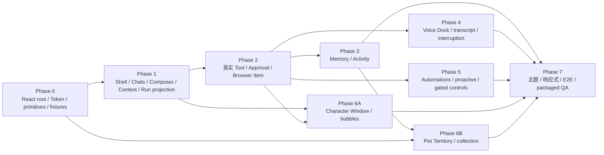

# CharaMate UI 与交互设计讨论稿

> 状态：Design Review
>
> 日期：2026-08-01
>
> 范围：主面板、Chats、Composer、Run 过程、语音、桌宠气泡、领地及其余一级页面

---

## 0. 设计结论

CharaMate 的 UI 采用“现代聊天产品的安静底盘 + 有温度的角色表达”：聊天和任务执行像 ChatGPT/Codex 一样清楚、可靠、低干扰；桌宠、语音和领地承担二次元角色感与展示感。

| 主题 | 设计决定 |
| --- | --- |
| 整体风格 | 柔和中性色、轻层次、圆角、少量角色强调色；不做游戏 HUD 式主界面 |
| Chats | 内容居中、助手无气泡、用户浅色气泡、过程与最终回答分层 |
| Composer | ChatGPT 式圆角容器；模式、模型、权限在输入区；统一 SVG 图标，不使用 Emoji |
| Run 过程 | 运行时展开，完成后折叠为“已处理 6分59秒 · 8 项”；内部 Tool 可二次展开 |
| 内容复制 | 问题、完整回答、代码块、公式、表格、命令和 Tool 输出都可独立复制 |
| 语音 | 空输入时显示圆形波形入口；语音中显示实时波形、状态和转写，可自然打断 |
| Multi-agent | 实验通过后才出现“允许并行协作”图标开关；开启不代表强制派生 |
| 像素风 | 集中用于桌宠和领地，不把聊天控件、表格、设置页全部像素化 |
| 普通用户界面 | 不显示 Harness 参数、Token 图表、检索算法和研发指标 |
| Renderer 技术 | React + CSS Modules/语义变量；Radix 负责无样式交互，Lucide 负责通用 SVG，TanStack Virtual 负责长列表 |
| 内容与像素 | remark/rehype + KaTeX + 懒加载 Mermaid；PixiJS 只负责桌宠与领地 sprite/scene |

---

## 1. 参考界面的可复用规律

### 1.1 ChatGPT 式 Composer

参考界面的关键不是某个麦克风符号，而是：

- 一个完整、稳定的圆角输入容器；
- 左侧附件入口，中间是没有多余边框的输入区；
- 模型/推理等少量上下文控件靠近发送区；
- 麦克风是细线图标，Realtime 是独立的高对比圆形波形按钮；
- 控件在一个视觉整体中，而不是散落在多个工具栏。

CharaMate 复用这种信息密度和层级，但不复制品牌颜色、图标或具体尺寸。

本文中的像素值、时长和断点是第一版高保真原型 Token，不是未经验证的产品常量。它们通过可用性、视觉密度与目标设备测试后只冻结一套。用户可在 Settings 选择产品定义的背景方案；背景方案只替换同一组语义颜色 Token，不为试验值建立密度档位、并行组件或布局分支。

### 1.2 Codex 式完成态

完成态的核心层级：

```text
用户问题
  ↓
已处理 6分59秒 · 8 项  [Chevron]
  ↓
最终回答
```

默认收起中间过程，让用户先读结果。点击“已处理”后，原位置展开用户可见的进度说明和真实执行事件；命令、文件编辑、搜索或 Tool Call 还能继续展开细节。

这里展示的是可公开的进度摘要、计划变化和真实 Tool 事件，不展示模型隐藏 chain-of-thought。

---

## 2. 视觉语言

### 2.1 风格关键词

- 清爽；
- 温暖；
- 轻盈；
- 可信；
- 有角色感但不幼稚；
- 内容优先；
- 长时间使用不疲劳。

### 2.2 颜色

先完成一套浅色组件树。默认使用低饱和雾蓝背景，并提供中性白、暖灰两个用户可选背景方案；三者只替换 `canvas`、`sidebar`、`surface-subtle` 等背景 Token，正文层级、语义状态色和组件结构保持一致。选择由 Renderer 本地记忆，接入 Settings 持久化后再迁移到同一设置真源。深色主题后续仍由同一语义 Token 派生。

| Token | 浅色建议 | 用途 |
| --- | --- | --- |
| `canvas` | `#F7F7F8` | 应用最底层背景 |
| `sidebar` | `#EAF3F7` | 默认雾蓝侧栏背景 |
| `surface` | `#FFFFFF` | 内容面、Composer、卡片 |
| `surface-subtle` | `#F0F1F3` | 用户气泡、折叠过程、hover |
| `text-primary` | `#202124` | 正文 |
| `text-secondary` | `#6F737A` | 元信息、时间、占位符 |
| `border` | `rgba(20, 24, 32, .09)` | 低对比边界 |
| `accent` | `#7C6CF2` | 角色主强调色 |
| `accent-soft` | `#EEEAFE` | 选中态背景 |
| `success` | `#2F9B67` | 成功 |
| `warning` | `#C88824` | 等待批准 |
| `danger` | `#D95959` | 失败、停止、拒绝 |

角色 Persona 可以替换 `accent` 与少量插画，但不能改变成功/警告/错误等语义颜色。

### 2.3 字体与排版

- UI：系统无衬线字体栈，中文优先系统苹方/微软雅黑；
- 正文：14–15 px，行高 1.52–1.6；
- 辅助信息：11–13 px，行高 1.4；Copy、Retry 等消息动作使用 11–12 px；
- 代码：系统等宽字体，13–13.5 px，行高 1.5；
- 长回答最大正文宽度建议 820 px；
- 标题不使用过重字重，避免文档式大面积黑块。

### 2.4 圆角、阴影与间距

| 元素 | 建议 |
| --- | --- |
| Composer | 26–30 px 圆角，展开时仍保持柔和 |
| 用户气泡 | 18 px |
| 普通卡片 | 14 px |
| 小 Chip/Button | 10–12 px |
| 主间距 | 8 px 网格；常用 8/12/16/24/32 |
| 阴影 | 只用于浮层和 Composer；内容卡片优先 border |

### 2.5 图标

- 使用一套一致的 SVG outline 图标，建议 20 px、1.75 px stroke、round cap；
- `Add`、`Mic`、`ArrowUp`、`Stop`、`Chevron`、`Copy`、`Check`、`Branch`、`Globe`、`Terminal` 等按语义命名；
- Realtime 主按钮使用定制波形 glyph；
- 不用 `🎙`、`➕`、`🤖` 等 Emoji 作为正式控件；
- 图标按钮必须有 tooltip、focus ring 和 disabled 状态。

### 2.6 Renderer 实现基线

- React 组件只消费 typed Preload snapshot/event，不直接访问 SQLite、Node、Electron API 或 Provider。
- Main/数据库是 Chat、Run、Approval、Voice 和窗口状态真源；Renderer 以 `useSyncExternalStore` 维护可重建领域投影，Composer/Popover/折叠等局部交互使用纯 reducer。
- 不在首版引入 Redux、Zustand 或第二套业务状态机；若实际复杂度证明需要，先更新权威设计并迁移为单一路径。
- CSS Modules 负责组件样式，CSS Custom Properties 承载本文件语义 Token；不同时建设 Tailwind、CSS-in-JS 主题或完整 UI 套件。
- Radix Primitives 只提供 Dialog、Popover、Menu、Tooltip 等无样式行为；所有视觉仍由 CharaMate Token 控制。
- Lucide 提供通用 outline 图标；Voice waveform、角色、领地和产品专用语义图标使用自有 SVG/Pixi asset。
- TanStack Virtual 负责消息、Memory、Activity 等长列表；靠近底部、动态行高、焦点和滚动锚点由 CharaMate adapter 统一处理。
- 消息使用 `react-markdown` + remark/rehype pipeline，GFM、math、KaTeX、允许列表、链接策略和复制源集中配置；Shiki 与 Mermaid 只在出现对应 block 时懒加载。
- PixiJS 只在 Character Window 和 Territory canvas 内运行；React 管理页面/浮层/可访问控件，PixiJS 管理 atlas、sprite、场景层、pointer 和动画 tick，二者不重复保存业务状态。
- UI component test 使用 Vitest + Testing Library；跨 Electron 窗口、Preload、重启和拖动使用 Playwright Electron。Voice 真实打断、音频和图像生成另列 Live 验收。

---

## 3. 主面板结构

### 3.1 默认窗口

- 默认：约 `1180 × 800`；
- 最小：约 `900 × 640`；
- 记住用户尺寸、位置和侧栏展开状态；
- macOS 使用融合标题栏，但保留足够拖动区域；
- 主内容区域不因窗口变宽而无限拉长，聊天正文保持居中最大宽度。

### 3.2 App Shell

```text
┌──────────────────────────────────────────────────────────────┐
│ Window drag region                              Window actions│
├───────────────┬──────────────────────────────────────────────┤
│ CharaMate     │ Page header                                   │
│ [New chat]    ├──────────────────────────────────────────────┤
│               │                                              │
│ Chats         │              Page content                    │
│ Territory     │                                              │
│ Memory        │                                              │
│ Activity      │                                              │
│ Automations   │                                              │
│               │                                              │
│ Recent chats  │                                              │
│               │                                              │
│ Settings      │                                              │
└───────────────┴──────────────────────────────────────────────┘
```

侧栏建议 248–264 px，可折叠为 64 px 图标栏。产品内一级页面显示名统一使用英文：Chats、Territory、Memory、Activity、Automations、Settings。

- 顶部是当前桌宠的图片槽、产品名和新建 Chat；图片槽使用原生图片源，可随当前 Persona/桌宠切换 PNG、WebP、GIF 或 SVG；
- 中部是六个一级页面；
- Chats 页面在导航下显示搜索、置顶和最近会话；
- 底部是当前 Persona，以及处于同一行的 Settings 和侧栏折叠按钮；
- 不再增加第二条常驻导航栏，避免像研发 IDE。

### 3.3 Page Header

Header 高度约 52 px，只放当前页面真正需要的动作：

- Chats：会话名、重命名、归档、更多；
- 领地：场景名、布置/游览切换、收藏库；
- Memory：搜索、筛选；
- Activity：日期、暂停/恢复；
- Automations：新建任务；
- Settings：不需要额外大标题工具栏。

---

## 4. Chats 页面

### 4.1 内容布局

```text
┌──────────────────────────────────────────────────────┐
│ Conversation header                                  │
├──────────────────────────────────────────────────────┤
│                                                      │
│        User message                                  │
│                                                      │
│        Run process                                   │
│                                                      │
│        Assistant answer                              │
│                                                      │
│                                                      │
├──────────────────────────────────────────────────────┤
│                 Composer                             │
└──────────────────────────────────────────────────────┘
```

- 消息列表虚拟滚动，但靠近底部时流式内容稳定跟随；
- 用户主动向上滚动后不强制拉回，底部显示“回到最新”；
- Composer 固定在底部，下面保留 12–20 px 安全间距；
- 内容区左右留白随窗口变化，正文最大 820 px，Composer 最大 900 px。

### 4.2 消息造型

用户消息：

- 右侧浅灰/浅强调色气泡；
- 最大宽度约内容区 72%；
- 保留换行、附件卡片和代码；
- 悬停显示 Copy、Edit、More。

助手消息：

- 左侧无大气泡，直接落在内容背景上；
- 不显示对话头像或 Persona 标记，使用内容位置和上下留白区分轮次；
- 消息底部以紧凑弱化样式显示 Copy、Retry、Quote、More；
- Tool 过程和最终回答分开，不能混成一个巨大灰框。

### 4.3 空状态

首次进入 Chats：

- 中心显示当前角色小插画和一句自然问候；
- 下方给 3–4 个真正有用的建议，例如“聊聊今天”“帮我处理电脑上的任务”“从记忆里找一件事”；
- 建议卡点击后只填入 Composer，不自动发送；
- 不放产品指标、教程长文或权限矩阵。

---

## 5. Composer

### 5.1 基本形态

Composer 是一个整体，不在输入框外再堆叠多条工具栏：

```text
┌────────────────────────────────────────────────────────────┐
│ [Add]  问问 CharaMate……                                    │
│                                                            │
│ [Chat ▾] [Model ▾] [请求批准 ▾] [Parallel]    [Mic] [Voice] │
└────────────────────────────────────────────────────────────┘
```

状态自适应：

- 空输入：右下是高对比圆形 `Voice` 波形按钮；
- 有文本：`Voice` 原位变为圆形 `Send` 箭头；
- Run 进行中：发送位变为 `Stop` 方块；
- 多行文本/附件：Composer 向上生长，控制条保持底部；
- 最大高度约内容区 40%，超过后输入区内部滚动。

### 5.2 控件顺序

左侧：

1. `Add`：文件、图片、文件夹、当前截图；
2. `Chat / Agent` 模式；
3. `Model`；
4. Agent 模式的权限；
5. 实验通过后才出现的并行协作。

右侧：

1. `Mic`：按住说话或录入一段单轮语音；
2. `Voice`：进入全双工 Realtime；
3. `Send / Stop`：根据输入与运行状态切换。

窄窗口中，Model 和权限进入一个 `More controls` popover，但 Chat/Agent 与 Send/Voice 始终直接可见。

### 5.3 Chat / Agent

模式是一个带文字的紧凑 Pill：

```text
[ Chat  v ]    [ Agent  v ]
```

- Chat 使用对话气泡 icon；
- Agent 使用 spark/terminal 组合 icon；
- 切换时在 popover 中用一句话解释差异；
- Chat 发现需要执行时，回答中给“一键切换到 Agent”，不能静默升级；
- Agent 选中后才显示权限和可选并行协作。

### 5.4 权限

权限 Pill 只显示当前值：

- 请求批准；
- 替我审批；
- 完全访问。

Popover 中每项只有一行说明，不展示风险分值、规则树或几十个 Tool 开关。当前选择随本轮 Run 快照保存。

### 5.5 并行协作

只有实验通过并正式发布时才显示：

- 图标使用 `Branch` 或双节点协作图形；
- tooltip：“允许主 Agent 在确有独立子任务时并行协作”；
- 关闭是中性灰，开启使用 `accent-soft` 背景与强调色描边；
- 开启不保证派生，简单问题仍由单 Agent 回答；
- 实际派生后，Composer 不持续闪烁，过程区显示 Subtask Item 即可。

### 5.6 附件

- 图片显示缩略图；
- 文件显示类型、名称和大小；
- 文件夹显示名称与“将按需读取”；
- 每个附件可移除，错误显示在对应卡片上；
- 大附件上传/索引进度不占用发送按钮；
- 拖入时 Composer 外圈出现轻量 drop zone，不覆盖整个窗口。

### 5.7 键盘

- `Enter` 发送；
- `Shift+Enter` 换行；
- 输入法候选打开时 Enter 不发送；
- `Esc` 关闭当前 popover，第二次 Esc 不擅自停止 Run；
- Stop 必须由显式按钮或清晰快捷键触发。

---

## 6. Markdown、代码、公式与复制

### 6.1 完整回答复制

助手回答底部的 Copy 复制源 Markdown：

- 保留标题、列表、表格和引用；
- 保留 fenced code block 与语言；
- 保留 `$...$` / `$$...$$` TeX；
- 文件卡复制用户可理解的名称，不嵌入内部数据库 ID；
- 成功后 Copy 图标短暂变为 Check，不弹 toast 堆叠。

用户问题也有独立 Copy；问题和回答不能只能靠鼠标框选。

### 6.2 代码块

```text
┌─ typescript ───────────────────────────── [Copy] ┐
│ interface RunItem {                              │
│   id: string                                     │
│ }                                                │
└─────────────────────────────────────────────────┘
```

- 顶栏显示语言与 Copy；
- 代码正文可横向滚动；
- 行号默认关闭，长日志/补丁按类型决定是否显示；
- Copy 只复制代码正文；
- 超长块先显示合理高度，可展开到完整内容；
- 流式未闭合时使用临时渲染，完成后确定性重渲染。

### 6.3 LaTeX

- 行内和块级公式由 KaTeX 渲染；
- hover/focus 出现 `Copy TeX`；
- 复制的是原 TeX，不是不可读的视觉字符；
- 渲染失败时显示源码和错误提示，不能让整条消息空白；
- 块公式在窄窗口可横向滚动。

### 6.4 表格、引用与链接

- 表格上方提供 Copy Markdown，复制为原始表格源码；
- 外链悬停显示目标域名；
- 引用和来源卡片与正文在视觉上相邻；
- Mermaid 有“图 / 源码”切换和源码复制。

---

## 7. Run 过程与 Tool 详情

### 7.1 默认折叠

完成后：

```text
已处理 6分59秒 · 8 项                                      [Chevron]
────────────────────────────────────────────────────────────

最终回答从这里开始……
```

- 整行可点击，Chevron 表示展开方向；
- “已处理”使用次要文字，不能抢过最终回答；
- hover 时背景轻微变化；
- 键盘 focus 后 Enter/Space 可展开；
- 失败或仍等待批准时不强制收起关键 Item。

### 7.2 展开层级

第一层是按时间排列的用户可理解过程：

```text
已处理 6分59秒 · 8 项                                      [Chevron Up]

我先确认相关文档和状态，再整理实现边界。

[Search] 已读取 3 个文件                                   [Chevron]
[Edit]   已修改产品设计文档                                 [Chevron]
[Run]    已运行类型检查                                     [Chevron]

我发现语音和 Agent 共用同一个 Run，可以继续收敛状态机。
```

第二层是某个 Tool/Command 的真实细节：

```text
[Run] 已运行命令 · 12.4s                                   [Chevron Up]
  Working directory  /project
  Command            npm run typecheck                     [Copy]
  Exit code           0
  Output              ...                                  [Expand]
```

### 7.3 Item 视觉

| Item | 摘要标题 | 展开内容 |
| --- | --- | --- |
| Progress | 正在查找相关文件 | 用户可见进度摘要 |
| Plan | 已更新计划 | 步骤与状态 |
| Search/Read | 已读取 3 个文件 | 文件列表、查询词 |
| Command | 已运行测试 | 命令、cwd、exit、输出 |
| File change | 已修改 2 个文件 | 文件、摘要、diff 入口 |
| Browser | 已查看页面 | 域名、动作、结果 |
| Tool/MCP | 已调用日历 | 参数、结构化结果 |
| Approval | 等待你确认 | 动作、允许/拒绝 |
| Subtask（仅 `MULTI-AGENT` 晋级后） | 2 个子任务已完成 | 子任务状态与结果；未晋级时无此 Item 类型与组件 |
| Context compaction | 已整理较早上下文 | 仅显示发生了压缩，不显示隐藏推理 |
| Error | 某一步失败 | 错误、已尝试恢复、继续动作 |

### 7.4 运行中

- 当前 Item 展开并显示 spinner/progress；
- 已完成 Item 变为低对比 Check；
- 输出 delta 合批更新，避免整页跳动；
- 新的简短 progress 可以流式出现，但不展示隐藏推理；
- Tool 等待较久时显示耗时，不伪造百分比；
- 用户 Stop 后立即显示“正在停止”，完成清理后变为“已停止”。

### 7.5 复制与跳转

用户可以复制：

- 单条命令；
- 当前 cwd + 命令；
- Tool JSON 参数或结果；
- 完整可见过程；
- 文件路径；
- 错误详情。

文件 Item 可打开文件，Browser Item 可回到受管页面，失败 Item 可从该边界继续。

---

## 8. Approval

### 8.1 Chat 内 Approval Card

```text
┌──────────────────────────────────────────────────────┐
│ 需要你的确认                                         │
│ 即将运行：npm install package-name                   │
│ 工作目录：project                                    │
│                                                      │
│ [拒绝]                         [允许一次] [打开详情]  │
└──────────────────────────────────────────────────────┘
```

- `允许一次`为主按钮，`拒绝`为次按钮；
- 长命令默认摘要，详情中看完整内容；
- 决定后卡片变成只读结果，显示时间；
- 审批只绑定一个 Run Item，不在气泡和 Chat 分别维护状态。

### 8.2 桌宠气泡投影

桌宠气泡只显示一行动作摘要和“允许一次 / 拒绝 / 查看详情”。复杂动作点击后打开 Chat 的同一 Approval Card。处理完成或过期后，气泡按钮立即失效。

---

## 9. Realtime 语音 UI

### 9.1 进入语音

空 Composer 右侧的白色/强调色圆形波形按钮进入 Realtime。按钮不是 Emoji，而是由 4–5 根圆角竖线组成的动态 SVG 波形。

连接过程：

```text
Voice button → 正在连接 → 正在聆听
```

若连接失败，原位显示简短错误和“重试”，不弹出占满页面的模态框。

### 9.2 语音中的 Composer

进入语音后 Composer 变成 Voice Dock：

```text
┌────────────────────────────────────────────────────────────┐
│ [Mute]  ∿∿∿∿  正在聆听…  实时用户转写             [End]    │
│          角色正在思考 / 正在调用日历 / 正在说话             │
└────────────────────────────────────────────────────────────┘
```

- 波形响应用户输入或助手播放，颜色区分输入/输出；
- 主状态只有连接、聆听、思考、使用工具、等待批准、说话；
- 实时转写是可读文本，不做夸张字幕动画；
- 用户开始说话时助手音频立即淡出/停止，状态切回聆听；
- `Mute` 只停麦，`End` 结束 Session；
- 等待 Approval 时 Voice Dock 保持连接，Chat 中定位 Approval Card。

### 9.3 文字与音频同步

- 用户转写和助手转写实时进入当前 Chat；
- 面向用户的自然语言同时显示并播放；
- Tool 日志、JSON、命令和代码块不朗读；
- 被用户打断后，历史消息标记“已打断”并保存音频播放边界，不把未听到的尾巴显示成完整回答；音频与文字无法逐字对齐时不伪装成精确字符边界；
- 语音结束后 Composer 恢复普通形态，完整过程仍可展开。

### 9.4 桌宠联动

- `listening`：角色轻微呼吸/注意动画；
- `thinking/acting`：使用统一等待或工作动画；
- `speaking`：口型/说话动画与音频 envelope 轻量同步；
- `waiting_approval`：气泡显示确认入口；
- 角色动画不影响 Chat 中的 Run 真源。

---

## 10. 托盘与短提示音

托盘用于在主面板关闭或后台时保持状态可见：

- idle：正常图标；
- running：轻量活动标记；
- waiting approval：醒目标记和 tooltip；
- completed/failed：短暂显示结果标记，点击进入对应 Chat，随后恢复普通图标。

短提示音是 100–300 ms 的非语言 earcon，只提示需要批准、完成或失败。它和助手实时说话完全不同：Realtime 语音播放自然语言，earcon 只传达应用状态；语音正在播放时不叠加完成音。

---

## 11. 其余一级页面

### 11.1 领地

领地是视觉展示页，应与工具型页面明显不同：

- 主区域占满可用空间，展示像素场景；
- 角色可走动，点击地面移动，拖动物件布置；
- 底部/右侧抽屉是收藏库，不常驻遮挡场景；
- 点击物件显示短描述、来源时间和“查看记忆”；
- 布置模式出现网格、旋转、收回；游览模式隐藏编辑控件；
- 场景加载先显示本地基础图，不因生图等待而空白；
- 生成新物件使用有质感的 reveal 动画，但避免老虎机式奖励表达。

### 11.2 Memory

桌面宽度足够时采用列表 + 详情双栏：

```text
Search / filters
┌────────────────────┬──────────────────────────────────┐
│ Memory list        │ Content / source / revisions     │
│                    │ profile / related entities       │
└────────────────────┴──────────────────────────────────┘
```

- 默认先显示内容和来源，不先展示向量分数；
- 编辑、纠正、pin、归档、删除在详情页；
- Revision 使用时间线；
- 只有 `MEMORY-GRAPH` Decision 晋级时才显示轻量关系视图；否则不保留空入口或图谱组件；
- “放入领地”是明确动作。

### 11.3 Activity

- 顶部是一键暂停/恢复和日期；
- 主体是 Episode 时间线，不是每秒事件日志；
- 每个 Episode 显示应用/网站摘要、持续时间、少量截图和蒸馏结果；
- 原始数据已清理时显示稳定说明，不保留坏缩略图；
- 周期摘要与跨周期趋势比应用时长图更靠前；
- 数据占用和“立即清理”放在页面次要区域。

### 11.4 Automations

- 卡片显示名称、下次运行、状态、最近结果；
- 新建使用单页轻表单：目标、时间、Chat/Agent、权限；
- 每次运行点击后进入对应 Chat Run；
- 等待批准与失败使用和 Chats 相同的状态组件。

### 11.5 Settings

左侧分组、右侧表单，避免一页滚到底：

- Appearance（背景方案；完整深色主题在 Phase 7 验收）；
- Character；
- Voice；
- Models；
- Agent；
- Browser & Computer；
- Skills；
- MCP；
- Activity；
- Data。

Settings 只放用户真正会改变的选择。Embedding 档位、RRF、topK、WAL、Harness 步数、Realtime transport 和开发指标都不出现。

Models 使用和 Codex 设置一致的紧凑密度：分区由细分隔线和小标题组织，不把每个动作做成大卡片；普通输入、选择器和按钮高度为 `30–32px`，按钮按文字内容收缩，表单纵向间距为 `10–12px`。Provider 列表保持窄列，主表单不使用夸张圆角或大面积留白。Chat 的“测试连接 / 加载模型”、Realtime 的“测试 Realtime”、Image 的“测试 Image”分别贴近所属配置。Realtime 与 Image 明示复用当前 Provider Profile 上方的 API Key，不重复展示密钥输入；不同密钥必须拆为另一个 Profile。Azure API Version 标成 Chat/Image 可选项，Realtime-only Profile 可以留空；Image Endpoint 以 `/images/generations` 作为同一 deployment 的唯一配置基准，自带的 `api-version` 继续保留并优先用于 Image 验证。界面要说明这套配置同时服务于新图生成和基于已有图的继续编辑；Phase 6 Adapter 分别派生 `/images/generations` 与同级 `/images/edits`，不让用户重复填写 Endpoint 或 Key。Azure Realtime Endpoint 的示例只到 `/openai/v1/realtime`，API 类型必须为 Azure OpenAI，Model 明示为 deployment 名称；连接时该字段覆盖 Endpoint 中已有的 `model` 查询值。若 Azure 域名误选 OpenAI-compatible，测试必须在联网前给出改正提示。Image 测试旁必须说明只验证 URL、凭据和模型，不调用可能计费的生成或编辑请求。

---

## 12. 动效与反馈

- 普通 hover/fade：120–160 ms；
- 折叠过程：160–220 ms，长内容使用高度/透明度组合并避免昂贵全量重排；
- Voice 波形使用音频 envelope 驱动，不做随机高频闪烁；
- 新消息进入不使用弹跳；
- 领地物件生成可使用 600–900 ms reveal；
- 用户启用减少动态效果后，保留状态变化但移除位移和连续波形动画。

所有异步动作必须有三类反馈：已接收、进行中、完成/失败。不能让一次点击只靠日志证明发生了。

---

## 13. 组件结构

```text
MainPanelRoot
└─ AppShell
   ├─ Sidebar
   ├─ PageHeader
   └─ PageOutlet
      ├─ ChatsPage
      │  ├─ VirtualMessageList
      │  │  ├─ UserMessage
      │  │  ├─ RunProcess
      │  │  │  ├─ RunSummaryRow
      │  │  │  ├─ ProgressItem
      │  │  │  ├─ ToolItem
      │  │  │  ├─ CommandItem
      │  │  │  ├─ ApprovalItem
      │  │  │  └─ SubtaskItem  # 仅 MULTI-AGENT 晋级后存在
      │  │  └─ AssistantMessage
      │  │     ├─ MarkdownRenderer
      │  │     ├─ CodeBlock
      │  │     ├─ MathBlock
      │  │     ├─ MermaidBlock
      │  │     └─ MessageActions
      │  └─ Composer
      │     ├─ AttachmentTray
      │     ├─ ComposerEditor
      │     ├─ ModePicker
      │     ├─ ModelPicker
      │     ├─ ApprovalPicker
      │     ├─ ParallelToggle  # 仅 MULTI-AGENT 晋级后存在
      │     ├─ MicButton
      │     ├─ SendVoiceStopButton
      │     └─ VoiceDock
      ├─ TerritoryPage
      │  ├─ PixiTerritoryCanvas
      │  └─ AccessibleSceneControls
      ├─ MemoryPage
      ├─ ActivityPage
      ├─ AutomationsPage
      └─ SettingsPage

CharacterWindowRoot
├─ PixiPetCanvas
└─ BubbleProjection
```

关键约束：

- `RunProcess` 只消费结构化 Run Event，不解析助手正文猜测状态；
- Copy 动作由各内容组件提供统一 `CopyPayload`；
- Composer 控件状态来自一个 reducer/state machine，避免多个按钮各自猜当前模式；
- Voice Dock 是 Composer 的状态，不建立另一套 Chat 页面；
- Tool Item 共享骨架，只由 adapter 提供 icon、摘要和详情。
- `MainPanelRoot` 与 `CharacterWindowRoot` 可以是两个 React root，但只订阅同一 Main event contract；气泡和 Chat 不各自维护 Approval。
- `PixiTerritoryCanvas`/`PixiPetCanvas` 接受序列化 scene/sprite projection，不调用领域 service；React 负责所有文字、按钮、表单、焦点和辅助技术语义。
- `VirtualMessageList` 负责滚动锚点和动态高度；它不能通过卸载正在输入、播放或等待批准的组件丢失局部交互状态。

---

## 14. 响应式与窗口状态

| 宽度 | 行为 |
| --- | --- |
| `≥ 1180` | 完整侧栏、820 px 内容、所有 Composer 主要 Pill |
| `900–1179` | 侧栏可折叠，Model/权限使用短标签 |
| `< 900` | 进入最小布局：图标侧栏、部分 Composer 控件进入 More |

- 消息内容绝不因侧栏开关改变阅读位置过多；
- 代码、公式和表格在自己的容器横向滚动；
- Approval 主按钮始终在可见区域；
- 领地在最小窗口保持场景比例，收藏库改为底部 Sheet；
- 桌宠独立透明窗口不继承主面板最小尺寸。

---

## 15. 可用性验收

### 15.1 Chats

- 新用户能在 10 秒内找到附件、Chat/Agent、语音和发送；
- 单行输入不显得像复杂 IDE，多行/附件时控件不跳位；
- 用户能复制问题、完整回答、任意代码块和公式源码；
- Run 完成后默认折叠，展开后能定位命令、文件、Tool 和错误；
- 隐藏推理不会出现在 UI，真实动作不会丢失。

### 15.2 Agent

- 权限在 Agent 模式始终可见，Chat 模式不占空间；
- Stop 后立即反馈并最终落到 cancelled/interrupted 状态；
- Approval 气泡和 Chat 卡片永远指向同一决定；
- Multi-agent 开关若存在，用户能理解它是“允许”而不是“强制”。

### 15.3 Voice

- 空输入时语音入口比发送箭头更明确；
- 连接、聆听、工具、等待批准和说话状态不会混淆；
- 用户插话后本地音频停止足够快，不出现两个回答叠音；
- 实际听到的助手内容与 Chat 持久化文本一致；
- 结束语音后仍能从普通文字 Composer 延续同一会话。

### 15.4 视觉

- 浅色和深色下正文、代码、公式、禁用状态均达到可读对比；
- 所有正式控件使用 SVG 图标，不使用 Emoji 替代图标；
- 像素风不会降低 Settings、Memory 和长回答的可读性；
- 1440p 与 Retina 缩放下边框、图标和 sprite 都清晰。

---

## 16. 第一版高保真原型基线

第一轮原型只实现下面这一套组件和布局，不并行实现主题组件或布局分支：

1. 侧栏使用 256 px 单侧栏，而不是“图标栏 + 会话栏”双侧栏；
2. 浅色为首个设计基线，默认雾蓝背景；Settings 可切换中性白、暖灰背景，三者共用语义 Token 和同一组件树；
3. Composer 采用两层自适应布局：输入内容在上，模式/模型/权限与语音在下；
4. 空输入显示 Voice 波形圆钮，有文本后原位变 Send；
5. 助手消息无气泡，用户消息使用浅灰圆角气泡；
6. 对话不显示头像；正文采用紧凑排版，Copy、Retry 等动作保持次要层级；
7. 完成过程默认折叠，内部 Tool 使用两级展开；
8. 领地使用完整像素场景，其他页面只保留轻量角色插画和强调色。

评审只观察三组关键画面：Chats 空状态、Agent 执行完成态、Realtime 说话/打断态。可用性与视觉测试完成后，直接修改本节和 Design Token 为胜者，并删除被否决的组件/CSS 分支；Memory、Activity 和 Settings 复用同一视觉系统。

---

## 17. UI 实施依赖与交付顺序

UI 跟随产品 Phase DAG，但不需要等待所有 Main 逻辑才开始。共享 TypeBox event fixture 冻结后，Renderer work package 可以独立实现和做 component test；真实服务接入由对应领域 integration owner 完成。



交付规则：

- Phase 0 只创建被 Shell/Chats 首个 owner 使用的 React root、Token、Radix wrapper、Lucide mapping、copy payload、event projection 和 test harness，不预建全部页面组件。
- Phase 1 使用确定性 fixture 完成三组高保真关键画面，并接入真实 Chat/Run snapshot；UI fixture 与 shared Schema 必须由 contract test 证明一致。
- Phase 2 将 Tool/Command/File/Browser/MCP/Approval 的真实 Item adapter 接入同一骨架；不为不同能力复制 RunProcess。
- Memory/Activity、Voice、Automation 与 Character/Territory 是可并行的功能分支，但不能并行修改 Composer reducer、Run Item union 或共享视觉 Token；这些文件由指定 integration owner 串行变更。
- `ParallelToggle`、`SubtaskItem`、Graph view 和 self-evolution candidate UI 只有对应 Decision 晋级后才创建；未晋级时 fixture、组件、route 和 CSS 都不存在。
- Voice Architecture/Transport 未决期间可以用规范化 Voice event fixture验证 Voice Dock，但不得创建两个 Driver 对应的 UI 状态分支。
- PixiJS canvas 的视觉回归、Retina scaling、sprite atlas 与 placement 使用截图/确定性 scene fixture；Memory 来源、Approval、按钮和键盘焦点仍由 React/DOM 测试。
- Phase 7 必须同时验证普通开发窗口与 Forge packaged app；Playwright Electron 的 experimental 状态由 Phase 0 兼容性检查承担，不另保留第二个桌面 E2E 框架。
