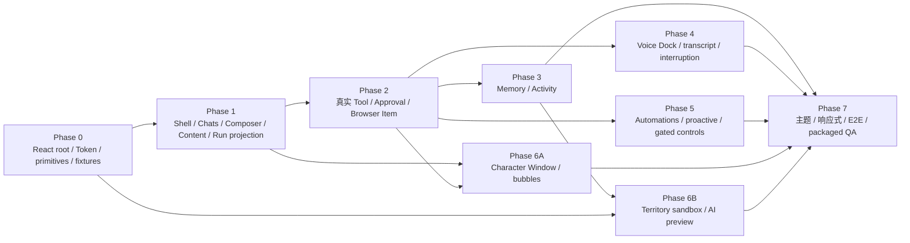

# CharaMate UI 与交互设计讨论稿

> 状态：Design Review
>
> 日期：2026-08-01
>
> 范围：主面板、Chats、Composer、Run 过程、语音、桌宠气泡、领地及其余一级页面

---

## 0. 设计结论

CharaMate 的 UI 采用“现代聊天产品的安静底盘 + 有温度的角色表达”：聊天和任务执行像 ChatGPT/Codex 一样清楚、可靠、低干扰；桌宠、语音和领地承担二次元角色感与展示感。

| 主题 | 设计决定 |
| --- | --- |
| 整体风格 | 柔和中性色、轻层次、圆角、少量角色强调色；不做游戏 HUD 式主界面 |
| Chats | 内容居中、助手无气泡、用户浅色气泡、过程与最终回答分层 |
| Composer | ChatGPT 式圆角容器；模式、模型、权限在输入区；统一 SVG 图标，不使用 Emoji |
| Run 过程 | 只有存在用户可理解的真实执行过程时才显示；运行时展开，完成后折叠为“已处理 6分59秒 · 8 项”，可见 Tool 可二次展开 |
| 内容复制 | 问题、完整回答、代码块、公式、表格、命令和 Tool 输出都可独立复制 |
| 语音 | 空输入时显示圆形波形入口；语音中显示实时波形、状态和转写，可自然打断 |
| Multi-agent | 不增加 Composer 开关；Agent 自主决定是否调用，实际派生只在 Run 过程显示可折叠 Subtask Item |
| 像素风 | 集中用于桌宠和领地，不把聊天控件、表格、设置页全部像素化 |
| 普通用户界面 | 不显示 Harness 参数、Token 图表、检索算法和研发指标 |
| Renderer 技术 | React + CSS Modules/语义变量；Radix 负责无样式交互，Lucide 负责通用 SVG，TanStack Virtual 负责长列表 |
| 内容与像素 | remark/rehype + KaTeX + 懒加载 Mermaid；PixiJS 只负责桌宠与领地 sprite/scene |

---

## 1. 参考界面的可复用规律

### 1.1 ChatGPT 式 Composer

参考界面的关键不是某个麦克风符号，而是：

- 一个完整、稳定的圆角输入容器；
- 左侧附件入口，中间是没有多余边框的输入区；
- 模型/推理等少量上下文控件靠近发送区；
- 麦克风是细线图标，Realtime 是独立的高对比圆形波形按钮；
- 控件在一个视觉整体中，而不是散落在多个工具栏。

CharaMate 复用这种信息密度和层级，但不复制品牌颜色、图标或具体尺寸。

本文中的像素值、时长和断点是第一版高保真原型 Token，不是未经验证的产品常量。它们通过可用性、视觉密度与目标设备测试后只冻结一套。用户可在 Settings 选择产品定义的背景方案；背景方案只替换同一组语义颜色 Token，不为试验值建立密度档位、并行组件或布局分支。

### 1.2 Codex 式完成态

完成态的核心层级：

```text
用户问题
  ↓
已处理 6分59秒 · 8 项  [Chevron]
  ↓
最终回答
```

默认收起中间过程，让用户先读结果。点击“已处理”后，原位置展开用户可见的进度说明和真实执行事件；命令、文件编辑、搜索或 Tool Call 还能继续展开细节。只有用户/助手消息或 Memory、Journey 等内部状态维护的普通 Chat 不生成空的“已处理”行，也不把消息数量伪装成过程项数。

这里展示的是可公开的进度摘要、计划变化和真实 Tool 事件，不展示模型隐藏 chain-of-thought。

---

## 2. 视觉语言

### 2.1 风格关键词

- 清爽；
- 温暖；
- 轻盈；
- 可信；
- 有角色感但不幼稚；
- 内容优先；
- 长时间使用不疲劳。

### 2.2 颜色

先完成一套浅色组件树。默认使用低饱和雾蓝背景，并提供中性白、暖灰两个用户可选背景方案；三者只替换 `canvas`、`sidebar`、`surface-subtle` 等背景 Token，正文层级、语义状态色和组件结构保持一致。选择由 Renderer 本地记忆，接入 Settings 持久化后再迁移到同一设置真源。深色主题后续仍由同一语义 Token 派生。

| Token | 浅色建议 | 用途 |
| --- | --- | --- |
| `canvas` | `#F7F7F8` | 应用最底层背景 |
| `sidebar` | `#EAF3F7` | 默认雾蓝侧栏背景 |
| `surface` | `#FFFFFF` | 内容面、Composer、卡片 |
| `surface-subtle` | `#F0F1F3` | 用户气泡、折叠过程、hover |
| `text-primary` | `#202124` | 正文 |
| `text-secondary` | `#6F737A` | 元信息、时间、占位符 |
| `border` | `rgba(20, 24, 32, .09)` | 低对比边界 |
| `accent` | `#7C6CF2` | 角色主强调色 |
| `accent-soft` | `#EEEAFE` | 选中态背景 |
| `success` | `#2F9B67` | 成功 |
| `warning` | `#C88824` | 等待批准 |
| `danger` | `#D95959` | 失败、停止、拒绝 |

角色 Persona 可以替换 `accent` 与少量插画，但不能改变成功/警告/错误等语义颜色。

### 2.3 字体与排版

- UI：系统无衬线字体栈，中文优先系统苹方/微软雅黑；
- 正文：14–15 px，行高 1.52–1.6；
- 辅助信息：11–13 px，行高 1.4；Copy、Retry 等消息动作使用 11–12 px；
- 代码：系统等宽字体，13–13.5 px，行高 1.5；
- 长回答最大正文宽度建议 820 px；
- 标题不使用过重字重，避免文档式大面积黑块。

### 2.4 圆角、阴影与间距

| 元素 | 建议 |
| --- | --- |
| Composer | 26–30 px 圆角，展开时仍保持柔和 |
| 用户气泡 | 18 px |
| 普通卡片 | 14 px |
| 小 Chip/Button | 10–12 px |
| 主间距 | 8 px 网格；常用 8/12/16/24/32 |
| 阴影 | 只用于浮层和 Composer；内容卡片优先 border |

### 2.5 图标

- 使用一套一致的 SVG outline 图标，建议 20 px、1.75 px stroke、round cap；
- `Add`、`Mic`、`ArrowUp`、`Stop`、`Chevron`、`Copy`、`Check`、`Branch`、`Globe`、`Terminal` 等按语义命名；
- Realtime 主按钮使用定制波形 glyph；
- 不用 `🎙`、`➕`、`🤖` 等 Emoji 作为正式控件；
- 图标按钮必须有 tooltip、focus ring 和 disabled 状态。

### 2.6 Renderer 实现基线

- React 组件只消费 typed Preload snapshot/event，不直接访问 SQLite、Node、Electron API 或 Provider。
- Main/数据库是 Chat、Run、Approval、Voice 和窗口状态真源；Renderer 以 `useSyncExternalStore` 维护可重建领域投影，Composer/Popover/折叠等局部交互使用纯 reducer。
- 不在首版引入 Redux、Zustand 或第二套业务状态机；若实际复杂度证明需要，先更新权威设计并迁移为单一路径。
- CSS Modules 负责组件样式，CSS Custom Properties 承载本文件语义 Token；不同时建设 Tailwind、CSS-in-JS 主题或完整 UI 套件。
- Radix Primitives 只提供 Dialog、Popover、Menu、Tooltip 等无样式行为；所有视觉仍由 CharaMate Token 控制。
- Lucide 提供通用 outline 图标；Voice waveform、角色、领地和产品专用语义图标使用自有 SVG/Pixi asset。
- TanStack Virtual 负责消息、Memory、Activity 等长列表；靠近底部、动态行高、焦点和滚动锚点由 CharaMate adapter 统一处理。
- 消息使用 `react-markdown` + remark/rehype pipeline，GFM、CJK 紧邻标点/正文的强调与删除线、math、KaTeX、允许列表、链接策略和复制源集中配置；兼容解析不改写源 Markdown，Shiki 与 Mermaid 只在出现对应 block 时懒加载。
- PixiJS 只在 Character Window 和 Territory canvas 内运行；React 管理页面/浮层/可访问控件，PixiJS 管理 atlas、sprite、场景层、pointer 和动画 tick，二者不重复保存业务状态。
- UI component test 使用 Vitest + Testing Library；跨 Electron 窗口、Preload、重启和拖动使用 Playwright Electron。Voice 真实打断、音频和图像生成另列 Live 验收。

---

## 3. 主面板结构

### 3.1 默认窗口

- 默认：约 `1180 × 800`；
- 最小：约 `900 × 640`；
- 记住用户尺寸、位置和侧栏展开状态；
- macOS 使用融合标题栏，但保留足够拖动区域；
- 主内容区域不因窗口变宽而无限拉长，聊天正文保持居中最大宽度。

### 3.2 App Shell

```text
┌──────────────────────────────────────────────────────────────┐
│               │ Optional shared-presence hint                 │
│ CharaMate     ├──────────────────────────────────────────────┤
│ [New chat]    │                                              │
│               │                                              │
│ Chats         │              Page content                    │
│ Territory     │                                              │
│ Memory        │                                              │
│ Activity      │                                              │
│ Automations   │                                              │
│               │                                              │
│ Recent chats  │                                              │
│               │                                              │
│ Settings      │                                              │
└───────────────┴──────────────────────────────────────────────┘
```

侧栏建议 248–264 px，可折叠为 64 px 图标栏。产品内一级页面显示名统一使用英文：Chats、Territory、Memory、Activity、Automations、Settings。

- 顶部是当前桌宠的图片槽、产品名和新建 Chat；点击新建只在右侧打开空白草稿，不向左侧插入占位会话，首次发送后才显示真实会话；若 Voice 正在进行，则先结束当前 Voice Session，成功后再打开草稿，结束失败时按钮不得悄悄切走；图片槽使用原生图片源，可随当前 Persona/桌宠切换 PNG、WebP、GIF 或 SVG；
- 中部是六个一级页面；
- Chats 页面在导航下显示搜索、置顶和最近会话；会话数量超过可用高度时只滚动会话区，不扩张侧栏或覆盖底部操作；
- 底部是当前 Persona，以及处于同一行的 Settings 和侧栏折叠按钮；
- 不再增加第二条常驻导航栏，避免像研发 IDE。

### 3.3 页面动作归属

主内容区不设置跨页面的常驻 Page Header，避免重复标题和空工具栏占用纵向空间。动作由实际拥有它的页面或侧栏承载：

- Chats 从消息/空状态直接开始；会话名及重命名、置顶、归档、恢复、删除全部归左侧会话项，右键或 `Shift+F10` 打开同一菜单，重命名直接在该行内完成；
- 领地的 Zone、布置/游览、Undo/Redo、Revision 与 Preview 属于 Territory 页面自己的工具区；
- Memory 的搜索/筛选、Activity 的日期与暂停/恢复属于各自页面内容；
- Automations 的“新建任务”固定在任务列表页头，空列表和已有任务时都可见；
- Settings 不增加额外大标题工具栏；
- 窄屏只提供不占布局高度的侧栏浮动按钮，不恢复常驻顶部框。

---

## 4. Chats 页面

### 4.1 内容布局

新建草稿直接显示 Chats 空状态，不在主内容上方重复“新对话”标题，也不在左侧插入占位项。首次发送后，侧栏立即显示首条用户消息兜底标题；后台 AI 摘要返回时原位更新该会话项，标题生成失败不阻塞消息与 Run。

```text
┌──────────────────────────────────────────────────────┐
│                                                      │
│        User message                                  │
│                                                      │
│        Run process                                   │
│                                                      │
│        Assistant answer                              │
│                                                      │
│                                                      │
├──────────────────────────────────────────────────────┤
│                 Composer                             │
└──────────────────────────────────────────────────────┘
```

- 消息列表虚拟滚动，但靠近底部时流式内容稳定跟随；
- 用户主动向上滚动后不强制拉回，底部显示“回到最新”；
- Composer 固定在底部，下面保留 12–20 px 安全间距；
- 内容区左右留白随窗口变化，正文最大 820 px，Composer 最大 900 px。

### 4.2 消息造型

用户消息：

- 右侧浅灰/浅强调色气泡；
- 最大宽度约内容区 72%；
- 保留换行、附件卡片和代码；
- 悬停显示 Copy、Edit、More。

助手消息：

- 左侧无大气泡，直接落在内容背景上；
- 不显示对话头像或 Persona 标记，使用内容位置和上下留白区分轮次；
- 消息底部以紧凑弱化样式显示 Copy、Retry、Quote、More；
- Tool 过程和最终回答分开，不能混成一个巨大灰框。

### 4.3 空状态

首次进入 Chats：

- 中心显示当前角色小插画和一句自然问候；
- 下方给 3–4 个真正有用的建议，例如“聊聊今天”“帮我处理电脑上的任务”“从记忆里找一件事”；
- 建议卡点击后只填入 Composer，不自动发送；
- 不放产品指标、教程长文或权限矩阵。

### 4.4 同行与共处

同行事项和共处会话都留在 Chats 与统一 Agent Runtime 的内部状态中，不增加一级页面、不在 Composer 增加第三种模式，也不要求用户认识或管理 `Journey`、`Together Session`、`Home Chat`、`active / paused / completed` 等名词。

Chats 侧栏只保留普通的最近/已归档 Chat 列表。系统用于长期续接的 Chat 与其他 Chat 使用同一行、同一标题和同一重命名、置顶、归档、删除行为；删除确认沿用 Chat 原交互，并同步移除只依赖该 Chat 的内部续接状态。不再出现“同行中 / 待续共处 / 同行回望”分组、共处卡片或 Journey 详情抽屉。过去一起做过的事通过原 Chat 历史、Memory 与 Territory 自然可见，不另造一套管理入口。

当前确实存在共同活动时，在主内容顶部跨六个一级页面显示一条轻量在场提示：`Mika 正和你一起 · <具体活动>`。它只在有真实活动时占一行，不依赖或恢复 Page Header；也不显示所属 Journey、计时、状态、进度、清单、负责人或截止日期，不提供“暂停 / 结束 / 恢复 / 完成”按钮。当前不在对应 Chat 时可以“回到对话”；“理解有误”只会回到原 Chat 并预填一句面向具体活动的自然纠正，例如“我们现在一起做的不是「梳理论文问题」，实际是：”，由 Agent 语义处理，界面本身不直接改状态。

Chats 不放“开始一段同行”或“开始共处”按钮，也不要求用户先说“陪我”。常规起点是桌宠基于 Activity 事实发起的一句轻量对话：全新话题先进入不显示在 Chats 中的 20 秒临时邀请；若 Agent 语义判断与某件既有长期经历唯一匹配，则直接落入系统维护的原 Chat。用户第一次文字回复或从该气泡启动语音回复后，临时邀请才以同一个 `chatId` 转为普通 Chat；用户接住对话、Agent 实际加入当前活动后，Agent 在内部开始或续上当下共同活动。明确切换到另一项共同活动时，宿主自动暂停旧活动。用户用“先这样，晚点继续”“这次看完了”“这个以后不用跟了”等日常表达触发暂停、结束或长期收束，Agent 保存短续接记录并自然回应，不播报内部状态。

对话表明这件事会持续数天到数月且对用户重要时，Agent 可以用具体承诺自然询问一次，例如“下次你再打开这篇论文，我继续从这里接，可以吗？”；只有用户确认后才建立长期连续性。自然语言存在真实歧义时，只询问用户说的是哪一件具体事情，不出现“请选择 Chat / Journey / Session”。气泡阶段证据不足则不打扰。

完成一件长期事情时，Agent 在原 Chat 中给出短回望；Memory 与 Territory 仍分别跳转现有页面，不复制编辑器。Run、Tool 与 Approval 始终沿用原组件；内部 `companionship.update` 与 `memory.record` 不生成空的“已处理”行，也不把状态变更写成面向用户的系统通知。

Activity 触发的新话题和已约定的 Journey 跟进都先通过统一 Run 形成一条真实助手消息，再把相同内容投影为桌宠对话气泡。前者暂存在隐藏的 provisional Chat，后者固定属于约定的正式 Chat。气泡是该目标 Chat 的紧凑第二界面，提供单行文字输入、发送、语音和关闭；“打开完整 Chat”只在正式 Chat 或临时邀请被用户接住后出现。主动对话气泡使用跟随桌宠的独立透明小窗，不覆盖桌宠本体：优先放在桌宠上方，上方空间不足时翻到下方；横向随桌宠中心对齐并限制在当前显示器工作区内，拖动桌宠或显示器边界变化时同步重算。桌宠原有 hover 声波入口仍只属于桌宠窗口，不能盖住或穿入对话小窗：

- 用户可不打开主窗口直接连续发送短文字；发送时输入暂时不可编辑并显示回复中状态，但保留当前输入焦点，完成回答替换气泡正文后即可继续下一轮；
- 每轮都使用气泡发起时绑定的精确 `chatId`，不会跟随主窗口当前 Chat，也不让用户选择底层 Chat；输入、回答和 Run 全部保存在该 Chat，气泡不保存第二份历史；
- 全新话题的气泡不显示倒计时或进度条；20 秒内没有回复，或用户主动关闭时，气泡自动消失，临时 Chat、开场 Run 与消息不进入最近、搜索或归档记录；
- 第一次回复会先转正同一个 Chat；此后才显示“打开完整 Chat”，用于完整历史、附件、富内容、结构化输入、审批和复杂执行过程；
- 语音直接绑定同一对话，固定使用 `Chat` 权限，只改变回复媒介，不提升到桌宠通用声波入口的 `Agent + 完全访问`；
- 仅打开气泡或切换文字/语音媒介不改变状态；用户回复后，Agent 根据是否已经实际加入当前活动的完整语义开始或续上，不要求固定续接口令；
- 已有 Chat 或已经回复的气泡，关闭时只结束投影，不追加追问，不删除 Chat 或已启动 Run，也不改变 Journey/Session 状态；用户已经回复的气泡不被新的主动开场顶掉。

气泡正文最多占紧凑的可滚动区域，不因长回答持续扩大气泡窗口，也不改变桌宠窗口的持久尺寸和位置；输入和三个图标动作保持单行。视觉采用浅色半透明材质、细白描边、轻阴影和大圆角，深色正文配灰色辅助信息；不使用深色控制面板、原生可见滚动条或进度条，也不照搬任务进度卡语义。气泡不是“检测到你在使用某应用”的监控通知，不展示应用图标、Activity ID、匹配分数或“创建 Journey”按钮。开场只可使用已有观察能支持的内容；如果只有模糊窗口标题，Agent 应保持沉默。用户回复前不出现共处计时、Journey 卡片或任务化动作。

这类气泡的语义是“角色来开启一轮对话”，不是到期提醒、任务通知或共处恢复按钮，因此不显示截止时间、完成率、Snooze、清单或“继续共处”快捷动作。

---

## 5. Composer

### 5.1 基本形态

Composer 是一个整体，不在输入框外再堆叠多条工具栏：

```text
┌────────────────────────────────────────────────────────────┐
│ [Add]  问问 CharaMate……                                    │
│                                                            │
│ [Chat ▾] [Model ▾] [请求批准 ▾]               [Mic] [Voice] │
└────────────────────────────────────────────────────────────┘
```

状态自适应：

- 空输入：右下是高对比圆形 `Voice` 波形按钮；
- 有文本：`Voice` 原位变为圆形 `Send` 箭头；
- Run 进行中：发送位变为 `Stop` 方块；
- 多行文本/附件：Composer 向上生长，控制条保持底部；
- 最大高度约内容区 40%，超过后输入区内部滚动。

### 5.2 控件顺序

左侧：

1. `Add`：文件、图片、文件夹、当前截图；
2. `Chat / Agent` 模式；
3. `Model`；
4. Agent 模式的权限；

右侧：

1. `Mic`：按住说话或录入一段单轮语音；
2. `Voice`：进入全双工 Realtime；
3. `Send / Stop`：根据输入与运行状态切换。

窄窗口中，Model 和权限进入一个 `More controls` popover，但 Chat/Agent 与 Send/Voice 始终直接可见。

### 5.3 Chat / Agent

模式是一个带文字的紧凑 Pill：

```text
[ Chat  v ]    [ Agent  v ]
```

- Chat 使用对话气泡 icon；
- Agent 使用 spark/terminal 组合 icon；
- 切换时在 popover 中用一句话解释差异；
- Chat 发现需要执行时，回答中给“一键切换到 Agent”，不能静默升级；
- Agent 选中后显示权限；按需协作是 Agent 的内部能力，不增加模式旁开关。

### 5.4 权限

权限 Pill 只显示当前值：

- 请求批准；
- 替我审批；
- 完全访问。

Popover 中每项只有一行说明，不展示风险分值、规则树或几十个 Tool 开关。当前选择随本轮 Run 快照保存。

### 5.5 按需协作反馈

- Composer 和 Settings 都不显示并行授权、并发档位或实验开关；简单问题保持普通单 Agent 视觉。
- 父 Agent 实际派生后，过程区出现一个使用 `GitFork`/双节点 Lucide 图形的 Subtask Item；运行中标题为“正在并行协作”，完成后为“已完成并行协作”。
- Item 复用现有展开/收起、spinner、Check、Error、时长和复制交互；展开后显示两个 child 的目标、资源声明、状态、证据摘要与限制。
- 部分 child 失败时不伪装为全部完成；父 Run 仍可基于已返回证据换策略或诚实说明限制。

### 5.6 附件

- 图片显示缩略图；
- 缩略图只证明附件已进入 Composer；发送后必须由 Provider 多模态输入链读取真实图片内容，不能因展示了文件名或缩略图就声称模型看过图片；
- 文件显示类型、名称和大小；
- 文件夹显示名称与“将按需读取”；
- 每个附件可移除，错误显示在对应卡片上；
- 大附件上传/索引进度不占用发送按钮；
- 拖入时 Composer 外圈出现轻量 drop zone，不覆盖整个窗口。

### 5.7 键盘

- `Enter` 发送；
- `Shift+Enter` 换行；
- 输入法候选打开时 Enter 不发送；
- `Esc` 关闭当前 popover，第二次 Esc 不擅自停止 Run；
- Stop 必须由显式按钮或清晰快捷键触发。

---

## 6. Markdown、代码、公式与复制

### 6.1 完整回答复制

助手回答底部的 Copy 复制源 Markdown：

- 保留标题、列表、表格和引用；
- 保留 fenced code block 与语言；
- 保留 `$...$` / `$$...$$` TeX；
- 文件卡复制用户可理解的名称，不嵌入内部数据库 ID；
- 成功后 Copy 图标短暂变为 Check，不弹 toast 堆叠。

用户问题也有独立 Copy；问题和回答不能只能靠鼠标框选。

### 6.2 代码块

```text
┌─ typescript ───────────────────────────── [Copy] ┐
│ interface RunItem {                              │
│   id: string                                     │
│ }                                                │
└─────────────────────────────────────────────────┘
```

- 顶栏显示语言与 Copy；
- 代码正文可横向滚动；
- 行号默认关闭，长日志/补丁按类型决定是否显示；
- Copy 只复制代码正文；
- 超长块先显示合理高度，可展开到完整内容；
- 流式未闭合时使用临时渲染，完成后确定性重渲染。

### 6.3 LaTeX

- 行内和块级公式由 KaTeX 渲染；
- hover/focus 出现 `Copy TeX`；
- 复制的是原 TeX，不是不可读的视觉字符；
- 渲染失败时显示源码和错误提示，不能让整条消息空白；
- 块公式在窄窗口可横向滚动。

### 6.4 表格、引用与链接

- 表格上方提供 Copy Markdown，复制为原始表格源码；
- 外链悬停显示目标域名；
- 引用和来源卡片与正文在视觉上相邻；
- Mermaid 有“图 / 源码”切换和源码复制。

---

## 7. Run 过程与 Tool 详情

### 7.1 活跃 Plan 悬浮

多步骤 Run 产生 Plan 后，最新完整快照从运行过程列表抽离，悬浮在 Composer 正上方：

```text
                                             [计划 1/5  Chevron]
┌───────────────────────────────────────────────────────────┐
│ 输入消息……                                                │
└───────────────────────────────────────────────────────────┘
```

- 默认只显示紧凑的 `计划 1/5` 进度胶囊，不占用消息时间线，也不与当前 Tool/Command 展开项竞争视觉焦点；
- 鼠标 hover、键盘 focus 或点击胶囊时，在其上方展开完整计划；点击可保持展开，再次点击、按 Escape 或 Run 结束后收起；
- 完整面板显示说明、所有步骤与三态图标；当前步骤使用 Accent，完成步骤降噪但保持可读；
- 每个新 Plan 快照原位更新同一悬浮面板，不叠加旧卡片；Renderer 刷新后从持久化 Run Item 恢复；
- Run 进入终态后悬浮面板立即消失，最新 Plan 与既有调用仍保留在该 Run 的“已处理”展开历史中；
- 没有有效 Plan、简单任务或 Chat 模式不显示空壳。

### 7.2 默认折叠

完成后：

```text
已处理 6分59秒 · 8 项                                      [Chevron]
────────────────────────────────────────────────────────────

最终回答从这里开始……
```

- 整行可点击，Chevron 表示展开方向；
- “已处理”使用次要文字，不能抢过最终回答；
- 只有 Run 至少包含一项用户可理解的计划、审批、协作、命令、文件变化或外部 Tool 过程时才进入时间线；纯消息与内部领域状态更新完成后直接隐藏过程壳；
- hover 时背景轻微变化；
- 键盘 focus 后 Enter/Space 可展开；
- 失败或仍等待批准时不强制收起关键 Item。

### 7.3 展开层级

第一层是按时间排列的用户可理解过程：

```text
已处理 6分59秒 · 8 项                                      [Chevron Up]

我先确认相关文档和状态，再整理实现边界。

[Search] 已读取 3 个文件                                   [Chevron]
[Edit]   已修改产品设计文档                                 [Chevron]
[Run]    已运行类型检查                                     [Chevron]

我发现语音和 Agent 共用同一个 Run，可以继续收敛状态机。
```

第二层是某个 Tool/Command 的真实细节：

```text
[Run] 已运行命令 · 12.4s                                   [Chevron Up]
  Working directory  /project
  Command            npm run typecheck                     [Copy]
  Exit code           0
  Output              ...                                  [Expand]
```

### 7.4 Item 视觉

| Item | 摘要标题 | 展开内容 |
| --- | --- | --- |
| Progress | 正在查找相关文件 | 用户可见进度摘要 |
| Plan | 已更新计划 | 步骤与状态 |
| Input request | 需要你补充信息 | 1–3 个短问题、互斥选项、自由文本与提交/取消 |
| Search/Read | 已读取 3 个文件 | 文件列表、查询词 |
| Command | 已运行测试 | 命令、cwd、exit、输出 |
| File change | 已修改 2 个文件 | 文件、摘要、diff 入口 |
| Browser | 已查看页面 | 域名、动作、结果 |
| Tool/MCP | 已调用日历 | 参数、结构化结果 |
| Approval | 等待你确认 | 动作、允许/拒绝 |
| Subtask | 已完成并行协作 | 两个子任务的目标、互斥资源、状态、证据摘要与限制 |
| Context compaction | 已整理较早上下文 | 仅显示发生了压缩，不显示隐藏推理 |
| Error | 某一步失败 | 错误、已尝试恢复、继续动作 |

### 7.5 运行中

- 当前非 Plan Item 展开并显示 spinner/progress；最新 Plan 按 §7.1 悬浮展示；
- `input_request` 出现时就地显示可键盘操作的回答卡，提交后折叠为已回答摘要并继续同一 Run；它不使用 Approval 的盾牌、权限文案或允许/拒绝按钮；
- 已完成 Item 变为低对比 Check；
- 输出 delta 合批更新，避免整页跳动；
- 新的简短 progress 可以流式出现，但不展示隐藏推理；
- Tool 等待较久时显示耗时，不伪造百分比；
- 用户 Stop 后立即显示“正在停止”，完成清理后变为“已停止”。

### 7.6 复制与跳转

用户可以复制：

- 单条命令；
- 当前 cwd + 命令；
- Tool JSON 参数或结果；
- 完整可见过程；
- 文件路径；
- 错误详情。

文件 Item 可打开文件，Browser Item 可回到受管页面，失败 Item 可从该边界继续。

---

## 8. Approval

### 8.1 Chat 内 Approval Card

```text
┌──────────────────────────────────────────────────────┐
│ 需要你的确认                                         │
│ 即将运行：npm install package-name                   │
│ 工作目录：project                                    │
│                                                      │
│ [拒绝]                         [允许一次] [打开详情]  │
└──────────────────────────────────────────────────────┘
```

- `允许一次`为主按钮，`拒绝`为次按钮；
- 长命令默认摘要，详情中看完整内容；
- 决定后卡片变成只读结果，显示时间；
- 审批只绑定一个 Run Item，不在气泡和 Chat 分别维护状态。

### 8.2 桌宠气泡投影

审批气泡只显示一行动作摘要和“允许一次 / 拒绝 / 查看详情”。复杂动作点击后打开 Chat 的同一 Approval Card。处理完成或过期后，气泡按钮立即失效。

主动对话气泡显示目标 Chat 中已存在的助手消息，并提供紧凑单行文字输入、发送、语音、打开完整 Chat 和关闭。文字输入可在不打开主窗口的情况下连续往返；助手生成期间输入暂时只读但不主动夺取或丢弃用户焦点，完成消息继续投影到原气泡。文字与语音都回到气泡绑定的同一 Chat；语音回复固定为 `Chat` 权限。长内容在正文区域滚动，完整历史、附件、富内容、结构化输入、审批和复杂执行过程由完整 Chat 承担。它不提供任务式 Snooze；媒介动作本身不改变内部状态，用户回复后才由 Agent 根据实际参与语义判断，并且用户忽略时不会重复出现。

---

## 9. Realtime 语音 UI

### 9.1 进入语音

空 Composer 右侧的白色/强调色圆形波形按钮进入 Realtime。按钮不是 Emoji，而是由 4–5 根圆角竖线组成的动态 SVG 波形。

入口权限遵循“从哪里进入就沿用哪里的语义”：Composer Voice 继承当前 Chat/Agent 与 Agent 权限；鼠标移到桌宠上时，桌宠旁才浮现一个深色圆形声波图标，不显示 `Chat` 文字或聊天气泡。没有活动 Session 时点击会新建 `Agent + 完全访问` 的 Voice Chat；活动时同一图标显示并执行“暂停语音聊天”，暂停后显示并执行“恢复语音聊天”，连接或恢复中禁用重复操作。只有 Voice Dock 的 `End` 才明确结束健康 Session；点击产生的焦点不得让图标在指针移开后粘住。

连接过程：

```text
Voice button → 正在连接 → 正在聆听
```

若连接失败，原位显示简短错误和“重试”，不弹出占满页面的模态框。

### 9.2 语音中的 Composer

进入语音后 Composer 变成 Voice Dock：

```text
┌────────────────────────────────────────────────────────────┐
│ [Mute] [Pause]  ∿∿∿∿  正在聆听…  实时转写         [End]    │
│          角色正在思考 / 正在调用日历 / 正在说话             │
└────────────────────────────────────────────────────────────┘
```

- 波形响应用户输入或助手播放，颜色区分输入/输出；
- 主状态只有连接、聆听、思考、使用工具、等待批准、说话、暂停和恢复中；
- 实时转写是可读文本，不做夸张字幕动画；
- 用户开始说话时助手音频立即淡出/停止，状态切回聆听；
- `speech_stopped` 后只有非空完整转写才进入思考；极短插话没有可用转写时继续显示“正在聆听”，下一次说话无需重连；
- `Mute` 只停麦；`Pause/Resume` 停止采集和播放但保留可复用连接；`End` 始终结束 Session 并释放连接，三者不能混用；
- 暂停时正文显示“媒体连接已保留，点击恢复即可继续”，恢复中禁用重复操作；Provider、model、voice、输入模式或权限身份不兼容时可以冷重连，但 UI 仍使用同一恢复动作；
- 活动 Session 固定归属启动它的 Voice Chat。用户选择其他 Chat 后不自动跳回、不迁移连接，当前页面仍显示 Voice Dock，并以“原 Voice Chat”标记和说明告知归属；重新选择原 Chat 只改变视图，不触发重连；
- 活动或暂停语音期间关闭主窗口只隐藏窗口并保留该 Renderer；再次点击桌宠本体可打开原窗口，点击桌宠旁声波图标则在后台直接暂停或恢复原 Voice Chat；
- 等待 Approval 时 Voice Dock 保持连接，Chat 中定位 Approval Card。
- 语音会话开始时可显示“语音对话”；第一条完整转写到达后与普通 Chat 共用首消息兜底标题，首轮完成后再共用既有 AI 摘要标题，不显示 Voice 专属标题状态。

### 9.3 文字与音频同步

- 用户输入转写与 Realtime 原生输出转写实时进入当前 Chat；输出音频与助手转写来自同一个 Realtime response，文字 Agent 不再生成或朗读这条回答；
- 助手转写 delta 到达即更新草稿，远端音轨由页面内唯一媒体元素连续播放，不按句子拆成第二批 TTS 请求；
- Realtime 在需要工具时可以先说一句自然短回应；Function Call、Tool Result 和 Approval 作为同一 Voice Run 的结构化 Item 展示，不把 JSON、命令或日志读出来；
- 用户明确说“拜拜”“你挂了吧”或表达同等挂断意图时，Realtime Agent 可调用 `voice.end`，说一句简短告别；告别音频播完后 Dock 自动消失并恢复 Composer。UI 不做本地关键词命中提示，用户在告别结束前重新说话仍可打断并取消挂断；
- 转写保持用户实际说出的语言：普通话以简体中文呈现，英文和自然的多语言切换不被翻译；助手也跟随当前语言发声；
- Tool 日志、JSON、命令和代码等过程保留为结构化 Run Item，不混入助手自然语言；
- 被用户打断后，历史消息标记“已打断”并保存音频播放时间边界，不把毫秒边界伪装成精确字符位置；
- 语音结束后 Composer 恢复普通形态，完整过程仍可展开。

### 9.4 桌宠联动

- 深色圆形声波图标悬停桌宠时浮现在其旁边，不要求也不得顺带显示、激活或聚焦主窗口；它控制的仍是主进程唯一 Voice Session。
- `listening`：角色轻微呼吸/注意动画；
- `thinking/acting`：使用统一等待或工作动画；
- `speaking`：口型/说话动画与音频 envelope 轻量同步；
- `waiting_approval`：气泡显示确认入口；
- 角色动画不影响 Chat 中的 Run 真源。

Approval 气泡使用轻量浮层，展示“需要你的允许”、Tool 名和一行动作摘要，并提供“拒绝 / 详情 / 允许一次”。三者处理的都是 Chat 中同一个 Approval Item；详情聚焦主窗口对应卡片，决定成功后气泡立即消失。

---

## 10. 托盘与短提示音

托盘首先是“CharaMate 仍在陪伴”的系统级锚点，不是任务看板。macOS 使用 18 px 单色 Template 图标：猫耳轮廓与对话气泡合成一个符号，适配浅色/深色菜单栏；不在图标内部绘制数字、进度环、Run 状态或彩色徽章，也不调用生成式图片作为小尺寸系统图标。

菜单使用一套自然语义：首行显示 `Mika 正在陪你 · 1 个桌宠`；用户主动隐藏后显示 `Mika 已暂时隐藏 · 1 个桌宠`，没有活动桌宠时显示 0 个。第二行只说明当前 Voice 的连接、聆听、回应、暂停或结束状态。其余动作依次为“显示桌宠”“打开 CharaMate”“麦克风静音”“暂停活动感知”和“退出 CharaMate”。桌宠显隐只改变桌面 Character Window 及其跟随气泡，不改变 Territory 内的角色、所选桌宠或保存位置；Activity 暂停和 Voice 静音直接复用各自现有领域状态。

应用必须持有单实例锁。重复启动不再产生第二套桌宠、Tray、Activity Capture 或 Provider Runtime，而是恢复并聚焦现有主窗口。菜单中的桌宠数量表达当前产品唯一活动桌宠，不把 Run、Journey、Together Session 或自动化数量伪装成“正在运行的桌宠”。

短提示音是 100–300 ms 的非语言 earcon，只提示需要批准、完成或失败。它和助手实时说话完全不同：Realtime 语音播放自然语言，earcon 只传达应用状态；语音正在播放时不叠加完成音。

---

## 11. 其余一级页面

### 11.1 领地

领地是一个可游览、可扩建、可自由组合的 2.5D 像素世界，应与 Chats、Memory 等工具型页面明显不同。场景始终是视觉主体，React 面板只在需要时出现；用户退出编辑后看到的是一个桌宠正在生活的世界，而不是带网格的后台管理器。

同一时刻只展示一份当前桌宠。主窗口可见并停留 Territory 时，桌面透明 Character Window 临时隐藏；切换到 Chats、Memory、Activity、Automations 或 Settings，或主窗口隐藏/关闭时，桌面桌宠立即恢复。这个临时交接不写入桌宠设置，也不改变桌宠在桌面的保存位置。

#### 11.1.1 游览状态

- Canvas 占满页面扣除应用侧栏后的所有空间，顶部只保留 Zone 名、游览/布置切换、镜头复位和必要的返回动作；控件在无操作时弱化。
- 用户可平移、缩放和复位镜头，但不能旋转 2.5D 视角。大于视口的 Zone 默认以接近原生像素比例显示局部，不自动缩放成完整微缩地图；复位回到蓝图的默认生活焦点。缩放保持像素边缘清晰，不能把 sprite 插值成模糊插画。
- 右键任意可见位置让桌宠走到对应 24 px 原子格；落在家具底座等碰撞区时停在最近可达点，因此右键地毯仍可精确走到毯面。从第一段位置插值开始到抵达前，实际显示纹理必须持续来自对应朝向的 running atlas 行；纯竖向沿用最近朝向，但不能以 idle、坐下、睡眠或互动帧平移。行走途中再次右键会从桌宠当前屏幕位置平滑改道，不回跳旧目标、不消失重建。左键物件只选中并立即打开紧凑故事卡或操作，不移动桌宠、不运行寻路，也不会因物件不可达而报错；左键与右键不因物件叠层互相抢占。
- 桌宠、家具、可遮挡结构和父子附件共享脚底/深度锚点的 Y 排序；角色在物件后方时被遮挡、在前方时覆盖物件。背景结构与前景遮挡片分开声明；游览状态完全隐藏编辑网格、合法落点、碰撞和锚点。
- 日夜、天气、灯光、环境动画和前景视差只增强生活感，不抢占点击目标；reduced motion 下停用非必要镜头和粒子运动。
- 页面打开先显示随包发布的当前 World Revision 与可用本地资产，不因远端生成、区域修复或未完成候选出现空白。

#### 11.1.2 布置工作区

桌面宽度充足时采用“可收起收藏库 + 场景 + 按需检查器”，底部 AI 创作条与当前选择共享上下文：

```text
┌ Zone / 游览·布置 / Undo / Redo / Revision / Preview ┐
├──────────────┬─────────────────────────┬──────────────┤
│ 收藏与建造    │                         │ 选择检查器    │
│ 地形 / 结构   │      Territory Canvas   │ 外观 / 结构   │
│ 家具 / 装饰   │                         │ 来源 / 版本   │
│ 记忆 / 组合   │                         │ 删除 / 恢复   │
├──────────────┴─────────────────────────┴──────────────┤
│ AI：描述要生成、扩建、重绘或整理的内容      [预览]   │
└──────────────────────────────────────────────────────┘
```

- 左侧收藏库按地形、结构、家具、装饰、记忆物件和组合模板分类，支持搜索、来源筛选、收藏和最近删除；不显示全局容量或建议用户清理已接受内容。
- 工具条提供选择、地形笔刷、结构、擦除、框选、多选、移动、复制、组合/拆分、旋转/翻转、删除、撤销和重做。只有当前目标需要时才显示网格或结构线。
- 布置网格同时呈现弱化的原子单位与更明确的地形/结构宏格；家具可以按原子单位移动，不再被一个 48 px 大格限制。地形、墙体和大型结构吸附到适用宏格；小型装饰进入桌面、书架、墙面、窗台和天花板等兼容锚点，并可在合法区域细调。选中附件时，只高亮可接收它的锚点，不铺满无关地面网格。
- 拖动组合或承载物件时，以半透明 ghost 同时展示子物件、占地、通路和最终遮挡；非法位置说明具体原因，不只改变边框颜色。
- 右侧检查器只在选中内容时出现。物件详情包含名称、描述、形成时间、视觉/结构标签、组合关系和 Memory/Activity 来源；操作包含编辑名称与故事、编辑外观、历史版本、收藏/锁定、移回收藏库、删除和恢复。
- 结构修改会在原位置预览占地、碰撞、锚点和受影响子物件；用户确认前不移动其他内容。
- 起始蓝图中的地面、墙体、背景和家具与生成内容遵循同一编辑语义，不出现无法删除或只能切换整张预设图的特殊场景对象。

#### 11.1.3 AI 创作交互

- 底部 AI 创作条是一个入口，通过当前选择表达作用域。无选择时作用于当前 Zone；框选区域、选中组合或锁定实体后，输入条明确显示“正在修改哪里”和“会保留什么”。
- 用户可以描述单物件、协调套装、区域整理、扩建或整体风格变化，也可以要求“只使用现有收藏”。UI 不暴露 prompt 模板、模型参数、图片尺寸、分块或素材处理阈值。
- 生成期间当前 World 保持可游览。进度卡说明正在准备蓝图、视觉资产或场景预览，允许取消；不把局部图片完成伪装成可应用世界。
- 完成后进入全场景 Preview：可在修改前/后之间切换，查看新增、移动、替换和删除分组，继续自然语言修改、排除某个分组或锁定更多内容。
- “应用变化”一次提交新的 World Revision；取消或失败返回原 Revision。Base Revision 已变化的旧候选必须重新预览，不能直接覆盖用户后续编辑。
- 单物件、套装和记忆物件确认后使用克制的 reveal；区域/整体改造使用镜头过渡和逐层出现，不使用老虎机、稀有度、货币或连续奖励表达。

#### 11.1.4 记忆与桌宠演出

- Memory/Activity 候选仍通过明确的“放入领地”进入 AI 创作条，来源摘要和日期在预览、物件详情与版本历史中保持可见。
- 记忆物件首次形成时，镜头移向目标区域、物件出现、桌宠走近并展示一句来源摘要；用户可跳过，结果不依赖演出是否完成。
- 删除记忆物件不会删除 Memory；可恢复删除和永久删除的区别必须在动作发生前明确。永久删除只处理 Territory 内容。
- 桌宠正在使用椅子、床或其他物件时，进入布置状态会平滑结束该互动再允许移动目标，不让角色和物件状态分裂。

### 11.2 Memory

桌面宽度足够时采用列表 + 详情双栏：

```text
Search / filters
┌────────────────────┬──────────────────────────────────┐
│ Memory list        │ Content / source / revisions     │
│                    │ profile / related entities       │
└────────────────────┴──────────────────────────────────┘
```

- 默认先显示内容和来源，不先展示向量分数；
- Chat/Agent 自动形成的明确陈述直接出现在列表；推断、执行观察、缺失合法更新目标或字段冲突显示在“待确认”，卡片同时展示新增/替换/追加/移除、稳定字段、是否更新现有 Memory、形成原因与来源，不要求用户先手动新建 Memory；
- 编辑、纠正、pin、归档、删除在详情页；
- Revision 使用时间线；
- 只有 `MEMORY-GRAPH` Decision 晋级时才显示轻量关系视图；否则不保留空入口或图谱组件；
- “放入领地”是明确动作。

### 11.3 Activity

- 顶部是一键暂停/恢复和日期；
- 主体是 Episode 时间线，不是每秒事件日志；
- 每个 Episode 显示应用/网站摘要、持续时间、少量截图和蒸馏结果；
- 原始数据已清理时显示稳定说明，不保留坏缩略图；
- 周期摘要与跨周期趋势比应用时长图更靠前；
- Activity Digest 的“放入领地”与 Memory 使用同一个 Territory 候选入口；
- 数据占用和“立即清理”放在页面次要区域。

### 11.4 Automations

- “新建任务”固定放在 Automations 页面列表页头，不依赖 App Shell，也不在空状态重复第二个入口；
- 卡片显示名称、下次运行、状态、最近结果；
- 新建使用单页轻表单：目标、时间、Chat/Agent、权限；
- Agent Task 运行可进入对应 Chat Run；Reminder 直接查看提醒结果与运行历史，不创建 Chat；
- 等待批准与失败使用和 Chats 相同的状态组件。

### 11.5 Settings

左侧分组、右侧表单，避免一页滚到底：

- Appearance（背景方案；完整深色主题在 Phase 7 验收）；
- Character；
- Voice；
- Models；
- Agent；
- Browser & Computer；
- Skills；
- MCP；
- Activity；
- Data。

Settings 只放用户真正会改变的选择。Embedding 档位、RRF、topK、WAL、Harness 步数、Realtime transport 和开发指标都不出现。

Skills 首屏只展示 Agent Skills 管理器，不混入成长候选或候选历史；待确认 Skill 候选留在来源 Chat，生效后由这里唯一管理。左栏顶部是“新建 Skill”和“当前 / 已归档”切换，每个列表项只显示较小字号的 Skill 名称和最多两行 description，不显示用户/项目标签、revision 或版本号；已有活动用户 Skill 优先自动选中。详情上方只放状态说明与主要动作：内容未改时显示不可点击的“已保存”，修改后变为“保存更改”，成功反馈只说“已保存”；已归档 Skill 显示“恢复 Skill”，workspace Skill 明示只读。名称和 `SKILL.md` 始终约束在详情列内，长行使用不改写原内容的软换行，不允许被面板右边界截断；编辑器保留横向滚动作为极端长 token 的兜底。焦点反馈只围绕实际输入控件并使用克制的中性描边。编辑器下方只保留带说明的启用与 Pin；revision、内容 SHA、Patch 计数和历史版本不进入普通 UI。归档与永久删除放在编辑器末尾独立的“Skill 管理”区：归档明确说明会移出“当前”列表且可恢复，永久删除确认文案说明整个 Skill 目录中的 `SKILL.md`、脚本、模板和 references 都会被清除且无法撤销。候选生效后在来源 Chat 只保留“已成为 Agent Skill”的结果记录，不再提供归档、Pin 或恢复动作。

Models 使用和 Codex 设置一致的紧凑密度：分区由细分隔线和小标题组织，不把每个动作做成大卡片；普通输入、选择器和按钮高度为 `30–32px`，按钮按文字内容收缩，表单纵向间距为 `10–12px`。Provider 列表保持窄列，主表单不使用夸张圆角或大面积留白。Chat 的“测试连接 / 加载模型”、Realtime 的“测试 Realtime”、Image 的“测试 Image”分别贴近所属配置。Realtime 与 Image 明示复用当前 Provider Profile 上方的 API Key，不重复展示密钥输入；不同密钥必须拆为另一个 Profile。Azure API Version 标成 Chat/Image 可选项，Realtime-only Profile 可以留空；Image Endpoint 以 `/images/generations` 作为同一 deployment 的唯一配置基准，自带的 `api-version` 继续保留并优先用于 Image 验证。界面要说明这套配置同时服务于新图生成和基于已有图的继续编辑；唯一 Image Adapter 分别派生 `/images/generations` 与同级 `/images/edits`，不让用户重复填写 Endpoint 或 Key。Azure Realtime Endpoint 的示例只到 `/openai/v1/realtime`，API 类型必须为 Azure OpenAI，Model 明示为 deployment 名称；连接时该字段覆盖 Endpoint 中已有的 `model` 查询值。若 Azure 域名误选 OpenAI-compatible，测试必须在联网前给出改正提示。Image 测试旁必须说明只验证 URL、凭据和模型，不调用可能计费的生成或编辑请求。

---

## 12. 动效与反馈

- 普通 hover/fade：120–160 ms；
- 折叠过程：160–220 ms，长内容使用高度/透明度组合并避免昂贵全量重排；
- Voice 波形使用音频 envelope 驱动，不做随机高频闪烁；
- 新消息进入不使用弹跳；
- 领地单物件接受可使用 `600–900 ms` reveal 原型 Token；区域改造使用可跳过的分层过渡，最终时长经 Territory 视觉测试后只保留一套；
- 用户启用减少动态效果后，保留状态变化但移除位移和连续波形动画。

所有异步动作必须有三类反馈：已接收、进行中、完成/失败。不能让一次点击只靠日志证明发生了。

---

## 13. 组件结构

```text
MainPanelRoot
└─ AppShell
   ├─ Sidebar
   ├─ SharedPresenceHint
   └─ PageOutlet
      ├─ ChatsPage
      │  ├─ VirtualMessageList
      │  │  ├─ UserMessage
      │  │  ├─ RunProcess
      │  │  │  ├─ RunSummaryRow
      │  │  │  ├─ ProgressItem
      │  │  │  ├─ ToolItem
      │  │  │  ├─ CommandItem
      │  │  │  ├─ ApprovalItem
      │  │  │  └─ SubtaskItem
      │  │  └─ AssistantMessage
      │  │     ├─ MarkdownRenderer
      │  │     ├─ CodeBlock
      │  │     ├─ MathBlock
      │  │     ├─ MermaidBlock
      │  │     └─ MessageActions
      │  └─ Composer
      │     ├─ AttachmentTray
      │     ├─ ComposerEditor
      │     ├─ ModePicker
      │     ├─ ModelPicker
      │     ├─ ApprovalPicker
      │     ├─ MicButton
      │     ├─ SendVoiceStopButton
      │     └─ VoiceDock
      ├─ TerritoryPage
      │  ├─ TerritoryToolbar
      │  ├─ TerritoryWorkspace
      │  │  ├─ TerritoryLibrary
      │  │  ├─ PixiTerritoryCanvas
      │  │  ├─ TerritoryInspector
      │  │  └─ TerritoryAiComposer
      │  ├─ TerritoryChangePreview
      │  └─ AccessibleWorldControls
      ├─ MemoryPage
      ├─ ActivityPage
      ├─ AutomationsPage
      └─ SettingsPage

CharacterWindowRoot
├─ PixiPetCanvas
└─ BubbleProjection
```

关键约束：

- `RunProcess` 只消费结构化 Run Event，不解析助手正文猜测状态；
- Copy 动作由各内容组件提供统一 `CopyPayload`；
- Composer 控件状态来自一个 reducer/state machine，避免多个按钮各自猜当前模式；
- Voice Dock 是 Composer 的状态，不建立另一套 Chat 页面；
- Tool Item 共享骨架，只由 adapter 提供 icon、摘要和详情。
- `MainPanelRoot` 与 `CharacterWindowRoot` 可以是两个 React root，但只订阅同一 Main event contract；气泡和 Chat 不各自维护 Approval。
- `PixiTerritoryCanvas`/`PixiPetCanvas` 接受序列化 scene/sprite projection，不调用领域 service；React 负责所有文字、按钮、表单、焦点和辅助技术语义。
- `VirtualMessageList` 负责滚动锚点和动态高度；它不能通过卸载正在输入、播放或等待批准的组件丢失局部交互状态。

---

## 14. 响应式与窗口状态

| 宽度 | 行为 |
| --- | --- |
| `≥ 1180` | 完整侧栏、820 px 内容、所有 Composer 主要 Pill |
| `900–1179` | 侧栏可折叠，Model/权限使用短标签 |
| `< 900` | 进入最小布局：图标侧栏、部分 Composer 控件进入 More |

- 消息内容绝不因侧栏开关改变阅读位置过多；
- 代码、公式和表格在自己的容器横向滚动；
- Approval 主按钮始终在可见区域；
- 领地在最小窗口保持场景比例；收藏库、检查器和 AI 预览改为一次只打开一个的 Sheet，关闭后镜头回到打开前的焦点与视口；
- 桌宠独立透明窗口不继承主面板最小尺寸。
- macOS 桌宠窗口与主动对话小窗都使用 panel 语义。2026-08-14 按锁定 `electron@43.2.0` 的 `electron.d.ts` 复核 `BrowserWindow` 的独立 `setBounds`、`loadFile(..., { query })`、`focusable` 与 `acceptFirstMouse` 能力：桌宠窗口始终保持 `focusable=false`、`acceptFirstMouse=true`；只有存在主动对话投影时才创建可聚焦的跟随小窗，关闭投影即销毁，避免透明区域继续拦截鼠标。两个 React surface 复用同一 Character preload 与 Main 领域服务，不复制 Chat、Run 或 Voice 状态；从对话小窗点击语音时，该 Renderer 在用户点击同步调用栈内建立唯一 WebRTC Driver，并继续复用 Main 的唯一 Voice Session。Voice 活动期间小窗保留为连接 owner，打开完整 Chat 不销毁它，关闭动作暂时不可用；Session 结束后恢复普通关闭生命周期。整个过程不因气泡出现而触发主窗口 `show/focus`；其他平台保留同样的双窗口边界。
- 同日复核 `electron@43.2.0` 的 `Tray`、`nativeImage.setTemplateImage`、`app.requestSingleInstanceLock` 与 `second-instance` 类型说明：菜单栏图标从随包 PNG 的 1x/2x 表示创建，macOS 标记为 Template Image；第二实例只发送激活事件并立即退出。图标尺寸、猫耳气泡造型、菜单文案和“不显示任务数量”均为 CharaMate 产品选择，不是 Electron 协议限制。

---

## 15. 可用性验收

### 15.1 Chats

- 新用户能在 10 秒内找到附件、Chat/Agent、语音和发送；
- 单行输入不显得像复杂 IDE，多行/附件时控件不跳位；
- 用户能复制问题、完整回答、任意代码块和公式源码；
- Run 完成后默认折叠，展开后能定位命令、文件、Tool 和错误；
- 隐藏推理不会出现在 UI，真实动作不会丢失。
- Chats 主内容没有重复的会话标题/归档工具栏；重命名、置顶、归档、恢复和删除都能从左侧会话项完成；
- 同一时刻至多出现一条 `Mika 正和你一起 · <具体活动>` 在场提示；开始另一项共同活动时旧状态由宿主自动暂停，普通界面没有共处/Journey 状态按钮；
- 系统维护的长期 Chat 与普通 Chat 一起出现在最近/已归档列表中，不出现“同行中 / 待续共处 / 同行回望”、详情抽屉或内部状态名；
- Activity 观察本身不出现状态卡；证据充分时 Agent 的真实消息投影为可连续短文字/语音回复的气泡，气泡使用跟随桌宠且根据工作区在上/下方翻转的独立小窗，不遮挡桌宠或 hover 声波入口；全新话题在首个回复前不进入 Chats、不提供打开完整 Chat，20 秒无回复或关闭后气泡与临时记录一同消失，首个回复后原地转正并可打开完整 Chat；已有 Chat 的主动续接不受该到期删除影响；证据不足时没有模板问候，且 Chats 中没有“开始一段同行”按钮；
- 经过多次共同活动、切换和应用重启后，Agent 能在原 Chat 自然说出准确的当前位置与下一次切入点，用户不需要打开详情或手动恢复。

### 15.2 Agent

- 权限在 Agent 模式始终可见，Chat 模式不占空间；
- Stop 后立即反馈并最终落到 cancelled/interrupted 状态；
- Approval 气泡和 Chat 卡片永远指向同一决定；
- Composer/Settings 不出现 Multi-agent 开关；只有 Agent 实际派生后出现一个可折叠 Subtask Item，Chat 不出现。

### 15.3 Voice

- 空输入时语音入口比发送箭头更明确；
- 桌宠 hover 时只浮现深色圆形声波图标，能原位开始、暂停和恢复同一 Voice Chat，移开后自动隐藏且不唤起主窗口；桌宠入口固定为 Agent 完全访问，Composer 入口继承当前模式与权限，彻底结束仍使用 Voice Dock 的 `End`；
- 连接、聆听、工具、等待批准和说话状态不会混淆；
- Pause 与 Resume 有明确图标和状态，暂停不销毁健康连接，End 仍可随时彻底结束；同身份恢复不再次走完整 WebRTC 建连；
- 用户插话后本地音频停止足够快，不出现两个回答叠音；
- 实际听到的助手内容与同一 Realtime response 的 Chat 输出转写一致；
- 普通话转写保持简体，英文对话保持英文且能够播放；
- 点击任一 Voice 入口后，播放分析能力在该次用户操作内立即准备；远端音轨由页面内唯一媒体元素直接播放，只有 `play()` 成功才显示“正在说话”，失败时 Voice Dock 明确报错，不能保持静音却显示成功；
- 初次连接时麦克风初始化与临时凭据申请并行；开发看板能分别看到凭据、麦克风、ICE、SDP 和 DataChannel 耗时，普通 Voice Dock 不展示研发指标；
- Voice 标题沿用普通 Chat 的首消息兜底与 AI 摘要链路；
- 浏览 Chat B 或关闭主窗口不迁移、不销毁 Chat A 的活动 VoiceSession；桌宠声波入口继续控制 Chat A，Dock 在非归属 Chat 明确标记“原 Voice Chat”；
- Agent 可在明确挂断意图下无审批调用 `voice.end`，一句告别的音频排空后自动结束；普通文字对话不可发现该 Tool；
- Voice 活跃时点击新建 Chat 会先可靠结束 Voice，再进入新草稿；
- 结束语音后仍能从普通文字 Composer 延续同一会话。

### 15.4 Territory

- 首次进入立即看到构图完整的起始领地，不先面对空画布、加载占位或强制生成表单。
- 起始领地必须像已经共同生活很久的房间：默认视口中至少能辨认多个用途不同的角落、层叠附件和使用痕迹，继续平移仍有连续布置；所有内容均可选中和修改。
- 游览状态不显示网格、锚点、容量或开发参数；用户能用右键移动桌宠、左键点击物件、移动镜头并回到默认视角。
- 桌宠绕过实体底部碰撞区，并在同一高物件前后产生相反遮挡顺序；不能永远盖住所有家具，也不能从实体底座穿过。
- 桌宠同向、反向、纯竖向和途中改道时都使用实际 running atlas 帧，抵达后才回到 idle 或目标互动姿态；不能只更新诊断属性却继续显示坐姿帧。
- 主窗口可见且停留 Territory 时桌面 Character Window 不重复出现；切到其他一级页面或隐藏/关闭主窗口后恢复，且所选桌宠、桌面位置和尺寸不变。
- 布置状态能在不遮住主要构图的前提下找到地形、结构、家具、装饰、记忆物件、组合、Undo/Redo 和 AI 创作入口。
- 用户可以把地毯、家具、桌面/书架/墙面附件、前景和灯光组成一个区域；父子移动、组合拆分、删除恢复和重启后的结果一致。
- 起始内容与生成内容均能编辑外观和说明、切换版本、移回收藏库、删除和恢复；“收回”与“删除”不会混淆。
- AI Preview 明确显示作用域、锁定内容和新增/移动/替换/删除分组；取消、失败或过期候选不会改变当前 World Revision。
- 页面不显示固定物件容量，也不会因继续放置而自动收回旧内容；视口外内容再次进入时保持原状。
- reduced motion、键盘和辅助技术可以完成模式切换、选择、检查器操作、生成确认和取消；Canvas 中不可读的文字语义由 React 控件提供。

### 15.5 视觉

- 浅色和深色下正文、代码、公式、禁用状态均达到可读对比；
- 所有正式控件使用 SVG 图标，不使用 Emoji 替代图标；
- 像素风不会降低 Settings、Memory 和长回答的可读性；
- 1440p 与 Retina 缩放下边框、图标和 sprite 都清晰。

---

## 16. 第一版高保真原型基线

第一轮原型只实现下面这一套组件和布局，不并行实现主题组件或布局分支：

1. 侧栏使用 256 px 单侧栏，而不是“图标栏 + 会话栏”双侧栏；
2. 浅色为首个设计基线，默认雾蓝背景；Settings 可切换中性白、暖灰背景，三者共用语义 Token 和同一组件树；
3. Composer 采用两层自适应布局：输入内容在上，模式/模型/权限与语音在下；
4. 空输入显示 Voice 波形圆钮，有文本后原位变 Send；
5. 助手消息无气泡，用户消息使用浅灰圆角气泡；
6. 对话不显示头像；正文采用紧凑排版，Copy、Retry 等动作保持次要层级；
7. 有真实可见过程的完成 Run 默认折叠，可见 Tool 使用两级展开；纯消息和内部领域状态更新不生成“已处理”空壳；
8. 领地使用完整、可扩建的像素世界和沉浸式游览/布置工作区，其他页面只保留轻量角色插画和强调色。
9. 新建 Chat 在首次发送前只存在于右侧草稿态；首次发送后才进入侧栏，标题先用首条消息兜底，再无阻塞地更新为可用 Provider 生成的摘要。
10. 当前共同活动只用跨页面的轻量在场提示表达；长期经历与暂停状态退到 Agent 和持久化内部，Chats 仍只有普通最近/已归档列表，不增加详情抽屉、状态卡或一级导航。

首轮通用组件评审观察 Chats 空状态、Agent 执行完成态、Realtime 说话/打断态；Territory 另观察全屏游览、布置多层组合和 AI 改造 Preview 三组关键画面。可用性与视觉测试完成后，直接修改本节、§11.1 和 Design Token 为胜者，并删除被否决的组件/CSS 分支；Memory、Activity 和 Settings 复用同一视觉系统。

---

## 17. UI 实施依赖与交付顺序

UI 跟随产品 Phase DAG，但不需要等待所有 Main 逻辑才开始。共享 TypeBox event fixture 冻结后，Renderer work package 可以独立实现和做 component test；真实服务接入由对应领域 integration owner 完成。



交付规则：

- Phase 0 只创建被 Shell/Chats 首个 owner 使用的 React root、Token、Radix wrapper、Lucide mapping、copy payload、event projection 和 test harness，不预建全部页面组件。
- Phase 1 使用确定性 fixture 完成三组高保真关键画面，并接入真实 Chat/Run snapshot；UI fixture 与 shared Schema 必须由 contract test 证明一致。
- Phase 2 将 Tool/Command/File/Browser/MCP/Approval 的真实 Item adapter 接入同一骨架；不为不同能力复制 RunProcess。
- Memory/Activity、Voice、Automation 与 Character/Territory 是可并行的功能分支，但不能并行修改 Composer reducer、Run Item union 或共享视觉 Token；这些文件由指定 integration owner 串行变更。
- `SubtaskItem` 已由 `MULTI-AGENT` Decision 进入统一 RunProcess；没有 `ParallelToggle`。Graph view 和 self-evolution candidate UI 仍只有对应 Decision 晋级后才创建。
- Voice Architecture/Transport 未决期间可以用规范化 Voice event fixture验证 Voice Dock，但不得创建两个 Driver 对应的 UI 状态分支。
- PixiJS canvas 的视觉回归、Retina scaling、活动 Zone 视口、Asset Pack、多层组合与 placement 使用截图/确定性 World fixture；Memory 来源、AI Preview diff、删除恢复、按钮和键盘焦点仍由 React/DOM 测试。
- `TERRITORY-SCENE-GENERATION` 与 `TERRITORY-WORLD-PERFORMANCE` 已接受；UI 只消费结构化 compiler/原子 Asset Pack 与活动 Zone 直接 scene tree 的唯一结果，不把旧固定场景、固定物件容量或失败候选做成分支。
- Phase 7 必须同时验证普通开发窗口与 Forge packaged app；Playwright Electron 的 experimental 状态由 Phase 0 兼容性检查承担，不另保留第二个桌面 E2E 框架。
