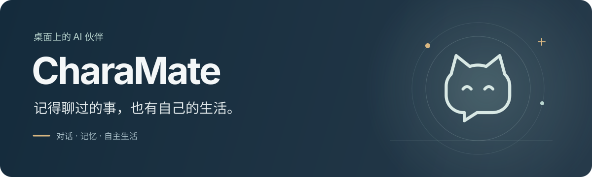
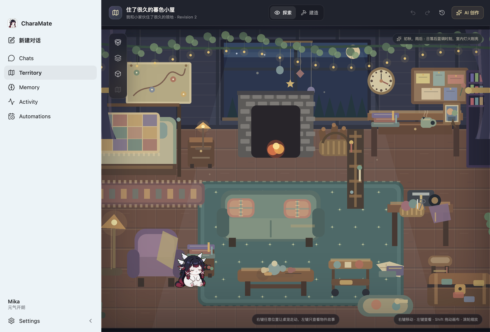
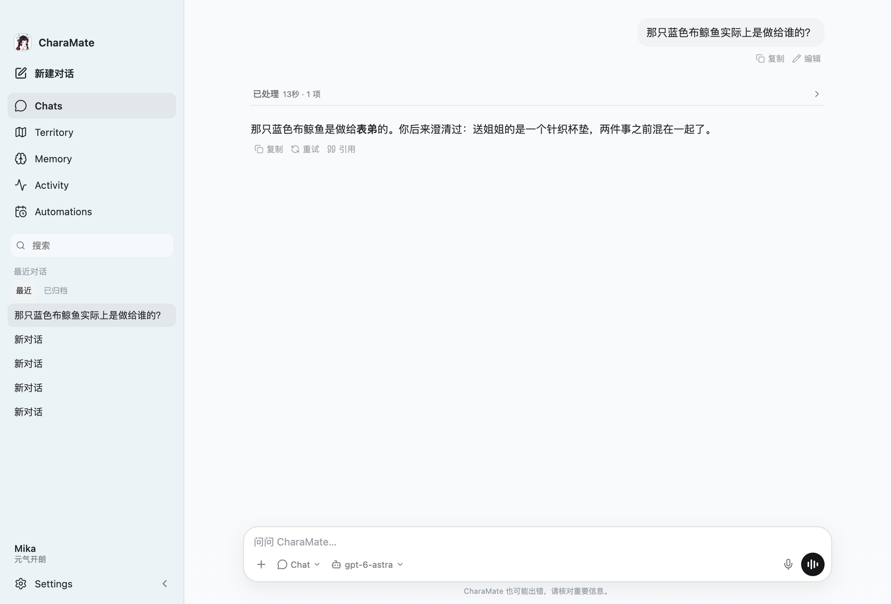
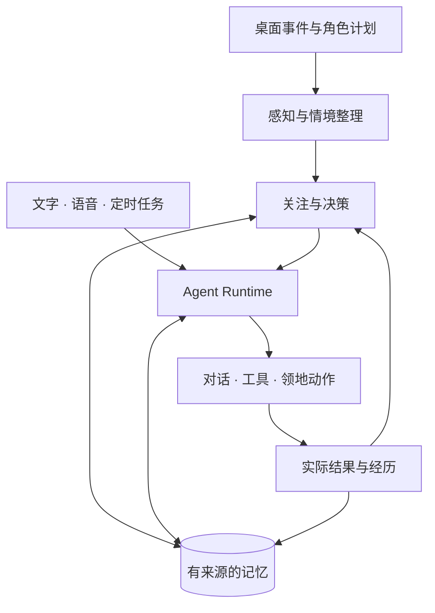

<p align="center">
  
</p>

<p align="center">
  <a href="#experience">产品体验</a> ·
  <a href="#getting-started">安装与配置</a> ·
  <a href="#everyday">日常使用</a> ·
  <a href="#architecture">技术概览</a> ·
  <a href="#development">开发与构建</a> ·
  <a href="#faq">常见问题</a>
</p>

CharaMate 是一个常驻桌面的 AI 伙伴。她记得你们聊过的事，会接着之前的话题和你交流；也有自己的日常，在领地里走动、休息、做些小东西。你可以随时找她说话，需要帮忙时，也可以一起处理文件、查找资料或完成任务。

**文字与实时语音 · 长期记忆 · 桌面感知 · 自主生活 · 可创作的领地 · Agent 工具**

<p align="center">
  
  <br />
  <sub>CharaMate 本地运行截图，使用演示数据。</sub>
</p>

<a id="experience"></a>

## 产品体验

### 聊过的事，下次还能接着聊

无论打字、语音还是桌面气泡，和你交流的都是同一个角色，也能用到之前形成的记忆。可以聊今天的小事，也可以隔一段时间再提起之前的约定。语音对话支持打断、静音和暂停；开启本地唤醒后，说一句 **“Hi Mika”** 就能开始。

### 记得你说过什么，也记得后来改了什么

交流中的偏好、经历和约定会逐渐形成记忆。你改了主意，她会更新当前的理解，同时保留事情的来龙去脉。临时选择和长期习惯分开处理，回忆时也会考虑是谁的事、发生在什么时候、后来有没有变化。

<details>
  <summary>实际对话：分清两份礼物，记住后来的澄清</summary>

<p>
  
</p>

这是 CharaMate 的实际对话截图，使用演示数据。记录经过纠正后，角色在新会话中找回了相应记忆。

</details>

### 你忙的时候，她也有自己的事

应用运行时，角色会安排领地中的活动：走动、坐下、休息、观察，或创作和摆放小物件。实际做过的事会留下记录，之后可以和你聊起。你来找她时，当前交流优先；自己的安排可以先暂停，之后再继续。

### 留意眼前的事，决定什么时候开口

开启桌面感知后，CharaMate 会结合应用、窗口、可读页面内容和操作节奏整理当前情境，再决定回应、继续观察或安静待着。切换应用后仍可以接着原来的事情聊；不会只因为点击多、停留久，就认定你喜欢什么或心情如何。

### 一起做点事

切换到 **Agent** 后，可以处理文件、使用浏览器、操作应用、执行命令，以及调用 Skills 和 MCP 扩展。每次执行都有可以展开查看的过程和结果；需要确认的操作会在对话中询问。提醒和定时任务也能在这里安排。

### 有一个一起生活的地方

Territory 是角色的生活空间。可以通过对话创作物件，把一段经历放进房间，也可以亲手调整布局。角色会使用这个空间，而你可以随时来看看她。外形、人格和音色可以分别调整，也支持导入兼容的 Codex 角色素材。

<a id="getting-started"></a>

## 安装与配置

### 运行环境

当前桌面版本支持 **macOS Apple Silicon**，以下从源码启动。

| 项目     | 要求                                                                   |
| -------- | ---------------------------------------------------------------------- |
| 系统     | Apple Silicon；最低构建目标为 macOS 13.3                               |
| 工具链   | Node.js **24.18.x**、npm **11.16.x**、Xcode Command Line Tools         |
| 磁盘     | 本地记忆编码模型约 **2.50 GB**，另需依赖、Chromium、下载缓存及构建空间 |
| 模型服务 | 自行配置文本服务及 API Key；语音、图像按需配置                         |

尚未安装 Apple 命令行工具时，先运行 `xcode-select --install`。已使用 nvm 的开发者可以在仓库中执行 `nvm install`，按 `.nvmrc` 安装 Node.js，并确认 npm 版本符合要求。

```sh
git clone https://github.com/MicroYui/chara-mate.git
cd chara-mate

npm ci
npm run embedding:prepare
npm run browser:install
npm start
```

首次准备会从 Qwen 官方仓库和 llama.cpp 官方发布下载本地编码资源，并校验固定版本；Chromium 也会单独安装。之后启动复用已有资源，Forge 自动处理原生模块和桌面感知辅助程序。

### 连接文字模型

打开 **Settings → Models**，新建或编辑一个 Provider：

| 字段              | 填写方式                                                                        |
| ----------------- | ------------------------------------------------------------------------------- |
| API 类型          | 按服务选择 **OpenAI-compatible** 或 **Azure OpenAI**                            |
| Base URL          | OpenAI-compatible 填服务商提供的 API 基地址，通常包含 `/v1`；Azure 填资源根地址 |
| API Key           | 该服务的有效凭据                                                                |
| Chat Model        | 点击 **加载模型** 后选择，或手动填写可用的 Model ID；Azure 使用实际部署名称     |
| Azure API Version | 使用 Azure 文字模型时必须填写                                                   |

保存后回到 **Chats**，在输入框选择模型，发送第一条消息。

文本服务需要支持 **Responses API 和工具调用**。只提供 `/chat/completions` 的服务不能直接使用。预置的 `copilot_api` 指向 `localhost:4141`，没有附带凭据，也不会自动启动代理；没有这个服务时，改成自己可用的地址和模型即可。

<details>
  <summary><strong>配置实时语音</strong></summary>

当前语音使用 **Azure OpenAI Realtime**：

1. 在 **Models → Realtime 与 Image** 中填写 Azure Provider 的凭据、**Realtime Endpoint** 和 **Realtime Model**。
2. Realtime Model 填实际部署名称。Endpoint 格式如下，将 `<resource>` 替换为自己的 Azure 资源名。
3. 保存后，在 **Settings → Voice → Realtime Provider** 选择这个配置并保存。
4. 允许麦克风权限，点击输入框右侧的语音按钮开始。音色和说话方式跟随当前 Persona。

```text
https://<resource>.openai.azure.com/openai/v1/realtime
```

**“Hi Mika”** 本地唤醒默认关闭，可以在 Voice 中开启。唤醒检测在本地运行，唤醒后的对话连接 Realtime 服务。

从输入框进入语音会沿用当前 Chat / Agent 和执行权限。从桌面角色声波按钮或“Hi Mika”开始的新语音会话使用 **Agent + 完全访问**。

</details>

<details>
  <summary><strong>配置图像与领地创作</strong></summary>

当前图像创作使用 **Azure OpenAI Provider**。在 **Models → Realtime 与 Image** 中填写：

- **Image Endpoint（Generation 基准）**：部署的生成地址，路径以 `/images/generations` 结尾。
- **Image Model**：该部署的模型名称。
- **API Version**：填在 Endpoint 的 `api-version` 参数中，或使用 Provider 的 Azure API Version。

生成和编辑使用同一部署。一个 Provider 共用一份 API Key；如果文字、语音或图像使用不同的密钥，请分别创建 Provider。

保存后，可以在对话中提出创作要求，或打开 **Territory → AI 创作**。Image 连接测试只检查配置和模型，不会生成图片；实际创作会调用图像服务。

</details>

### 按需开启系统权限

普通文字聊天不需要桌面或麦克风权限。使用相应功能时，在 macOS **系统设置 → 隐私与安全性** 中授权：

| 权限     | 用途                                               |
| -------- | -------------------------------------------------- |
| 辅助功能 | 读取应用可访问内容、窗口与焦点，执行支持的应用操作 |
| 屏幕录制 | 截图、视觉观察与屏幕操作                           |
| 麦克风   | 本地唤醒与实时语音                                 |

**Settings → Browser & Computer** 显示桌面权限状态；**Activity** 管理感知的启用和暂停。感知记录操作类别和节奏，不记录原始按键文本。开发版和打包应用可能是不同的授权对象，更换启动方式后需要检查对应权限。

<a id="everyday"></a>

## 日常使用

| 想做的事           | 操作                                                                                                                                               |
| ------------------ | -------------------------------------------------------------------------------------------------------------------------------------------------- |
| 聊天或执行任务     | 在 Chats 输入消息。需要操作文件、浏览器或应用时，切换到 **Agent** 并选择执行权限。运行中可以追加要求，也可以点 **停止**。                          |
| 调整角色           | 在 **Settings → Character** 选择或导入外形。人格预设可先 **复制并编辑**，再使用自定义 Persona；音色也随 Persona 设置。                             |
| 查看与纠正记忆     | 在 **Memory** 中搜索并打开记录，查看来源和历史版本；编辑“当前内容”后点 **保存为新 Revision**。也可以手动新增、归档或删除。                         |
| 逛逛领地           | 在 **Territory → 探索** 中左键查看物件故事、右键让角色走动；切到 **建造** 修改布局。AI 创作先预览，再点 **应用到领地**，支持撤销、重做和版本历史。 |
| 减少主动打扰       | 在 **Character → 主动陪伴** 调整主动程度和安静时段。主动搭话会受这些设置约束，你明确约定的跟进仍会保留。                                           |
| 暂停角色自己的活动 | 直接告诉她“先停下你自己的活动”；想继续时说“可以继续自己的安排了”。**暂停活动感知** 只停止采集，不等于暂停角色生活。                                |
| 安排提醒           | 在对话中提出提醒或定时任务，到 **Automations** 查看和管理。                                                                                        |

Agent 的三种执行权限：

- **请求批准**：外部写操作执行前询问你。
- **替我审批**：常规写操作直接执行；移到废纸篓等关键操作仍需确认。
- **完全访问**：本轮直接执行可用动作，不再逐项询问。

只读操作以及内部记忆和生活工具不逐项审批。角色在领地中的日常由她自己安排；对现实文件和应用的操作沿用执行权限。

### 接入自己的工具

**Settings → Skills** 管理 `SKILL.md` 格式的技能，可以编辑、启停，也可固定内容，避免后台修改。**Settings → MCP** 管理 MCP 服务，支持 stdio 和 Streamable HTTP 传输，可以查看工具并测试连接。两者都通过同一套 Agent 工具机制执行。

### 本地数据与后台运行

会话、记忆、领地和运行状态保存在本机。**Settings → Data** 可以查看实际目录、分类占用，并在 Finder 中打开；API Key 由系统提供的加密能力保存。记忆向量在本地计算，文字、语音、图像以及后台认知和记忆形成使用你配置的模型服务。使用远程服务时，相应输入会发往该服务，自主生活和后台分析也可能产生调用费用。

macOS 上关闭主窗口后，应用仍可留在后台。需要停止后台运行时，使用菜单栏中的 **退出 CharaMate**。退出后不会有云端角色继续活动；重新打开时，再处理本地保存的待继续事项。

<a id="architecture"></a>

## 技术概览

CharaMate 的文字、语音、定时任务和角色自主生活共用一个 Agent Runtime。对话历史、当前情境、长期记忆分别保存，按当前问题组织成模型需要的材料。

**感知与决策。** 应用、窗口和内容变化先合并为有来源的事件，再整理成跨应用的情境。认知中枢维护当前关注、未完成意图和信息缺口，决定继续哪件事、查询什么记忆，以及此时应该行动、回应还是保持安静。用户直接输入优先处理。

**记忆形成与检索。** 记忆保留主体、来源、时间、条件和修订历史。词法检索保留专名与精确措辞，语义检索处理不同说法；再结合实体、时间和当前版本筛选。取回后还会检查这些证据是否回答了问题、有没有冲突或遗漏，避免只因为主题相似就带进回答。

**本地编码与存储。** 语义检索使用固定版本的 **Qwen3-Embedding-4B Q4_K_M**，输出 512 维向量。SQLite 保存会话、记忆和运行状态，编码与索引由后台进程和 Worker 处理。事实与来源更新后，派生索引异步跟进；未完成工作保存在本地，重启后继续处理。

**行动与反馈。** 对话、语音、工具和领地动作进入同一套 Run/Item 执行记录。认知中枢根据实际工具结果更新状态，角色自己的经历也来自真正完成的动作。执行过程支持停止、等待用户输入、审批与恢复。

<details>
  <summary>查看运行关系</summary>



</details>

| 层次         | 使用的技术                                    |
| ------------ | --------------------------------------------- |
| 桌面与构建   | Electron、Electron Forge、Vite                |
| 界面与角色   | React、TypeScript、CSS Modules、Radix、PixiJS |
| 数据与合同   | SQLite / better-sqlite3、TypeBox、Ajv         |
| 模型与扩展   | OpenAI SDK、Azure Realtime、MCP、Agent Skills |
| 浏览器与验证 | Playwright、Vitest、Testing Library           |

<a id="development"></a>

## 开发与构建

项目使用一个 npm 包和一份锁文件，Main、Preload、Renderer 与共享合同均使用 TypeScript。Main 拥有业务状态，Renderer 通过类型化的 Preload API 调用功能。

```text
src/main/       对话、Agent、认知、记忆、感知、语音与领地
src/preload/    桌面 IPC 边界
src/renderer/   React 界面与角色渲染
src/shared/     合同、Schema 与纯逻辑
resources/     应用图标、角色和本地模型资源描述
tests/         合同、跨领域集成与 Electron E2E
```

| 命令                       | 用途                           |
| -------------------------- | ------------------------------ |
| `npm start`                | 启动开发应用                   |
| `npm run check:fast`       | 类型、Lint、格式和合同检查     |
| `npm run test:focused`     | 单元与组件测试                 |
| `npm run test:integration` | 领域及边界集成测试             |
| `npm run verify:offline`   | 完整离线验证                   |
| `npm run build`            | 构建 Main、Preload 和 Renderer |
| `npm run test:e2e`         | 构建并运行 Electron 端到端测试 |

### 构建本地应用

```sh
npm run package
npm run smoke:package
```

应用生成在 `out/CharaMate-darwin-arm64/CharaMate.app`，包含 Chromium、本地编码资源和原生辅助程序。运行 `npm run make` 可进一步生成 DMG。

<details>
  <summary>正式分发的签名与公证配置</summary>

本地开发与打包不要求正式发行身份。用于正式分发时，通过环境变量指定自己的 Apple 签名与公证配置：

| 环境变量                              | 用途                                   |
| ------------------------------------- | -------------------------------------- |
| `CHARAMATE_MACOS_SIGN_IDENTITY`       | Developer ID 签名身份                  |
| `CHARAMATE_NOTARIZE_KEYCHAIN_PROFILE` | 已配置的 `notarytool` Keychain profile |
| `CHARAMATE_NOTARIZE_KEYCHAIN`         | 可选的 Keychain 路径                   |

设置公证 profile 时也必须设置签名身份。

</details>

离线验证使用固定数据和模拟接口，不调用真实模型。`npm run test:live` 单独运行，需要相应凭据，可能产生费用。修改后先运行受影响的测试；交付前运行离线验证和构建，涉及桌面交互时再运行对应 E2E。

<a id="faq"></a>

## 常见问题

**支持 Windows、Linux 或 Intel Mac 吗？**

当前完整构建与运行路径支持 macOS Apple Silicon。本地编码资源和原生桌面感知依赖这一平台，其他平台尚未提供完整支持。

**必须给语音和图像配置服务吗？**

不需要。先配置文字模型即可开始交流；语音和图像按需添加。记忆编码模型负责检索，不替代聊天模型。

**模型列表能加载，为什么发消息还是失败？**

列表可用不等于生成接口可用。检查服务是否支持 Responses API、模型是否支持工具调用，以及 Base URL、部署名称和 API Version 是否正确。设置页的连接测试不能替代一次实际对话。

**首次启动很慢，或提示编码资源缺失，怎么办？**

先运行 `npm run embedding:prepare` 查看下载和校验结果。下载需要访问 GitHub 与 Hugging Face；中断或版本不匹配时，脚本会指出对应目录。模型下载缓存和生成资源各占一份空间，请同时检查可用磁盘。

**刚聊过的内容，为什么还没有出现在 Memory？**

记忆在后台逐步形成，会话中每句话也不都会成为长期记忆。可以先在 Chats 查看原文；需要明确保留或纠正的内容，可以直接告诉角色，或在 Memory 中编辑。

**数据可以找回或删除吗？**

Memory 的删除先保留恢复入口：勾选 **含已删除** 可恢复记录，也可选择 **永久删除** 并确认。数据目录可以从 **Settings → Data** 打开。开发版与打包版如果显示不同记录，先核对各自的数据目录。

**能让多个角色在线生活、跨平台同步吗？**

当前版本的角色生活、记忆和领地由本机应用负责。在线常驻、多角色社区和跨平台身份延续尚未提供。

<a id="feedback"></a>

## 反馈与贡献

欢迎通过 [Issues](https://github.com/MicroYui/chara-mate/issues) 分享使用体验或报告问题。故障反馈请写明系统与芯片、应用版本、模型服务、复现步骤和错误信息；日志中请移除 API Key 等凭据。

修复问题时，请附上复现方式和实际运行过的检查。较大的功能改动可以先开 Issue 讨论使用场景，再确定实现范围。
