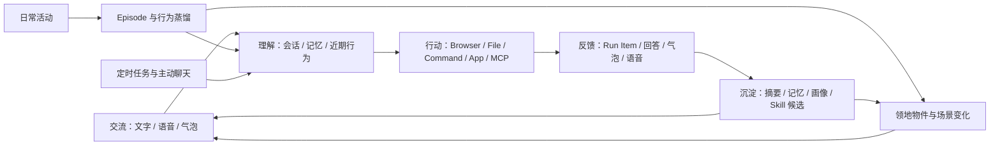
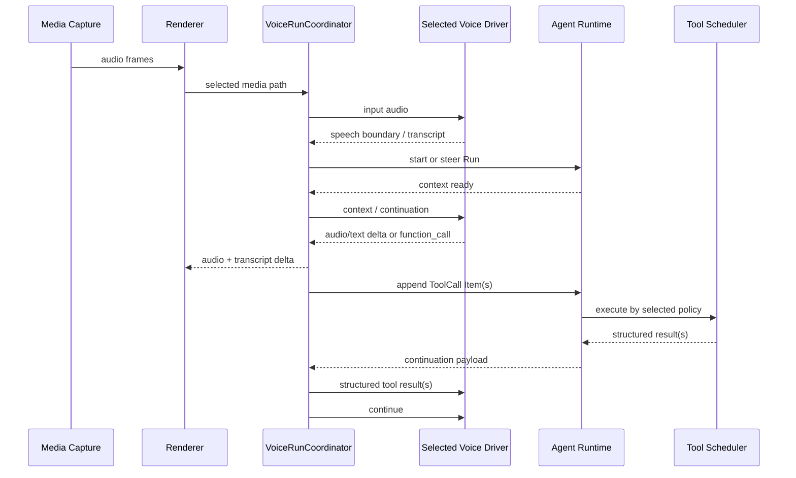
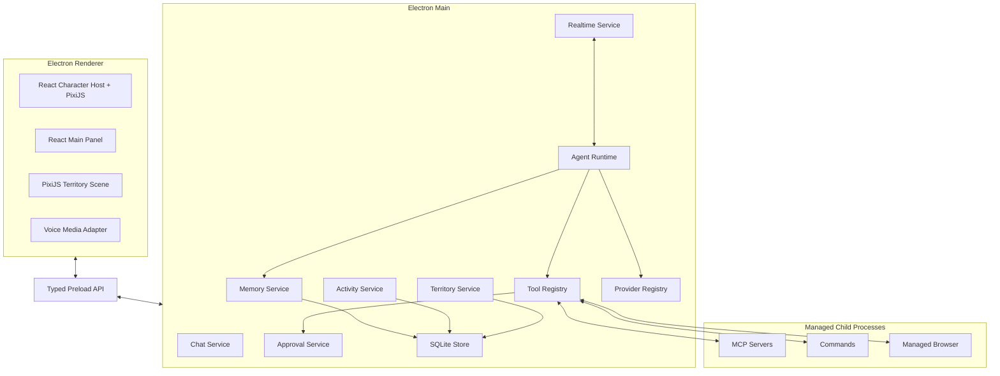
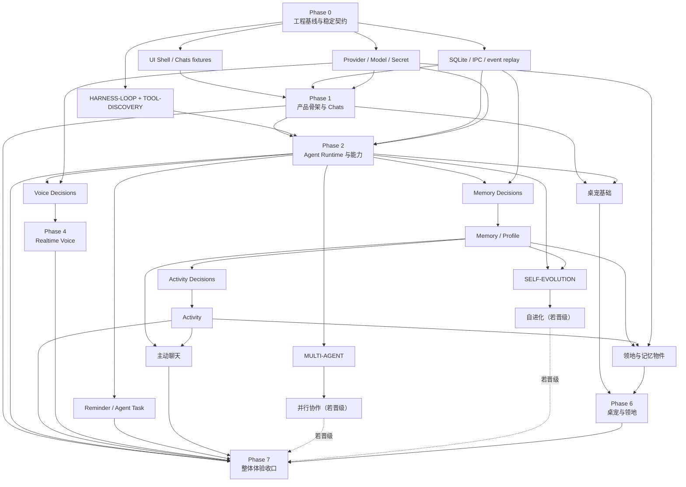

# CharaMate 完整产品与技术架构设计

> 状态：Design Review
> 日期：2026-08-01
> 范围：产品功能、交互、Agent Harness、记忆、语音、桌宠领地、代码与数据架构

---

## 0. 架构结论

CharaMate 是一个由常驻二次元桌面角色承载的个人 AI Agent。她能以文字和实时语音与用户交流，理解多会话上下文和长期生活轨迹，在用户选择的执行模式下操作浏览器、文件、命令、应用与 MCP，并将真实使用逐步沉淀为可编辑记忆、角色人格偏好和一座可见生长的像素领地。

| 主题 | 最终设计 |
| --- | --- |
| 产品入口 | 桌面角色、气泡、主面板、快捷键和托盘 |
| 一级页面 | Chats、领地、Memory、Activity、Automations、Settings |
| 基础技术栈 | 单 package Electron + Electron Forge/Vite + strict TypeScript/ESM + React；只有一条构建与打包路径 |
| Renderer | CSS Modules/语义 Token、Radix Primitives、Lucide、TanStack Virtual；PixiJS 只承载桌宠与领地像素渲染 |
| 契约与数据 | TypeBox + Ajv 的 JSON Schema-first 契约；typed Preload；`better-sqlite3` prepared SQL 与领域 Repository，不使用 ORM |
| Agent Harness | 单一、自适应、事件驱动的循环；没有固定 12 步上限 |
| Chat / Agent | 用户在 Composer 中明确选择，位置与模型、执行权限在同一输入区 |
| 执行过程 | Run/Item 事件持久化；运行时展开，完成后折叠为“已处理 …” |
| 长期记忆 | `better-sqlite3` 保存 Memory/Revision 真源；索引、图关系、向量布局和写入参数由实验一次选定，发布版只有一套实现 |
| 检索 | 产品只依赖一个冻结的 `RetrievalPipeline`；候选、模型与参数只存在于研究设计和实验工件 |
| 行为理解 | 原始活动 → Episode → 周期摘要 → 长期记忆/画像/领地候选 → 定期删除低价值原始数据 |
| 自我进化 | 由 `SELF-EVOLUTION` 实验决定是否进入产品；晋级后只保留一种异步复盘、候选、replay 与恢复流程 |
| 实时语音 | Azure OpenAI `gpt-realtime-2.1` 全双工会话；事件驱动同一 Agent Loop、异步 Tool、打断和持久化 |
| 浏览器与电脑操作 | Playwright/DOM 优先，App Action/Accessibility 次之，视觉 Computer Use 兜底 |
| 扩展协议 | JSON Schema Tool、Agent Skills `SKILL.md`、MCP stdio/Streamable HTTP |
| 桌宠素材 | CharaMate 自有目录；兼容导入 Codex pet v1/v2 文件夹 |
| 领地 | 像素风可编辑空间；记忆生成物件，角色可走动，Azure GPT Image 负责受控生图 |
| 用户权限 | Composer 只有“请求批准 / 替我审批 / 完全访问”三个直观档位 |
| 敏感信息 | 写入持久层前统一去除密钥等敏感值；API Key 使用系统能力简单加密 |
| 开发指标 | 独立本地看板和结构化日志；不进入普通产品页面 |
| 测试工具 | Vitest + Testing Library + Playwright Electron；默认回归离线，Live/Benchmark 独立运行 |

两个 Azure Endpoint：

```text
Realtime
https://datasetannotator-openai.openai.azure.com/openai/v1/realtime?model=gpt-realtime-2.1-2

Image Edit
https://datasetannotator-openai.openai.azure.com/openai/deployments/gpt-image-2/images/edits?api-version=2025-04-01-preview
```

---

## 1. 产品定义

### 1.1 一句话定位

一个长期生活在用户桌面上的二次元 AI 搭子：能聊、能听、能看懂近期生活、能记住重要事情，也能真正完成电脑上的任务。

### 1.2 核心体验

1. 用户不需要打开主面板，也能点击角色、拖动角色、查看气泡或开始语音。
2. 需要完整交流时，主面板提供多会话 ChatGPT 式聊天体验。
3. 需要执行时，用户在输入框把 `Chat` 切为 `Agent`，并选择本轮执行权限。
4. Agent 的每一步真实操作、命令、结果、等待确认和耗时都可见、可展开、可追溯。
5. 聊天、语音、活动和执行结果持续形成可编辑、有来源、会更新和衰减的记忆。
6. 记忆与生活轨迹不只藏在列表中，还会转化为领地中的物件、场景变化和短小文字。
7. 用户通过人格、音色、语音 instructions、Skills、MCP 和 Provider 塑造自己的 CharaMate。

### 1.3 产品闭环



### 1.4 设计原则

1. **一个运行内核**：文字、语音、定时任务、主动聊天和桌宠动作都进入同一个 Run Runtime。
2. **模式由用户选择**：LLM 可以建议切换 Agent，但不能把 Chat 静默升级为可执行任务。
3. **过程真实可见**：UI 只展示已经发生或正在发生的结构化事件，不用自然语言伪造步骤。
4. **本地持久、可追溯**：会话、记忆、活动、执行事件和领地数据以本机数据库为准。
5. **长程而不臃肿**：上下文压缩、无进展检测与可恢复 checkpoint 代替固定小步数和静默资源截断。
6. **实验只负责选型**：候选 Arm 不等于产品档位；实验结束后只保留一个获胜实现，reranker、ANN、图扩展和 multi-agent 没有收益就完全不进入产品路径。
7. **面向用户呈现**：普通界面只展示完成任务所需的产品控制；研发指标放进独立本地看板。
8. **成长来自内容**：人格、记忆、Skill 和领地随使用变化，不设置亲密度数值或关系阶段。
9. **固定值必须有来源**：协议限制来自当前官方文档或源码；产品启发式参数来自预注册实验或可用性测试，不能凭直觉写死。
10. **实验必须收口**：胜者以干净实现进入产品，失败 Arm、Adapter、feature flag、依赖、临时 Schema 和用户开关在合并前删除。

---

## 2. 信息架构

### 2.1 窗口

| 窗口 | 作用 |
| --- | --- |
| Character Window | 透明常驻桌面角色、状态动画、气泡、快捷语音和简短审批 |
| Main Panel | Chats、领地、Memory、Activity、Automations、Settings |
| Managed Browser | CharaMate 管理的 Chromium 与独立持久化 Profile |
| Dev Dashboard | 仅开发时启动的本地浏览器看板，不出现在产品导航 |
| Tray | 显示/隐藏角色、打开主面板、语音静音、暂停活动感知、退出 |

### 2.2 主面板一级页面

| 页面 | 用户看到的内容 |
| --- | --- |
| Chats | 会话列表、完整消息、Composer、Run 过程、附件、语音转写 |
| 领地 | 像素空间、角色、物件、记忆库入口、布置与场景演化 |
| Memory | 搜索、画像、长期记忆、来源、Revision 与衰减状态；图关系只在对应 Decision 晋级后出现 |
| Activity | 今日/历史 Episode、应用/浏览器/截图摘要和蒸馏结果 |
| Automations | 定时任务、主动聊天规则、运行历史和对应 Chat |
| Settings | 角色、Persona、语音、Provider/Model、Skills、MCP、Browser、桌宠 |

Browser 和 Computer Use 是 Agent 能力，不占一级页面；浏览器登录/Profile 管理在 Settings，实际浏览器按需打开。

### 2.3 全局状态

```ts
type CompanionState =
  | 'idle'
  | 'listening'
  | 'thinking'
  | 'acting'
  | 'waiting_approval'
  | 'speaking'
  | 'success'
  | 'failed'
```

同一状态同时驱动：

- 角色动画；
- 气泡文案；
- Chats 中当前 Run Item；
- 托盘状态；
- 可选的短提示音。

Main 进程是状态真源，Renderer 不自行推断“任务是否完成”。

这里的“托盘状态”和“短提示音”都不是语音回答：

- **托盘状态**是系统菜单栏/托盘图标的轻量投影。运行中改变图标状态或 tooltip，等待批准时显示醒目标记，完成或失败后恢复；点击仍然打开对应 Chat。它不增加第二套任务状态。
- **短提示音（earcon）**是很短的非语言声音，只用于应用在后台时提示“需要批准 / 已完成 / 失败”。它不朗读回答、不循环播放，并受一个简单的“提示音”开关和系统静音控制；具体时长按 UI 原型与听感测试冻结。
- **实时说话**属于 Voice Session。语音模式开启后，面向用户的自然语言会同时流式显示文字并播放模型音频；命令、JSON、日志和代码块只显示，不逐字朗读。Realtime 正在说话时不叠加完成提示音。

因此，用户与角色进行语音对话时看到和听到的是同一条助手消息的文字与音频；托盘与 earcon 只负责应用级状态提示。

---

## 3. 常驻桌面角色与气泡

### 3.1 桌面角色

- Character Window 使用 React host + PixiJS canvas：React 管理文字、菜单、气泡和可访问交互，PixiJS 只管理 atlas、sprite、朝向与动画 tick。
- 透明、无边框、置顶窗口，角色以像素或透明动画精灵显示。
- 单击打开/聚焦最近 Chat；双击可按 Persona 配置触发问候或语音。
- 右键提供简短菜单：聊天、语音、领地、切换角色、静音、设置、退出。
- 鼠标可从角色任意可点击区域开始拖动，拖到哪里就停在哪里，不吸附屏幕边缘。
- 多显示器分别记住逻辑坐标与屏幕 ID；显示器变化时只把角色夹回当前可见区域。
- 重启后恢复尺寸、缩放、位置、朝向和当前桌宠。
- 空闲时可以在小范围内做 Persona 对应的动画，但不擅自改变用户放置位置。

### 3.2 桌宠素材目录与 Codex 兼容

CharaMate 只读取自己的目录：

```text
userData/
  pets/
    <pet-id>/
      pet.json
      spritesheet.webp
      preview.webp        # optional
```

最小 `pet.json`：

```json
{
  "id": "mika",
  "displayName": "Mika",
  "description": "A cheerful pixel-art desktop companion.",
  "spriteVersionNumber": 2,
  "spritesheetPath": "spritesheet.webp"
}
```

导入器接受一个 Codex 风格文件夹，校验后**复制**进 CharaMate 目录；运行时不依赖 `~/.codex/pets`。因此用户可直接复制兼容素材，但两边安装、更新和删除互不影响。

兼容格式：

| 版本 | 图集 | 含义 |
| --- | --- | --- |
| v1 | 8 列 × 9 行，通常 `1536×1872` | 9 个标准动作；可能没有 `spriteVersionNumber` |
| v2 | 8 列 × 11 行，`1536×2288` | 9 个标准动作 + 16 个视线方向 |

每格 `192×208`。标准动作行：

```text
0 idle
1 running-right
2 running-left
3 waving
4 jumping
5 failed
6 waiting
7 running
8 review
9 look 000° → 157.5°
10 look 180° → 337.5°
```

内部使用语义动画名，Renderer Adapter 再映射图集行；这样 v1 缺少视线行时可自然降级到 idle，而不把 Codex 的命名渗透到业务代码。

### 3.3 气泡

气泡类型：

| 类型 | 内容与操作 |
| --- | --- |
| `reply` | 最近一段简短回答；点击打开对应 Chat |
| `progress` | “正在查看文件”“正在操作浏览器”等当前 Item 摘要 |
| `waiting_approval` | 动作摘要、允许一次、拒绝、打开详情 |
| `proactive` | 主动问候或基于长期摘要的轻量话题 |
| `automation` | 定时任务完成/失败摘要；点击打开持久化 Run |
| `error` | 一句用户可理解的错误与打开详情 |

`waiting_approval` 的完整事实只存一份：Chat 中的 Approval Item。气泡是它的轻量投影：

- 低信息动作可直接“允许一次 / 拒绝”；
- 命令较长、包含多个文件或需要额外选择时只显示摘要，点击进入 Chat；
- 处理后气泡立即消失，Chat Item 记录决定与时间；
- 过期或 Run 已取消的按钮不可再执行。

### 3.4 人格

内置数个可直接使用的 Persona，例如：

- 元气开朗：主动、自然、有感染力；
- 温柔陪伴：语速舒缓、表达克制；
- 冷静可靠：信息密度高、少寒暄；
- 活泼吐槽：有轻度幽默，但不影响任务清晰度。

用户可以：

- 从预设复制创建；
- 编辑名称、背景、说话风格、称呼、主动程度、禁用表达；
- 为每个人格配置默认音色和语音 instructions；
- 切换后只影响新回答，不改写历史消息。

人格中可以自然描述关系与相处方式，但产品没有亲密度、经验值、等级或关系阶段。

---

## 4. Chats、Composer 与 Agent Run

### 4.1 多会话

支持新建、重命名、置顶、搜索、归档、恢复和删除 Chat。每个 Chat 独立保存：

- 消息与附件；
- 语音转写与 Turn 元数据；用户主动上传的音频仍作为普通附件处理；
- 滚动摘要；
- Run 与 Run Item；
- 使用的 Persona、Provider、Model 与权限模式快照；
- 相关长期记忆引用；
- Automation/主动聊天来源。

同一个 Chat 内 Turn 串行；不同 Chat 可并行。切换页面不会停止后台 Run。

### 4.2 Composer

布局采用 ChatGPT 式圆角输入容器和 VS Code Copilot 式模式选择，但所有图标来自统一 SVG 图标集，不使用 Emoji 充当产品图标：

```text
┌──────────────────────────────────────────────────────────────┐
│ [Add]  问问 CharaMate……                                      │
│ [Chat ▾] [Model ▾] [请求批准 ▾] [并行协作]  [Mic] [Voice/Send] │
└──────────────────────────────────────────────────────────────┘
```

空输入或单行输入保持紧凑胶囊；有附件或多行文本时自然展开为“内容区 + 底部控制条”。按钮使用清晰的 hover、focus、active 和 tooltip，不把所有选项做成常驻文字按钮。完整布局、尺寸、颜色和状态在独立 UI 设计稿中定义。

控件：

- `Add`：图片、本地文件、文件夹或当前截图；
- `Chat / Agent`：由用户选择；
- `Model`：当前 Provider 自动发现的模型下拉框；
- 权限：Agent 模式显示“请求批准 / 替我审批 / 完全访问”；Chat 模式隐藏或禁用；
- `Mic / Voice`：线性麦克风图标用于录音入口，圆形波形按钮用于进入/结束 Realtime；连接后明确显示聆听、静音和结束状态；
- `并行协作`：只有 Multi-agent 实验通过后才在 Agent 模式出现；它表示“允许主 Agent 在确有独立子任务时并行协作”，不强制每轮派生；
- `发送`：有运行时变为停止按钮。

模式语义：

| 模式 | 能力 |
| --- | --- |
| Chat | 回答、读当前会话、检索记忆、分析附件；不执行有外部效果的 Tool |
| Agent | 可使用本地、Browser、Computer Use、MCP 与 Skills；按本轮权限处理审批 |

LLM 如果在 Chat 中发现任务需要执行，只能回复建议并给出“一键切换 Agent”按钮；不能自行升级。

### 4.3 执行权限

| 选项 | 产品语义 |
| --- | --- |
| 请求批准 | 读取与低影响观察直接进行；命令、写文件、点击提交等动作在执行前询问 |
| 替我审批 | 对当前 Run 的普通动作自动批准；不可恢复或账户关键动作仍询问 |
| 完全访问 | 当前 Run 按用户目标直接执行，只保留操作记录与停止能力 |

这是用户在 Composer 每次可见的唯一权限选择。Settings 可设默认值，不提供繁复风险矩阵。

### 4.4 消息渲染

助手消息完整支持：

- CommonMark 与 GFM；
- 标题、粗体、斜体、引用、列表、任务列表、链接；
- 表格和横线；
- 行内代码与带语言的代码块、语法高亮和复制按钮；
- 行内/块级 LaTeX，使用 KaTeX；
- 图片、音频、视频和生成文件卡片；
- 可折叠的长 Tool 输出；

流式阶段对未闭合 Markdown 做增量容错；消息完成后重新进行一次确定性渲染。代码块、LaTeX 和表格不能因流式 token 造成永久错位。

复制与消息操作对齐成熟聊天产品：

- 用户问题悬停后可“复制问题”，必要时可编辑并重新发送；
- 助手回答底部提供“复制完整回答”，复制源 Markdown，保留代码围栏、公式源码、列表和表格结构；
- 每个代码块右上角独立复制，只复制代码正文，不包含语言标签或行号；
- 行内公式和块级公式悬停后可复制 TeX 源码；
- Tool 输出、命令和表格有各自的复制动作；
- 复制成功用轻量图标状态和短 tooltip 反馈，不弹出阻塞式提示框。

### 4.5 Run 与 Item

```text
queued → running ↔ waiting_approval → completed
              ↘ needs_input
              ↘ interrupted
              ↘ failed
              ↘ cancelled
```

Run 是一次用户目标；Item 是 Run 中真实发生的事件：

```ts
type RunItemKind =
  | 'user_message'
  | 'assistant_message'
  | 'plan'
  | 'tool_call'
  | 'command'
  | 'file_change'
  | 'approval'
  | 'context_compaction'
  | 'error'
```

每个 Item 保存状态、顺序、起止时间、耗时、结构化输入、截断后的可显示输出、完整结果文件引用和错误。系统不保存或展示模型隐藏推理。

UI 行为：

1. Run 进行中，当前 Item 自动展开，输出实时追加。
2. 命令以 `命令 + 工作目录 + 状态 + 输出` 的下拉卡片显示。
3. Tool Call 以用户可理解的动作标题显示；第一层展开看到动作摘要，第二层再看参数、命令和截断结果。
4. 等待审批时定位到 Approval Item，同时桌宠进入 `waiting_approval`。
5. 完成后全部过程自动折叠为“已处理 2分13秒 · 8 项”，下方只保留最后回答；点击整行可重新展开完整过程。
6. 展开后显示的是助手主动给用户看的进度摘要、计划变化和真实 Tool/Command/File Item，不展示隐藏 chain-of-thought。
7. 用户可以复制整个问题、完整回答、单个代码块/公式、命令或 Tool 输出，也可以打开文件或从失败 Item 继续。

### 4.6 Agent Harness

主循环没有“最多 12 个模型步骤”的限制：

```text
创建 Run 与 UserMessage Item
  ↓
组装有界 Context
  ↓
模型流式返回 Assistant 内容或 Tool Call
  ├─ final 且无用户追加输入 → 完成
  ├─ Tool Call → Schema 校验 → 审批 → 执行 → Tool Result → 继续
  ├─ Context 压力高 → 压缩已完成历史 → 继续
  ├─ 用户追加消息 → 在当前 Run 的一致性边界合入 → 继续
  ├─ 暂时无进展 → 按获胜 Loop Guard 改变策略、询问用户或诚实失败
  └─ 进程/网络中断 → 保存 checkpoint，恢复后继续
```

正常产品路径**不以总时长、累计 Token 或累计成本作为静默硬停止条件**。上下文 Token 接近窗口时先压缩并继续；时间、Token 和成本只进入可观测与软提醒，用户随时可以主动停止，不伪装成任务已经完成。

Run 的终态语义：

- `completed`：模型给出 final，且没有待处理 Tool、审批、steering 或异步 continuation；
- `cancelled`：用户明确停止；AbortSignal 向模型、Tool 和子进程传播；
- `needs_input`：缺少无法推断的必要信息，或审批拒绝后确实没有其他合法路径；拒绝本身先作为结构化 Tool Result 返回，Agent 可以改用无副作用方案；
- `failed`：Provider 或必需 Tool 在有界重试/换策略后仍不可恢复，必须如实说明完成到哪里；
- `interrupted`：应用退出、崩溃、断网或 Provider session 丢失；保存 checkpoint 后允许恢复。

重复调用检测不是立即终止：同一规范化失败连续出现且没有新观察时，Harness 先要求改变策略；仍无进展才进入 `needs_input` 或诚实失败。底层 supervisor 可以处理失控进程等基础设施异常，但必须留下可恢复边界，不能让模型用假答案收尾。

### 4.7 Plan 与 Multi-agent

- 简单任务直接执行，不强制先写计划。
- 多步骤任务可生成可见、可更新的 Plan Item；Plan 只是同一 Harness 的一种 Item。
- 默认只有一个 Agent 保持目标和上下文，避免协调与代码膨胀。
- Multi-agent 作为实验能力：只有两个以上相互独立、可并行且主要为读取的子任务才允许派生。
- 子任务不能并发写同一工作区或共用同一可变 Browser Profile。
- 父 Run 负责合并证据、处理冲突和生成最终回答。
- 是否进入产品由成功率、误派生率、Token、Tool 正确率与端到端时延实验决定；未通过则不保留生产分支。
- 通过后在 Agent Composer 提供一个紧凑的“允许并行协作”开关，不放进复杂 Settings。关闭时永不派生；开启时只授予能力，主 Agent 仍需判断任务是否值得拆分，简单问题不会派生。
- UI 使用统一的分支/协作 SVG 图标、状态色和 tooltip，不使用 Emoji；只有 Decision 晋级后才把 `subtask` 加入 Run Item 协议并显示为普通可折叠 Item，未晋级时协议、表和组件中都不存在该类型。

### 4.8 并发与恢复

- 同一 Chat 一个活动 Turn，用户的新输入作为 steering 排队或合入当前 Run。
- 不同 Chat 默认有限并发；实际数量按设备和 Provider 限流动态控制。
- 每个 Browser Profile 同时只有一个写操作 Run。
- Run/Item 先持久化再广播 UI；Renderer 刷新或应用重启后从数据库重建状态。
- 崩溃时 `running` Item 变为 `interrupted`，用户可以继续或结束；已完成 Tool 不自动重放。

---

## 5. Tool、Skills、MCP、Browser 与 Computer Use

### 5.1 统一 Tool Registry

所有可执行能力使用主流 Tool Calling 形状：

```ts
interface ToolDefinition<Input, Output> {
  name: string
  description: string
  inputSchema: JsonSchema
  execute(input: Input, context: ToolContext): Promise<Output>
}
```

Tool Result 是结构化数据，至少含 `status`、用户可见摘要、模型可见结果和可选 artifact。模型不通过解析日志字符串判断成功。

Registry 负责：

- 唯一命名与 Schema；
- 当前 Chat/Agent 模式可用性；
- 审批要求；
- AbortSignal 和 deadline；
- 输出截断与 artifact 化；
- Run Item 事件；
- 指标与错误分类。

### 5.2 内置能力

| 类别 | 示例 |
| --- | --- |
| File | 列目录、读文件、搜索、patch、创建文件、移动到废纸篓 |
| Command | 运行命令、流式 stdout/stderr、交互输入、终止进程 |
| App | 打开/聚焦应用、打开 URL/文件、触发已注册 App Action |
| Browser | 导航、DOM/AX 快照、点击、输入、上传、下载、截图 |
| Computer | 读取 Accessibility 树、截图、鼠标、键盘、窗口操作 |
| Memory | 检索、读取来源、创建候选、编辑记忆 |
| Chat | 创建会话、附加结果、读取当前 Run 状态 |
| Territory | 提议物件、生成、放置、收回记忆库 |

### 5.3 Browser

Managed Browser 由 `playwright-core` 驱动产品管理、版本固定的 Chromium，并使用独立持久化 Profile：

- 用户可以直接登录网站；
- 支持用户导入 Cookie，导入后写入该 Profile；
- Playwright 或兼容 MCP 操作已登录页面；
- 下载进入 CharaMate 管理目录，并以 Chat artifact 展示；
- 上传必须来自用户附件或 Agent 明确选定的本地文件；
- Browser 动作产生可见 Item；只有 Computer Use 定位、结果证据或调试确有需要时才附截图 artifact，不为每次 DOM 状态变化持续截图。

执行优先级：DOM/Accessibility Locator → Playwright 行为 → 截图视觉定位。网页能被结构化定位时不使用坐标猜测。

### 5.4 Computer Use 与 App Action

Computer Use 作为统一 fallback：

1. 有 App 专用 action、CLI 或 API 时优先；
2. 否则读取 macOS Accessibility 语义树并按元素操作；
3. 语义树不足时获取截图，由视觉模型定位；
4. 鼠标键盘动作仍记录为 Tool Item，并服从 Composer 权限。

OS 首次要求的 Accessibility/Screen Recording 权限使用系统原生提示；产品只解释“为了让 Agent 操作应用需要开启”，不再设计一套额外授权系统。

### 5.5 MCP

支持标准 MCP：

- Adapter 使用官方 MCP TypeScript SDK，但只把标准 Tool 描述/调用映射到 CharaMate Tool Registry，不让 SDK 拥有 Run、Approval 或持久化状态；
- stdio；
- Streamable HTTP；
- `tools/list` 和 `tools/call`；
- server 级启用/停用、连接测试、工具列表与状态；
- 环境变量、参数和工作目录配置；
- Tool 名采用 `mcp__<server>__<tool>` 防止冲突。

用户可以在 Settings 添加和管理，也可以在 Agent 模式授权 Agent 写入配置。Agent 修改后必须重新发现工具，不把外部 Tool 描述永久塞进所有会话 Prompt。

### 5.6 Skills

采用 Agent Skills 目录与 `SKILL.md`，不发明自有格式：

```text
<workspace>/.agents/skills/<skill-name>/SKILL.md
userData/skills/<skill-name>/SKILL.md
```

Skill 可以包含少量脚本、模板和 references；常驻上下文只加载名称与短描述，命中后再读完整 `SKILL.md`。Settings 支持启用、编辑、查看来源、版本、最近使用和归档。

Agent 可在以下情况下创建或修改 Skill：

- 用户明确说“把这个流程学会”；
- 若 `SELF-EVOLUTION` 晋级，Experience Review 生成候选，并通过 replay 或用户确认。

### 5.7 自我进化

`SELF-EVOLUTION` 是功能 Gate：只有实验能证明后续同类任务收益足以覆盖错误迁移、候选膨胀和维护成本时，产品才加入本节能力；否则不提交 Review Job、候选表或管理入口。

若晋级，有学习价值的 Run 完成后可按唯一获胜触发规则启动异步 `ExperienceReview`。它是候选生成器，不是第二套 Agent Runtime，只输出四类结构化候选：

```ts
type EvolutionCandidate =
  | MemoryCandidate
  | PersonaPreferenceCandidate
  | SkillPatchCandidate
  | NewSkillCandidate
```

触发依据是用户纠正、明确教学、可验证复杂任务成功、重复模式，而不是简单累计 Tool Call 数。

候选要求：

- 指向来源 Run/Item；
- 展示新增或修改内容；
- 区分“用户是谁”与“这类任务怎样做”；
- Skill 修改先跑保存的 replay；
- 支持 draft、active、stale、archived、pin、版本和恢复；
- 后台归档可恢复，不删除用户内容；
- 候选只覆盖 Memory、Persona 偏好和 Skill，不把产品源码、系统 Prompt 或 Provider 配置变成自进化对象。

用户可以在 Chat 中打开“这次学到了什么”，也可以在 Memory/Settings 统一处理候选。

---

## 6. 长短期记忆与用户画像

### 6.1 目标

记忆系统需要同时做到：

- 让角色在聊天和语音中自然想起相关事实；
- 支持用户查看、编辑、纠正、删除和追溯；
- 正确处理事实更新、时间和冲突；
- 从大量低信息 Activity 中提炼稳定偏好；
- 在个人规模上低延迟、低写放大；
- 任何运行环境都只使用实验冻结的同一条检索路径，不靠隐藏备用算法维持表面可用。

### 6.2 记忆类型

| 类型 | 示例 |
| --- | --- |
| profile | 用户称呼、职业、长期偏好、重要关系 |
| preference | 喜欢安静的咖啡馆、不喜欢过甜饮品 |
| project | 当前项目、技术选择、未完成目标 |
| event | 一次重要经历、决定或里程碑 |
| procedure | 用户习惯的工作方法；可进一步形成 Skill |
| commitment | 约定、提醒、后续要做的事 |
| activity_digest | 某个周期及跨周期的高信息行为归纳 |
| agent_learning | 用户对回答或执行方式的纠正 |

用户画像不是独立黑盒；它是稳定、当前有效的长期记忆投影，点击画像条目可以回到 Memory Revision 和原始证据。

### 6.3 Memory 与 Revision

```ts
interface Memory {
  id: string
  type: MemoryType
  status: 'active' | 'superseded' | 'archived'
  currentRevisionId: string
  importance: number
  confidence: number
  validFrom?: string
  validTo?: string
  lastAccessedAt?: string
}

interface MemoryRevision {
  id: string
  memoryId: string
  content: string
  sourceType: 'chat' | 'voice' | 'activity' | 'tool' | 'user_edit' | 'distillation'
  sourceIds: string[]
  reason: string
  createdAt: string
}
```

- 编辑创建 Revision，不覆盖历史。
- 新事实与旧事实冲突时，新 Revision 可 supersede 旧 Revision。
- 用户手动纠正具有最高事实优先级。
- Memory 页面可查看时间线、来源消息/Activity/Run、相关实体与被使用记录。
- 删除进入可恢复状态；用户明确永久删除时清除 Revision、索引引用和相关展示投影。

### 6.4 衰减

衰减影响自动检索排序，不自动抹去事实。相关性、有效时间、最近使用、重要性、置信度和用户 pin 是必须保留的语义信号，但不在产品设计中预先规定乘法公式、权重或阈值；排序组合由同一检索实验选出并冻结。

- `validity` 先处理已经失效或被取代的事实；
- 使用和用户确认会推迟衰减；
- 重要、固定、身份类事实衰减很慢或不衰减；
- 一次性 Activity 摘要快速退出在线 Context，但仍可搜索；
- 用户可以 pin、降权、归档或恢复。

### 6.5 图关系能力

图关系不是首版必带模块。`MEMORY-GRAPH` 实验只有证明它提高最终回答或用户理解、且收益覆盖表、索引和维护成本时，才进入唯一发布实现；否则产品没有 Graph 表、Graph 检索分支或图谱 UI。

若图关系晋级，其产品语义固定为：连接人物、项目、地点、偏好、事件与作品；每条关系指向 Memory Revision 证据；只服务个人记忆，不建设通用世界知识图谱。具体存储和在线使用方式由该 Decision Record 唯一确定。

### 6.6 唯一 Retrieval Pipeline

Memory 对外只暴露一个 `RetrievalPipeline`：

```ts
interface RetrievalPipeline {
  search(query: MemoryQuery): Promise<MemoryHit[]>
}
```

发布版遵守：

1. 只有一条在线路径、一组参数和一个索引生命周期；
2. `ContextCompiler`、`search_memory` 和 Memory 页面搜索复用它，不各自维护排序；
3. 时间、有效性、冲突、Revision 和来源追溯是稳定语义；
4. 用户和 Settings 看不到内部模型、融合、topK、重排或索引档位；
5. 在 `MEMORY-RETRIEVAL` Decision Record 完成前不得实现生产检索；完成后本节只写入胜者，不把候选搬回来；
6. 失败 Arm 的代码、表、模型、依赖、配置和 feature flag 不进入合并结果。

### 6.7 检索运行时工件

获胜 Pipeline 若需要模型或专用索引，发布物只包含 Decision Record 冻结的一个模型工件、量化、维度、instruction、索引类型和执行位置；若不需要，则不创建向量表、worker 或模型下载流程。应用不会同时维护本地/远程、exact/ANN 或有模型/无模型的备用路径。

模型或索引不可用时，Run 如实返回该能力暂不可用并保留可恢复状态，不静默切换到另一套未经本轮选择的排序算法。

### 6.8 Context Engineering

`ContextCompiler` 只有以下不可变契约：

- 当前用户请求、附件和 steering 不得被较早内容挤掉；
- 当前审批结果、最新必要 Tool Result 与本轮所需 Tool Schema 必须可见；
- 记忆进入 Context 时带 ID、时间、Revision 和来源，不能变成无来源事实；
- 会话摘要是带覆盖水位和来源的版本化工件，能够表达目标、约束、完成动作、重要决定与未解决问题；
- Persona、近期原文、摘要、长期记忆、Activity Digest 和 Tool 结果的具体顺序、预算、topK 与裁剪规则由 `CONTEXT-RECIPE` 实验一次选定。

发布版只有一套冻结的 Context Recipe，不按模型、设备或用户设置维护多种装配模式。

### 6.9 Activity 蒸馏为记忆

```text
Raw events
  → Episode（连续行为片段）
  → Period Digest（一个冻结周期内的高信息摘要）
  → Memory/Profile candidates（稳定事实与偏好）
  → Cross-period consolidation（仅在实验选中时）
  → Territory item candidates（可展示记忆）
```

蒸馏器必须输出 evidence IDs、置信度、新颖性、有效时间和 supersedes。宿主去除密钥等敏感值、合并重复、识别冲突；琐碎或一次性行为停留在 Episode/Digest，不进入长期记忆。

### 6.10 存储与写放大

`better-sqlite3` 保存 Chat、Run、Memory Revision 和其他关系型元数据，并开启外键一致性。journal、synchronous、busy timeout、checkpoint、批量大小、向量字节位置与计算进程由 `MEMORY-STORAGE` 实验一次选定；产品文档不预先写死 WAL、段文件或 worker。

稳定存储分工：

| 数据 | 位置 |
| --- | --- |
| Chat、Run、Memory、Revision、来源与所选索引 metadata | SQLite |
| 截图、音频、附件、生成图像 | asset 文件目录 |
| 所选 Pipeline 的专用工件 | Decision Record 指定的唯一位置；不需要则不存在 |

降低写放大：

- Activity 事务批量、检索使用记录、索引更新、提交与 GC 采用 `MEMORY-STORAGE` 胜者冻结的唯一策略，不在产品文档预设批量值或进程形态；
- 派生数据不应让 Memory 主行在每次命中时变成热写点，具体记录方式随同一 Storage Decision 固化；
- 原图等大资产单独保存，数据库只保存路径、尺寸、时间和摘要；
- 清理、重建与长模型调用不进入交互事务，Renderer 不承担存储或索引计算。

### 6.11 Memory 页面

Memory 页面包含：

- 由唯一 Retrieval Pipeline 提供的统一搜索；
- 用户画像卡片；
- 按类型、时间、来源、状态筛选；
- Revision 时间线；
- 来源 Chat/Voice/Activity/Run 跳转；
- 若 `MEMORY-GRAPH` 晋级，显示相关实体和关系的小型证据视图；未晋级则不出现空入口；
- pin、编辑、纠正、归档、删除；
- “生成领地物件”与已经进入领地的状态；
- 待确认的记忆/画像候选。

---

## 7. Activity 行为感知

### 7.1 数据源

| 来源 | 记录内容 |
| --- | --- |
| Active App | bundle/app 名、窗口标题、开始/结束时间 |
| Managed Browser | 页面标题、URL/域名、标签状态和操作事件 |
| Screenshot | 定时或事件触发截图文件及 OCR/视觉摘要 |
| Idle | 空闲开始/结束，用于切分 Episode |
| Agent Run | 由 CharaMate 自身执行的工作，避免与用户手动行为混淆 |

### 7.2 采集与 Episode

- 前台应用变化立即结束上一段并开始下一段。
- 相同应用和相近窗口在短间隔内合并。
- Browser 标签停留和 Active App 统一到时间线，但保留来源。
- 截图使用目标设备长时测试后冻结的一种低频采集节奏，并可由应用/窗口变化触发；最终只保留这一种策略，内部频率不做用户档位。
- 原图单独保存；数据库仅保存路径、尺寸、时间和摘要。
- Idle、锁屏和休眠切断 Episode。
- 先用时间、应用变化、Idle 等确定性边界形成 Episode；标签、合并和摘要方式由 `ACTIVITY-DISTILLATION` 选择一次，发布版不逐事件调用模型。

### 7.3 Activity 页面

- 今日时间线和 Episode 卡片；
- 应用/网站时长；
- 截图缩略图与搜索；
- 周期摘要和跨周期趋势；
- “这条形成了哪些记忆/领地候选”；
- 用户可编辑 Episode 标题、摘要或删除一段记录；
- 一键暂停/恢复采集放在页面顶部和托盘，不扩展成复杂隐私控制中心。

### 7.4 蒸馏调度

| 频率 | 输入 | 输出 |
| --- | --- | --- |
| 实时/短周期 | 原始事件 | Episode 边界与轻量标签 |
| 定期蒸馏 | 已闭合 Episode、聊天摘要 | Period Digest、候选记忆、候选画像变化 |
| 跨周期归纳 | 多个 Digest、现有长期记忆 | 稳定模式、冲突/过期建议、领地物件候选 |

具体周期、是否需要第二层跨周期归纳及其批量由 `ACTIVITY-DISTILLATION` Decision 一次选定。蒸馏结果进入 Memory 候选而不是直接无限累积；稳定偏好需要跨事件证据或用户明确表达。

### 7.5 保留与定期删除

Activity 不是永久事件仓库。原始数据完成蒸馏后由 `ActivityRetentionJob` 定期清理：

```text
截图原图 / OCR / 缩略图
  → 原始 app/browser event
  → Episode
  → Period / Cross-period Digest
  → 已接受 Memory / Profile / Territory evidence（独立生命周期）
```

- 在线记忆检索不直接召回原始事件或截图，只召回 Digest、Memory 和必要的 Episode 摘要，避免低信息活动污染回答。
- 删除作业同时清理文件、缩略图、OCR、获胜检索索引引用和数据库行；空闲时再做所选数据库维护、空间回收与 asset orphan sweep。
- 达到 `ACTIVITY-RETENTION` 胜者定义的回收条件时，只回收已经完成必要蒸馏的原始层；具体使用时间窗、容量还是两者组合由实验一次决定，长期记忆与领地物件不随原始截图过期而删除。
- Digest 和 Memory 的来源保存到稳定摘要证据；原始资产删除后显示“原始活动已按保留策略清理”，不留下失效文件链接。
- 保留窗口、容量和清理批量由 `ACTIVITY-RETENTION` 实验选择一次，发布版固化为一个产品策略；Settings 不提供多档算法或模型兼容选项，只保留暂停采集、查看占用和立即清理。

---

## 8. Azure OpenAI Realtime 语音

### 8.1 产品体验

- 点击 Composer 麦克风或桌宠语音入口开始 Realtime Session。
- 状态依次为连接、聆听、思考、调用工具、说话；角色动画同步。
- 支持自然打断：用户开始说话后停止当前播放并继续同一轮上下文。
- 支持静音、Push-to-Talk 和免手持模式。
- 语音模式开启后，所有**面向用户的助手自然语言输出**都同时语音播放，包括最终回答和必要的短进度；原始命令、JSON、日志和代码块不逐字朗读。
- 语音结束后，用户和助手转写、工具步骤、最终回答都留在同一个 Chat。
- 用户可回看一轮语音的文本；产品持久化转写、Run 和必要协议元数据，不长期保存原始会话音频。

### 8.2 Endpoint 与连接

```text
配置 URI：
https://datasetannotator-openai.openai.azure.com/openai/v1/realtime?model=gpt-realtime-2.1-2
```

该 URI 固定了 Azure resource 与 model/deployment。若 `VOICE-TRANSPORT` 选择 Direct WebSocket，连接时按协议转换为 `wss`；若选择 GA WebRTC，则从同一 resource/model 派生官方 `client_secrets` 与 `calls` 端点。Settings 仍只保存一个规范化 Realtime 配置，不让用户维护两套 URI。

公开 Realtime 协议提供 VAD、显式 `response.create`、Function Call 和 `function_call_output` 等构件，因此“Realtime 负责流式语音、应用持有统一 Run”具备可验证基础；目标 Azure deployment 是否完整支持以及该结构是否在体验上获胜，仍由 Contract Test 与 `VOICE-ARCHITECTURE` 实验决定。

给定 Azure resource 与 deployment 是产品配置；媒体 Transport 不是用户设置。[Microsoft 当前文档](https://learn.microsoft.com/en-us/azure/foundry/openai/how-to/realtime-audio-webrtc)把 WebRTC 作为客户端低延迟音频的优先路径，因此先验证目标 deployment 的 WebRTC Contract 与体验门槛；只有不支持或未达门槛时，才完整推进 Direct WebSocket 对照。`VOICE-TRANSPORT` 决策完成后，本节更新为唯一获胜 Transport 的连接、鉴权和媒体路径；生产代码不得同时保留两套 Transport、自动 fallback 或协议选择器。

### 8.3 VoiceRunCoordinator

语音不建立第二套 Agent。`VoiceRunCoordinator` 是唯一稳定适配层：它把获胜 Voice Driver 的转写、模型事件、音频和 Tool Call 映射为同一个 Chat/Run，Tool、Approval、Memory、Context 和持久化仍由统一 Harness 负责。



Driver 的具体事件、turn-control 与 continuation 流程由 `VOICE-ARCHITECTURE` 胜者写回本节。决策前不创建双 Driver；决策后不保留失败架构的 STT/TTS、Realtime 自动 turn 或手动 turn 分支。

“全双工”在产品中的准确含义是：麦克风在助手播放音频时仍可检测用户说话，用户可以自然打断；输入采集、网络收发和播放并行。它不表示两个助手回答可以同时播放，任一时刻只允许一个 audible response。

### 8.4 异步 Tool 与 Join

Realtime Tool Call 不走旁路：每个调用都创建普通 Tool/Approval Item，使用同一 Tool Registry、权限和结果协议。

Voice Driver 产生的 Tool 请求全部进入统一调度器；串行还是依赖感知并行由 `VOICE-TOOL-JOIN` 选择一次：

```text
voice tool request(s)
  → Run ToolCall Item(s)
  → selected ToolScheduler policy
  → structured Tool Result(s)
  → one selected-driver continuation
```

并发规则：

- 若并行方案晋级，只有输入完整、资源不冲突且无前后依赖的调用可以并行；文件写入、同一 Browser Profile 和 Computer Use 仍串行。
- 每个 Tool 独立校验、审批、超时、取消和持久化；一个失败不丢弃其他成功结果。
- 获胜 continuation 规则等待本轮必要结果，将成功与结构化错误分别写回，再只触发一次后续模型响应；若并行方案晋级，这个等待点才实现为 Join。
- 不预设 Azure 模型一定会在一次响应中发出多个 Function Call；只有协议实际返回多个调用，或统一 Harness 已得到可验证的独立计划时才 fan-out。是否提高成功率与时延由语音专项实验验证。
- 长工具等待期间可以播放一句已经完成的短进度话术，但不能让“稍等一下”等音频与最终回答重叠。

语音不拥有专用 Tool Scheduler；调度器、审批、Tool Result、Run Item 与 ContextCompiler 全部复用文字 Agent。若 `VOICE-TOOL-JOIN` 选择串行，代码中不创建 `ToolJoinGroup`；若选择并行，只实现胜者定义的一种 Join。

### 8.5 打断、steering 与竞态

当获胜 Voice Driver 发出规范化 `speech_started` 事件：

1. 立即停止本地播放并取消当前模型 response；
2. 通知唯一 Transport 丢弃尚未播放的响应尾部，并执行该协议要求的 cancel/truncate；
3. 新转写作为当前 Run 的 steering，而不是另开一个不可见会话；
4. 尚未开始且已不再需要的 Tool 取消；已产生副作用的 Tool 不回滚、不自动重放，结果仍作为 Item 保存；
5. 每个响应、Tool 与 Join 都携带 `sessionId/runId/turnId/generation/callId`，旧 generation 的迟到结果不能自动触发新回答，只有当前 Run 接受后才能写回模型。

如果用户只是补充条件，Harness 在当前 Run 的一致性边界合入并继续；如果用户改变目标，取消尚未执行的旧计划并重新编排。语音断线不丢 Chat 与 Run，重连只新建协议 Session。

### 8.6 持久化

```text
voice_sessions
voice_turns
chat_messages
run_items
```

每个语音 Turn 保存开始/结束、用户转写、助手转写、关联消息、关联 Run、打断标记、音色和 instructions 快照。Chat 消息是用户回看的主视图，`voice_turns` 保存实时协议元数据。

语音文本与普通消息使用同一渲染和复制能力。助手音频 delta 与 transcript delta 共同更新一条草稿消息，`response.done` 后原子完成。打断时保存 `audio_end_ms`、`interrupted=true` 和当时可用的 transcript，并把消息显示为“已打断”；由于音频与 transcript 不保证逐字精确对齐，不把近似字符位置伪装成精确听取边界，也不把未播放尾部显示成一条完整回答。

### 8.7 音色与 instructions

Settings 提供：

- 内置音色下拉框；
- 每个音色的短句试听；
- Persona 默认音色；
- 可编辑并保存的 Realtime instructions；
- 语速/情绪由 instructions 表达，不堆叠大量滑条。

默认中文 instructions 示例：

> 使用自然、简洁的中文口语。角色整体开朗、有温度；用户分享好消息时表现出真诚的兴奋，处理任务时保持清楚可靠。允许自然停顿，不朗读命令、代码和日志；涉及工具执行时用一句短话说明正在做什么。

### 8.8 性能指标与验收

开发看板记录：连接耗时、speech end → first audio、首转写、打断停止耗时、误打断率、Tool Call/Join 往返、并行节省时间、音频 underrun、断线重连、迟到结果丢弃和端到端 p50/p95。语音回归需要真实 endpoint、真实麦克风和扬声器；fake 只能验证状态机。

语音实现前必须完成 `VOICE-ARCHITECTURE`、`VOICE-TRANSPORT` 与 `VOICE-TOOL-JOIN` 决策。每项只交付一个胜者，并在本章写明其协议与验收结果；失败候选的 Driver、依赖、配置与测试适配层不得进入生产合并。真实 endpoint、真实麦克风和扬声器的性能与体验门槛不能由 mock 宣称通过。

---

## 9. Automations、成长与主动聊天

### 9.1 定时任务

两种任务：

| 类型 | 行为 |
| --- | --- |
| Reminder | 到时发送一句通知/气泡，可选语音 |
| Agent Task | 到时创建普通 Chat Run，使用保存的目标、Model、Persona、Tool 范围和权限模式 |

支持一次、每天、每周和 Cron 表达式；可暂停、编辑、立即试跑、查看下次时间与历史结果。

每次 Agent Task 都有持久化 Chat：

- 计划、Tool、命令、审批、结果均可追溯；
- 气泡只显示摘要并跳转；
- `waiting_approval` 不因任务是后台触发而消失；
- 后台无人处理的审批保持待处理，直到用户决定或统一 Approval 生命周期结束；不增加每个任务一套超时策略，也不擅自假装成功。

### 9.2 主动聊天

触发来源：

- 用户设定的时间；
- 某个重要 Automation 完成；
- 当日行为摘要出现值得交流的模式；
- 长时间专注后的轻量关心；
- 领地产生新物件候选；
- 用户明确要求后续跟进。

主动聊天先创建普通 Chat 消息，再投影为气泡；回复后自然进入同一 Chat。用户可设置主动程度和安静时段，也可以对单类气泡说“少一点”。

### 9.3 成长语义

“成长”由以下可见变化构成：

- 记住更多被用户确认的事实与偏好；
- Persona instructions 经用户编辑或候选确认变得更贴合；
- Agent 学会可复用的 Skills；
- 主动聊天时机根据用户反馈调整；
- 领地出现代表共同经历的物件和场景变化。

不设置亲密度、等级、关系阶段或用数值锁定功能。

---

## 10. 桌宠领地

### 10.1 产品定位

领地是 CharaMate 最具展示性的一级页面：把抽象的长期记忆、用户画像和日常轨迹变成一个可浏览、可布置、会随使用变化的像素空间。

视觉方向是温暖、细腻的像素生活模拟与养成气质，可参考经典农场/生活模拟游戏的氛围，但不复制《星露谷物语》的素材、角色、地图或 UI。

### 10.2 首次体验

首次进入：

1. 用户从数个基础场景选择：林间小屋、海边房间、城市天台、星空工坊等。
2. 当前桌宠出现在场景中，可走动、待机和朝向点击位置。
3. 场景包含少量基础物件，保证一开始就是完整可看的空间。
4. 页面用一句诗意说明：这里会慢慢装下共同经历，但不要求用户先做设置。

### 10.3 记忆生成物件

高信息记忆或跨日模式可以生成 `TerritoryItemCandidate`：

```ts
interface TerritoryItemCandidate {
  id: string
  sourceMemoryIds: string[]
  name: string
  description: string
  visualPrompt: string
  suggestedZone: string
  createdAt: string
}
```

示例：

- 连续完成一个重要项目 → 一盏仍亮着的工坊台灯；
- 经常听某类音乐 → 会轻轻跳动的旧唱片机；
- 一次难忘旅行 → 窗边带日期的小海螺；
- 长期学习主题 → 逐渐增厚的一摞书。

物件描述保持简短、诗意并带来源日期。点击物件打开：名称、描述、形成时间、相关记忆和“在 Memory 中查看”。物件不是新的事实源。

### 10.4 生成管线

Image Edit Endpoint：

```text
https://datasetannotator-openai.openai.azure.com/openai/deployments/gpt-image-2/images/edits?api-version=2025-04-01-preview
```

为了保持画风和布局稳定，不每次重画整张领地：

1. 每个基础场景有 canonical reference、palette、tile scale 和可放置 mask。
2. 物件生成使用 reference + 局部 mask + 统一 style prompt。
3. 生成结果去背景、缩放到 tile、生成缩略图并缓存为 asset。
4. 场景由底图、地面层、物件层、角色层和特效层确定性合成。
5. 整体场景大改只在用户主动选择“场景演化”时生成预览，确认后应用。
6. 失败时保留候选和重试入口，不破坏当前场景。

### 10.5 布置与交互

- Territory 使用与桌宠共享语义的 PixiJS sprite/scene runtime；React 负责页面 Header、抽屉、表单、焦点和 Memory 来源卡。
- 编辑模式拖动物件、旋转/翻转允许的物件、收回记忆库。
- 网格吸附保证像素整齐；UI 显示合法放置区域。
- 角色使用简单 A* 或 nav grid 在可走区域移动。
- 点击空地让角色走过去；点击物件触发走近、朝向和短动画。
- 可为少量物件配置一条互动动画，不建设复杂游戏战斗或经济系统。
- 场景变化由季节、时间或长期行为摘要驱动的视觉候选表达，用户可预览。

### 10.6 容量与记忆库

- 同屏物件上限由目标窗口和视觉密度可用性测试一次选定并冻结，不提供多档容量模式。
- 用户可 pin 特别重要的物件。
- 新物件超过上限时，最早放入且未 pin 的物件回到 Memory 的“领地收藏库”，不会删除。
- 用户可以从完整记忆库选择任意合适记忆生成/放回领地。
- 同一记忆默认只有一个活动物件版本；重新生成会形成版本，可切回旧图。

### 10.7 数据模型

```text
territory_scenes
territory_scene_revisions
territory_items
territory_item_sources
territory_placements
territory_generation_jobs
territory_assets
```

`placement` 只保存场景 ID、item ID、坐标、层、朝向和 pin。图像在 asset 目录，数据库不存大 BLOB。

### 10.8 领地验收

- 首次进入无需等待生图就有完整可看的初始空间。
- 记忆候选可以预览、生成、放置、点击追溯和收回。
- 生图失败不损坏现有场景。
- 角色可绕过障碍走到点击位置和物件附近。
- 超过物件上限时只回收藏库，不丢失记忆或生成图。
- 同一场景重启后位置、层级、角色和物件版本完全一致。

---

## 11. Provider、Model 与 Settings

### 11.1 Provider Profile

```ts
interface ProviderProfile {
  id: string
  name: string
  apiStyle: 'openai-compatible' | 'azure-openai'
  baseUrl: string
  apiKeyRef: string
  chatModel?: string
  realtimeEndpoint?: string
  realtimeModel?: string
  imageEditEndpoint?: string
  imageModel?: string
}
```

设置流程：

1. 用户填写 Provider 名称、URL 和 API Key。
2. 应用请求标准模型列表端点并填充下拉框。
3. Azure 或非标准服务无法列出时，允许用户手动输入 Model ID。
4. 用户分别选择 Chat、Realtime 和 Image 模型；Memory 检索使用实验冻结的唯一产品实现，不在这里选择 embedding 档位。
5. 提供“测试连接”，展示简短成功/错误，不泄露 Key。
6. 切换只影响新 Run；历史 Run 保存使用的 Provider/Model 快照。

OpenAI-compatible 与 Azure HTTP Adapter 使用官方 OpenAI JavaScript SDK 能直接表达的标准能力，并在 Adapter 边界归一化 stream、Tool Call、usage 和错误；兼容服务确需协议差异时只在该外部 Adapter 内做有界映射，不能把 SDK 对象或 Provider 分支带入 Chat/Run/Memory。Realtime 连接仍遵守 `VOICE-TRANSPORT` 胜者，不因 HTTP SDK 选择提前固定媒体 Driver。

API Key 使用 Electron async `safeStorage`（`encryptStringAsync` / `decryptStringAsync`）加密后落盘，SQLite 只保存引用；初始化暂不可用与 key rotation 作为可恢复状态处理。日志、Run Item、Prompt、Memory 和错误文本都不能包含明文 Key。Renderer 只能提交或删除 Key，不能从 Preload 读取长期明文。

### 11.2 Settings 分组

| 分组 | 内容 |
| --- | --- |
| Character | 当前桌宠、导入、缩放、动画、Persona |
| Voice | Realtime Provider、音色试听、默认 instructions、输入模式 |
| Models | Provider、URL、Key、Model 自动加载与选择 |
| Agent | 默认 Chat/Agent、默认权限、工作目录；并行协作若发布则只在 Composer 按轮授权 |
| Browser & Computer | Managed Profile、Cookie 导入、OS 权限状态 |
| Skills | 用户/项目 Skill、版本、编辑、归档 |
| MCP | Server、传输、环境、工具列表、测试与启停 |
| Activity | 开关、暂停状态、占用与立即清理；采集/蒸馏内部频率不做用户档位 |
| Data | 数据目录、资源占用和清理 |

研发 metrics、Harness 步数、召回阈值、RRF 常数、reranker topK 等不放进 Settings。

---

## 12. 开发可观测与 Benchmark

### 12.1 Dev Dashboard

开发模式按需启动本地服务，例如：

```text
http://127.0.0.1:<dynamic-port>/dev
```

页面：

| 页面 | 内容 |
| --- | --- |
| Runs | Run 时间线、Item、模型调用、Tool、审批、Token、错误 |
| Tools | 调用量、正确率、无效参数、重复调用、p50/p95 |
| Memory | 唯一检索 Pipeline 的召回结果、最终排名、引用与回答反馈 |
| Storage | 数据库事务、journal/checkpoint、所选索引工件与清理 |
| Voice | TTFT、首音频、打断、丢帧、重连、工具 continuation |
| Activity | 采集吞吐、Episode、蒸馏队列、候选接受率 |
| Territory | 生图队列、耗时、失败、缓存、asset 占用 |

采用 typed event/metric 与 Pino JSON log，不要求一开始部署外部监控系统。所有 payload 在进入 Pino 前先经过统一 redactor。看板可按时间、Chat、Run ID、Provider、Model、Tool、状态和错误码过滤，日志支持全文查询并可从一条 metric 下钻到对应 Run Item。Dev Dashboard 直接查询只读聚合或 ring buffer；关闭开发模式时不运行。

### 12.2 关键指标

- Agent：任务成功率、模型调用数、Tool Call 数、工具选择/参数正确率、重复调用率、端到端时延、Token。
- Memory：Decision Record 冻结 K 下的 Recall/Hit/MRR/nDCG、知识更新、过期误召回、abstention、context token 构成。
- Storage：每次事务写入、journal 增长、checkpoint、所选索引工件占用、清理耗时与相关进程 RSS。
- Voice：连接、首转写、首音频、打断停止、误打断、Tool continuation、迟到结果、断线恢复。
- Activity：原始事件/episode 比、摘要压缩率、候选接受/编辑/拒绝率、过期清理量、原始数据占用与孤儿资产。
- Territory：候选到生成转化、生成成功率、首次可见时间、asset cache 命中。

### 12.3 实验文档

所有 Harness、记忆、检索、embedding、rerank、存储、Activity retention、Realtime、multi-agent 和自进化实验都生成中文 Markdown 决策记录。记录必须包含稳定实验 ID、外部源码/文档版本、数据版本/hash、Arm、唯一变量、硬件、指标、门槛、结果、限制、复现信息和最终产品决定；不得依赖某个工作区位置才能理解。

实验代码在一次性分支或 worktree 中运行。决定完成后，用胜者重写干净生产实现，并在合并前删除失败 Arm、候选 Adapter、feature flag、临时 Schema、专用依赖、Runner 与配置。原始 JSON/JSONL 默认在仓库外按 hash 归档或删除，正式提交只保留一份中文 Decision Record，紧凑结果与复现标识写在该 Markdown 内。若某个小样本确实承担长期质量门禁，必须以获胜实现的产品回归测试重新归属到 `tests/fixtures`，并在 Decision Record 说明理由；它不能继续作为实验 Arm 工件存在。

核心公开集：

- LongMemEval：信息抽取、多会话推理、知识更新、时间推理、abstention；
- LoCoMo：长对话 QA evidence 与跨 session 事件摘要；
- 自建冻结中文产品集：中英偏好、专有名词、改口、Activity 蒸馏、图关系和无答案。

---

## 13. 技术架构

### 13.1 固定基础技术栈与版本基线

CharaMate 是一个单 package Electron 应用，不建设 monorepo。Main、Preload、Renderer 和 shared contracts 全部使用 strict TypeScript 与 ESM；只有 OS 原生能力确实无法由 Electron/Node 提供时，才在对应平台 Adapter 内引入最小原生 helper。

2026-08-01 核对的一手发布基线：

| 组件 | Phase 0 兼容性起始版本 | 一手来源 | 固定方式 |
| --- | --- | --- | --- |
| Electron | `43.2.0` | [Electron v43.2.0](https://github.com/electron/electron/releases/tag/v43.2.0) | Phase 0 smoke 后精确写入 lockfile |
| Electron Forge | `7.11.2` | [Forge v7.11.2](https://github.com/electron/forge/releases/tag/v7.11.2) | 与所有 Forge Plugin 精确同组锁定 |
| Forge Vite Plugin | `7.11.2` | [官方 Plugin README](https://github.com/electron/forge/tree/v7.11.2/packages/plugin/vite) | 只保留这一条 build path；必须先过 package smoke |
| React | `19.2.8` | [React v19.2.8](https://github.com/facebook/react/releases/tag/v19.2.8) | 与 Renderer/component tests 一起锁定 |
| `better-sqlite3` | `13.0.2` | [`better-sqlite3` v13.0.2](https://github.com/WiseLibs/better-sqlite3/releases/tag/v13.0.2) | 验证 Electron ABI rebuild、ASAR unpack 和 packaged read/write |
| Playwright | `1.62.1` | [Playwright v1.62.1](https://github.com/microsoft/playwright/releases/tag/v1.62.1) | Browser runtime 与 Electron E2E 分别声明职责但版本统一锁定 |
| Vitest | `4.1.10` | [Vitest v4.1.10](https://github.com/vitest-dev/vitest/releases/tag/v4.1.10) | 作为 L0/L1/L2 的唯一 JS/TS test runner |

这些版本是已核对的兼容性起点，不是跳过验证的永久常量。Phase 0 必须在目标开发机完成 dev launch、Main/Preload/Renderer build、`better-sqlite3` 事务与重开、Forge package、packaged-app smoke 和 Playwright Electron 启动；通过后把完整依赖树精确锁入 `package-lock.json` 并在 `STATUS.md` 记录。升级时重新运行同一兼容性套件，不维护新旧两套构建配置。

[Electron 官方](https://www.electronjs.org/docs/latest/tutorial/forge-overview)使用 Forge 作为打包与分发工具；Forge 会自动调用 Electron rebuild 处理原生模块，但 `better-sqlite3` 仍必须经过开发和打包产物的真实读写检查。[Electron 原生模块文档](https://www.electronjs.org/docs/latest/tutorial/using-native-node-modules)说明 Electron ABI 与普通 Node ABI 不同。Forge Vite Plugin 的官方 README 当前仍标记为 experimental，因此精确锁版本和 packaged smoke 是进入源码实现的门槛，而不是保留 Webpack 备用路径的理由。

固定库职责：

| 领域 | 选择 | 设计约束 |
| --- | --- | --- |
| Package/build | npm、Electron Forge、Forge Vite Plugin | 单 package、单 lockfile、单 build/package path |
| Code quality | ESLint flat config、typescript-eslint/React Hooks、Prettier | 唯一 lint/format path，不同时维护 Biome 或第二套 formatter |
| Renderer | React、CSS Modules、CSS Custom Properties | 语义 Token 是样式真源，不并行建设 Tailwind 或完整 UI 主题框架 |
| UI primitives | Radix Primitives、Lucide、TanStack Virtual | 无样式可访问交互、统一 SVG 图标、长列表虚拟化；产品专用图标自绘 |
| Content | `react-markdown`、remark/rehype、KaTeX、懒加载 Shiki/Mermaid | 源 Markdown 保存与复制；渲染输入经过允许列表；流式完成后确定性重渲染 |
| Pixel rendering | PixiJS | 桌宠与领地共享 atlas、animation、scale 和 pointer 语义；不引入完整游戏引擎 |
| Contract/schema | TypeBox + Ajv | Tool、IPC、event 和持久化输入以 JSON Schema-first 定义并推导 TypeScript |
| Renderer state | 纯 reducer + `useSyncExternalStore` 领域投影 | Main/数据库是真源；没有 Redux/Zustand 第二业务状态机，必要性出现后需先更新设计 |
| Database | `better-sqlite3`、prepared SQL、领域 Repository | 不使用 ORM；初版只有当前 Schema，真实发布后才增加迁移 |
| Agent/provider | CharaMate Harness + Adapter 内官方 SDK | 不引入 LangChain/LangGraph 类总框架；外部协议差异不得分叉 Run 状态机 |
| External SDK | 官方 OpenAI JavaScript SDK、官方 MCP TypeScript SDK | 仅在 Provider/MCP Adapter 边界；不拥有 Run、Tool 或 Approval 状态 |
| Browser | `playwright-core` + 产品管理的固定 Chromium | 独立 Profile；DOM/AX 优先；与 Electron E2E runner 隔离 |
| Secrets | async Electron `safeStorage` + shared redactor | typed Preload 不暴露密钥；SQLite 只存引用；临时不可用可恢复 |
| Observability | Pino + typed local events/metrics | redaction 在日志入口前；不预建外部 telemetry 平台 |
| Test | Vitest、Testing Library、Playwright Electron | L0–L2 默认离线；L3 桌面 E2E；L4 Live/Benchmark 单独触发 |

基础栈不替代实验决策。SQLite journal/checkpoint/batch、检索模型/索引、Context Recipe、Activity retention、Voice architecture/transport/join、multi-agent、自进化及全部数值阈值仍由命名 Decision 选择；在 Decision 完成前不安装其候选专用运行时依赖。

### 13.2 进程架构



### 13.3 职责

**Renderer**

- React 只负责展示、用户输入与领域投影；Markdown/LaTeX 由固定内容管线渲染，PixiJS 只负责桌宠/领地 sprite 和场景。
- 不持有 API Key，不直接访问数据库，不直接 spawn 进程。
- 通过 `useSyncExternalStore` 订阅 typed event projection，局部交互使用纯 reducer；不解析模型文本推断状态，也不维护第二业务真源。

**Preload**

- 在 `contextIsolation` 下通过 `contextBridge` 暴露最小、带 TypeBox/Ajv 边界校验的领域 API；不暴露原始 `ipcRenderer`。
- 管理 subscription/unsubscribe；若获胜 Transport 需要 Preload 媒体桥，则只暴露该唯一桥接契约。
- 不包含业务逻辑。

**Main**

- 是 Session、Run、审批、Provider、Activity、Memory、Territory 与 Window 状态真源。
- 先持久化事件，再向 Renderer 广播。
- 管理外部进程与应用退出清理。
- 在进入 Pino、数据库、Prompt、Tool Result 或错误持久化前复用同一个 redactor。

**Workers**

- 获胜检索方案若需要模型计算，则该计算独立于 UI 主线程；不需要时不存在检索 worker；
- MCP、命令、Browser 都有生命周期、取消和输出限制；
- 任一托管进程崩溃不带走 SQLite 真源，并按对应领域的一致性协议恢复队列。

### 13.4 推荐目录

```text
src/
  shared/
    contracts/            # domain service、IPC、Run/Item 与 event 类型
    schemas/              # TypeBox JSON Schema 真源与 Ajv validator
    pure/                 # 无 I/O 的 reducer、排序与格式逻辑
  main/
    app/
      lifecycle.ts
      windows.ts
      tray.ts
    chat/
      chatService.ts
      messageStore.ts
      sessionSummary.ts
    agent/
      runLoop.ts
      runStore.ts
      runEvents.ts
      contextCompiler.ts
      loopGuard.ts
      checkpoint.ts
    approval/
      approvalService.ts
    tools/
      registry.ts
      file/
      command/
      app/
      browser/
      computer/
      mcp/
      skills/
    memory/
      memoryStore.ts
      revisions.ts
      retrieval.ts
      context.ts
      profile.ts
      distillation.ts
      # relations.ts 仅在 MEMORY-GRAPH 胜出后存在
    activity/
      collector.ts
      episodes.ts
      distillation.ts
      retention.ts
    voice/
      realtimeSession.ts
      voiceRunCoordinator.ts
      voiceDriver.ts
      mediaAdapter.ts
      transcriptStore.ts
    territory/
      sceneService.ts
      itemService.ts
      generationService.ts
      placement.ts
    automations/
      scheduler.ts
      proactive.ts
    providers/
      registry.ts
      openaiCompatible.ts
      azureOpenAI.ts
      secretStore.ts
    observability/
      events.ts
      metrics.ts
      devServer.ts
    db/
      database.ts
      schema/              # 首个真实 owner 出现时创建
      migrations/          # 首个发布版后的真实 Schema 变化才创建
  preload/
    index.ts
  renderer/
    app/                   # React root、routing、window composition
    features/
      chats/
      territory/
      memory/
      activity/
      automations/
      settings/
      character/
    components/
      composer/
      markdown/
      run-items/
      pixel/               # PixiJS host 与共享 sprite view
tests/
  contract/
  integration/
  e2e/
  fixtures/
```

目录边界服务于 ownership，不为每个函数建 interface。每个领域保持一个公开 service 和少量纯逻辑模块。focused unit test 与 owner 模块同目录；根 `tests/` 只放契约、跨领域集成、Electron E2E 和共享 fixture。

上图表示 owner 出现后的目标位置，不要求脚手架一次创建所有目录。若某个获胜 Decision 需要 worker/utility process，其入口放在拥有它的 Main 领域内并由该领域管理生命周期；没有测量需求时不创建顶层 `workers/`、通用 job 系统或空 Adapter 目录。Graph、retrieval worker、自进化和 Subtask 相关文件只在对应 Decision 晋级后出现。

### 13.5 依赖规则

```text
renderer → preload contract → main domain service
agent → context / provider / tool registry / run store
tool executor → platform adapter
memory → sqlite / selected retrieval runtime（若有）
activity → episode / distillation → memory proposals
territory → memory references / image provider / asset store
```

- `shared` 只放纯类型、Schema 和可独立测试的逻辑。
- Renderer 不 import Main。
- Provider Adapter 不读 UI 状态。
- Tool 不直接操作 React 或窗口；窗口动作通过 App Adapter。
- Memory 不依赖 Territory；Territory 通过 Memory ID 引用，避免循环依赖。
- Activity 只生成候选，不直接改 Persona 或场景。

### 13.6 最小核心接口

```ts
interface AgentRuntime {
  start(input: StartRunInput): Promise<Run>
  steer(runId: string, message: UserMessageInput): Promise<void>
  cancel(runId: string): Promise<void>
  resume(runId: string): Promise<void>
}

interface ContextCompiler {
  compile(input: CompileContextInput): Promise<ModelContext>
}

interface MemoryService {
  search(query: MemoryQuery): Promise<MemoryHit[]>
  propose(input: MemoryProposalInput): Promise<MemoryCandidate[]>
  revise(input: ReviseMemoryInput): Promise<MemoryRevision>
}

interface ModelProvider {
  stream(input: ModelRequest, signal: AbortSignal): AsyncIterable<ModelEvent>
  listModels(): Promise<ModelDescriptor[]>
}
```

不要为 Chat、Voice、Automation 再复制一个 Agent 接口；它们只构造不同 `StartRunInput`。

---

## 14. 数据架构

### 14.1 本地目录

```text
userData/
  charamate.sqlite
  secrets.bin
  assets/
    attachments/
    screenshots/
    audio/
    territory/
  browser-profile/
  pets/
  skills/
  mcp/
  logs/
```

这个目录图只列稳定产品资产；journal/shm 等数据库伴生文件和检索工件由获胜存储方案生成。若胜者需要独立检索工件，Decision Record 完成后才把其唯一真实目录写入这里，不先创建占位目录或“selected”抽象层。

### 14.2 核心表组

| 领域 | 表 |
| --- | --- |
| Chat | `chats`, `messages`, `attachments`, `chat_summaries` |
| Run | `runs`, `run_items`, `tool_artifacts`, `approvals`, `checkpoints` |
| Voice | `voice_sessions`, `voice_turns`；原始会话音频不长期持久化 |
| Memory | `memories`, `memory_revisions`, `memory_sources`, `memory_usage`, `memory_candidates` |
| Search | `MEMORY-RETRIEVAL` 胜者所需的唯一索引表；不需要的表不存在 |
| Graph | 仅当 `MEMORY-GRAPH` 晋级时存在其唯一表组，否则没有 Graph 表 |
| Profile | `profile_fields`（指向 Memory Revision） |
| Activity | `activity_events`, `activity_episodes`, `activity_digests`, `distillation_runs`, `retention_runs` |
| Automation | `automations`（包含 Reminder、Agent Task 与主动触发规则）, `automation_runs` |
| Extension | `mcp_servers`, `skill_versions`, `skill_usage` |
| Provider | `provider_profiles`（无明文 Key） |
| Territory | `territory_scenes`, `territory_scene_revisions`, `territory_items`, `territory_item_sources`, `territory_placements`, `territory_generation_jobs`, `territory_assets` |
| App | `personas`, `pet_installations`, `window_placements`, `settings` |

### 14.3 数据不变量

1. `messages` 和 `run_items` append-first；编辑产生明确版本或新消息。
2. Tool 开始、完成、审批与错误都有 sequence，重启可重放 UI。
3. 每条 Memory Revision 至少有用户编辑或一个来源 ID。
4. Profile 字段必须指向当前有效 Memory Revision。
5. 若 Graph 晋级，每条关系必须有 evidence，失效通过 `validTo` 表达。
6. 若所选检索使用外部字节引用，引用提交前对应字节必须按其一致性协议持久化。
7. Territory item 只引用 Memory，不成为 Memory 的事实来源。
8. API Key 不进 SQLite、日志、消息、Tool Result 和 Memory。

### 14.4 Migration

全新项目只维护一份当前 Schema，并记录版本；不编写旧产品迁移，也不为尚未发生的变化预建迁移层。首个可发布数据库之后发生真实 Schema 变化时，再添加对应的单向显式迁移：

- 每次真实新列/表有一条前向迁移和来自上一发布版的测试 fixture；
- 大迁移分批、可恢复，不在 Renderer 启动热路径长时间锁库；
- migration 完成后运行 `foreign_key_check` 和关键行数校验；
- 所选检索工件与 SQLite metadata 的升级遵守同一个已测试版本协议；没有外部工件时不创建空迁移框架。

---

## 15. IPC 与事件协议

### 15.1 Namespace

```text
chat.*
run.*
approval.*
memory.*
activity.*
voice.*
territory.*
automation.*
provider.*
pet.*
skills.*
mcp.*
settings.*
```

### 15.2 Run Event

```ts
type RunEvent =
  | { type: 'run.started'; run: Run }
  | { type: 'item.started'; item: RunItem }
  | { type: 'item.delta'; itemId: string; delta: unknown }
  | { type: 'item.completed'; item: RunItem }
  | { type: 'approval.requested'; approval: Approval }
  | { type: 'approval.resolved'; approval: Approval }
  | { type: 'run.needs_input'; run: Run }
  | { type: 'run.interrupted'; run: Run }
  | { type: 'run.completed'; run: Run }
```

Renderer 断线后传 `afterSequence` 补事件；不依赖“刚好在线”才能拿到最终状态。

### 15.3 Realtime 音频

音频只走 `VOICE-TRANSPORT` 决定指定的唯一媒体路径，不经过普通 JSON IPC。转写、状态、Tool Call、Tool Result/continuation 和错误始终走同一 typed event。Renderer 是否参与鉴权、媒体与 ring buffer 由该 Transport 的协议决定，但不得持有长期 API Key。决策完成后本节必须写成具体实现，不保留双 Transport 分支。

### 15.4 IPC 一致性

每个新增领域动作需要同步：

1. shared request/response/event contract；
2. Main handler；
3. Preload bridge；
4. Renderer caller/subscriber；
5. 错误码与测试。

事件名称和 payload 通过共享 Schema 校验，避免四处字符串漂移。

---

## 16. 敏感信息与执行批准

产品只在两个地方做明确设计：

### 16.1 敏感信息不入库

- API Key、Bearer Token、Cookie 明文、私钥和常见密钥格式在持久化边界统一识别并替换。
- Provider Key 由 `safeStorage` 简单加密保存，数据库只留引用。
- Tool Result、错误、日志、Prompt dump、Memory 和 Activity OCR 共用同一个 redaction 函数。
- Browser Cookie 只在 Chromium Profile 中，由浏览器自身存储；不复制到 Chat/Memory。
- 发现疑似密钥时丢弃该字段或保存占位符，不建设复杂分类、策略中心或安全评分。

### 16.2 Agent 执行批准

- 权限模式只在 Composer 提供三档。
- Approval 绑定规范化 Tool 名、参数摘要、Run ID 和过期时间。
- 用户决定持久化为 Run Item；拒绝后模型收到结构化结果并调整方案。
- 完全访问仍可停止 Run、查看过程和结果。
- OS Accessibility/Screen Recording 提示属于平台能力开启，不增加产品自有权限矩阵。

除此之外不建设对抗、合规、审计导出、策略语言或大量隐私选项。

---

## 17. 可靠性与性能

### 17.1 恢复与取消

- Run/Item 先落库后广播；意外退出可看到最后完成边界。
- AbortSignal 贯穿模型、Tool、Browser、MCP、Command、Realtime 和生图。
- 子进程收到温和终止，超时后强制退出；应用退出不残留托管进程。
- 已完成的有副作用 Tool 不自动 replay；恢复时模型先读取 checkpoint 与实际结果。
- Realtime 断线保留转写和 Run，重连开启新协议 session 并关联同一 Chat。

### 17.2 UI 线程

- 获胜检索方案的模型计算、图片处理、OCR 和大摘要不在 Main/Renderer UI 热线程运行。
- Markdown/KaTeX 长消息使用分块与虚拟列表。
- Run delta 合批刷新，命令高频输出先写 artifact/ring buffer。
- 领地使用固定图层与 sprite atlas，场景生图在后台队列。

### 17.3 存储维护

- 数据库维护、所选索引清理、asset 清理和必要 optimize 在空闲期调度。
- Activity 原始事件、截图、OCR 与缩略图按唯一保留策略批量过期；删除后同步清理检索引用和孤儿资产。
- 数据库事务保持短小；长模型调用不持有事务。
- 资源引用计数避免删除仍被 Chat/Memory/Territory 使用的 asset。
- Dev Dashboard 观察获胜存储/索引实现的 journal、垃圾率和相关进程 RSS，但普通用户只看到数据占用与清理按钮。

---

## 18. 测试与实验

### 18.1 测试层级

| 层级 | 唯一工具路径 | 覆盖 |
| --- | --- | --- |
| L0 static/contract | `tsc`、ESLint/format、Vitest contract + Ajv | strict TypeScript、TypeBox Schema 正反例、IPC 名称/payload、redaction、依赖边界 |
| L1 focused unit | Vitest | 获胜 Context Recipe、检索排序、衰减、Episode、placement、reducer、copy payload |
| L1 UI component | Vitest + Testing Library | Composer、Markdown/LaTeX、Run 折叠、Approval、Voice Dock、领地交互 host |
| L2 DB/domain integration | Vitest + 临时真实目录/数据库 | 初始 Schema/真实 migration、获胜 journal、Revision、Run replay、索引与 asset 清理 |
| L2 Agent simulation | Vitest + fake clock/injected adapter | Tool Call、审批、取消、steering、压缩、重复调用、checkpoint、generation 竞态 |
| L3 Electron E2E | Playwright Electron | 窗口、桌宠拖动、重启恢复、typed IPC、Managed Browser、打包产物 smoke |
| L4 live provider | 显式 live scripts | Chat Tool Calling、Realtime、获胜检索真实依赖（若有）、Computer Use、生图 |
| L4 benchmark | 一次性 experiment runner | Harness、LongMemEval、LoCoMo、中文集、multi-agent、存储和长时资源 |

Playwright 官方当前把 Electron automation 标为 experimental，因此 Phase 0 必须先验证目标 Electron/Playwright 组合，并保留一个从 packaged app 启动的 smoke；这不构成保留第二套 E2E 框架的理由。[Playwright Electron API](https://playwright.dev/docs/api/class-electron)

### 18.2 必测旅程

1. Chat 回答不会执行工具；一键切 Agent 后在同一 Composer 继续。
2. Agent 运行十几个以上模型/工具边界仍可压缩、继续、停止与恢复，不被固定步数截断。
3. 命令、文件、Browser、MCP、Computer Use 的 Item 实时展开，完成后折叠且重启可见。
4. 气泡审批与 Chat Approval 指向同一决定，过期按钮不能执行。
5. 多会话并发不串消息、记忆、Model、权限和 Browser Profile。
6. Memory 编辑产生 Revision，旧来源仍可追溯；改口后旧事实不进入默认 Context。
7. 发布版只加载实验选出的一个检索实现；未获胜候选的模型、依赖和配置不存在。
8. 大量 Activity 被压缩成少量 Episode/Digest，不逐条生成长期记忆；过期原始事件、截图、OCR、索引和孤儿文件会被完整清理。
9. Realtime 可在说话时被打断，Tool 能审批、返回并继续说话，用户实际听到的转写写回 Chat；若并行 Join 晋级，还必须验证独立 Tool 的依赖/资源冲突检查与单次 continuation。
10. 用户填写 URL/Key 后模型列表加载，Key 不出现在数据库、日志和错误。
11. Codex v1/v2 pet 文件夹导入 CharaMate 自有目录后动画正确；角色拖到任意位置并跨重启恢复。
12. 领地初始可见，记忆物件可生成、放置、追溯、收回；失败不破坏场景。
13. 超过领地上限时最老未 pin 物件回收藏库，不删除 Memory。
14. Skill 教学产生版本化候选，replay 失败时不自动激活。

### 18.3 Benchmark 决策门槛

- Harness：成功率、Tool 正确率、模型调用、Token、p95、重复调用。
- Multi-agent：只在独立只读任务有稳定收益且 Token/冲突可接受时启用。
- Memory：LongMemEval/LoCoMo/中文集同时看 retrieval 和 answer，不用单一 MTEB 分数决定。
- 存储、检索、Context 与图关系按研究文档分别作 Decision；发布版只接入获胜配方，不形成运行时档位、兼容矩阵或普通用户配置。
- Voice/Image：真实 Azure endpoint 的性能与体验门槛不能由 mock 宣称通过。

---

## 19. 实施顺序

Phase 是产品集成与验收顺序，不是“全项目只能有一个任务运行”的串行队列。完整工作包、owner 交接和退出条件在 `docs/progress/ROADMAP.md`；本节定义不可省略的产品阶段与依赖。

### 19.1 依赖 DAG



关键路径是 `Phase 0 → Phase 1 → Phase 2 → Memory → Activity → Phase 7`。Voice、Automation 基础、桌宠基础与 Multi-agent 研究在 Phase 2 后可以成为并行支线；它们不需要等待整个 Activity 完成。Phase 6 编号较晚，是因为完整领地同时依赖 UI、Agent 状态、Memory/Activity 和 Image Provider，而不是因为桌宠窗口必须最后才开始。

### Phase 0：工程基线与稳定契约

- 用单 package npm 工程建立 Electron/Forge/Vite、strict TypeScript/ESM、React、Main/Preload/Renderer 的唯一构建路径；
- 验证并精确锁定 §13.1 的版本集合，包括 dev launch、`better-sqlite3` rebuild/ASAR、Forge package、packaged-app read/write 与 Playwright Electron smoke；
- 建立 CSS semantic tokens、React root、typed `contextBridge`、TypeBox/Ajv contract test 和 Pino/redaction 入口；
- 定义 Chat、Message、Run、RunItem、Approval、Provider snapshot、sequence、artifact、error、clock 和 AbortSignal 的最小稳定契约；
- 建立 Vitest、Testing Library、Playwright 的真实 scripts 后，才把 Commands 写入 `AGENTS.md`；
- 不创建空领域目录、ORM、通用 Agent 框架、第二套构建路径或任何 Decision 候选运行时。

退出条件：开发与打包产物都能启动，原生数据库真实读写，IPC 正反例和 redaction 测试通过，依赖与命令已锁定且文档一致。

### Phase 1：产品骨架与 Chats

可并行工作：React UI 使用冻结 fixtures；SQLite/IPC 实现事件真源；Provider/Secret Adapter 独立实现。共享 Contract/Schema 由一个 integration owner 串行修改。

- 主窗口、融合标题栏、单侧栏、六个一级页面骨架、窗口尺寸/位置与侧栏恢复；
- Chat/Message/Attachment/Run/RunItem 初始 Schema、领域 Repository、多会话管理和 append-first event replay；
- Composer 的 Chat/Agent、Model、三档权限、附件、Mic/Voice/Send/Stop 位置与 reducer；
- React 消息列表、TanStack Virtual、自动跟随/回到最新、空状态与响应式布局；
- `react-markdown`/GFM、懒加载 Shiki 代码高亮、KaTeX、表格、懒加载 Mermaid、媒体/文件卡和全部复制语义；
- Run 运行中展开、完成折叠、Tool 二级详情、停止反馈、刷新和重启恢复；
- Provider URL/Key/Model 自动发现与手填、连接测试、async `safeStorage`、快照和统一 redaction。

退出条件：Chat 不执行外部效果 Tool；Chats/Composer/内容渲染/Run projection/Provider 满足 UI 与持久化旅程；L0–L2、Chats E2E 和 package smoke 通过。

### Phase 2：Agent Runtime 与能力

- 先在隔离 worktree 完成 `HARNESS-LOOP` 与 `TOOL-DISCOVERY`，写中文 Decision Record 并删除失败 Arms；
- 实现唯一 Agent Runtime、ContextCompiler 接口、自动压缩、steering、checkpoint、恢复和获胜 Loop Guard；
- 实现 JSON Schema Tool Registry、结构化 Tool Result、AbortSignal、deadline、artifact 和错误分类；
- 实现三档 Approval，确保 Chat Card 与未来桌宠气泡投影同一个 Approval Item；
- File、Command、App、Browser、Computer Use 的单一路径，Managed Browser 使用固定 Chromium/Profile 和 DOM/AX 优先；
- MCP stdio/Streamable HTTP、Skills `SKILL.md`、渐进披露、重新发现和配置管理；
- Pino typed trace/metric 与 Dev Dashboard 第一版。

退出条件：Direct、File、Command、Browser、Computer、MCP、Long Run、Steering、Recovery、Approval、No-op 旅程通过；没有固定全局步数/总时长/Token/成本静默截断；审批前和取消后副作用为零。

### Phase 3：Memory 与 Activity

- 在一次性 worktree 完成 `MEMORY-STORAGE`、`MEMORY-RETRIEVAL`、`CONTEXT-RECIPE` 与 `MEMORY-GRAPH`；存储的向量/worker 阶段只有 dense lane 达到触发门槛才实现；
- 用 `better-sqlite3` prepared SQL 实现 Memory/Revision/Source、validity、supersede、pin、archive/delete 与 Profile 投影；
- 只实现获胜的 Retrieval Pipeline、Context Recipe、索引生命周期和 `search_memory`；Graph 未晋级时没有表、文件或 UI；
- Memory 页面完成搜索、筛选、来源、Revision、画像、候选与领地入口；
- 完成 `ACTIVITY-DISTILLATION`、`ACTIVITY-RETENTION` 后，实现 Active App/Browser/Screenshot/OCR metadata/Idle 采集、确定性 Episode 与获胜 Digest/候选流程；
- 实现文件、缩略图、OCR、索引引用、数据库行和 orphan asset 的一致清理；
- 运行 LongMemEval、LoCoMo 与冻结中文集，分别报告 retrieval、answer、storage、Activity 和资源指标。

退出条件：改口/Revision/来源语义正确；发布物只含一个 Retrieval/Context/Graph 结果；Activity 不污染长期检索，原始层磁盘有界且清理完整。

### Phase 4：Realtime Voice

Phase 4 的实验与实现可在 Phase 2 稳定后和 Phase 3 后半段并行，不依赖 Activity；Context 中需要 Memory 的体验验收在 Phase 3 集成后补齐。

- 刷新 Azure 一手协议并对目标 deployment 做 Contract Test；
- 完成 `VOICE-ARCHITECTURE`、`VOICE-TRANSPORT`、`VOICE-TOOL-JOIN`，只保留唯一 Driver/媒体路径/Join；
- 实现 VoiceRunCoordinator，把 VAD、transcript、audio/text delta、Function Call、Approval 和 continuation 映射到统一 Run；
- 实现自然打断、generation/callId 竞态隔离、单 audible response、迟到结果丢弃和断线重连；
- 持久化 VoiceSession/Turn、实际播放边界、interrupted 标记、用户/助手转写和关联 Run；
- React Voice Dock、PixiJS speaking/listening 状态、音色试听与 Persona instructions；
- 用真实 endpoint、麦克风和扬声器建立性能看板，mock 只验证状态机。

退出条件：首音频/打断/Tool/Approval 达到预注册门槛，旧 generation 注入和重复副作用为零，实际听到内容与 Chat/Run/重启恢复一致。

### Phase 5：Automations、主动聊天与可选成长能力

- Reminder/Agent Task 使用普通 Chat Run，支持一次/每天/每周/Cron、暂停、编辑、试跑、历史与待审批；
- 主动聊天在 Memory/Activity 稳定后接入时间、Automation、Digest、专注、领地候选和跟进触发，并遵守安静时段；
- 完成 `SELF-EVOLUTION`；只在晋级时实现唯一异步 Experience Review、四类候选、Skill replay、版本/归档/恢复；
- 完成 `MULTI-AGENT`；只在晋级时实现获胜 Dispatch、资源隔离、父 Join、Subtask Item 与 Composer 按轮授权。

退出条件：Automation 与手动 Run 同构；后台 Approval 不伪装成功；未晋级能力的协议、表、组件、设置、依赖和空入口完全不存在。

### Phase 6：桌宠与领地

- PixiJS 桌宠透明窗口、CompanionState 动画、自由拖动、多显示器、位置/尺寸/朝向恢复、托盘和 earcon；
- Codex v1/v2 pet 校验、复制安装、自有目录与 v1 缺少 look row 的语义降级；
- reply/progress/approval/proactive/automation/error 气泡投影，所有事实来自同一 Chat/Run/Approval；
- 首次可见的基础像素场景、图层、nav grid、角色移动、游览/布置、收藏库和确定性恢复；
- Memory/Activity → Territory candidate、来源追溯、pin、容量回收和版本；
- Azure Image Edit canonical reference/mask、去背景、tile 缩放、cache、preview、确认和失败恢复。

退出条件：桌宠和气泡跨重启可信，v1/v2 动画正确；领地无需等待生图即可完整使用；失败不损坏场景，超容量不删除 Memory 或资产版本。

### Phase 7：整体体验收口

- 六个一级页面、Character Window、Tray、Managed Browser 和 Dev Dashboard 的完整端到端旅程；
- 多会话并发、崩溃恢复、取消、审批、资源引用、获胜存储/索引/asset 的长时观察；
- Provider/Model 自动发现与手填、Live Chat/Realtime/Image/Computer Use/MCP；
- React 浅/深主题、响应式、减少动态效果、键盘、复制与可读性验收；
- 产品文案、首次体验、Persona、错误恢复、展示脚本、签名/notarization 和安装包；
- 单路径审计，删除失败 Arm、Adapter、开关、临时 Schema、候选依赖、未使用 package 和隐藏内部设置。

退出条件：§18 必测旅程、§20 完成定义、full offline、build/package、受影响 Electron E2E 全部满足；Live/Benchmark 结果独立报告，未运行项有明确原因。

### 19.2 串行与并行规则

- 必须串行：工具链冻结；共享 Contract/IPC/Schema；每个 Decision 的“来源 → 预注册 → 实验 → 决策 → 胜者重写 → 失败路径删除”；Phase 7 最终集成。
- 可并行：冻结 fixture 后的 UI 与 Main；不同领域 Repository；只读研究；独立 Provider Contract Test；Phase 2 后的 Memory、Voice、Automation、pet 和 Multi-agent 分支；Memory 后的 Activity、proactive、Territory 与 self-evolution 分支。
- 不可并发写：同一源码文件、共享 Schema、迁移、SQLite fixture、可变 Browser Profile、音频设备或副作用账户。
- 并行量由独立 ownership、测试容量和 integration owner 的 review 能力决定，不写固定最大人数。

---

## 20. 完成定义

CharaMate 达到首个完整产品版本时，应满足：

- 单 package Electron/Forge/Vite、strict TypeScript/React、typed Preload 和 `better-sqlite3` 构建路径在开发与打包产物中一致；原生模块、签名安装包和 packaged smoke 可重复通过，仓库没有第二套 build/package/ORM/前端业务状态路径。
- 桌面角色始终可用、可自由拖动、状态可信，Codex v1/v2 pet 可复制导入。
- Chats 具备成熟的文字、Markdown、LaTeX、附件、语音和多会话体验。
- Chat/Agent、Model 和三档权限都在 Composer，用户能预期本轮行为。
- Agent 没有固定 12 步限制，长任务可压缩、追加输入、暂停、恢复和取消。
- Browser、Computer Use、File、Command、App、MCP、Skills 共用同一 Tool/Approval/Run 模型。
- 每个 Agent Task 在 Chat 中有持久化、可折叠的完整过程和结果。
- Realtime 低延迟、可打断、可调用同样的 Tool，并留下可回看的文本。
- 长期记忆可编辑、可追溯、可更新、可衰减，画像能回到证据；若图关系晋级，关系也必须回到证据，否则产品中不存在图谱入口。
- Activity 被蒸馏为高信息摘要和候选；低价值原始数据定期删除，不淹没长期记忆或无限占用磁盘。
- Provider URL/Key/Model 配置顺畅，Key 简单加密且不进入业务数据。
- 领地从首次进入就完整好看，并能把真实记忆转成可生成、可布置、可追溯的像素物件。
- 开发者能在本地看板查询 Run、Tool、Memory、Storage、Voice 与 Image 指标，普通产品界面不被研发控制淹没。
- 检索、embedding、rerank、ANN、图扩展、Realtime transport 与 multi-agent 的候选只存在于实验；发布版每项只保留一个获胜实现。
- `package-lock.json`、实际 scripts、`AGENTS.md` Commands、`STATUS.md` 最近绿色验证和已接受 Decision Record 指向同一真实工具链与生产路径。

---

## 参考资料

- [Electron v43.2.0 release](https://github.com/electron/electron/releases/tag/v43.2.0)
- [Electron Forge overview](https://www.electronjs.org/docs/latest/tutorial/forge-overview)
- [Electron native Node modules](https://www.electronjs.org/docs/latest/tutorial/using-native-node-modules)
- [Electron context isolation](https://www.electronjs.org/docs/latest/tutorial/context-isolation)
- [Electron safeStorage](https://www.electronjs.org/docs/latest/api/safe-storage)
- [Electron Forge Vite Plugin v7.11.2](https://github.com/electron/forge/tree/v7.11.2/packages/plugin/vite)
- [React v19.2.8](https://github.com/facebook/react/releases/tag/v19.2.8)
- [`better-sqlite3` v13.0.2](https://github.com/WiseLibs/better-sqlite3/releases/tag/v13.0.2)
- [Playwright Electron API](https://playwright.dev/docs/api/class-electron)
- [Codex turn loop](https://github.com/openai/codex/blob/6751b54cae32b23786001e2414d749a9916201e1/codex-rs/core/src/session/turn.rs)
- [Codex feature registry](https://github.com/openai/codex/blob/6751b54cae32b23786001e2414d749a9916201e1/codex-rs/features/src/lib.rs)
- [Codex ThreadItem protocol](https://github.com/openai/codex/blob/6751b54cae32b23786001e2414d749a9916201e1/codex-rs/app-server-protocol/src/protocol/v2/item.rs)
- [Codex memory pipeline](https://github.com/openai/codex/blob/6751b54cae32b23786001e2414d749a9916201e1/codex-rs/memories/README.md)
- [Hermes background review](https://github.com/NousResearch/hermes-agent/blob/126ff7071b6b755055879648f4e859b3187d0fac/agent/background_review.py)
- [Hermes curator](https://github.com/NousResearch/hermes-agent/blob/126ff7071b6b755055879648f4e859b3187d0fac/agent/curator.py)
- [LongMemEval](https://github.com/xiaowu0162/LongMemEval)
- [LoCoMo](https://github.com/snap-research/locomo)
- [OpenAI Realtime conversations](https://developers.openai.com/api/docs/guides/realtime-conversations)
- [OpenAI Realtime VAD](https://developers.openai.com/api/docs/guides/realtime-vad)
- [OpenAI Voice agents](https://developers.openai.com/api/docs/guides/voice-agents)
- [Azure Realtime via WebSocket](https://learn.microsoft.com/en-us/azure/foundry/openai/how-to/realtime-audio-websockets)
- [Azure Realtime via WebRTC](https://learn.microsoft.com/en-us/azure/foundry/openai/how-to/realtime-audio-webrtc)
