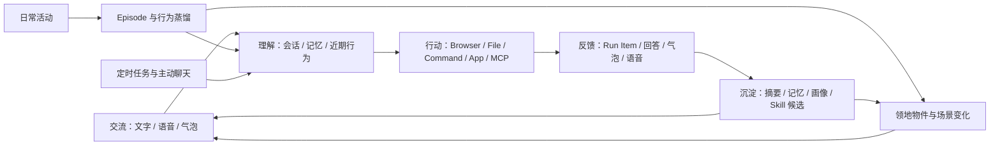
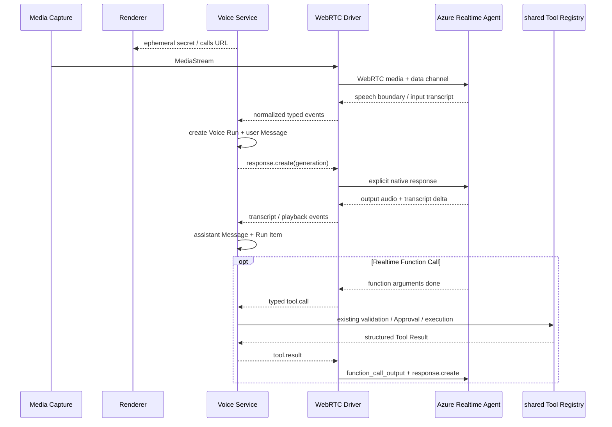
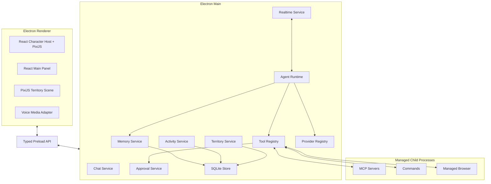
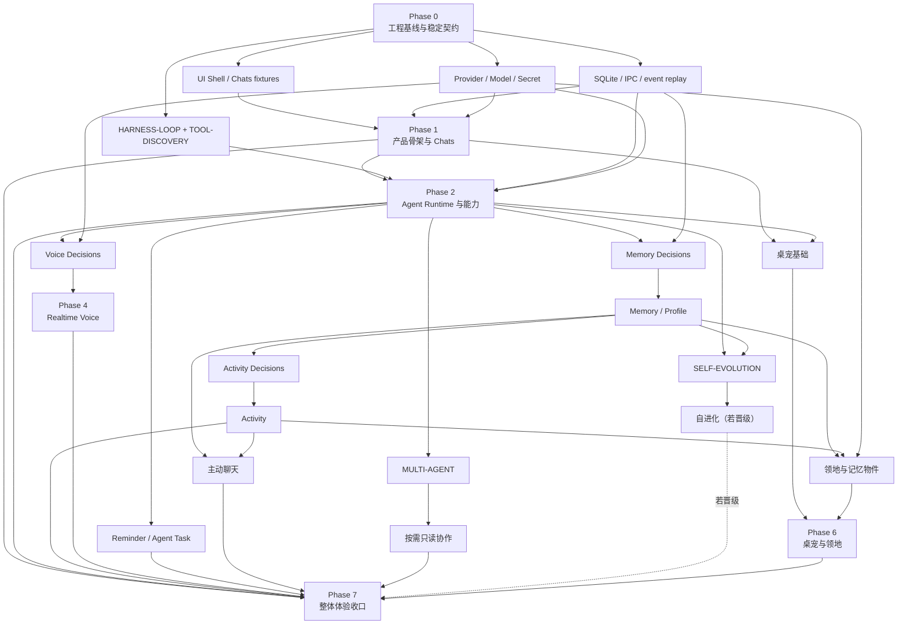

# CharaMate 完整产品与技术架构设计

> 状态：Design Review
> 日期：2026-08-01
> 范围：产品功能、交互、Agent Harness、记忆、语音、桌宠领地、代码与数据架构

---

## 0. 架构结论

CharaMate 是一个由常驻二次元桌面角色承载的个人 AI Agent。她能以文字和实时语音与用户交流，理解多会话上下文和长期生活轨迹，在用户选择的执行模式下操作浏览器、文件、命令、应用与 MCP，并将真实使用逐步沉淀为可编辑记忆、角色人格偏好和一座可见生长的像素领地。

| 主题 | 最终设计 |
| --- | --- |
| 产品入口 | 桌面角色、气泡、主面板、快捷键和托盘 |
| 一级页面 | Chats、领地、Memory、Activity、Automations、Settings |
| 基础技术栈 | 单 package Electron + Electron Forge/Vite + strict TypeScript/ESM + React；只有一条构建与打包路径 |
| Renderer | CSS Modules/语义 Token、Radix Primitives、Lucide、TanStack Virtual；PixiJS 只承载桌宠与领地像素渲染 |
| 契约与数据 | TypeBox + Ajv 的 JSON Schema-first 契约；typed Preload；`better-sqlite3` prepared SQL 与领域 Repository，不使用 ORM |
| Agent Harness | 单一、自适应、事件驱动的循环；没有固定 12 步上限 |
| Chat / Agent | 用户在 Composer 中明确选择，位置与模型、执行权限在同一输入区 |
| 执行过程 | Run/Item 事件持久化；运行时展开，完成后折叠为“已处理 …” |
| 长期记忆 | `better-sqlite3` 保存 Memory/Revision 真源；索引、图关系、向量布局和写入参数由实验一次选定，发布版只有一套实现 |
| 检索 | 产品只依赖一个冻结的 `RetrievalPipeline`；候选、模型与参数只存在于研究设计和实验工件 |
| 行为理解 | 原始活动 → Episode → 周期摘要 → Agent 按需紧凑检索 / 跨周期待确认记忆 / 领地候选 → 定期删除低价值原始数据 |
| 自我进化 | 触发式异步复盘；四类用户确认候选，Skill 再经过 replay；生效后只由普通 Skill 管理器管理 |
| 实时语音 | Azure OpenAI `gpt-realtime-2.1` 全双工原生 Agent；共享客户端 Tool/Approval、上下文、Run/Item 与持久化边界 |
| 浏览器与电脑操作 | Playwright/DOM 优先，App Action/Accessibility 次之，视觉 Computer Use 兜底 |
| 扩展协议 | JSON Schema Tool、Agent Skills `SKILL.md`、MCP stdio/Streamable HTTP |
| 桌宠素材 | CharaMate 自有目录；兼容导入 Codex pet v1/v2 文件夹 |
| 领地 | 像素风可编辑空间；记忆生成物件，角色可走动，Azure GPT Image 负责受控生图 |
| 用户权限 | Composer 只有“请求批准 / 替我审批 / 完全访问”三个直观档位 |
| 敏感信息 | 写入持久层前统一去除密钥等敏感值；API Key 使用系统能力简单加密 |
| 开发指标 | 独立本地看板和结构化日志；不进入普通产品页面 |
| 测试工具 | Vitest + Testing Library + Playwright Electron；默认回归离线，Live/Benchmark 独立运行 |

两个 Azure Endpoint：

```text
Realtime
https://datasetannotator-openai.openai.azure.com/openai/v1/realtime?model=gpt-realtime-2.1

Image Generation
https://datasetannotator-openai.openai.azure.com/openai/deployments/gpt-image-2/images/generations?api-version=2025-04-01-preview
```

---

## 1. 产品定义

### 1.1 一句话定位

一个长期生活在用户桌面上的二次元 AI 搭子：能聊、能听、能看懂近期生活、能记住重要事情，也能真正完成电脑上的任务。

### 1.2 核心体验

1. 用户不需要打开主面板，也能点击角色、拖动角色、查看气泡或开始语音。
2. 需要完整交流时，主面板提供多会话 ChatGPT 式聊天体验。
3. 需要执行时，用户在输入框把 `Chat` 切为 `Agent`，并选择本轮执行权限。
4. Agent 的每一步真实操作、命令、结果、等待确认和耗时都可见、可展开、可追溯。
5. 聊天、语音和执行结果可形成可编辑、有来源、会更新和衰减的记忆；Activity 先保留为独立事实与摘要，Agent 可按需检索，只有跨自然周期稳定的可观察行为才进入用户确认的长期候选，不能由使用时长推断偏好或用途。
6. 记忆与生活轨迹不只藏在列表中，还会转化为领地中的物件、场景变化和短小文字。
7. 用户通过人格、音色、语音 instructions、Skills、MCP 和 Provider 塑造自己的 CharaMate。

### 1.3 产品闭环



### 1.4 设计原则

1. **一个运行内核**：文字、语音、定时任务、主动聊天和桌宠动作都进入同一个 Run Runtime。
2. **模式由用户选择**：LLM 可以建议切换 Agent，但不能把 Chat 静默升级为可执行任务。
3. **过程真实可见**：UI 只展示已经发生或正在发生的结构化事件，不用自然语言伪造步骤。
4. **本地持久、可追溯**：会话、记忆、活动、执行事件和领地数据以本机数据库为准。
5. **长程而不臃肿**：上下文压缩、无进展检测与可恢复 checkpoint 代替固定小步数和静默资源截断。
6. **实验只负责选型**：候选 Arm 不等于产品档位；实验结束后只保留一个获胜实现，reranker、ANN、图扩展和 multi-agent 没有收益就完全不进入产品路径。
7. **面向用户呈现**：普通界面只展示完成任务所需的产品控制；研发指标放进独立本地看板。
8. **成长来自内容**：人格、记忆、Skill 和领地随使用变化，不设置亲密度数值或关系阶段。
9. **固定值必须有来源**：协议限制来自当前官方文档或源码；产品启发式参数来自预注册实验或可用性测试，不能凭直觉写死。
10. **实验必须收口**：胜者以干净实现进入产品，失败 Arm、Adapter、feature flag、依赖、临时 Schema 和用户开关在合并前删除。

---

## 2. 信息架构

### 2.1 窗口

| 窗口 | 作用 |
| --- | --- |
| Character Window | 透明常驻桌面角色、状态动画、气泡、快捷语音和简短审批 |
| Main Panel | Chats、领地、Memory、Activity、Automations、Settings |
| Managed Browser | CharaMate 管理的 Chromium 与独立持久化 Profile |
| Dev Dashboard | 仅开发时启动的本地浏览器看板，不出现在产品导航 |
| Tray | 显示/隐藏角色、打开主面板、语音静音、暂停活动感知、退出 |

主面板关闭只销毁该窗口，不结束仍由 Character Window 承载的常驻应用。桌宠、Tray 与 macOS `activate` 等入口必须经过同一个主窗口生命周期 owner：已有窗口就恢复、显示并聚焦，窗口已销毁就单飞重建；需要打开特定页面时，必须等新 Renderer 报告 ready 后再发送导航事件。来源基线：2026-08-06 检查项目锁定的 Electron `43.2.0` 类型与 API 说明，使用 `BrowserWindow.closed/isDestroyed/restore/show/focus` 和 macOS `app.focus` 的当前语义；重建与导航时序属于 CharaMate 的产品生命周期约束。

### 2.2 主面板一级页面

| 页面 | 用户看到的内容 |
| --- | --- |
| Chats | 会话列表、完整消息、Composer、Run 过程、附件、语音转写 |
| 领地 | 可扩建 2.5D 像素世界、桌宠生活、自由布置、AI 创作与记忆物件 |
| Memory | 搜索、画像、长期记忆、来源、Revision 与衰减状态；图关系只在对应 Decision 晋级后出现 |
| Activity | 今日/历史 Episode、应用/浏览器/截图摘要和蒸馏结果 |
| Automations | 定时任务、主动聊天规则、运行历史和对应 Chat |
| Settings | 角色、Persona、语音、Provider/Model、Skills、MCP、Browser、桌宠 |

Browser 和 Computer Use 是 Agent 能力，不占一级页面；浏览器登录/Profile 管理在 Settings，实际浏览器按需打开。

### 2.3 全局状态

```ts
type CompanionState =
  | 'idle'
  | 'listening'
  | 'thinking'
  | 'acting'
  | 'waiting_approval'
  | 'speaking'
  | 'success'
  | 'failed'
```

同一状态同时驱动：

- 角色动画；
- 气泡文案；
- Chats 中当前 Run Item；
- 托盘状态；
- 可选的短提示音。

Main 进程是状态真源，Renderer 不自行推断“任务是否完成”。

这里的“托盘状态”和“短提示音”都不是语音回答：

- **托盘状态**是系统菜单栏/托盘图标的轻量投影。图标证明 CharaMate 单实例仍在运行，菜单以自然语言显示唯一活动桌宠、当前 Voice 与 Activity 暂停状态，并复用现有服务完成显隐、打开主面板、麦克风静音和暂停感知。它不显示 Run、Journey、Together Session 或自动化数量，也不增加第二套任务状态。
- **短提示音（earcon）**是很短的非语言声音，只用于应用在后台时提示“需要批准 / 已完成 / 失败”。它不朗读回答、不循环播放，并受一个简单的“提示音”开关和系统静音控制；具体时长按 UI 原型与听感测试冻结。
- **实时说话**属于 Voice Session。语音模式开启后，同一个 Realtime response 同时产生流式显示文字和输出音频；命令、JSON、日志和代码等原始过程留在结构化 Run Item，不混进这条自然语言回答。Realtime 正在说话时不叠加完成提示音。

因此，用户与角色进行语音对话时看到和听到的是同一条助手消息的文字与音频；托盘与 earcon 只负责应用级状态提示。

---

## 3. 常驻桌面角色与气泡

### 3.1 桌面角色

- Character Window 使用 React host + PixiJS canvas：React 管理文字、菜单、气泡和可访问交互，PixiJS 只管理 atlas、sprite、朝向与动画 tick。
- 透明、无边框、置顶窗口，角色以像素或透明动画精灵显示。
- 单击打开/聚焦最近 Chat；双击可按 Persona 配置触发问候或语音。
- 右键提供简短菜单：聊天、语音、领地、切换角色、静音、设置、退出。
- 鼠标可从角色任意可点击区域开始拖动，拖到哪里就停在哪里，不吸附屏幕边缘。
- 多显示器分别记住逻辑坐标与屏幕 ID；显示器变化时只把角色夹回当前可见区域。
- 重启后恢复尺寸、缩放、位置、朝向和当前桌宠。
- 空闲时可以在小范围内做 Persona 对应的动画，但不擅自改变用户放置位置。

### 3.2 桌宠素材目录与 Codex 兼容

CharaMate 只读取自己的目录：

```text
userData/
  pets/
    <pet-id>/
      pet.json
      spritesheet.webp
      preview.webp        # optional
```

最小 `pet.json`：

```json
{
  "id": "mika",
  "displayName": "Mika",
  "description": "A cheerful pixel-art desktop companion.",
  "spriteVersionNumber": 2,
  "spritesheetPath": "spritesheet.webp"
}
```

导入器接受一个 Codex 风格文件夹，校验后**复制**进 CharaMate 目录；运行时不依赖 `~/.codex/pets`。因此用户可直接复制兼容素材，但两边安装、更新和删除互不影响。

发布包随附 Columbinya v2 与 Linnea v1 两个初始桌宠。首次启动使用同一导入校验与复制路径把缺失项写入 CharaMate 自有目录；同 ID 的已有桌宠、当前选择和用户后续修改均不被覆盖。内置资源也不改变运行时边界：Renderer 仍只读取 `userData/pets`。

兼容格式：

| 版本 | 图集 | 含义 |
| --- | --- | --- |
| v1 | 8 列 × 9 行，通常 `1536×1872` | 9 个标准动作；可能没有 `spriteVersionNumber` |
| v2 | 8 列 × 11 行，`1536×2288` | 9 个标准动作 + 16 个视线方向 |

每格 `192×208`。标准动作行：

```text
0 idle
1 running-right
2 running-left
3 waving
4 jumping
5 failed
6 waiting
7 running
8 review
9 look 000° → 157.5°
10 look 180° → 337.5°
```

内部使用语义动画名，Renderer Adapter 再映射图集行；这样 v1 缺少视线行时可自然降级到 idle，而不把 Codex 的命名渗透到业务代码。

### 3.3 气泡

气泡类型：

| 类型 | 内容与操作 |
| --- | --- |
| `reply` | 最近一段简短回答；点击打开对应 Chat |
| `progress` | “正在查看文件”“正在操作浏览器”等当前 Item 摘要 |
| `waiting_approval` | 动作摘要、允许一次、拒绝、打开详情 |
| `proactive` | 主动问候或基于长期摘要的轻量话题；全新话题先作为短时邀请，已有对话直接续接 |
| `automation` | 定时任务完成/失败摘要；点击打开持久化 Run |
| `error` | 一句用户可理解的错误与打开详情；轻量投影可显式关闭，关闭只清展示态 |

`waiting_approval` 的完整事实只存一份：Chat 中的 Approval Item。气泡是它的轻量投影：

- 低信息动作可直接“允许一次 / 拒绝”；
- 命令较长、包含多个文件或需要额外选择时只显示摘要，点击进入 Chat；
- 处理后气泡立即消失，Chat Item 记录决定与时间；
- 过期或 Run 已取消的按钮不可再执行。

### 3.4 人格

内置数个可直接使用的 Persona，例如：

- 元气开朗：主动、自然、有感染力；
- 温柔陪伴：语速舒缓、表达克制；
- 冷静可靠：信息密度高、少寒暄；
- 活泼吐槽：有轻度幽默，但不影响任务清晰度。

用户可以：

- 从预设复制创建；
- 编辑名称、背景、说话风格、称呼、主动程度、禁用表达；
- 为每个人格配置默认音色和语音 instructions；
- 切换后只影响新回答，不改写历史消息。

人格中可以自然描述关系与相处方式，但产品没有亲密度、经验值、等级或关系阶段。

---

## 4. Chats、Composer 与 Agent Run

### 4.1 多会话

支持新建、重命名、置顶、搜索、归档、恢复和删除 Chat。会话标题与全部生命周期动作只由左侧 Chat 列表拥有：通过会话项菜单重命名、置顶、归档、恢复或删除，重命名在该行内完成；主内容不再重复会话标题或动作 Header。每个 Chat 独立保存：

- 消息与附件；
- 语音转写与 Turn 元数据；用户主动上传的音频仍作为普通附件处理；
- 滚动摘要；
- Run 与 Run Item；
- 使用的 Persona、Provider、Model 与权限模式快照；
- 相关长期记忆引用；
- Automation/主动聊天来源。

“新建 Chat”先进入右侧未持久化草稿态，不立即向侧栏插入“新对话”；用户首次发送时才创建真实 Chat 并出现在会话列表。创建后的即时兜底标题取首条用户消息的紧凑文本；首轮回答成功且所选 Provider 可用时，再以无 Tool 的后台模型请求生成简短摘要标题并实时替换。标题请求失败时保留兜底，若用户已经手工重命名，迟到的模型结果不得覆盖用户标题。

Voice Session 是需要持久化的例外：开始语音时立即创建或绑定真实 Chat。桌宠“聊天”入口先显示“语音对话”，首条完整用户转写到达后调用同一个首消息兜底标题函数，首轮回答完成后再按需调用既有 `ChatTitleService` 生成摘要标题；Voice 不拥有另一套标题提示词、服务或状态。标题 Provider 只在摘要阶段惰性创建，其凭据或请求失败只保留上一层可读标题，不得阻断 Voice Session 启动、回答或结束。语音进行中点击“新建 Chat”时，必须先成功结束当前 Voice Session，再进入普通空白草稿；结束失败时保留原会话并显示错误，不能悄悄产生第二个会话。

同一个 Chat 内 Turn 串行；不同 Chat 可并行。切换页面不会停止后台 Run。

### 4.2 Composer

布局采用 ChatGPT 式圆角输入容器和 VS Code Copilot 式模式选择，但所有图标来自统一 SVG 图标集，不使用 Emoji 充当产品图标：

```text
┌──────────────────────────────────────────────────────────────┐
│ [Add]  问问 CharaMate……                                      │
│ [Chat ▾] [Model ▾] [请求批准 ▾]  [Mic] [Voice/Send]          │
└──────────────────────────────────────────────────────────────┘
```

空输入或单行输入保持紧凑胶囊；有附件或多行文本时自然展开为“内容区 + 底部控制条”。按钮使用清晰的 hover、focus、active 和 tooltip，不把所有选项做成常驻文字按钮。完整布局、尺寸、颜色和状态在独立 UI 设计稿中定义。

控件：

- `Add`：图片、本地文件、文件夹或当前截图；
- `Chat / Agent`：由用户选择；
- `Model`：当前 Provider 自动发现的模型下拉框；
- 权限：Agent 模式显示“请求批准 / 替我审批 / 完全访问”；Chat 模式隐藏或禁用；
- `Mic / Voice`：线性麦克风图标用于录音入口，圆形波形按钮用于进入/结束 Realtime；连接后明确显示聆听、静音和结束状态；
- `发送`：有运行时变为停止按钮。

模式语义：

| 模式 | 能力 |
| --- | --- |
| Chat | 回答、计划、Provider 原生网页搜索、读当前会话、检索记忆、分析附件及其他幂等只读查询；不执行有外部效果的 Tool |
| Agent | 具备 Chat 的查询能力，并可使用本地、Browser、Computer Use、MCP 与 Skills；按本轮权限处理审批；自主判断是否调用内建只读协作能力 |

LLM 如果在 Chat 中发现任务需要执行，只能回复建议并给出“一键切换 Agent”按钮；不能自行升级。

Chat 与 Agent 使用同一个 Agent Runtime、Tool Registry、Context 和标题链路，只在 Tool 执行边界按 `effect=read && idempotency=idempotent` 限制 Chat。两种模式都加载计划能力和 Provider 原生网页搜索；简单问答或一次查询直接回答，不为展示流程而创建计划，只有真正的多步骤任务才调用计划工具。Voice 从 Composer 进入时继承当前 Chat/Agent 与 Agent 权限，从桌宠声波入口进入时创建 `Agent + 完全访问` 会话；开始后不再改写权限语义。

用户明确发起虚构角色扮演时，仍使用普通 Chat 和同一 Agent Runtime，不新增第三种 Composer 模式。用户独占其玩家角色的动作、对白、决定和感受；CharaMate 只扮演非玩家角色与环境，承认用户输入并给出局部可见后果，不为推进预设剧情改写用户选择。用户明确出戏后立即停止演绎。虚构事件只属于当前 Chat 上下文，不写成用户现实 Memory、Journey、Activity 或 Tool 事实；这条边界不限制用户明确要求的共同写作、续写或改稿。

当模型需要少量、明确且会改变后续执行的信息时，可以调用宿主直接提供的结构化 `request_user_input`，由 Chat 内卡片收集选项或自由文本，再继续同一个 Run。它不是外部副作用，不走 Approval，也不应先经 Tool Search；普通对话式追问仍可直接使用自然语言，不强迫所有问题结构化。

### 4.3 执行权限

| 选项 | 产品语义 |
| --- | --- |
| 请求批准 | 读取与低影响观察直接进行；命令、写文件、点击提交等动作在执行前询问 |
| 替我审批 | 对当前 Run 的普通动作自动批准；不可恢复或账户关键动作仍询问 |
| 完全访问 | 当前 Run 按用户目标直接执行，只保留操作记录与停止能力 |

这是用户在 Composer 每次可见的唯一权限选择。Settings 可设默认值，不提供繁复风险矩阵。

### 4.4 消息渲染

助手消息完整支持：

- CommonMark 与 GFM，并兼容 CJK 标点/正文紧邻的强调与删除线 delimiter；
- 标题、粗体、斜体、引用、列表、任务列表、链接；
- 表格和横线；
- 行内代码与带语言的代码块、语法高亮和复制按钮；
- 行内/块级 LaTeX，使用 KaTeX；
- 图片、音频、视频和生成文件卡片；
- 可折叠的长 Tool 输出；

流式阶段对未闭合 Markdown 做增量容错；消息完成后重新进行一次确定性渲染。CJK 兼容在固定解析管线内完成，不预处理或改写源 Markdown；代码块、LaTeX 和表格不能因流式 token 造成永久错位。

复制与消息操作对齐成熟聊天产品：

- 用户问题悬停后可“复制问题”，必要时可编辑并重新发送；
- 助手回答底部提供“复制完整回答”，复制源 Markdown，保留代码围栏、公式源码、列表和表格结构；
- 每个代码块右上角独立复制，只复制代码正文，不包含语言标签或行号；
- 行内公式和块级公式悬停后可复制 TeX 源码；
- Tool 输出、命令和表格有各自的复制动作；
- 复制成功用轻量图标状态和短 tooltip 反馈，不弹出阻塞式提示框。

### 4.5 Run 与 Item

```text
queued → running ↔ waiting_approval → completed
              ↘ needs_input
              ↘ interrupted
              ↘ failed
              ↘ cancelled
```

Run 是一次用户目标；Item 是 Run 中真实发生的事件：

```ts
type RunItemKind =
  | 'user_message'
  | 'assistant_message'
  | 'plan'
  | 'input_request'
  | 'tool_call'
  | 'command'
  | 'file_change'
  | 'approval'
  | 'context_compaction'
  | 'error'
```

每个 Item 保存状态、顺序、起止时间、耗时、结构化输入、截断后的可显示输出、完整结果文件引用和错误。系统不保存或展示模型隐藏推理。

UI 行为：

1. Run 进行中，当前非 Plan Item 自动展开，输出实时追加；最新 Plan 快照悬浮在 Composer 上方，默认只显示当前完成数/总步数，hover、focus 或点击后展开完整步骤。
2. 命令以 `命令 + 工作目录 + 状态 + 输出` 的下拉卡片显示。
3. Tool Call 以用户可理解的动作标题显示；第一层展开看到动作摘要，第二层再看参数、命令和截断结果。
4. `input_request` 显示模型真正等待的 1–3 个短问题、互斥选项和可选自由文本；提交后答案只注入一次并继续同一 Run，刷新或重启不会丢失待回答状态。
5. 等待审批时定位到 Approval Item，同时桌宠进入 `waiting_approval`。
6. Run 进入终态后，活跃 Plan 悬浮层消失，全部过程自动折叠为“已处理 2分13秒 · 8 项”，下方只保留最后回答；点击整行可重新展开完整过程及最新 Plan。
7. 展开后显示的是助手主动给用户看的进度摘要、计划变化和真实 Tool/Command/File Item，不展示隐藏 chain-of-thought。
8. 用户可以复制整个问题、完整回答、单个代码块/公式、命令或 Tool 输出，也可以打开文件或从失败 Item 继续。

### 4.6 Agent Harness

主循环没有“最多 12 个模型步骤”的限制：

```text
创建 Run 与 UserMessage Item
  ↓
组装有界 Context
  ↓
模型流式返回 Assistant 内容或 Tool Call
  ├─ final 且无用户追加输入 → 完成
  ├─ Tool Call → Schema 校验 → 审批 → 执行 → Tool Result → 继续
  ├─ Context 压力高 → 压缩已完成历史 → 继续
  ├─ 用户追加消息 → 在当前 Run 的一致性边界合入 → 继续
  ├─ 暂时无进展 → 按获胜 Loop Guard 改变策略、询问用户或诚实失败
  └─ 进程/网络中断 → 保存 checkpoint，恢复后继续
```

正常产品路径**不以总时长、累计 Token 或累计成本作为静默硬停止条件**。上下文 Token 接近窗口时先压缩并继续；时间、Token 和成本只进入可观测与软提醒，用户随时可以主动停止，不伪装成任务已经完成。

Run 的终态语义：

- `completed`：模型给出 final，且没有待处理 Tool、审批、steering 或异步 continuation；
- `cancelled`：用户明确停止；AbortSignal 向模型、Tool 和子进程传播；
- `needs_input`：缺少无法推断的必要信息，或审批拒绝后确实没有其他合法路径；拒绝本身先作为结构化 Tool Result 返回，Agent 可以改用无副作用方案；
- `failed`：Provider 或必需 Tool 在有界重试/换策略后仍不可恢复，必须如实说明完成到哪里；
- `interrupted`：应用退出、崩溃、断网或 Provider session 丢失；保存 checkpoint 后允许恢复。

重复调用检测不是立即终止：同一规范化失败连续出现且没有新观察时，Harness 先要求改变策略；仍无进展才进入 `needs_input` 或诚实失败。底层 supervisor 可以处理失控进程等基础设施异常，但必须留下可恢复边界，不能让模型用假答案收尾。

### 4.7 Plan 与 Multi-agent

- 简单任务直接执行，不强制先写计划。
- 多步骤任务可生成可见、可更新的 Plan Item；Plan 只是同一 Harness 的一种 Item。
- 活跃 Run 只把最新 Plan 快照投影为 Composer 上方的紧凑悬浮进度；Run 结束后该快照回到“已处理”历史，不复制 Item 或维护第二份计划状态。
- 普通路径由父 Agent 保持目标和完整上下文；Chat 始终使用这条单 Agent 路径。
- Agent 模式始终加载一个内部 `collaboration.dispatch` 能力，但是否调用由父 Agent 根据当前目标自行判断，不增加 Composer、Settings 或每轮授权开关。
- 只有恰好两个相互独立、可并行、只读且资源声明互斥的具体子目标才能派生；简单任务、顺序依赖、写操作、待审批动作以及 Browser/Computer 可变会话留在父 Agent。
- 父 Agent 在一次调用中预声明每个 child 的目标、资源与确切幂等读取；宿主只做结构、当前 Tool scope、只读性、幂等性、资源冲突和可变会话校验，不替 Agent 做语义拆分选择。
- 两个 child 并发读取各自资源并独立生成证据摘要；父 Run 必须等待两者终局，再负责合并证据、处理限制和生成最终回答。取消信号与恢复边界沿同一 Run/Tool 生命周期传播。
- 实际派生作为一个普通可折叠 `subtask` Run Item 显示，内部列出两个 child 的状态、证据和 Token；UI 使用统一的分支 SVG 图标，不使用 Emoji。
- 选择依据、机械 no-go 与仓库所有者的透明事后取舍见 [`docs/benchmarks/multi-agent.md`](./docs/benchmarks/multi-agent.md)。生产只保留上述 `D2 + M2R` 路径，不保留实验 Arm、并发档位或 fallback 开关。

### 4.8 并发与恢复

- 同一 Chat 一个活动 Turn，用户的新输入作为 steering 排队或合入当前 Run。
- 不同 Chat 默认有限并发；实际数量按设备和 Provider 限流动态控制。
- 每个 Browser Profile 同时只有一个写操作 Run。
- Run/Item 先持久化再广播 UI；Renderer 刷新或应用重启后从数据库重建状态。
- 崩溃时 `running` Item 变为 `interrupted`，用户可以继续或结束；已完成 Tool 不自动重放。

### 4.9 同行事项与共处会话

CharaMate 的陪伴叙事是“**一起做，一起经历，一起记住**”。它使用两个互相嵌套、但不取代 Chat/Run 的时间尺度：

- **同行事项（Journey）**：持续数天到数月，表达一件对用户重要的事如何被用户和角色共同走过；一个同行事项拥有一个由系统管理的 Home Chat，可以包含多次共处会话、会话间的续接、稀疏阶段节点、一次明确约定的跟进以及最终回望。
- **共处会话（Together Session）**：持续数十分钟到数小时，表达一次围绕具体活动的共同在场；可以跨文字、Voice、Browser、文档和普通 Agent Run，但不拥有另一套模型循环、Tool、审批或消息系统。

系统不要求用户先说“陪我做什么”，也不把显式创建入口作为常规起点。常规入口是：Activity 提供有来源的当前活动观察，陪伴 Agent 依据完整语境语义判断“不打扰 / 发起一段新对话 / 回到某个既有 Journey”，再通过普通 Chat Run 发出一句轻量、具体且有依据的对话邀请。全新话题的开场 Run 暂存在一个不进入最近或已归档列表的 provisional Chat 中；气泡可见后的 20 秒内，用户第一次文字回复或明确启动该气泡的语音回复才把它原子转为普通 Chat，超时或关闭则连同开场 Run 与消息级联删除。已有 Chat 的续接与约定跟进已经属于正式历史，不使用这套短时删除规则。Activity 不负责判断陪伴意图，也不创建 Journey 或 Together Session；语义门不使用应用名、论文、电影等关键词表或正则硬编码。每条 Activity 主动消息成功投影后，宿主执行 5 分钟全局冷却；仅持久化最近 3 次主动消息的观察依据、实际话术和回应/关闭/到期结果，冷却结束后由 Agent 基于这 3 条记录判断新开场是否在语义上重复，宿主不增加标题、关键词或字面相似度规则。20 秒与 5 分钟都是仓库所有者明确选择的 CharaMate 产品启发式，分别负责临时 Chat 转正和全局打扰节流，不是 Provider 或操作系统协议限制。

主动开场本身仍是普通对话，不自动代表共同在场。用户接住话题并让角色实际参与当前活动后，Agent 才可根据语义开始 Together Session，不要求用户说出固定邀约句；只闲聊、忽略或关闭气泡都不产生 Session。对话进一步表明这是一件会持续数天到数月、且对用户重要的事时，Agent 可以自然提议把它作为 Journey 一起走；Journey 仍只能由用户明确提出，或由 Agent 提议并获得用户确认后创建，绝不因 Activity 匹配而静默创建。若新 Journey 正是从当前对话里尚未结束的共处生长出来，宿主在同一事务中完成创建与关联，不让用户重新选择或搬运 Chat。Agent 只提交带候选 ID 的语义动作，宿主负责 ID、Home Chat、路由和全部状态不变量。

状态与基数规则：

- Journey 只有 `active / paused / completed`；完成后可以重开，并保留原完成节点。
- Together Session 只有 `active / paused / ended`；全局至多一个 `active`。开始或恢复另一场共处时，宿主自动暂停当前未结束共处。
- 一次共处最多关联一个 Journey；一个 Journey 可以包含多次共处；共处也可以独立存在。
- 暂停表示仍打算续上这次具体共处；结束表示本次共同在场已经收束，即使 Journey 仍继续。空闲时长、沉默或话题轻微漂移都不自动暂停或结束。
- 暂停 Journey 会暂停它当前活跃的共处；之后 Agent 基于明确语义恢复其中一场共处时会同时恢复 Journey。
- 完成 Journey 会结束其全部未结束共处、写入完成节点并停止开放式跟进许可；需要独立继续的共处必须先解除关联。重开 Journey 不复活已结束共处。
- 应用退出、崩溃或恢复时，遗留 `active` 共处转为 `paused`，绝不伪装为完成。

Journey 的 Home Chat 是系统路由目标，不是用户要理解或挑选的概念。来自 Activity、Automation、Memory 或当前对话的确定入口直接携带内部 ID；自然语言由 Agent 在当前候选中做语义判断，唯一匹配时直接操作，真实歧义时只询问用户说的是哪一件具体事情，不让用户挑 Chat。当前共同活动只在全局显示简短范围提示并允许自然纠正；纠正改变关联，不复制 Run 或消息历史。

`Journey`、`Together Session`、`Home Chat` 及其状态名只属于产品设计、持久化和 Agent Tool 协议，**不是普通用户要创建、浏览或管理的对象**。正常界面不出现“同行中 / 待续共处 / 同行回望”分组、Session 卡片、Journey 详情抽屉或开始、暂停、恢复、完成、重开按钮；系统管理的 Home Chat 与其他 Chat 一样出现在最近对话中，并继续使用普通重命名、置顶、归档和删除交互。删除该 Chat 时随 Chat 一并删除只为续接服务的 Journey/Session/节点引用，不以隐藏外键阻止用户删除；已经独立进入 Memory 的内容继续由 Memory 自己的删除规则管理。跨页面只保留一条非阻塞的当前在场提示，例如“Mika 正和你一起：修改论文引言”，不显示所属 Journey、状态、时长或进度；它只允许回到原对话，或以“理解有误”预填一句自然纠正，不直接暴露状态变更。

生命周期动作由 Agent 根据完整对话语义调用内部 Tool：实际开始共同处理具体内容时开始或续上；明确转去另一项共同活动时开始新 Session 并由宿主自动暂停旧 Session；“先到这里、晚点继续”保存续接点并暂停；“看完了、这次结束了”保存短回顾并结束。用户不需要使用“陪我”“共处”“同行”或任何固定口令，Agent 也不得在回复中播报“已创建 Journey”“已开始共处”等内部结果。话题轻微变化、失焦、沉默或经过一段时间仍不足以改变状态。长期性被自然揭示时，Agent 只用日常语言提出一次具体承诺，例如“以后再看到这篇论文时，我继续从这里接，可以吗？”；用户确认后才创建 Journey。暂停、完成、重开、范围纠正和忘掉这段连续性同样通过普通对话表达，用户面对的始终是具体事情，而不是状态机。

Activity 再次观察到与既有 Journey 语义一致的活动时，陪伴 Agent 可以把开场路由到该 Journey 的 Home Chat，让用户无需重新解释；真实歧义或证据不足时保持沉默，不以气泡逼用户消歧。该路由只恢复对话上下文，不恢复 Journey 状态，不开始或恢复 Together Session，也不扩大执行权限。用户回复后，Agent 再根据“是新的一次共处、续上某次未结束共处，还是只聊几句”分别处理。

共处期间角色拥有**局部、可撤销的语境主动性**：只在当前活动已有内容、Tool 结果或自然边界提供帮助；用户说“安静陪我”后，除审批、错误和重要结果外不制造闲聊。沉默本身是有效陪伴，时间流逝不能触发“还在吗”“加油”等空洞关心；没有真实文档、页面、音视频或 Tool 观察时，角色不得声称看见或听见。共处不会扩大当前 Run 的执行权限，也不会把主动性带到会话外。

创建 Journey 只授予跨会话连续性，不授予外呼权限。会话外默认只记住并在用户回来时自然续接；主动跟进必须有 Journey 范围内的明确自然语言约定。MVP 把约定具体化为一个可见的下一次一次性跟进，复用 Automation 的 Agent Task 并投递到 Home Chat；同一条已完成的助手消息再投影到桌宠气泡，不另存一份“提醒事实”。

气泡是目标 Chat 的轻量第二界面，不是新的 Runtime、提醒卡或共处控制器。每个气泡创建时已经绑定一个精确 `chatId`：Activity 全新话题绑定宿主自动创建但尚未转正的 provisional Chat，匹配既有 Journey 或 Journey 跟进时绑定其正式 Home Chat；它不跟随主窗口当前正在浏览的 Chat，也不要求用户选择归属。provisional Chat 只为统一 Run/Item 和准确回复路由提供短暂内部归属，不出现在 Chat 列表、搜索或归档记录中；用户第一次回复后沿用同一个 `chatId` 转正，不搬运、不复制消息。用户可以完全不打开主窗口，在气泡内连续发送短文字；每轮用户消息和助手回答仍由统一 Agent Runtime 写入这个 Chat 的普通 Run/Item，回答完成后投影回同一个气泡。语音入口同样固定绑定该 Chat，并使用 `Chat` 权限。文字或语音媒介都不会自动恢复 Together Session，也不会继承桌宠通用声波入口的 `Agent + 完全访问` 语义。

气泡只承担轻量文字往返：完整历史、附件、富内容精读、结构化输入、审批和复杂执行过程继续在“打开完整 Chat”后处理；切换界面不复制消息或迁移 Run。全新话题在用户回复前不提供“打开完整 Chat”，不显示倒计时、进度条或“保存会话”；20 秒超时或关闭气泡会撤下投影并删除 provisional Chat，应用退出或崩溃留下的 provisional Chat 在下一次启动时清理。第一次文字回复，或从该气泡明确发起语音回复，代表用户接住对话：宿主先转正原 Chat、取消到期清理，再运行回复；即使后续 Provider 失败，用户已经接住的 Chat 也继续保留。已有 Chat 的气泡关闭只关闭投影，不删除 Chat、消息或已启动的 Run，也不改变 Journey/Session 状态；用户已接住的气泡不会被另一条主动开场替换。回复后只要完整语义表明角色已经实际加入当前活动，Agent 即可开始或恢复，无需“继续陪我”等固定表述。关闭或忽略气泡不产生追问，暂停状态本身绝不触发提醒。后续才评估有界开放式“偶尔问问”，不在 MVP 中建立无限调度。

每次暂停或结束都保存可纠正的续接记录（当前位置、下次切入点和短回顾），但不自动制造长期 Memory。Journey 时间线只保存有意义的决定、转折、结果、完成/重开节点和已关联的共享 Memory。用户明确说“记住”时沿用 `memory.record`；Agent 只可对少量显著时刻语义判断并清楚告知记住了什么、如何纠正或忘记。Territory 物件只在重要里程碑或完成回望时提出，仍需用户选择，不按每次共处自动生成。

项目、考试、求职和内容共赏使用同一组状态与数据结构，不成为模板或场景状态机。差异只进入 Agent 的语境姿态、证据和里程碑表达：项目不变成看板，考试不变成打卡监督，求职不变成 CRM，单次电影或文章共赏默认可以只是独立共处。

MVP 要验证的核心承诺是：用户经历多次切换和间隔后，角色仍能回到正确的事情及准确续接点，用户无需重新解释、挑选 Chat 或管理 Journey/Session；同时只收到一次自己同意的跟进，并能在结束时得到自然回望与可见记忆。成功指标关注范围理解、自动路由、纠正/重述次数、主动介入是否有依据且不打扰，以及用户是否感到“被陪着”而不是“被项目管理”，不以任务完成率代替陪伴价值。可用性验收必须直接检查普通界面和 Agent 文案中不存在内部名词与状态管理控件，不能只证明底层状态正确。

2026-08-13 的触发语义复核参考了 OpenAI 官方 [Chronicle 文档](https://learn.chatgpt.com/docs/customization/chronicle)（当日访问）：Chronicle 使用近期屏幕上下文理解用户当前所见、补足用户未显式写入提示词的信息并识别相关来源。CharaMate 只采用这一“上下文依据”边界；官方文档没有定义主动搭话策略，因此“不打扰 / 新对话 / 既有 Journey”的选择、气泡投影和 Session/Journey 生命周期均是 CharaMate 自身的产品语义，不冒充 Chronicle 行为。

---

## 5. Tool、Skills、MCP、Browser 与 Computer Use

### 5.1 统一 Tool Registry

所有可执行能力使用主流 Tool Calling 形状：

```ts
interface ToolDefinition<Input, Output> {
  name: string
  description: string
  inputSchema: JsonSchema
  execute(input: Input, context: ToolContext): Promise<Output>
}
```

Tool Result 是结构化数据，至少含 `status`、用户可见摘要、模型可见结果和可选 artifact。模型不通过解析日志字符串判断成功。

Registry 负责：

- 唯一命名与 Schema；
- 当前 Chat/Agent 模式可用性；
- 审批要求；
- AbortSignal 和 deadline；
- 输出截断与 artifact 化；
- Run Item 事件；
- 指标与错误分类。

Provider wire Schema 与领域 Schema 只有一个真源、两个校验层次：Tool Registry 始终用完整 TypeBox/Ajv Schema 校验真实调用；Responses Adapter 只有在根级对象、全部对象字段必填且没有 strict 子集不支持的约束时，才为该 Tool 启用 `strict: true`。包含 `format`、`pattern`、长度或数值范围等完整领域约束的 Tool 仍发送同一 Schema，但使用非 strict Function Calling，并在宿主执行前完成完整校验，不复制或放宽领域契约。来源：2026-08-14 复核 [OpenAI Structured Outputs supported schemas](https://developers.openai.com/api/docs/guides/structured-outputs#supported-schemas) 与锁定的 `openai@6.49.0` 类型。

Tool 的模型可见性分为固定核心与 deferred 长尾两层。`file.list`、`file.read`、`file.search`、`file.write`、`file.patch`、`file.trash` 和 `command.run` 是本地执行的核心原语：只要当前 Chat/Agent 模式允许，该完整 Schema 就随首个模型请求常驻，并从 Tool Discovery 候选集中排除；Agent 不先搜索这些能力。Skills、MCP、App Action、Browser/Computer 专项动作以及其他长尾能力继续使用已接受的 `T2-CLIENT-BM25` 按需发现。常驻只表示模型可见，不表示获得执行授权：Chat 仍只暴露幂等只读能力，Agent 写入与 critical 操作仍经过统一 Approval Policy。2026-08-28 复核锁定的 `openai@6.49.0` Responses 类型：`defer_loading` 是逐 Tool 的可选字段，`tool_search` 只服务 deferred Tool；协议没有要求同一 Registry 中全部 Tool 都必须 deferred。具体边界见 `docs/benchmarks/tool-discovery.md` 的带日期修正。

### 5.2 内置能力

| 类别 | 示例 |
| --- | --- |
| File | 列目录、读文件、搜索、patch、创建文件、移动到废纸篓 |
| Command | 运行命令、流式 stdout/stderr、交互输入、终止进程 |
| App | 打开/聚焦应用、打开 URL/文件、触发已注册 App Action |
| Browser | 导航、DOM/AX 快照、点击、输入、上传、下载、截图 |
| Computer | 读取 Accessibility 树、截图、鼠标、键盘、窗口操作 |
| Image | 读取用户图片附件、已知本地图片、截图或图片 artifact 的真实像素语义 |
| Memory | 检索、读取来源、创建候选、编辑记忆 |
| Chat | 创建会话、附加结果、读取当前 Run 状态 |
| Territory | 提议物件/套装/区域改造、生成预览、编辑 World change、管理收藏与来源 |

当前公开信息在 Adapter 已确认 Provider 支持时优先使用原生 Web Search；需要页面交互、已登录状态或可复现 DOM/AX 证据时使用 Managed Browser；网页结构化能力不足时才退到 Computer Use。原生搜索、受管浏览器与 Computer 分别承担检索、交互和兜底职责，不构成同一能力的运行时模式或失败回退链。

图片输入只有一条 Main-owned 媒体路径。用户在 Composer 明确附加的图片直接成为 Provider 多模态 message content；Agent 已经知道某个本地图片、截图或图片 artifact 时，通过按模型/环境能力条件直载的 `image.inspect` 请求同一路径读取。Renderer 缩略图、文件名、路径或 OCR 文本都不能单独作为“模型已经看过图片”的证据；目标模型不支持视觉输入时明确返回能力不可用，不暗中切换未验证的识别方案。

### 5.3 Browser

Managed Browser 由 `playwright-core` 驱动产品管理、版本固定的 Chromium，并使用独立持久化 Profile：

- 用户可以直接登录网站；
- 支持用户导入 Cookie，导入后写入该 Profile；
- Playwright 或兼容 MCP 操作已登录页面；
- 下载进入 CharaMate 管理目录，并以 Chat artifact 展示；
- 上传必须来自用户附件或 Agent 明确选定的本地文件；
- Browser 动作产生可见 Item；只有 Computer Use 定位、结果证据或调试确有需要时才附截图 artifact，不为每次 DOM 状态变化持续截图。

执行优先级：DOM/Accessibility Locator → Playwright 行为 → 截图视觉定位。网页能被结构化定位时不使用坐标猜测。

### 5.4 Computer Use 与 App Action

Computer Use 作为统一 fallback：

1. 有 App 专用 action、CLI 或 API 时优先；
2. 否则读取 macOS Accessibility 语义树并按元素操作；
3. 语义树不足时获取截图，由视觉模型定位；
4. 鼠标键盘动作仍记录为 Tool Item，并服从 Composer 权限。

OS 首次要求的 Accessibility/Screen Recording 权限使用系统原生提示；产品只解释“为了让 Agent 操作应用需要开启”，不再设计一套额外授权系统。

### 5.5 MCP

支持标准 MCP：

- Adapter 使用官方 MCP TypeScript SDK，但只把标准 Tool 描述/调用映射到 CharaMate Tool Registry，不让 SDK 拥有 Run、Approval 或持久化状态；
- stdio；
- Streamable HTTP；
- `tools/list` 和 `tools/call`；
- server 级启用/停用、连接测试、工具列表与状态；
- 环境变量、参数和工作目录配置；
- Tool 名采用 `mcp__<server>__<tool>` 防止冲突。

用户可以在 Settings 添加和管理，也可以在 Agent 模式授权 Agent 写入配置。Agent 修改后必须重新发现工具，不把外部 Tool 描述永久塞进所有会话 Prompt。

### 5.6 Skills

采用 Agent Skills 目录与 `SKILL.md`，不发明自有格式：

```text
<workspace>/.agents/skills/<skill-name>/SKILL.md
userData/skills/<skill-name>/SKILL.md
```

Skill 可以包含少量脚本、模板和 references；常驻上下文只加载名称与短描述，命中后再读完整 `SKILL.md`。Settings 左侧只显示紧凑的名称与短描述，并以“当前 / 已归档”区分生命周期；详情支持启用、编辑、Pin、保存、归档、恢复和永久删除。保存是普通的“保存更改”，不向用户暴露 revision、历史版本或点击恢复历史的入口；内部 revision/hash 只服务于防止过期成长 patch 覆盖手动编辑、崩溃恢复和删除收口，不构成产品版本功能。归档与删除位于独立的 Skill 管理区，不和保存并列。活动或已归档的用户 Skill 都可以由用户在二次确认后永久删除；活动 Skill 在删除事务内部先进入可恢复归档状态，再清除整个目录和内部 revision 记录，workspace Skill 始终只读且不可删除。关联成长候选只保留内部来源证据并解除已删除 Skill 的激活绑定，不在 Settings 中重新形成第二套 Skill 管理入口。

生命周期来源说明（2026-08-13）：锁定复核的 [Agent Skills specification commit `217be548739f21d6008915c29aefe320ea1a90af`](https://github.com/agentskills/agentskills/blob/217be548739f21d6008915c29aefe320ea1a90af/docs/specification.mdx) 只定义 Skill 目录、`SKILL.md` 与可选资源，不定义启用、归档、恢复或删除协议；这些是 CharaMate 的产品生命周期语义，不冒充外部协议约束。

Agent 可在以下情况下创建或修改 Skill：

- 用户明确说“把这个流程学会”；
- Experience Review 生成候选，由用户确认；Skill 候选再通过 replay。

### 5.7 自我进化

`SELF-EVOLUTION` 已由 [`docs/benchmarks/self-evolution.md`](./docs/benchmarks/self-evolution.md) 定案为一条触发式异步路径。完成 Run 只有在出现用户明确纠正、明确教学、具有客观验证的成功或已持久化的重复工具模式时才排入 `ExperienceReview`；不按固定 Tool Call 数或每个 Run 调用模型。Review job 先持久化再异步执行，重启恢复 queued/running 状态，不阻塞刚完成的主回答。

`ExperienceReview` 是无 Tool 权限的单次结构化候选生成器，不是第二套 Agent Runtime，也不直接写入任何领域。Text Run 复用来源 Run 的 Chat Provider/Model；Voice Run 的来源快照属于 Realtime transport，不能作为严格 Structured Outputs 的 Chat Model 使用，因此只复用来源 Run/Item/Message 证据，并通过产品既有默认选择取得一个已配置的 Chat Provider/Model。没有可用 Chat Model 时该 Voice Review 直接完成为 `skipped`，不发送错误协议请求，也不生成失败候选；兼容 Chat Model 的真实网络、认证或 Provider 失败仍保留为可重试 `failed`。Review 只输出四类结构化草稿：

```ts
type EvolutionCandidate =
  | MemoryCandidate
  | PersonaPreferenceCandidate
  | SkillPatchCandidate
  | NewSkillCandidate
```

候选要求：

- 指向来源 Run/Item；
- 展示新增或修改内容；
- 区分“用户是谁”与“这类任务怎样做”；
- 所有候选都由用户接受、编辑或拒绝，Reviewer 不自批；
- Skill 候选在用户接受后跑同类与旁路 replay，通过才激活；replay 是增量质量信号，不替代用户确认；
- Skill patch 绑定 Review 时加载的目标 ID、revision 与内容 hash；接受和激活都重新校验，不能覆盖其后发生的手动修改；revision 是内部并发真源，不是用户版本功能；
- 用户只处理待确认候选和 replay 失败候选；Skill 候选生效后，在来源 Chat 中降为无生命周期动作的结果记录，后续编辑、Pin、归档、恢复和删除全部进入普通 Skill 管理器；忽略或已归档候选不进入 Skills Settings；
- Settings 或 Agent 显式修改、归档、恢复、pin Skill 时，仍在内部同步关联候选的 stale、archived 与 pin 状态；用户永久删除 Skill 时，候选只保留来源证据并解除激活绑定，不向普通 UI 提供从候选恢复 Skill 的第二条路径；
- 后台归档可恢复，不删除用户内容；永久删除只来自 Settings 中用户对用户 Skill 的二次确认，活动 Skill 在删除事务内部先归档；
- 候选只覆盖 Memory、Persona 偏好和 Skill，不把产品源码、系统 Prompt 或 Provider 配置变成自进化对象。

用户在来源 Chat 中处理“这次学到了什么”；Memory/Persona 候选也可在 Memory 统一处理。Memory 保持“搜索/筛选 + 列表/详情”主体，成长候选只进入左侧有界的待确认区域；Review 失败使用不改变布局的紧凑状态，允许重试或关闭。关闭只把该失败 Review 收口为 `skipped`，不删除来源 Run、候选或 Memory。Skills Settings 只管理已经存在的 Agent Skills，不展示成长候选历史。

Phase 3 的 `memory.record` 与普通 Memory 候选仍负责当前 Run 中用户明确陈述的基础形成。本节不复制该路径，也不采用 Hermes 的直接写入、后台 forked Agent、固定 iteration 或自动归档日期。

---

## 6. 长短期记忆与用户画像

### 6.1 目标

记忆系统需要同时做到：

- 让角色在聊天和语音中自然想起相关事实；
- 支持用户查看、编辑、纠正、删除和追溯；
- 正确处理事实更新、时间和冲突；
- 让大量低信息 Activity 在独立 Episode/Digest 生命周期内保持有界，同时向 Agent 提供紧凑事实检索，并只把跨周期稳定行为送入用户确认的长期候选；
- 在个人规模上低延迟、低写放大；
- 任何运行环境都只使用实验冻结的同一条检索路径，不靠隐藏备用算法维持表面可用。

### 6.2 记忆类型

| 类型 | 示例 |
| --- | --- |
| profile | 用户称呼、职业、长期偏好、重要关系 |
| preference | 喜欢安静的咖啡馆、不喜欢过甜饮品 |
| project | 当前项目、技术选择、未完成目标 |
| event | 一次重要经历、决定或里程碑 |
| procedure | 用户习惯的工作方法；可进一步形成 Skill |
| commitment | 约定、提醒、后续要做的事 |
| activity_digest | 某个周期及跨周期的高信息行为归纳 |
| agent_learning | 用户对回答或执行方式的纠正 |

用户画像不是独立黑盒；它是稳定、当前有效的长期记忆投影，点击画像条目可以回到 Memory Revision 和原始证据。

### 6.3 Memory 与 Revision

```ts
interface Memory {
  id: string
  type: MemoryType
  status: 'active' | 'superseded' | 'archived'
  currentRevisionId: string
  importance: number
  confidence: number
  validFrom?: string
  validTo?: string
  lastAccessedAt?: string
}

interface MemoryRevision {
  id: string
  memoryId: string
  content: string
  sourceType: 'chat' | 'voice' | 'activity' | 'tool' | 'user_edit' | 'distillation'
  sourceIds: string[]
  reason: string
  createdAt: string
}
```

- 编辑创建 Revision，不覆盖历史。
- 新事实与旧事实冲突时，新 Revision 可 supersede 旧 Revision。
- 用户手动纠正具有最高事实优先级。
- Memory 页面可查看时间线、来源消息/Activity/Run、相关实体与被使用记录。
- 删除进入可恢复状态；用户明确永久删除时清除 Revision、索引引用和相关展示投影。

### 6.3.1 使用期自动形成

`MEMORY-FORMATION` 已选择同 Run 的 `F2-IN-RUN-TOOL`：`memory.record` 是 Chat 与 Agent 都始终加载的宿主能力。当前回答模型在最终回答前提交结构化记忆意图，宿主把它写入既有 `MemoryService`；不增加 post-Run reviewer、第二套 Agent、轮询任务、规则解析器、运行时开关或用户设置。

唯一生效规则是：

- 用户在当前输入中明确陈述、且预计在本轮之后仍有用的画像、偏好、项目、事件、方法或承诺，直接创建 active Memory；
- profile/preference 必须使用产品闭集 `claimSlot` 作为稳定字段身份，Tool 不接受裸 profile/preference type；模型按语义选择字段并提交 `create/replace/append/remove`，宿主派生 Memory type 与单值/集合基数，字段名不随“喜欢 A → 喜欢 B”变化；
- Memory、Revision 与来源 ID 只存在于宿主私有 checkpoint、持久化和 Memory 详情追溯中，不注入模型可见证据，不要求模型复制，也不得出现在普通聊天回复；
- profile/preference 更新由模型提交稳定 `claimSlot` 和 operation，宿主只在该字段唯一 active 目标属于当前 Run 私有 allowlist 时解析并修订同一 Memory；内部调用若显式携带 `memoryId`，仍必须交叉校验 ID、type、slot、active 状态和 operation；
- 更新未取得本轮合法目标、同 slot create 冲突、本次 R0 真正命中的同类型字段与另一个 slot create 形成歧义、单值字段误用 append/remove、推断更新或旧 unkeyed 数据首次绑定时，只创建带 operation/slot/target 的待确认候选；错 ID 直接失败，不创建第二条 active Memory。稳定画像中的全部字段可作为合法更新目标，但仅因被有界预注入而不自动阻断其他新字段；
- 只从语境推断出的结论和 Agent 执行观察只能创建待确认候选，不直接进入 Profile 或默认 Context；
- 临时请求、助手自己的主张、复制资料、否定内容、凭据和未受支持结论不形成记忆；
- 来源类型、Chat/Run reference、证据 Item 和时间由 Main 绑定，模型不能提交来源 ID；相同规范化内容、重复 Tool Call 和 checkpoint 恢复幂等，不制造第二条 Memory 或候选；
- active Memory 在后续新 Run 通过同一 Memory Context 装配进入 Context：所有已绑定的 active profile/preference 稳定字段形成有界画像投影，当前请求另执行既有 R0 top8；两部分去重后，模型可见内容只含事实文本、类型、稳定字段、有效时间和来源数量/类型/时间跨度的紧凑摘要，宿主私有 checkpoint 另存目标 allowlist。候选在 Memory 页面显示 operation、字段、目标、形成原因与完整来源，由用户接受或忽略。接受定向更新候选时修订原 Memory，不新建 superseding Memory。

`memory.record` 是产品内部持久化，不是 Agent 对外执行动作，因此不走三档执行审批；它仍作为可恢复 Run Item 记录成功或失败。稳定字段身份存入 `memory_claims`，形成候选的 operation/slot 存入 `memory_candidate_formation`；v5→v6 不猜测旧内容的字段。手动新建、编辑和纠正继续保留，但不再是形成普通 Memory 的唯一入口。Phase 4 Voice 复用同一能力并把宿主来源改为 Voice；Phase 5 仅负责异步 Experience Review、Skill/replay 与高级任务方法成长。

2026-08-09 的实现前来源刷新复核了 OpenAI 官方 [Function calling](https://developers.openai.com/api/docs/guides/function-calling) 与仓库锁定 `openai@6.49.0` commit [`04671d2`](https://github.com/openai/openai-node/blob/04671d278ef1531692ae31a870251eec90f3c2d2/src/resources/responses/responses.ts)：应用提供 JSON Schema Function Tool，模型返回结构化 call，应用以匹配 `call_id` 的 output 继续同一响应流程。它只定义协议构件；direct/candidate、来源绑定、去重和 Phase 边界是 CharaMate 产品策略。

### 6.4 衰减

衰减影响自动检索排序，不自动抹去事实。相关性、有效时间、最近使用、重要性、置信度和用户 pin 是必须保留的语义信号，但不在产品设计中预先规定乘法公式、权重或阈值；排序组合由同一检索实验选出并冻结。

- `validity` 先处理已经失效或被取代的事实；
- 使用和用户确认会推迟衰减；
- 重要、固定、身份类事实衰减很慢或不衰减；
- 一次性 Activity 摘要快速退出在线 Context，但仍可搜索；
- 用户可以 pin、降权、归档或恢复。

### 6.5 图关系能力

`MEMORY-GRAPH` 已选择无图实现：oracle-quality 一跳关系没有改善冻结 graph 问题的 evidence reach。发布版没有 Graph 表、索引、检索分支、文件、设置或图谱 UI；Memory 之间的组合回答只使用唯一 Retrieval Pipeline 返回的 Revision evidence。该结论不是运行时开关，未来若真实产品数据形成不同证据，应新开 Decision，而不是预留空图模块。

### 6.6 唯一 Retrieval Pipeline

Memory 对外只暴露一个 `RetrievalPipeline`：

```ts
interface RetrievalPipeline {
  search(query: MemoryQuery): Promise<MemoryHit[]>
}
```

`MEMORY-RETRIEVAL` 已选择单路 SQLite FTS5：文本先做 NFKC、中文/英文 word segmentation，并为连续 Han 词补相邻二元词；按 BM25 召回。查询先过滤删除、状态、有效时间与 `asOf` Revision；相同 relevance 才依次用 pin、importance、confidence、last access、updated time 与稳定 ID 打破平局。Revision 与 FTS 在同一事务更新，不在启动时全量重建。

发布版遵守：

1. 只有一条在线路径、一组参数和一个索引生命周期；
2. `ContextCompiler`、`memory.search` 和 Memory 页面搜索复用它，不各自维护排序；
3. 时间、有效性、冲突、Revision 和来源追溯是稳定语义；
4. 用户和 Settings 看不到内部模型、融合、topK、重排或索引档位；
5. 在 `MEMORY-RETRIEVAL` Decision Record 完成前不得实现生产检索；完成后本节只写入胜者，不把候选搬回来；
6. 失败 Arm 的代码、表、模型、依赖、配置和 feature flag 不进入合并结果。

### 6.7 检索运行时工件

获胜 Pipeline 不需要 embedding、reranker 或专用向量索引。发布物不包含检索模型、向量表、segment、worker、下载流程或本地/远程 fallback；FTS 与 Memory Revision 同属一个 SQLite 生命周期。索引事务失败时该 Memory 写入整体失败，不静默切换到另一套排序算法。

### 6.8 Context Engineering

`ContextCompiler` 只有以下不可变契约：

- 当前用户请求、附件和 steering 不得被较早内容挤掉；
- 当前审批结果、最新必要 Tool Result 与本轮所需 Tool Schema 必须可见；
- Provider Adapter 按当前 Provider、模型和协议元数据解析本 Run 的有效输入预算，Harness 只在该预算上应用已选的 90% 压缩水位；数值不得按 Model ID 写死，且必须随 checkpoint 冻结，恢复同一个 Run 时不得中途漂移；
- Provider 既没有模型列表限额、也没有模型详情限额时不猜窗口值，保留真实 context-limit 错误后至多一次强制压缩恢复；
- 记忆进入模型 Context 时带事实文本、类型、稳定字段、时间和有界来源摘要，不能变成无来源事实；Memory/Revision/来源 ID 与逐条 provenance 只留在宿主和 Memory 详情页；
- 会话摘要是带覆盖水位和来源的版本化工件，能够表达目标、约束、完成动作、重要决定与未解决问题；
- Persona、近期原文、摘要、长期记忆、Activity Digest 和 Tool 结果的具体顺序、预算、topK 与裁剪规则由 `CONTEXT-RECIPE` 实验一次选定。

`CONTEXT-RECIPE` 已选择 `C2 PRE8 + goal-last`，并在 2026-08-27 的真实缺陷修复中明确其画像边界：每个新 Run 固定装配全部已绑定且 active 的 profile/preference 稳定字段，并只执行一次当前请求的 R0 top8 检索；两部分去重后把模型可见的紧凑 evidence 与宿主私有 Memory allowlist 一起存入 checkpoint，物化给 Provider 时只发送前者。有界活跃上下文与结构化 handoff 在前，当前用户输入靠近末尾。模型续步、Tool continuation、恢复和 run 内 steering 不重复初始检索；压缩仍保留该 evidence 与当前/最新结构化用户输入、未完成宿主状态和最新必要 action Tool Result。

跨 Run 的会话工作记忆固定为每个 Chat 一份持久 `ChatContextSnapshot`，与完整聊天记录、当前 Run checkpoint 和长期 Memory 分离：

- `messages` 继续保存完整、不可因模型上下文裁剪而删除的用户可见记录；Renderer、搜索、导出和来源追溯都读取完整记录，而不是摘要投影；
- Snapshot 保存单调递增 generation、版本化 summary、`coveredThroughMessageId`/时间水位以及最近一次真实请求的输入用量校准。水位之前的原文只由 summary 代表，水位之后的已完成消息作为近期原文；两者不得同时注入造成重复；
- 新 Text Chat、Automation、主动对话、inline continuation 与 Voice start/reconnect 都从同一 Snapshot + 水位后近期原文编译 Chat 工作上下文。Run terminal 后删除 checkpoint 不得删除或回退 Snapshot；应用重启后继续使用同一 generation；
- 新 Run 前只在按当前 Provider/模型解析出的有效输入预算达到既有 90% 水位时滚动更新 Snapshot。裁剪边界按最早的完整已结束 Run 推进，并保留满足预算的最长近期完整 Run 后缀；不另设固定消息条数、Run 数或模型专属窗口；
- 摘要生成只使用当前选中的同一 Chat Provider/模型，输入为旧 summary 加即将覆盖的完整 Run 片段，输出覆盖目标、约束、完成动作、重要决定和未解决问题。成功后以比较交换方式推进水位；失败时保留旧 Snapshot 并让当前请求可重试，不伪造摘要、不静默丢弃历史；
- Provider 在新 Run 第一次模型调用、尚未产生 Tool/Plan/assistant 边界前返回 context-limit 时，允许强制执行一次持久 Chat 滚动并重试；进入 Run 循环后的超限仍由既有 Run 内 compaction 恢复，只更新临时 checkpoint，不修改 Chat 水位。

2026-08-18 来源刷新：OpenAI 官方 [Responses Compaction](https://developers.openai.com/api/docs/guides/compaction) 明确最新 compaction item 承担后续上下文状态，stateless chaining 可丢弃其之前的输入；Codex `main` commit [`f47f77a`](https://github.com/openai/codex/tree/f47f77ada6699460bf13b0b7278e710692e0ea34) 将 replacement history 持久为 `RolloutItem::Compacted`，恢复时从该 history 重建；LangChain `master` commit [`9f2d56e`](https://github.com/langchain-ai/langchain/tree/9f2d56e376ea926d334f8f99ed7c67b154c2f0bf) 的 `SummarizationMiddleware` 以 summary 替换旧 message state 并保留近期完整消息。这些来源只支持“压缩结果必须跨后续调用成为状态”的边界；90% 水位、完整 Run 边界、Snapshot Schema 与单一路径是 CharaMate 已选 Recipe 和本次正确性修复。

Plan 的持久化和模型上下文分工固定如下：完整 Plan 更新仍以 `kind=plan` 的 Run Item 作为历史与 UI 投影真源；活动 checkpoint 保存从最新已完成 Plan Item 恢复出的 `currentPlan` 编译快照。普通 Tool、审批与 steering 可以更新 handoff，但不得覆盖该快照。每次压缩都在当前用户输入之前重新注入最新完整 Plan（说明、全部步骤与三态）；新 Plan 更新会替换快照并移除较早的压缩 Plan 消息，避免长上下文同时出现两个“当前计划”。这不是第二份可编辑计划状态，也不增加 Plan 表或 Renderer 状态机。

`memory.search` 是 deferred 只读能力，不常驻普通上下文，也不成为后台自动第二检索阶段。若用户询问个人历史、偏好或“你记得什么”，而预注入画像与 R0 evidence 确实不足，当前 Chat/Agent/Voice 模型可按需加载并调用至多一次，使用面向证据的简洁改写，并可附 `type`、`claimSlot` 或 `asOf` 结构化过滤；返回仍经过同一 R0 top8，但每条只投影事实文本、类型、稳定字段、有效时间、排序和来源数量/类型/时间跨度，不展开来源 label/reference，不返回任何内部 ID。证据已经充分时不得重复，空结果也不得作为事实不存在的证明。发布版不维护同义词表、停用词规则链、第二检索器、动态 topK 或用户可见装配模式。

`activity.search` 是 Activity 领域拥有的 deferred 只读能力，与 `memory.search` 分开。用户询问近期使用轨迹、跨日习惯或某个应用/网站的实际使用情况，而当前上下文没有充分证据时，Text/Voice Agent 可按需查询 Episode/Digest 的紧凑聚合；省略 query 表示查看概览，指定对象时由当前模型做简洁证据查询，不在宿主维护同义词表。返回沿用 Context evidence 的固定最多 8 条投影，只含可观察标签、活跃日期数、片段数、累计分钟和首末时间，不展开窗口原文、截图、逐条 Episode/Digest provenance 或任何内部 ID。结果只能表述“观察到的行为”，不得自动解释成喜欢、职业、目标或用途，也不自动进入普通 Memory Retrieval。

旧版未绑定 `claimSlot` 的 active profile/preference 不进入稳定画像投影，且不得由迁移或模型静默猜测字段。Memory 详情为这类记录提供显式“绑定稳定字段”；若目标字段已有记录，界面同时展示两边当前内容和可编辑的合并后完整内容，用户确认后在字段 owner 上创建 Revision，并把旧记录标记为 superseded。Memory 页面手动新建 profile/preference 时必须先选择稳定字段，避免继续产生无身份记录。

### 6.9 Activity 蒸馏为记忆

```text
Raw events
  → Episode（连续行为片段）
  → Period Digest（一个冻结周期内的高信息摘要）
  → activity.search evidence（Agent 按需读取的紧凑可观察事实）
  → Cross-period activity_digest candidate（跨自然周期稳定、用户确认）
  → Proactive conversation evidence（可解释的活动事实）
  → Territory item candidates（用户明确选择的可展示摘要）
```

原始事件、截图和逐条 Episode 不进入普通 Memory Retrieval，也不随 `activity.search` 注入模型。Activity 保留完整 Digest/evidence 供自己的页面、来源追溯和保留清理；Agent 只获得上述有界聚合。

同一用户 actor 的同一 app/domain/activity 标签只有在至少两个已完成自然周的 Weekly Digest 中都出现时，才形成 `activity_digest` 待确认候选。`2` 是“跨周期”成立所需的最小不同周期数，是 2026-08-28 用户确认的产品语义，不是协议限制或可调检索阈值。候选只陈述“多个自然周持续出现的可观察使用行为”，不累计写入不断增长的分钟数，也不推断偏好、职业、目的或人格；其来源固定为最近两个匹配 Weekly Digest，而不是展开全部 Episode。

同一稳定标签只能有一个候选/长期 Memory 身份：pending 候选会用最新两个 Weekly Digest 刷新而不累加；用户拒绝后相同模式保持抑制；用户接受后，相同语义继续出现不会生成新候选或 Revision。旧版已经接受、内容为累计时长且来源膨胀的 `activity_digest` 不被静默改写；该模式再次满足跨周条件时，可产生一个指向原 Memory 的紧凑替换候选，只有用户确认才创建 Revision。新的稳定标签继续按同一规则沉淀。明确聊天/Voice 陈述仍具有更高事实优先级。

### 6.10 存储与写放大

`better-sqlite3` 保存 Chat、Run、Memory Revision 和其他关系型元数据，并开启外键一致性。`MEMORY-STORAGE` 已选择 `WAL + synchronous=FULL` 与 SQLite 默认 autocheckpoint；产品不增加自定义 checkpoint job、busy-timeout 档位或存储设置。长清理与重建不进入交互事务，Activity 和批量使用记录在领域事务内提交。检索未选择专用向量工件时，不创建向量表、segment、worker 或本地模型服务。

稳定存储分工：

| 数据 | 位置 |
| --- | --- |
| Chat、Run、Memory、Revision、来源与所选索引 metadata | SQLite |
| 截图、音频、附件、生成图像 | asset 文件目录 |
| 所选 Pipeline 的专用工件 | Decision Record 指定的唯一位置；不需要则不存在 |

降低写放大：

- Activity Episode/Digest 与检索使用记录使用各自领域的显式事务；索引和 Revision 与真源同事务更新，文件 GC 在数据库提交后执行并由 orphan sweep 收口；
- 检索命中批量追加到 `memory_usage`，`lastAccessedAt` 从使用记录投影，不在每次命中时改写 Memory 主行；
- 原图等大资产单独保存，数据库只保存路径、尺寸、时间和摘要；
- 清理、重建与长模型调用不进入交互事务，Renderer 不承担存储或索引计算。

### 6.11 Memory 页面

Memory 页面包含：

- 由唯一 Retrieval Pipeline 提供的统一搜索；
- 用户画像卡片；
- 按类型、时间、来源、状态筛选；
- Revision 时间线；
- 来源 Chat/Voice/Activity/Run 跳转；
- 若 `MEMORY-GRAPH` 晋级，显示相关实体和关系的小型证据视图；未晋级则不出现空入口；
- pin、编辑、纠正、归档、删除；
- “生成领地物件”与已经进入领地的状态；
- 待确认的记忆/画像候选。

---

## 7. Activity 行为感知

### 7.1 数据源

| 来源 | 记录内容 |
| --- | --- |
| Active App | bundle/app 名、窗口标题、开始/结束时间 |
| Managed Browser | 页面标题、URL/域名、标签状态和操作事件 |
| Screenshot | 定时或事件触发截图文件及 OCR/视觉摘要 |
| Idle | 空闲开始/结束，用于切分 Episode |
| Agent Run | 由 CharaMate 自身执行的工作，避免与用户手动行为混淆 |

### 7.2 采集与 Episode

- 前台应用变化立即结束上一段并开始下一段。
- 同 actor、同应用和同窗口在 8 分钟内合并；不同窗口不因应用名相同而混为一段。
- Browser 标签停留和 Active App 统一到时间线，但保留来源。
- macOS 前台应用使用加载到 Electron Main 进程内的最小 Node-API 原生适配层订阅 `NSWorkspace.didActivateApplicationNotification`；启动时从 `frontmostApplication` 取得一次初始事实，同一 Main 进程再通过 Accessibility 读取焦点窗口标题，并在焦点窗口或标题变化通知到达时刷新。生产路径没有独立 Activity 可执行 helper，也不周期性启动 `System Events`/AppleScript；仅保留每 15 秒一次的进程内 idle 状态采样，以在连续 idle 60 秒时切断 Episode，锁屏或休眠仍由系统事件立即切断。15 秒是 CharaMate 的 idle 边界延迟启发式，不是协议限制或普通用户设置。
- 截图只在用户前台状态变化时触发，且距上次成功截图至少 15 分钟；Activity 使用主显示器逻辑像素尺寸获取一次 PNG，资产层直接写入同一字节并异步计算摘要，不再二次解码/编码。截图任务不占用前台 metadata event 的串行队列；失败不阻断 metadata event，内部频率不做用户档位。
- 原图单独保存；数据库仅保存路径、尺寸、时间和摘要。
- 先用时间、应用变化和 Idle 等确定性边界形成 Episode；Agent 操作使用独立 actor，不归因给用户，发布版不逐事件调用模型。

本节于 2026-08-28 复核 Apple [`AXIsProcessTrusted`](https://developer.apple.com/documentation/applicationservices/1460720-axisprocesstrusted) 与代码签名文档、锁定 `electron@43.2.0` 的 [`systemPreferences.isTrustedAccessibilityClient`](https://www.electronjs.org/docs/latest/api/system-preferences) 以及既有 AppKit 来源：辅助功能信任检查针对调用它的当前进程，macOS 隐私授权又依赖代码身份；Electron Settings 当前展示的是 Main 进程信任状态。仓库实测发现旧独立 helper 在 Main 显示已授权时仍只能持续产生应用名，且本地 ad-hoc 包中两者代码身份分离。CharaMate 因此把 `NSWorkspace`/AX 调用收敛到 Main 内加载的原生模块，让授权查询者与窗口标题读取者成为同一进程；发布包仍按 Apple 内到外规则签名嵌套 Mach-O。以上是平台硬事实与当前源码观察；“没有非空窗口标题就不调用主动陪伴模型”、事件订阅、idle 采样延迟和 15 分钟截图间隔是 CharaMate 产品策略。

### 7.3 Activity 页面

- 今日时间线和 Episode 卡片；
- 应用/网站时长；
- 截图缩略图与搜索；
- 周期摘要和跨周期趋势；
- “这条形成了哪些记忆/领地候选”；
- 用户可编辑 Episode 标题、摘要或删除一段记录；
- 一键暂停/恢复采集放在页面顶部和托盘，不扩展成复杂隐私控制中心。

### 7.4 蒸馏调度

| 频率 | 输入 | 输出 |
| --- | --- | --- |
| 8 分钟闭合窗口 | 原始 transition event | 确定性 Episode 边界与轻量标签 |
| 每日 | 已闭合 Episode | Daily Digest |
| 每周 | 多日 Episode/Digest | Weekly Digest；同一标签跨至少两个已完成自然周后形成紧凑、待确认的 `activity_digest` 候选 |

蒸馏继续采用 `ACTIVITY-DISTILLATION` 选出的无模型 Episode/Digest 单路径，不从任意窗口或截图推断复杂意图，也不自动写 active Memory/Profile。跨周候选只归纳可观察行为、只引用两个 Weekly Digest，并由用户确认；明确聊天表达仍是更高优先级的长期事实入口。

### 7.5 保留与定期删除

Activity 不是永久事件仓库。原始数据完成蒸馏后由 `ActivityRetentionJob` 定期清理：

```text
截图原图 / OCR / 缩略图
  → 原始 app/browser event
  → Episode
  → Period / Cross-period Digest
  → 已接受 Memory / Profile / Territory evidence（独立生命周期）
```

- 在线记忆检索不直接召回原始事件或截图，只召回 Digest、Memory 和必要的 Episode 摘要，避免低信息活动污染回答。
- 删除作业同时清理文件、缩略图、OCR、获胜检索索引引用和数据库行；空闲时再做所选数据库维护、空间回收与 asset orphan sweep。
- 只有 `distilled_at` 已提交的原始层可以回收：截图 7 天、raw event 30 天、Episode 90 天，Digest 与已接受 Memory 使用自己的生命周期；截图资产层同时受 512 MiB 上限约束。
- Digest 和 Memory 的来源保存到稳定摘要证据；原始资产删除后显示“原始活动已按保留策略清理”，不留下失效文件链接。
- 立即清理只提前处理同样已完成蒸馏的原始层，不越过 eligibility；Settings 不提供 TTL、容量或算法档位，只保留暂停采集、查看占用和立即清理。

---

## 8. Azure OpenAI Realtime 语音

### 8.1 产品体验

- 点击 Composer Voice 入口开始 Realtime Session，并继承该 Composer 当前的 Chat/Agent 与 Agent 权限。没有活动 VoiceSession 时，点击桌宠旁的声波按钮新建 `Agent + 完全访问` 的 Voice Chat；同一 Session 活动时该按钮暂停，已暂停时恢复原 Chat 和健康连接。只有显式 `End`、应用退出或异常 Session 清理才结束归属；结束后下一次桌宠入口再新建 Voice Chat。
- 状态依次为连接、聆听、思考、调用工具、说话，也明确显示暂停与恢复中；角色动画同步。
- 支持自然打断：用户开始说话后停止当前播放并继续同一轮上下文。
- 支持静音、暂停/恢复、Push-to-Talk 和免手持模式。暂停停止本地采集和播放但不等于结束；结束始终彻底释放媒体连接。
- 一个活动 VoiceSession 始终固定归属一个 Voice Chat。用户在主窗口选择另一个 Chat 只改变浏览目标，不迁移 Realtime conversation；Voice Dock 标明“原 Voice Chat”。活动或暂停语音期间关闭主窗口只隐藏拥有 WebRTC 的 Renderer 以保留连接；点击桌宠本体仍只负责重新打开主窗口，桌宠旁的声波按钮才负责暂停或恢复原语音。
- 语音模式开启后，Azure Realtime 原生生成同一 response 的音频与输出转写；输出转写实时进入 Chat，工具、审批、命令和日志继续以结构化 Run Item 展示。文字 Agent 不参与这条语音回答，也没有额外 TTS 或朗读模型。
- 语音结束后，用户和助手转写、工具步骤、最终回答都留在同一个 Chat。
- 用户可回看一轮语音的文本；产品持久化转写、Run 和必要协议元数据，不长期保存原始会话音频。
- Voice Session 的标题沿用普通 Chat 的既有链路：“语音对话”占位 → 首条用户转写兜底 → 首轮回答后的模型摘要；标题 Provider 按需惰性创建，任何一步失败都只保留上一层可读标题，不能阻断语音连接或回答。

### 8.1.1 本地固定短语唤醒

Settings → Voice 与 Tray 提供同一个默认关闭开关。用户开启后，常驻 Character Renderer 使用一个 AudioWorklet 和一个 Web Worker 在本机匹配固定短语 `Hi Mika`；命中前不创建 Realtime Session，不把麦克风音频发送给 Provider，也不把原始待机音频写入数据库或文件。Realtime `server_vad` 只继续负责已建立 Session 内的语音边界，不能承担待机唤醒。

命中后本地 KWS 立即暂停并播放短 ready cue，然后调用桌宠既有的 wake-origin quick-start：新会话固定为 `Agent + 完全访问`，不显示或聚焦完整主窗口；若当前 Voice 只是暂停，则恢复同一 Session。ready cue 只确认“本地已经听到唤醒词”；Realtime `session.created` 或恢复后的 `session.updated` 被现有 Voice Runtime 接受后，Voice 立即进入“正在回应”，并发送一次 `conversation: "none"` 的 out-of-band 音频 response，把固定文本 `Hi Mika` 作为本次 response 的临时输入。连接欢迎语只携带用户配置的 Voice 人格/语言偏好和极短欢迎约束，不重复注入完整 Agent、Tool、Skill、Memory 或 Chat Context instructions；简体中文默认只说“我在，请说。”。该欢迎语明确表示已经可以开始说话，允许用户直接插话，但不进入默认 Realtime conversation，也不创建 Message、Run 或 Memory。只有随后到达的非空用户转写才进入既有 Voice Run。首版采用“唤醒 → 本地提示音 → Mika 连接欢迎语 → 自然对话”，不保留同一口气内唤醒词后的 pre-roll。

Character Renderer 持有唯一麦克风基流：待机帧进入本地 KWS，建立 WebRTC 时只克隆该音轨并暂停 KWS，不再打开第二次采集。连接、聆听、思考、工具、审批、说话和输出播放期间均不监听唤醒词，避免角色自身声音触发；Voice 结束后重新布防。误唤醒的 10 秒无输入窗口只能从连接欢迎语完整停止、Voice 重新进入 listening 后开始；连接、生成和播放欢迎语不占用用户回答时间，任何真实用户输入立即取消该收口。10 秒是误唤醒副作用的首版产品启发式，不是协议限制。

锁屏、系统休眠和应用退出释放待机麦克风、Worker 与 AudioContext；解锁或恢复后仅在持久开关仍开启时重新布防。KWS 初始化或运行失败时通过桌宠、Settings 和 Tray 投影可见错误，不建立云端 wake fallback，也不创建第二套 Voice/Run/Tool/Approval 状态机。桌宠上的 Voice 连接失败提示必须能显式关闭；关闭只清 Character Renderer 的提示，不改变真实 VoiceSession、错误记录或 `wake_enabled`，下一次连接尝试仍按正常路径重新显示结果。实现、来源、离线合成语料限制和打包资产哈希见 [`VOICE-WAKE`](./docs/benchmarks/voice-wake.md)。

### 8.2 Endpoint 与连接

```text
Realtime Endpoint：
https://datasetannotator-openai.openai.azure.com/openai/v1/realtime

Realtime Model / deployment：
gpt-realtime-2.1
```

Provider Settings 分开保存无查询参数的 Realtime Endpoint 与 Azure deployment 名称。Main 从该 Endpoint 唯一派生 `POST /openai/v1/realtime/client_secrets` 与 `POST /openai/v1/realtime/calls`：前者使用长期 `api-key` 创建临时 client secret，后者由 Renderer 使用临时 Bearer 凭据提交 SDP offer。长期凭据不进入 Renderer；GA Realtime 不使用 date-based `api-version`。

生产媒体路径固定为 Azure GA WebRTC：麦克风和远端音频走 media channel，Realtime 事件走 data channel，普通 JSON IPC 不承载 PCM。目标 Azure resource 对 `gpt-4o-mini-transcribe` 返回 `DeploymentNotFound`，因此输入转写使用已实测可用的 `whisper-1`，不固定 `language`，以允许用户自然切换语言；prompt 只保留简体中文、英文和产品术语关键词，不在转写后增加翻译、繁简转换、韩文检测或正则修补。来源与取舍见 [`VOICE-TRANSPORT`](./docs/benchmarks/voice-transport.md)。

媒体 Transport 不是用户设置。生产没有 Direct WebSocket 音频 Driver、协议选择器或自动 fallback；Provider 的 WebSocket 连接测试只是配置探测，不属于 Voice 媒体路径。

Voice 连接生命周期属于共享领域合同，不属于 Azure UI 状态：暂停时关闭 capture 与 playback，但保留健康的 PeerConnection/DataChannel；恢复时重新读取当前 instructions 与允许的 Tool 快照。只有 Chat、Provider profile、model、voice、输入模式和 execution 权限身份不变且当前 Driver 声明支持会话刷新时才复用连接；当前 Azure GA WebRTC Driver 把领域刷新命令翻译为 `session.update`，收到 `session.updated` 后才重新采集。身份变化、Driver 不支持热刷新或连接已经断开时走冷重连；没有隐藏连接池、固定 TTL 或自动 Transport fallback。

Provider/协议差异只留在 Adapter 边界。未来若接入 OpenAI 原生或 Azure 上另一种 GPT Live/Voice Live 协议，支持等价会话刷新就复用，不支持就返回冷重连；Chat、Run、Tool、Approval、Voice Dock 与“结束”语义不分叉。当前生产 Provider 仍只有本节已选择的 Azure GA WebRTC。

### 8.3 Realtime Voice Agent

文字 Chat/Agent 继续由 CharaMate `AgentRuntime` 回答；Voice 由 Azure Realtime 自己的 speech-to-speech Agent 回答。两者不是同一个模型循环，但共用同一个产品能力边界：Chat 历史、核心行为 instructions、Persona/Voice instructions、Workspace Skill instructions、相关 Memory evidence、Tool Registry、入口 Chat/Agent 权限过滤、Approval、Run/Item、标题和持久化。Voice 不把转写转交给文字 Agent，也不把文字 Agent 输出再交给 Realtime 改写或朗读。

每条完整用户转写创建一个普通 `source=voice` Run。应用以显式 `response.create` 让 Realtime 基于已经提交到会话的输入音频直接回答；Realtime 的输出转写 delta 与音频来自同一个 response，前者按协议 `response_id/item_id/output_index` 聚合到本 Turn 唯一一条 Chat 助手草稿，后者由唯一远端 `<audio>` 播放。若 Realtime 选择客户端 Function Call，Main 使用现有 Tool Registry 执行并创建正常 Tool/Approval Item，再把完整结构化 Tool Result 作为 `function_call_output` 回注，继续同一 generation。除 Session 生命周期能力 `voice.end` 外，没有普通业务 Tool 的 Voice 副本、TTS、句子切分器、文字转述 fallback 或架构开关。

文字 Responses Provider 的托管 `web_search` 不是客户端 Tool Registry 的成员；当前 Azure Realtime Session 没有这项托管能力。因此 Voice 获得相同的客户端 Tools，但不会伪造本地 `web.search`。适合的 Browser/查询能力存在时可按入口权限使用，否则 Realtime 应简短说明限制。

受管浏览器的 `browser.navigate + browser.snapshot` 是幂等只读查询链，因此 Chat 入口的 Voice 也可用它查询公开网页；点击、填写、下载等操作仍只在 Agent 入口按原审批规则开放。Realtime 不因缺少 Provider 托管 `web_search` 而忽略已经注入的 Browser 查询能力。空白页或空内容的 snapshot 是工具失败而不是查询证据，Realtime 应重新打开目标网址；Agent 入口还可在其既有审批模式内使用同一个 `command.run` 以只读 `curl` 直接查询公开 HTTP/API，不新增 Voice 专用 curl 或搜索 Tool。



Azure `server_vad` 设置 `create_response=false`、`interrupt_response=true`。VAD 自动取消并截断 WebRTC 中尚未播放的活动 response；Main 仍等非空完整转写落入 Chat/Run 后才显式创建新 response，避免产生没有持久化身份的回答。`speech_stopped` 只表示输入音频边界，不表示已经进入思考；没有可用转写时保持聆听。每个 response、Function Call 和 Tool Result 携带 generation/callId，旧 generation 事件只可收口旧 Turn，不能触发当前回答。这里没有句长、等待时间、语种纠偏或文本切分阈值。

Renderer 在用户点击 Composer Voice 或桌宠聊天按钮的同步调用栈中创建并恢复唯一 `AudioContext`，供输入/输出波形分析使用；开始连接时，麦克风权限/采集初始化与 Main 申请临时凭据并行，二者完成后再进入 SDP/ICE 与 DataChannel 收口。实际出声只走一个挂载于当前 Renderer 文档的原生 `<audio>`：远端 WebRTC `MediaStream` 直接赋给 `srcObject`，元素先以静音状态启动，播放时解除静音并显式等待 `play()` 成功；Web Audio 分支只接零增益分析节点，不能再承担扬声器输出。Driver 只有在媒体元素确认播放且远端输出 item 已知时才上报 `audio.started`；`play()` 失败必须显示播放错误，不能把服务端缓冲开始或分析 Context 运行误报成用户已经听到声音。工具前 response 与 `function_call_output` 后的 continuation 可以属于同一个 Voice generation，所有音频开始、停止和清空事件必须按协议 `response_id` 精确管理；旧 response 延迟到达的停止事件不能静音正在播放的新 response。

“全双工”在产品中的准确含义是：麦克风在助手播放音频时仍可检测用户说话，用户可以自然打断；输入采集、网络收发和播放并行。它不表示两个助手回答可以同时播放，任一时刻只允许一个 audible response。

### 8.4 Tool 与 Approval 复用

Session 创建时，Voice 从同一个 Tool Registry 生成一次工具快照：Agent 入口获得全部注册工具，Chat 入口只获得幂等只读工具以及内部 `memory.record` 例外；两类 Voice 入口都额外获得无审批的 Session 生命周期 Tool `voice.end`，普通文字 Chat/Agent 不发现该 Tool。工具执行时再次应用同一规则。Realtime Function 名使用稳定的 `.`/`-` 到 `_` 映射，Main 保留 alias 到真实 ToolDefinition 的一一对应并拒绝冲突，不复制 Tool Schema 或 executor。2026-08-09 目标 Azure `gpt-realtime-2.1` 实测拒绝 Function Tool 根级 `anyOf`，因此 Realtime Adapter 仅在外部 wire 边界把对象联合投影成顶层 `object` 字段并集；真实参数仍必须通过原 Tool Registry Schema 校验。该行为是目标部署兼容映射，不被表述为通用协议硬限制，也不产生第二套执行 Schema。

当用户明确要求挂断或以结束本次通话的方式告别时，Realtime Agent 可调用 `voice.end`。Tool 描述提供“拜拜”“你挂了吧”“结束通话”等意图示例，但应用不在转写上做本地关键词匹配。Tool Result 要求 Agent 只说一句简短自然告别；最终非 Function response 完成后，若本轮有音频，Main 等对应 WebRTC `output_audio_buffer.stopped` 确认播放缓冲排空才关闭 Session，无音频则立即关闭。用户在告别播放完之前重新说话会取消待挂断请求，按正常打断进入下一 Turn。

生产设置 `parallel_tool_calls=false`，一次只处理一个待审批或执行中的调用，结果回注后由 Realtime 决定下一步。现有证据已证明目标模型能产生多个调用，但当前产品没有需要 Voice 专用并发 Join 的代表性收益；选择串行路径以复用现有 Approval/Run 生命周期。证据与限制记录在 [`VOICE-TOOL-JOIN`](./docs/benchmarks/voice-tool-join.md)。

```text
voice transcript → Voice Run → Realtime response
  → optional Realtime Function Call
  → shared Tool/Approval execution
  → function_call_output → Realtime continuation
  → output transcript + audio in the same Turn
```

每个客户端 Tool 按现有 Tool Registry、JSON Schema、execution/Approval 和取消规则独立校验、执行与持久化。生产没有 `ToolJoinGroup`、依赖图、并发设置、Voice Tool Registry 或 Voice 专用 executor。

### 8.5 打断、steering 与竞态

当 WebRTC Driver 发出规范化 `speech_started` 事件：

1. 立即静音本地远端音轨，并请求取消当前模型 response；
2. `server_vad.interrupt_response=true` 让 WebRTC 服务端截断尚未播放的响应尾部，Driver 接收协议产生的 `conversation.item.truncated` 边界；
3. 当前 Voice Run 标记 interrupted；下一条完整转写像普通 Chat 消息一样创建新的可见 Voice Run；
4. 尚未开始且已不再需要的 Tool 取消；已产生副作用的 Tool 不回滚、不自动重放，结果仍作为 Item 保存；
5. 每个响应、Tool 与 Join 都携带 `sessionId/runId/turnId/generation/callId`，旧 generation 的迟到结果不能自动触发新回答，只有当前 Run 接受后才能写回模型。

语音断线不丢 Chat 与已完成/已打断 Run。重试沿用同一逻辑 VoiceSession，重新申请临时凭据、重建 Azure 协议 Session，并将已有的完整 Chat 消息按原角色写入新会话；断线中的 Voice Run 保留 interrupted 边界，下一条转写创建新 Run，不依赖文字 Agent checkpoint。

用户主动暂停时，当前仍在生成、播放、执行或等待批准的 Voice Turn 先按普通打断规则收口，避免暂停后继续产生后台动作；健康媒体连接本身保留。恢复不会复活被打断的旧 Turn，下一次语音输入创建新 Run。配置不兼容的冷重连会结束旧 VoiceSession 记录并在同一 Chat 建立新 VoiceSession；新凭据申请成功前不销毁仍可恢复的暂停连接。

Agent 主动挂断不依靠 `response.done` 猜测音频已经播放。`response.done` 先完成本轮 Run/Message；只有对应输出没有音频，或 WebRTC 报告对应 `output_audio_buffer.stopped`，才完成 VoiceSession 并关闭媒体连接。该等待属于协议事件驱动的收口，不引入固定延时。

2026-08-09 复核的 Azure GA [Realtime client events reference](https://learn.microsoft.com/en-us/azure/foundry-classic/openai/realtime-audio-reference-ga)（source commit `777f84fbedeb0995f4fdea6c65bee2f2a4af1657`，updated `2026-06-05`）和 [OpenAI WebRTC Realtime 指南](https://developers.openai.com/api/docs/guides/realtime-webrtc)确认 WebRTC 的服务端 VAD 可取消活动 response，并自动截断客户端尚未播放的音频。生产因此不估算或主动发送 `audio_end_ms`，也不维护手工 truncate 补偿状态；本地立即静音负责即时听感，服务端 `conversation.item.truncated` 只用于记录实际边界。取消已结束 response 返回的结构化 `response_cancel_not_active` 视为幂等收口，其他 Realtime 错误仍进入可见失败状态。

### 8.6 持久化

```text
voice_sessions
voice_turns
chat_messages
run_items
```

每个语音 Turn 保存开始/结束、用户转写、助手转写、关联消息、关联 Run、打断标记、音色和 instructions 快照。Chat 消息是用户回看的主视图，`voice_turns` 保存实时协议元数据。

语音文本与普通消息使用同一渲染和复制能力。Realtime 输出 transcript delta 更新一条助手草稿，`response.done` 后完成 Run；音频来自同一 response，Agent 主动挂断时 Session 可继续存活到该 response 的输出缓冲排空。打断时保存 `audio_end_ms`、`interrupted=true` 和当时可用的 transcript，并把消息显示为“已打断”；由于音频与 transcript 不保证逐字时间对齐，不把毫秒边界伪装成精确字符位置。

### 8.7 音色与 instructions

Settings 提供：

- 内置音色下拉框；
- 每个音色的短句试听；
- Persona 默认音色；
- 可编辑并保存的 Realtime instructions；
- 语速/情绪由 instructions 表达，不堆叠大量滑条。

默认多语言 instructions 示例：

> 跟随用户当前使用的语言自然回答；用户使用普通话时输出简体中文，用户切换到英文或其他语言时保持该语言，不擅自翻译。角色整体开朗、有温度，处理任务时清楚可靠。允许自然停顿，不朗读命令、代码和日志；涉及工具执行时只用一句短话说明正在做什么。

### 8.8 性能指标与验收

开发看板记录已实际观测到的完整连接耗时，并把临时凭据、麦克风、ICE、SDP 和 DataChannel 分阶段显示 p50/p95；同时记录 speech end → first transcript、speech end → first audio、打断到 truncate 确认、Tool Call、断线/重连、迟到事件丢弃、turn 数和 token usage。没有可靠观测源的误打断率或 underrun 不伪造指标。语音回归需要真实 endpoint、真实麦克风和扬声器；fake 只能验证状态机。

`VOICE-ARCHITECTURE` 于 2026-08-09 按真人体验反馈透明修订为 Orchestrated Native Realtime；`VOICE-TRANSPORT` 保持 WebRTC，`VOICE-TOOL-JOIN` 选择最小串行 continuation。生产只有本章描述的一条媒体、回答和 Tool 路径。旧 Shared Runtime/TTS 的历史结果只作修订证据，不算当前路径验收。

---

## 9. Automations、成长与主动聊天

### 9.1 定时任务

两种任务：

| 类型 | 行为 |
| --- | --- |
| Reminder | 到时发送一句通知/气泡，可选语音 |
| Agent Task | 到时创建普通 Chat Run，使用保存的目标、Model、Persona、Tool 范围和权限模式 |

支持一次、每天、每周和 Cron 表达式；可暂停、编辑、立即试跑、查看下次时间与历史结果。“新建任务”是 Automations 页面列表页头中的持久入口，不由跨页面 App Shell 承载，空列表也不重复第二个创建按钮。

Schedule 契约使用以下唯一表示：一次任务保存 UTC `runAt`；每天和每周保存本地时刻及显式 IANA 时区；Cron 保存显式 IANA 时区和 POSIX 五段调度表达式，不接受第六段 shell command。持久化的 UTC `nextRunAt` 是列表与唤醒检查的投影，`scheduledFor` 是一次计划触发的稳定 occurrence identity；编辑任务会递增 revision，历史运行保留当时的完整定义快照，不能被后续编辑改写。计时器只负责唤醒检查，不是真源。

Automation Run 的 `queued/running/waiting_approval/needs_input/interrupted/completed/failed/cancelled` 投影与普通 Run 状态同构；只有 `completed/failed/cancelled` 发布带唯一 event ID 的 `automation.run.finished` 跨领域事件。事件包含 Automation/运行 ID、revision、当时的定义快照和可用的 Chat/Run 引用，主动聊天与桌宠只消费这一个事实，不另查 Automation 私有表；`waiting_approval` 仍由既有 Approval/Run 事件维持，不伪装为完成。

2026-08-11 的实现前来源刷新检查了 Electron [`powerMonitor`](https://www.electronjs.org/docs/latest/api/power-monitor) 当前文档（项目锁定 Electron `43.2.0`，提供 `suspend`/`resume` 事件）、[Node.js v24 timers](https://nodejs.org/docs/latest-v24.x/api/timers.html) 文档（项目锁定 Node `24.18.x`；`setTimeout` 不保证精确触发时间）、[ECMA-402](https://tc39.es/ecma402/) 当前规范、[IANA TZDB](https://data.iana.org/time-zones/) 索引和 [POSIX.1-2024 `crontab`](https://pubs.opengroup.org/onlinepubs/9799919799/utilities/crontab.html)。本机锁定运行时报告 ICU `78.3`、TZ `2026b`，IANA 当日最新为 `2026c`；因此时区 ID 由打包运行时 `Intl` 校验，不把某份时区名单复制进数据库。Cron 的五段只描述 minute/hour/day-of-month/month/day-of-week，应用不持久化或执行 Cron command。协议来源只约束表示和可观测能力；补跑、DST 与调度并发是下述 CharaMate 产品策略，不冒充协议硬限制，也不发明固定补跑次数、TTL 或并发数。

`P5-AUTOMATIONS-CORE` 于 2026-08-11 复核并锁定 [`cron-parser@5.6.2`](https://github.com/harrisiirak/cron-parser/tree/750c9a26e8602aed8ece36ed2ce1b7fceb1e0b18)（tag `v5.6.2`，commit `750c9a26e8602aed8ece36ed2ce1b7fceb1e0b18`）作为唯一时间计算实现；CharaMate 在调用前自行限制为 POSIX.1-2024 的整数、列表、闭区间与 `*`，不接受该依赖支持的 step、名称、hash、秒字段或其他扩展。每天/每周先编译成同一个五段表达式。DST gap 使用该锁定实现的“移到下一个存在的本地时刻”语义（例如 `02:30` 映射为 `03:30`），DST fold 只运行第一次对应 instant，不在回拨小时重复执行；两者均有固定时区回归样本。

休眠与停机恢复采用单一 pending projection：`nextRunAt` 只代表尚未 claim 的下一次 occurrence。启动、系统 `resume` 或延迟 timer 检查发现它已经到期时，事务只 claim 这个持久化 `scheduledFor` 一次；重复计划随后直接投影到检查时刻之后的第一项，期间更早的多个 occurrence 合并而不逐项 replay，一次性计划在 claim 时进入 `completed`。数据库的 occurrence 唯一约束负责幂等，timer 只触发重新读库；远期 timer 按 Node 的 `2_147_483_647ms` 协议上限分段唤醒。每轮检查至多为每个到期 Automation claim 一项，但不另设固定全局并发数，实际 Agent 执行继续服从既有 Chat 串行、Run、Tool、Approval 与取消路径。

每次 Agent Task 都有持久化 Chat：

- 计划、Tool、命令、审批、结果均可追溯；
- 气泡只显示摘要并跳转；
- `waiting_approval` 不因任务是后台触发而消失；
- 后台无人处理的审批保持待处理，直到用户决定或统一 Approval 生命周期结束；不增加每个任务一套超时策略，也不擅自假装成功。

### 9.2 主动聊天

触发来源：

- 用户设定的时间；
- 某个重要 Automation 完成；
- Activity 发布的当前前台活动观察，经陪伴 Agent 语义门判断后适合自然搭话；
- 当日行为摘要出现值得交流的模式；
- 长时间专注后的轻量关心；
- 领地产生新物件候选；
- 用户明确要求后续跟进。

Activity 只发布事实，不调用 Journey/Session 写入，也不自行生成话术。陪伴语义门把带有非空窗口标题的观察、当前 Journey 候选以及最近 3 次已展示主动消息的紧凑记录一起交给模型，模型可以选择保持沉默、开一段新对话或准确回到某个既有 Journey，并负责判断新话题、意图或搭话方式是否在语义上重复；只有应用名而没有窗口标题时，宿主直接视为证据不足，不发送 Provider 请求。宿主只校验候选 ID、用户 actor、单次进行中的主动 Run、现有气泡和成功展示后 5 分钟全局冷却等结构与时间条件，不用应用名、主题关键词或字面相似度替 Agent 做语义决定。前台切换过程中只保留最新尚未判断的观察，避免把采样流变成排队提醒；失败或证据不足静默退出，不降级为模板问候。

主动聊天由统一 Agent Runtime 在目标 Chat 先写入一条真实助手消息，再投影为气泡；新话题使用普通 Chat，匹配既有 Journey 时使用其 Home Chat。气泡保存并只使用发起时的精确 `chatId`，不会根据当前窗口、Activity 或后续话题重新猜测归属。气泡本身是“当前是否已有主动对话”的唯一真源，不再额外维护一个跨气泡生命周期的等待用户状态：气泡存在或开场 Run 进行中时拒绝并发开场，用户回复后继续同一 Chat，用户关闭或 20 秒临时邀请过期后只释放当前气泡；从消息成功展示起的 5 分钟全局冷却结束后，新的充分 Activity 证据才可再次进入语义门。最近记录只保留 3 条并随回复、主动关闭、到期或应用中断更新结果，不形成无限增长日志，也不暴露给普通 UI。用户可以在气泡内连续短文字回复，用户消息与助手回答都持久化到该 Chat 的普通 Chat-mode Run，回答再回到同一气泡；“打开完整 Chat”只切换到同一事实源。气泡中的语音入口也固定绑定该 Chat，并默认使用 `Chat` 权限；回复媒介不等于执行授权。仅打开或切换文字/语音媒介不创建或恢复状态；回复内容让 Agent 实际参与当前活动后，才按整体语义开始或恢复 Together Session，长期 Journey 仍必须获得确认。用户可设置主动程度和安静时段，也可以对单类气泡说“少一点”。

Journey 跟进是本节的受限特例：只有用户明确约定后才能创建；使用一次性 Agent Task、固定投递到该 Journey 的 Home Chat，并继续复用普通 Run/Item、Tool 与 Approval。完成消息可以投影为桌宠气泡，但气泡只承载该消息、短文字输入、语音、打开完整 Chat 和关闭，不承载完成率、截止时间、续接开关或执行权限。Journey 或 Together Session 的存在、暂停时长和沉默都不是触发条件。MVP 不把“偶尔问问”解释成无限周期任务，而是在每次确认后只保留一个可见的下一次跟进。

### 9.3 成长语义

“成长”由以下可见变化构成：

- 记住更多被用户确认的事实与偏好；
- Persona instructions 经用户编辑或候选确认变得更贴合；
- Agent 学会可复用的 Skills；
- 主动聊天时机根据用户反馈调整；
- 领地出现代表共同经历的物件和场景变化。

不设置亲密度、等级、关系阶段或用数值锁定功能。

---

## 10. 桌宠领地

### 10.1 产品定位与边界

领地是 CharaMate 最具展示性的一级页面，也是一个可长期建造、持续演化的 **AI 原生 2.5D 生活沙盒**。它把长期记忆、日常轨迹和用户自己的审美选择变成一个可游览、可扩建、可自由组合且桌宠真实生活其中的像素世界。

领地吸收生活模拟游戏的完成度、沙盒建造的组合自由和可改造世界的持续性，但不复制任何现有游戏的素材、地图、角色或 UI。这里的“自由”指用户能够改变空间、组合大量兼容元素并形成统一好看的结果，不引入第一人称、真正 3D 体素、物理模拟、挖矿、锻造、战斗、经济、作物收益或关系等级。

产品固定为精致像素风的 2.5D 视角。用户可平移和缩放镜头，但不旋转世界视角；PixiJS 继续是唯一 Territory renderer，不引入第二个游戏引擎。

### 10.2 世界形态与首次体验

一个用户只有一个持续存在的 Territory World。World 由相连的 Zone 组成，Zone 可以是室内房间、庭院、花园、阳台、屋顶或户外地块。用户通过明确的“扩建区域”动作增加 Zone；产品不承诺无限开放世界，也不把每个主题做成互不相干的运行时场景。

首次进入：

1. 应用立即加载一个本地随包发布、构图完整的起始领地，不等待远端生图。
2. 用户可以保留当前起始蓝图、选择另一份起始蓝图，或描述一个主题并生成替换预览。
3. 起始蓝图只创建 World 的第一个不可变 Revision；其中的地面、墙体、背景、家具和装饰之后都可编辑、移动、替换或删除，不存在不可修改的“预设场景”。
4. 当前桌宠在可行走区域内生活，页面用一句简短说明提示这里会随着共同经历继续生长，不要求用户先完成设置。

主窗口可见且当前一级页面为 Territory 时，角色只在 Territory Canvas 内出现，桌面 Character Window 临时隐藏，避免同一桌宠同时出现在世界内外。离开 Territory，或主窗口被隐藏、最小化到后台、关闭或销毁时，Character Window 立即恢复；该交接只属于当前窗口生命周期，不改变所选桌宠、桌宠开关、位置或其他持久设置。

每个 Zone 有一个当前 Style Profile，保存像素尺度、调色板、轮廓、材质、光照方向、阴影语言、季节/时间基调和已接受的参考资产。用户可以改造一个 Zone，也可以让整个 Territory 使用同一风格；Style Profile 是生成和校验的输入，不是暴露模型参数的高级设置页。

### 10.3 空间组合语法

自由度来自大量元素共享一套稳定的空间语法，而不是把不受约束的图片叠在一起。World 使用以下确定性层级：

| 层级 | 内容 | 组合规则 |
| --- | --- | --- |
| `terrain` | 草地、地板、道路、水面 | 通过网格笔刷绘制，边缘与转角由同一素材组确定性拼接 |
| `underlay` | 地毯、落叶、水洼、地面光影 | 可与地面物件共格，是否可行走由自己的碰撞声明决定 |
| `structure` | 墙体、门窗、台阶、屋顶 | 吸附到结构网格并共同定义通行、遮挡和室内外边界 |
| `object` | 桌椅、床、壁炉、树木等实体 | 按占地、碰撞和深度锚点放置，可在合法范围内微调 |
| `attachment` | 桌面、书架、墙面、窗台、天花板小物 | 附着到类型匹配的语义锚点，随承载物件一起变换 |
| `foreground/effect` | 前景叶片、天气、灯光、粒子 | 不成为任意可执行脚本，由类型化视觉能力驱动 |

World 只使用一套整数空间坐标，但不同内容采用不同吸附粒度。当前实现以 **24 px 原子世界单位**表达家具位置、碰撞与桌宠寻路；48 px 地形/结构宏格由 `2 × 2` 原子单位组成；附件在父级语义锚点内继续使用受约束的像素偏移。24 px 是用户体验反馈后为了保留既有 48 px 像素素材尺度、同时把横纵放置分辨率各提高一倍而选择的 CharaMate 产品值，不是协议限制、性能容量或可调渲染参数。Zone 边界仍以原子单位表达，任一蓝图尺寸都只是内容选择，不形成全局最大值。

地形、结构和大型物件使用适用的宏格或原子格保证边缘与寻路稳定；小型装饰在兼容锚点或合法包围区域内支持细粒度移动。物件的视觉 footprint 只负责边界与选区，不把整张透明包围盒都当成不可重叠空间；实体碰撞只由明确 collision cells 决定，因此高物件的上半部可以与后方内容形成自然视觉重叠。视觉范围、占地、碰撞、深度锚点、遮挡模式、可用变换和承载锚点分别声明，不能从透明图片边界猜测。

渲染使用一个共享的 2.5D 深度平面。桌宠、`object`、需要遮挡角色的 `structure` 及其 `attachment` 都按旋转后的脚底/深度锚点世界 Y 排序；附件继承承载物件的脚底深度，只使用稳定的局部次序。`terrain`、`underlay` 和背景结构固定在共享深度平面之后，`foreground` 固定在其之前，效果按 Definition 声明位于背景或覆盖层。这样角色走到桌椅、植物或床后方时会被对应 sprite 遮挡，走到前方时才覆盖它；树冠、屋檐等不能用单一脚底线表达的内容拆成背景主体与前景遮挡片，而不是给角色一个永远最高的层级。

承载关系是无环的组合图。桌面、书架、墙面、窗台和天花板等锚点可承载兼容物件；移动、复制、组合、旋转、删除或恢复父级时，整棵组合在一个 Territory 事务中保持一致。用户可以把多个地形、结构、家具、附件与效果保存为可拆分的组合模板，例如“阅读角”“露营区”或“玻璃花房”。

物件只声明类型化能力，例如 `seatable`、`sleepable`、`light`、`ambient-animation`、`inspectable` 和 `memory-reveal`。产品不执行生成模型提供的任意代码，也不为每件物品建立独立状态机。

### 10.4 AI 创作与场景演化

GPT Image 的成本和 Edit 能力使生成成为日常建造操作，而不只是少见的奖励动画。用户可以创建单个物件、协调套装、完整区域、扩建蓝图，或重绘选区/Zone/整个 Territory；这些入口都生成同一种 `TerritoryChangeCandidate`，不建立互不兼容的生图模式。

一次生成遵循唯一流程：

1. Territory 冻结当前 World Revision、目标 Zone、用户锁定的实体、Style Profile 和来源快照。
2. 结构化 Territory compiler 产生可校验的地形、结构、实体、锚点、碰撞、寻路与变更边界；图片模型只产生视觉资产或基于参考图编辑视觉，不把整张概念图直接当成可玩的世界状态。
3. 单个物件生成独立 sprite；套装或选区把实际变化的多个 Definition 视觉放入同一个 Asset Pack；Zone/扩建使用一张连续的可编辑 base environment plate，独立家具、附件、记忆物件、碰撞和寻路仍由结构化实例表达。Asset Pack 是原子 manifest，不要求固定格数的 contact sheet，也不会为了形式完整生成未被当前 change set 使用的空素材。
4. Main 校验尺寸、透明度、像素尺度、锚点、素材引用和结构语义，并把候选变化合成到真实场景预览。失败素材可在同一候选内定向修复。
5. 用户可以继续用自然语言修改、排除提案中的分组或锁定更多内容；确认前不写当前 World。
6. 确认时，结构变化、Asset Pack、来源和新的 World Revision 原子提交。失败、取消或应用中断都保留现有 Revision。

每个可展示的 Territory Definition 同时拥有独立于视觉 prompt 的叙事内容：简短名称与 1–2 句诗意描述。描述应使用具体、克制的感官意象，让物件像世界中的一部分，同时忠于已知来源；不得复制生图 prompt、Weekly Digest 全文、窗口标题列表、Provider/模型术语、尺寸参数或内部 ID。Memory/Activity 来源物件可以含蓄表达它所承载的事实，但不能把“观察到使用”写成“喜欢”或虚构经历。

未来的 Agent/Tool 生成必须把用户可见名称和诗意描述作为结构化内容随候选提交，图片 prompt 只负责外观。没有结构化内容的普通 UI 请求由 Territory 宿主生成同样有界的叙事 fallback，不能把原 prompt 当描述。随包起始物件与仍停留在系统首版技术/原始 prompt 描述的既有 Definition 通过一次幂等内容补全创建新的 Definition Revision，并在同一 World Revision 切换当前实例；用户已经编辑过名称或故事的后续 Revision 不被覆盖。

典型请求包括：

- “生成一套和当前房间一致的雨夜咖啡馆家具”；
- “把框选区域整理成阅读角，优先使用收藏里的物件”；
- “向右扩建一间冬季玻璃花房”；
- “把整个领地变成秋天，但保留书桌、桌宠小窝和全部记忆物件”。

用户锁定的实体、组合和 Zone 在重绘时不可被移动、替换或删除；未锁定内容只能在预览明确展示后改变。普通物件可以生成适配新 Style Profile 的新 Definition Revision，记忆物件默认保留自身视觉，除非用户明确选择修改。

`TERRITORY-SCENE-GENERATION` 已完成目标 Azure `gpt-image-2` 的协议复核、真实 Zone 生成与视觉验收。生产采用结构化 compiler + 每个实际 Definition 一张视觉资产 + 原子 Asset Pack：物件/选区做 opaque 洋红连通去背景，Zone/扩建保留 full-bleed opaque environment plate，Edit 只使用真实生成源图；图片不推断 World 几何。旧 `TERRITORY-IMAGE-PROCESSING` 只保留为去背景基线，产品中没有 contact-sheet parser、透明请求、固定套装件数或第二套生成路径。

### 10.5 游览与布置

Territory 只有两个用户交互状态：

- **游览**：场景占据视觉主体，编辑网格和面板隐藏；右键任意可见位置把桌宠移动到该 24 px 原子格，目标落在碰撞区时走到最近可达点；行走从第一段位移开始到抵达前必须持续使用与朝向一致的 running atlas 行，不能以 idle、坐下、睡眠或物件互动姿态平移。行走途中再次右键时，从屏幕中桌宠的连续当前位置改道，不回跳到旧目标或闪现。左键只选择物件并打开故事/操作，不触发桌宠移动、寻路或“无法走到”错误。地毯等可互动铺层因而既能用右键走上去，也能用左键查看。
- **布置**：显示地形、结构、家具、装饰、记忆收藏和 AI 创作入口；支持笔刷、放置、框选、多选、移动、复制、组合、旋转/翻转、删除、撤销和重做。

大于当前视口的 Zone 默认保持接近素材原生像素比例，由镜头展示局部并允许平移；不能为了“一次看完整张地图”自动把所有内容缩成微缩图。布置状态用弱化的原子格与更明确的地形/结构宏格同时表达精细位置和大块拼接，游览状态两者都隐藏。

布置模式的直接操作和自然语言修改最终都编译为同一种 Territory change set。一次编辑会话提供撤销/重做；用户明确保存或确认 AI 提案时产生不可变 World Revision，因此跨重启仍可恢复到历史版本。自动对齐、间距、通路、遮挡和色彩搭配只作为软性建议，不能把用户锁在模板布局中。

收藏库支持搜索、来源筛选、普通装饰、记忆物件、组合模板和未放置内容。用户可以要求 AI 只使用现有收藏重新布置选区；没有明确请求时，系统不因“更好看”自动移动已接受内容。

### 10.6 物件与记忆生命周期

高信息 Memory 或 Activity Digest 仍只能通过用户明确动作形成 Territory 候选。候选冻结来源 Revision 与说明；Memory/Activity 不读取 Territory 表，Territory 也不把物件反写为 Memory 事实。

每个已接受物件有稳定 Item ID，并引用不可变 Definition Revision。物件详情提供：

- 编辑名称和诗意故事描述；系统生成内容默认保持 1–2 句、可展示且不泄露 prompt 或内部元数据；
- 以当前视觉为参考继续编辑或生成新版本；
- 比较、选择和恢复历史版本；
- 移动到收藏库、加入/拆出组合、收藏和锁定；
- 删除到可恢复状态，以及用户明确触发的永久删除。

编辑预览不会改变当前世界；确认后创建新 Definition Revision，并在同一 World Revision 中切换实例引用。涉及占地、碰撞、锚点或承载关系的结构修改必须先在原位置完成合法性预览；无法保持布局时明确展示受影响实体，不静默移动其他内容。

同一 Memory 默认只有一个承载来源关系的物件身份；重新生成形成该物件的新版本，而不是伪造多个来源相同的记忆事实。普通装饰可以复制。删除 Territory 物件不会删除上游 Memory/Activity；永久删除只清理 Territory 自己的实例、无引用 Definition Revision、候选投影和孤儿资产。

### 10.7 活世界与桌宠

桌宠使用 World 的通行、深度和类型化物件能力，而不是另一套场景状态。它可以在合法位置行走、坐下、睡觉、靠近光源、观察新物件，并根据时间、天气和 Zone 类型播放少量上下文行为。移动结构或应用 AI 提案后，通行图与可用交互从同一个已接受 Revision 重建。

当用户在 Text 或 Voice 中明确邀请角色进入领地行动时，同一 Agent Runtime 按需发现并调用两个 Territory Tool：先以只读 `territory.observe` 取得活动 Zone、当前 World Revision、桌宠位置和紧凑的类型化物件 affordance，再用 `territory.act` 显式选择 `move`、`observe`、`sit`、`sleep` 或 `react`。普通对话不预注入动态 World snapshot，也不经过额外 planner。除 `move` 坐标外，目标互动自身已经包含走近过程，Agent 不应先发出重复移动。

模型只选择高层动作和 observation 中的目标；Territory 宿主独占 Revision、能力、边界、碰撞、精确可达路径、最终位置与行为状态的裁决。Revision 冲突时 Agent 必须重新观察，能力不匹配或不可达时必须按真实 Tool Result 回答，不能虚报成功。执行成功后，Main 发布同一份类型化路径/最终状态事件：Territory 页面可见时沿现有 Pixi 路径播放，页面未挂载时只持久化最终 pet state，之后打开页面直接显示真实状态。

Zone 可呈现昼夜光照、天气、季节、窗外景色、水面、树叶、火焰、蒸汽和前后景视差。它们用于生活感和视觉叙事，不建立饥饿、体力、生产或收益数值。

记忆物件首次形成时有一段克制的标志性演出：镜头移向目标区域，物件在光线与粒子中出现，桌宠走近并产生上下文反应，随后展示日期和一句来源摘要。动画遵守 reduced motion，跳过演出不影响提交结果。

### 10.8 数据与领域边界

Territory 领域拥有以下聚合，不要求它们一一对应一张表：

- World、Zone 与不可变 World Revision；
- Style Profile 与 Asset Pack Revision；
- Entity Definition、Entity Instance、组合关系与放置；
- Memory/Activity 来源快照；
- Territory Change Candidate 与生成状态；
- 已登记 Asset、预览 cache 与删除恢复状态。

Renderer 只通过 typed Preload 取得当前 Territory projection 和受控 Territory asset URL，不读取任意文件路径。Main 负责 JSON Schema 校验、Revision 提交、文件 staging/rollback、资源引用和孤儿清理。数据库不保存大图片 BLOB；图片位于 Territory 自有 asset 目录。

结构化生成的持久产物是经过校验的 World change set、Definition/Asset Pack manifest 和图片资产，而不是 SQL、任意 Pixi `zIndex`、未校验世界坐标或可执行脚本。候选重试以稳定 ID 和冻结的 base Revision 幂等；如果当前 World 已前进，应用前必须重新预览或明确重建候选，不能覆盖新修改。

本项目仍是 greenfield。实现新沙盒合同时，用一次干净 Schema 替换现有固定场景原型；不保留旧场景 Adapter、旧容量 fallback、双 Renderer 或用户可选的“经典领地模式”。

### 10.9 规模与性能

领地没有面向用户的全局物件数量上限，也不会因为同屏数量达到某个常量而自动把最早物件收回收藏库。用户能否继续放置由真实空间、类型化锚点、碰撞和结构合法性决定；已接受内容不会为性能优化而被删除、隐藏为未放置状态或失去来源。

`TERRITORY-WORLD-PERFORMANCE` 已在目标 Electron 窗口比较直接树、Pixi Culler 与静态层缓存。生产一次只投影活动 Zone，使用稳定层级、直接 scene tree 与 Pixi `Assets` URL cache；当前实测规模下 Culler 和 `cacheAsTexture` 都增加主线程成本且没有改善帧 p95，因此不进入运行时。Repository 保留语义化 viewport projection，但产品不先发明 chunk 大小、预载半径、动画预算或低配档位。其他 Zone 与活动 Zone 视口外内容始终留在同一 World Revision，切换或返回时重建，不因性能被删除或收回。

既有 `TERRITORY-CAPACITY` 的 12 件结论只对固定房间、合成物件的旧问题有效，因用户改变产品目标而被取代；Decision Record 保留为历史证据并标记 superseded。当前获胜路径不沿用“超限自动收回”，也不预先加入分块或视觉降级；若未来真实规模超出已测边界，必须以新 Decision 比较候选并继续保持完整世界状态。

### 10.10 领地验收

- 首次进入无需等待生图就有构图完整、可直接游览和修改的起始领地。
- 起始房间像已经共同生活很久的空间，包含多个用途明确的生活角落、层叠附件和使用痕迹；默认视口与继续平移后都有连续内容，不能靠自动缩小整张大地图伪装容量。
- 两个用户从同一起始蓝图出发，可以通过地形、结构、多层物件、组合和 AI 改造形成明显不同但风格统一的结果。
- 用户能扩建相连 Zone，并能生成/编辑单物件、协调套装、选区和完整 Zone；所有生成先预览，失败不改变当前 World。
- 起始内容和生成内容都可编辑、移动、复制、组合、版本切换、删除和恢复；不存在确认后不可修改的物件或背景。
- 地毯、家具、桌面/墙面/书架附件、前景与灯光可按声明组合；角色、遮挡、碰撞、寻路和父子变换在重启后保持确定。
- 自动化行走验收至少覆盖同一件高物件的“角色在后方被遮挡、角色在前方覆盖物件”两种顺序，并确认角色脚底不会进入其 collision cells。
- AI 重绘严格保留锁定实体和来源；用户可以只使用现有收藏重新布置，不被迫生成新资产。
- Territory 不因数量常量自动收回或删除已接受内容；大区域滚动、缩放和返回时世界状态完整。
- 桌宠能够使用类型化物件能力，并在时间、天气、场景改造和记忆物件形成时呈现上下文行为。
- 行走期间实际显示纹理持续来自 running atlas 行，抵达后才切换到 idle 或目标互动姿态；同向、反向、纯竖向与途中改道均不出现坐姿平移。
- 主窗口可见且停留 Territory 时桌面 Character Window 隐藏；切换到任一其他一级页面或主窗口隐藏/关闭后恢复，且不修改桌宠持久设置。
- 游览模式以世界为视觉主体；正常 UI 不暴露模型参数、素材处理阈值、分块预算或开发指标。

---

## 11. Provider、Model 与 Settings

### 11.1 Provider Profile

```ts
interface ProviderProfile {
  id: string
  name: string
  apiStyle: 'openai-compatible' | 'azure-openai'
  baseUrl: string
  apiVersion?: string
  apiKeyRef: string
  chatModel?: string
  realtimeEndpoint?: string
  realtimeModel?: string
  imageGenerationEndpoint?: string
  imageModel?: string
}
```

一个 Provider Profile 只保存一个 `apiKeyRef`，Chat、Realtime 与 Image 能力共用该凭据。若某项能力由不同服务或不同密钥提供，用户应创建另一个 Provider Profile；普通设置与持久层都不增加能力级多密钥字段。

空 Provider 库首次初始化时写入两份源码所有的非密钥元数据：`copilot_api`（本机 `localhost:4141/v1` 与 `gpt-5.6-sol`）以及 `azure`（目标 resource、API Version、Realtime/Image Endpoint 与 Model）。已有 Profile 库不被改写。源码、SQLite 和 IPC 都不包含 API Key；用户填写的真实 Key 仍只进入 `safeStorage` 管理的 `secrets.bin`，数据库只保留随机引用。

2026-08-01 的实现前来源刷新确认：官方 OpenAI JavaScript SDK `6.49.0` 的 `OpenAI` client 支持显式 `baseURL`，OpenAI OpenAPI `2.3.0` 的 `GET /v1/models` 对应 `client.models.list()`；同一 SDK 的 `AzureOpenAI` client 在构造 HTTP client 时除 endpoint/baseURL 与 API Key 外还强制要求 `apiVersion`。这只是 SDK HTTP client 的构造约束，不代表 Azure GA Realtime 需要版本号。因此 `apiVersion` 在 `azure-openai` Profile 中为可选，在 `openai-compatible` Profile 中不存在；Adapter 仅在模型发现等 Azure HTTP 动作发生时构造 SDK client 并要求版本号，Realtime GA 握手不读取它，Image 验证优先使用 Image deployment 的 Generation 基准 Endpoint 自带的 `api-version`、否则使用 Profile 值。这些差异只存在于外部协议 Adapter 边界，不分叉 CharaMate Provider Service。Electron `43.2.0` 的正式类型与 API 文档同时确认 async `safeStorage` 需要在 app ready 后调用 `isAsyncEncryptionAvailable`、`encryptStringAsync` 与 `decryptStringAsync`，解密结果的 `shouldReEncrypt` 由 Secret Store 原位换钥处理。

同日针对分能力连接测试再次刷新一手来源：OpenAI Realtime GA 文档要求服务端 WebSocket 使用标准 API Key，通过 `/v1/realtime?model=...` 建立已认证连接，且不再发送 Beta header。Microsoft Learn 的 Azure Realtime WebSocket 文档（`ms.date=2026-07-13`，页面更新于 `2026-07-19`）要求 GA 地址使用 `/openai/v1`，明确禁止 date-based API Version 与 `api-version` 查询参数，并把 Azure deployment 名称放在 `model` 查询参数；API Key 通过 `api-key` header 发送。该 Microsoft 示例使用普通 `OpenAI` client 与 `/openai/v1` base URL；已安装 OpenAI SDK `6.49.0` 源码中的 `OpenAIRealtimeWS.azure` 仍会生成旧式 `api-version` 与 `deployment` 参数，这是已观察的 SDK 行为而不是当前协议约束。CharaMate 因此只实现当前 GA 路径：连接前清除 Endpoint 查询，以 Realtime Model 重建唯一 `model` 参数，不保留 Preview fallback。对目标 Azure resource 的无密钥/占位凭据探测进一步观察到：`api-key` header 的无效值返回 401，而错误使用 Bearer header 会返回 302，并把值迁入重定向 URL 的 `api-key` 查询参数；这是 2026-08-01 的目标端点实测行为，不是协议保证。为避免凭据进入 URL，CharaMate 在联网前拒绝把 `*.openai.azure.com` Endpoint 配为 `openai-compatible`，且永不跟随 Realtime 3xx。生产 Adapter 使用 SDK peer 范围内已核对的 `ws@8.21.1` 完成同一握手，以同时支持本机 `ws://` OpenAI-compatible Endpoint；该依赖只在 Main 中运行并作为 Forge runtime external 打包。

同日 Image 协议来源刷新后又按用户提供的目标 deployment 完成配对验证。[OpenAI Image generation guide](https://developers.openai.com/api/docs/guides/image-generation) 将 Image API 明确分为 generation 与 edit，并列出 `gpt-image-2`；edit 接受已有图片与修改提示。[Microsoft Learn Azure OpenAI image REST `2025-04-01-preview`](https://learn.microsoft.com/en-us/azure/ai-foundry/openai/reference-preview)（`ms.date=2026-05-19`，页面更新于 `2026-06-24`）同时定义 `POST /openai/deployments/{deployment-id}/images/generations?api-version=2025-04-01-preview` 与同 deployment 下的 `/images/edits`。目标 Azure deployment 的 Generation 请求返回 HTTP 200；从同一 deployment、model 与 API Version 确定性派生的 Edit 请求也返回 HTTP 200，旧版本 Edit 的 404 不能推出能力不存在。

CharaMate 因此仍只保存一套 `imageGenerationEndpoint` 作为 deployment、API Version 与凭据归属的**配置基准**，而不是把产品能力缩减为只生成。唯一 Image Adapter 按用户动作确定路由：从文本创建新图使用 `/images/generations`，基于已有图继续修改使用同级 `/images/edits`，并保留基准 Endpoint 的查询参数；这不是 fallback，也不会增加第二个 Endpoint、第二个 Key 或运行时模式。Territory 的单物件、Asset Pack、选区与 Zone 创作复用该 Adapter，再由 Territory compiler 形成结构化 World change，不在 Provider 层增加场景状态。设置页只接受 Generation 基准地址，是为了让一套配置有唯一规范形式，不代表拒绝图片编辑。Generation/Edit 都可能产生计费输出且没有独立只读健康端点；Phase 1 Provider 测试只校验 URL 形状、凭据和 Image Model 可读取性，不调用两种生图动作。若服务不提供模型读取，Image 返回需要手动确认，而不是伪报实际生成或编辑已通过。

设置流程：

1. 用户填写 Provider 名称、URL 和 API Key；Azure API Version 仅在目标 Chat/Image HTTP 能力需要时填写，Realtime-only Profile 可以留空。
2. 应用请求标准模型列表端点并填充下拉框。
3. Azure 或非标准服务无法列出时，允许用户手动输入 Model ID。
4. 用户分别选择 Chat、Realtime 和 Image 模型；Memory 检索使用实验冻结的唯一产品实现，不在这里选择 embedding 档位。
5. Chat、Realtime 与 Image 分别提供紧邻配置的测试入口，展示简短成功/错误，不泄露 Key；Image 测试不生成图片并明确说明验证范围。
6. 切换只影响新 Run；历史 Run 保存使用的 Provider/Model 快照。

模型窗口同样属于 Provider/模型快照，而不是 `gpt-5.6-sol` 这类名称的全局常量。OpenAI-compatible Adapter 先读取标准模型列表中的完整条目；若目标条目没有可用限额，再读取模型详情。它把 Provider 明示的 `max_prompt_tokens/max_input_tokens`，或 Codex 风格的 `context_window × effective_context_window_percent`，归一化为 `effectiveInputTokens`；只有两者都不存在且总窗口/最大输出同时明确时，才用两者之差。该值在 Run 首次创建时写入 checkpoint，重启/继续沿用原快照，新 Run 才重新发现。

2026-08-08 的来源刷新说明了为什么必须保留这层 Adapter 语义：OpenAI 官方 [`gpt-5.6-sol` 模型页](https://developers.openai.com/api/docs/models/gpt-5.6-sol)列出物理 Context Window `1,050,000` 与最大输出 `128,000`；本机 `codex-cli 0.145.0` 的当前 catalog 则给该模型 `context_window=272,000`、`effective_context_window_percent=95`，Codex 展示的有效窗口因而为 `258,400`；当前 `copilot_api 1.15.2` 的标准 `/v1/models` 又为同名模型明示 `max_prompt_tokens=922,000`。同一个 Model ID 在不同 Provider/runtime/档位下具有不同可用预算。`billing.default.context_max=272,000` 是该 gateway 返回的计费分界，不作为上下文硬上限。CharaMate 因此不会把 Codex 的 `258,400` 覆盖到当前 Copilot 路径：前者经归一化后的 90% 触发点为 `232,560`，后者为 `829,800`；若未来 Provider 返回不同值，新 Run 自动随之变化。

OpenAI-compatible 与 Azure HTTP Adapter 使用官方 OpenAI JavaScript SDK 能直接表达的标准能力，并在 Adapter 边界归一化 stream、Tool Call、usage 和错误；兼容服务确需协议差异时只在该外部 Adapter 内做有界映射，不能把 SDK 对象或 Provider 分支带入 Chat/Run/Memory。Realtime 连接仍遵守 `VOICE-TRANSPORT` 胜者，不因 HTTP SDK 选择提前固定媒体 Driver。

Provider Prompt Cache 是协议相关的请求优化，不是 Run、Context 或 Tool 语义。`PROVIDER-PROMPT-CACHE` 必须先用当前目标 Provider/模型证明净计费输入成本和 TTFT 收益；发布版对每个已验证协议只保留一个固定 Adapter 策略，无收益时不添加缓存专用代码。缓存命中不减少逻辑 input token、上下文占用或 TPM，也不能掩盖 `TOOL-DISCOVERY` 的真实 Prompt 大小。Settings 不提供 cache key、breakpoint、TTL 或开关，Azure/OpenAI-compatible 也不继承未经各自 Contract Test 验证的 OpenAI 字段。

API Key 使用 Electron async `safeStorage`（`encryptStringAsync` / `decryptStringAsync`）加密后落盘，SQLite 只保存引用；初始化暂不可用与 key rotation 作为可恢复状态处理。日志、Run Item、Prompt、Memory 和错误文本都不能包含明文 Key。Renderer 只能提交或删除 Key，不能从 Preload 读取长期明文。

### 11.2 Settings 分组

| 分组 | 内容 |
| --- | --- |
| Character | 当前桌宠、导入、缩放、动画、Persona |
| Voice | Realtime Provider、音色试听、默认 instructions、输入模式 |
| Models | Provider、URL、Key、Model 自动加载与选择 |
| Agent | 默认 Chat/Agent、默认权限、工作目录；内部按需协作没有用户设置 |
| Browser & Computer | Managed Profile、Cookie 导入、OS 权限状态 |
| Skills | 用户/项目 Skill 的名称与描述、编辑、启停、Pin、归档、恢复和删除；不展示版本历史或成长候选历史 |
| MCP | Server、传输、环境、工具列表、测试与启停 |
| Activity | 开关、暂停状态、占用与立即清理；采集/蒸馏内部频率不做用户档位 |
| Data | 读取真实数据目录与分类占用、在 Finder 中打开；清理只复用 Activity 已蒸馏原始事件/截图和孤立 Activity 资产边界，不删除 Chat、Memory、Territory 或 Settings |

研发 metrics、Harness 步数、召回阈值、RRF 常数、reranker topK 等不放进 Settings。

---

## 12. 开发可观测与 Benchmark

### 12.1 Dev Dashboard

开发模式按需启动本地服务，例如：

```text
http://127.0.0.1:<dynamic-port>/dev
```

页面：

| 页面 | 内容 |
| --- | --- |
| Runs | Run 时间线、Item、模型调用、Tool、审批、Token、错误 |
| Tools | 调用量、正确率、无效参数、重复调用、p50/p95 |
| Memory | 唯一检索 Pipeline 的召回结果、最终排名、引用与回答反馈 |
| Storage | 数据库事务、journal/checkpoint、所选索引工件与清理 |
| Voice | TTFT、首音频、打断、丢帧、重连、工具 continuation |
| Activity | 采集吞吐、Episode、蒸馏队列、候选接受率 |
| Territory | Change/生图队列、World/Zone Revision、候选耗时/失败、Preview、活动 Zone 投影、asset cache 与占用 |

采用 typed event/metric 与 Pino JSON log，不要求一开始部署外部监控系统。所有 payload 在进入 Pino 前先经过统一 redactor。看板可按时间、Chat、Run ID、Provider、Model、Tool、状态和错误码过滤，日志支持全文查询并可从一条 metric 下钻到对应 Run Item。Dev Dashboard 直接查询只读聚合或 ring buffer；关闭开发模式时不运行。

### 12.2 关键指标

- Agent：任务成功率、模型调用数、Tool Call 数、工具选择/参数正确率、重复调用率、端到端时延、逻辑 Token、Provider cache read/write 与实际计费成本。
- Memory：Decision Record 冻结 K 下的 Recall/Hit/MRR/nDCG、知识更新、过期误召回、abstention、context token 构成。
- Storage：每次事务写入、journal 增长、checkpoint、所选索引工件占用、清理耗时与相关进程 RSS。
- Voice：连接、首转写、用户停止说话到首音频、打断停止、误打断、迟到结果、断线恢复；Tool 指标沿用 Agent 口径。
- Activity：原始事件/episode 比、摘要压缩率、候选接受/编辑/拒绝率、过期清理量、原始数据占用与孤儿资产。
- Territory：单物件/Asset Pack/区域候选的生成与应用成功率、首次 Preview、Revision 冲突/恢复、锁定内容保留、视口帧耗时、asset cache 命中和 asset 占用。

### 12.3 实验文档

所有 Harness、记忆、检索、embedding、rerank、存储、Activity retention、Realtime、multi-agent 和自进化实验都生成中文 Markdown 决策记录。记录必须包含稳定实验 ID、外部源码/文档版本、数据版本/hash、Arm、唯一变量、硬件、指标、门槛、结果、限制、复现信息和最终产品决定；不得依赖某个工作区位置才能理解。

实验代码在一次性分支或 worktree 中运行。决定完成后，用胜者重写干净生产实现，并在合并前删除失败 Arm、候选 Adapter、feature flag、临时 Schema、专用依赖、Runner 与配置。原始 JSON/JSONL 默认在仓库外按 hash 归档或删除，正式提交只保留一份中文 Decision Record，紧凑结果与复现标识写在该 Markdown 内。若某个小样本确实承担长期质量门禁，必须以获胜实现的产品回归测试重新归属到 `tests/fixtures`，并在 Decision Record 说明理由；它不能继续作为实验 Arm 工件存在。

核心公开集：

- LongMemEval：信息抽取、多会话推理、知识更新、时间推理、abstention；
- LoCoMo：长对话 QA evidence 与跨 session 事件摘要；
- 自建冻结中文产品集：中英偏好、专有名词、改口、Activity 蒸馏、图关系和无答案。

---

## 13. 技术架构

### 13.1 固定基础技术栈与版本基线

CharaMate 是一个单 package Electron 应用，不建设 monorepo。Main、Preload、Renderer 和 shared contracts 全部使用 strict TypeScript 与 ESM；只有 OS 原生能力确实无法由 Electron/Node 提供时，才在对应平台 Adapter 内引入最小原生适配代码。原生代码优先加载到拥有该领域状态和系统授权身份的现有进程；除非操作系统协议明确要求，不新增独立常驻 helper 进程。

2026-08-01 核对的一手发布基线：

| 组件 | Phase 0 兼容性起始版本 | 一手来源 | 固定方式 |
| --- | --- | --- | --- |
| Electron | `43.2.0` | [Electron v43.2.0](https://github.com/electron/electron/releases/tag/v43.2.0) | Phase 0 smoke 后精确写入 lockfile |
| Electron Forge | `7.11.2` | [Forge v7.11.2](https://github.com/electron/forge/releases/tag/v7.11.2) | 与所有 Forge Plugin 精确同组锁定 |
| Forge Vite Plugin | `7.11.2` | [官方 Plugin README](https://github.com/electron/forge/tree/v7.11.2/packages/plugin/vite) | 只保留这一条 build path；必须先过 package smoke |
| React | `19.2.8` | [React v19.2.8](https://github.com/facebook/react/releases/tag/v19.2.8) | 与 Renderer/component tests 一起锁定 |
| `better-sqlite3` | `13.0.1` | [`better-sqlite3` v13.0.1](https://github.com/WiseLibs/better-sqlite3/releases/tag/v13.0.1) | 验证 Electron ABI rebuild、ASAR unpack 和 packaged read/write |
| Playwright | `1.62.0` | [Playwright v1.62.0](https://github.com/microsoft/playwright/releases/tag/v1.62.0) | Browser runtime 与 Electron E2E 分别声明职责但版本统一锁定 |
| Vitest | `4.1.10` | [Vitest v4.1.10](https://github.com/vitest-dev/vitest/releases/tag/v4.1.10) | 作为 L0/L1/L2 的唯一 JS/TS test runner |

这些版本是已核对的兼容性起点，不是跳过验证的永久常量。Phase 0 必须在目标开发机完成 dev launch、Main/Preload/Renderer build、`better-sqlite3` 事务与重开、Forge package、packaged-app smoke 和 Playwright Electron 启动；通过后把完整依赖树精确锁入 `package-lock.json` 并在 `STATUS.md` 记录。升级时重新运行同一兼容性套件，不维护新旧两套构建配置。

[Electron 官方](https://www.electronjs.org/docs/latest/tutorial/forge-overview)使用 Forge 作为打包与分发工具；Forge 会自动调用 Electron rebuild 处理原生模块，但 `better-sqlite3` 仍必须经过开发和打包产物的真实读写检查。[Electron 原生模块文档](https://www.electronjs.org/docs/latest/tutorial/using-native-node-modules)说明 Electron ABI 与普通 Node ABI 不同。Forge Vite Plugin 的官方 README 当前仍标记为 experimental，因此精确锁版本和 packaged smoke 是进入源码实现的门槛，而不是保留 Webpack 备用路径的理由。

[Electron ESM 文档（2026-08-01 核对）](https://www.electronjs.org/docs/latest/tutorial/esm)规定 ESM Preload 使用 `.mjs`，并说明 sandboxed Preload 不支持 ESM。CharaMate 因此使用 `.mjs` Preload、`contextIsolation: true`、`nodeIntegration: false` 与 `sandbox: false`；这是一条受官方运行时约束的配置，不扩展为产品自有安全模式。

固定库职责：

| 领域 | 选择 | 设计约束 |
| --- | --- | --- |
| Package/build | npm、Electron Forge、Forge Vite Plugin | 单 package、单 lockfile、单 build/package path |
| Code quality | ESLint flat config、typescript-eslint/React Hooks、Prettier | 唯一 lint/format path，不同时维护 Biome 或第二套 formatter |
| Renderer | React、CSS Modules、CSS Custom Properties | 语义 Token 是样式真源，不并行建设 Tailwind 或完整 UI 主题框架 |
| UI primitives | Radix Primitives、Lucide、TanStack Virtual | 无样式可访问交互、统一 SVG 图标、长列表虚拟化；产品专用图标自绘 |
| Content | `react-markdown`、remark/rehype、KaTeX、懒加载 Shiki/Mermaid | 源 Markdown 保存与复制；渲染输入经过允许列表；流式完成后确定性重渲染 |
| Pixel rendering | PixiJS | 桌宠与领地共享 atlas、animation、scale 和 pointer 语义；不引入完整游戏引擎 |
| Contract/schema | TypeBox + Ajv | Tool、IPC、event 和持久化输入以 JSON Schema-first 定义并推导 TypeScript |
| Renderer state | 纯 reducer + `useSyncExternalStore` 领域投影 | Main/数据库是真源；没有 Redux/Zustand 第二业务状态机，必要性出现后需先更新设计 |
| Database | `better-sqlite3`、prepared SQL、领域 Repository | 不使用 ORM；初版只有当前 Schema，真实发布后才增加迁移 |
| Agent/provider | CharaMate Harness + Adapter 内官方 SDK | 不引入 LangChain/LangGraph 类总框架；外部协议差异不得分叉 Run 状态机 |
| External SDK | 官方 OpenAI JavaScript SDK、官方 MCP TypeScript SDK | 仅在 Provider/MCP Adapter 边界；不拥有 Run、Tool 或 Approval 状态 |
| Browser | `playwright-core` + 产品管理的固定 Chromium | 独立 Profile；DOM/AX 优先；与 Electron E2E runner 隔离 |
| Secrets | async Electron `safeStorage` + shared redactor | typed Preload 不暴露密钥；SQLite 只存引用；临时不可用可恢复 |
| Observability | Pino + typed local events/metrics | redaction 在日志入口前；不预建外部 telemetry 平台 |
| Test | Vitest、Testing Library、Playwright Electron | L0–L2 默认离线；L3 桌面 E2E；L4 Live/Benchmark 单独触发 |

基础栈不替代实验决策。SQLite journal/checkpoint/batch、检索模型/索引、Context Recipe、Activity retention、Voice architecture/transport/join、multi-agent、自进化及全部数值阈值仍由命名 Decision 选择；在 Decision 完成前不安装其候选专用运行时依赖。

### 13.2 进程架构



### 13.3 职责

**Renderer**

- React 只负责展示、用户输入与领域投影；Markdown/LaTeX 由固定内容管线渲染，PixiJS 只负责桌宠/领地 sprite 和场景。
- 不持有 API Key，不直接访问数据库，不直接 spawn 进程。
- 通过 `useSyncExternalStore` 订阅 typed event projection，局部交互使用纯 reducer；不解析模型文本推断状态，也不维护第二业务真源。

**Preload**

- 在 `contextIsolation` 下通过 `contextBridge` 暴露最小、带 TypeBox/Ajv 边界校验的领域 API；不暴露原始 `ipcRenderer`。
- 管理 subscription/unsubscribe；若获胜 Transport 需要 Preload 媒体桥，则只暴露该唯一桥接契约。
- 不包含业务逻辑。

**Main**

- 是 Session、Run、审批、Provider、Activity、Memory、Territory 与 Window 状态真源。
- 先持久化事件，再向 Renderer 广播。
- 管理外部进程与应用退出清理。
- 在进入 Pino、数据库、Prompt、Tool Result 或错误持久化前复用同一个 redactor。

**Workers**

- 获胜检索方案若需要模型计算，则该计算独立于 UI 主线程；不需要时不存在检索 worker；
- MCP、命令、Browser 都有生命周期、取消和输出限制；
- 任一托管进程崩溃不带走 SQLite 真源，并按对应领域的一致性协议恢复队列。

### 13.4 推荐目录

```text
src/
  shared/
    contracts/            # domain service、IPC、Run/Item 与 event 类型
    schemas/              # TypeBox JSON Schema 真源与 Ajv validator
    pure/                 # 无 I/O 的 reducer、排序与格式逻辑
  main/
    app/
      lifecycle.ts
      windows.ts
      tray.ts
    chat/
      chatService.ts
      messageStore.ts
      sessionSummary.ts
    agent/
      runLoop.ts
      runStore.ts
      runEvents.ts
      contextCompiler.ts
      loopGuard.ts
      checkpoint.ts
    approval/
      approvalService.ts
    tools/
      registry.ts
      file/
      command/
      app/
      browser/
      computer/
      mcp/
      skills/
    memory/
      memoryStore.ts
      revisions.ts
      retrieval.ts
      context.ts
      profile.ts
      distillation.ts
      # relations.ts 仅在 MEMORY-GRAPH 胜出后存在
    activity/
      collector.ts
      episodes.ts
      distillation.ts
      retention.ts
    voice/
      realtimeSession.ts
      voiceRunCoordinator.ts
      voiceDriver.ts
      mediaAdapter.ts
      transcriptStore.ts
    territory/
      sceneService.ts
      itemService.ts
      generationService.ts
      placement.ts
    automations/
      scheduler.ts
      proactive.ts
    providers/
      registry.ts
      openaiCompatible.ts
      azureOpenAI.ts
      secretStore.ts
    observability/
      events.ts
      metrics.ts
      devServer.ts
    db/
      database.ts
      schema/              # 首个真实 owner 出现时创建
      migrations/          # 首个发布版后的真实 Schema 变化才创建
  preload/
    index.ts
  renderer/
    app/                   # React root、routing、window composition
    features/
      chats/
      territory/
      memory/
      activity/
      automations/
      settings/
      character/
    components/
      composer/
      markdown/
      run-items/
      pixel/               # PixiJS host 与共享 sprite view
tests/
  contract/
  integration/
  e2e/
  fixtures/
```

目录边界服务于 ownership，不为每个函数建 interface。每个领域保持一个公开 service 和少量纯逻辑模块。focused unit test 与 owner 模块同目录；根 `tests/` 只放契约、跨领域集成、Electron E2E 和共享 fixture。

上图表示 owner 出现后的目标位置，不要求脚手架一次创建所有目录。若某个获胜 Decision 需要 worker/utility process，其入口放在拥有它的 Main 领域内并由该领域管理生命周期；没有测量需求时不创建顶层 `workers/`、通用 job 系统或空 Adapter 目录。Graph、retrieval worker、自进化和 Subtask 相关文件只在对应 Decision 晋级后出现。

### 13.5 依赖规则

```text
renderer → preload contract → main domain service
agent → context / provider / tool registry / run store
tool executor → platform adapter
memory → sqlite / selected retrieval runtime（若有）
activity → episode / distillation → memory proposals
territory → memory references / image provider / asset store
```

- `shared` 只放纯类型、Schema 和可独立测试的逻辑。
- Renderer 不 import Main。
- Provider Adapter 不读 UI 状态。
- Tool 不直接操作 React 或窗口；窗口动作通过 App Adapter。
- Memory 不依赖 Territory；Territory 通过 Memory ID 引用，避免循环依赖。
- Activity 只发布 Episode/Digest、紧凑检索结果和待确认的跨周期行为候选；它不直接改 active Memory/Persona，也不直接改场景。

### 13.6 最小核心接口

```ts
interface AgentRuntime {
  start(input: StartRunInput): Promise<Run>
  steer(runId: string, message: UserMessageInput): Promise<void>
  cancel(runId: string): Promise<void>
  resume(runId: string): Promise<void>
}

interface ContextCompiler {
  compile(input: CompileContextInput): Promise<ModelContext>
}

interface MemoryService {
  search(query: MemoryQuery): Promise<MemoryHit[]>
  form(input: MemoryFormationInput): Promise<MemoryFormationResult>
  propose(input: MemoryProposalInput): Promise<MemoryCandidate[]>
  revise(input: ReviseMemoryInput): Promise<MemoryRevision>
}

interface ModelProvider {
  stream(input: ModelRequest, signal: AbortSignal): AsyncIterable<ModelEvent>
  listModels(): Promise<ModelDescriptor[]>
}
```

不要为 Chat、Voice、Automation 再复制一个 Agent 接口；它们只构造不同 `StartRunInput`。

---

## 14. 数据架构

### 14.1 本地目录

```text
userData/
  charamate.sqlite
  secrets.bin
  assets/
    attachments/
    screenshots/
    audio/
    territory/
  browser-profile/
  pets/
  skills/
  mcp/
  logs/
```

这个目录图只列稳定产品资产；journal/shm 等数据库伴生文件和检索工件由获胜存储方案生成。若胜者需要独立检索工件，Decision Record 完成后才把其唯一真实目录写入这里，不先创建占位目录或“selected”抽象层。

### 14.2 核心表组

| 领域 | 表 |
| --- | --- |
| Chat | `chats`, `messages`, `attachments`, `chat_summaries` |
| Run | `runs`, `run_items`, `tool_artifacts`, `approvals`, `checkpoints` |
| Voice | `voice_sessions`, `voice_turns`；原始会话音频不长期持久化 |
| Memory | `memories`, `memory_revisions`, `memory_sources`, `memory_usage`, `memory_candidates` |
| Search | `MEMORY-RETRIEVAL` 胜者所需的唯一索引表；不需要的表不存在 |
| Graph | 仅当 `MEMORY-GRAPH` 晋级时存在其唯一表组，否则没有 Graph 表 |
| Profile | `profile_fields`（指向 Memory Revision） |
| Activity | `activity_events`, `activity_episodes`, `activity_digests`, `distillation_runs`, `retention_runs` |
| Journey | `journeys`, `together_sessions`, `journey_moments`；Home Chat 与 Automation/Memory 只保存稳定引用，不复制其领域数据 |
| Automation | `automations`（包含 Reminder、Agent Task 与主动触发规则）, `automation_runs` |
| Extension | `mcp_servers`, `skill_versions`, `skill_usage` |
| Provider | `provider_profiles`（无明文 Key） |
| Territory | World/Zone/World Revision、Style Profile/Asset Pack、Entity Definition/Instance、来源、Change Candidate 与 Asset 所需的唯一表组；具体表在新合同实现时一次冻结 |
| App | `personas`, `pet_installations`, `window_placements`, `settings` |

### 14.3 数据不变量

1. `messages` 和 `run_items` append-first；编辑产生明确版本或新消息。
2. Tool 开始、完成、审批与错误都有 sequence，重启可重放 UI。
3. 每条 Memory Revision 至少有用户编辑或一个来源 ID。
4. Profile 字段必须指向当前有效 Memory Revision。
5. 若 Graph 晋级，每条关系必须有 evidence，失效通过 `validTo` 表达。
6. 若所选检索使用外部字节引用，引用提交前对应字节必须按其一致性协议持久化。
7. Territory entity 只保存 Memory/Activity 来源快照，不成为上游领域的事实来源；删除 Territory 内容不级联删除来源。
8. API Key 不进 SQLite、日志、消息、Tool Result 和 Memory。
9. 全局至多一条 `together_sessions.status = active`；一次 Session 至多一个 Journey；每个 Journey 恰有一个唯一 Home Chat。
10. Journey 完成时不存在仍为 `active/paused` 的关联 Session；应用恢复时不存在遗留 `active` Session。

2026-08-01 的 Phase 1 Data 实现前来源刷新使用锁定发布物 `better-sqlite3@13.0.1` 随包源码：其 [`transaction`](https://github.com/WiseLibs/better-sqlite3/blob/v13.0.1/lib/methods/transaction.js) 在同步回调成功后提交、异常时回滚，并以 savepoint 支持嵌套事务。Phase 1 因此只把“事件行、当前投影与 sequence 水位必须在一个同步事务中提交”作为正确性约束；`journal_mode`、`synchronous`、busy timeout、batch 与 checkpoint 仍留给 `MEMORY-STORAGE`，本阶段不据 README 的性能建议提前选择 WAL 或固定数值。

### 14.4 Migration

全新项目只维护一份当前 Schema，并记录版本；不编写旧产品迁移，也不为尚未发生的变化预建迁移层。首个可发布数据库之后发生真实 Schema 变化时，再添加对应的单向显式迁移：

- 每次真实新列/表有一条前向迁移和来自上一发布版的测试 fixture；
- 大迁移分批、可恢复，不在 Renderer 启动热路径长时间锁库；
- migration 完成后运行 `foreign_key_check` 和关键行数校验；
- 所选检索工件与 SQLite metadata 的升级遵守同一个已测试版本协议；没有外部工件时不创建空迁移框架。

---

## 15. IPC 与事件协议

### 15.1 Namespace

```text
chat.*
journey.*
run.*
approval.*
memory.*
activity.*
voice.*
territory.*
automation.*
provider.*
pet.*
skills.*
mcp.*
settings.*
```

### 15.2 Run Event

```ts
type RunEvent =
  | { type: 'run.started'; run: Run }
  | { type: 'item.started'; item: RunItem }
  | { type: 'item.delta'; itemId: string; delta: unknown }
  | { type: 'item.completed'; item: RunItem }
  | { type: 'approval.requested'; approval: Approval }
  | { type: 'approval.resolved'; approval: Approval }
  | { type: 'run.needs_input'; run: Run }
  | { type: 'run.interrupted'; run: Run }
  | { type: 'run.completed'; run: Run }
```

Renderer 断线后传 `afterSequence` 补事件；不依赖“刚好在线”才能拿到最终状态。

### 15.3 Realtime 音频

音频只走 Renderer 的 Azure GA WebRTC media channel，不经过普通 JSON IPC。Main 用 Provider 长期凭据申请临时 client secret，Renderer 只持有该临时值和 `calls` URL，并用原生 `RTCPeerConnection` 完成麦克风采集与远端播放；Realtime data channel 事件经共享 Schema 归一化后通过 narrow Preload API 交给 Main。Main 返回的 capture、response、truncate 和 close 命令走同一 typed IPC。生产没有 PCM ring buffer、WebSocket 音频 Driver、Transport fallback 或长期 Key 暴露。

### 15.4 IPC 一致性

每个新增领域动作需要同步：

1. shared request/response/event contract；
2. Main handler；
3. Preload bridge；
4. Renderer caller/subscriber；
5. 错误码与测试。

事件名称和 payload 通过共享 Schema 校验，避免四处字符串漂移。

2026-08-01 的 Phase 1 IPC 实现前来源刷新使用 Electron `43.2.0` 随包 `electron.d.ts` 及其指向的官方 [`ipcMain`](https://www.electronjs.org/docs/latest/api/ipc-main)、[`ipcRenderer`](https://www.electronjs.org/docs/latest/api/ipc-renderer)、[`webContents`](https://www.electronjs.org/docs/latest/api/web-contents) 与 [`contextBridge`](https://www.electronjs.org/docs/latest/api/context-bridge) API：`invoke/handle` 的参数和 `webContents.send` 的 payload 经过 Structured Clone；Main 抛出的 Error 不会透明保留；Renderer 订阅回调不得收到原始 IPC event。CharaMate 因此在 Main 与 Preload 两侧复用共享 Schema，Preload 只把已验证 payload 交给产品 listener，并通过明确 unsubscribe 移除包装后的 listener；这些是当前锁定源码的观测行为，不是 CharaMate 自定协议限制。实现升级 Electron 时需重新刷新该记录。

---

## 16. 敏感信息与执行批准

产品只在两个地方做明确设计：

### 16.1 敏感信息不入库

- API Key、Bearer Token、Cookie 明文、私钥和常见密钥格式在持久化边界统一识别并替换。
- Provider Key 由 `safeStorage` 简单加密保存，数据库只留引用。
- Tool Result、错误、日志、Prompt dump、Memory 和 Activity OCR 共用同一个 redaction 函数。
- Browser Cookie 只在 Chromium Profile 中，由浏览器自身存储；不复制到 Chat/Memory。
- 发现疑似密钥时丢弃该字段或保存占位符，不建设复杂分类、策略中心或安全评分。

### 16.2 Agent 执行批准

- 权限模式只在 Composer 提供三档。
- Approval 绑定规范化 Tool 名、参数摘要、Run ID 和过期时间。
- 用户决定持久化为 Run Item；拒绝后模型收到结构化结果并调整方案。
- 完全访问仍可停止 Run、查看过程和结果。
- OS Accessibility/Screen Recording 提示属于平台能力开启，不增加产品自有权限矩阵。

除此之外不建设对抗、合规、审计导出、策略语言或大量隐私选项。

---

## 17. 可靠性与性能

### 17.1 恢复与取消

- Run/Item 先落库后广播；意外退出可看到最后完成边界。
- AbortSignal 贯穿模型、Tool、Browser、MCP、Command、Realtime 和生图。
- 子进程收到温和终止，超时后强制退出；应用退出不残留托管进程。
- 已完成的有副作用 Tool 不自动 replay；恢复时模型先读取 checkpoint 与实际结果。
- Realtime 断线保留转写和 Run，重连开启新协议 session 并关联同一 Chat。

### 17.2 UI 线程

- 获胜检索方案的模型计算、图片处理、OCR 和大摘要不在 Main/Renderer UI 热线程运行。
- Markdown/KaTeX 长消息使用分块与虚拟列表。
- Run delta 合批刷新，命令高频输出先写 artifact/ring buffer。
- Activity 前台事实由常驻系统通知流推送，截图编码结果直接异步持久化；不得用周期性 AppleScript 子进程或重复 PNG 编码占用 Main 热路径。
- Character Window 的 `AnimatedSprite` 使用由 15 FPS 定时器显式推进的应用私有 ticker，避免默认 display-rate `requestAnimationFrame` 持续唤醒；窗口不可见时停止推进，并复用已加载 atlas 与按动画/朝向建立的 frame texture。15 FPS 是结合当前最短 120 ms atlas 帧、最高 1.5 倍播放速度与真实进程 CPU 复核选择的 CharaMate 渲染启发式，不作为普通用户档位。
- 领地一次投影活动 Zone，按稳定层级、直接 scene tree 与 Pixi `Assets` cache 渲染；图片与区域候选在后台生成，不能阻塞当前 Revision 的游览和布置。

### 17.3 存储维护

- 数据库维护、所选索引清理、asset 清理和必要 optimize 在空闲期调度。
- Activity 原始事件、截图、OCR 与缩略图按唯一保留策略批量过期；删除后同步清理检索引用和孤儿资产。
- 数据库事务保持短小；长模型调用不持有事务。
- 资源引用计数避免删除仍被 Chat/Memory/Territory 使用的 asset。
- Dev Dashboard 观察获胜存储/索引实现的 journal、垃圾率和相关进程 RSS，但普通用户只看到数据占用与清理按钮。

---

## 18. 测试与实验

### 18.1 测试层级

| 层级 | 唯一工具路径 | 覆盖 |
| --- | --- | --- |
| L0 static/contract | `tsc`、ESLint/format、Vitest contract + Ajv | strict TypeScript、TypeBox Schema 正反例、IPC 名称/payload、redaction、依赖边界 |
| L1 focused unit | Vitest | 获胜 Context Recipe、检索排序、衰减、Episode、placement、reducer、copy payload |
| L1 UI component | Vitest + Testing Library | Composer、Markdown/LaTeX、Run 折叠、Approval、Voice Dock、领地交互 host |
| L2 DB/domain integration | Vitest + 临时真实目录/数据库 | 初始 Schema/真实 migration、获胜 journal、Revision、Run replay、索引与 asset 清理 |
| L2 Agent simulation | Vitest + fake clock/injected adapter | Tool Call、审批、取消、steering、压缩、重复调用、checkpoint、generation 竞态 |
| L3 Electron E2E | Playwright Electron | 窗口、桌宠拖动、重启恢复、typed IPC、Managed Browser、打包产物 smoke |
| L4 live provider | 显式 live scripts | Chat Tool Calling、Realtime、获胜检索真实依赖（若有）、Computer Use、生图 |
| L4 benchmark | 一次性 experiment runner | Harness、LongMemEval、LoCoMo、中文集、multi-agent、存储和长时资源 |

Playwright 官方当前把 Electron automation 标为 experimental，因此 Phase 0 必须先验证目标 Electron/Playwright 组合，并保留一个从 packaged app 启动的 smoke；这不构成保留第二套 E2E 框架的理由。[Playwright Electron API](https://playwright.dev/docs/api/class-electron)

### 18.2 必测旅程

1. Chat 回答不会执行工具；一键切 Agent 后在同一 Composer 继续。
2. Agent 运行十几个以上模型/工具边界仍可压缩、继续、停止与恢复，不被固定步数截断。
3. 命令、文件、Browser、MCP、Computer Use 的 Item 实时展开，完成后折叠且重启可见。
4. 气泡审批与 Chat Approval 指向同一决定，过期按钮不能执行。
5. 多会话并发不串消息、记忆、Model、权限和 Browser Profile。
6. Chat/Agent 中明确且耐久的用户陈述会自动形成有来源 Memory；推断和执行观察只形成候选，重复调用或重启不重复写入。
7. Memory 编辑和明确改口产生同一 Memory ID 的 Revision；错 ID、未命中与同字段冲突只失败或进入候选，不产生 A/B 双活；旧来源仍可追溯，改口后旧事实不进入默认 Context。
8. 发布版只加载实验选出的一个检索实现；未获胜候选的模型、依赖和配置不存在。
9. 大量 Activity 被压缩成少量 Episode/Digest；Agent 可按需读取不含内部 ID/逐条来源的紧凑聚合，只有跨至少两个已完成自然周的稳定可观察行为进入用户确认候选，且来源固定为两个 Weekly Digest；过期原始事件、截图、OCR、索引和孤儿文件会被完整清理。
10. Realtime 原生语音 Agent 可在说话时被打断；它获得与文字 Agent 相同的客户端 Tool Registry、入口权限和 Approval 规则，Tool 结果回注后继续说话，实际输入与输出转写写回同一 Chat 和 Run/Item。
11. 用户填写 URL/Key 后模型列表加载，Key 不出现在数据库、日志和错误。
12. Codex v1/v2 pet 文件夹导入 CharaMate 自有目录后动画正确；角色拖到任意位置并跨重启恢复。
13. 领地初始可见且可全部改写；地形、结构、多层物件、组合与记忆来源在生成、编辑、删除、恢复和重启后保持一致，失败不改变当前 World Revision。
14. 领地不设置全局物件数量常量，也不为性能自动收回内容；当前使用获胜的活动 Zone 直接 scene tree 与 `Assets` cache，并在跨 Zone、视口和重启时保持完整世界状态。
15. Skill 教学产生版本化候选，replay 失败时不自动激活。

### 18.3 Benchmark 决策门槛

- Harness：成功率、Tool 正确率、模型调用、Token、p95、重复调用。
- Multi-agent：生产固定为 Agent 自主选择、宿主校验的两个只读分支；机械 execution gate 未证明平均时延收益，事后产品取舍与限制必须保留在中文 Decision Record。
- Memory：LongMemEval/LoCoMo/中文集同时看 retrieval 和 answer，不用单一 MTEB 分数决定。
- 存储、检索、Context 与图关系按研究文档分别作 Decision；发布版只接入获胜配方，不形成运行时档位、兼容矩阵或普通用户配置。
- Voice/Image：真实 Azure endpoint 的性能与体验门槛不能由 mock 宣称通过。

---

## 19. 实施顺序

Phase 是产品集成与验收顺序，不是“全项目只能有一个任务运行”的串行队列。完整工作包、owner 交接和退出条件在 `docs/progress/ROADMAP.md`；本节定义不可省略的产品阶段与依赖。

### 19.1 依赖 DAG



关键路径是 `Phase 0 → Phase 1 → Phase 2 → Memory → Activity → Phase 7`。Voice、Automation 基础、桌宠基础与 Multi-agent 研究在 Phase 2 后可以成为并行支线；它们不需要等待整个 Activity 完成。Phase 6 编号较晚，是因为完整领地同时依赖 UI、Agent 状态、Memory/Activity 和 Image Provider，而不是因为桌宠窗口必须最后才开始。

### Phase 0：工程基线与稳定契约

- 用单 package npm 工程建立 Electron/Forge/Vite、strict TypeScript/ESM、React、Main/Preload/Renderer 的唯一构建路径；
- 验证并精确锁定 §13.1 的版本集合，包括 dev launch、`better-sqlite3` rebuild/ASAR、Forge package、packaged-app read/write 与 Playwright Electron smoke；
- 建立 CSS semantic tokens、React root、typed `contextBridge`、TypeBox/Ajv contract test 和 Pino/redaction 入口；
- 定义 Chat、Message、Run、RunItem、Approval、Provider snapshot、sequence、artifact、error、clock 和 AbortSignal 的最小稳定契约；
- 建立 Vitest、Testing Library、Playwright 的真实 scripts 后，才把 Commands 写入 `AGENTS.md`；
- 不创建空领域目录、ORM、通用 Agent 框架、第二套构建路径或任何 Decision 候选运行时。

退出条件：开发与打包产物都能启动，原生数据库真实读写，IPC 正反例和 redaction 测试通过，依赖与命令已锁定且文档一致。

### Phase 1：产品骨架与 Chats

可并行工作：React UI 使用冻结 fixtures；SQLite/IPC 实现事件真源；Provider/Secret Adapter 独立实现。共享 Contract/Schema 由一个 integration owner 串行修改。

- 主窗口、融合窗口标题栏、单侧栏、无重复 Page Header 的六个一级页面骨架、窗口尺寸/位置与侧栏恢复；
- Chat/Message/Attachment/Run/RunItem 初始 Schema、领域 Repository、多会话管理、首次发送落库、首条消息兜底/AI 摘要标题和 append-first event replay；
- Composer 的 Chat/Agent、Model、三档权限、附件、Mic/Voice/Send/Stop 位置与 reducer；
- React 消息列表、TanStack Virtual、自动跟随/回到最新、空状态与响应式布局；
- `react-markdown`/GFM、懒加载 Shiki 代码高亮、KaTeX、表格、懒加载 Mermaid、媒体/文件卡和全部复制语义；
- Run 运行中展开、完成折叠、Tool 二级详情、停止反馈、刷新和重启恢复；
- Provider URL/Key/Model 自动发现与手填、连接测试、async `safeStorage`、快照和统一 redaction。

退出条件：Chat 不执行外部效果 Tool；Chats/Composer/内容渲染/Run projection/Provider 满足 UI 与持久化旅程；L0–L2、Chats E2E 和 package smoke 通过。

### Phase 2：Agent Runtime 与能力

- 先在隔离 worktree 完成 `HARNESS-LOOP`、`TOOL-DISCOVERY` 与 `PROVIDER-PROMPT-CACHE`，写中文 Decision Record 并删除失败 Arms；
- Decision 若为无胜者，Phase 2 对应生产实现保持阻塞；后继研究可在仓库外直接修订同一可覆盖工作 Manifest/任务集，并让每次计分结果记录实际输入 hash，不要求每次修改复制冻结版本或重跑无关阶段；AR1/AR2-S 的阶段 baseline 仍不得越过未完成的联合 holdout 成为产品默认或 fallback；
- 实现唯一 Agent Runtime、ContextCompiler 接口、自动压缩、steering、checkpoint、恢复和获胜 Loop Guard；
- 实现 JSON Schema Tool Registry、结构化 Tool Result、AbortSignal、deadline、artifact 和错误分类；
- 实现三档 Approval，确保 Chat Card 与未来桌宠气泡投影同一个 Approval Item；
- File、Command、App、Browser、Computer Use 的单一路径，Managed Browser 使用固定 Chromium/Profile 和 DOM/AX 优先；
- MCP stdio/Streamable HTTP、Skills `SKILL.md`、渐进披露、重新发现和配置管理；
- Pino typed trace/metric 与 Dev Dashboard 第一版。

退出条件：Direct、File、Command、Browser、Computer、MCP、Long Run、Steering、Recovery、Approval、No-op 旅程通过；没有固定全局步数/总时长/Token/成本静默截断；审批前和取消后副作用为零。

### Phase 3：输入闭环、Memory 与 Activity

- `P3-STRUCTURED-INPUT`：直接宿主工具 `request_user_input`、持久化 `input_request` Item、选项/自由文本卡片、重启恢复和同 Run continuation；该工作只依赖 Phase 2，可与 Memory 研究并行；
- `P3-MULTIMODAL-INPUT`：用户图片附件与条件直载 `image.inspect` 共用一条 Main 图片解码/校验和 Provider 多模态输入路径；不支持视觉的模型诚实停止，不保留第二识别 fallback；
- 在一次性 worktree 完成 `MEMORY-STORAGE`、`MEMORY-RETRIEVAL`、`CONTEXT-RECIPE` 与 `MEMORY-GRAPH`；存储的向量/worker 阶段只有 dense lane 达到触发门槛才实现；
- 用 `better-sqlite3` prepared SQL 实现 Memory/Revision/Source、validity、supersede、pin、archive/delete 与 Profile 投影；
- 完成 `MEMORY-FORMATION`，在 Chat/Agent 同一 Run 通过唯一 `memory.record` 路径自动创建/修订明确陈述，把推断与执行观察送入候选，并验证来源绑定、稳定字段身份、当前 Run 目标 allowlist、跨 Chat Revision、去重和 checkpoint/数据库恢复；
- 只实现获胜的 Retrieval Pipeline、Context Recipe、索引生命周期和 `memory.search`；Graph 未晋级时没有表、文件或 UI；
- Memory 页面完成搜索、筛选、来源、Revision、画像、候选与领地入口；
- 完成 `ACTIVITY-DISTILLATION`、`ACTIVITY-RETENTION` 后，实现 Active App/Browser/Screenshot/OCR metadata/Idle 采集、确定性 Episode/Digest、`activity.search` 紧凑检索，以及跨自然周、用户确认且来源有界的 `activity_digest` 流程；
- 实现文件、缩略图、OCR、索引引用、数据库行和 orphan asset 的一致清理；
- 运行 LongMemEval、LoCoMo 与冻结中文集，分别报告 retrieval、answer、storage、Activity 和资源指标。

退出条件：结构化补充信息可恢复并继续原 Run；支持视觉的目标 Provider 能读取用户附件和 Agent 已知本地图片的真实内容；Chat/Agent 使用期会形成有来源、可去重、可修订或待确认的 Memory；改口/Revision/来源语义正确；发布物只含一个 Formation/Retrieval/Context/Graph 结果；Activity 不污染长期检索，原始层磁盘有界且清理完整。

### Phase 4：Realtime Voice

Phase 4 的实验与实现可在 Phase 2 稳定后和 Phase 3 后半段并行，不依赖 Activity；Context 中需要 Memory 的体验验收在 Phase 3 集成后补齐。

- 刷新 Azure 一手协议并对目标 deployment 做 Contract Test；
- 完成 `VOICE-ARCHITECTURE` 与 `VOICE-TRANSPORT`，归档不再适用的 `VOICE-TOOL-JOIN`，只保留唯一 Driver、媒体和回答路径；
- 实现 Orchestrated Native Realtime，把 VAD、输入/输出转写、Realtime Function Call、共享 Tool/Approval、Run/Item 和输出音频映射到同一 Chat；
- 实现自然打断、generation/callId 竞态隔离、单 audible response、迟到结果丢弃和断线重连；
- 持久化 VoiceSession/Turn、实际播放边界、interrupted 标记、用户/助手转写和关联 Run；
- React Voice Dock、PixiJS speaking/listening 状态、音色试听与 Persona instructions；
- 用真实 endpoint、麦克风和扬声器建立性能看板，mock 只验证状态机。

退出条件：首音频/打断/Tool/Approval 达到预注册门槛，旧 generation 注入和重复副作用为零，实际听到内容与 Chat/Run/重启恢复一致。

### Phase 5：Automations、主动聊天与可选成长能力

- Reminder 通过 Automation Run 记录并投递通知/气泡，Agent Task 使用普通 Chat Run；两者支持一次/每天/每周/Cron、暂停、编辑、试跑与历史，Agent Task 保留待审批状态；
- 主动聊天在 Memory/Activity 稳定后接入时间、Automation、Digest、专注、领地候选和跟进触发，并遵守安静时段；
- 完成 `SELF-EVOLUTION`；只在晋级时实现唯一异步 Experience Review、高级成长候选、Skill replay、过期 patch 防护和单一 Skill 归档/恢复入口；不重复实现 Phase 3 的普通 Memory 形成；
- 完成 `MULTI-AGENT`：实现 Agent 自主 Dispatch、宿主资源/只读校验、两个并发 child、父 Join、取消/恢复与 Subtask Item；不增加 Composer 开关。

退出条件：Automation 与手动 Run 同构；后台 Approval 不伪装成功；未晋级能力的协议、表、组件、设置、依赖和空入口完全不存在。

### Phase 6：桌宠与领地

- PixiJS 桌宠透明窗口、CompanionState 动画、自由拖动、多显示器、位置/尺寸/朝向恢复、托盘和 earcon；
- Codex v1/v2 pet 校验、复制安装、自有目录与 v1 缺少 look row 的语义降级；
- reply/progress/approval/proactive/automation/error 气泡投影，所有事实来自同一 Chat/Run/Approval；
- 用唯一沙盒合同替换固定场景原型：一个持续存在的 World、可扩建 Zone、地形/结构/物件/附件/前景与效果层、组合、寻路、镜头和确定性恢复；
- 游览与布置两种交互状态；地形笔刷、结构建造、搜索收藏、框选/多选、移动、复制、组合、锁定、删除/恢复、撤销/重做和 World Revision；
- Memory/Activity → Territory candidate、来源追溯、稳定物件身份、Definition Revision，以及普通装饰复制；不因数量常量自动收回内容；
- 完成 `TERRITORY-SCENE-GENERATION`，以同一 Image Adapter 生成/编辑单物件、协调 Asset Pack、选区、扩建和 Style Profile，并由结构化 compiler 产生唯一可玩的 World change set；
- 完成 `TERRITORY-WORLD-PERFORMANCE`，在目标硬件与真实组合世界冻结活动 Zone + 直接 scene tree + Pixi `Assets` cache；Culler、静态层缓存和用户可调参数不进入生产；
- 桌宠消费同一个 World Revision 的通行与类型化能力，加入时间/天气氛围、上下文行为和记忆物件形成演出。

退出条件：桌宠和气泡跨重启可信，v1/v2 动画正确；起始领地无需等待生图即可完整使用并可全部改写；用户能通过直接布置与 AI 创作形成明显不同但风格统一的领地；生成失败不损坏当前 Revision；滚动、缩放和重启不丢失未在视口内的世界内容。

### Phase 7：整体体验收口

- 六个一级页面、Character Window、Tray、Managed Browser 和 Dev Dashboard 的完整端到端旅程；
- 多会话并发、崩溃恢复、取消、审批、资源引用、获胜存储/索引/asset 的长时观察；
- Provider/Model 自动发现与手填、Live Chat/Realtime/Image/Computer Use/MCP；
- React 浅/深主题、响应式、减少动态效果、键盘、复制与可读性验收；
- 产品文案、首次体验、Persona、错误恢复、展示脚本、签名/notarization 和安装包；
- 单路径审计，删除失败 Arm、Adapter、开关、临时 Schema、候选依赖、未使用 package 和隐藏内部设置。

退出条件：§18 必测旅程、§20 完成定义、full offline、build/package、受影响 Electron E2E 全部满足；Live/Benchmark 结果独立报告，未运行项有明确原因。

### 19.2 串行与并行规则

- 必须串行：工具链冻结；共享 Contract/IPC/Schema；每个 Decision 的“来源 → 预注册 → 实验 → 决策 → 胜者重写 → 失败路径删除”；Phase 7 最终集成。
- 可并行：冻结 fixture 后的 UI 与 Main；不同领域 Repository；只读研究；独立 Provider Contract Test；Phase 2 后的 Memory、Voice、Automation、pet 和 Multi-agent 分支；Memory 后的 Activity、proactive、Territory 与 self-evolution 分支。
- 不可并发写：同一源码文件、共享 Schema、迁移、SQLite fixture、可变 Browser Profile、音频设备或副作用账户。
- 并行量由独立 ownership、测试容量和 integration owner 的 review 能力决定，不写固定最大人数。

---

## 20. 完成定义

CharaMate 达到首个完整产品版本时，应满足：

- 单 package Electron/Forge/Vite、strict TypeScript/React、typed Preload 和 `better-sqlite3` 构建路径在开发与打包产物中一致；原生模块、签名安装包和 packaged smoke 可重复通过，仓库没有第二套 build/package/ORM/前端业务状态路径。
- 桌面角色始终可用、可自由拖动、状态可信，Codex v1/v2 pet 可复制导入。
- Chats 具备成熟的文字、Markdown、LaTeX、附件、结构化补充信息、图片语义读取、语音和多会话体验。
- Chat/Agent、Model 和三档权限都在 Composer，用户能预期本轮行为。
- Agent 没有固定 12 步限制，长任务可压缩、追加输入、暂停、恢复和取消。
- Browser、Computer Use、File、Command、App、MCP、Skills 共用同一 Tool/Approval/Run 模型。
- 每个 Agent Task 在 Chat 中有持久化、可折叠的完整过程和结果。
- Realtime 输入/输出可打断，语音转写通过同一个 Agent Runtime 使用相同模型与 Tool，并留下可回看的文本。
- 长期记忆可编辑、可追溯、可更新、可衰减，画像能回到证据；若图关系晋级，关系也必须回到证据，否则产品中不存在图谱入口。
- Activity 被蒸馏为高信息 Episode/Digest，可由 Agent 按需检索；跨周期稳定行为只以紧凑待确认候选进入长期 Memory，同一模式不会持续堆叠文本、来源或 Revision。低价值原始数据定期删除，不淹没长期记忆或无限占用磁盘。
- Provider URL/Key/Model 配置顺畅，Key 简单加密且不进入业务数据。
- 领地从首次进入就完整好看且可全部改写；用户能扩建 Zone、自由组合多层内容、用 AI 生成/编辑物件与区域，并让真实记忆成为可追溯、可版本化的世界组成部分。
- 开发者能在本地看板查询 Run、Tool、Memory、Storage、Voice 与 Image 指标，普通产品界面不被研发控制淹没。
- 检索、embedding、rerank、ANN、图扩展、Provider Prompt Cache、Realtime transport 与 multi-agent 的候选只存在于实验；发布版每项只保留一个获胜实现。
- `package-lock.json`、实际 scripts、`AGENTS.md` Commands、`STATUS.md` 最近绿色验证和已接受 Decision Record 指向同一真实工具链与生产路径。

---

## 参考资料

- [Electron v43.2.0 release](https://github.com/electron/electron/releases/tag/v43.2.0)
- [Electron Forge overview](https://www.electronjs.org/docs/latest/tutorial/forge-overview)
- [Electron native Node modules](https://www.electronjs.org/docs/latest/tutorial/using-native-node-modules)
- [Electron context isolation](https://www.electronjs.org/docs/latest/tutorial/context-isolation)
- [Electron safeStorage](https://www.electronjs.org/docs/latest/api/safe-storage)
- [OpenAI JavaScript SDK 6.49.0](https://github.com/openai/openai-node/tree/v6.49.0)
- [OpenAI Models API](https://developers.openai.com/api/reference/resources/models/methods/list)
- [OpenAI Prompt caching](https://developers.openai.com/api/docs/guides/prompt-caching)
- [Electron Forge Vite Plugin v7.11.2](https://github.com/electron/forge/tree/v7.11.2/packages/plugin/vite)
- [React v19.2.8](https://github.com/facebook/react/releases/tag/v19.2.8)
- [`better-sqlite3` v13.0.1](https://github.com/WiseLibs/better-sqlite3/releases/tag/v13.0.1)
- [Playwright Electron API](https://playwright.dev/docs/api/class-electron)
- [Codex turn loop](https://github.com/openai/codex/blob/6751b54cae32b23786001e2414d749a9916201e1/codex-rs/core/src/session/turn.rs)
- [Codex feature registry](https://github.com/openai/codex/blob/6751b54cae32b23786001e2414d749a9916201e1/codex-rs/features/src/lib.rs)
- [Codex ThreadItem protocol](https://github.com/openai/codex/blob/6751b54cae32b23786001e2414d749a9916201e1/codex-rs/app-server-protocol/src/protocol/v2/item.rs)
- [Codex memory pipeline](https://github.com/openai/codex/blob/6751b54cae32b23786001e2414d749a9916201e1/codex-rs/memories/README.md)
- [Hermes background review](https://github.com/NousResearch/hermes-agent/blob/126ff7071b6b755055879648f4e859b3187d0fac/agent/background_review.py)
- [Hermes curator](https://github.com/NousResearch/hermes-agent/blob/126ff7071b6b755055879648f4e859b3187d0fac/agent/curator.py)
- [LongMemEval](https://github.com/xiaowu0162/LongMemEval)
- [LoCoMo](https://github.com/snap-research/locomo)
- [OpenAI Realtime conversations](https://developers.openai.com/api/docs/guides/realtime-conversations)
- [OpenAI Realtime VAD](https://developers.openai.com/api/docs/guides/realtime-vad)
- [OpenAI Voice agents](https://developers.openai.com/api/docs/guides/voice-agents)
- [Azure Realtime via WebSocket](https://learn.microsoft.com/en-us/azure/foundry/openai/how-to/realtime-audio-websockets)
- [Azure Realtime via WebRTC](https://learn.microsoft.com/en-us/azure/foundry/openai/how-to/realtime-audio-webrtc)
