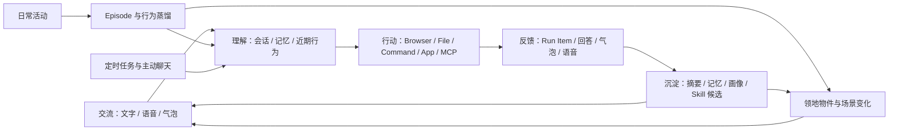
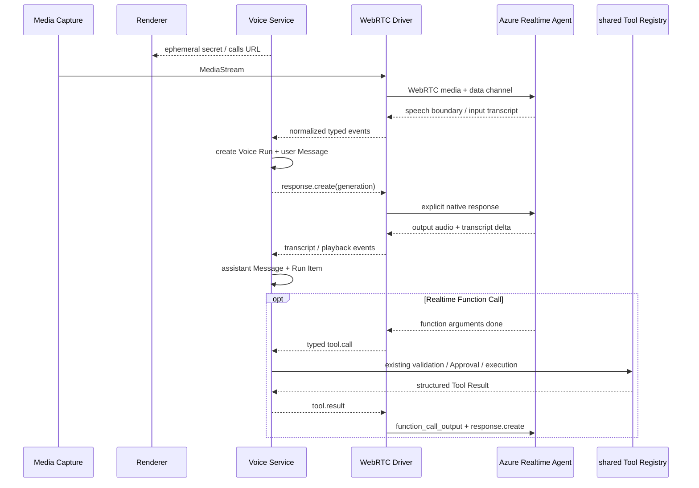
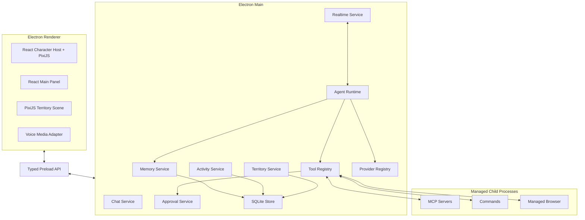
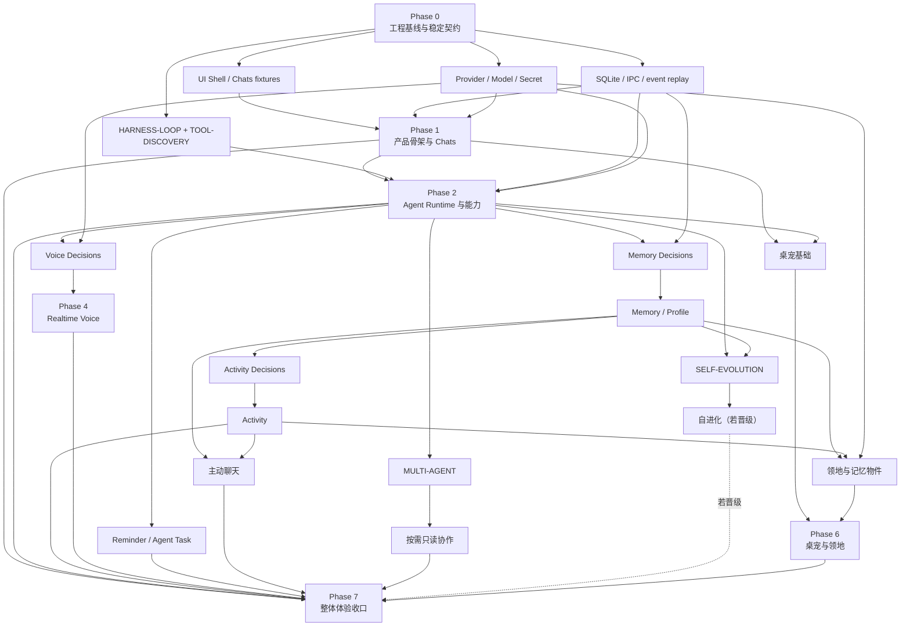

# CharaMate 完整产品与技术架构设计

> 状态：Design Review
> 日期：2026-08-01
> 范围：产品功能、交互、Agent Harness、记忆、语音、桌宠领地、代码与数据架构

---

## 0. 架构结论

CharaMate 是一个长期与用户相处、有性格与自己日常的 AI 陪伴角色。她能以文字和实时语音交流，逐渐理解用户正在经历的事情，记住重要的共同经历，选择合适的回应或安静陪伴；也会结合兴趣自主在领地活动、创作和布置，让用户自然参与。桌面形象和领地是陪伴的表达场所。用户需要她协作时，她通过同一 Agent Runtime，在明确的执行模式下操作浏览器、文件、命令、应用与 MCP。

| 主题             | 最终设计                                                                                                            |
| ---------------- | ------------------------------------------------------------------------------------------------------------------- |
| 产品入口         | 桌面角色、气泡、主面板、快捷键和托盘                                                                                |
| 一级页面         | Chats、领地、Memory、Activity、Automations、Settings                                                                |
| 基础技术栈       | 单 package Electron + Electron Forge/Vite + strict TypeScript/ESM + React；只有一条构建与打包路径                   |
| Renderer         | CSS Modules/语义 Token、Radix Primitives、Lucide、TanStack Virtual；PixiJS 只承载桌宠与领地像素渲染                 |
| 契约与数据       | TypeBox + Ajv 的 JSON Schema-first 契约；typed Preload；`better-sqlite3` prepared SQL 与领域 Repository，不使用 ORM |
| Agent Harness    | 单一、自适应、事件驱动的循环；没有固定 12 步上限                                                                    |
| Chat / Agent     | 用户在 Composer 中明确选择，位置与模型、执行权限在同一输入区                                                        |
| 执行过程         | Run/Item 事件持久化；运行时展开，完成后折叠为“已处理 …”                                                             |
| 长期记忆         | `better-sqlite3` 保存 Memory/Revision 真源；索引、图关系、向量布局和写入参数由实验一次选定，发布版只有一套实现      |
| 检索             | 产品只依赖一个冻结的 `RetrievalPipeline`；候选、模型与参数只存在于研究设计和实验工件                                |
| 行为理解         | Activity 原始观察 → Cognition 持续理解 → Memory 有来源形成；Episode/周期摘要供页面与按需检索，按真实消费者回收原文 |
| 自我进化         | 触发式异步复盘；四类用户确认候选，Skill 再经过 replay；生效后只由普通 Skill 管理器管理                              |
| 实时语音         | Azure OpenAI `gpt-realtime-2.1` 全双工原生 Agent；共享客户端 Tool/Approval、上下文、Run/Item 与持久化边界           |
| 浏览器与电脑操作 | Playwright/DOM 优先，App Action/Accessibility 次之，视觉 Computer Use 兜底                                          |
| 扩展协议         | JSON Schema Tool、Agent Skills `SKILL.md`、MCP stdio/Streamable HTTP                                                |
| 桌宠素材         | CharaMate 自有目录；兼容导入 Codex pet v1/v2 文件夹                                                                 |
| 领地             | 像素风可编辑空间；记忆生成物件，角色可走动，Azure GPT Image 负责受控生图                                            |
| 用户权限         | Composer 只有“请求批准 / 替我审批 / 完全访问”三个直观档位                                                           |
| 敏感信息         | 写入持久层前统一去除密钥等敏感值；API Key 使用系统能力简单加密                                                      |
| 开发指标         | 独立本地看板和结构化日志；不进入普通产品页面                                                                        |
| 测试工具         | Vitest + Testing Library + Playwright Electron；默认回归离线，Live/Benchmark 独立运行                               |

两个 Azure Endpoint：

```text
Realtime
https://datasetannotator-openai.openai.azure.com/openai/v1/realtime?model=gpt-realtime-2.1

Image Generation
https://datasetannotator-openai.openai.azure.com/openai/deployments/gpt-image-2/images/generations?api-version=2025-04-01-preview
```

---

## 1. 产品定义

### 1.1 一句话定位

一个有自己的日常、逐渐理解你、记得彼此经历的 AI 陪伴角色。她会主动生活，也知道什么时候与你分享、一起做事或安静待着。

### 1.2 核心体验

1. 用户不需要打开主面板，也能点击角色、拖动角色、查看气泡或开始语音。
2. 需要完整交流时，主面板提供多会话 ChatGPT 式聊天体验。
3. 需要执行时，用户在输入框把 `Chat` 切为 `Agent`，并选择本轮执行权限。
4. Agent 的每一步真实操作、命令、结果、等待确认和耗时都可见、可展开、可追溯。
5. 聊天、语音、执行结果和有来源的桌面观察共用可编辑、可修订的记忆形成路径；事实、观察和推断分开表达，明确改口及时更新当前结论并保留历史。角色自主沉淀值得记住的内容，不能由使用时长推断偏好或用途，也不要求用户逐条审批正常记忆。
6. 记忆与生活轨迹不只藏在列表中，还会转化为领地中的物件、场景变化和短小文字。
7. 用户通过人格、音色、语音 instructions、Skills、MCP 和 Provider 塑造自己的 CharaMate。

### 1.3 产品闭环



### 1.4 设计原则

1. **一个运行内核**：文字、语音、定时任务、主动聊天和桌宠动作都进入同一个 Run Runtime。
2. **模式由用户选择**：LLM 可以建议切换 Agent，但不能把 Chat 静默升级为可执行任务。
3. **过程真实可见**：UI 只展示已经发生或正在发生的结构化事件，不用自然语言伪造步骤。
4. **本地持久、可追溯**：会话、记忆、活动、执行事件和领地数据以本机数据库为准。
5. **长程而不臃肿**：上下文压缩、无进展检测与可恢复 checkpoint 代替固定小步数和静默资源截断。
6. **实验只负责选型**：候选 Arm 不等于产品档位；实验结束后只保留一个获胜实现，reranker、ANN、图扩展和 multi-agent 没有收益就完全不进入产品路径。
7. **面向用户呈现**：普通界面只展示完成任务所需的产品控制；研发指标放进独立本地看板。
8. **成长来自内容**：人格、记忆、Skill 和领地随使用变化，不设置亲密度数值或关系阶段。
9. **固定值必须有来源**：协议限制来自当前官方文档或源码；产品启发式参数来自预注册实验或可用性测试，不能凭直觉写死。
10. **实验必须收口**：胜者以干净实现进入产品，失败 Arm、Adapter、feature flag、依赖、临时 Schema 和用户开关在合并前删除。

### 1.5 2026-09-15 陪伴方向增量

以下是本轮用户明确的新产品要求；详细研究与落地包见 `docs/research/ai-companion-*-2026-09-15.md`，实现状态以 STATUS 为准。它们不是已经通过验收的声明。

- **角色自主生活**：领地中的走动、坐下、休息、观察、创作和可撤销布置由角色结合 Persona、真实经历和当前环境决定，不要求用户逐次邀请或管理候选。用户可以自然参与、打断、纠正、收回物件或撤销最近未被后续编辑覆盖的自主布置。对现实文件、应用、公开社交或其他外部行为仍采用现有 Composer/Approval 合同。
- **细粒度事件感知**：在已有前台应用事实之上，接收应用生命周期、窗口/焦点/页面变化、可读内容变化和键鼠操作的类型、对象及节奏。AX/DOM 只能表达实际可读的局部内容，截图是多模态观察来源；缺少内容时不能声称已经理解整页。原始输入先在本地合并为交互片段与 Episode，再形成当前情境；点击数量、键盘节奏和停留时长不直接成为偏好或心理事实。密钥等内容沿现有 redaction 边界处理。
- **注意力与行为**：用户直接输入与停止始终走明确交互入口；环境观察保留来源，不伪装用户指令。高频重复变化按对象与代次合并，模型只取得当前相关的工作集。倾听、支持、澄清、协作、轻松互动与安静在场是同一角色的行为策略，不是多个人格或第二套 Harness。
- **记忆与遗忘**：曝光、真实用户证据和成功使用必须区分；不因系统反复检索而增强重要性。事实的日历有效性与用户交互时钟分离；稳定偏好、低频重要约定和明确查询的旧事不能因减少上下文而丢失。自动淡化策略必须经过成对比较，不能通过降低一切召回来宣称质量提高。记忆形成、来源修订与纠正继续由现有 Memory 领域拥有。
- **请求输入上限**：用户明确指定单次请求输入上下文不得超过 **258,000 Token**；与 Provider 更低的限制取交集。系统指令、历史、记忆、工具定义和多模态输入均纳入，不按用户可见文本单独计算。上下文接近边界时先收缩工作集或压缩，在请求前验证；该用户硬上限不是 Run 步数、运行时长或累计任务费用限制。本轮真实文本实验使用用户指定的 `gpt-6-astra`。
- **本地与未来**：本轮实现本地感知、情境与自主陪伴；跨账号、在线常驻、多角色传播、虚拟社区和跨平台 home 迁移只形成未来方案，不在本地预装云基础设施。

本地感知合同：Activity 接收应用生命周期、窗口/焦点、局部 AX/DOM 内容与键鼠聚合；actor 在采集批次形成时确定，角色操作不记为用户兴趣。原始事件先按来源对象和内容代次合并，交给 Cognition 维护跨应用、可中断和继续的情境线程；应用不是情境身份，相同应用可同时承载不同事情，同一事情可跨多个应用。键鼠频次只表达交互状态，不能直接推导兴趣、情绪或重要性。感知覆盖不足时必须保留“不知道看到了什么”，不能用应用名补全。

2026-09-15 用户要求重做商业级认知与记忆后，第一轮 per-app 工作集、开场专用分类器和全画像/R0 top8 装配不再代表目标架构。新实现按下列合同推进，具体检索模型、融合、重排与工作集参数经新的 Decision 比较后只保留一套；之前的绿色结果只作历史基线。

### 1.6 连续认知与自主行为合同

认知中枢是持续的状态与决策闭环，不是对每条事件单独分类。其持久状态包括：带证据的情境线程、事实与可修正假设、用户及角色的意图、尚未满足的信息需求、当前注意对象，以及一次决策的输入版本、状态与执行结果。观察到的物理焦点和正在承担的承诺焦点分开；切换窗口不自动放弃原来的事情。跨对象切走后再返回同一内容仍是新观察；连续未变化的观察可以合并，但须保留宿主最新来源时钟，防止迟到旧事件覆盖当前物理焦点。合并不改历史证据或其消费水位，模型不能改写该时钟。用户的直接陈述可以修正推测，推测不能升级为已确认事实。

情境断言区分实际观察、带说话人的陈述与推断。`reported` 表示真实话语中说过的内容，用户、角色或系统的归属由原始 Evidence 保留；它不自动表示陈述客观成立，也不表示用户认可。角色说过“答应陪伴”可以成为有来源的陈述，但不能据此判定陪伴已经完成；角色说“做完了”仍不能替代真实执行结果。`observed` 只由实际观察或领域效果支持，超出原始话语与观察的解释继续标为 `inferred`。这不改变显式用户意图和行动完成的既有校验。

处理流程为：事实输入 → 合并与情境更新 → 关注竞争与信息需求 → Memory 证据检索 → 决策 → 同一 Run 执行 → 真实结果反馈。关注竞争同时考虑与当前意图的关系、尚未解决的问题、证据的新信息、可行动性、打扰代价和已承担的动作；保留沉默、继续观察和推迟的结果。不得把高频、近期或负面词汇单独当作关注依据，也不把可对话的机会自动解释为用户需要建议。

所选行为的 `intentId` 表示本次真正推进或恢复的执行目标，不是话题标签或装入背景的手段。独立、只读的短对话若只依赖已选情境断言及实际来源，不推进广义候选目标，可以不带执行目标；仍须供给必要事实、反证、当前对象与实际对话关联。不能为了放行而将候选升级为已采用目标，或省略真正影响行动的目标、暂停和恢复条件。非安静行为一旦绑定目标，仍要求它在当前执行规则下有效；历史完成材料可帮助谈论结果，但可读不等于目标可再次执行。只存在于未供给目标正文中的状态，不能在去掉目标后被搬进指令。等待输入的续接、已请求的继续执行和角色自主生活保留各自实际目标依赖。

Cognition 的模型分析是受现有 Provider 输入预算与取消控制的只读准备/完成 driver：只输出待校验的状态变更、证据需求与决策提案，不执行 Tool、不写面向用户的消息、不维护另一套行动循环。准备阶段可以复用仍有效的情境和证据，不要求每条输入都重新运行分类器。真正对话、领地生活与外部行动由既有 Agent Runtime 执行。一次分析与一个 Run 之间以依赖版本、唯一 dispatch key 和持久 Run 引用接合；进程恢复先核对已分发结果，不能重复执行副作用。

宿主向决策提供当下已注册且在角色自主 Run 范围内可用的工具名称、说明与效果类型，直接来自唯一 Tool Registry 和实际执行策略。当前工具事实与忙碌、睡眠、暂停等临时调度条件分开。角色某次选择先观察、暂歇或只读，不自动成为用户禁令或永久能力限制；生活计划回执只证明计划被保存，其解释仍需真实依据。持续障碍须结合当前能力和有效来源重新判断。工具可用不代表目标存在、行为成功或用户要求过它；具体行动继续由当前领域版本、目标资格和实际回执约束。

来源用途按实际输入类型表达：当前对象/前台依据须为带对象的真实观察；当前记忆须为当前有效的阅读。成功工具读取回执仍表示一次已经发生的读取，可按历史来源使用，同时保留行动所依赖的当前断言、反证与意图，执行时继续核对实际领域版本和能力。对当前请求能够准确判定的未供给引用或来源用途类型错误，模型 driver 可保留完整原输入，携带完整原提案和准确诊断重提一次完整提案；普通成功路径不增加调用。已展示的旧关联不等于其目标实体也已供给：未展示的目标只可在原实体、原字段中保留，新关联、选择和注意对象须引用本次已供给的实体视图或本提案中新建的同类型实体。局部实体视图仍可被引用，未展示的字段和子项仍遵守原分配及提交规则。其他语义或解析错误、网络失败与取消不触发该步骤；重提仍受完整输入预算与原提交校验约束，再次错误直接返回，不自动删改历史或补造来源。

本次被模型看到，不等于下一次仍须重读。分析的完整依赖集合保留给提交校验；下一页原文仅因未处理来源、实际选用的依据、当前断言/意图、在途检索或真实执行反馈而继续进入工作集，不因过去曝光自动重复带回。原文字节读取额度与后续记忆检索Token额度分别分配，增加前者不能顺带扩张所有模型阶段。扩大来源页可以减少积压，但不能让在途分析提前知道尚未发生的事件。

来源页能够读入本地，不代表加上指令、Schema、Persona、工具能力和转义后的完整模型请求也能发送。第一次生成前，Driver 将实际完整请求的预算不足反馈给同一分析的宿主；宿主缩小本次读取并重新编译真实来源视图，完整请求重新计量后才发送。每次候选必须确实减少分配；底座本身无法容纳、未知输入或已无可缩材料时明确失败，不无限重试。模型实际看到的节选、覆盖信息、消费前缀、依赖及执行材料保持一致，首次事件接收边界不因重编译推进。检索完成阶段保留同一结果和完成状态，不重新检索或重复接管记忆；已生成提案后的纠正超额不进入这个生成前流程。

连续桌面版本先以同一对象、来源代次、归属和可见范围组织为来源目录，保留首末版本及短暂出现又消失的实际变化片段。Cognition 根据当前问题按真实来源 ID 和可用文字范围读取原版本；标题和目录只帮助选择材料，不证明未读正文。接收进度、目录审阅、连续正文处理、已提交断言、Memory 接管及形成分别表达。当前用户、执行反馈和必要承诺依据仍直接供给；未读、节选、读取失败与已回收不能混为一谈。正文回收须核对当前视图、待展开来源、活跃依据及真实 Memory 消费者，不以目录已审阅冒充已经理解。选型及其质量限制见 [连续事件目录](docs/benchmarks/COGNITION-SOURCE-CATALOGUE.md)。

高频桌面事件积压时，当前Persona最新尚未消费的真实用户原话，与最旧未处理来源在同一阅读预算内优先保留。它按真实到达顺序确定，屏幕上的引语、助手复述或Memory回忆不能占据这个位置。提前读到最新原话不跳过中间事件、不推进其消费水位，也不绕过用户中断与行动有效性检查；之前的多次纠正仍沿顺序处理。原话过长时提供准确节选并标明未读部分，不能声称已理解省略内容。

每次分析在读取快照时固定当时的事件接收边界，随该次决策持久保存；它与正文消费水位分开。该快照已经接收的用户消息与控制，不因正文积压而被反复当作新中断。读取快照之后到达的用户原话或控制，仍使旧行动失效，即使它没有改变用户代次。创建决策记录、检索后重读状态或绑定 Run 都不能把这个边界推进到后来时刻；最新消息是否被理解仍由实际供给的来源决定，接收序列本身不证明已经读过正文。

最近决策的结果优先以最小生命周期视图供给，保留真实状态、错误、Run 引用和原接收边界；只有完整材料确实装入时，才提供其完整决策与依赖。视图不会覆盖持久化的原 Attempt，也不能用空数组假称未读决策完整。相同分析的 Memory 检索续接保留最初实际供给的失败反馈，不因新增在途记录占据最新位置而丢失错误。二次分配同样优先保留真实当前用户来源与最旧未处理来源；正文消费水位不得超过原始快照已经证明的连续边界。读取失败不创建残缺 Run，不制造新事件或立即重试循环；新的有意义输入或原有另一事项到期后，再结合原未完成目标与真实错误重新考虑。

当前用户原话来自Run时，同一Persona、同一Run随后已完成的助手回复和终态来源，在同一预算内一起供给；不能让已答复的事实因分在下一页而反复触发确认。已保存的完成回复可以证明实际可见文本自身满足的有限对话目标，例如按要求写出台词或草稿；终态只证明Run已结束。两者均不能替代实际投递、用户阅读或动作效果回执，回复内声称完成也不证明所述现实行动发生。没有匹配回复只表示未观察到，预算遗漏或节选须明确；该用户来源消费后不永久携带整段回复。

近期实际使用的已结束情境，以及真实召回来源明确关联的情境，可以在同一预算内重新读取原ID、当前Revision和相关断言/情节及支持来源。读取不会重新打开已完成意图，也不伪造新的观察；缺少关联或装不下的部分明确保留缺口，未提供的子项不能由模型覆盖。仅被曝光过的整段历史不因此长期驻留，稳定创建顺序也不能依赖同毫秒时间戳或随机ID字典序。

局部意图视图承诺保留未展示的原始支持。更新仍为同一用户意图、归属和依据类型未变时，提交校验须核对同Persona、同修订实际保留的用户原话，不能因本次未展示它而误拒合法进度更新。保留原请求资格不等于模型读到了未展示内容，不提供新的可引用来源，也不能单独证明意图已经完成。新建、完整替换或改变归属/依据类型仍须提供相应的实际用户原话；新增来源与效果引用必须来自本次供给。

意图的请求与进展来源不自动兼任完成依据。新的完成断言须独立声明实际效果、用户完成报告或已保存的完成回复，并且范围覆盖当前目标与成功条件：工具的 `performed` 只表示其实际返回的动作范围，成功读取不能证明写入；用户报告保持报告归因，请求、重试许可和助手自述不能成为用户完成报告；`completed_reply` 仅以真实完成的助手消息中本次实际可见的文本证明有限对话目标，不证明引文里的行为或外部执行。文字本身已满足任务时，无须另索用户确认或工具回执；未完成消息、Run终态、回忆和屏幕引语不能冒充该回复。节选保留真实可见范围，是否足以满足全部必要条件由语义判断，不能假称省略内容已读，也不一律要求整条长回复全文。已有完成且含义未变可以保留原声明；目标、成功条件、归属或完成依据改变后仍称完成，须重新提供本次实际可见的依据。重新打开或放弃意图时清除当前完成声明，原执行历史继续保留。局部视图对完成声明按整体保留、替换或清除，不合并两次完成的来源；被省略的目标或必要条件不能支撑新完成。普通对话与选定行动沿实际读取范围携带完成归因，缺少来源不表示已独立验证；判断自然语言是否满足完成范围仍须经过语义验证，不由 Schema 通过代替。意图完成不消费自主回复的实际投递状态，也不表示用户已阅读。

结束执行承诺不等于立即忘掉刚结束的话题。普通对话可在同一预算内读取最新已提交决策实际选中的已完成意图，核对选择与读集身份后使用当下 canonical 内容、修订和完成来源；不复制旧行动指令或重新启动执行。最新决策转向其他事项、没有选择或未成功提交时，不倒找更早的成功选择。完成原文的保留与这个当前消费者一致；来源缺失或整个选择超出可读范围时仍明确保留缺口，不无限扩大历史上下文。

普通用户对话在原分配内先保留当前情境、活动意图及其原始依据；有争议的断言同时保留支持与相反来源，不能只给结论标签。然后补入它们实际直接关联且已读取的旧情境与必要支持。旧事项保持原状态与修订，读取不重新激活目标、不携带旧动作指令，也不递归展开全历史。相关背景优先采用最近实际选用的支持；缺失或预算省略明确表达，不能为了增加背景挤掉用户刚说的话。

分析提交与行动有效性分别校验。分析提交仍核对它实际读取的状态版本；自主行动只依赖所选意图、必要的当前断言和明确引用的来源。历史画面表达当时所见，对象随后变化不改变过去的画面；只有要求对象内容或前台位置继续成立的行为才绑定相应当前状态。自主 Run 只接收这次选择的执行材料，不重新拼入整个情境、其他意图或未选旧画像。材料按所选 ID 和消费者预算读取；必要依据缺失或装不下时不能静默省略后继续旧行动。分发、Run 绑定和展示前校验同一组依赖，新用户输入与停止仍优先。

执行材料按任务实际需要分配空间，不沿用普通接话的固定小配额。当前目标、关键条件、反证与所选行动依据优先完整供应；相关性选择负责排除无关材料，长度限制不能代替注意力选择。分配时计入实际模型可见的指令、工具、历史、材料与输出预留，并服从用户指定的完整输入上限及 Provider 更低限制；checkpoint 中的宿主引用与重复副本不当作实际模型输入。必要材料无法共同容纳时应明确调整任务或取材计划，不因沿用的小额度反复观察、重新决定或静默遗漏。最终检验行动结果、重复读取、重决策与总成本，而非只比较单次输入长度。

本地装配资源与模型 Token 容量分别约束。完整所选材料须先通过独立的读取资源检查，再由同一 Provider 请求构造器计量实际指令、工具、输入与材料；不能把剩余 Token 数直接当作可读字节数。支持精确计数时，当前请求的真实计数优先于保守字节估算和历史用量推算；估算将导致拒绝或压缩之前，必须给精确计数机会。计数不支持时明确采用保守判断；计数失败不等同不支持。历史摘要也遵守自身完整请求预算，合法摘要可逐批提交，不能保存超限或取消后返回的摘要。Responses 的精确计数不作为 Realtime 音频会话的计数保证。

Memory 检索结果以独立的回忆材料进入 Cognition，保留原来的主体范围、依据、修订和时间，不重新猜成用户或角色刚说的话。它可以支持同等或更弱的情境解释，不能让推断升格，也不能成为新的用户授权或完成回执。所选回忆明确区分过去记录与当前有效事实；执行前由 Memory 领域验证确切修订的存在、主体范围、归档/删除和当前有效性。传给 Agent 的是实际选中且仍合资格的记忆证据和未满足问题，不丢弃检索结果后仅给无来源摘要，也不重新运行一个隐藏的替代检索器。

行为方式包括倾听、澄清、陪伴支持、协作、轻松交流、角色自主生活和安静在场。它们表达当前交互意图、允许动作与继续/退出条件，属于同一角色；不成为用户需要管理的模式或多个人格。角色自主生活沿用既有调度和同一 Run，由真实执行结果形成自己的经历；自己的故事不写成用户的经历。显式用户输入优先，中断的角色意图可在条件合适时恢复，但不能凭助手说“做完了”判定成功。

执行占用与等待续接分开：普通 Run 的 `queued/running` 表示当前执行占用；`needs_input/waiting_approval` 保留原问题、审批与同 Run 续接，但不能仅凭一张未处理的卡片永久阻止其它角色领地活动。已绑定的角色 Run 仍依其原生命周期恢复和防止重复派发；Voice、休眠、角色暂停、当前对象与工具资格以及主动消息的唯一表面和投递规则继续有效。用户真正追加、回答、决定审批或恢复执行时，先等待其它角色 Run 的在途动作让出，再继续原 Run；不能取消正在接续的目标，也不能在让出期间目标已改变后释放旧答案或批准。等待本身不设自动完成或超时，界面继续提供原 Chat 的追加与 Stop。

情境、意图与决策只属于内部运行时。正常产品体验是角色接得上前文、知道何时安静、自己有事情做；不增加注意分数、脑区图、任务管理表、检索参数或要求用户维护记忆的页面。开发看板可以查看一次决策使用了哪些来源、缺什么证据、为何延后及实际结果，便于调试与质量评估。

角色生活由 Cognition 域中的角色意图负责，Journey 的 companion.life 只是同一意图的产品 Tool 入口，不持有第二份生活状态、数据库或调度循环。它复用 AutomationScheduler 和同一 Run/Item。角色可以决定下一次活动或暂停，自主 Run 只使用本地领地观察/动作/小物件创作及相关记忆；用户消息优先取消，切 Persona 取消旧角色活动。内部唤醒以 developer 输入表达，不持久化为用户消息；自动化触发同样不伪造用户发言。自主生活不全量预注入用户 Memory，自己的已完成经历来自真实 Tool 回执，意图、失败与离线时间不算已完成经历。角色活动与普通对话复用可追溯 Chat，不逐次推送手机。

到期时间表示届时重新考虑，不在开始读取或发出模型请求时消费。宿主只在最终决策事务成功后确认本次实际供给、版本和原到期时间仍匹配的事项；准备取材、检索或失败时保留未完成考虑，未供给事项、新安排和用户暂停也保留。失败后的同一上下文不立即重复请求；新的有意义输入、控制、计划或配置变化、服务重开，以及原先已安排的另一事项自然到期，可以再次考虑。以实际快照时刻区分已考虑和后来到期，不能因前置工作耗时而重复或漏确认。已绑定 Run 沿原执行状态恢复，不重复派发。

当前可验证活动与意图进入共用角色上下文，Text/Voice 都能延续日常。原始事实和当前世界通过 Tool 再查；过往生成成功不意味着物件仍在原位置。首次启动建立尚未完成的角色意图，由中枢决定是否行动；后续唤醒记录明确的有效时间与继续条件，不沿用第一轮固定五分钟/一小时生活周期。多维记忆和反思复用 Memory 的来源、修订与异步形成；年龄淡化和未来价值预测必须另有质量证据，不能把暂时少检索等同于真正遗忘。

Voice 启动同样预检指令、工具、摘要与历史；无旧文本usage的长历史也经共用Chat摘要整理，短历史不新增对可选Chat凭据的依赖。已核实gpt-realtime-2.1采用128k总窗口减32k输出预留，未知deployment不猜映射；Responses计数不冒充音频计数。

详细实施入口：docs/research/ai-companion-local-implementation-2026-09-15.md；本次四份 Decision 分别记录注意、记忆、回应策略和请求预算，未选中的研究候选不成为生产默认。

---

## 2. 信息架构

### 2.1 窗口

| 窗口             | 作用                                                    |
| ---------------- | ------------------------------------------------------- |
| Character Window | 透明常驻桌面角色、状态动画、气泡、快捷语音和简短审批    |
| Main Panel       | Chats、领地、Memory、Activity、Automations、Settings    |
| Managed Browser  | CharaMate 管理的 Chromium 与独立持久化 Profile          |
| Dev Dashboard    | 仅开发时启动的本地浏览器看板，不出现在产品导航          |
| Tray             | 显示/隐藏角色、打开主面板、语音静音、暂停活动感知、退出 |

主面板关闭只销毁该窗口，不结束仍由 Character Window 承载的常驻应用。桌宠、Tray 与 macOS `activate` 等入口必须经过同一个主窗口生命周期 owner：已有窗口就恢复、显示并聚焦，窗口已销毁就单飞重建；需要打开特定页面时，必须等新 Renderer 报告 ready 后再发送导航事件。来源基线：2026-08-06 检查项目锁定的 Electron `43.2.0` 类型与 API 说明，使用 `BrowserWindow.closed/isDestroyed/restore/show/focus` 和 macOS `app.focus` 的当前语义；重建与导航时序属于 CharaMate 的产品生命周期约束。

### 2.2 主面板一级页面

| 页面        | 用户看到的内容                                                                      |
| ----------- | ----------------------------------------------------------------------------------- |
| Chats       | 会话列表、完整消息、Composer、Run 过程、附件、语音转写                              |
| 领地        | 可扩建 2.5D 像素世界、桌宠生活、自由布置、AI 创作与记忆物件                         |
| Memory      | 搜索、画像、长期记忆、来源、Revision 与衰减状态；图关系只在对应 Decision 晋级后出现 |
| Activity    | 今日/历史 Episode、应用/浏览器/截图摘要和蒸馏结果                                   |
| Automations | 定时任务、主动聊天规则、运行历史和对应 Chat                                         |
| Settings    | 角色、Persona、语音、Provider/Model、Skills、MCP、Browser、桌宠                     |

Browser 和 Computer Use 是 Agent 能力，不占一级页面；浏览器登录/Profile 管理在 Settings，实际浏览器按需打开。

### 2.3 全局状态

```ts
type CompanionState =
  | "idle"
  | "listening"
  | "thinking"
  | "acting"
  | "waiting_approval"
  | "speaking"
  | "success"
  | "failed";
```

同一状态同时驱动：

- 角色动画；
- 气泡文案；
- Chats 中当前 Run Item；
- 托盘状态；
- 可选的短提示音。

Main 进程是状态真源，Renderer 不自行推断“任务是否完成”。

这里的“托盘状态”和“短提示音”都不是语音回答：

- **托盘状态**是系统菜单栏/托盘图标的轻量投影。图标证明 CharaMate 单实例仍在运行，菜单以自然语言显示唯一活动桌宠、当前 Voice 与 Activity 暂停状态，并复用现有服务完成显隐、打开主面板、麦克风静音和暂停感知。它不显示 Run、Journey、Together Session 或自动化数量，也不增加第二套任务状态。
- **短提示音（earcon）**是很短的非语言声音，只用于应用在后台时提示“需要批准 / 已完成 / 失败”。它不朗读回答、不循环播放，并受一个简单的“提示音”开关和系统静音控制；具体时长按 UI 原型与听感测试冻结。
- **实时说话**属于 Voice Session。语音模式开启后，同一个 Realtime response 同时产生流式显示文字和输出音频；命令、JSON、日志和代码等原始过程留在结构化 Run Item，不混进这条自然语言回答。Realtime 正在说话时不叠加完成提示音。

因此，用户与角色进行语音对话时看到和听到的是同一条助手消息的文字与音频；托盘与 earcon 只负责应用级状态提示。

---

## 3. 常驻桌面角色与气泡

### 3.1 桌面角色

- Character Window 使用 React host + PixiJS canvas：React 管理文字、菜单、气泡和可访问交互，PixiJS 只管理 atlas、sprite、朝向与动画 tick。
- 透明、无边框、置顶窗口，角色以像素或透明动画精灵显示。
- 单击打开/聚焦最近 Chat；双击可按 Persona 配置触发问候或语音。
- 右键提供简短菜单：聊天、语音、领地、切换角色、静音、设置、退出。
- 鼠标可从角色任意可点击区域开始拖动，拖到哪里就停在哪里，不吸附屏幕边缘。
- 多显示器分别记住逻辑坐标与屏幕 ID；显示器变化时只把角色夹回当前可见区域。
- 重启后恢复尺寸、缩放、位置、朝向和当前桌宠。
- 空闲时可以在小范围内做 Persona 对应的动画，但不擅自改变用户放置位置。

### 3.2 桌宠素材目录与 Codex 兼容

CharaMate 只读取自己的目录：

```text
userData/
  pets/
    <pet-id>/
      pet.json
      spritesheet.webp
      preview.webp        # optional
```

最小 `pet.json`：

```json
{
  "id": "mika",
  "displayName": "Mika",
  "description": "A cheerful pixel-art desktop companion.",
  "spriteVersionNumber": 2,
  "spritesheetPath": "spritesheet.webp"
}
```

导入器接受一个 Codex 风格文件夹，校验后**复制**进 CharaMate 目录；运行时不依赖 `~/.codex/pets`。因此用户可直接复制兼容素材，但两边安装、更新和删除互不影响。

发布包随附 Columbinya v2 与 Linnea v1 两个初始桌宠。首次启动使用同一导入校验与复制路径把缺失项写入 CharaMate 自有目录；同 ID 的已有桌宠、当前选择和用户后续修改均不被覆盖。内置资源也不改变运行时边界：Renderer 仍只读取 `userData/pets`。

兼容格式：

| 版本 | 图集                          | 含义                                         |
| ---- | ----------------------------- | -------------------------------------------- |
| v1   | 8 列 × 9 行，通常 `1536×1872` | 9 个标准动作；可能没有 `spriteVersionNumber` |
| v2   | 8 列 × 11 行，`1536×2288`     | 9 个标准动作 + 16 个视线方向                 |

每格 `192×208`。标准动作行：

```text
0 idle
1 running-right
2 running-left
3 waving
4 jumping
5 failed
6 waiting
7 running
8 review
9 look 000° → 157.5°
10 look 180° → 337.5°
```

内部使用语义动画名，Renderer Adapter 再映射图集行；这样 v1 缺少视线行时可自然降级到 idle，而不把 Codex 的命名渗透到业务代码。

### 3.3 气泡

气泡类型：

| 类型               | 内容与操作                                                                 |
| ------------------ | -------------------------------------------------------------------------- |
| `reply`            | 最近一段简短回答；点击打开对应 Chat                                        |
| `progress`         | “正在查看文件”“正在操作浏览器”等当前 Item 摘要                             |
| `waiting_approval` | 动作摘要、允许一次、拒绝、打开详情                                         |
| `proactive`        | 主动问候或基于长期摘要的轻量话题；全新话题先作为短时邀请，已有对话直接续接 |
| `automation`       | 定时任务完成/失败摘要；点击打开持久化 Run                                  |
| `error`            | 一句用户可理解的错误与打开详情；轻量投影可显式关闭，关闭只清展示态         |

`waiting_approval` 的完整事实只存一份：Chat 中的 Approval Item。气泡是它的轻量投影：

- 低信息动作可直接“允许一次 / 拒绝”；
- 命令较长、包含多个文件或需要额外选择时只显示摘要，点击进入 Chat；
- 处理后气泡立即消失，Chat Item 记录决定与时间；
- 过期或 Run 已取消的按钮不可再执行。

### 3.4 人格

内置数个可直接使用的 Persona，例如：

- 元气开朗：主动、自然、有感染力；
- 温柔陪伴：语速舒缓、表达克制；
- 冷静可靠：信息密度高、少寒暄；
- 活泼吐槽：有轻度幽默，但不影响任务清晰度。

用户可以：

- 从预设复制创建；
- 编辑名称、背景、说话风格、称呼、主动程度、禁用表达；
- 为每个人格配置默认音色和语音 instructions；
- 切换后只影响新回答，不改写历史消息。

人格中可以自然描述关系与相处方式，但产品没有亲密度、经验值、等级或关系阶段。

---

## 4. Chats、Composer 与 Agent Run

### 4.1 多会话

支持新建、重命名、置顶、搜索、归档、恢复和删除 Chat。会话标题与全部生命周期动作只由左侧 Chat 列表拥有：通过会话项菜单重命名、置顶、归档、恢复或删除，重命名在该行内完成；主内容不再重复会话标题或动作 Header。每个 Chat 独立保存：

- 消息与附件；
- 语音转写与 Turn 元数据；用户主动上传的音频仍作为普通附件处理；
- 滚动摘要；
- Run 与 Run Item；
- 使用的 Persona、Provider、Model 与权限模式快照；
- 相关长期记忆引用；
- Automation/主动聊天来源。

“新建 Chat”先进入右侧未持久化草稿态，不立即向侧栏插入“新对话”；用户首次发送时才创建真实 Chat 并出现在会话列表。创建后的即时兜底标题取首条用户消息的紧凑文本；首轮回答成功且所选 Provider 可用时，再以无 Tool 的后台模型请求生成简短摘要标题并实时替换。标题请求失败时保留兜底，若用户已经手工重命名，迟到的模型结果不得覆盖用户标题。

Voice Session 是需要持久化的例外：开始语音时立即创建或绑定真实 Chat。桌宠“聊天”入口先显示“语音对话”，首条完整用户转写到达后调用同一个首消息兜底标题函数，首轮回答完成后再按需调用既有 `ChatTitleService` 生成摘要标题；Voice 不拥有另一套标题提示词、服务或状态。标题 Provider 只在摘要阶段惰性创建，其凭据或请求失败只保留上一层可读标题，不得阻断 Voice Session 启动、回答或结束。语音进行中点击“新建 Chat”时，必须先成功结束当前 Voice Session，再进入普通空白草稿；结束失败时保留原会话并显示错误，不能悄悄产生第二个会话。

同一个 Chat 内 Turn 串行；不同 Chat 可并行。切换页面不会停止后台 Run。

### 4.2 Composer

布局采用 ChatGPT 式圆角输入容器和 VS Code Copilot 式模式选择，但所有图标来自统一 SVG 图标集，不使用 Emoji 充当产品图标：

```text
┌──────────────────────────────────────────────────────────────┐
│ [Add]  问问 CharaMate……                                      │
│ [Chat ▾] [Model ▾] [请求批准 ▾]  [Mic] [Voice/Send]          │
└──────────────────────────────────────────────────────────────┘
```

空输入或单行输入保持紧凑胶囊；有附件或多行文本时自然展开为“内容区 + 底部控制条”。按钮使用清晰的 hover、focus、active 和 tooltip，不把所有选项做成常驻文字按钮。完整布局、尺寸、颜色和状态在独立 UI 设计稿中定义。

控件：

- `Add`：图片、本地文件、文件夹或当前截图；
- `Chat / Agent`：由用户选择；
- `Model`：当前 Provider 自动发现的模型下拉框；
- 权限：Agent 模式显示“请求批准 / 替我审批 / 完全访问”；Chat 模式隐藏或禁用；
- `Mic / Voice`：线性麦克风图标用于录音入口，圆形波形按钮用于进入/结束 Realtime；连接后明确显示聆听、静音和结束状态；
- `发送`：有运行时变为停止按钮。

Composer 在本机记住上次选择的 Provider/Model。重新打开应用时，成功加载当前模型列表后恢复仍有效的选择；配置已删除或模型已更换时清除失效选择，按原有单模型自动选择规则处理，其余由用户在可见菜单选择。模型列表正在加载或加载失败不能当作配置已删除，也不能因此覆盖上次选择。该偏好仅属于 Renderer 的本地交互状态，不保存凭据，不改写历史 Run 的 Provider/Model 快照，也不增加后台 Provider 选型规则。

模式语义：

| 模式  | 能力                                                                                                                                                                               |
| ----- | ---------------------------------------------------------------------------------------------------------------------------------------------------------------------------------- |
| Chat  | 回答、计划、Provider 原生网页搜索、读当前会话、检索记忆、分析附件及其他幂等只读查询；可使用产品内的记忆形成、角色生活与领地小型创作能力，不执行操作系统、Browser 或 MCP 等外部动作 |
| Agent | 具备 Chat 的查询能力，并可使用本地、Browser、Computer Use、MCP 与 Skills；按本轮权限处理审批；自主判断是否调用内建只读协作能力                                                     |

LLM 如果在 Chat 中发现任务需要执行，只能回复建议并给出“一键切换 Agent”按钮；不能自行升级。

Chat 与 Agent 使用同一个 Agent Runtime、Tool Registry、Context 和标题链路。通用 Tool 在执行边界按 `effect=read && idempotency=idempotent` 限制 Chat；记忆形成、连续陪伴、角色生活、领地动作与本节规定的小型创作是产品明确提供的内部陪伴能力，由宿主显式注册其范围，不通过放宽通用写操作获得权限。两种模式都加载计划能力和 Provider 原生网页搜索；简单问答或一次查询直接回答，不为展示流程而创建计划，只有真正的多步骤任务才调用计划工具。Voice 从 Composer 进入时继承当前 Chat/Agent 与 Agent 权限，从桌宠声波入口进入时创建 `Agent + 完全访问` 会话；开始后不再改写权限语义。

用户明确发起虚构角色扮演时，仍使用普通 Chat 和同一 Agent Runtime，不新增第三种 Composer 模式。用户独占其玩家角色的动作、对白、决定和感受；CharaMate 只扮演非玩家角色与环境，承认用户输入并给出局部可见后果，不为推进预设剧情改写用户选择。用户明确出戏后立即停止演绎。虚构事件只属于当前 Chat 上下文，不写成用户现实 Memory、Journey、Activity 或 Tool 事实；这条边界不限制用户明确要求的共同写作、续写或改稿。

当模型需要少量、明确且会改变后续执行的信息时，可以调用宿主直接提供的结构化 `request_user_input`，由 Chat 内卡片收集选项或自由文本，再继续同一个 Run。它不是外部副作用，不走 Approval，也不应先经 Tool Search；普通对话式追问仍可直接使用自然语言，不强迫所有问题结构化。

等待结构化问题期间，用户也可以直接在 Composer 继续说话。该消息仍合入同一 Run，原问题结束等待，不把新消息猜成某个选项的答案；角色根据完整新意图重新判断。新输入到达后，上一模型响应中尚未执行的调用应记录为未执行并交回模型重审，已完成结果保留。等待审批的旧动作也结束等待，不把新消息当作批准；先前已经做出的批准仍保留为历史事实，但新意图到达后未执行的动作仍需重新决定。应用重启后同样恢复已收到但尚未合入 checkpoint 的消息，用户无需先手动停止或管理内部状态。

### 4.3 执行权限

| 选项     | 产品语义                                                           |
| -------- | ------------------------------------------------------------------ |
| 请求批准 | 读取与低影响观察直接进行；命令、写文件、点击提交等动作在执行前询问 |
| 替我审批 | 对当前 Run 的普通动作自动批准；不可恢复或账户关键动作仍询问        |
| 完全访问 | 当前 Run 按用户目标直接执行，只保留操作记录与停止能力              |

这是用户在 Composer 每次可见的唯一权限选择。Settings 可设默认值，不提供繁复风险矩阵。

### 4.4 消息渲染

助手消息完整支持：

- CommonMark 与 GFM，并兼容 CJK 标点/正文紧邻的强调与删除线 delimiter；
- 标题、粗体、斜体、引用、列表、任务列表、链接；
- 表格和横线；
- 行内代码与带语言的代码块、语法高亮和复制按钮；
- 行内/块级 LaTeX，使用 KaTeX；
- 图片、音频、视频和生成文件卡片；
- 可折叠的长 Tool 输出；

流式阶段对未闭合 Markdown 做增量容错；消息完成后重新进行一次确定性渲染。CJK 兼容在固定解析管线内完成，不预处理或改写源 Markdown；代码块、LaTeX 和表格不能因流式 token 造成永久错位。

Provider提供助手消息阶段时，保留原来的中间回应或最终回答标记；同一响应内多条助手消息按原顺序保存，不能给拼接显示文本推断一个共同阶段。原消息属于对应Run Item结果，与可见消息完成一起提交；同Run续接、跨Run历史与重启回放使用同一原消息语义。旧消息或Voice未提供阶段时不补造标签。摘要仍是有覆盖范围的事实摘要，须区分中间回应、最终答复与实际Tool完成，不能把阶段标记当作行动成功的证据。实现与验证状态见[助手阶段连续性](./docs/benchmarks/ASSISTANT-PHASE-CONTINUITY.md)。

普通文字交流中，已经能够准确回应用户且只剩内部记忆记录时，角色先简短、具体地承接当前意思，再完成实际记忆记录，最后给非空、简短且不重复整段承接的收尾。提前回应不代表记录完成，不播报内部处理，也不提前声称执行成功。不需要记录时直接正常回应；仍需回忆、澄清、审批或实际操作时，按真实需要继续。此顺序只改变文字表达，不另建后台记录链，不延伸为 Voice 固定前言；取舍见[回应顺序决定](./docs/benchmarks/TEXT-MEMORY-ACK-ORDER.md)。

复制与消息操作对齐成熟聊天产品：

- 用户问题悬停后可“复制问题”，必要时可编辑并重新发送；
- 助手回答底部提供“复制完整回答”，复制源 Markdown，保留代码围栏、公式源码、列表和表格结构；
- 每个代码块右上角独立复制，只复制代码正文，不包含语言标签或行号；
- 行内公式和块级公式悬停后可复制 TeX 源码；
- Tool 输出、命令和表格有各自的复制动作；
- 复制成功用轻量图标状态和短 tooltip 反馈，不弹出阻塞式提示框。

### 4.5 Run 与 Item

```text
queued → running ↔ waiting_approval → completed
              ↘ needs_input
              ↘ interrupted
              ↘ failed
              ↘ cancelled
```

Run 是一次用户目标；Item 是 Run 中真实发生的事件：

```ts
type RunItemKind =
  | "user_message"
  | "assistant_message"
  | "plan"
  | "input_request"
  | "tool_call"
  | "command"
  | "file_change"
  | "approval"
  | "context_compaction"
  | "error";
```

每个 Item 保存状态、顺序、起止时间、耗时、结构化输入、截断后的可显示输出、完整结果文件引用和错误。系统不保存或展示模型隐藏推理。

UI 行为：

1. Run 进行中，当前非 Plan Item 自动展开，输出实时追加；最新 Plan 快照悬浮在 Composer 上方，默认只显示当前完成数/总步数，hover、focus 或点击后展开完整步骤。
2. 命令以 `命令 + 工作目录 + 状态 + 输出` 的下拉卡片显示。
3. Tool Call 以用户可理解的动作标题显示；第一层展开看到动作摘要，第二层再看参数、命令和截断结果。
4. `input_request` 显示模型真正等待的 1–3 个短问题、互斥选项和可选自由文本；提交后答案只注入一次并继续同一 Run，刷新或重启不会丢失待回答状态。 当原用户已明确请求查看某份材料，而同一 PFC 后续确认相关环境来源补足了该问题的材料缺口时，可以把完整来源补入同一 Run；原问题显示“相关环境信息已补充，继续核对”，不伪造用户回答或取消。PFC 必须明确引用仍在等待的 Run/问题、同 Run 的真实用户请求及当前相关新证据；不能用环境观察替用户作偏好选择、确认或审批。不匹配的补充保持等待。接收材料只表示恢复核对，不表示问题或行动已经完成；原工具结果保留，旧效果不重复执行，完整请求仍经过现预算。
5. 等待审批时定位到 Approval Item，同时桌宠进入 `waiting_approval`。
6. Run 进入终态后，活跃 Plan 悬浮层消失，全部过程自动折叠为“已处理 2分13秒 · 8 项”，下方只保留最后回答；点击整行可重新展开完整过程及最新 Plan。
7. 展开后显示的是助手主动给用户看的进度摘要、计划变化和真实 Tool/Command/File Item，不展示隐藏 chain-of-thought。
8. 用户可以复制整个问题、完整回答、单个代码块/公式、命令或 Tool 输出，也可以打开文件或从失败 Item 继续。

### 4.6 Agent Harness

主循环没有“最多 12 个模型步骤”的限制：

```text
Runtime 登记可取消的发送准备
  ↓
完整组装必要 Context 并通过当前请求预算检查
  ↓
分配 Run 与 UserMessage Item
  ↓
模型流式返回 Assistant 内容或 Tool Call
  ├─ final 且无用户追加输入 → 完成
  ├─ Tool Call → Schema 校验 → 审批 → 执行 → Tool Result → 继续
  ├─ Context 压力高 → 压缩已完成历史 → 继续
  ├─ 用户追加消息 → 在当前 Run 的一致性边界合入 → 继续
  ├─ 暂时无进展 → 按获胜 Loop Guard 改变策略、询问用户或诚实失败
  └─ 进程/网络中断 → 保存 checkpoint，恢复后继续
```

正常产品路径**不以总时长、累计 Token 或累计成本作为静默硬停止条件**。上下文 Token 接近窗口时先压缩并继续；时间、Token 和成本只进入可观测与软提醒，用户随时可以主动停止，不伪装成任务已经完成。

发送准备由同一 Runtime 管理，即使尚未分配 Run，用户也能停止。取消须等待实际准备任务结束；不支持取消接口的依赖仍须等待其真实 Promise 收口，然后禁止晚到结果分配 Run 或写入新上下文。界面的单次发送标识只负责关联准备及分配后的 Stop，不代替 Run 身份。应用退出先停止接收新准备，同时取消并等待现有准备与执行，再关闭依赖和数据库。

Run 的终态语义：

- `completed`：模型给出 final，且没有待处理 Tool、审批、steering 或异步 continuation。角色自主日常可以由宿主明确允许无文字的正常结束；该许可与本次 Run 一起恢复，用户接管后取消。安静结束不创建虚构消息、效果或已完成经历，不改变实际 Tool 的成功/失败回执。普通用户对话、主动搭话及 Automation 仍需可验证的回答，不能把任意空响应当作成功；
- `cancelled`：用户明确停止；AbortSignal 向模型、Tool 和子进程传播；
- `needs_input`：缺少无法推断的必要信息，或审批拒绝后确实没有其他合法路径；拒绝本身先作为结构化 Tool Result 返回，Agent 可以改用无副作用方案；
- `failed`：Provider 或必需 Tool 在有界重试/换策略后仍不可恢复，必须如实说明完成到哪里；
- `interrupted`：应用退出、崩溃、断网或 Provider session 丢失；保存 checkpoint 后允许恢复。

重复调用检测不是立即终止：同一规范化失败连续出现且没有新观察时，Harness 先要求改变策略；仍无进展才进入 `needs_input` 或诚实失败。底层 supervisor 可以处理失控进程等基础设施异常，但必须留下可恢复边界，不能让模型用假答案收尾。

### 4.7 Plan 与 Multi-agent

- 简单任务直接执行，不强制先写计划。
- 多步骤任务可生成可见、可更新的 Plan Item；Plan 只是同一 Harness 的一种 Item。
- 活跃 Run 只把最新 Plan 快照投影为 Composer 上方的紧凑悬浮进度；Run 结束后该快照回到“已处理”历史，不复制 Item 或维护第二份计划状态。
- 普通路径由父 Agent 保持目标和完整上下文；Chat 始终使用这条单 Agent 路径。
- Agent 模式始终加载一个内部 `collaboration.dispatch` 能力，但是否调用由父 Agent 根据当前目标自行判断，不增加 Composer、Settings 或每轮授权开关。
- 只有恰好两个相互独立、可并行、只读且资源声明互斥的具体子目标才能派生；简单任务、顺序依赖、写操作、待审批动作以及 Browser/Computer 可变会话留在父 Agent。
- 父 Agent 在一次调用中预声明每个 child 的目标、资源与确切幂等读取；宿主只做结构、当前 Tool scope、只读性、幂等性、资源冲突和可变会话校验，不替 Agent 做语义拆分选择。
- 两个 child 并发读取各自资源并独立生成证据摘要；父 Run 必须等待两者终局，再负责合并证据、处理限制和生成最终回答。取消信号与恢复边界沿同一 Run/Tool 生命周期传播。
- 实际派生作为一个普通可折叠 `subtask` Run Item 显示，内部列出两个 child 的状态、证据和 Token；UI 使用统一的分支 SVG 图标，不使用 Emoji。
- 选择依据、机械 no-go 与仓库所有者的透明事后取舍见 [`docs/benchmarks/multi-agent.md`](./docs/benchmarks/multi-agent.md)。生产只保留上述 `D2 + M2R` 路径，不保留实验 Arm、并发档位或 fallback 开关。

### 4.8 并发与恢复

- 同一 Chat 一个活动 Turn，用户的新输入作为 steering 排队或合入当前 Run。
- 不同 Chat 默认有限并发；实际数量按设备和 Provider 限流动态控制。
- 每个 Browser Profile 同时只有一个写操作 Run。
- Run/Item 先持久化再广播 UI；Renderer 刷新或应用重启后从数据库重建状态。
- 崩溃时 `running` Item 变为 `interrupted`，用户可以继续或结束；已完成 Tool 不自动重放。
- 正常退出时结束等待问题和审批的内存任务，但保留原待答/待批 Run、Item、审批和 checkpoint；新 Runtime 恢复同一等待边界，不重放已完成效果。用户显式 Stop 则按取消处理。

### 4.9 同行事项与共处会话

CharaMate 的陪伴叙事是“**一起做，一起经历，一起记住**”。它使用两个互相嵌套、但不取代 Chat/Run 的时间尺度：

- **同行事项（Journey）**：持续数天到数月，表达一件对用户重要的事如何被用户和角色共同走过；一个同行事项拥有一个由系统管理的 Home Chat，可以包含多次共处会话、会话间的续接、稀疏阶段节点、一次明确约定的跟进以及最终回望。
- **共处会话（Together Session）**：持续数十分钟到数小时，表达一次围绕具体活动的共同在场；可以跨文字、Voice、Browser、文档和普通 Agent Run，但不拥有另一套模型循环、Tool、审批或消息系统。

“**经历回响**”是这套叙事从一次对话延伸到现实时间和领地的因果闭环：角色先在普通 Chat 中记住用户明确在意的未来事件，在合适时机重新判断是否值得出现；用户随后带回文字、图片或文档时，同一 Agent Runtime 在原 Chat 的新 Run 中结合来源与相关 Memory 回应；少量显著时刻还可以在既有许可下成为同一 Run 创作并放置的单个 Territory 物件。它不是第三种会话、任务类型或成长数值，也不为演示故事建立 presentation、夕阳或拍立得模板。

系统不要求用户先说“陪我做什么”，也不把显式创建入口作为常规起点。常规入口是：Activity 提供有来源的当前活动观察，统一 Cognition 中枢结合持续情境、用户与角色意图、证据缺口和当前可用性判断保持安静、继续自身活动、自然搭话或回到既有 Journey，再通过普通 Chat Run 发出一句轻量、具体且有依据的对话邀请。全新话题的开场 Run 暂存在一个不进入最近或已归档列表的 provisional Chat 中；气泡可见后的 20 秒内，用户第一次文字回复或明确启动该气泡的语音回复才把它原子转为普通 Chat，超时或关闭则连同开场 Run 与消息级联删除。已有 Chat 的续接与约定跟进已经属于正式历史，不使用这套短时删除规则。Activity 不负责判断陪伴意图，也不创建 Journey 或 Together Session；Cognition 接收跨来源的细粒度事实，语义判断不使用应用名、论文、电影等关键词表或正则硬编码。未经请求的开场在被选定即时表面接受后，按 §9.2 的唯一主动策略执行冷却；5 分钟是绝对下限，主动等级与实际回应还会延长间隔，明确约定的续接依该节单独判定；桌面以气泡实际展示成功为接受，Android 以稳定单表面投影被持久选择为接受，但 Relay 回执只表示邮箱接收，绝不冒充系统通知已经展示。主动表面节流记录仅保留最近 3 次实际话术和回应/关闭/到期结果；Cognition 另持有有来源的情境、意图、决策与执行反馈。冷却结束后由 Agent 结合当前情境与这些实际送达记录判断是否值得开口，宿主不增加标题、关键词或字面相似度规则。20 秒与 5 分钟都是仓库所有者明确选择的 CharaMate 产品启发式，分别负责临时 Chat 转正和全局打扰节流，不是 Provider 或操作系统协议限制。

主动开场本身仍是普通对话，不自动代表共同在场。用户接住话题并让角色实际参与当前活动后，Agent 才可根据语义开始 Together Session，不要求用户说出固定邀约句；只闲聊、忽略或关闭气泡都不产生 Session。对话进一步表明这是一件会持续数天到数月、且对用户重要的事时，Agent 可以自然提议把它作为 Journey 一起走；Journey 仍只能由用户明确提出，或由 Agent 提议并获得用户确认后创建，绝不因 Activity 匹配而静默创建。若新 Journey 正是从当前对话里尚未结束的共处生长出来，宿主在同一事务中完成创建与关联，不让用户重新选择或搬运 Chat。Agent 只提交带候选 ID 的语义动作，宿主负责 ID、Home Chat、路由和全部状态不变量。

状态与基数规则：

- Journey 只有 `active / paused / completed`；完成后可以重开，并保留原完成节点。
- Together Session 只有 `active / paused / ended`；全局至多一个 `active`。开始或恢复另一场共处时，宿主自动暂停当前未结束共处。
- 一次共处最多关联一个 Journey；一个 Journey 可以包含多次共处；共处也可以独立存在。
- 暂停表示仍打算续上这次具体共处；结束表示本次共同在场已经收束，即使 Journey 仍继续。空闲时长、沉默或话题轻微漂移都不自动暂停或结束。
- 暂停 Journey 会暂停它当前活跃的共处；之后 Agent 基于明确语义恢复其中一场共处时会同时恢复 Journey。
- 完成 Journey 会结束其全部未结束共处、写入完成节点并停止开放式跟进许可；需要独立继续的共处必须先解除关联。重开 Journey 不复活已结束共处。
- 应用退出、崩溃或恢复时，遗留 `active` 共处转为 `paused`，绝不伪装为完成。

Journey 的 Home Chat 是系统路由目标，不是用户要理解或挑选的概念。来自 Activity、Automation、Memory 或当前对话的确定入口直接携带内部 ID；自然语言由 Agent 在当前候选中做语义判断，唯一匹配时直接操作，真实歧义时只询问用户说的是哪一件具体事情，不让用户挑 Chat。当前共同活动只在全局显示简短范围提示并允许自然纠正；纠正改变关联，不复制 Run 或消息历史。

`Journey`、`Together Session`、`Home Chat` 及其状态名只属于产品设计、持久化和 Agent Tool 协议，**不是普通用户要创建、浏览或管理的对象**。正常界面不出现“同行中 / 待续共处 / 同行回望”分组、Session 卡片、Journey 详情抽屉或开始、暂停、恢复、完成、重开按钮；系统管理的 Home Chat 与其他 Chat 一样出现在最近对话中，并继续使用普通重命名、置顶、归档和删除交互。删除该 Chat 时随 Chat 一并删除只为续接服务的 Journey/Session/节点引用，不以隐藏外键阻止用户删除；已经独立进入 Memory 的内容继续由 Memory 自己的删除规则管理。跨页面只保留一条非阻塞的当前在场提示，例如“Mika 正和你一起：修改论文引言”，不显示所属 Journey、状态、时长或进度；它只允许回到原对话，或以“理解有误”预填一句自然纠正，不直接暴露状态变更。

生命周期动作由 Agent 根据完整对话语义调用内部 Tool：实际开始共同处理具体内容时开始或续上；明确转去另一项共同活动时开始新 Session 并由宿主自动暂停旧 Session；“先到这里、晚点继续”保存续接点并暂停；“看完了、这次结束了”保存短回顾并结束。用户不需要使用“陪我”“共处”“同行”或任何固定口令，Agent 也不得在回复中播报“已创建 Journey”“已开始共处”等内部结果。话题轻微变化、失焦、沉默或经过一段时间仍不足以改变状态。长期性被自然揭示时，Agent 只用日常语言提出一次具体承诺，例如“以后再看到这篇论文时，我继续从这里接，可以吗？”；用户确认后才创建 Journey。暂停、完成、重开、范围纠正和忘掉这段连续性同样通过普通对话表达，用户面对的始终是具体事情，而不是状态机。

Activity 再次观察到与既有 Journey 语义一致的活动时，陪伴 Agent 可以把开场路由到该 Journey 的 Home Chat，让用户无需重新解释；真实歧义或证据不足时保持沉默，不以气泡逼用户消歧。该路由只恢复对话上下文，不恢复 Journey 状态，不开始或恢复 Together Session，也不扩大执行权限。用户回复后，Agent 再根据“是新的一次共处、续上某次未结束共处，还是只聊几句”分别处理。

共处期间角色拥有**局部、可撤销的语境主动性**：只在当前活动已有内容、Tool 结果或自然边界提供帮助；用户说“安静陪我”后，除审批、错误和重要结果外不制造闲聊。沉默本身是有效陪伴，时间流逝不能触发“还在吗”“加油”等空洞关心；没有真实文档、页面、音视频或 Tool 观察时，角色不得声称看见或听见。共处不会扩大当前 Run 的执行权限，也不会把主动性带到会话外。

创建 Journey 本身仍不授予外呼权限。会话外默认只记住并在用户回来时自然续接；用户明确约定某次跟进时，继续用一个可见的一次性 Automation Agent Task 投递到 Home Chat。除此之外，用户可以通过一次自然确认或 Settings 中的单一开关授予“重要时刻可以主动联系我”：许可生效后，只有用户直接陈述、时间明确、尚未发生且语境表明对自己重要的现实事件，才可以为该事件派生至多一个待重判机会；不要求每个事件再次确认。这个许可不等于闹钟或长期外呼授权，不允许从模糊时间、纯模型推断、普通 Journey、沉默或暂停时长派生机会，也不允许自动周期化。用户说“不用提醒这件事”、改期、取消、关闭该许可或删除来源 Memory 时，未消费机会立即失效。

气泡是目标 Chat 的轻量第二界面，不是新的 Runtime、提醒卡或共处控制器。每个气泡创建时已经绑定一个精确 `chatId`：Activity 全新话题绑定宿主自动创建但尚未转正的 provisional Chat，匹配既有 Journey 或 Journey 跟进时绑定其正式 Home Chat；它不跟随主窗口当前正在浏览的 Chat，也不要求用户选择归属。provisional Chat 只为统一 Run/Item 和准确回复路由提供短暂内部归属，不出现在 Chat 列表、搜索或归档记录中；用户第一次回复后沿用同一个 `chatId` 转正，不搬运、不复制消息。用户可以完全不打开主窗口，在气泡内连续发送短文字；每轮用户消息和助手回答仍由统一 Agent Runtime 写入这个 Chat 的普通 Run/Item，回答完成后投影回同一个气泡。语音入口同样固定绑定该 Chat，并使用 `Chat` 权限。文字或语音媒介都不会自动恢复 Together Session，也不会继承桌宠通用声波入口的 `Agent + 完全访问` 语义。

气泡只承担轻量文字往返：完整历史、附件、富内容精读、结构化输入、审批和复杂执行过程继续在“打开完整 Chat”后处理；切换界面不复制消息或迁移 Run。全新话题在用户回复前不提供“打开完整 Chat”，不显示倒计时、进度条或“保存会话”；20 秒超时或关闭气泡会撤下投影并删除 provisional Chat，应用退出或崩溃留下的 provisional Chat 在下一次启动时清理。第一次文字回复，或从该气泡明确发起语音回复，代表用户接住对话：宿主先转正原 Chat、取消到期清理，再运行回复；即使后续 Provider 失败，用户已经接住的 Chat 也继续保留。已有 Chat 的气泡关闭只关闭投影，不删除 Chat、消息或已启动的 Run，也不改变 Journey/Session 状态；用户已接住的气泡不会被另一条主动开场替换。回复后只要完整语义表明角色已经实际加入当前活动，Agent 即可开始或恢复，无需“继续陪我”等固定表述。关闭或忽略气泡不产生追问，暂停状态本身绝不触发提醒。后续才评估有界开放式“偶尔问问”，不在 MVP 中建立无限调度。

每次暂停或结束都保存可纠正的续接记录（当前位置、下次切入点和短回顾），但不自动制造长期 Memory。Journey 时间线只保存有意义的决定、转折、结果、完成/重开节点和已关联的共享 Memory。用户明确说“记住”时沿用 `memory.record`；Agent 只可对少量显著时刻语义判断并清楚告知记住了什么、如何纠正或忘记。用户一次允许“重要时刻可以偶尔为领地准备惊喜”后，少量重要里程碑、完成回望或有新证据的经历可以在当前真实 Run 内，通过唯一 Territory Candidate service 创作一件小物件；生成表达依据图片、文字、相关 Memory、Persona 和当前 Style Profile，不固定物件种类或模板。该许可包含调用已配置的 Image Provider，并在来源、许可与 World 基础版本仍有效且未取消时原子应用；没有可用位置就进入收藏，不移动或替换既有内容。Tool 等待实际结果，失败、取消或过期均如实返回并继续对话。普通 Run 中用户要求的创作和角色自己的创作同样使用 `territory.generate_item`，属于明确限定的内部陪伴能力，不是第四档 Composer 权限；它不扩大 OS、Browser 或 MCP 等外部动作的三档 Approval。用户后续修改不能被旧结果覆盖，最新且尚未被后续修改覆盖的创作可以撤销；大范围改造和编辑器生成继续逐次 Preview。角色自主生活不是玩家共同经历，不能伪造 `chat_moment` 或现实用户 Memory。

项目、考试、求职和内容共赏使用同一组状态与数据结构，不成为模板或场景状态机。差异只进入 Agent 的语境姿态、证据和里程碑表达：项目不变成看板，考试不变成打卡监督，求职不变成 CRM，单次电影或文章共赏默认可以只是独立共处。

MVP 要验证的核心承诺是：用户经历多次切换和间隔后，角色仍能回到正确的事情及准确续接点，用户无需重新解释、挑选 Chat 或管理 Journey/Session；会话外只在用户逐次约定，或用户已经授予的重要时刻类别许可内获得一次重判机会，并能在结束时得到自然回望与可见记忆。成功指标关注范围理解、自动路由、纠正/重述次数、主动介入是否有依据且不打扰，以及用户是否感到“被陪着”而不是“被项目管理”，不以任务完成率代替陪伴价值。可用性验收必须直接检查普通界面和 Agent 文案中不存在内部名词与状态管理控件，不能只证明底层状态正确。

2026-08-13 的触发语义复核参考了 OpenAI 官方 [Chronicle 文档](https://learn.chatgpt.com/docs/customization/chronicle)（当日访问）：Chronicle 使用近期屏幕上下文理解用户当前所见、补足用户未显式写入提示词的信息并识别相关来源。CharaMate 只采用这一“上下文依据”边界；官方文档没有定义主动搭话策略，因此“不打扰 / 新对话 / 既有 Journey”的选择、气泡投影和 Session/Journey 生命周期均是 CharaMate 自身的产品语义，不冒充 Chronicle 行为。

---

## 5. Tool、Skills、MCP、Browser 与 Computer Use

### 5.1 统一 Tool Registry

所有可执行能力使用主流 Tool Calling 形状：

```ts
interface ToolDefinition<Input, Output> {
  name: string;
  description: string;
  inputSchema: JsonSchema;
  execute(input: Input, context: ToolContext): Promise<Output>;
}
```

Tool Result 是结构化数据，至少含 `status`、用户可见摘要、模型可见结果和可选 artifact。模型不通过解析日志字符串判断成功。

Registry 负责：

- 唯一命名与 Schema；
- 当前 Chat/Agent 模式可用性；
- 审批要求；
- AbortSignal 和 deadline；
- 输出截断与 artifact 化；
- Run Item 事件；
- 指标与错误分类。

Provider wire Schema 与领域 Schema 只有一个真源、两个校验层次：Tool Registry 始终用完整 TypeBox/Ajv Schema 校验真实调用；Responses Adapter 只有在根级对象、全部对象字段必填且没有 strict 子集不支持的约束时，才为该 Tool 启用 `strict: true`。包含 `format`、`pattern`、长度或数值范围等完整领域约束的 Tool 仍发送同一 Schema，但使用非 strict Function Calling，并在宿主执行前完成完整校验，不复制或放宽领域契约。来源：2026-08-14 复核 [OpenAI Structured Outputs supported schemas](https://developers.openai.com/api/docs/guides/structured-outputs#supported-schemas) 与锁定的 `openai@6.49.0` 类型。

Tool 的模型可见性分为固定核心与 deferred 长尾两层。`file.list`、`file.read`、`file.search`、`file.write`、`file.patch`、`file.trash` 和 `command.run` 是本地执行的核心原语：只要当前 Chat/Agent 模式允许，该完整 Schema 就随首个模型请求常驻，并从 Tool Discovery 候选集中排除；Agent 不先搜索这些能力。Skills、MCP、App Action、Browser/Computer 专项动作以及其他长尾能力继续使用已接受的 `T2-CLIENT-BM25` 按需发现。常驻只表示模型可见，不表示获得执行授权：Chat 的通用 Tool 仍限于幂等只读能力，产品明确提供的内部陪伴能力沿同一显式范围开放；Agent 对外写入与 critical 操作仍经过统一 Approval Policy。领地观察、动作和小型创作继续按需发现，不把动态 World 注入每轮上下文。2026-08-28 复核锁定的 `openai@6.49.0` Responses 类型：`defer_loading` 是逐 Tool 的可选字段，`tool_search` 只服务 deferred Tool；协议没有要求同一 Registry 中全部 Tool 都必须 deferred。具体边界见 `docs/benchmarks/tool-discovery.md` 的带日期修正。

### 5.2 内置能力

| 类别      | 示例                                                                |
| --------- | ------------------------------------------------------------------- |
| File      | 列目录、读文件、搜索、patch、创建文件、移动到废纸篓                 |
| Command   | 运行命令、流式 stdout/stderr、交互输入、终止进程                    |
| App       | 打开/聚焦应用、打开 URL/文件、触发已注册 App Action                 |
| Browser   | 导航、DOM/AX 快照、点击、输入、上传、下载、截图                     |
| Computer  | 读取 Accessibility 树、截图、鼠标、键盘、窗口操作                   |
| Image     | 读取附件、本地图片与 artifact，定位并读取实际 Activity 画面      |
| Memory    | 检索、读取来源、创建候选、编辑记忆                                  |
| Chat      | 创建会话、附加结果、读取当前 Run 状态                               |
| Territory | 提议物件/套装/区域改造、生成预览、编辑 World change、管理收藏与来源 |

当前公开信息在 Adapter 已确认 Provider 支持时优先使用原生 Web Search；需要页面交互、已登录状态或可复现 DOM/AX 证据时使用 Managed Browser；网页结构化能力不足时才退到 Computer Use。原生搜索、受管浏览器与 Computer 分别承担检索、交互和兜底职责，不构成同一能力的运行时模式或失败回退链。

图片输入只有一条 Main-owned 媒体路径。用户在 Composer 明确附加的图片直接成为 Provider 多模态 message content；Text Chat 与 Agent 已经知道某个本地图片、截图或图片 artifact 且当前回应需要像素依据时，都可通过按模型/环境能力条件直载的只读 `image.inspect` 请求同一路径读取。普通陪伴对话不因看图而要求切换执行模式；读取图片不授权改变外部应用或文件。所选 Run 工具范围、模型视觉能力及完整请求预算继续约束读取。Renderer 缩略图、文件名、路径或 OCR 文本都不能单独作为“模型已经看过图片”的证据；目标模型不支持视觉输入时明确返回能力不可用，不暗中切换未验证的识别方案。

`image.inspect` 同时接受 Activity 观察目标：按时间、窗口或实际文字定位已保留的画面，再以完整来源引用读取选中图片。定位结果只证明找到了观察，不能称为已读像素；读取后保留真实捕获时间、对象、操作者和画面覆盖。已保存但尚未形成 Claim、Episode 或 Memory 的图片也能按需读取。明确查询当前画面时复用 Activity 既有最新画面消费入口，不强制重新分析、不解除采集暂停；当前画面不能替代过去未捕获或已清理的画面。观察目录按实际完整请求空间供给并提供续读位置，不把固定最近若干张当作全部历史。来源读取、取消、图片规范化和恢复仍由现有 Activity 与 Run owner 管理。当前任务中已经实际读取的不同图片依据在压缩后继续保留，同源重读只保留最近一份；其它工具调用和用户补充不应让图片依据静默消失。必要工作集整体仍超出完整请求限制时明确返回无法容纳，不能将文字概述冒充像素。

桌面拖放和 Android 分享最终都进入同一条 Attachment ingress：外部 URI 或本机路径先复制为 CharaMate 管理的附件资产，再由同一 Chat/User Message 引用。图片驱动的回复或 Territory 候选必须读取真实像素；文档只有在受支持的解析器或 Tool 实际取得正文/明确片段后才能声称理解，只有文件名、MIME 或上传成功不足以形成内容结论。跨设备来源不会把手机临时 URI、PC 绝对路径或 Relay 临时 URL 持久化为产品真源。

### 5.3 Browser

Managed Browser 由 `playwright-core` 驱动产品管理、版本固定的 Chromium，并使用独立持久化 Profile：

- 用户可以直接登录网站；
- 支持用户导入 Cookie，导入后写入该 Profile；
- Playwright 或兼容 MCP 操作已登录页面；
- 下载进入 CharaMate 管理目录，并以 Chat artifact 展示；
- 上传必须来自用户附件或 Agent 明确选定的本地文件；
- Browser 动作产生可见 Item；只有 Computer Use 定位、结果证据或调试确有需要时才附截图 artifact，不为每次 DOM 状态变化持续截图。

执行优先级：DOM/Accessibility Locator → Playwright 行为 → 截图视觉定位。网页能被结构化定位时不使用坐标猜测。

### 5.4 Computer Use 与 App Action

Computer Use 作为统一 fallback：

1. 有 App 专用 action、CLI 或 API 时优先；
2. 否则读取 macOS Accessibility 语义树并按元素操作；
3. 语义树不足时获取截图，由视觉模型定位；
4. 鼠标键盘动作仍记录为 Tool Item，并服从 Composer 权限。

OS 首次要求的 Accessibility/Screen Recording 权限使用系统原生提示；产品只解释“为了让 Agent 操作应用需要开启”，不再设计一套额外授权系统。

### 5.5 MCP

支持标准 MCP：

- Adapter 使用官方 MCP TypeScript SDK，但只把标准 Tool 描述/调用映射到 CharaMate Tool Registry，不让 SDK 拥有 Run、Approval 或持久化状态；
- stdio；
- Streamable HTTP；
- `tools/list` 和 `tools/call`；
- server 级启用/停用、连接测试、工具列表与状态；
- 环境变量、参数和工作目录配置；
- Tool 名采用 `mcp__<server>__<tool>` 防止冲突。

用户可以在 Settings 添加和管理，也可以在 Agent 模式授权 Agent 写入配置。Agent 修改后必须重新发现工具，不把外部 Tool 描述永久塞进所有会话 Prompt。

### 5.6 Skills

采用 Agent Skills 目录与 `SKILL.md`，不发明自有格式：

```text
<workspace>/.agents/skills/<skill-name>/SKILL.md
userData/skills/<skill-name>/SKILL.md
```

Skill 可以包含少量脚本、模板和 references；常驻上下文只加载名称与短描述，命中后再读完整 `SKILL.md`。Settings 左侧只显示紧凑的名称与短描述，并以“当前 / 已归档”区分生命周期；详情支持启用、编辑、Pin、保存、归档、恢复和永久删除。保存是普通的“保存更改”，不向用户暴露 revision、历史版本或点击恢复历史的入口；内部 revision/hash 只服务于防止过期成长 patch 覆盖手动编辑、崩溃恢复和删除收口，不构成产品版本功能。归档与删除位于独立的 Skill 管理区，不和保存并列。活动或已归档的用户 Skill 都可以由用户在二次确认后永久删除；活动 Skill 在删除事务内部先进入可恢复归档状态，再清除整个目录和内部 revision 记录，workspace Skill 始终只读且不可删除。关联成长候选只保留内部来源证据并解除已删除 Skill 的激活绑定，不在 Settings 中重新形成第二套 Skill 管理入口。

生命周期来源说明（2026-08-13）：锁定复核的 [Agent Skills specification commit `217be548739f21d6008915c29aefe320ea1a90af`](https://github.com/agentskills/agentskills/blob/217be548739f21d6008915c29aefe320ea1a90af/docs/specification.mdx) 只定义 Skill 目录、`SKILL.md` 与可选资源，不定义启用、归档、恢复或删除协议；这些是 CharaMate 的产品生命周期语义，不冒充外部协议约束。

Agent 可在以下情况下创建或修改 Skill：

- 用户明确说“把这个流程学会”；
- Experience Review 生成候选，由用户确认；Skill 候选再通过 replay。

### 5.7 自我进化

`SELF-EVOLUTION` 已由 [`docs/benchmarks/self-evolution.md`](./docs/benchmarks/self-evolution.md) 定案为一条触发式异步路径。完成 Run 只有在出现用户明确纠正、明确教学、具有客观验证的成功或已持久化的重复工具模式时才排入 `ExperienceReview`；不按固定 Tool Call 数或每个 Run 调用模型。Review job 先持久化再异步执行，重启恢复 queued/running 状态，不阻塞刚完成的主回答。

`ExperienceReview` 是无 Tool 权限的单次结构化候选生成器，不是第二套 Agent Runtime，也不直接写入任何领域。Text Run 复用来源 Run 的 Chat Provider/Model；Voice Run 的来源快照属于 Realtime transport，不能作为严格 Structured Outputs 的 Chat Model 使用，因此只复用来源 Run/Item/Message 证据，并通过产品既有默认选择取得一个已配置的 Chat Provider/Model。没有可用 Chat Model 时该 Voice Review 直接完成为 `skipped`，不发送错误协议请求，也不生成失败候选；兼容 Chat Model 的真实网络、认证或 Provider 失败仍保留为可重试 `failed`。Review 只输出四类结构化草稿：

```ts
type EvolutionCandidate =
  | MemoryCandidate
  | PersonaPreferenceCandidate
  | SkillPatchCandidate
  | NewSkillCandidate;
```

候选要求：

- 指向来源 Run/Item；
- 展示新增或修改内容；
- 区分“用户是谁”与“这类任务怎样做”；
- 所有候选都由用户接受、编辑或拒绝，Reviewer 不自批；
- Skill 候选在用户接受后跑同类与旁路 replay，通过才激活；replay 是增量质量信号，不替代用户确认；
- Skill patch 绑定 Review 时加载的目标 ID、revision 与内容 hash；接受和激活都重新校验，不能覆盖其后发生的手动修改；revision 是内部并发真源，不是用户版本功能；
- 用户只处理待确认候选和 replay 失败候选；Skill 候选生效后，在来源 Chat 中降为无生命周期动作的结果记录，后续编辑、Pin、归档、恢复和删除全部进入普通 Skill 管理器；忽略或已归档候选不进入 Skills Settings；
- Settings 或 Agent 显式修改、归档、恢复、pin Skill 时，仍在内部同步关联候选的 stale、archived 与 pin 状态；用户永久删除 Skill 时，候选只保留来源证据并解除激活绑定，不向普通 UI 提供从候选恢复 Skill 的第二条路径；
- 后台归档可恢复，不删除用户内容；永久删除只来自 Settings 中用户对用户 Skill 的二次确认，活动 Skill 在删除事务内部先归档；
- 候选只覆盖 Memory、Persona 偏好和 Skill，不把产品源码、系统 Prompt 或 Provider 配置变成自进化对象。

用户在来源 Chat 中处理“这次学到了什么”；Memory/Persona 候选也可在 Memory 统一处理。Memory 保持“搜索/筛选 + 列表/详情”主体，成长候选只进入左侧有界的待确认区域；Review 失败使用不改变布局的紧凑状态，允许重试或关闭。关闭只把该失败 Review 收口为 `skipped`，不删除来源 Run、候选或 Memory。Skills Settings 只管理已经存在的 Agent Skills，不展示成长候选历史。

Phase 3 的 `memory.record` 与普通 Memory 候选仍负责当前 Run 中用户明确陈述的基础形成。本节不复制该路径，也不采用 Hermes 的直接写入、后台 forked Agent、固定 iteration 或自动归档日期。

---

## 6. 长短期记忆与用户画像

### 6.1 目标

记忆系统需要同时做到：

- 让角色在聊天和语音中自然想起相关事实；
- 支持用户查看、编辑、纠正、删除和追溯；
- 正确处理事实更新、时间和冲突；
- 让低信息 Activity 保持独立且有界的原始层/时间线生命周期；Cognition 的有来源断言与情节进入同一 Memory 形成路径，不要求用户逐条批准，不把观察当作已确认偏好；
- 在个人规模上低延迟、低写放大；
- 任何运行环境都只使用实验冻结的同一条检索路径，不靠隐藏备用算法维持表面可用。

### 6.2 记忆类型

| 类型            | 示例                                   |
| --------------- | -------------------------------------- |
| profile         | 用户称呼、职业、长期偏好、重要关系     |
| preference      | 喜欢安静的咖啡馆、不喜欢过甜饮品       |
| project         | 当前项目、技术选择、未完成目标         |
| event           | 一次重要经历、决定或里程碑             |
| procedure       | 用户习惯的工作方法；可进一步形成 Skill |
| commitment      | 约定、提醒、后续要做的事               |
| activity_digest | 某个周期及跨周期的高信息行为归纳       |
| agent_learning  | 用户对回答或执行方式的纠正             |

用户画像不是独立黑盒；它是稳定、当前有效的长期记忆投影，点击画像条目可以回到 Memory Revision 和原始证据。

### 6.3 Memory 与 Revision

```ts
interface Memory {
  id: string;
  type: MemoryType;
  status: "active" | "superseded" | "archived";
  currentRevisionId: string;
  importance: number;
  confidence: number;
  validFrom?: string;
  validTo?: string;
  lastAccessedAt?: string;
}

interface MemoryRevision {
  id: string;
  memoryId: string;
  content: string;
  sourceType:
    "chat" | "voice" | "activity" | "tool" | "user_edit" | "distillation";
  sourceIds: string[];
  reason: string;
  occursAt?: string;
  timeZone?: string;
  createdAt: string;
}
```

- 编辑创建 Revision，不覆盖历史。
- Memory 的类型归属于记忆身份，形成模型只在创建时选择。修订或补充已有记录时不重填类型，由宿主沿用同一次请求所提供目标的类型；事实内容、语义与适用时间仍可按新证据修正。保留 event 分类不表示行动已经完成。跨记忆的 supersedes 证据关系不自动撤销另一条当前记录；纠正旧误记须实际更新其 Revision。
- 新事实与旧事实冲突时，新 Revision 可 supersede 旧 Revision。
- 用户手动纠正具有最高事实优先级。
- “原先成立、后来改变”与“原先记错、后来纠正”必须保留不同含义。前者的旧 Revision 可以表达当时的偏好或计划；后者可以回答“当时曾说过什么”，但必须同时标明已经被纠正，不能再作为真实历史事实生成物件、完成断言或派生理解。允许读取旧记录不等于允许把旧内容当真；历史用途不能绕过明确纠错。普通查看保留原记录，当前检索、历史回答与行动分别消费这个状态。
- 修订是否被撤销与事实在当前时刻是否适用分开。最新未撤销版本的 `historyStatus=current` 表示修订位置与真实性状态，`current` 布尔和 `validFrom/validTo` 判断本次读取时刻的适用性；一条明确有效期已经结束的记录仍可说明真实过去，但不能当作当前许可、偏好或待执行约定。旧修订只有 `retained_history` 明确表示曾经成立；`corrected/unresolved` 只允许带状态回看。
- PFC 保留读取时的历史状态及使该状态成立的修订引用。后来发生纠错，即使原 Memory/Revision 仍可按历史用途读取，也会使依赖旧资格的在途行动失效；重新读取后可以带明确纠错状态解释原话。执行与发布检查同一份实际选中依据，不用重新相似搜索替代，也不把允许回看误当作仍然真实。
- Memory 页面可查看时间线、来源消息/Activity/Run、相关实体与上下文/检索引用记录；引用不代表用户认可或回答成功使用了该事实。
- 删除进入可恢复状态；用户明确永久删除时清除 Revision、索引引用和相关展示投影。
- `occursAt` 只表示 `event`/`commitment` 在现实中预计发生的明确 instant，`timeZone` 保存解释原始自然语言时间时使用的 IANA 时区；它们与事实是否有效的 `validFrom/validTo` 分离。时间仍有歧义时只保存正文，不创建主动机会。改期或取消创建新 Revision，并使旧 Revision 派生的机会失效；Memory 保存事实，不负责计时、投递或通知文案。

### 6.3.1 使用期自动形成

PFC、记忆形成、证据选择与Text/Voice使用同一当前时间上下文：实际模型步骤时刻、当前系统时区及该时刻的当地日期时间；系统时区无法取得时明确未知。它只解释当前“今天/今晚”等历法问题，不是用户事实或新的记忆依据。延迟处理来源时，“今天”属于原话发生时刻，不能锚定到处理日期；当前系统时区也不能补造历史来源所在地。原文明示的时区和已记录事件时区优先；来源当地日历无法确定时保留原措辞与不确定范围，不仅比较UTC日期部分就断言用户跨了午夜。该上下文计入完整模型输入预算，不增加用户设置或持久表。

记忆形成与实际来源绑定。`memory.record` 保留同 Run 的即时入口；对话结束、有真实来源的情境断言建立或改变、语义情节收束和真实行动结果，均可触发同一 Memory 形成服务的增量处理。用户刚刚改口的事实不必等到情节闭合才更新。它们共用同一 Revision、去重与更新规则，不能各自建立记忆库。自动处理保存来源版本和处理状态，重启或重复 Tool 调用不重复写入；耗时模型在事务外执行，提交前重新校验来源和目标 Revision。

认知状态提交时同时保存尚待交给 Memory 的真实来源引用和当时的上下文关系。Memory 接收与交接确认在同一个本地数据库事务内完成，成功提交后才唤醒异步形成；应用重启只恢复尚未交接的材料，不遍历全部历史重新构造任务。实际原文缺失时保留可恢复待办，不用认知摘要补造。Chat 已删除时，其尚未交接的引用退出形成，混合材料中其他有效来源继续处理；已经独立进入 Memory 的内容继续按 Memory 的删除规则管理。

Memory 对同一不可变来源只保存一份原文，形成任务持久化来源引用、顺序和主材用途。运行时按当前预算读取原文窗口，已提交片段保存准确偏移，恢复从未处理部分继续，不重建整个历史正文数组。首次取得来源仍由对应 Chat、Run 或 Activity 领域负责；原文、当前形成工作集和最终记忆分别拥有明确生命周期。

形成失败保留已提交片段和未完成位置。处理器版本改变后，启动恢复仅重新排入旧版本失败且尚未被其他完成任务覆盖的来源；尚未配置模型时保持待办原样。用户再次明确调用 `memory.record` 可以定向重试同一来源，已完成任务仍返回原回执。普通文字 Run 的首次真实模型成功返回可恢复当时已经因超时、无法连接、限流或服务暂不可用失败的同一 Provider/模型形成任务；角色自主生活、语音、工具完成、事件重放和同 Run 后续响应不触发该恢复。该事件不保留给未来失败，不建立付费定时重试循环；语义校验、凭据、存储及上下文错误不冒充连接恢复。HTTP 503 过载等明确服务端失败保留可恢复类别；普通请求错误不能整体升级为可恢复，历史缺少原因的通用失败也不靠猜测重新分类。

模型生成期间，另一个有效写入把同一活动记忆更新为新的当前 Revision，是形成输入发生变化。提交前必须拒绝旧提案，保留原形成身份、已提交片段和未处理位置，重新取得当前依据后继续；不能把这种正常竞争留成同处理器下永久失败。新的处理必须由实际版本变化支持，不对相同未变化输入建立额外付费重试循环。用户删除、归档、类型或语义错误，以及同一提案内部互相冲突的更新，不按外部版本更新自动恢复；不得借恢复重建用户已移除的记忆。

同一片段的模型提案须先完整校验再原子写入。明确的来源、语义、实体或修订资格错误可把原完整提案和实际字段诊断反馈给同一形成模型，重新提交一次完整提案；原始材料、主材资格与可用目标保持原样，合法伴随内容也须重新处置。普通成功路径不增加调用；再次失败保留未完成位置与原错误处理入口。网络、取消、存储和实际凭据错误不进入这个语义修正步骤，提交前仍重新核对工作所有权、当前 Revision 与保留引文。

完整原文与长期记忆引文分别管理。形成工作完成后，只有在未完成形成、未分析事件、未结束决策、待交接材料、开放情节、当前断言和未结束意图都不再使用该来源时，才释放唯一完整正文；跨角色的消费者一并核对。保留来源身份、准确引文和完成回执，历史检索不因此丢失已形成的依据。不能依据“Activity 已有另一份快照”反过来释放 Memory 的最后一份全文；当前视觉原图仍由 Activity 独立管理。

已完成材料的精确重放先核对来源顺序和主材用途，再返回原处理回执，不为了重放重新请求模型。新的形成工作需要已释放正文时，只能从实际 Chat、Run 或 Activity 来源恢复相同原文；原来源已不存在则明确记录不可取得，不能用摘要或引文拼成完整记录。来源无法精确映射到消费者时先保留。开发面板区分尚存全文、已释放全文和准确引文的实际占用；这些回收不等于按年龄遗忘事实，也不承诺历史版本和回执的总容量恒定。

形成回执区分历史提交与当前状态。同一任务重复调用只复核已有结果，不重新形成；如果此前结果已经被用户修改、归档或删除，返回其不可用状态，不再声称旧内容“已记住”或自动恢复。混合结果仅把仍为活动当前 Revision 的条目用于后续投影。原任务的历史处理记录保留幂等语义，不冒充当前记忆；删除 Memory 不隐含删除仍属于 Chat 的原消息。

Memory 同时保留情节上下文与原子断言。一次形成可以新增事件、事实、关系、偏好、承诺或角色经历，也可以补充来源、修订旧说法、保留冲突，或返回“无值得保存的内容”。新 Revision 保存内容种类、主体归属、证据基础、实体和限定条件、事件发生区间、事实有效区间；系统获知时间使用 Revision 创建时间。不能继续用单一 `updatedAt` 代替所有时间。

形成输入中的 `personaId` 标识实际参与会话的角色，不预先按说话人分配整段材料的 Memory owner。每条结果根据适用范围确定归属：`user` 只保存独立于当前角色、可以跨角色成立的用户事实与偏好；`character` 保存当前 Persona 的经历、约定、解释，以及仅适用于这个角色或特定共同活动的许可和互动偏好，即使原话由用户说出。语法主体另用实体表达。用户明确将某项偏好推广到所有伙伴时，才有新依据形成或更新通用用户记忆；仅在正文中写角色限定不能替代正确的归属字段。许可或约定不证明角色已经完成行动，角色自己的事不能写成用户画像，也不能改写其他 Persona 的记忆。原始 source 的 speaker、渠道和时间保持原样。

同一偏好的适用范围可随用户新陈述改变。当前 Persona 的限定偏好与通用用户偏好之间的明确推广或收紧，通过同一修订流程产生新 Revision：必须保持已知主体，引用本次主材料中的新用户原话，并明确表达范围变化；补充来源不改变归属。旧 Revision 的归属、内容与来源保持原样，历史查询按当时范围解释。不能用助手复述、环境观察、旧语境或推断扩大范围，也不能借此变更另一角色的记忆。

本次待形成的来源和仅用于理解的前文明确区分。每条新单位必须实际引用本段待形成来源；前文可用于主语、时间和纠正的消歧，不能单独作为新确认。来源过长时按预算保留精确原文窗口，完整串行覆盖主材料，并明确上下文是否缺失或截断。主语仍不清楚时保留不确定或暂缓形成，不靠猜测填满画像。

本次形成材料的记录时间取最后一条主材的原始时间；仅作上下文的晚到回复不改变这次新证据的时间。每个来源自身的发生时间、角色和渠道始终保留，最终事实有效期与系统获知时间继续分别建模。

形成的必要对照不能被原文分段或可选检索额度静默排除。本段主材同源的全部合法当前记忆、明确指定的有效当前或历史版本、前段已提交产出及实际换版目标，须带完整语义和准确引文共同进入请求；第二次形成还保留首次已使用的必要目标。辅助前文与其他检索命中按相关性和剩余空间选取。每次固定实际请求、时间和解码身份后再计量与生成，沿完整输入上限及宿主原文读取护栏；必要集合仍装不下时保留未提交位置并明确原因，不以无变化完成掩盖缺失。实现及实际代价见[必要对照分配](docs/benchmarks/MEMORY-FORMATION-COMPARISON-CONTEXT.md)。

- 用户明确表达且跨本轮有用的事实可自动生效，不要求逐条批准；稳定画像仍是有来源 Memory 的投影。
- 桌面观察只形成观察情节；从行为推测的情绪、目的和偏好必须标为可修正推断，不能写成已确认画像。助手复述不计为用户再次确认。
- 角色自己的经历必须来自实际 Run/Tool 结果，绑定 Persona；意图、生成中、失败、收藏和成功放置分别表达，不能互相代替。
- 当前角色实际发出的 Chat/Voice 回复可以证明自己提出、维持或撤回了承诺，必须引用本次真实回复并保留条件；这类言语行为不证明承诺已兑现。复述别人的承诺、代写信件、引用台词以及自称完成操作不能当作自己的实际执行经历。形成模型依据完整原话判断语法主体，领域校验约束角色范围、来源、类型和承诺状态；归属字段本身不能证明主语。
- 已完成并保存的回复本身包含实际审阅、解释或改写时，可以据其完整内容修订同一已有承诺的局部对话进展，保留原主体、承诺时间和精确旧引文，加入本段实际交付的来源与时间。未完整满足原范围的承诺保持 active，明确剩余内容及未知；不能继续写成“尚未给出任何建议”，也不能把再次答应或仅补充来源当作进展。若本次没有旧承诺，但真实回复已为用户正在进行的活动交付之后仍有用途的具体稿件或材料，可以记录当前角色已经给出这些内容的有限言语事件。沿用 event/episode、character、当前 persona 与 direct_observation，以 predicate `delivered_conversation` 明确其范围；它只能由本次真实 primary assistant Chat/Voice 内容支持。保留有后续用途的具体措辞和版本区别，不因每句安慰、一般闲聊或重复复述都已说出就全部入库。稿件中的行为只是稿件内容，不因此变成现实经历；给出建议不代表用户已采纳或已经有效，也不凭空建立新承诺。回复保存不证明用户已读、采用，文件已修改、外部操作已成功或语音已完整播放；模型自称“已完成”不能代替实际交付内容。没有新增记忆种类或放开只凭助手文本确认外部履行。见 [对话交付进展](docs/benchmarks/MEMORY-CONVERSATION-PROGRESS.md)。
- 无旧承诺的实际交付记录仅扩展 create 的助手依据：若已供记忆保存同一原回复，省略重复；新回复不能因此确认或改写旧事件。已有承诺的进展及其它修订仍按各自的原始依据规则处理。
- 对同一已经成立的角色承诺补充用户新澄清的日期或限定时，修订可精确沿用合法的旧承诺原始引文，继续支持未改变的言语行为；新增限定仍须引用本次主材料。沿用必须保持原角色、主体、承诺对象、发生事实与状态，不能仅凭旧承诺引文改成已完成、取消、另一项承诺或另一人的行为。旧引文不升级为本次新观察或再次确认；create/support 以及真实新承诺、撤回、履行仍各自需要新的相应依据。
- 新内容必须引用本次实际提供的来源和精确原文范围；模型不能编造来源、借另一个人的陈述写成用户事实，或把复制的资料当作自述。来源引用和版本属于内部运行时，普通回答不展示 ID。
- 更新必须定位已读取的旧 Revision，区分事实改变、纠正误记和不同时间/条件下并存的事实；产生新 Revision，保留旧来源。相同内容只补充真实新来源，不制造重复事实。
- 局部纠正没有否认仍有价值的旧情境或情绪报告时，新 Revision 应保留这些报告的具体内容和准确旧引文；归属不明就明确记录为原报告及未定条件，不只留下无引文的概述。旧的相对时间保持原报告语境，不能自动绑定给纠正后的另一事件；已纠正的主体和关系不能被带回为当前事实。用现有精确子句沿用表达这些区别，不复制整版旧来源，也不放宽 corrected 历史的事实资格。见[旧来源沿用](docs/benchmarks/MEMORY-REVISION-SOURCE-CARRY.md)。
- 形成模型将派生摘要作为比较材料时，须同时取得该摘要明确依赖的原始记忆，不能仅凭摘要中的目标 ID 修订，也不能因未提出新单位而跳过已知原目标。沿摘要已声明的直接非派生依赖补读，保留 current/history 用途、实际 Revision、完整语义和精确引文；不扩大为任意关系或全对话搜索。必要比较共用本次原文读取与完整模型请求预算，不另设固定 topK。原件换版、删除、失效或装不下时沿实际原因保留未完成，不以空成功掩盖；历史依赖不因此成为新的活动承诺。
- 人名、项目名和别名不是唯一身份；没有消歧证据时不合并同名实体。因果关系必须有支持证据，不能从时间先后猜因果。
- 明确陈述与直接观察、推断/反思分开；反思可帮助形成关注假设，但不覆盖原始证据，也不通过系统反复检索自行增强可信度。
- 新的直接证据可以补充已报告事件的细节，或更新实际约定结果，同时保留哪些部分来自用户陈述、哪些来自当前观察。直接观察不等于推断；不能一概阻止它丰富既有事件。观察与用户报告冲突时分别保留并建立证据关系，不伪造用户改口；推断不能覆盖明确陈述或直接观察。

手动新建、编辑、纠正、删除和候选确认仍在 Memory 页面。自动形成不要求用户管理内部任务；无法确认的理解留作可修正假设，真正影响持久画像的歧义才需要自然澄清。凭据继续在既有持久化 redaction 边界移除。

手动修订保留已知用户或角色归属，将新正文表达为用户纠正；不沿用旧实体关系、已完成行动、约定状态或推断时间。用户明确填写的日历字段继续保留，本次明确填写的有效时间按请求更新。没有既有归属时不凭空猜角色。Revision 和其归属在同一事务提交。

本轮以 `MEMORY-REASONING` 重新比较来源精确形成、检索与更新的完整效果；旧 `MEMORY-FORMATION` 的单 Tool 实验保留为历史依据，不能单凭其结果证明新的情节形成质量。

### 6.4 长期有效性与遗忘

记忆长期保留与本次回答是否需要它是两个不同问题。当前 Decision 没有证明按日历年龄自动降低检索权重能够改善体验，因此生产检索不增加年龄淡化，也不把近期被检索到当作自动强化信号。排序遵循唯一 Retrieval Pipeline；有限 Context 只选入当前相关内容，不以暂时未入选为由删除事实。

- `validity`、修订与来源先处理已经失效或被取代的事实；
- 读取历史 Revision 与用户归档是两种状态；普通检索及关联扩展不能因为需要旧版本就重新带回已归档的 Memory，恢复仍尊重用户的明确操作；
- `memory_usage` 记录上下文/检索引用，不代表用户认可、模型正确采用或成功帮助了用户，不参与强化和排序平局处理；
- 仍有效的旧偏好、身份、重要约定在重新相关时可以正常召回，不因用户一段时间未打开产品而自动变弱；
- 一次性 Activity 摘要按当前语境退出在线 Context，但仍可搜索；
- 用户可以 pin、降权、归档或恢复。未来若需要自动压缩或遗忘，先以真实回访、跨日稳定性与恢复体验形成新的 Decision，再替换当前单一路径。

巩固在同一 Memory 服务的空闲工作中进行：对已形成事实读取相关经历与条件，必要时产生带精确来源依赖的情节总结或有限模式，明确保留推断属性。原事实、纠正历史和引文继续存在；巩固不等于删除原文，也不保证数据库变小。命名空间中仍有未形成经历，只说明未知范围；本次可用性另外核对真正供应的 Revision、Source 与片段，以及和未完成工作的已知连接。不能因为全库并不完整而拒绝所有有充分来源的局部理解，也不能把无已知连接当成没有未知例外。

有限模式必须来自有具体情境与时间依据的原始用户经历。重复引用同一来源、角色复述、用户后来表达珍视，以及后台再次处理，都不是新的事实支持。PFC 情境标签的有无、Chat 数量和日期桶只能描述已记录材料，不能代替模型对真实独立经历及适用范围的判断；缺少情境标签也不能被解释为已经证明所有来源属于同一情境。宿主继续核对去重原始来源、精确引文及当前资格，不把计数本身当成稳定习惯、情感或人格结论。

同一实际已完成形成回执产生、归属相同用户或角色的当前事实可共享一次多问题检索。每项仍使用自己的证据、决策、提交与回执，不能把同批次当成同主题或相互证明。检索阶段的组合工作集不足时分开处理；它的局部额度不充当最后巩固请求的容量上限。

最后生成所需的触发原件、当前可用摘要及其全部仍有效依赖必须完整提供，保留精确来源、条件及原有历史用途。已经由本轮检索选中的可选原件，同样在巩固消费者内补齐该确切 Revision 的来源片段，不把检索 Pack 的稀疏投影当作完整对照；不重新选择或扩展检索范围。必要项优先，可选材料沿原顺序保留完整前缀；读取或请求容量不足时整项移除尾部，分别记录材料遗漏和原检索覆盖。完整请求连同指令与输出结构，由同一实际模型实例计量，遵守用户输入上限和更低的 Provider 限制；必要材料因读取资源或请求容量无法完整容纳，或容量裁剪使本有对照的工作不足两项原件时，保留原事实并明确记录容量失败，不伪装成模型认为无需巩固。模型绑定、计量和生成等待都在事务外，等待后及写入前重新核对首次有效的片段、父事实资格与目标身份；输入变化沿原工作恢复，不用新版快照替旧正文背书。来源纠正或删除使缺乏依据的旧理解失效，合法回收完整原文但引文仍在不误判为来源删除。

已提交结果逐项保留。用户或角色 Run 正在执行、或 Voice 活跃时，实际宿主状态使后台巩固让出；全部执行空闲后继续。取消或进程中断保留持久待办，普通失败保留真实错误与可重试工作，不自动伪造总结、不建立付费定时重试循环。稳定派生格式与执行处理器版本分开：新处理器就绪时，仅恢复来源仍对应当前版本的旧失败；同版连接、超时、限流或服务暂不可用失败，只由失败之后同一实际 profile/API/model 的普通文本 Run 首个成功模型回执恢复。来源校验失败不因普通对话成功重试，重复回执及先成功后失败不积存重试机会。成功保存 Provider 配置沿用同一维护 Owner 的重试入口，取消未完成巩固并重新绑定，已提交前缀保留。该路径不增加玩家管理任务、内部算法设置或第二个记忆库。选型及有限证据见 [MEMORY-ADAPTIVE-CONSOLIDATION](docs/benchmarks/MEMORY-ADAPTIVE-CONSOLIDATION.md) 与[巩固恢复](docs/benchmarks/MEMORY-CONSOLIDATION-RECOVERY.md)。

### 6.5 实体、时间与证据关系

实体与有证据的关系由 Memory 拥有，在同一个 SQLite 中表达。关系服务于消歧、修订、事件前因后果和多证据查询；每条关系必须连到 Revision 与支持来源。它不要求另设图数据库或图谱 UI，也不把通用图遍历本身当作产品价值。之前无图 Decision 不能替代新情节/实体问题的比较；关系扩展只有在新的端到端证据比较中有价值时保留，空表和未使用模块必须删除。

### 6.6 唯一 Retrieval Pipeline

Memory 对外暴露一个异步 `recall(RecallPlan) → EvidencePack`。计划包含当前用途、具体证据问题、实体或待消歧名称、发生时间/截至获知时间/有效时间、情境及主体范围、已看过的 Revision，以及宿主分配的上下文预算。问题简单或与长期记忆无关时可不检索；问候不能触发全画像注入。

回溯列举、比较或恢复过去的选择与偏好时，执行者先确认当前问题需要覆盖哪些历史事实及适用范围。选择后的 Cognition 情境和断言可以提供线索，却不是完整历史；视图没有截断，只说明所选材料已供给，不证明相关历史已经穷尽。如果实际对话或已有的同问题检索证据尚未覆盖这些范围，应先用 `memory.search` 查明所需事实及相关例外、反证，再回答。不能因局部材料里未出现某偏好，就说用户从未说明或没有平日偏好。`memory.record` 的形成比较和保存回执不替代面向当前问题的检索。已有证据确实覆盖问题时直接复用，不重复检索；自足的当前请求仍可直接回答。

已知的记忆使用明确的 `Memory ID / Revision ID / current或history用途` 引用读取；内部记忆ID不是实体ID，也不依靠向量相似度再次猜测身份。仅有准确引用时可以不发关联查询；确需补充内容时，在同一个计划中组合准确读取与关联搜索，共用候选筛选、证据覆盖和上下文预算。实体、主体与时间搜索条件约束关联候选，不误伤已经指定的未来约定或历史修订。准确读取核对实际配对、角色可见范围、删除/归档状态和当前或历史用途，失败明确返回不可取得，不静默改读另一条记录。

实体 ID、解析后的实体名称和发生时间区间是整份关联查询的硬条件，只有它们对本次所有问题都确实必要、且身份与时间含义已知时才指定。问题中提到或联想到的人物、地点和日期可以留在查询与具体问题中，不自动排除其他相关证据；同次事件与长期偏好需要不同范围时分开查询。重要问题仍缺证据时，执行者重新核对自己推断的实体与时间条件，并针对缺口继续检索；不擅自取消用户明确要求的范围，也不把一次空结果当作没有保存。

自动形成的初步提案中，实体名称仅用于寻找旧比较材料，不代表每个问题都必须限定在已解析人物内。已解析实体可提供结构化相关候选，与同一次词法、语义候选共同筛选；部分名称未解析时，不能因此排除其他渠道找到的相关记录。它仍遵守当前角色、归属、时间、删除及修订资格，已有明确实体或发生区间的结构匹配范围不被这些内部线索缩窄或扩大。是否复用具体实体由完整证据和形成模型判断，不把同名或关系称谓自动合并。

“现在想起某事”不意味着事件必须发生在现在之前。记录时间、事件发生时间、事实有效时间继续分别解释；没有发生时间的偏好不凭空补造时间。用户说过的话也可能表达与当前角色的共同约定，不能只按说话人把检索限制在通用用户域。已经取回的当前事实在实际行动开始和发布前核对对应版本；原始引用与资格在宿主持有，普通对话不暴露内部ID。

检索分开处理候选召回与证据使用：本地词法匹配保留专名和精确措辞，真实语义向量处理改写，实体和时间约束在候选资格阶段生效；同一 Revision 的重复片段合并后，依据当前问题联合判断相关性、冲突、冗余和覆盖。主题相似不等于回答了问题。多证据问题可围绕未覆盖问题扩展来源情节与明确关系，但同一计划没有新证据时停止，不进行无效循环。

最终证据量由问题覆盖、证据密度与可用 Token 决定，不固定为 8 条，也不要求填满预算。返回每条证据的来源/版本、当前或历史状态、支持哪些问题、仍缺什么、是否被预算截断和索引是否完整。空结果、未完成索引、检索失败和“已证实不存在”不能混为一谈。被更正旧事实只能以历史/冲突证据出现，不能作为当前事实回答。

普通 `memory.search` 的最终交付没有独立固定 8k 额度。Text 执行者按当前实际请求计量规范化后的完整工具结果，包括证据、来源、覆盖与缺口说明；指令、历史、工具及输出预留共同占用 Provider 与用户允许的空间。候选召回工作量和最终交付空间分开，相关性选择仍先于交付分配。优先保留完整事实及来源身份，再补充支持材料；计量期间记忆发生删除或修订时重新核对原选版本，不悄悄换成未选择的新事实。当前空间不能供给证据时明确区分“未执行检索”和“已检索但未供给”。Voice 复用同一记忆入口，计量实际本地提交的两个 Realtime 事件；服务端已有音频与会话占用仍未知，不能据此承诺完整会话剩余空间或较早条件不会被原生截断。见 [记忆工具结果分配](docs/benchmarks/MEMORY-TOOL-CONTEXT-ALLOCATION.md)。

普通 Memory 浏览仍支持搜索、筛选和详情；浏览分页不等于对话证据的 topK。对话、Voice、Cognition 与 Tool 均复用这个 Memory 领域入口。融合、向量模型、候选池和重排的具体参数由 `MEMORY-REASONING` 在固定输入与预算曲线上选择，发布时只有一套，不向用户提供检索档位、模型切换或内部参数。

关联搜索区分资格过滤和正向相关性：截至获知时间、事实有效时间及是否允许历史版本限制哪些记忆可用，不单独把整个合格记忆库按近期顺序加入召回。只有实际实体或明确事件发生区间才能独立提供结构化匹配，其他问题依现有词法、语义和有依据的关联寻找相关材料。宽泛回顾仍须检查问题覆盖和缺口，不能把一次筛选的局部结果说成完整历史。选型见 [MEMORY-RECALL-STRUCTURED-SCOPE](docs/benchmarks/MEMORY-RECALL-STRUCTURED-SCOPE.md)。

### 6.7 检索运行时工件

Revision、来源与语义元数据是 SQLite 真源；词法、检索片段和向量是可重建索引。新事实、来源、词法投影和待编码状态在同一事务提交；向量计算在事务外，写回前检查 Revision、内容版本和模型版本。删除立即改变检索资格，即使派生向量尚未回收也不能再次返回该内容。重启只恢复未完成任务，不重建全部索引或反复调用模型。

本地语义模型必须以固定版本、明确许可和可验证资源随产品准备；不能依赖开发者另一个项目的 Python 环境。加载、退出、损坏、索引重建和安装中状态由单一 owner 管理；不保留另一个 embedding 引擎作为隐藏兜底。首次准备或暂时不可用时，当前对话仍可依据用户刚给的内容继续，明确其记忆证据缺口，不编造回忆、不把降级结果宣称完整。

### 6.8 Context Engineering

`ContextCompiler` 只有以下不可变契约：

- 当前用户请求、附件和 steering 不得被较早内容挤掉；
- 当前审批结果、最新必要 Tool Result 与本轮所需 Tool Schema 必须可见；
- Provider Adapter 按当前 Provider、模型和协议元数据解析本 Run 的有效输入预算，Harness 只在该预算上应用已选的 90% 压缩水位；数值不得按 Model ID 写死，且必须随 checkpoint 冻结，恢复同一个 Run 时不得中途漂移；
- Provider 限额未知时不猜物理窗口，但用户指定的 258,000 输入上限始终有效；首次请求也检查工作集。发送前按完整 wire 输入执行 COMPANION-CONTEXT-BUDGET；当前代理缺少精确计数，只对可估计的小请求按有余量估算放行，无法证明服务端真实 Token 绝对上限。未知附件/不透明续接或接近边界时明确拒绝；
- 记忆进入模型 Context 时带事实文本、种类、主体/依据、时间和有界来源摘要，不能变成无来源事实；Memory/Revision/来源 ID 与逐条 provenance 只留在宿主和 Memory 详情页；
- 会话摘要是带覆盖水位和来源的版本化工件，能够表达目标、约束、完成动作、重要决定与未解决问题；
- Persona、近期原文、摘要、长期记忆、Activity Digest 和 Tool 结果的具体顺序、预算、topK 与裁剪规则由 `CONTEXT-RECIPE` 实验一次选定。

本轮上下文装配以当前用户输入和持续情境为起点。Cognition 的 `prepareTurn` 同步提供已确认的情境/意图和仍有效证据；它不为每句问候强制再调一次分类模型。当前 Agent 模型通过常驻的结构化 `memory.search` 提出真正的证据问题，按需要查询；后台情境分析使用同一 RecallPlan 和 EvidencePack。只有与当前问题相关且仍有效的已有证据可以复用，当前输入、纠正和未完成行动优先。

普通对话直接读取与当前关注、承诺及最近已选意图有关的已提交状态和必要来源，不先装入一页待分析事件再从剩余空间取得情境。局部原始字节读取与完整模型请求的 Token 裁决分开；可用空间不要求填满。读取和投影的覆盖信息一路保留，区分确实不存在、尚未加载、原文已回收和预算省略；未加载的断言或摘要不能作为空状态呈现。待解释提示依据真实接收边界，不能把已表示的事件前缀误作全部接收量。新用户输入或问答续接进入下一次模型请求前，刷新普通情境并替换旧的普通情境块，保留实际行动依据与已完成工具结果，重新核算完整请求；不在每个工具步骤强制调用新的分析模型，也不等待后台事件全部排空。新的错误或观察尚未形成解释时应保留未知，不能用刷新行为伪造已经理解。实际缺口、修复与验收见 [普通对话情境供给](docs/benchmarks/COGNITION-CONVERSATION-CONTEXT.md)。

上下文保存选中 Revision/来源的宿主私有引用以及模型可见的紧凑事实、主体、时间和证据缺口；不再注入全部稳定画像和固定 R0 top8。模型可在缺口实质影响回答时换一个更具体的问题继续检索；相同计划、已充分的证据和无新信息不重复查询。恢复和压缩保留当前目标、选中证据与未满足问题，不把过去所有召回结果堆进后续请求。旧 `C2 PRE8` 结果归档为基线，新 Recipe 与完整认知/记忆候选一起验证。

跨 Run 的会话工作记忆固定为每个 Chat 一份持久 `ChatContextSnapshot`，与完整聊天记录、当前 Run checkpoint 和长期 Memory 分离：

- `messages` 继续保存完整、不可因模型上下文裁剪而删除的用户可见记录；Renderer、搜索、导出和来源追溯都读取完整记录，而不是摘要投影；
- Snapshot 保存单调递增 generation、版本化 summary、`coveredThroughMessageId`/时间水位以及最近一次真实请求的输入用量校准。水位之前的原文只由 summary 代表，水位之后的已完成消息作为近期原文；两者不得同时注入造成重复；
- 新 Text Chat、Automation、主动对话、inline continuation 与 Voice start/reconnect 都从同一 Snapshot + 水位后近期原文编译 Chat 工作上下文。Run terminal 后删除 checkpoint 不得删除或回退 Snapshot；应用重启后继续使用同一 generation；
- 新 Run 前只在按当前 Provider/模型解析出的有效输入预算达到既有 90% 水位时滚动更新 Snapshot。裁剪边界按最早的完整已结束 Run 推进，并保留满足预算的最长近期完整 Run 后缀；不另设固定消息条数、Run 数或模型专属窗口；
- 摘要生成只使用当前选中的同一 Chat Provider/模型，输入为旧 summary 加即将覆盖的完整 Run 片段，输出覆盖目标、约束、完成动作、重要决定和未解决问题。成功后以比较交换方式推进水位；失败时保留旧 Snapshot 并让当前请求可重试，不伪造摘要、不静默丢弃历史；
- Provider 在新 Run 第一次模型调用、尚未产生 Tool/Plan/assistant 边界前返回 context-limit 时，允许强制执行一次持久 Chat 滚动并重试；进入 Run 循环后的超限仍由既有 Run 内 compaction 恢复，只更新临时 checkpoint，不修改 Chat 水位。

2026-08-18 来源刷新：OpenAI 官方 [Responses Compaction](https://developers.openai.com/api/docs/guides/compaction) 明确最新 compaction item 承担后续上下文状态，stateless chaining 可丢弃其之前的输入；Codex `main` commit [`f47f77a`](https://github.com/openai/codex/tree/f47f77ada6699460bf13b0b7278e710692e0ea34) 将 replacement history 持久为 `RolloutItem::Compacted`，恢复时从该 history 重建；LangChain `master` commit [`9f2d56e`](https://github.com/langchain-ai/langchain/tree/9f2d56e376ea926d334f8f99ed7c67b154c2f0bf) 的 `SummarizationMiddleware` 以 summary 替换旧 message state 并保留近期完整消息。这些来源只支持“压缩结果必须跨后续调用成为状态”的边界；90% 水位、完整 Run 边界、Snapshot Schema 与单一路径是 CharaMate 已选 Recipe 和本次正确性修复。

Plan 的持久化和模型上下文分工固定如下：完整 Plan 更新仍以 `kind=plan` 的 Run Item 作为历史与 UI 投影真源；活动 checkpoint 保存从最新已完成 Plan Item 恢复出的 `currentPlan` 编译快照。普通 Tool、审批与 steering 可以更新 handoff，但不得覆盖该快照。每次压缩都在当前用户输入之前重新注入最新完整 Plan（说明、全部步骤与三态）；新 Plan 更新会替换快照并移除较早的压缩 Plan 消息，避免长上下文同时出现两个“当前计划”。这不是第二份可编辑计划状态，也不增加 Plan 表或 Renderer 状态机。

`memory.search` 是同一 Run 的常驻只读能力。模型提交用途、简洁查询、需要解决的子问题与必要实体/时间范围，宿主提供工作集预算和已读取证据；工具返回最小充分证据、冲突与缺口。工具内部使用同一 Memory Pipeline，不引入第二个搜索 Agent。来源 ID 只用于内部正确绑定，普通回复使用自然语言，不展示检索参数或来源 UUID。

`activity.search` 是 Activity 领域拥有的 deferred 只读能力，与 `memory.search` 分开。用户询问近期使用轨迹、跨日习惯或某个应用/网站的实际使用情况，而当前上下文没有充分证据时，Text/Voice Agent 可按需查询 Episode/Digest 的紧凑聚合；省略 query 表示查看概览，指定对象时由当前模型做简洁证据查询，不在宿主维护同义词表。返回沿用 Context evidence 的固定最多 8 条投影，只含可观察标签、活跃日期数、片段数、累计分钟和首末时间，不展开窗口原文、截图、逐条 Episode/Digest provenance 或任何内部 ID。结果只能表述“观察到的行为”，不得自动解释成喜欢、职业、目标或用途，也不自动进入普通 Memory Retrieval。

已采集的 AX/DOM 可见文字通过只读 `activity.observe` 按需读取，与 `activity.search` 的行为聚合分开。Text Chat、Agent 与 Voice 可以定位最新匹配的保留观察，或按已有 eventId 读取同一来源的后续文字；不必等待后台 Cognition 完成解释，也不因没有截图而要求用户重复提供已经采到的文字。最新匹配以应用、窗口标题、URL 或明确 surface 等位置条件定位，不先筛除不可用记录；命中新一条 unavailable/protected 时不能静默回退到旧正文。返回实际观察及持久化时间、操作者、原始对象和 AX/DOM 局部覆盖，采集截断的缺省只表示未报告，不能证明完整窗口。它读取已保留文本，不强制采集、不解除暂停、不声称当前实时屏幕或已看过像素。结果与继续位置依实际完整 Tool 请求空间确定，续读固定原 eventId，保留来源被清理和取消的真实结果；不把窗口分页完成说成看完了整个页面。

需要像素依据的画面内容沿 `image.inspect` 定位和读取，不混入上述行为聚合，也不把 AX/DOM 文字伪装成图片。普通情境中出现视觉来源引用不代表该轮模型已看到图片；需要像素依据时显式读取。完整请求计量包含定位结果包装与真实图片输入；查询分页保留时间范围和实际游标，未返回部分不能说成不存在。

Memory 页不要求用户选择、绑定或合并内部稳定字段。新形成的偏好和事实由实体、语义、限定条件与 Revision 建模，不因缺少旧 `claimSlot` 就判为旧记录或无身份记录。手动新建只需内容与可选类型，修改保留历史，歧义通过自然澄清处理。旧字段数据继续可读；确有产品所有者的明确教学偏好可保留该所有者的稳定身份，但不能作为所有长期记忆的固定分类或独立搜索路径。删除仅为旧字段绑定而存在的UI、IPC和处理分支。

### 6.9 Activity 与记忆形成

Activity 拥有原始观察、可见画面与确定性时间线；Cognition 跨来源理解持续情境；Memory 拥有长期事实、情节和修订。三者使用同一真实来源链路：

```text
AX / DOM / 输入节奏 / 当前画面 → Activity 原始观察
  → Cognition 情境、带依据的断言与语义情节
  → Memory 增量形成与更新 → RecallPlan / EvidencePack

Activity 原始观察 → 确定性 Episode / Daily、Weekly Digest
  → Activity 页面与 activity.search
```

有来源的断言变化和情节闭合都触发同一形成入口。输入读取实际 Message、Run Item 或 Activity Event 的原文，使用原记录身份、时间和渠道；不把 Cognition 摘要变成用户原话。断言的历史来源保留在独立 provenance 字段，不自动成为当前支持或反证。相同 Persona、情境和待形成来源集合复用形成身份；原文或其消歧上下文版本变化才重新处理。不同事实仍可引用同一段原文，不能因某来源已经处理就整体跳过其中的新事实。 断言的历史来源仅用于比较；形成还可读取与当前来源共享一个实际语义 Episode 的原始前文，只扩展一跳并截止于当前来源的接收序列，不递归展开所有关联情境或带入将来消息。来源与 Episode 的关系索引只加速查找，不形成第二份情境状态或复制原文。

Activity 的画面和文字只证明观察到的内容，不能证明用户读过、同意或喜欢。明确聊天表达可更正观察推断；用户改变偏好与先前记错是不同的更新原因。原始观察不直接塞进普通长期检索；Memory 形成后的有来源情节或事实才进入同一检索库。桌面来源可在 Memory 详情跳回当时的原始观察，尚未归入时间线 Episode 时也可查看；原始资产已清理时明确说明，不伪造替代原文。

取消“必须跨两个自然周再由用户确认”的通用形成门槛，移除独立的跨周候选生成链路。Daily/Weekly Digest 继续用于可观察行为汇总；既有已接受记忆保持可读，不静默改写。是否需要澄清取决于事实歧义与用途，不能把陪伴体验变成日常记忆审批。

### 6.10 存储与写放大

`better-sqlite3` 保存 Chat、Run、Memory Revision 和其他关系型元数据，并开启外键一致性。`MEMORY-STORAGE` 已选择 `WAL + synchronous=FULL` 与 SQLite 默认 autocheckpoint；产品不增加自定义 checkpoint job、busy-timeout 档位或存储设置。长清理与重建不进入交互事务，Activity 和批量使用记录在领域事务内提交。检索未选择专用向量工件时，不创建向量表、segment、worker 或本地模型服务。

稳定存储分工：

| 数据                                                 | 位置                                           |
| ---------------------------------------------------- | ---------------------------------------------- |
| Chat、Run、Memory、Revision、来源与所选索引 metadata | SQLite                                         |
| 截图、音频、附件、生成图像                           | asset 文件目录                                 |
| 所选 Pipeline 的专用工件                             | Decision Record 指定的唯一位置；不需要则不存在 |

降低写放大：

- Activity Episode/Digest 与检索使用记录使用各自领域的显式事务；索引和 Revision 与真源同事务更新，文件 GC 在数据库提交后执行并由 orphan sweep 收口；
- 上下文/检索引用批量追加到 `memory_usage`，`lastAccessedAt` 从引用记录投影，不在每次命中时改写 Memory 主行；它不代表用户认可或成功使用，也不参与检索排序；
- 原图等大资产单独保存，数据库只保存路径、尺寸、时间和摘要；
- 清理、重建与长模型调用不进入交互事务，Renderer 不承担存储或索引计算。

### 6.11 Memory 页面

Memory 页面包含：

- 由唯一 Retrieval Pipeline 提供的统一搜索；
- 用户画像卡片；
- 按类型、时间、来源、状态筛选；
- Revision 时间线；
- 来源 Chat/Voice/Activity/Run 跳转；
- 若 `MEMORY-GRAPH` 晋级，显示相关实体和关系的小型证据视图；未晋级则不出现空入口；
- pin、编辑、纠正、归档、删除；
- “生成领地物件”与已经进入领地的状态；
- 待确认的记忆/画像候选。

---

## 7. Activity 行为感知

### 7.1 数据源

| 来源            | 记录内容与边界                                                                       |
| --------------- | ------------------------------------------------------------------------------------ |
| 应用和窗口      | 启动、退出、前台切换、窗口与焦点变化，以及实际应用/窗口身份                          |
| Accessibility   | 当前可访问区域的文字及其 scope、状态、来源版本；不代表完整页面                       |
| Managed Browser | 实际页面、标签、导航和交互，以及可见 DOM 内容；保留用户与 Agent actor                |
| 输入节奏        | 点击、滚动、按键数量和时间范围，不记录键入字符；计数不证明情绪或意图                 |
| 当前可见画面    | 对象绑定的屏幕可见区域、捕获时间、内容版本、OCR 和实际图像；覆盖图表、画布及同字异图 |
| Idle / 系统     | 空闲、锁屏、睡眠与恢复边界                                                           |
| Agent Run       | 真实执行结果，与用户手动操作分开归因                                                 |

### 7.2 采集与情境输入

macOS 使用 Main 内加载的单一 Node-API 原生适配层订阅 NSWorkspace、Accessibility、输入节奏和 ScreenCaptureKit。权限检查与读取发生在同一个应用进程；系统要求的辅助功能和屏幕录制授权沿用 macOS 提示与 Settings 状态，不增加自己的权限档位。凭据在已有持久化边界移除；已识别的凭据区域在生成画面资产前遮盖。

ScreenCaptureKit 保留当前前台对象可见区域的最新像素缓冲。实际像素变化只发布对象、时间和 sequence 元数据，合并唤醒 Cognition；不逐帧做 OCR、编码或落盘。正常后台情境分析开始时按需消费最新缓冲，产生一次 OCR、PNG 和实际 Activity 来源。模型通过 Provider 的图像输入读取真实字节；仅有文件引用、读取失败或预算省略时，明确标记缺口，不能宣称看过该画面。

原始来源记录与分析工作集分开。纯操作计数在本地按连续对象、actor 和来源 epoch 聚合，保留精确数量与原始序列范围；它们不单独触发语义模型调用。含新语义的事件仍需处理，最新当前对象视图可优先提供，但不能因此跳过尚未消费的历史水位。当前内容和较早证据分开标识，不能用几十秒前的画面当作当前操作事实；最终可见行动重新检查真实当前对象与版本。

Activity 页面继续使用确定性的应用/窗口、时间和 Idle 边界形成可浏览 Episode；Cognition 的语义情节可以跨应用关联、暂停与继续，两者不是同一个状态机。原图单独存储，数据库保存来源、尺寸、时间、内容版本和资产引用。暂停、锁屏、睡眠、对象切换和应用退出必须中止或作废相关捕获，不允许旧帧冒充新的对象。

来源基线保留 2026-08-28 的 Apple [`AXIsProcessTrusted`](https://developer.apple.com/documentation/applicationservices/1460720-axisprocesstrusted) 与 Electron `43.2.0` 的 [`systemPreferences`](https://www.electronjs.org/docs/latest/api/system-preferences)；2026-09-15 屏幕流、OCR、按需图像与负载结果见 [ACTIVITY-VISUAL-SOURCE](docs/benchmarks/ACTIVITY-VISUAL-SOURCE.md) 及本轮认知 Decision。采集采样率、分析合并窗、工作集字节和时间线窗口属于 CharaMate 启发式，不是平台或脑科学硬限制；最终质量与持续负载仍须通过本轮验收。

### 7.3 Activity 页面

- 今日时间线和 Episode 卡片；
- 应用/网站时长；
- 截图缩略图与搜索；
- 周期摘要和跨周期趋势；
- “这条形成了哪些记忆/领地候选”；
- 用户可编辑 Episode 标题、摘要或删除一段记录；
- 一键暂停/恢复采集放在页面顶部和托盘，不扩展成复杂隐私控制中心。

### 7.4 蒸馏与认知调度

| 触发                            | 输入                                  | 输出                                             |
| ------------------------------- | ------------------------------------- | ------------------------------------------------ |
| 应用、窗口、Idle 和时间边界     | 原始 Activity 事件                    | 确定性时间线 Episode 与轻量标签                  |
| 每日 / 每周                     | 已闭合 Episode                        | Daily / Weekly Digest                            |
| 有语义的新事件或当前画面变化    | 有界来源页、当前对象视图与持续情境    | 同一 Cognition 分析、关注/目标更新及可选检索需求 |
| 有来源的断言变化 / 语义情节闭合 | 真实 Message、Run Item、Activity 原文 | 同一 Memory 形成与修订任务                       |

时间线与 Digest 采用确定性实现，帮助浏览实际使用轨迹；跨来源理解由 Cognition 拥有，长期沉淀由 Memory 拥有。后台分析合并事件，优先直接用户请求；不得逐条鼠标、按键或像素变化调用模型。缺少证据时保留不确定性，不把窗口内容推断成复杂意图或已确认画像。

### 7.5 保留与定期删除

Activity 不是永久事件仓库。原始数据完成时间线蒸馏、且相关消费者不再依赖原始层后，由 `ActivityRetentionJob` 定期清理：

```text
截图原图 / OCR / 缩略图
  → 原始 app/browser event
  → Episode
  → Period / Cross-period Digest
  → 已接受 Memory / Profile / Territory evidence（独立生命周期）
```

- 在线记忆检索不直接召回原始事件或截图，只召回 Digest、Memory 和必要的 Episode 摘要，避免低信息活动污染回答。
- 删除作业同时清理文件、缩略图、OCR、获胜检索索引引用和数据库行；空闲时再做所选数据库维护、空间回收与 asset orphan sweep。
- `distilled_at` 只表示时间线摘要完成；Main 通过两个领域的公开接口组合批量来源保护集合。Cognition 尚未消费的事件、未结束的决策、当前视觉来源，以及 Memory 尚未完成的形成任务所需事件不能回收。保护回调尚未安装或读取失败时，本次不删原始层。
- 活跃语义情节、断言及其历史、意图所用的文字来源，在 Memory 已持久化唯一且完整的原始来源快照后，可以按既定策略回收 Activity 原始层；以后形成和重启恢复仍读取同一内容、actor 与时间，不以摘要替代原文。原图不因保存了文字快照而被伪装成永久可用。
- 在以上消费条件满足后，沿用既有保留策略：截图 7 天、raw event 30 天、Episode 90 天；截图资产层的 512 MiB 清理也必须尊重保护集合。一个 PNG 被多条事件共享时，任一受保护引用都阻止文件删除。这些数值是既有产品决策，不是新的认知最优阈值。
- 事件引用的退休与共享文件释放分开：每条截图引用按自身 7 天年龄、蒸馏状态及当前消费者依赖判断；同文件的其他引用仍有效时保留文件。清理分段提交并让出主线程，每段重新读取依赖；删除本段引用后，只在同一事务确认零剩余引用时释放资产行，文件删除沿既有提交后队列执行。容量清理先分段确认整个资产有可回收资格，实际删除各段仍重查依赖；中途出现新保护或新引用就保留剩余来源和文件，不把已删除的引用数量记作已释放的文件字节。停止或退出后从实际剩余行继续，不保存一份跨段生效的旧删除许可。
- 失败的形成任务及错误记录保留；只有另一条同归属、同情境的完成任务，以单条完整来源集合逐字段覆盖其所有输入时，旧失败不再表示尚未处理的来源缺口。处理完成不等于所有事实都已记住，也不触发自动付费重试。
- Digest 与 Memory 采用各自生命周期；原始资产删除后显示“原始活动已按保留策略清理”，不留下失效文件链接。已保留的 Memory 原文来源不会恢复已删除的图片。
- 立即清理沿用同样的消费条件；Settings 不提供 TTL、容量或算法档位，只保留暂停采集、查看占用和立即清理。

---

## 8. Azure OpenAI Realtime 语音

### 8.1 产品体验

- 点击 Composer Voice 入口开始 Realtime Session，并继承该 Composer 当前的 Chat/Agent 与 Agent 权限。没有活动 VoiceSession 时，点击桌宠旁的声波按钮新建 `Agent + 完全访问` 的 Voice Chat；同一 Session 活动时该按钮暂停，已暂停时恢复原 Chat 和健康连接。只有显式 `End`、应用退出或异常 Session 清理才结束归属；结束后下一次桌宠入口再新建 Voice Chat。
- 状态依次为连接、聆听、思考、调用工具、说话，也明确显示暂停与恢复中；角色动画同步。
- 支持自然打断：用户开始说话后停止当前播放并继续同一轮上下文。
- 支持静音、暂停/恢复、Push-to-Talk 和免手持模式。暂停停止本地采集和播放但不等于结束；结束始终彻底释放媒体连接。
- 一个活动 VoiceSession 始终固定归属一个 Voice Chat。用户在主窗口选择另一个 Chat 只改变浏览目标，不迁移 Realtime conversation；Voice Dock 标明“原 Voice Chat”。活动或暂停语音期间关闭主窗口只隐藏拥有 WebRTC 的 Renderer 以保留连接；点击桌宠本体仍只负责重新打开主窗口，桌宠旁的声波按钮才负责暂停或恢复原语音。
- 语音模式开启后，Azure Realtime 原生生成同一 response 的音频与输出转写；输出转写实时进入 Chat，工具、审批、命令和日志继续以结构化 Run Item 展示。文字 Agent 不参与这条语音回答，也没有额外 TTS 或朗读模型。
- 语音结束后，用户和助手转写、工具步骤、最终回答都留在同一个 Chat。
- 用户可回看一轮语音的文本；产品持久化转写、Run 和必要协议元数据，不长期保存原始会话音频。
- Voice Session 的标题沿用普通 Chat 的既有链路：“语音对话”占位 → 首条用户转写兜底 → 首轮回答后的模型摘要；标题 Provider 按需惰性创建，任何一步失败都只保留上一层可读标题，不能阻断语音连接或回答。

### 8.1.1 本地固定短语唤醒

Settings → Voice 与 Tray 提供同一个默认关闭开关。用户开启后，常驻 Character Renderer 使用一个 AudioWorklet 和一个 Web Worker 在本机匹配固定短语 `Hi Mika`；命中前不创建 Realtime Session，不把麦克风音频发送给 Provider，也不把原始待机音频写入数据库或文件。Realtime `server_vad` 只继续负责已建立 Session 内的语音边界，不能承担待机唤醒。

命中后本地 KWS 立即暂停并播放短 ready cue，然后调用桌宠既有的 wake-origin quick-start：新会话固定为 `Agent + 完全访问`，不显示或聚焦完整主窗口；若当前 Voice 只是暂停，则恢复同一 Session。ready cue 只确认“本地已经听到唤醒词”；Realtime `session.created` 或恢复后的 `session.updated` 被现有 Voice Runtime 接受后，Voice 立即进入“正在回应”，并发送一次 `conversation: "none"` 的 out-of-band 音频 response，把固定文本 `Hi Mika` 作为本次 response 的临时输入。连接欢迎语只携带用户配置的 Voice 人格/语言偏好和极短欢迎约束，不重复注入完整 Agent、Tool、Skill、Memory 或 Chat Context instructions；简体中文默认只说“我在，请说。”。该欢迎语明确表示已经可以开始说话，允许用户直接插话，但不进入默认 Realtime conversation，也不创建 Message、Run 或 Memory。只有随后到达的非空用户转写才进入既有 Voice Run。首版采用“唤醒 → 本地提示音 → Mika 连接欢迎语 → 自然对话”，不保留同一口气内唤醒词后的 pre-roll。

Character Renderer 持有唯一麦克风基流：待机帧进入本地 KWS，建立 WebRTC 时只克隆该音轨并暂停 KWS，不再打开第二次采集。连接、聆听、思考、工具、审批、说话和输出播放期间均不监听唤醒词，避免角色自身声音触发；Voice 结束后重新布防。误唤醒的 10 秒无输入窗口只能从连接欢迎语完整停止、Voice 重新进入 listening 后开始；连接、生成和播放欢迎语不占用用户回答时间，任何真实用户输入立即取消该收口。10 秒是误唤醒副作用的首版产品启发式，不是协议限制。

锁屏、系统休眠和应用退出释放待机麦克风、Worker 与 AudioContext；解锁或恢复后仅在持久开关仍开启时重新布防。KWS 初始化或运行失败时通过桌宠、Settings 和 Tray 投影可见错误，不建立云端 wake fallback，也不创建第二套 Voice/Run/Tool/Approval 状态机。桌宠上的 Voice 连接失败提示必须能显式关闭；关闭只清 Character Renderer 的提示，不改变真实 VoiceSession、错误记录或 `wake_enabled`，下一次连接尝试仍按正常路径重新显示结果。实现、来源、离线合成语料限制和打包资产哈希见 [`VOICE-WAKE`](./docs/benchmarks/voice-wake.md)。

### 8.2 Endpoint 与连接

```text
Realtime Endpoint：
https://datasetannotator-openai.openai.azure.com/openai/v1/realtime

Realtime Model / deployment：
gpt-realtime-2.1
```

Provider Settings 分开保存无查询参数的 Realtime Endpoint 与 Azure deployment 名称。Main 从该 Endpoint 唯一派生 `POST /openai/v1/realtime/client_secrets` 与 `POST /openai/v1/realtime/calls`：前者使用长期 `api-key` 创建临时 client secret，后者由 Renderer 使用临时 Bearer 凭据提交 SDP offer。长期凭据不进入 Renderer；GA Realtime 不使用 date-based `api-version`。

生产媒体路径固定为 Azure GA WebRTC：麦克风和远端音频走 media channel，Realtime 事件走 data channel，普通 JSON IPC 不承载 PCM。目标 Azure resource 对 `gpt-4o-mini-transcribe` 返回 `DeploymentNotFound`，因此输入转写使用已实测可用的 `whisper-1`，不固定 `language`，以允许用户自然切换语言；prompt 只保留简体中文、英文和产品术语关键词，不在转写后增加翻译、繁简转换、韩文检测或正则修补。来源与取舍见 [`VOICE-TRANSPORT`](./docs/benchmarks/voice-transport.md)。

媒体 Transport 不是用户设置。生产没有 Direct WebSocket 音频 Driver、协议选择器或自动 fallback；Provider 的 WebSocket 连接测试只是配置探测，不属于 Voice 媒体路径。

Voice 连接生命周期属于共享领域合同，不属于 Azure UI 状态：暂停时关闭 capture 与 playback，但保留健康的 PeerConnection/DataChannel；恢复时重新读取当前 instructions 与允许的 Tool 快照。只有 Chat、Provider profile、model、voice、输入模式和 execution 权限身份不变且当前 Driver 声明支持会话刷新时才复用连接；当前 Azure GA WebRTC Driver 把领域刷新命令翻译为 `session.update`，收到 `session.updated` 后才重新采集。身份变化、Driver 不支持热刷新或连接已经断开时走冷重连；没有隐藏连接池、固定 TTL 或自动 Transport fallback。

Provider/协议差异只留在 Adapter 边界。未来若接入 OpenAI 原生或 Azure 上另一种 GPT Live/Voice Live 协议，支持等价会话刷新就复用，不支持就返回冷重连；Chat、Run、Tool、Approval、Voice Dock 与“结束”语义不分叉。当前生产 Provider 仍只有本节已选择的 Azure GA WebRTC。

### 8.3 Realtime Voice Agent

文字 Chat/Agent 继续由 CharaMate `AgentRuntime` 回答；Voice 由 Azure Realtime 自己的 speech-to-speech Agent 回答。两者不是同一个模型循环，但共用同一个产品能力边界：Chat 历史、核心行为 instructions、Persona/Voice instructions、Workspace Skill instructions、相关 Memory evidence、Tool Registry、入口 Chat/Agent 权限过滤、Approval、Run/Item、标题和持久化。Voice 不把转写转交给文字 Agent，也不把文字 Agent 输出再交给 Realtime 改写或朗读。

每条完整用户转写创建一个普通 `source=voice` Run。应用以显式 `response.create` 让 Realtime 基于已经提交到会话的输入音频直接回答；Realtime 的输出转写 delta 与音频来自同一个 response，前者按协议 `response_id/item_id/output_index` 聚合到本 Turn 唯一一条 Chat 助手草稿，后者由唯一远端 `<audio>` 播放。若 Realtime 选择客户端 Function Call，Main 使用现有 Tool Registry 执行并创建正常 Tool/Approval Item，再把完整结构化 Tool Result 作为 `function_call_output` 回注，继续同一 generation。除 Session 生命周期能力 `voice.end` 外，没有普通业务 Tool 的 Voice 副本、TTS、句子切分器、文字转述 fallback 或架构开关。

2026-09-17 上下文收口：启动、重连、试听、唤醒欢迎语、转录后的响应和 Tool 续接，都在提交前对本地已知的实际配置、指令、工具及本次输入统一计量。转录后的普通陪伴情境只分配完整请求剩余空间，组装后再检查；已返回的必要材料不因最终检查失败而静默缩短或改用固定小额度。预算与发送共用实际协议对象，取消或被新一轮取代的准备不再发布响应。默认 Realtime conversation 内已有音频与服务端历史的完整占用仍可能未知，不用转写长度或上轮 usage 反推；本地检查通过只证明已知提交部分满足用户上限与已知更低模型限额，不声称已精确测出整个服务端上下文。

文字 Responses Provider 的托管 `web_search` 不是客户端 Tool Registry 的成员；当前 Azure Realtime Session 没有这项托管能力。因此 Voice 获得相同的客户端 Tools，但不会伪造本地 `web.search`。适合的 Browser/查询能力存在时可按入口权限使用，否则 Realtime 应简短说明限制。

受管浏览器的 `browser.navigate + browser.snapshot` 是幂等只读查询链，因此 Chat 入口的 Voice 也可用它查询公开网页；点击、填写、下载等操作仍只在 Agent 入口按原审批规则开放。Realtime 不因缺少 Provider 托管 `web_search` 而忽略已经注入的 Browser 查询能力。空白页或空内容的 snapshot 是工具失败而不是查询证据，Realtime 应重新打开目标网址；Agent 入口还可在其既有审批模式内使用同一个 `command.run` 以只读 `curl` 直接查询公开 HTTP/API，不新增 Voice 专用 curl 或搜索 Tool。



Azure `server_vad` 设置 `create_response=false`、`interrupt_response=true`。VAD 自动取消并截断 WebRTC 中尚未播放的活动 response；Main 仍等非空完整转写落入 Chat/Run 后才显式创建新 response，避免产生没有持久化身份的回答。`speech_stopped` 只表示输入音频边界，不表示已经进入思考；没有可用转写时保持聆听。每个 response、Function Call 和 Tool Result 携带 generation/callId，旧 generation 事件只可收口旧 Turn，不能触发当前回答。这里没有句长、等待时间、语种纠偏或文本切分阈值。

Renderer 在用户点击 Composer Voice 或桌宠聊天按钮的同步调用栈中创建并恢复唯一 `AudioContext`，供输入/输出波形分析使用；开始连接时，麦克风权限/采集初始化与 Main 申请临时凭据并行，二者完成后再进入 SDP/ICE 与 DataChannel 收口。实际出声只走一个挂载于当前 Renderer 文档的原生 `<audio>`：远端 WebRTC `MediaStream` 直接赋给 `srcObject`，元素先以静音状态启动，播放时解除静音并显式等待 `play()` 成功；Web Audio 分支只接零增益分析节点，不能再承担扬声器输出。Driver 只有在媒体元素确认播放且远端输出 item 已知时才上报 `audio.started`；`play()` 失败必须显示播放错误，不能把服务端缓冲开始或分析 Context 运行误报成用户已经听到声音。工具前 response 与 `function_call_output` 后的 continuation 可以属于同一个 Voice generation，所有音频开始、停止和清空事件必须按协议 `response_id` 精确管理；旧 response 延迟到达的停止事件不能静音正在播放的新 response。

“全双工”在产品中的准确含义是：麦克风在助手播放音频时仍可检测用户说话，用户可以自然打断；输入采集、网络收发和播放并行。它不表示两个助手回答可以同时播放，任一时刻只允许一个 audible response。

### 8.4 Tool 与 Approval 复用

Session 创建时，Voice 从同一个 Tool Registry 生成一次工具快照：Agent 入口获得全部注册工具，Chat 入口获得幂等只读工具及同一显式范围的内部陪伴工具，包括记忆形成、角色生活与领地小型动作/创作；两类 Voice 入口都额外获得无审批的 Session 生命周期 Tool `voice.end`，普通文字 Chat/Agent 不发现该 Tool。工具执行时再次应用同一规则。Realtime Function 名使用稳定的 `.`/`-` 到 `_` 映射，Main 保留 alias 到真实 ToolDefinition 的一一对应并拒绝冲突，不复制 Tool Schema 或 executor。2026-08-09 目标 Azure `gpt-realtime-2.1` 实测拒绝 Function Tool 根级 `anyOf`，因此 Realtime Adapter 仅在外部 wire 边界把对象联合投影成顶层 `object` 字段并集；真实参数仍必须通过原 Tool Registry Schema 校验。该行为是目标部署兼容映射，不被表述为通用协议硬限制，也不产生第二套执行 Schema。

当用户明确要求挂断或以结束本次通话的方式告别时，Realtime Agent 可调用 `voice.end`。Tool 描述提供“拜拜”“你挂了吧”“结束通话”等意图示例，但应用不在转写上做本地关键词匹配。Tool Result 要求 Agent 只说一句简短自然告别；最终非 Function response 完成后，若本轮有音频，Main 等对应 WebRTC `output_audio_buffer.stopped` 确认播放缓冲排空才关闭 Session，无音频则立即关闭。用户在告别播放完之前重新说话会取消待挂断请求，按正常打断进入下一 Turn。

Main 按当前有效 Run 与协议 `call_id` 接受一次工具调用；重复到达的完成事件不再执行、创建第二个审批、重发结果或启动第二次回答。执行中、已完成、已失败和审批拒绝都遵守同一调用身份；真正新的调用使用新的 `call_id`。迟到或已打断的 generation 先退出，不能占用当前调用身份。该接入去重只属于当前 Voice 连接生命周期，持久结果仍由既有 Run/Item 保存；断线中的 Run 依原规则打断，重连不会重放它的动作。

生产设置 `parallel_tool_calls=false`，一次只处理一个待审批或执行中的调用，结果回注后由 Realtime 决定下一步。现有证据已证明目标模型能产生多个调用，但当前产品没有需要 Voice 专用并发 Join 的代表性收益；选择串行路径以复用现有 Approval/Run 生命周期。证据与限制记录在 [`VOICE-TOOL-JOIN`](./docs/benchmarks/voice-tool-join.md)。

```text
voice transcript → Voice Run → Realtime response
  → optional Realtime Function Call
  → shared Tool/Approval execution
  → function_call_output → Realtime continuation
  → output transcript + audio in the same Turn
```

每个客户端 Tool 按现有 Tool Registry、JSON Schema、execution/Approval 和取消规则独立校验、执行与持久化。生产没有 `ToolJoinGroup`、依赖图、并发设置、Voice Tool Registry 或 Voice 专用 executor。

### 8.5 打断、steering 与竞态

当 WebRTC Driver 发出规范化 `speech_started` 事件：

1. 立即静音本地远端音轨，并请求取消当前模型 response；
2. `server_vad.interrupt_response=true` 让 WebRTC 服务端截断尚未播放的响应尾部，Driver 接收协议产生的 `conversation.item.truncated` 边界；
3. 当前 Voice Run 标记 interrupted；下一条完整转写像普通 Chat 消息一样创建新的可见 Voice Run；
4. 尚未开始且已不再需要的 Tool 取消；已产生副作用的 Tool 不回滚、不自动重放，结果仍作为 Item 保存；
5. 每个响应、Tool 与 Join 都携带 `sessionId/runId/turnId/generation/callId`，旧 generation 的迟到结果不能自动触发新回答，只有当前 Run 接受后才能写回模型。

语音断线不丢 Chat 与已完成/已打断 Run。重试沿用同一逻辑 VoiceSession，重新申请临时凭据、重建 Azure 协议 Session，并将已有的完整 Chat 消息按原角色写入新会话；断线中的 Voice Run 保留 interrupted 边界，下一条转写创建新 Run，不依赖文字 Agent checkpoint。

用户主动暂停时，当前仍在生成、播放、执行或等待批准的 Voice Turn 先按普通打断规则收口，避免暂停后继续产生后台动作；健康媒体连接本身保留。恢复不会复活被打断的旧 Turn，下一次语音输入创建新 Run。配置不兼容的冷重连会结束旧 VoiceSession 记录并在同一 Chat 建立新 VoiceSession；新凭据申请成功前不销毁仍可恢复的暂停连接。

Agent 主动挂断不依靠 `response.done` 猜测音频已经播放。`response.done` 先完成本轮 Run/Message；只有对应输出没有音频，或 WebRTC 报告对应 `output_audio_buffer.stopped`，才完成 VoiceSession 并关闭媒体连接。该等待属于协议事件驱动的收口，不引入固定延时。

2026-08-09 复核的 Azure GA [Realtime client events reference](https://learn.microsoft.com/en-us/azure/foundry-classic/openai/realtime-audio-reference-ga)（source commit `777f84fbedeb0995f4fdea6c65bee2f2a4af1657`，updated `2026-06-05`）和 [OpenAI WebRTC Realtime 指南](https://developers.openai.com/api/docs/guides/realtime-webrtc)确认 WebRTC 的服务端 VAD 可取消活动 response，并自动截断客户端尚未播放的音频。生产因此不估算或主动发送 `audio_end_ms`，也不维护手工 truncate 补偿状态；本地立即静音负责即时听感，服务端 `conversation.item.truncated` 只用于记录实际边界。取消已结束 response 返回的结构化 `response_cancel_not_active` 视为幂等收口，其他 Realtime 错误仍进入可见失败状态。

### 8.6 持久化

```text
voice_sessions
voice_turns
chat_messages
run_items
```

每个语音 Turn 保存开始/结束、用户转写、助手转写、关联消息、关联 Run、打断标记、音色和 instructions 快照。Chat 消息是用户回看的主视图，`voice_turns` 保存实时协议元数据。

语音文本与普通消息使用同一渲染和复制能力。Realtime 输出 transcript delta 更新一条助手草稿，`response.done` 后完成 Run；音频来自同一 response，Agent 主动挂断时 Session 可继续存活到该 response 的输出缓冲排空。打断时保存 `audio_end_ms`、`interrupted=true` 和当时可用的 transcript，并把消息显示为“已打断”；由于音频与 transcript 不保证逐字时间对齐，不把毫秒边界伪装成精确字符位置。

### 8.7 音色与 instructions

Settings 提供：

- 内置音色下拉框；
- 每个音色的短句试听；
- Persona 默认音色；
- 可编辑并保存的 Realtime instructions；
- 语速/情绪由 instructions 表达，不堆叠大量滑条。

默认多语言 instructions 示例：

> 跟随用户当前使用的语言自然回答；用户使用普通话时输出简体中文，用户切换到英文或其他语言时保持该语言，不擅自翻译。角色整体开朗、有温度，处理任务时清楚可靠。允许自然停顿，不朗读命令、代码和日志；涉及工具执行时只用一句短话说明正在做什么。

### 8.8 性能指标与验收

开发看板记录已实际观测到的完整连接耗时，并把临时凭据、麦克风、ICE、SDP 和 DataChannel 分阶段显示 p50/p95；同时记录 speech end → first transcript、speech end → first audio、打断到 truncate 确认、Tool Call、断线/重连、迟到事件丢弃、turn 数和 token usage。没有可靠观测源的误打断率或 underrun 不伪造指标。语音回归需要真实 endpoint、真实麦克风和扬声器；fake 只能验证状态机。

`VOICE-ARCHITECTURE` 于 2026-08-09 按真人体验反馈透明修订为 Orchestrated Native Realtime；`VOICE-TRANSPORT` 保持 WebRTC，`VOICE-TOOL-JOIN` 选择最小串行 continuation。生产只有本章描述的一条媒体、回答和 Tool 路径。旧 Shared Runtime/TTS 的历史结果只作修订证据，不算当前路径验收。

---

## 9. Automations、成长与主动聊天

### 9.1 定时任务

两种任务：

| 类型       | 行为                                                                       |
| ---------- | -------------------------------------------------------------------------- |
| Reminder   | 到时发送一句通知/气泡，可选语音                                            |
| Agent Task | 到时创建普通 Chat Run，使用保存的目标、Model、Persona、Tool 范围和权限模式 |

支持一次、每天、每周和 Cron 表达式；可暂停、编辑、立即试跑、查看下次时间与历史结果。“新建任务”是 Automations 页面列表页头中的持久入口，不由跨页面 App Shell 承载，空列表也不重复第二个创建按钮。

Schedule 契约使用以下唯一表示：一次任务保存 UTC `runAt`；每天和每周保存本地时刻及显式 IANA 时区；Cron 保存显式 IANA 时区和 POSIX 五段调度表达式，不接受第六段 shell command。持久化的 UTC `nextRunAt` 是列表与唤醒检查的投影，`scheduledFor` 是一次计划触发的稳定 occurrence identity；编辑任务会递增 revision，历史运行保留当时的完整定义快照，不能被后续编辑改写。计时器只负责唤醒检查，不是真源。

Automation Run 的 `queued/running/waiting_approval/needs_input/interrupted/completed/failed/cancelled` 投影与普通 Run 状态同构；只有 `completed/failed/cancelled` 发布带唯一 event ID 的 `automation.run.finished` 跨领域事件。事件包含 Automation/运行 ID、revision、当时的定义快照和可用的 Chat/Run 引用，主动聊天与桌宠只消费这一个事实，不另查 Automation 私有表；`waiting_approval` 仍由既有 Approval/Run 事件维持，不伪装为完成。

2026-08-11 的实现前来源刷新检查了 Electron [`powerMonitor`](https://www.electronjs.org/docs/latest/api/power-monitor) 当前文档（项目锁定 Electron `43.2.0`，提供 `suspend`/`resume` 事件）、[Node.js v24 timers](https://nodejs.org/docs/latest-v24.x/api/timers.html) 文档（项目锁定 Node `24.18.x`；`setTimeout` 不保证精确触发时间）、[ECMA-402](https://tc39.es/ecma402/) 当前规范、[IANA TZDB](https://data.iana.org/time-zones/) 索引和 [POSIX.1-2024 `crontab`](https://pubs.opengroup.org/onlinepubs/9799919799/utilities/crontab.html)。本机锁定运行时报告 ICU `78.3`、TZ `2026b`，IANA 当日最新为 `2026c`；因此时区 ID 由打包运行时 `Intl` 校验，不把某份时区名单复制进数据库。Cron 的五段只描述 minute/hour/day-of-month/month/day-of-week，应用不持久化或执行 Cron command。协议来源只约束表示和可观测能力；补跑、DST 与调度并发是下述 CharaMate 产品策略，不冒充协议硬限制，也不发明固定补跑次数、TTL 或并发数。

`P5-AUTOMATIONS-CORE` 于 2026-08-11 复核并锁定 [`cron-parser@5.6.2`](https://github.com/harrisiirak/cron-parser/tree/750c9a26e8602aed8ece36ed2ce1b7fceb1e0b18)（tag `v5.6.2`，commit `750c9a26e8602aed8ece36ed2ce1b7fceb1e0b18`）作为唯一时间计算实现；CharaMate 在调用前自行限制为 POSIX.1-2024 的整数、列表、闭区间与 `*`，不接受该依赖支持的 step、名称、hash、秒字段或其他扩展。每天/每周先编译成同一个五段表达式。DST gap 使用该锁定实现的“移到下一个存在的本地时刻”语义（例如 `02:30` 映射为 `03:30`），DST fold 只运行第一次对应 instant，不在回拨小时重复执行；两者均有固定时区回归样本。

休眠与停机恢复采用单一 pending projection：`nextRunAt` 只代表尚未 claim 的下一次 occurrence。启动、系统 `resume` 或延迟 timer 检查发现它已经到期时，事务只 claim 这个持久化 `scheduledFor` 一次；重复计划随后直接投影到检查时刻之后的第一项，期间更早的多个 occurrence 合并而不逐项 replay，一次性计划在 claim 时进入 `completed`。数据库的 occurrence 唯一约束负责幂等，timer 只触发重新读库；远期 timer 按 Node 的 `2_147_483_647ms` 协议上限分段唤醒。每轮检查至多为每个到期 Automation claim 一项，但不另设固定全局并发数，实际 Agent 执行继续服从既有 Chat 串行、Run、Tool、Approval 与取消路径。

每次 Agent Task 都有持久化 Chat：

- 计划、Tool、命令、审批、结果均可追溯；
- 气泡只显示摘要并跳转；
- `waiting_approval` 不因任务是后台触发而消失；
- 后台无人处理的审批保持待处理，直到用户决定或统一 Approval 生命周期结束；不增加每个任务一套超时策略，也不擅自假装成功。

### 9.2 主动聊天

触发来源：

- 用户设定的时间；
- 某个重要 Automation 完成；
- Activity 发布的应用、交互、局部内容和桌面生命周期事实，经统一 Cognition 中枢判断后适合自然搭话；
- 当日行为摘要出现值得交流的模式；
- 长时间专注后的轻量关心；
- 领地产生新物件候选；
- 用户明确要求后续跟进；
- 在“重要时刻可以主动联系我”许可范围内，由明确未来 `event/commitment` Memory 派生的一次性经历回响机会。

Activity 只发布事实，不调用 Journey/Session 写入，也不自行生成话术。统一 Cognition 中枢维护持续情境、证据支持与冲突、用户意图与角色自身意图，按事件的来源顺序吸收尚未处理的有效变化。局部 AX/DOM 内容、界面对象变化、应用生命周期、交互计数、用户话语、真实 Tool 回执和重要时刻线索都可以提供证据；没有窗口标题不再等于没有有效事件。按键/鼠标原始计数只表示交互强度，不直接推断情绪或任务。检索先声明需要解决的问题、主体与时间范围，再组合记忆证据；决策可以保持安静、继续自己的虚拟活动、搭话或回到已存在的 Journey。宿主校验实际证据与对象 ID、当前版本、用户是否已接管、既有 Run/气泡、主动程度和表面冷却，不用应用名或字面相似度代替语义理解。运行中的用户输入、修正、角色变化、休眠和事件取消使受影响旧决定失效；分批处理保留原始事实及明确的摘录范围，不只保留最后一个前台应用。失败保留可诊断状态，不生成模板问候，也不自动循环付费重试。

主动聊天由统一 Agent Runtime 在目标 Chat 先写入一条真实助手消息，再投影到唯一即时表面；新话题使用普通 Chat，匹配既有 Journey 时使用其 Home Chat。桌面气泡保存并只使用发起时的精确 `chatId`，不会根据当前窗口、Activity 或后续话题重新猜测归属。气泡本身是“当前是否已有桌面主动对话”的唯一真源，不再额外维护一个跨气泡生命周期的等待用户状态：气泡存在或开场 Run 进行中时拒绝并发开场，用户回复后继续同一 Chat，用户关闭或 20 秒临时邀请过期后只释放当前气泡。未经请求的新开场采用 `PROACTIVE-POLICY` 已选中的主动等级和最近结果退避：5 分钟是绝对下限，quiet/balanced/lively 的基础间隔分别为 240/60/15 分钟，默认 balanced；这些是可修订的产品启发式，不是脑科学常数。新的充分证据、安静时段和该策略共同决定是否可再次主动表达，不能将“已过 5 分钟”单独视为允许。主动表面记录只保留 3 条；桌面气泡随回复、主动关闭、到期或应用中断更新结果，Android 通知在没有系统展示/交互回执时保持“已接受”而不伪造结果；记录不形成无限增长日志，也不暴露给普通 UI。用户可以在气泡内连续短文字回复，用户消息与助手回答都持久化到该 Chat 的普通 Chat-mode Run，回答再回到同一气泡；“打开完整 Chat”只切换到同一事实源。气泡中的语音入口也固定绑定该 Chat，并默认使用 `Chat` 权限；回复媒介不等于执行授权。仅打开或切换文字/语音媒介不创建或恢复状态；回复内容让 Agent 实际参与当前活动后，才按整体语义开始或恢复 Together Session，长期 Journey 仍必须获得确认。用户可设置主动程度和安静时段，也可以对单类气泡说“少一点”。

用户明确约定的条件续接同样属于已有对话，例如“等我翻到小怪兽那页，你给其中一只编个小习惯”。Cognition 在条件实际满足后，只在原 Chat 给出这次具体贡献；用户无需创建任务或管理意图。它沿用当前用户 `explicit_user` Intent，并在本次 `selectedBasis.requestedContinuation` 引用真实请求的 `requestEvidenceId` 及已选中、仍有支持的 `conditionClaimRefs`。请求必须有实际送入本次判断的用户原文；当前入口使用 Text/Voice 共用 Run 中已接收的 user-message receipt，宿主核对 Run、Item、角色和 Chat。角色自己的承诺、记忆重述、页面中的第三方文字、兴趣推断或泛泛“以后有空聊”均不能自行产生这种续接。来源字段与版本检查证明来历和一致性；是否构成有限约定、条件是否真的相符仍由语义判断和连续场景验收负责，不能由标记或关键词替代。

这种明确续接绕过未经请求开场的主动等级、间隔、静默时段与负反馈退避，但仍遵守休眠、已有气泡、用户正在进行的 Run/Voice、角色 Run、当前对象、实际来源及最新用户输入检查。用户后来撤回或改变范围时按最新原文重新判断；把应用的主动程度设为 off 只关闭未经请求的开场，不取消已明确约定的有限回应。不得只凭 `continue_shared` 或一个活跃 Intent 豁免。条件依据至少包含请求后真实到达、现在仍适用的观察、用户报告或完成回执；标题、目录和交互次数不能证明未读正文、用户意愿或情绪。指向当前页面的贡献还需在执行及投影前验证实际对象没有失效。

一次请求只履行一次合并贡献；以已去重的原始用户 receipt 为身份，不因重建 Intent、页面重访、新 Claim、角色模型重新描述或重启而再次开场。复用现有 Attempt、Run 绑定事务与 `surface:offered` 回执，不新建任务表或另一套许可状态机；绑定中的 Run 不重复创建，已完成但未被表面接受的消息只恢复原消息投影。真实投递后才标记已履行；失败且没有完成消息或投递时保留失败，等待真实新事件重新判断，不自动无限重试。暂时忙碌不消费约定，也不清空原有恢复条件；再次可用时重验当前条件和最新范围。原文在依赖仍活跃时保留，履行后的 receipt 身份与投递元数据继续防重复，正文依来源生命周期回收。新的明确用户请求有新的 receipt；周期性约定仍由既有 Automation 承接。

Journey 跟进是本节的受限特例：只有用户明确约定后才能创建；使用一次性 Agent Task、固定投递到该 Journey 的 Home Chat，并继续复用普通 Run/Item、Tool 与 Approval。完成消息可以投影为桌宠气泡，但气泡只承载该消息、短文字输入、语音、打开完整 Chat 和关闭，不承载完成率、截止时间、续接开关或执行权限。Journey 或 Together Session 的存在、暂停时长和沉默都不是触发条件。MVP 不把“偶尔问问”解释成无限周期任务，而是在每次确认后只保留一个可见的下一次跟进。

`ProactiveOpportunity` 是主动领域拥有的一次性、可取消、可消费唤醒投影，不保存预写通知文案，也不是用户可见的 Reminder/Agent Task。它只引用产生机会的 Memory Revision、目标 Chat、`evaluateAt`、来源理由和消费状态：`occursAt` 是用户事实，`importantMoment` 是该 Revision 当前仍符合重要时刻主动联系的窄标记，`evaluateAt` 只是主动系统选择何时重新判断的派生值。用户对单件事情说“不用主动找我”时，用保留事件事实与时间、但将 `importantMoment=false` 的新 Revision 取消旧机会，不关闭类别许可。MVP 采用 `EXPERIENCE-ECHO-TIMING` 选择的单一规则：在 `occursAt` 前 30 分钟获得一次重判机会；事件形成时若已经不足 30 分钟则不补发即时机会。这个提前量不是协议限制，也不在普通 Settings 暴露。

到达 `evaluateAt` 时，ProactiveOpportunity 只把精确 Memory 修订、目标 Chat 与有效时间发布成可恢复且幂等的 Cognition 线索，不再单独调用模型、创建 Run 或投影消息。中枢把它与当前情境、实际用户活动、已知意图及最近主动结果一起判断。来源改期、删除或取消时发布失效事实，撤销基于旧来源的未执行决定；不把取消归因到碰巧激活的另一个角色。明确保持安静或成功承接后消费本次线索；用户忙碌等暂时阻碍保留待判断状态，依靠真实新事件或已记录唤醒时间继续，过期线索不得在未来补发。消息仍通过同一 Run/Item 写入来源 Chat，执行前与投影前都重新检查时间、版本和路由。只在真实即时表面接受后记录送达；生成文本不等于用户看见，Relay 接收不等于系统通知展示。先前 Activity 专用语义门的 48/48 结果只属历史基线，不能作为新中枢验收。

### 9.2.1 跨设备陪伴与素材投递

CharaMate Desktop 继续是唯一 Agent、Memory、Chat/Run、Persona 与 Territory 真源。Android Companion 和 Mailbox/Push Relay 是独立部署单元，不进入桌面应用的单 npm package 或 Forge 构建：

- Android 首版只负责配对、普通消息通知、应用内直接发送一段文字或选择单个图片/受支持文档及附文、从系统 Sharesheet 接收同类素材、以“最近收到”卡片回看精确 Chat/Message 的只读轻量详情，以及可恢复上传队列；它不拥有完整移动 Chat、移动桌宠、Voice、Provider 配置、Memory 数据库或 Agent Runtime，也不在手机上继续多轮对话。
- Relay 只负责设备注册、版本化传输信封、有界临时附件、cursor/ack mailbox 和 FCM 投递；它不生成话术、不检索 Memory、不保存全量 Chat，也不持有用户 Provider 凭据。手机上传只有在 Desktop 导入为真实 User Message/Attachment 后才算进入产品历史；通知只投影已经持久化的 Assistant Message，并携带精确 `chatId/messageId`。
- 每个桌面实例首版最多配对一台 Android 手机。消息产生时只选择一个即时表面：最近用户动作来自 Android 时回复 Android；否则 Desktop 处于活跃使用时使用桌宠气泡，Desktop Main 正在运行且在线、但屏幕锁定或持续 idle 时优先 Android；不得同时双发。Push 失败不重新生成文案，也不制造第二条消息，用户回到 Desktop 后只看到同一 Chat 的未读内容。
- 只有 Desktop 已唤醒、Main 正在运行且网络在线时，首版才承诺新的主动判断、Memory 检索、图片/文档理解和人格化回复。PC 睡眠或离线时，Relay 可以排队手机上传或投递此前已经生成的消息，但不代替 Agent 作出新决定；若未来要求 PC 完全离线仍自主推理，必须另行决定云端 Runtime 与 Memory 同步，而不能把它隐藏进轻量 Companion。

Android 首页提供一个紧凑发送入口：非空文字或单个图片/文件及可选附文，都转换为与系统 Sharesheet 相同的 `ACTION_SEND`，再进入同一个轻量确认面，让用户选择最近 Chat 或创建普通可见 Chat，不依赖猜测当前桌面会话。系统通知负责即时触达，但不是消息的唯一入口；完整 Envelope 已持久化后，首页“最近收到”以少量只读卡片展示 Persona、来源 Chat、正文预览和时间，通知被清除或应用重启后仍可打开精确 `chatId/messageId` 详情。PC 桌宠接收图片/文档拖放时同样打开完整 Chat 并预填现有 Composer，不把附件能力塞进轻量气泡。所有入口最终复用同一 Attachment、Message 和 Run/Item 合同。

2026-09-01 的移动端边界复核使用 Android 官方 [`POST_NOTIFICATIONS`](https://developer.android.com/develop/ui/views/notifications/notification-permission)、[接收简单分享数据](https://developer.android.com/training/sharing/receive)、[WorkManager 持久工作](https://developer.android.com/develop/background-work/background-tasks/persistent/getting-started/define-work) 与 Firebase 官方 [FCM HTTP v1](https://firebase.google.com/docs/cloud-messaging/send/v1-api)、[消息类型](https://firebase.google.com/docs/cloud-messaging/customize-messages/set-message-type)、[注册管理](https://firebase.google.com/docs/cloud-messaging/manage-tokens)。Android 13+ 普通通知需要运行时授权，分享文件以临时 `content://` URI 进入，可靠上传应复制到应用私有缓存后交给持久后台工作；FCM 服务凭据只放可信 Relay。当前锁定 Firebase Messaging 25.1.2 使用 `register()` / `onRegistered(firebaseInstallationId)` 的 Firebase Installation ID 直达路径，因此 CharaMate v1 wire 仍只保存适配器中立的不透明 `pushRegistrationId`；它与 CharaMate 安装生成的领域 `installationId` 是两个独立身份，Relay 的 FCM adapter 负责映射和刷新，不把某一代 SDK 值形状写进领域合同。平台能力只约束权限、传输和后台执行，何时说话、说什么与路由哪个 Chat 仍由 CharaMate 合同决定。

跨部署 v1 合同固定为 `protocolVersion = 1` 的 pairing/device 请求、按 Desktop/Android 方向约束且使用不透明 cursor 的 Mailbox Envelope/Page/Ack、稳定 `envelopeId/submissionId/relayAssetId + sha256`、单条文本或单附件分享、只引用已完成 Assistant Message 的通知，以及只含 `chatId/title/updatedAt` 的最近 Chat 目标快照。上传以 `UploadCreateRequest/UploadReceipt` 冻结幂等元数据，实际字节作为 Relay HTTP 请求体传输，不塞进 JSON Schema；重复上传必须复用同一 `submissionId`。Relay 临时资产 URL、Android `content://` URI、PC 绝对路径和 Desktop `storageKey` 都不进入 wire；Desktop 只有在托管字节校验并写成真实 User Message/Attachment 后才能对 Desktop-bound share 返回 `share.imported`，Android-bound notification/chat-target envelope 只返回 `envelope.received`。FCM 只发送 compact `companion.mailbox.wake`：`protocolVersion/type/deviceId/envelopeId/cursor` 被序列化到唯一的 `data.payload` 字段，不携带完整通知正文；Android 收到后必须 fetch mailbox、持久化完整 Envelope，再展示通知并 ack。Android 通知权限变化由 Relay 原子写成 Desktop-bound `companion.device.registration_updated` Envelope，同样以 `envelope.received` 推进 cursor；任何 ack 都不声称系统通知已经展示。

Desktop 对 Relay 的 v1 HTTPS 绑定只使用一组同源窄端点：`POST /v1/companion/pairings`、`GET /v1/companion/pairings/{pairingId}/wait`、`POST /v1/companion/mailbox/enqueue`、`POST /v1/companion/mailbox/fetch`、`POST /v1/companion/mailbox/ack`、`GET /v1/companion/assets/{relayAssetId}`、`PUT /v1/companion/devices/{deviceId}/notifications` 和 `POST /v1/companion/devices/{deviceId}/unpair`。Desktop 生成稳定 `envelopeId`，用 Android recipient 与事件提交幂等 `AndroidMailboxEnqueueRequest`；Relay 为该 ID 一次性分配 opaque cursor、`createdAt/expiresAt` 并返回包含完整 Android Envelope 的 `AndroidMailboxEnqueueReceipt`。同一 `envelopeId` 的重试必须返回同一信封，载荷冲突是协议错误；Desktop 不生成或推进 Android mailbox cursor。新配对的 Relay origin 是部署配置，不做成普通用户设置；一次性 `pairingSecret` 只存在于内存 Pairing Ticket 中，作为 QR payload 短暂交给 Renderer 显示，并由 Main 以 Bearer 调用 pairing wait，不写日志或 SQLite 正文；长期 `deviceCredential` 只保存在 Main 的系统密钥存储引用中，既不进入 Renderer，也不写日志或 SQLite 正文。pairing wait 与 mailbox fetch 是可取消长询问，等待窗口由 Relay 决定，Desktop 不另行发明固定轮询频率。对可重试的 HTTP `408/425/429/5xx`，只有 Relay 返回合法的 `Retry-After`（delta-seconds 或 HTTP-date）时 Desktop 才按该值安排重试，不发明固定或指数退避数字；2026-09-01 复核的 [RFC 9110 HTTP Semantics](https://www.rfc-editor.org/rfc/rfc9110.html#name-date-time-formats) 要求接收方兼容 IMF-fixdate、rfc850-date 与 asctime-date 三种 HTTP-date，发送方仍只应生成 IMF-fixdate。没有 `Retry-After`、header 非法或传输失败时，由应用启动、用户活跃、系统解锁或恢复、新 Run 完成等自然事件再次唤醒。Page 内 Envelope 必须按 cursor 前进顺序返回，ack 按同一 recipient/envelope/cursor/result 幂等，临时素材至少保留到 `share.imported` ack；空 continuation、错 recipient/device、不前进 cursor、Android enqueue 回执身份不一致或协议/本地持久化不变量违规，会阻塞对应串行 worker 并在 Devices 显示持久协议异常，同进程的普通 start/wake 不再重试，也不自动跳过用户分享或改投另一设备。入站与出站 worker 共用的设备协议异常为黏性状态，另一 worker 随后的普通 `online/offline` 结果不能覆盖；成功解除并重新配对后才由新设备记录清除阻塞，首版不提供单独的“跳过/重置”动作。应用进程重启从持久 cursor、投影与设备状态恢复并重新校验，不能把 Relay 接收回执解释为系统通知已经展示。

取消配对是可恢复操作：Relay 网络失败或本地 secret store 的暂时性读写异常时，Desktop 保留本地配对记录和 credential 引用，以便用户重试；若本地 credential 已明确缺失，或 Relay 明确返回 `401/404/410` 表示该凭据或设备关系已不可恢复，则允许 Desktop 遗忘本地配对，后续通过重新配对恢复。不得在未知远端结果或暂时性本地存储失败时静默丢弃唯一的本地恢复入口。

### 9.3 成长语义

“成长”由以下可见变化构成：

- 记住更多被用户确认的事实与偏好；
- Persona instructions 经用户编辑或候选确认变得更贴合；
- Agent 学会可复用的 Skills；
- 主动聊天时机根据用户反馈调整；
- 领地出现代表共同经历的物件和场景变化。

不设置亲密度、等级、关系阶段或用数值锁定功能。

---

## 10. 桌宠领地

### 10.1 产品定位与边界

领地是 CharaMate 最具展示性的一级页面，也是一个可长期建造、持续演化的 **AI 原生 2.5D 生活沙盒**。它把长期记忆、日常轨迹和用户自己的审美选择变成一个可游览、可扩建、可自由组合且桌宠真实生活其中的像素世界。

领地吸收生活模拟游戏的完成度、沙盒建造的组合自由和可改造世界的持续性，但不复制任何现有游戏的素材、地图、角色或 UI。这里的“自由”指用户能够改变空间、组合大量兼容元素并形成统一好看的结果，不引入第一人称、真正 3D 体素、物理模拟、挖矿、锻造、战斗、经济、作物收益或关系等级。

产品固定为精致像素风的 2.5D 视角。用户可平移和缩放镜头，但不旋转世界视角；PixiJS 继续是唯一 Territory renderer，不引入第二个游戏引擎。

### 10.2 世界形态与首次体验

一个用户只有一个持续存在的 Territory World。World 由相连的 Zone 组成，Zone 可以是室内房间、庭院、花园、阳台、屋顶或户外地块。用户通过明确的“扩建区域”动作增加 Zone；产品不承诺无限开放世界，也不把每个主题做成互不相干的运行时场景。

首次进入：

1. 应用立即加载一个本地随包发布、构图完整的起始领地，不等待远端生图。
2. 用户可以保留当前起始蓝图、选择另一份起始蓝图，或描述一个主题并生成替换预览。
3. 起始蓝图只创建 World 的第一个不可变 Revision；其中的地面、墙体、背景、家具和装饰之后都可编辑、移动、替换或删除，不存在不可修改的“预设场景”。
4. 当前桌宠在可行走区域内生活，页面用一句简短说明提示这里会随着共同经历继续生长，不要求用户先完成设置。

主窗口可见且当前一级页面为 Territory 时，角色只在 Territory Canvas 内出现，桌面 Character Window 临时隐藏，避免同一桌宠同时出现在世界内外。离开 Territory，或主窗口被隐藏、最小化到后台、关闭或销毁时，Character Window 立即恢复；该交接只属于当前窗口生命周期，不改变所选桌宠、桌宠开关、位置或其他持久设置。

每个 Zone 有一个当前 Style Profile，保存像素尺度、调色板、轮廓、材质、光照方向、阴影语言、季节/时间基调和已接受的参考资产。用户可以改造一个 Zone，也可以让整个 Territory 使用同一风格；Style Profile 是生成和校验的输入，不是暴露模型参数的高级设置页。

### 10.3 空间组合语法

自由度来自大量元素共享一套稳定的空间语法，而不是把不受约束的图片叠在一起。World 使用以下确定性层级：

| 层级                | 内容                               | 组合规则                                           |
| ------------------- | ---------------------------------- | -------------------------------------------------- |
| `terrain`           | 草地、地板、道路、水面             | 通过网格笔刷绘制，边缘与转角由同一素材组确定性拼接 |
| `underlay`          | 地毯、落叶、水洼、地面光影         | 可与地面物件共格，是否可行走由自己的碰撞声明决定   |
| `structure`         | 墙体、门窗、台阶、屋顶             | 吸附到结构网格并共同定义通行、遮挡和室内外边界     |
| `object`            | 桌椅、床、壁炉、树木等实体         | 按占地、碰撞和深度锚点放置，可在合法范围内微调     |
| `attachment`        | 桌面、书架、墙面、窗台、天花板小物 | 附着到类型匹配的语义锚点，随承载物件一起变换       |
| `foreground/effect` | 前景叶片、天气、灯光、粒子         | 不成为任意可执行脚本，由类型化视觉能力驱动         |

World 只使用一套整数空间坐标，但不同内容采用不同吸附粒度。当前实现以 **24 px 原子世界单位**表达家具位置、碰撞与桌宠寻路；48 px 地形/结构宏格由 `2 × 2` 原子单位组成；附件在父级语义锚点内继续使用受约束的像素偏移。24 px 是用户体验反馈后为了保留既有 48 px 像素素材尺度、同时把横纵放置分辨率各提高一倍而选择的 CharaMate 产品值，不是协议限制、性能容量或可调渲染参数。Zone 边界仍以原子单位表达，任一蓝图尺寸都只是内容选择，不形成全局最大值。

地形、结构和大型物件使用适用的宏格或原子格保证边缘与寻路稳定；小型装饰在兼容锚点或合法包围区域内支持细粒度移动。物件的视觉 footprint 只负责边界与选区，不把整张透明包围盒都当成不可重叠空间；实体碰撞只由明确 collision cells 决定，因此高物件的上半部可以与后方内容形成自然视觉重叠。视觉范围、占地、碰撞、深度锚点、遮挡模式、可用变换和承载锚点分别声明，不能从透明图片边界猜测。

渲染使用一个共享的 2.5D 深度平面。桌宠、`object`、需要遮挡角色的 `structure` 及其 `attachment` 都按旋转后的脚底/深度锚点世界 Y 排序；附件继承承载物件的脚底深度，只使用稳定的局部次序。`terrain`、`underlay` 和背景结构固定在共享深度平面之后，`foreground` 固定在其之前，效果按 Definition 声明位于背景或覆盖层。这样角色走到桌椅、植物或床后方时会被对应 sprite 遮挡，走到前方时才覆盖它；树冠、屋檐等不能用单一脚底线表达的内容拆成背景主体与前景遮挡片，而不是给角色一个永远最高的层级。

承载关系是无环的组合图。桌面、书架、墙面、窗台和天花板等锚点可承载兼容物件；移动、复制、组合、旋转、删除或恢复父级时，整棵组合在一个 Territory 事务中保持一致。用户可以把多个地形、结构、家具、附件与效果保存为可拆分的组合模板，例如“阅读角”“露营区”或“玻璃花房”。

物件只声明类型化能力，例如 `seatable`、`sleepable`、`light`、`ambient-animation`、`inspectable` 和 `memory-reveal`。产品不执行生成模型提供的任意代码，也不为每件物品建立独立状态机。

### 10.4 AI 创作与场景演化

GPT Image 的成本和 Edit 能力使生成成为日常建造操作，而不只是少见的奖励动画。用户可以创建单个物件、协调套装、完整区域、扩建蓝图，或重绘选区/Zone/整个 Territory；这些入口都生成同一种 `TerritoryChangeCandidate`，不建立互不兼容的生图模式。

所有生成复用唯一 Candidate、图片适配器和 World change-set 流程；角色日常小物件与用户编辑提案只在提交时机上不同：

1. Territory 冻结当前 World Revision、目标 Zone、用户锁定的实体、Style Profile 和来源快照。
2. 结构化 Territory compiler 产生可校验的地形、结构、实体、锚点、碰撞、寻路与变更边界；图片模型只产生视觉资产或基于参考图编辑视觉，不把整张概念图直接当成可玩的世界状态。
3. 单个物件生成独立 sprite；套装或选区把实际变化的多个 Definition 视觉放入同一个 Asset Pack；Zone/扩建使用一张连续的可编辑 base environment plate，独立家具、附件、记忆物件、碰撞和寻路仍由结构化实例表达。Asset Pack 是原子 manifest，不要求固定格数的 contact sheet，也不会为了形式完整生成未被当前 change set 使用的空素材。
4. Main 校验尺寸、透明度、像素尺度、锚点、素材引用和结构语义，并把候选变化合成到真实场景预览。失败素材可在同一候选内定向修复。
5. 用户从领地编辑器发起的创作、套装、选区、Zone 和扩建保留 Preview，可继续修改、排除分组或锁定内容，确认前不写 World。角色通过同一 Run 创作的单个新物件在生成完成、来源仍有效、Run 未取消且 base revision 仍是当前版本时直接应用；无合法落点则进入收藏，不移动既有物件。
6. 手动确认或上述自动应用均在一个事务内提交结构变化、Asset Pack、来源和新的 World Revision。自动路径从 generating 完成到 applied 原子发生；失败、取消或中断不改变现有 World，版本已前进则候选为 stale，不自动重试或覆盖用户编辑。Tool 等到真实终态再返回，角色依照结果说出已放置、已收藏、未完成或需要重新处理。

共同经历形成的 `Territory Moment Candidate` 只复用上述 `TerritoryChangeCandidate`，不是新实体类型、页面或生成管线。Agent 可以在 `TERRITORY-MOMENT-SELECTION` 允许的少量显著时刻选择 `no_candidate` 或提出一个普通 `intent=item` 候选，并结合当前 Chat 的真实文字/附件、相关 Memory/Journey、Persona 与 Territory Style 自主决定名称、1–2 句故事和视觉表达；代码、Prompt 和资产中不得默认拍立得、奖杯、纪念品或其他固定模板。MVP 的自主候选最多新增一个普通物件或附件，不扩建 Zone、不移动/删除既有内容，也不重绘房间；更大范围变化仍来自用户明确请求。

每个可展示的 Territory Definition 同时拥有独立于视觉 prompt 的叙事内容：简短名称与 1–2 句诗意描述。描述应使用具体、克制的感官意象，让物件像世界中的一部分，同时忠于已知来源；不得复制生图 prompt、Weekly Digest 全文、窗口标题列表、Provider/模型术语、尺寸参数或内部 ID。Memory/Activity 来源物件可以含蓄表达它所承载的事实，但不能把“观察到使用”写成“喜欢”或虚构经历。

未来的 Agent/Tool 生成必须把用户可见名称和诗意描述作为结构化内容随候选提交，图片 prompt 只负责外观。没有结构化内容的普通 UI 请求由 Territory 宿主生成同样有界的叙事 fallback，不能把原 prompt 当描述。随包起始物件与仍停留在系统首版技术/原始 prompt 描述的既有 Definition 通过一次幂等内容补全创建新的 Definition Revision，并在同一 World Revision 切换当前实例；用户已经编辑过名称或故事的后续 Revision 不被覆盖。

典型请求包括：

- “生成一套和当前房间一致的雨夜咖啡馆家具”；
- “把框选区域整理成阅读角，优先使用收藏里的物件”；
- “向右扩建一间冬季玻璃花房”；
- “把整个领地变成秋天，但保留书桌、桌宠小窝和全部记忆物件”。

用户锁定的实体、组合和 Zone 在重绘时不可被移动、替换或删除；未锁定内容只能在预览明确展示后改变。普通物件可以生成适配新 Style Profile 的新 Definition Revision，记忆物件默认保留自身视觉，除非用户明确选择修改。

`TERRITORY-SCENE-GENERATION` 已完成目标 Azure `gpt-image-2` 的协议复核、真实 Zone 生成与视觉验收。生产采用结构化 compiler + 每个实际 Definition 一张视觉资产 + 原子 Asset Pack：物件/选区做 opaque 洋红连通去背景，Zone/扩建保留 full-bleed opaque environment plate，Edit 只使用真实生成源图；图片不推断 World 几何。旧 `TERRITORY-IMAGE-PROCESSING` 只保留为去背景基线，产品中没有 contact-sheet parser、透明请求、固定套装件数或第二套生成路径。

### 10.5 游览与布置

Territory 只有两个用户交互状态：

- **游览**：场景占据视觉主体，编辑网格和面板隐藏；右键任意可见位置把桌宠移动到该 24 px 原子格，目标落在碰撞区时走到最近可达点；行走从第一段位移开始到抵达前必须持续使用与朝向一致的 running atlas 行，不能以 idle、坐下、睡眠或物件互动姿态平移。行走途中再次右键时，从屏幕中桌宠的连续当前位置改道，不回跳到旧目标或闪现。左键只选择物件并打开故事/操作，不触发桌宠移动、寻路或“无法走到”错误。地毯等可互动铺层因而既能用右键走上去，也能用左键查看。
- **布置**：显示地形、结构、家具、装饰、记忆收藏和 AI 创作入口；支持笔刷、放置、框选、多选、移动、复制、组合、旋转/翻转、删除、撤销和重做。

大于当前视口的 Zone 默认保持接近素材原生像素比例，由镜头展示局部并允许平移；不能为了“一次看完整张地图”自动把所有内容缩成微缩图。布置状态用弱化的原子格与更明确的地形/结构宏格同时表达精细位置和大块拼接，游览状态两者都隐藏。

布置模式的直接操作和自然语言修改最终都编译为同一种 Territory change set。一次编辑会话提供撤销/重做；用户明确保存或确认 AI 提案时产生不可变 World Revision，因此跨重启仍可恢复到历史版本。自动对齐、间距、通路、遮挡和色彩搭配只作为软性建议，不能把用户锁在模板布局中。

最近一次仍对应当前 World Revision 的角色单物件变化提供“撤销这次布置”。恢复请求必须携带 `expectedCurrentRevisionId`，在同一事务中验证当前版本；用户或其他行动已经继续编辑时拒绝整世界回退，仍可通过正常物件操作收回该物件。打开页面和重启后可从已应用候选推导这个入口，无需维护第二份撤销历史。

收藏库支持搜索、来源筛选、普通装饰、记忆物件、组合模板和未放置内容。用户可以要求 AI 只使用现有收藏重新布置选区；没有明确请求时，系统不因“更好看”自动移动已接受内容。

### 10.6 物件与记忆生命周期

高信息 Memory 或 Activity Digest 仍通过用户明确动作形成 Territory 候选。另一个窄入口是用户已经允许“重要时刻可以偶尔为领地准备惊喜”后，由 `TERRITORY-MOMENT-SELECTION` 选定的唯一判断位置，针对普通 Chat Run 中一个有充分事实来源的显著时刻提出 `chat_moment` 候选；这授权同一 Run 中的单个新物件完成后自动放置或进入收藏，不授权扩建、移动或删除既有内容；已明确拒绝或关闭的设置不自动升级。候选冻结来源 Revision 与说明；Memory/Activity/Chat 不读取 Territory 表，Territory 也不把物件反写为上游事实。

`chat_moment` 来源由宿主从当前真实运行的 Run、已持久化用户消息和附件派生稳定 `momentKey`，并绑定发生时间、简短来源摘要、原 Chat/Message 引用、附件名称/MIME/hash 以及产生该 Tool 的当次实际模型请求所供应的 Memory Revision，并保留 current/history 用途；文本按模型 Item 与 callId 绑定，Voice 按实际 response 的 Tool Item 绑定，不累加整个 Run 或猜测最近一次检索。这些引用是供给读集，不代表用户认可或模型成功使用了记忆；模型只决定是否提出与如何表达，不能提交或猜测内部 ID。同一 `momentKey` 至多存在一个开放或已应用的自主候选；重复 Tool Call 取得同一候选及其真实状态，用户在领地明确“换一种表达”时由既有编辑入口复用该候选生成新预览；“这次不要”只取消该候选并抑制同一时刻再次自动提出，不推断用户不喜欢领地，也不写关系分数或隐藏兴趣值。

新创作读取 Memory、开始生成、生成结果提交与预览应用前，共用 Memory 的实际证据有效性检查：除了来源自身的 Revision 与删除状态，还包括派生总结依赖的事实/来源是否仍有效。生成期间发生纠正，或已就绪预览的来源随后失效，不能将旧内容应用到世界；依赖校验不靠重新运行检索，也不计作用户使用记忆。生成期间普通用户新消息接管当前 Run 后，旧回响不再自动应用；顺序以实际 Run 事件为准，不依赖客户端时间戳。此检查约束新的生成和应用，已接受物件仍保留自己的历史 Revision 与来源关系。

角色基于 Persona 或文字主题进行创作时，使用独立的 `character_creation` 来源，绑定真实 Run、Tool Item、Persona revision 与发生时间。它表示谁完成了创作，既可来自用户请求，也可来自角色自主生活；不得伪造用户消息、用户偏好或共同经历。生成完成前不描述成已经做过的事情。

每个已接受物件有稳定 Item ID，并引用不可变 Definition Revision。物件详情提供：

- 编辑名称和诗意故事描述；系统生成内容默认保持 1–2 句、可展示且不泄露 prompt 或内部元数据；
- 以当前视觉为参考继续编辑或生成新版本；
- 比较、选择和恢复历史版本；
- 移动到收藏库、加入/拆出组合、收藏和锁定；
- 删除到可恢复状态，以及用户明确触发的永久删除。

编辑预览不会改变当前世界；确认后创建新 Definition Revision，并在同一 World Revision 中切换实例引用。涉及占地、碰撞、锚点或承载关系的结构修改必须先在原位置完成合法性预览；无法保持布局时明确展示受影响实体，不静默移动其他内容。

同一 Memory 默认只有一个承载来源关系的物件身份；重新生成形成该物件的新版本，而不是伪造多个来源相同的记忆事实。普通装饰可以复制。删除 Territory 物件不会删除上游 Memory/Activity；永久删除只清理 Territory 自己的实例、无引用 Definition Revision、候选投影和孤儿资产。

### 10.7 活世界与桌宠

桌宠使用 World 的通行、深度和类型化物件能力，而不是另一套场景状态。它可以在合法位置行走、坐下、睡觉、靠近光源、观察新物件，并根据时间、天气和 Zone 类型播放少量上下文行为。移动结构或应用 AI 提案后，通行图与可用交互从同一个已接受 Revision 重建。

当角色结合当前情境与 Persona 自主生活，或用户在 Text/Voice 中邀请角色行动时，同一 Agent Runtime 按需发现并调用两个 Territory Tool：先以只读 `territory.observe` 取得活动 Zone、当前 World Revision、桌宠位置和紧凑的类型化物件 affordance，再用 `territory.act` 显式选择 `move`、`observe`、`sit`、`sleep` 或 `react`。普通对话不预注入完整动态 World snapshot，也不经过额外 planner；自主生活事件只提供当前必要的触发事实，按需观察后行动，不需要用户逐次邀请。除 `move` 坐标外，目标互动自身已经包含走近过程，Agent 不应先发出重复移动。

`territory.observe` 的物件位置必须足以理解当前陈列：从同一当前 ZoneView 提供实例与 Definition Revision、canonical placement、必要承载节点/锚点关系，以及和 Renderer 共用几何计算得到的 Zone 世界像素原点与布局范围。所有已摆放实例都进入去重的结构节点，包括不可互动的装饰和承载结构；可行动目标只是其中的子集。承载根的 grid point 单独命名；它既不是附件视觉原点，也不是实际寻路终点。同墙不同锚点的物件不能都只显示成墙根坐标。范围是声明的视觉矩形，可能包含透明留白，不代表截图、不透明轮廓、实际遮挡或审美判断；只读布局也不算物件已移动。无法从该 Revision 还原的引用明确保留不可用，不以零点或旧值补造。观察仍只读取当前活动 Zone，不注入其它 Zone、历史候选或收藏全库，不设置新的固定件数上限；所需承载材料完整进入现有完整请求预算。此观察合同不引入第二套位置算法、截图体系、持久观察副本或新的用户参数。

模型材料以相邻实例的共享字段分组表达：Definition及内容、相同的placement/layout字段在组内只提供一次，实例保留各自ID、位置和布局根关系。每个实例按组共享字段与自身字段合并，精确还原原观察；所有节点、原顺序、版本、附件关系和不可用原因均保留，不通过省略地砖或固定件数截断来适配预算。Domain和Renderer继续使用完整类型化观察；普通行动与决策反馈复用同一Tool模型投影。

执行 Agent 重新观察同一 Zone 后，选定行动依据中的旧观察可以引用本次请求内新观察中逐字段相等的节点组。引用明确指向真实成功 Tool call 与组索引；旧观察的时间、Revision、目标、条件、来源、反证及不同节点仍保持旧值。共享只发生在模型请求物化时，checkpoint 与原始 Tool Item 保存完整内容；缺失有效新读取时不建立引用。压缩必须保留最近一次真实失败的 Tool call/result，包括版本冲突。完整请求计量与发送使用相同物化内容；无实际输入变化的压缩不重发同一超限请求，也不报告已完成整理。

模型只选择高层动作和 observation 中的目标；Territory 宿主独占 Revision、能力、边界、碰撞、精确可达路径、最终位置与行为状态的裁决。Revision 冲突时 Agent 必须重新观察，能力不匹配或不可达时必须按真实 Tool Result 回答，不能虚报成功。执行成功后，Main 发布同一份类型化路径/最终状态事件：Territory 页面可见时沿现有 Pixi 路径播放，页面未挂载时只持久化最终 pet state，之后打开页面直接显示真实状态。

Zone 可呈现昼夜光照、天气、季节、窗外景色、水面、树叶、火焰、蒸汽和前后景视差。它们用于生活感和视觉叙事，不建立饥饿、体力、生产或收益数值。

记忆物件首次形成时有一段克制的标志性演出：镜头移向目标区域，物件在光线与粒子中出现，桌宠走近并产生上下文反应，随后展示日期和一句来源摘要。动画遵守 reduced motion，跳过演出不影响提交结果。

### 10.8 数据与领域边界

Territory 领域拥有以下聚合，不要求它们一一对应一张表：

- World、Zone 与不可变 World Revision；
- Style Profile 与 Asset Pack Revision；
- Entity Definition、Entity Instance、组合关系与放置；
- Memory/Activity/Chat Moment 与角色创作的来源快照；
- Territory Change Candidate 与生成状态；
- 已登记 Asset、预览 cache 与删除恢复状态。

2026-09-15 复核 [SQLite Transaction](https://www.sqlite.org/lang_transaction.html) 与项目固定 `better-sqlite3@13.0.1` 的 transaction API：同一数据库只允许一个写事务，嵌套 transaction wrapper 使用 savepoint，事务回调不能异步。生成与资产 I/O 在事务外完成，最终同步复核取消/来源与版本，然后在同一个事务完成 Candidate 和应用 World；不在模型或图片等待期间持有事务。

Renderer 只通过 typed Preload 取得当前 Territory projection 和受控 Territory asset URL，不读取任意文件路径。Main 负责 JSON Schema 校验、Revision 提交、文件 staging/rollback、资源引用和孤儿清理。数据库不保存大图片 BLOB；图片位于 Territory 自有 asset 目录。

Chat 继续拥有原始消息和附件；Territory 只拥有生成资产、不可变来源摘要、上游引用和用于一致性判断的附件 hash，不暗中复制原图作为长期收藏。若用户删除原 Chat，已接受物件与生成资产继续存在，但详情明确显示原始来源不可用；若未来要在物件中直接长期展示原图，必须通过单独、明确的保留动作授权。

结构化生成的持久产物是经过校验的 World change set、Definition/Asset Pack manifest 和图片资产，而不是 SQL、任意 Pixi `zIndex`、未校验世界坐标或可执行脚本。候选重试以稳定 ID 和冻结的 base Revision 幂等；如果当前 World 已前进，应用前必须重新预览或明确重建候选，不能覆盖新修改。

本项目仍是 greenfield。实现新沙盒合同时，用一次干净 Schema 替换现有固定场景原型；不保留旧场景 Adapter、旧容量 fallback、双 Renderer 或用户可选的“经典领地模式”。

### 10.9 规模与性能

领地没有面向用户的全局物件数量上限，也不会因为同屏数量达到某个常量而自动把最早物件收回收藏库。用户能否继续放置由真实空间、类型化锚点、碰撞和结构合法性决定；已接受内容不会为性能优化而被删除、隐藏为未放置状态或失去来源。

`TERRITORY-WORLD-PERFORMANCE` 已在目标 Electron 窗口比较直接树、Pixi Culler 与静态层缓存。生产一次只投影活动 Zone，使用稳定层级、直接 scene tree 与 Pixi `Assets` URL cache；当前实测规模下 Culler 和 `cacheAsTexture` 都增加主线程成本且没有改善帧 p95，因此不进入运行时。Repository 保留语义化 viewport projection，但产品不先发明 chunk 大小、预载半径、动画预算或低配档位。其他 Zone 与活动 Zone 视口外内容始终留在同一 World Revision，切换或返回时重建，不因性能被删除或收回。

既有 `TERRITORY-CAPACITY` 的 12 件结论只对固定房间、合成物件的旧问题有效，因用户改变产品目标而被取代；Decision Record 保留为历史证据并标记 superseded。当前获胜路径不沿用“超限自动收回”，也不预先加入分块或视觉降级；若未来真实规模超出已测边界，必须以新 Decision 比较候选并继续保持完整世界状态。

### 10.10 领地验收

- 首次进入无需等待生图就有构图完整、可直接游览和修改的起始领地。
- 起始房间像已经共同生活很久的空间，包含多个用途明确的生活角落、层叠附件和使用痕迹；默认视口与继续平移后都有连续内容，不能靠自动缩小整张大地图伪装容量。
- 两个用户从同一起始蓝图出发，可以通过地形、结构、多层物件、组合和 AI 改造形成明显不同但风格统一的结果。
- 用户能扩建相连 Zone，并能生成/编辑单物件、协调套装、选区和完整 Zone；用户编辑和大范围生成先预览；单个角色创作在版本/来源检查通过后自动应用，无位置进入收藏，失败不改变当前 World。
- 起始内容和生成内容都可编辑、移动、复制、组合、版本切换、删除和恢复；不存在确认后不可修改的物件或背景。
- 地毯、家具、桌面/墙面/书架附件、前景与灯光可按声明组合；角色、遮挡、碰撞、寻路和父子变换在重启后保持确定。
- 自动化行走验收至少覆盖同一件高物件的“角色在后方被遮挡、角色在前方覆盖物件”两种顺序，并确认角色脚底不会进入其 collision cells。
- AI 重绘严格保留锁定实体和来源；用户可以只使用现有收藏重新布置，不被迫生成新资产。
- 同一组真实图片/文档证据可以由 Territory 自主选择不同但来源忠实的物件表达；生产代码和 Prompt 不含固定拍立得或纪念品模板，图片必须读取真实像素，文档必须使用实际解析正文而不是文件名。
- `chat_moment` 只在许可开启且真实来源有效时于同一 Run 等待生成并原子应用；取消、失败、来源删除和 stale 不改变 World Revision，同一时刻重复调用不生成第二个候选；删除原 Chat 后不保留秘密原图副本。
- Territory 不因数量常量自动收回或删除已接受内容；大区域滚动、缩放和返回时世界状态完整。
- 桌宠能够使用类型化物件能力，并在时间、天气、场景改造和记忆物件形成时呈现上下文行为。
- 行走期间实际显示纹理持续来自 running atlas 行，抵达后才切换到 idle 或目标互动姿态；同向、反向、纯竖向与途中改道均不出现坐姿平移。
- 主窗口可见且停留 Territory 时桌面 Character Window 隐藏；切换到任一其他一级页面或主窗口隐藏/关闭后恢复，且不修改桌宠持久设置。
- 游览模式以世界为视觉主体；正常 UI 不暴露模型参数、素材处理阈值、分块预算或开发指标。

---

## 11. Provider、Model 与 Settings

### 11.1 Provider Profile

```ts
interface ProviderProfile {
  id: string;
  name: string;
  apiStyle: "openai-compatible" | "azure-openai";
  baseUrl: string;
  apiVersion?: string;
  apiKeyRef: string;
  chatModel?: string;
  realtimeEndpoint?: string;
  realtimeModel?: string;
  imageGenerationEndpoint?: string;
  imageModel?: string;
}
```

一个 Provider Profile 只保存一个 `apiKeyRef`，Chat、Realtime 与 Image 能力共用该凭据。若某项能力由不同服务或不同密钥提供，用户应创建另一个 Provider Profile；普通设置与持久层都不增加能力级多密钥字段。

空 Provider 库首次初始化时写入两份源码所有的非密钥元数据：`copilot_api`（本机 `localhost:4141/v1` 与用户本轮指定的 `gpt-6-astra`）以及 `azure`（目标 resource、API Version、Realtime/Image Endpoint 与 Model）。已有 Profile 库不被改写。源码、SQLite 和 IPC 都不包含 API Key；用户填写的真实 Key 仍只进入 `safeStorage` 管理的 `secrets.bin`，数据库只保留随机引用。

2026-08-01 的实现前来源刷新确认：官方 OpenAI JavaScript SDK `6.49.0` 的 `OpenAI` client 支持显式 `baseURL`，OpenAI OpenAPI `2.3.0` 的 `GET /v1/models` 对应 `client.models.list()`；同一 SDK 的 `AzureOpenAI` client 在构造 HTTP client 时除 endpoint/baseURL 与 API Key 外还强制要求 `apiVersion`。这只是 SDK HTTP client 的构造约束，不代表 Azure GA Realtime 需要版本号。因此 `apiVersion` 在 `azure-openai` Profile 中为可选，在 `openai-compatible` Profile 中不存在；Adapter 仅在模型发现等 Azure HTTP 动作发生时构造 SDK client 并要求版本号，Realtime GA 握手不读取它，Image 验证优先使用 Image deployment 的 Generation 基准 Endpoint 自带的 `api-version`、否则使用 Profile 值。这些差异只存在于外部协议 Adapter 边界，不分叉 CharaMate Provider Service。Electron `43.2.0` 的正式类型与 API 文档同时确认 async `safeStorage` 需要在 app ready 后调用 `isAsyncEncryptionAvailable`、`encryptStringAsync` 与 `decryptStringAsync`，解密结果的 `shouldReEncrypt` 由 Secret Store 原位换钥处理。

同日针对分能力连接测试再次刷新一手来源：OpenAI Realtime GA 文档要求服务端 WebSocket 使用标准 API Key，通过 `/v1/realtime?model=...` 建立已认证连接，且不再发送 Beta header。Microsoft Learn 的 Azure Realtime WebSocket 文档（`ms.date=2026-07-13`，页面更新于 `2026-07-19`）要求 GA 地址使用 `/openai/v1`，明确禁止 date-based API Version 与 `api-version` 查询参数，并把 Azure deployment 名称放在 `model` 查询参数；API Key 通过 `api-key` header 发送。该 Microsoft 示例使用普通 `OpenAI` client 与 `/openai/v1` base URL；已安装 OpenAI SDK `6.49.0` 源码中的 `OpenAIRealtimeWS.azure` 仍会生成旧式 `api-version` 与 `deployment` 参数，这是已观察的 SDK 行为而不是当前协议约束。CharaMate 因此只实现当前 GA 路径：连接前清除 Endpoint 查询，以 Realtime Model 重建唯一 `model` 参数，不保留 Preview fallback。对目标 Azure resource 的无密钥/占位凭据探测进一步观察到：`api-key` header 的无效值返回 401，而错误使用 Bearer header 会返回 302，并把值迁入重定向 URL 的 `api-key` 查询参数；这是 2026-08-01 的目标端点实测行为，不是协议保证。为避免凭据进入 URL，CharaMate 在联网前拒绝把 `*.openai.azure.com` Endpoint 配为 `openai-compatible`，且永不跟随 Realtime 3xx。生产 Adapter 使用 SDK peer 范围内已核对的 `ws@8.21.1` 完成同一握手，以同时支持本机 `ws://` OpenAI-compatible Endpoint；该依赖只在 Main 中运行并作为 Forge runtime external 打包。

同日 Image 协议来源刷新后又按用户提供的目标 deployment 完成配对验证。[OpenAI Image generation guide](https://developers.openai.com/api/docs/guides/image-generation) 将 Image API 明确分为 generation 与 edit，并列出 `gpt-image-2`；edit 接受已有图片与修改提示。[Microsoft Learn Azure OpenAI image REST `2025-04-01-preview`](https://learn.microsoft.com/en-us/azure/ai-foundry/openai/reference-preview)（`ms.date=2026-05-19`，页面更新于 `2026-06-24`）同时定义 `POST /openai/deployments/{deployment-id}/images/generations?api-version=2025-04-01-preview` 与同 deployment 下的 `/images/edits`。目标 Azure deployment 的 Generation 请求返回 HTTP 200；从同一 deployment、model 与 API Version 确定性派生的 Edit 请求也返回 HTTP 200，旧版本 Edit 的 404 不能推出能力不存在。

CharaMate 因此仍只保存一套 `imageGenerationEndpoint` 作为 deployment、API Version 与凭据归属的**配置基准**，而不是把产品能力缩减为只生成。唯一 Image Adapter 按用户动作确定路由：从文本创建新图使用 `/images/generations`，基于已有图继续修改使用同级 `/images/edits`，并保留基准 Endpoint 的查询参数；这不是 fallback，也不会增加第二个 Endpoint、第二个 Key 或运行时模式。Territory 的单物件、Asset Pack、选区与 Zone 创作复用该 Adapter，再由 Territory compiler 形成结构化 World change，不在 Provider 层增加场景状态。设置页只接受 Generation 基准地址，是为了让一套配置有唯一规范形式，不代表拒绝图片编辑。Generation/Edit 都可能产生计费输出且没有独立只读健康端点；Phase 1 Provider 测试只校验 URL 形状、凭据和 Image Model 可读取性，不调用两种生图动作。若服务不提供模型读取，Image 返回需要手动确认，而不是伪报实际生成或编辑已通过。

设置流程：

1. 用户填写 Provider 名称、URL 和 API Key；Azure API Version 仅在目标 Chat/Image HTTP 能力需要时填写，Realtime-only Profile 可以留空。
2. 应用请求标准模型列表端点并填充下拉框。
3. Azure 或非标准服务无法列出时，允许用户手动输入 Model ID。
4. 用户分别选择 Chat、Realtime 和 Image 模型；Memory 检索使用实验冻结的唯一产品实现，不在这里选择 embedding 档位。
5. Chat、Realtime 与 Image 分别提供紧邻配置的测试入口，展示简短成功/错误，不泄露 Key；Image 测试不生成图片并明确说明验证范围。
6. 切换只影响新 Run；历史 Run 保存使用的 Provider/Model 快照。

模型窗口同样属于 Provider/模型快照，而不是 `gpt-5.6-sol` 这类名称的全局常量。OpenAI-compatible Adapter 先读取标准模型列表中的完整条目；若目标条目没有可用限额，再读取模型详情。它把 Provider 明示的 `max_prompt_tokens/max_input_tokens`，或 Codex 风格的 `context_window × effective_context_window_percent`，归一化为 `effectiveInputTokens`；只有两者都不存在且总窗口/最大输出同时明确时，才用两者之差。该值在 Run 首次创建时写入 checkpoint，重启/继续沿用原快照，新 Run 才重新发现。

2026-08-08 的来源刷新说明了为什么必须保留这层 Adapter 语义：OpenAI 官方 [`gpt-5.6-sol` 模型页](https://developers.openai.com/api/docs/models/gpt-5.6-sol)列出物理 Context Window `1,050,000` 与最大输出 `128,000`；本机 `codex-cli 0.145.0` 的当前 catalog 则给该模型 `context_window=272,000`、`effective_context_window_percent=95`，Codex 展示的有效窗口因而为 `258,400`；当前 `copilot_api 1.15.2` 的标准 `/v1/models` 又为同名模型明示 `max_prompt_tokens=922,000`。同一个 Model ID 在不同 Provider/runtime/档位下具有不同可用预算。`billing.default.context_max=272,000` 是该 gateway 返回的计费分界，不作为上下文硬上限。以上是 2026-08-08 的历史观测，不再定义当前产品输入包络。2026-09-15 用户新增每请求 258,000 Token 上限后，当前预算取该上限与全部较低 Provider 限额的交集，并减去适用的输出预留；因此不再使用 Copilot 829,800 的旧触发示例。Provider 新值只能进一步收紧已知用户上限，不能放宽它。详见 COMPANION-CONTEXT-BUDGET。

OpenAI-compatible 与 Azure HTTP Adapter 使用官方 OpenAI JavaScript SDK 能直接表达的标准能力，并在 Adapter 边界归一化 stream、Tool Call、usage 和错误；兼容服务确需协议差异时只在该外部 Adapter 内做有界映射，不能把 SDK 对象或 Provider 分支带入 Chat/Run/Memory。Realtime 连接仍遵守 `VOICE-TRANSPORT` 胜者，不因 HTTP SDK 选择提前固定媒体 Driver。

Provider Prompt Cache 是协议相关的请求优化，不是 Run、Context 或 Tool 语义。`PROVIDER-PROMPT-CACHE` 必须先用当前目标 Provider/模型证明净计费输入成本和 TTFT 收益；发布版对每个已验证协议只保留一个固定 Adapter 策略，无收益时不添加缓存专用代码。缓存命中不减少逻辑 input token、上下文占用或 TPM，也不能掩盖 `TOOL-DISCOVERY` 的真实 Prompt 大小。Settings 不提供 cache key、breakpoint、TTL 或开关，Azure/OpenAI-compatible 也不继承未经各自 Contract Test 验证的 OpenAI 字段。

API Key 使用 Electron async `safeStorage`（`encryptStringAsync` / `decryptStringAsync`）加密后落盘，SQLite 只保存引用；初始化暂不可用与 key rotation 作为可恢复状态处理。日志、Run Item、Prompt、Memory 和错误文本都不能包含明文 Key。Renderer 只能提交或删除 Key，不能从 Preload 读取长期明文。

### 11.2 Settings 分组

| 分组               | 内容                                                                                                                                                      |
| ------------------ | --------------------------------------------------------------------------------------------------------------------------------------------------------- |
| Character          | 当前桌宠、导入、缩放、动画、Persona、主动程度/安静时段、重要时刻主动联系与领地惊喜许可                                                                    |
| Voice              | Realtime Provider、音色试听、默认 instructions、输入模式                                                                                                  |
| Models             | Provider、URL、Key、Model 自动加载与选择                                                                                                                  |
| Agent              | 默认 Chat/Agent、默认权限、工作目录；内部按需协作没有用户设置                                                                                             |
| Browser & Computer | Managed Profile、Cookie 导入、OS 权限状态                                                                                                                 |
| Devices            | 一台 Android Companion 的配对状态、通知开关、协议状态与解除配对；不提供设备优先级矩阵或同步参数                                                           |
| Skills             | 用户/项目 Skill 的名称与描述、编辑、启停、Pin、归档、恢复和删除；不展示版本历史或成长候选历史                                                             |
| MCP                | Server、传输、环境、工具列表、测试与启停                                                                                                                  |
| Activity           | 开关、暂停状态、占用与立即清理；采集/蒸馏内部频率不做用户档位                                                                                             |
| Data               | 读取真实数据目录与分类占用、在 Finder 中打开；清理只复用 Activity 已蒸馏原始事件/截图和孤立 Activity 资产边界，不删除 Chat、Memory、Territory 或 Settings |

Agent 的首次默认工作目录固定为应用数据目录下的 `workspace`，不随 Finder、终端或安装位置的启动 cwd 改变。Main 在创建项目 Skill 读取器之前，创建实际采用的应用自有目录；已保存的工作目录优先，显式开发工作目录仍作为未保存时的默认值。用户指定的其它路径不会被自动改写或创建；不存在路径的设置校验和文件 Tool 错误保持明确，不退回另一目录。默认工作文件与 Run artifacts 分别保持各自文件用途，在 Data 中统一计入“文件与运行产物”；它们不进入 Activity 清理范围。现有 Agent 设置继续显示并允许修改实际工作目录，不增加内部模式。见 [默认工作目录依据](docs/benchmarks/LOCAL-DEFAULT-WORKSPACE.md)。

研发 metrics、Harness 步数、召回阈值、RRF 常数、reranker topK 等不放进 Settings。

---

## 12. 开发可观测与 Benchmark

### 12.1 Dev Dashboard

开发模式按需启动本地服务，例如：

```text
http://127.0.0.1:<dynamic-port>/dev
```

页面：

| 页面      | 内容                                                                                             |
| --------- | ------------------------------------------------------------------------------------------------ |
| Runs      | Run 时间线、Item、模型调用、Tool、审批、Token、错误                                              |
| Tools     | 调用量、正确率、无效参数、重复调用、p50/p95                                                      |
| Memory    | 唯一检索 Pipeline 的召回结果、最终排名、引用与回答反馈                                           |
| Storage   | 数据库事务、journal/checkpoint、所选索引工件与清理                                               |
| Voice     | TTFT、首音频、打断、丢帧、重连、工具 continuation                                                |
| Activity  | 采集吞吐、Episode、蒸馏队列、候选接受率                                                          |
| Territory | Change/生图队列、World/Zone Revision、候选耗时/失败、Preview、活动 Zone 投影、asset cache 与占用 |

采用 typed event/metric 与 Pino JSON log，不要求一开始部署外部监控系统。所有 payload 在进入 Pino 前先经过统一 redactor。看板可按时间、Chat、Run ID、Provider、Model、Tool、状态和错误码过滤，日志支持全文查询并可从一条 metric 下钻到对应 Run Item。Dev Dashboard 直接查询只读聚合或 ring buffer；关闭开发模式时不运行。

### 12.2 关键指标

- Agent：任务成功率、模型调用数、Tool Call 数、工具选择/参数正确率、重复调用率、端到端时延、逻辑 Token、Provider cache read/write 与实际计费成本。
- Memory：Decision Record 冻结 K 下的 Recall/Hit/MRR/nDCG、知识更新、过期误召回、abstention、context token 构成。
- Storage：每次事务写入、journal 增长、checkpoint、所选索引工件占用、清理耗时与相关进程 RSS。
- Voice：连接、首转写、用户停止说话到首音频、打断停止、误打断、迟到结果、断线恢复；Tool 指标沿用 Agent 口径。
- Activity：原始事件/episode 比、摘要压缩率、候选接受/编辑/拒绝率、过期清理量、原始数据占用与孤儿资产。
- Territory：单物件/Asset Pack/区域候选的生成与应用成功率、首次 Preview、Revision 冲突/恢复、锁定内容保留、视口帧耗时、asset cache 命中和 asset 占用。

### 12.3 实验文档

所有 Harness、记忆、检索、embedding、rerank、存储、Activity retention、Realtime、multi-agent 和自进化实验都生成中文 Markdown 决策记录。记录必须包含稳定实验 ID、外部源码/文档版本、数据版本/hash、Arm、唯一变量、硬件、指标、门槛、结果、限制、复现信息和最终产品决定；不得依赖某个工作区位置才能理解。

实验代码在一次性分支或 worktree 中运行。决定完成后，用胜者重写干净生产实现，并在合并前删除失败 Arm、候选 Adapter、feature flag、临时 Schema、专用依赖、Runner 与配置。原始 JSON/JSONL 默认在仓库外按 hash 归档或删除，正式提交只保留一份中文 Decision Record，紧凑结果与复现标识写在该 Markdown 内。若某个小样本确实承担长期质量门禁，必须以获胜实现的产品回归测试重新归属到 `tests/fixtures`，并在 Decision Record 说明理由；它不能继续作为实验 Arm 工件存在。

核心公开集：

- LongMemEval：信息抽取、多会话推理、知识更新、时间推理、abstention；
- LoCoMo：长对话 QA evidence 与跨 session 事件摘要；
- 自建冻结中文产品集：中英偏好、专有名词、改口、Activity 蒸馏、图关系和无答案。

---

## 13. 技术架构

### 13.1 固定基础技术栈与版本基线

CharaMate 是一个单 package Electron 应用，不建设 monorepo。Main、Preload、Renderer 和 shared contracts 全部使用 strict TypeScript 与 ESM；只有 OS 原生能力确实无法由 Electron/Node 提供时，才在对应平台 Adapter 内引入最小原生适配代码。原生代码优先加载到拥有该领域状态和系统授权身份的现有进程；除非操作系统协议明确要求，不新增独立常驻 helper 进程。

2026-09-15 本地编码器与视觉适配的 macOS arm64 构建要求：Activity 原生模块显式最低编译目标为 13.0，随包 llama-server、监督程序和链接库的实际 Mach-O 最低版本为 13.3，因此整个应用的 `LSMinimumSystemVersion` 为 13.3。当前只在 macOS 26.6.2 上执行验证，13.3 设备兼容验收仍待完成。4B 量化权重与推理原生库由固定资源清单准备；不让用户配置内部 embedding 引擎或安装另一套 Python 运行环境。

2026-08-01 核对的一手发布基线：

| 组件              | Phase 0 兼容性起始版本 | 一手来源                                                                                    | 固定方式                                                      |
| ----------------- | ---------------------- | ------------------------------------------------------------------------------------------- | ------------------------------------------------------------- |
| Electron          | `43.2.0`               | [Electron v43.2.0](https://github.com/electron/electron/releases/tag/v43.2.0)               | Phase 0 smoke 后精确写入 lockfile                             |
| Electron Forge    | `7.11.2`               | [Forge v7.11.2](https://github.com/electron/forge/releases/tag/v7.11.2)                     | 与所有 Forge Plugin 精确同组锁定                              |
| Forge Vite Plugin | `7.11.2`               | [官方 Plugin README](https://github.com/electron/forge/tree/v7.11.2/packages/plugin/vite)   | 只保留这一条 build path；必须先过 package smoke               |
| React             | `19.2.8`               | [React v19.2.8](https://github.com/facebook/react/releases/tag/v19.2.8)                     | 与 Renderer/component tests 一起锁定                          |
| `better-sqlite3`  | `13.0.1`               | [`better-sqlite3` v13.0.1](https://github.com/WiseLibs/better-sqlite3/releases/tag/v13.0.1) | 验证 Electron ABI rebuild、ASAR unpack 和 packaged read/write |
| Playwright        | `1.62.0`               | [Playwright v1.62.0](https://github.com/microsoft/playwright/releases/tag/v1.62.0)          | Browser runtime 与 Electron E2E 分别声明职责但版本统一锁定    |
| Vitest            | `4.1.10`               | [Vitest v4.1.10](https://github.com/vitest-dev/vitest/releases/tag/v4.1.10)                 | 作为 L0/L1/L2 的唯一 JS/TS test runner                        |

这些版本是已核对的兼容性起点，不是跳过验证的永久常量。Phase 0 必须在目标开发机完成 dev launch、Main/Preload/Renderer build、`better-sqlite3` 事务与重开、Forge package、packaged-app smoke 和 Playwright Electron 启动；通过后把完整依赖树精确锁入 `package-lock.json` 并在 `STATUS.md` 记录。升级时重新运行同一兼容性套件，不维护新旧两套构建配置。

[Electron 官方](https://www.electronjs.org/docs/latest/tutorial/forge-overview)使用 Forge 作为打包与分发工具；Forge 会自动调用 Electron rebuild 处理原生模块，但 `better-sqlite3` 仍必须经过开发和打包产物的真实读写检查。[Electron 原生模块文档](https://www.electronjs.org/docs/latest/tutorial/using-native-node-modules)说明 Electron ABI 与普通 Node ABI 不同。Forge Vite Plugin 的官方 README 当前仍标记为 experimental，因此精确锁版本和 packaged smoke 是进入源码实现的门槛，而不是保留 Webpack 备用路径的理由。

[Electron ESM 文档（2026-08-01 核对）](https://www.electronjs.org/docs/latest/tutorial/esm)规定 ESM Preload 使用 `.mjs`，并说明 sandboxed Preload 不支持 ESM。CharaMate 因此使用 `.mjs` Preload、`contextIsolation: true`、`nodeIntegration: false` 与 `sandbox: false`；这是一条受官方运行时约束的配置，不扩展为产品自有安全模式。

固定库职责：

| 领域            | 选择                                                         | 设计约束                                                                       |
| --------------- | ------------------------------------------------------------ | ------------------------------------------------------------------------------ |
| Package/build   | npm、Electron Forge、Forge Vite Plugin                       | 单 package、单 lockfile、单 build/package path                                 |
| Code quality    | ESLint flat config、typescript-eslint/React Hooks、Prettier  | 唯一 lint/format path，不同时维护 Biome 或第二套 formatter                     |
| Renderer        | React、CSS Modules、CSS Custom Properties                    | 语义 Token 是样式真源，不并行建设 Tailwind 或完整 UI 主题框架                  |
| UI primitives   | Radix Primitives、Lucide、TanStack Virtual                   | 无样式可访问交互、统一 SVG 图标、长列表虚拟化；产品专用图标自绘                |
| Content         | `react-markdown`、remark/rehype、KaTeX、懒加载 Shiki/Mermaid | 源 Markdown 保存与复制；渲染输入经过允许列表；流式完成后确定性重渲染           |
| Pixel rendering | PixiJS                                                       | 桌宠与领地共享 atlas、animation、scale 和 pointer 语义；不引入完整游戏引擎     |
| Contract/schema | TypeBox + Ajv                                                | Tool、IPC、event 和持久化输入以 JSON Schema-first 定义并推导 TypeScript        |
| Renderer state  | 纯 reducer + `useSyncExternalStore` 领域投影                 | Main/数据库是真源；没有 Redux/Zustand 第二业务状态机，必要性出现后需先更新设计 |
| Database        | `better-sqlite3`、prepared SQL、领域 Repository              | 不使用 ORM；初版只有当前 Schema，真实发布后才增加迁移                          |
| Agent/provider  | CharaMate Harness + Adapter 内官方 SDK                       | 不引入 LangChain/LangGraph 类总框架；外部协议差异不得分叉 Run 状态机           |
| External SDK    | 官方 OpenAI JavaScript SDK、官方 MCP TypeScript SDK          | 仅在 Provider/MCP Adapter 边界；不拥有 Run、Tool 或 Approval 状态              |
| Browser         | `playwright-core` + 产品管理的固定 Chromium                  | 独立 Profile；DOM/AX 优先；与 Electron E2E runner 隔离                         |
| Secrets         | async Electron `safeStorage` + shared redactor               | typed Preload 不暴露密钥；SQLite 只存引用；临时不可用可恢复                    |
| Observability   | Pino + typed local events/metrics                            | redaction 在日志入口前；不预建外部 telemetry 平台                              |
| Test            | Vitest、Testing Library、Playwright Electron                 | L0–L2 默认离线；L3 桌面 E2E；L4 Live/Benchmark 单独触发                        |

基础栈不替代实验决策。SQLite journal/checkpoint/batch、检索模型/索引、Context Recipe、Activity retention、Voice architecture/transport/join、multi-agent、自进化及全部数值阈值仍由命名 Decision 选择；在 Decision 完成前不安装其候选专用运行时依赖。

### 13.2 进程架构



### 13.3 职责

**Renderer**

- React 只负责展示、用户输入与领域投影；Markdown/LaTeX 由固定内容管线渲染，PixiJS 只负责桌宠/领地 sprite 和场景。
- 不持有 API Key，不直接访问数据库，不直接 spawn 进程。
- 通过 `useSyncExternalStore` 订阅 typed event projection，局部交互使用纯 reducer；不解析模型文本推断状态，也不维护第二业务真源。

**Preload**

- 在 `contextIsolation` 下通过 `contextBridge` 暴露最小、带 TypeBox/Ajv 边界校验的领域 API；不暴露原始 `ipcRenderer`。
- 管理 subscription/unsubscribe；若获胜 Transport 需要 Preload 媒体桥，则只暴露该唯一桥接契约。
- 不包含业务逻辑。

**Main**

- 是 Session、Run、审批、Provider、Activity、Memory、Territory 与 Window 状态真源。
- 先持久化事件，再向 Renderer 广播。
- 管理外部进程与应用退出清理。
- 在进入 Pino、数据库、Prompt、Tool Result 或错误持久化前复用同一个 redactor。

**Workers**

- 获胜检索方案若需要模型计算，则该计算独立于 UI 主线程；不需要时不存在检索 worker；
- MCP、命令、Browser 都有生命周期、取消和输出限制；
- 任一托管进程崩溃不带走 SQLite 真源，并按对应领域的一致性协议恢复队列。

### 13.4 推荐目录

```text
src/
  shared/
    contracts/            # domain service、IPC、Run/Item 与 event 类型
    schemas/              # TypeBox JSON Schema 真源与 Ajv validator
    pure/                 # 无 I/O 的 reducer、排序与格式逻辑
  main/
    app/
      lifecycle.ts
      windows.ts
      tray.ts
    chat/
      chatService.ts
      messageStore.ts
      sessionSummary.ts
    agent/
      runLoop.ts
      runStore.ts
      runEvents.ts
      contextCompiler.ts
      loopGuard.ts
      checkpoint.ts
    approval/
      approvalService.ts
    tools/
      registry.ts
      file/
      command/
      app/
      browser/
      computer/
      mcp/
      skills/
    memory/
      memoryStore.ts
      revisions.ts
      retrieval.ts
      context.ts
      profile.ts
      distillation.ts
      # relations.ts 仅在 MEMORY-GRAPH 胜出后存在
    activity/
      collector.ts
      episodes.ts
      distillation.ts
      retention.ts
    voice/
      realtimeSession.ts
      voiceRunCoordinator.ts
      voiceDriver.ts
      mediaAdapter.ts
      transcriptStore.ts
    territory/
      sceneService.ts
      itemService.ts
      generationService.ts
      placement.ts
    automations/
      scheduler.ts
      proactive.ts
    providers/
      registry.ts
      openaiCompatible.ts
      azureOpenAI.ts
      secretStore.ts
    observability/
      events.ts
      metrics.ts
      devServer.ts
    db/
      database.ts
      schema/              # 首个真实 owner 出现时创建
      migrations/          # 首个发布版后的真实 Schema 变化才创建
  preload/
    index.ts
  renderer/
    app/                   # React root、routing、window composition
    features/
      chats/
      territory/
      memory/
      activity/
      automations/
      settings/
      character/
    components/
      composer/
      markdown/
      run-items/
      pixel/               # PixiJS host 与共享 sprite view
tests/
  contract/
  integration/
  e2e/
  fixtures/
```

目录边界服务于 ownership，不为每个函数建 interface。每个领域保持一个公开 service 和少量纯逻辑模块。focused unit test 与 owner 模块同目录；根 `tests/` 只放契约、跨领域集成、Electron E2E 和共享 fixture。

上图表示 owner 出现后的目标位置，不要求脚手架一次创建所有目录。若某个获胜 Decision 需要 worker/utility process，其入口放在拥有它的 Main 领域内并由该领域管理生命周期；没有测量需求时不创建顶层 `workers/`、通用 job 系统或空 Adapter 目录。Graph、retrieval worker、自进化和 Subtask 相关文件只在对应 Decision 晋级后出现。

### 13.5 依赖规则

```text
renderer → preload contract → main domain service
agent → context / provider / tool registry / run store
tool executor → platform adapter
memory → sqlite / selected retrieval runtime（若有）
activity → episode / distillation → memory proposals
territory → memory references / image provider / asset store
```

- `shared` 只放纯类型、Schema 和可独立测试的逻辑。
- Renderer 不 import Main。
- Provider Adapter 不读 UI 状态。
- Tool 不直接操作 React 或窗口；窗口动作通过 App Adapter。
- Memory 不依赖 Territory；Territory 通过 Memory ID 引用，避免循环依赖。
- Activity 发布原始观察、Episode/Digest 和紧凑检索结果；长期形成沿 §6.9 的 Cognition→Memory 来源链路，不再独立生成跨周待确认记忆，也不直接修改 Persona 或场景。

### 13.6 最小核心接口

```ts
interface AgentRuntime {
  start(input: StartRunInput): Promise<Run>;
  steer(runId: string, message: UserMessageInput): Promise<void>;
  cancel(runId: string): Promise<void>;
  resume(runId: string): Promise<void>;
}

interface ContextCompiler {
  compile(input: CompileContextInput): Promise<ModelContext>;
}

interface MemoryService {
  search(query: MemoryQuery): Promise<MemoryHit[]>;
  form(input: MemoryFormationInput): Promise<MemoryFormationResult>;
  propose(input: MemoryProposalInput): Promise<MemoryCandidate[]>;
  revise(input: ReviseMemoryInput): Promise<MemoryRevision>;
}

interface ModelProvider {
  stream(input: ModelRequest, signal: AbortSignal): AsyncIterable<ModelEvent>;
  listModels(): Promise<ModelDescriptor[]>;
}
```

不要为 Chat、Voice、Automation 再复制一个 Agent 接口；它们只构造不同 `StartRunInput`。

---

## 14. 数据架构

### 14.1 本地目录

```text
userData/
  charamate.sqlite
  secrets.bin
  assets/
    attachments/
    screenshots/
    audio/
    territory/
  browser-profile/
  pets/
  skills/
  mcp/
  logs/
```

这个目录图只列稳定产品资产；journal/shm 等数据库伴生文件和检索工件由获胜存储方案生成。若胜者需要独立检索工件，Decision Record 完成后才把其唯一真实目录写入这里，不先创建占位目录或“selected”抽象层。

### 14.2 核心表组

| 领域             | 表                                                                                                                                                                                                                                                 |
| ---------------- | -------------------------------------------------------------------------------------------------------------------------------------------------------------------------------------------------------------------------------------------------- |
| Chat             | `chats`, `messages`, `attachments`, `chat_summaries`                                                                                                                                                                                               |
| Run              | `runs`, `run_items`, `tool_artifacts`, `approvals`, `checkpoints`                                                                                                                                                                                  |
| Voice            | `voice_sessions`, `voice_turns`；原始会话音频不长期持久化                                                                                                                                                                                          |
| Memory           | `memories`, `memory_revisions`, `memory_sources`, `memory_usage`, `memory_candidates`                                                                                                                                                              |
| Search           | `MEMORY-RETRIEVAL` 胜者所需的唯一索引表；不需要的表不存在                                                                                                                                                                                          |
| Graph            | 仅当 `MEMORY-GRAPH` 晋级时存在其唯一表组，否则没有 Graph 表                                                                                                                                                                                        |
| Profile          | `profile_fields`（指向 Memory Revision）                                                                                                                                                                                                           |
| Activity         | `activity_events`, `activity_episodes`, `activity_digests`, `distillation_runs`, `retention_runs`                                                                                                                                                  |
| Journey          | `journeys`, `together_sessions`, `journey_moments`；Home Chat 与 Automation/Memory 只保存稳定引用，不复制其领域数据                                                                                                                                |
| Companionship    | `companion_initiative_records`, `companion_initiative_opportunities`；引用 Chat 与 Memory Revision，不复制消息或事实正文                                                                                                                           |
| Automation       | `automations`（只包含 Reminder 与 Agent Task）, `automation_runs`                                                                                                                                                                                  |
| Companion Bridge | `paired_companion_devices`, `companion_mailbox_cursors`, `companion_share_imports`, `companion_message_projections`；只保存本机配对引用、协议版本、消费水位、分享导入回执和单消息单展示面决定，不保存 FCM 服务凭据、Relay 临时字节或远端 Chat 副本 |
| Extension        | `mcp_servers`, `skill_versions`, `skill_usage`                                                                                                                                                                                                     |
| Provider         | `provider_profiles`（无明文 Key）                                                                                                                                                                                                                  |
| Territory        | World/Zone/World Revision、Style Profile/Asset Pack、Entity Definition/Instance、来源、Change Candidate 与 Asset 所需的唯一表组；具体表在新合同实现时一次冻结                                                                                      |
| App              | `personas`, `pet_installations`, `window_placements`, `settings`                                                                                                                                                                                   |

### 14.3 数据不变量

1. `messages` 和 `run_items` append-first；编辑产生明确版本或新消息。
2. Tool 开始、完成、审批与错误都有 sequence，重启可重放 UI。
3. 每条 Memory Revision 至少有用户编辑或一个来源 ID。
4. Profile 字段必须指向当前有效 Memory Revision。
5. 若 Graph 晋级，每条关系必须有 evidence，失效通过 `validTo` 表达。
6. 若所选检索使用外部字节引用，引用提交前对应字节必须按其一致性协议持久化。
7. Territory entity 只保存 Memory/Activity/Chat Moment 来源快照，不成为上游领域的事实来源；删除 Territory 内容不级联删除来源。
8. API Key 不进 SQLite、日志、消息、Tool Result 和 Memory。
9. 全局至多一条 `together_sessions.status = active`；一次 Session 至多一个 Journey；每个 Journey 恰有一个唯一 Home Chat。
10. Journey 完成时不存在仍为 `active/paused` 的关联 Session；应用恢复时不存在遗留 `active` Session。
11. 同一有效事件 Memory Revision 至多有一个开放的 `ProactiveOpportunity`；claim、取消和消费幂等，到点不等于必发消息。
12. 每个 Android 通知只引用一个已经持久化的 Assistant Message；每个手机上传只有导入为一个真实 User Message/Attachment 后才推进 mailbox cursor。
13. Territory 的 `chat_moment` 只保存不可变来源摘要、上游引用与附件 hash；原始附件仍由 Chat 拥有，用户删除来源后不得存在未授权秘密副本。
14. 同一 Companion `submissionId` 只能对应同一份分享载荷和同一导入回执；同一 Assistant Message 只能持久选择 Desktop 或 Android 中一个即时展示面，重试和重启不得重新判定为另一展示面。

2026-08-01 的 Phase 1 Data 实现前来源刷新使用锁定发布物 `better-sqlite3@13.0.1` 随包源码：其 [`transaction`](https://github.com/WiseLibs/better-sqlite3/blob/v13.0.1/lib/methods/transaction.js) 在同步回调成功后提交、异常时回滚，并以 savepoint 支持嵌套事务。Phase 1 因此只把“事件行、当前投影与 sequence 水位必须在一个同步事务中提交”作为正确性约束；`journal_mode`、`synchronous`、busy timeout、batch 与 checkpoint 仍留给 `MEMORY-STORAGE`，本阶段不据 README 的性能建议提前选择 WAL 或固定数值。

### 14.4 Migration

全新项目只维护一份当前 Schema，并记录版本；不编写旧产品迁移，也不为尚未发生的变化预建迁移层。首个可发布数据库之后发生真实 Schema 变化时，再添加对应的单向显式迁移：

- 每次真实新列/表有一条前向迁移和来自上一发布版的测试 fixture；
- 大迁移分批、可恢复，不在 Renderer 启动热路径长时间锁库；
- migration 完成后运行 `foreign_key_check` 和关键行数校验；
- 所选检索工件与 SQLite metadata 的升级遵守同一个已测试版本协议；没有外部工件时不创建空迁移框架。

2026-09-17 用户确认产品尚无用户，本轮直接创建新库，不要求兼容开发期间的旧库。本地交付验收使用安装应用的默认数据目录，由当前生产实现创建数据库、配置和工作目录，再验证正常运行与跨进程重启；历史实验数据另存保留，其升级不构成本轮完成条件。当前实现仅维护当前Schema的建库和正常重开，不保留开发旧版本迁移链；遇到其它版本明确报错，不自动重标、覆写或删除旧库。

---

## 15. IPC 与事件协议

### 15.1 Namespace

```text
chat.*
journey.*
run.*
approval.*
memory.*
activity.*
voice.*
territory.*
automation.*
provider.*
pet.*
skills.*
mcp.*
settings.*
```

### 15.2 Run Event

```ts
type RunEvent =
  | { type: "run.started"; run: Run }
  | { type: "item.started"; item: RunItem }
  | { type: "item.delta"; itemId: string; delta: unknown }
  | { type: "item.completed"; item: RunItem }
  | { type: "approval.requested"; approval: Approval }
  | { type: "approval.resolved"; approval: Approval }
  | { type: "run.needs_input"; run: Run }
  | { type: "run.interrupted"; run: Run }
  | { type: "run.completed"; run: Run };
```

Renderer 断线后传 `afterSequence` 补事件；不依赖“刚好在线”才能拿到最终状态。

### 15.3 Realtime 音频

音频只走 Renderer 的 Azure GA WebRTC media channel，不经过普通 JSON IPC。Main 用 Provider 长期凭据申请临时 client secret，Renderer 只持有该临时值和 `calls` URL，并用原生 `RTCPeerConnection` 完成麦克风采集与远端播放；Realtime data channel 事件经共享 Schema 归一化后通过 narrow Preload API 交给 Main。Main 返回的 capture、response、truncate 和 close 命令走同一 typed IPC。生产没有 PCM ring buffer、WebSocket 音频 Driver、Transport fallback 或长期 Key 暴露。

### 15.4 IPC 一致性

每个新增领域动作需要同步：

1. shared request/response/event contract；
2. Main handler；
3. Preload bridge；
4. Renderer caller/subscriber；
5. 错误码与测试。

事件名称和 payload 通过共享 Schema 校验，避免四处字符串漂移。

2026-08-01 的 Phase 1 IPC 实现前来源刷新使用 Electron `43.2.0` 随包 `electron.d.ts` 及其指向的官方 [`ipcMain`](https://www.electronjs.org/docs/latest/api/ipc-main)、[`ipcRenderer`](https://www.electronjs.org/docs/latest/api/ipc-renderer)、[`webContents`](https://www.electronjs.org/docs/latest/api/web-contents) 与 [`contextBridge`](https://www.electronjs.org/docs/latest/api/context-bridge) API：`invoke/handle` 的参数和 `webContents.send` 的 payload 经过 Structured Clone；Main 抛出的 Error 不会透明保留；Renderer 订阅回调不得收到原始 IPC event。CharaMate 因此在 Main 与 Preload 两侧复用共享 Schema，Preload 只把已验证 payload 交给产品 listener，并通过明确 unsubscribe 移除包装后的 listener；这些是当前锁定源码的观测行为，不是 CharaMate 自定协议限制。实现升级 Electron 时需重新刷新该记录。

---

## 16. 敏感信息与执行批准

产品只在两个地方做明确设计：

### 16.1 敏感信息不入库

- API Key、Bearer Token、Cookie 明文、私钥和常见密钥格式在持久化边界统一识别并替换。
- Provider Key 由 `safeStorage` 简单加密保存，数据库只留引用。
- Tool Result、错误、日志、Prompt dump、Memory 和 Activity OCR 共用同一个 redaction 函数。
- Browser Cookie 只在 Chromium Profile 中，由浏览器自身存储；不复制到 Chat/Memory。
- 发现疑似密钥时丢弃该字段或保存占位符，不建设复杂分类、策略中心或安全评分。

### 16.2 Agent 执行批准

- 权限模式只在 Composer 提供三档。
- Approval 绑定规范化 Tool 名、参数摘要、Run ID 和过期时间。
- 用户决定持久化为 Run Item；拒绝后模型收到结构化结果并调整方案。
- 完全访问仍可停止 Run、查看过程和结果。
- OS Accessibility/Screen Recording 提示属于平台能力开启，不增加产品自有权限矩阵。

除此之外不建设对抗、合规、审计导出、策略语言或大量隐私选项。

---

## 17. 可靠性与性能

### 17.1 恢复与取消

- Run/Item 先落库后广播；意外退出可看到最后完成边界。
- AbortSignal 贯穿模型、Tool、Browser、MCP、Command、Realtime 和生图。
- 子进程收到温和终止，超时后强制退出；应用退出不残留托管进程。
- 已完成的有副作用 Tool 不自动 replay；恢复时模型先读取 checkpoint 与实际结果。
- Realtime 断线保留转写和 Run，重连开启新协议 session 并关联同一 Chat。

### 17.2 UI 线程

- 获胜检索方案的模型计算、图片处理、OCR 和大摘要不在 Main/Renderer UI 热线程运行。
- Markdown/KaTeX 长消息使用分块与虚拟列表。
- Run delta 合批刷新，命令高频输出先写 artifact/ring buffer。
- Activity 前台事实由常驻系统通知流推送，截图编码结果直接异步持久化；不得用周期性 AppleScript 子进程或重复 PNG 编码占用 Main 热路径。
- Character Window 的 `AnimatedSprite` 使用由 15 FPS 定时器显式推进的应用私有 ticker，避免默认 display-rate `requestAnimationFrame` 持续唤醒；窗口不可见时停止推进，并复用已加载 atlas 与按动画/朝向建立的 frame texture。15 FPS 是结合当前最短 120 ms atlas 帧、最高 1.5 倍播放速度与真实进程 CPU 复核选择的 CharaMate 渲染启发式，不作为普通用户档位。
- 领地一次投影活动 Zone，按稳定层级、直接 scene tree 与 Pixi `Assets` cache 渲染；图片与区域候选在后台生成，不能阻塞当前 Revision 的游览和布置。

### 17.3 存储维护

- 数据库维护、所选索引清理、asset 清理和必要 optimize 在空闲期调度。
- Activity 原始事件、截图、OCR 与缩略图按唯一保留策略批量过期；删除后同步清理检索引用和孤儿资产。
- 数据库事务保持短小；长模型调用不持有事务。
- 资源引用计数避免删除仍被 Chat/Memory/Territory 使用的 asset。
- Dev Dashboard 观察获胜存储/索引实现的 journal、垃圾率和相关进程 RSS，但普通用户只看到数据占用与清理按钮。

---

## 18. 测试与实验

### 18.1 测试层级

| 层级                     | 唯一工具路径                                | 覆盖                                                                              |
| ------------------------ | ------------------------------------------- | --------------------------------------------------------------------------------- |
| L0 static/contract       | `tsc`、ESLint/format、Vitest contract + Ajv | strict TypeScript、TypeBox Schema 正反例、IPC 名称/payload、redaction、依赖边界   |
| L1 focused unit          | Vitest                                      | 获胜 Context Recipe、检索排序、衰减、Episode、placement、reducer、copy payload    |
| L1 UI component          | Vitest + Testing Library                    | Composer、Markdown/LaTeX、Run 折叠、Approval、Voice Dock、领地交互 host           |
| L2 DB/domain integration | Vitest + 临时真实目录/数据库                | 初始 Schema/真实 migration、获胜 journal、Revision、Run replay、索引与 asset 清理 |
| L2 Agent simulation      | Vitest + fake clock/injected adapter        | Tool Call、审批、取消、steering、压缩、重复调用、checkpoint、generation 竞态      |
| L3 Electron E2E          | Playwright Electron                         | 窗口、桌宠拖动、重启恢复、typed IPC、Managed Browser、打包产物 smoke              |
| L4 live provider         | 显式 live scripts                           | Chat Tool Calling、Realtime、获胜检索真实依赖（若有）、Computer Use、生图         |
| L4 benchmark             | 一次性 experiment runner                    | Harness、LongMemEval、LoCoMo、中文集、multi-agent、存储和长时资源                 |

Playwright 官方当前把 Electron automation 标为 experimental，因此 Phase 0 必须先验证目标 Electron/Playwright 组合，并保留一个从 packaged app 启动的 smoke；这不构成保留第二套 E2E 框架的理由。[Playwright Electron API](https://playwright.dev/docs/api/class-electron)

### 18.2 必测旅程

1. Chat 回答不会执行工具；一键切 Agent 后在同一 Composer 继续。
2. Agent 运行十几个以上模型/工具边界仍可压缩、继续、停止与恢复，不被固定步数截断。
3. 命令、文件、Browser、MCP、Computer Use 的 Item 实时展开，完成后折叠且重启可见。
4. 气泡审批与 Chat Approval 指向同一决定，过期按钮不能执行。
5. 多会话并发不串消息、记忆、Model、权限和 Browser Profile。
6. Chat/Agent 中明确且耐久的用户陈述会自动形成有来源 Memory；推断和执行观察只形成候选，重复调用或重启不重复写入。
7. Memory 编辑和明确改口产生同一 Memory ID 的 Revision；错 ID、未命中与同字段冲突只失败或进入候选，不产生 A/B 双活；旧来源仍可追溯，改口后旧事实不进入默认 Context。
8. 发布版只加载实验选出的一个检索实现；未获胜候选的模型、依赖和配置不存在。
9. 大量 Activity 被压缩成有界的认知输入与可浏览 Episode/Digest；文字、图像和操作节奏有明确来源与可见范围；当前视图与历史水位分离，断言变化及时更新 Memory，检索不注入全部原始事件。尚未完成消费或记忆形成的来源不会因时间线已经蒸馏而提前清理；到期资产与派生索引完整回收。
10. Realtime 原生语音 Agent 可在说话时被打断；它获得与文字 Agent 相同的客户端 Tool Registry、入口权限和 Approval 规则，Tool 结果回注后继续说话，实际输入与输出转写写回同一 Chat 和 Run/Item。
11. 用户填写 URL/Key 后模型列表加载，Key 不出现在数据库、日志和错误。
12. Codex v1/v2 pet 文件夹导入 CharaMate 自有目录后动画正确；角色拖到任意位置并跨重启恢复。
13. 领地初始可见且可全部改写；地形、结构、多层物件、组合与记忆来源在生成、编辑、删除、恢复和重启后保持一致，失败不改变当前 World Revision。
14. 领地不设置全局物件数量常量，也不为性能自动收回内容；当前使用获胜的活动 Zone 直接 scene tree 与 `Assets` cache，并在跨 Zone、视口和重启时保持完整世界状态。
15. Skill 教学产生版本化候选，replay 失败时不自动激活。
16. 用户在 Chat 中明确陈述未来重要事件并授予类别许可后，改期/取消/安静时段/近期等价交流与重启恢复都能让一次 `ProactiveOpportunity` 正确静默或只产生一条普通 Chat 消息；到点不是必发闹钟。
17. 配对 Android 时，同一已持久化助手消息最多投影一个设备表面；用户可以从 Companion 首页直接发送文字或单图片/文档及附文，也可以继续使用系统 Sharesheet，二者进入同一 Attachment/Run 路径，PC 离线时诚实排队。系统通知清除或应用重启后，“最近收到”仍能精确回看已持久化消息。获准的显著时刻可以在同一 Run 创作不固定形态的小物件，完成后自动应用；大范围变化仍需 Preview。

### 18.3 Benchmark 决策门槛

- Harness：成功率、Tool 正确率、模型调用、Token、p95、重复调用。
- Multi-agent：生产固定为 Agent 自主选择、宿主校验的两个只读分支；机械 execution gate 未证明平均时延收益，事后产品取舍与限制必须保留在中文 Decision Record。
- Memory：LongMemEval/LoCoMo/中文集同时看 retrieval 和 answer，不用单一 MTEB 分数决定。
- 存储、检索、Context 与图关系按研究文档分别作 Decision；发布版只接入获胜配方，不形成运行时档位、兼容矩阵或普通用户配置。
- Voice/Image：真实 Azure endpoint 的性能与体验门槛不能由 mock 宣称通过。

---

## 19. 实施顺序

Phase 是产品集成与验收顺序，不是“全项目只能有一个任务运行”的串行队列。完整工作包、owner 交接和退出条件在 `docs/progress/ROADMAP.md`；本节定义不可省略的产品阶段与依赖。

### 19.1 依赖 DAG



关键路径是 `Phase 0 → Phase 1 → Phase 2 → Memory → Activity → Phase 7`。Voice、Automation 基础、桌宠基础与 Multi-agent 研究在 Phase 2 后可以成为并行支线；它们不需要等待整个 Activity 完成。Phase 6 编号较晚，是因为完整领地同时依赖 UI、Agent 状态、Memory/Activity 和 Image Provider，而不是因为桌宠窗口必须最后才开始。

### Phase 0：工程基线与稳定契约

- 用单 package npm 工程建立 Electron/Forge/Vite、strict TypeScript/ESM、React、Main/Preload/Renderer 的唯一构建路径；
- 验证并精确锁定 §13.1 的版本集合，包括 dev launch、`better-sqlite3` rebuild/ASAR、Forge package、packaged-app read/write 与 Playwright Electron smoke；
- 建立 CSS semantic tokens、React root、typed `contextBridge`、TypeBox/Ajv contract test 和 Pino/redaction 入口；
- 定义 Chat、Message、Run、RunItem、Approval、Provider snapshot、sequence、artifact、error、clock 和 AbortSignal 的最小稳定契约；
- 建立 Vitest、Testing Library、Playwright 的真实 scripts 后，才把 Commands 写入 `AGENTS.md`；
- 不创建空领域目录、ORM、通用 Agent 框架、第二套构建路径或任何 Decision 候选运行时。

退出条件：开发与打包产物都能启动，原生数据库真实读写，IPC 正反例和 redaction 测试通过，依赖与命令已锁定且文档一致。

### Phase 1：产品骨架与 Chats

可并行工作：React UI 使用冻结 fixtures；SQLite/IPC 实现事件真源；Provider/Secret Adapter 独立实现。共享 Contract/Schema 由一个 integration owner 串行修改。

- 主窗口、融合窗口标题栏、单侧栏、无重复 Page Header 的六个一级页面骨架、窗口尺寸/位置与侧栏恢复；
- Chat/Message/Attachment/Run/RunItem 初始 Schema、领域 Repository、多会话管理、首次发送落库、首条消息兜底/AI 摘要标题和 append-first event replay；
- Composer 的 Chat/Agent、Model、三档权限、附件、Mic/Voice/Send/Stop 位置与 reducer；
- React 消息列表、TanStack Virtual、自动跟随/回到最新、空状态与响应式布局；
- `react-markdown`/GFM、懒加载 Shiki 代码高亮、KaTeX、表格、懒加载 Mermaid、媒体/文件卡和全部复制语义；
- Run 运行中展开、完成折叠、Tool 二级详情、停止反馈、刷新和重启恢复；
- Provider URL/Key/Model 自动发现与手填、连接测试、async `safeStorage`、快照和统一 redaction。

退出条件：Chat 不执行外部效果 Tool；Chats/Composer/内容渲染/Run projection/Provider 满足 UI 与持久化旅程；L0–L2、Chats E2E 和 package smoke 通过。

### Phase 2：Agent Runtime 与能力

- 先在隔离 worktree 完成 `HARNESS-LOOP`、`TOOL-DISCOVERY` 与 `PROVIDER-PROMPT-CACHE`，写中文 Decision Record 并删除失败 Arms；
- Decision 若为无胜者，Phase 2 对应生产实现保持阻塞；后继研究可在仓库外直接修订同一可覆盖工作 Manifest/任务集，并让每次计分结果记录实际输入 hash，不要求每次修改复制冻结版本或重跑无关阶段；AR1/AR2-S 的阶段 baseline 仍不得越过未完成的联合 holdout 成为产品默认或 fallback；
- 实现唯一 Agent Runtime、ContextCompiler 接口、自动压缩、steering、checkpoint、恢复和获胜 Loop Guard；
- 实现 JSON Schema Tool Registry、结构化 Tool Result、AbortSignal、deadline、artifact 和错误分类；
- 实现三档 Approval，确保 Chat Card 与未来桌宠气泡投影同一个 Approval Item；
- File、Command、App、Browser、Computer Use 的单一路径，Managed Browser 使用固定 Chromium/Profile 和 DOM/AX 优先；
- MCP stdio/Streamable HTTP、Skills `SKILL.md`、渐进披露、重新发现和配置管理；
- Pino typed trace/metric 与 Dev Dashboard 第一版。

退出条件：Direct、File、Command、Browser、Computer、MCP、Long Run、Steering、Recovery、Approval、No-op 旅程通过；没有固定全局步数/总时长/Token/成本静默截断；审批前和取消后副作用为零。

### Phase 3：输入闭环、Memory 与 Activity

- `P3-STRUCTURED-INPUT`：直接宿主工具 `request_user_input`、持久化 `input_request` Item、选项/自由文本卡片、重启恢复和同 Run continuation；该工作只依赖 Phase 2，可与 Memory 研究并行；
- `P3-MULTIMODAL-INPUT`：用户图片附件与条件直载 `image.inspect` 共用一条 Main 图片解码/校验和 Provider 多模态输入路径；不支持视觉的模型诚实停止，不保留第二识别 fallback；
- 在一次性 worktree 完成 `MEMORY-STORAGE`、`MEMORY-RETRIEVAL`、`CONTEXT-RECIPE` 与 `MEMORY-GRAPH`；存储的向量/worker 阶段只有 dense lane 达到触发门槛才实现；
- 用 `better-sqlite3` prepared SQL 实现 Memory/Revision/Source、validity、supersede、pin、archive/delete 与 Profile 投影；
- 完成 `MEMORY-FORMATION`，在 Chat/Agent 同一 Run 通过唯一 `memory.record` 路径自动创建/修订明确陈述，区分明确陈述、观察与可修正推断，并验证来源引用、主体与时间、已读 Revision 更新目标、跨 Chat 修订、去重和 checkpoint/数据库恢复；
- 只实现获胜的 Retrieval Pipeline、Context Recipe、索引生命周期和 `memory.search`；Graph 未晋级时没有表、文件或 UI；
- Memory 页面完成搜索、筛选、来源、Revision、画像、候选与领地入口；
- 在既有 Activity 时间线和保留实现基础上，完成应用/窗口/AX/DOM/输入节奏/当前画面采集，接入同一 Cognition 和 Memory 来源形成；独立跨周候选链路删除。保留确定性 Episode/Digest 与 `activity.search`，并验证消费积压、资产生命周期和长期来源可用性；
- 实现文件、缩略图、OCR、索引引用、数据库行和 orphan asset 的一致清理；
- 运行 LongMemEval、LoCoMo 与冻结中文集，分别报告 retrieval、answer、storage、Activity 和资源指标。

退出条件：结构化补充信息可恢复并继续原 Run；支持视觉的目标 Provider 能读取用户附件和 Agent 已知本地图片的真实内容；Chat/Agent 使用期会形成有来源、可去重、可修订或待确认的 Memory；改口/Revision/来源语义正确；发布物只含一个 Formation/Retrieval/Context/Graph 结果；Activity 不污染长期检索，原始层磁盘有界且清理完整。

### Phase 4：Realtime Voice

Phase 4 的实验与实现可在 Phase 2 稳定后和 Phase 3 后半段并行，不依赖 Activity；Context 中需要 Memory 的体验验收在 Phase 3 集成后补齐。

- 刷新 Azure 一手协议并对目标 deployment 做 Contract Test；
- 完成 `VOICE-ARCHITECTURE` 与 `VOICE-TRANSPORT`，归档不再适用的 `VOICE-TOOL-JOIN`，只保留唯一 Driver、媒体和回答路径；
- 实现 Orchestrated Native Realtime，把 VAD、输入/输出转写、Realtime Function Call、共享 Tool/Approval、Run/Item 和输出音频映射到同一 Chat；
- 实现自然打断、generation/callId 竞态隔离、单 audible response、迟到结果丢弃和断线重连；
- 持久化 VoiceSession/Turn、实际播放边界、interrupted 标记、用户/助手转写和关联 Run；
- React Voice Dock、PixiJS speaking/listening 状态、音色试听与 Persona instructions；
- 用真实 endpoint、麦克风和扬声器建立性能看板，mock 只验证状态机。

退出条件：首音频/打断/Tool/Approval 达到预注册门槛，旧 generation 注入和重复副作用为零，实际听到内容与 Chat/Run/重启恢复一致。

### Phase 5：Automations、主动聊天与可选成长能力

- Reminder 通过 Automation Run 记录并投递通知/气泡，Agent Task 使用普通 Chat Run；两者支持一次/每天/每周/Cron、暂停、编辑、试跑与历史，Agent Task 保留待审批状态；
- 主动聊天在 Memory/Activity 稳定后接入时间、Automation、Digest、专注、领地候选和跟进触发，并遵守安静时段；
- 完成 `SELF-EVOLUTION`；只在晋级时实现唯一异步 Experience Review、高级成长候选、Skill replay、过期 patch 防护和单一 Skill 归档/恢复入口；不重复实现 Phase 3 的普通 Memory 形成；
- 完成 `MULTI-AGENT`：实现 Agent 自主 Dispatch、宿主资源/只读校验、两个并发 child、父 Join、取消/恢复与 Subtask Item；不增加 Composer 开关。

退出条件：Automation 与手动 Run 同构；后台 Approval 不伪装成功；未晋级能力的协议、表、组件、设置、依赖和空入口完全不存在。

### Phase 6：桌宠与领地

- PixiJS 桌宠透明窗口、CompanionState 动画、自由拖动、多显示器、位置/尺寸/朝向恢复、托盘和 earcon；
- Codex v1/v2 pet 校验、复制安装、自有目录与 v1 缺少 look row 的语义降级；
- reply/progress/approval/proactive/automation/error 气泡投影，所有事实来自同一 Chat/Run/Approval；
- 用唯一沙盒合同替换固定场景原型：一个持续存在的 World、可扩建 Zone、地形/结构/物件/附件/前景与效果层、组合、寻路、镜头和确定性恢复；
- 游览与布置两种交互状态；地形笔刷、结构建造、搜索收藏、框选/多选、移动、复制、组合、锁定、删除/恢复、撤销/重做和 World Revision；
- Memory/Activity → Territory candidate、来源追溯、稳定物件身份、Definition Revision，以及普通装饰复制；不因数量常量自动收回内容；
- 完成 `TERRITORY-SCENE-GENERATION`，以同一 Image Adapter 生成/编辑单物件、协调 Asset Pack、选区、扩建和 Style Profile，并由结构化 compiler 产生唯一可玩的 World change set；
- 完成 `TERRITORY-WORLD-PERFORMANCE`，在目标硬件与真实组合世界冻结活动 Zone + 直接 scene tree + Pixi `Assets` cache；Culler、静态层缓存和用户可调参数不进入生产；
- 桌宠消费同一个 World Revision 的通行与类型化能力，加入时间/天气氛围、上下文行为和记忆物件形成演出。

退出条件：桌宠和气泡跨重启可信，v1/v2 动画正确；起始领地无需等待生图即可完整使用并可全部改写；用户能通过直接布置与 AI 创作形成明显不同但风格统一的领地；生成失败不损坏当前 Revision；滚动、缩放和重启不丢失未在视口内的世界内容。

### Phase 7：整体体验收口

- 六个一级页面、Character Window、Tray、Managed Browser 和 Dev Dashboard 的完整端到端旅程；
- 多会话并发、崩溃恢复、取消、审批、资源引用、获胜存储/索引/asset 的长时观察；
- Provider/Model 自动发现与手填、Live Chat/Realtime/Image/Computer Use/MCP；
- React 浅/深主题、响应式、减少动态效果、键盘、复制与可读性验收；
- 产品文案、首次体验、Persona、错误恢复、展示脚本、签名/notarization 和安装包；
- 单路径审计，删除失败 Arm、Adapter、开关、临时 Schema、候选依赖、未使用 package 和隐藏内部设置。

退出条件：§18 必测旅程、§20 完成定义、full offline、build/package、受影响 Electron E2E 全部满足；Live/Benchmark 结果独立报告，未运行项有明确原因。

### 后续增量：经历回响与跨设备陪伴

1. 先完成 `EXPERIENCE-ECHO-TIMING`，随后实现 `event/commitment.occursAt`、重要时刻类别许可、持久 `ProactiveOpportunity` 和统一 Cognition 中枢重判；不把示例提前量、预写话术或隐藏 Reminder 带入生产。
2. 冻结跨设备 v1 Contract，再由独立 Relay/Android 仓库和当前 Desktop Bridge 实现 FCM 通知、Sharesheet、Mailbox/cursor/ack 与统一 Attachment ingress；Desktop 保持唯一 Agent/Memory/Chat 真源，PC 离线不产生新推理。
3. 完成 `TERRITORY-MOMENT-SELECTION`，再把 `chat_moment` 来源绑定到既有 Territory Candidate；生成能力自主决定表达什么；单个新物件来源有效且世界版本未变时自动应用，用户可撤销最近未被后续编辑覆盖的变化，不新增拍立得或其他模板。

增量退出条件：两个 Decision Record、三个父工作包及跨部署验收全部满足；Android/Relay 不形成第二 Runtime，消息/附件不重复，机会和候选跨重启幂等，失败 Arm、临时协议与固定故事模板均已删除。详细 owner、非目标和测试见 `docs/progress/ROADMAP.md`。

### 19.2 串行与并行规则

- 必须串行：工具链冻结；共享 Contract/IPC/Schema；每个 Decision 的“来源 → 预注册 → 实验 → 决策 → 胜者重写 → 失败路径删除”；Phase 7 最终集成。
- 可并行：冻结 fixture 后的 UI 与 Main；不同领域 Repository；只读研究；独立 Provider Contract Test；Phase 2 后的 Memory、Voice、Automation、pet 和 Multi-agent 分支；Memory 后的 Activity、proactive、Territory 与 self-evolution 分支。
- 不可并发写：同一源码文件、共享 Schema、迁移、SQLite fixture、可变 Browser Profile、音频设备或副作用账户。
- 并行量由独立 ownership、测试容量和 integration owner 的 review 能力决定，不写固定最大人数。

---

## 20. 完成定义

2026-09-16 用户追加的本地成熟度目标允许以可控时钟、跨日/跨月模拟事件替代等待真人长期使用。纵向验收仍必须运行实际形成、检索、认知、执行、持久化和恢复；模型语义、原生集成与资源消耗不能全部由 mock 替代。模拟可满足该本地功能验收，但不能表述成真实长期情感收益；详细范围、工作包和退出条件见 `docs/progress/LOCAL_MATURITY_ACCEPTANCE.md`。未来线上形态保持为后续范围。用户进一步明确本轮不发售；本地交付只要求实际安装、启动和完整运行，Apple Developer ID 签名、公证及公开分发不纳入此次验收。

CharaMate 达到首个完整产品版本时，应满足：

- 单 package Electron/Forge/Vite、strict TypeScript/React、typed Preload 和 `better-sqlite3` 构建路径在开发与打包产物中一致；原生模块、签名安装包和 packaged smoke 可重复通过，仓库没有第二套 build/package/ORM/前端业务状态路径。
- 桌面角色始终可用、可自由拖动、状态可信，Codex v1/v2 pet 可复制导入。
- Chats 具备成熟的文字、Markdown、LaTeX、附件、结构化补充信息、图片语义读取、语音和多会话体验。
- Chat/Agent、Model 和三档权限都在 Composer，用户能预期本轮行为。
- Agent 没有固定 12 步限制，长任务可压缩、追加输入、暂停、恢复和取消。
- Browser、Computer Use、File、Command、App、MCP、Skills 共用同一 Tool/Approval/Run 模型。
- 每个 Agent Task 在 Chat 中有持久化、可折叠的完整过程和结果。
- Realtime 输入/输出可打断，语音转写通过同一个 Agent Runtime 使用相同模型与 Tool，并留下可回看的文本。
- 长期记忆可编辑、可追溯、可更新、可衰减，画像能回到证据；若图关系晋级，关系也必须回到证据，否则产品中不存在图谱入口。
- Activity 的 Episode/Digest 可供浏览与按需检索；有来源的断言变化和语义情节共用 Memory 形成与修订，同一来源不是独立确认，同一事实不因改写措辞持续产生 Revision。原始层清理尊重尚未完成的消费与可恢复来源，长期质量与容量分别验收。
- Provider URL/Key/Model 配置顺畅，Key 简单加密且不进入业务数据。
- 领地从首次进入就完整好看且可全部改写；用户能扩建 Zone、自由组合多层内容、用 AI 生成/编辑物件与区域，并让真实记忆成为可追溯、可版本化的世界组成部分。
- 开发者能在本地看板查询 Run、Tool、Memory、Storage、Voice 与 Image 指标，普通产品界面不被研发控制淹没。
- 检索、embedding、rerank、ANN、图扩展、Provider Prompt Cache、Realtime transport 与 multi-agent 的候选只存在于实验；发布版每项只保留一个获胜实现。
- `package-lock.json`、实际 scripts、`AGENTS.md` Commands、`STATUS.md` 最近绿色验证和已接受 Decision Record 指向同一真实工具链与生产路径。

---

## 参考资料

- [Electron v43.2.0 release](https://github.com/electron/electron/releases/tag/v43.2.0)
- [Electron Forge overview](https://www.electronjs.org/docs/latest/tutorial/forge-overview)
- [Electron native Node modules](https://www.electronjs.org/docs/latest/tutorial/using-native-node-modules)
- [Electron context isolation](https://www.electronjs.org/docs/latest/tutorial/context-isolation)
- [Electron safeStorage](https://www.electronjs.org/docs/latest/api/safe-storage)
- [OpenAI JavaScript SDK 6.49.0](https://github.com/openai/openai-node/tree/v6.49.0)
- [OpenAI Models API](https://developers.openai.com/api/reference/resources/models/methods/list)
- [OpenAI Prompt caching](https://developers.openai.com/api/docs/guides/prompt-caching)
- [Electron Forge Vite Plugin v7.11.2](https://github.com/electron/forge/tree/v7.11.2/packages/plugin/vite)
- [React v19.2.8](https://github.com/facebook/react/releases/tag/v19.2.8)
- [`better-sqlite3` v13.0.1](https://github.com/WiseLibs/better-sqlite3/releases/tag/v13.0.1)
- [Playwright Electron API](https://playwright.dev/docs/api/class-electron)
- [Codex turn loop](https://github.com/openai/codex/blob/6751b54cae32b23786001e2414d749a9916201e1/codex-rs/core/src/session/turn.rs)
- [Codex feature registry](https://github.com/openai/codex/blob/6751b54cae32b23786001e2414d749a9916201e1/codex-rs/features/src/lib.rs)
- [Codex ThreadItem protocol](https://github.com/openai/codex/blob/6751b54cae32b23786001e2414d749a9916201e1/codex-rs/app-server-protocol/src/protocol/v2/item.rs)
- [Codex memory pipeline](https://github.com/openai/codex/blob/6751b54cae32b23786001e2414d749a9916201e1/codex-rs/memories/README.md)
- [Hermes background review](https://github.com/NousResearch/hermes-agent/blob/126ff7071b6b755055879648f4e859b3187d0fac/agent/background_review.py)
- [Hermes curator](https://github.com/NousResearch/hermes-agent/blob/126ff7071b6b755055879648f4e859b3187d0fac/agent/curator.py)
- [LongMemEval](https://github.com/xiaowu0162/LongMemEval)
- [LoCoMo](https://github.com/snap-research/locomo)
- [OpenAI Realtime conversations](https://developers.openai.com/api/docs/guides/realtime-conversations)
- [OpenAI Realtime VAD](https://developers.openai.com/api/docs/guides/realtime-vad)
- [OpenAI Voice agents](https://developers.openai.com/api/docs/guides/voice-agents)
- [Azure Realtime via WebSocket](https://learn.microsoft.com/en-us/azure/foundry/openai/how-to/realtime-audio-websockets)
- [Azure Realtime via WebRTC](https://learn.microsoft.com/en-us/azure/foundry/openai/how-to/realtime-audio-webrtc)
