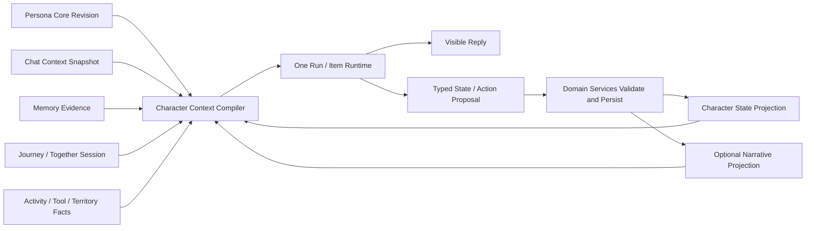

# CharaMate 智能角色、开放域对话与交互叙事路线提案

> 状态：路线已由用户确认；本文保留为论证提案，权威执行状态见研究设计 §8A 与 `docs/progress/`
> 日期：2026-08-27
> 当前基线：`main@5be8e28b12b5a563eb339456b8e10685992cabc2`
> 离线 Pilot 基线：`f7122f23e1ce3b6cce3008b9e0c59d43343c23f2`；真实 Pilot 前需完成来源漂移审计并重新冻结 Manifest
> 适用范围：智能 NPC、角色扮演、开放域对话、长期陪伴与交互叙事

本提案记录后续方向的产品边界、Decision、实验与生产工作包。用户已确认“真实生活中的长期个人角色优先、显式虚构角色扮演与 Territory NPC 后置”；当前执行以 `refactor-architecture-decisions-2026-07-31.md` §8A、`STATUS.md` 和 `ROADMAP.md` 为准，本文不单独定义生产默认值。

## 1. 推荐结论

下一阶段不应从“多 Agent 演戏”“自由剧情生成”或完整 NPC 世界模拟开始，而应先补齐一条可验证的 **Character Loop**：

```text
版本化 Persona Core
  + 当前 Chat / Journey 的 Character State
  + 用户 Memory 与共同经历
  + 当前 Activity / Tool / Territory 事实
  → 同一角色上下文编译器
  → 既有 Run / Item Runtime
  → 角色一致的回答与受控状态更新
```

推荐顺序是：

1. 先完成 `CHARACTER-DIALOGUE` Decision，证明结构化 Persona 与选择性角色状态是否真正改善长期对话。
2. 把胜者接入已接受的 `CONTEXT-RECIPE`，让文字、Voice、Automation、主动对话共用同一 Persona 快照和连续性上下文。
3. 完成主动发言的宿主策略，使“值得说”与“现在允许打扰”分离。
4. 对稳定的 Journey 增加可选 `NarrativeProjection`，先做生活叙事和用户能影响的后果，再考虑显式虚构场景。
5. 最后才让 Territory 中的角色拥有少量 typed affordance，形成可观察、可验证的 NPC 行为闭环。

这条路线保留 CharaMate 已经成熟的 Agent、Memory、Journey、Voice、Activity 和 Territory 基础，同时避免增加第二套聊天 Runtime、亲密度数值、常驻导演 Agent或完整游戏模拟器。

## 2. 当前基线与缺口

| 领域 | 当前事实 | 面向智能角色的缺口 |
| --- | --- | --- |
| Run / Item | Text、Voice、Automation、主动对话共享产品 Run/Item 状态和 Chat 真源 | 尚无统一的 Persona revision / character context snapshot |
| 长会话 | 已有持久 `ChatContextSnapshot`、覆盖水位、近期原文与 Memory evidence | 当前摘要偏任务状态，未明确保留共同经历、角色立场和未解决关系/叙事线索 |
| Memory | 已有形成、检索、来源、修订和可纠正边界 | 主要刻画用户事实；角色自身的当前意图、立场和变化尚无独立边界 |
| Journey | 已有目的、当前位置、下一步、Session、recap、milestone 和 Home Chat | 能持续“共同做事”，但不是 scene、participant goals、consequence 和 user agency 模型 |
| 主动聊天 | 已有基于 Activity 事实的语义门，证据不足时沉默 | 还缺安静时段、显式反馈、来源退避和全局打扰预算的完整宿主决策 |
| Voice | Realtime 与文字路径共享 Chat、Tool、Run 和长期上下文边界 | Persona/voice instructions 仍未由真实 Persona 领域统一提供和冻结 |
| Territory | 已有结构化 World、Revision、碰撞/寻路和桌宠移动 | 角色主要由用户指令移动；没有感知—意图—行动—结果的 NPC 循环 |
| Persona | 产品/UI 已规定预设、编辑、音色和切换语义 | 当前 Renderer 仍硬编码 `Mika / 元气开朗`，Chat Schema、Agent instructions 和数据库没有 Persona 领域 |
| 评测 | Harness、Memory、Context、Voice、Territory 等已有 Decision 证据 | 没有角色一致性、开放域社交质量、长期漂移、用户能动性和叙事连贯性的专门冻结集 |

因此，当前实现更准确的定位是：**有长期记忆和共同行程的个人 Agent/陪伴基础**，还不是一个完成态的角色扮演或交互叙事系统。

## 3. 产品目标与边界

### 3.1 第一目标：长期一致的个人角色

角色需要在普通 Chat、任务协作、Voice、主动发言和跨日续接中保持：

- 可辨识但不过度表演的语言风格；
- 稳定的背景、动机、价值取向、称呼和知识边界；
- 根据真实共同经历自然变化的当前意图和关系立场；
- 对用户事实、角色事实、世界事实和虚构设定的清楚区分；
- 在执行任务时继续清楚、准确，不因角色化降低 Tool/Approval/Run 可靠性。

### 3.2 第二目标：生活叙事

Journey 不只是任务续接，也可以形成“我们经历过什么、现在处在哪里、哪些选择产生了后果、下一次有什么自然机会”的长期叙事。但它仍来源于真实对话、共同活动、Memory 和用户确认，不把生活强行改写成游戏任务。

### 3.3 条件目标：显式角色扮演与 Territory NPC

用户明确发起虚构场景时，可以在普通 Chat 内形成临时 scene，不新增第三种 Composer 模式。该方向应在长期 Persona 与生活叙事稳定后再做。Territory NPC 也只在角色拥有可信状态和事实边界后进入研究。

### 3.4 非目标

- 不新增亲密度、好感度、经验值、等级或关系阶段。
- 不默认运行导演、编剧、演员等常驻多 Agent 队伍。
- 不建立第二套角色扮演 Chat、Memory、Tool 或 Voice Runtime。
- 不先做 Fine-tuning；先测量 Prompt、Context、Memory 和状态投影的上限。
- 不允许模型直接宣告 Territory 碰撞、路径、物件 Revision 或现实观察已经成立。
- 不把当前受限只读 `collaboration.dispatch` 改造成 NPC 群演或叙事编排器。

## 4. 推荐目标架构



这里的“一套 Runtime”指一套产品 Run/Item、Tool、Approval、Chat 和恢复语义。文字 Agent 与 Realtime 模型驱动仍遵守现有 Voice 设计，但必须消费相同的 Persona revision 和角色上下文合同，不能各自维护人格或长期记忆。

### 4.1 数据所有权

| 对象 | 负责内容 | 不负责内容 |
| --- | --- | --- |
| `PersonaCoreRevision` | 用户可编辑的角色身份、背景、动机、价值、说话/称呼/主动风格、禁用表达、知识边界、默认音色 | 用户事实、当前情绪、Journey 进度、世界真相 |
| `CharacterStateProjection` | 当前意图、非数值化 affect、当前相信/关注的内容、关系立场、未解决线索及证据引用 | 永久 Persona、用户 Memory、事实真源 |
| Memory | 用户事实、偏好、事件、承诺和可纠正来源 | 模型临时情绪或虚构剧情状态 |
| Journey | 长期共同事项、Session、当前位置、下一步和 milestone | 剧情导演、完整世界状态 |
| `NarrativeProjection` | 从 Journey/Chat/Memory 派生的当前 scene、参与者目标、最近 beat、后果和开放线索 | 直接改写 Memory/Journey/Territory 真源 |
| Territory | World/Zone/Entity/Revision、碰撞、寻路和动作结果 | 角色语言风格或用户关系状态 |

### 4.2 候选合同轮廓

以下只是 `CHARACTER-DIALOGUE` 的候选输入，不是已接受 Schema：

```text
PersonaCoreRevision
  id, revision, displayName
  identity, backstory
  motivations[], values[]
  speechStyle, addressStyle, initiativeStyle
  knowledgeBoundary, disabledExpressions[]
  voiceProfileId

CharacterStateProjection
  personaRevisionId, scope(chat | journey)
  currentIntent, affect
  salientBeliefs[], relationshipStance
  unresolvedHooks[], evidenceRefs[]
  generation, updatedAt

NarrativeProjection
  journeyId, currentScene
  participantGoals[]
  latestBeat, consequences[]
  unresolvedHooks[], nextOpportunity
  sourceRefs[], generation
```

`affect` 和 `relationshipStance` 是可读描述，不是可累加的分数。任何投影都必须可由证据重建或安全丢弃；它不能覆盖 Persona、Memory、Journey 或 Territory 的事实。

## 5. Decision 路线

| 顺序 | Decision / amendment | 解决的问题 | 依赖 |
| --- | --- | --- | --- |
| 1 | `CHARACTER-DIALOGUE` | 稳定 Persona 是否足够；选择性角色状态是否带来净收益 | 当前 Agent、Memory、Journey、Context Recipe |
| 2 | `CONTEXT-RECIPE` character amendment | 胜者怎样进入长会话摘要、跨 Run、Voice 与主动对话 | `CHARACTER-DIALOGUE` 胜者 |
| 3 | `PROACTIVE-POLICY` | 模型语义判断与宿主打扰控制怎样组合 | Persona contract 稳定 |
| 4 | `NARRATIVE-AGENCY` | 是否需要结构化 Narrative Projection 或边界型 director | 角色一致性和长期上下文已稳定 |
| 5 | `TERRITORY-NPC-ACTION` | 角色如何在现有 World 中做少量可信行动 | Narrative/character context 与 World affordance 稳定 |

### 5.1 `CHARACTER-DIALOGUE`

#### 研究问题

在不改变 Provider、模型、Memory Retrieval、Run Runtime 和任务权限的前提下，怎样获得长期一致、自然、能调用角色知识、又不损害任务能力的角色对话？

#### 候选 Arms

| Arm | 唯一主要变化 | 生产含义 |
| --- | --- | --- |
| `A0-CURRENT` | 当前通用 Agent instructions + Journey/Memory | 只作现状基线，不满足既定 Persona 产品要求 |
| `A1-PERSONA-CORE` | 注入版本化、分层的 Persona Core | 最小可上线候选 |
| `A2-SELECTIVE-STATE` | A1 + 仅在有证据的状态变化处提交 typed `CharacterStateDelta` | 有净收益才保留的适应层 |

A2 默认仍由同一回答 Run 选择是否提交状态 delta，不增加每轮后台 Reviewer。若模型无法在回答和状态更新间保持质量，才另开一次性子实验比较边界型单次 reflection；不能把第二模型调用直接写成生产默认值。

#### 冻结数据覆盖

- 多个内置 Persona 与用户编辑后的 Persona，覆盖明确风格、禁用表达、背景和知识边界；
- 普通闲聊、情绪支持、技术讨论、共同做事、分歧、道歉、幽默和话题切换；
- 角色事实需要在无显式提醒时被选中、同时又必须在边界外保持克制的样本；
- 用户事实改变、纠正、过期和隐含约束；
- 短、中、长会话层，其中长层必须跨真实 Chat summary/compaction 和应用重启；
- Text、Voice、Automation follow-up、Activity 主动开场和气泡续聊；
- Chat 与 Agent 权限、Tool、Approval 和任务完成的回归任务；
- 中文为主，并覆盖真实中英混合技术对话。

样本量、重复次数和质量差阈值在 pilot 后按区间精度预注册，不从论文结果或直觉直接复制。

#### 指标

角色质量：

- Persona fidelity、跨轮漂移、背景/价值矛盾；
- Anchoring、Selecting、Bounding、Enacting 四类 persona-memory 能力；
- 角色知识越界、假装观察、用户/角色事实混淆；
- 语言自然度、重复口头禅、过度角色表演和“通用助手腔”。

开放域与社交质量：

- 意图理解、共情适切性、合作、分歧处理、边界感和目标达成；
- 对隐含用户约束的遵守；
- 人类盲评的自然度、可信度、愿意继续聊和整体偏好。

Agent 保真：

- Tool/参数正确、Approval 语义、业务终局成功和虚假完成；
- Text/Voice/Automation/主动对话的 Persona revision 一致；
- Token、TTFT、总延迟、额外写入和失败恢复复杂度。

#### 选择规则

- A2 只有在角色一致性/自然度获得稳定增益，且没有明显损害任务成功、延迟或状态准确性时才晋级。
- A1 与 A2 质量相当时选择 A1；稳定 Persona 是产品要求，动态状态不是。
- 如果 A1/A2 都不能守住知识边界或任务能力，停止生产实现并重做候选，不以 A0 冒充 Persona 完成。
- Decision 完成后只保留中文记录 `docs/benchmarks/character-dialogue.md`；Arm prompt、runner、fixture 身份和候选状态全部从生产分支删除。

### 5.2 `CONTEXT-RECIPE` character amendment

该步骤不是重新开放 C0–C6，而是验证 `CHARACTER-DIALOGUE` 胜者加入已接受 Recipe 后没有破坏原结论。

必须保证：

- 稳定 Persona Core 使用版本化快照，适合放在稳定 instructions/context 前缀；
- Character State、Journey、Memory evidence 和当前目标各有明确槽位，不在多个摘要里复制；
- 当前用户输入仍靠近末尾；Persona、状态和 Memory 的具体顺序通过小规模配对消融确认；
- Chat summary 增加“共同经历、角色连续性、未解决互动/叙事线索”等必要语义，但只保存有证据的内容；
- 临时 affect、模型自述或虚构 scene 不得变成用户事实 Memory；
- Text、Voice start/reconnect、Automation、主动对话和 inline continuation 使用同一 snapshot generation；
- 更换 Persona 只影响新回答，历史消息和旧 Run 的 Persona snapshot 不被改写。

如果引入的新槽位显著改变质量、Token 或 compaction 行为，应预注册正式 amendment；如果只是落实已证明胜者的合同和正确性回归，不另造一组永久 Arm。

### 5.3 `PROACTIVE-POLICY`

主动发言应拆成两层：

```text
模型：这条事实是否值得说，应该怎样说？
宿主：现在是否允许打扰，应该投递到哪个 Chat？
```

候选比较：

| Arm | 语义门 | 宿主策略 |
| --- | --- | --- |
| `P0-CURRENT` | 当前 `none / new_conversation / existing_journey` | 现有结构校验与单次进行中约束 |
| `P1-USER-CONTROL` | 同 P0 | 加入安静时段、主动程度、显式“少一点”、来源退避和用户忽略语义 |
| `P2-GLOBAL-BUDGET` | 同 P1 | 再加入跨来源全局打扰预算与接受度优先级 |

P1 是既有产品要求的最小实现；P2 是否值得保留必须看真实使用。预算、退避和窗口不从经验拍常量，先用冻结 replay 与可用性 pilot 选择。模型仍不根据应用名关键词直接触发，宿主也不替模型生成话术。

主要指标包括：用户回复/打开/关闭/忽略、同来源重复、错误打扰、错过有价值机会、主动内容质量、到正确 Chat 的路由、每次有用互动的模型成本。普通 UI 只保留用户可理解的主动程度、安静时段和纠正入口，不显示内部分数或 benchmark 参数。

### 5.4 `NARRATIVE-AGENCY`

该 Decision 只有在 Persona、Character State 和长会话 continuity 稳定后才启动。优先研究生活叙事，不默认把日常陪伴游戏化。

| Arm | 叙事状态 | 生成方式 |
| --- | --- | --- |
| `N0-JOURNEY` | 当前 Journey/Session/milestone | 现有 Agent 回答 |
| `N1-PROJECTION` | 增加可重建的 `NarrativeProjection` | 同一 Agent 在自然边界提交 typed delta |
| `N2-BOUNDARY-DIRECTOR` | 同 N1 | 仅在 scene/episode 边界调用一次无 Tool 的结构化 director projection |

N2 不是常驻 Agent，也不拥有 Run、Memory 或世界真源。若 N1 与 N2 质量相当，选择 N1。

评测至少覆盖：

- 连贯性、角色一致性、重复和无意义戏剧化；
- 用户选择是否改变后续状态与可见后果；
- 是否强行替用户决定、把生活任务化或制造虚假共同经历；
- immersion、agency、后果兑现、开放线索回收和自然结束；
- 额外模型调用、延迟、Token、状态写入和恢复复杂度。

显式虚构角色扮演应作为单独分层：只有用户自然发起后才建立临时 scene；离开场景后不把虚构事实写入普通 Memory。是否把这一层纳入当前产品周期需要产品确认，不能由技术实验自行扩张范围。

### 5.5 `TERRITORY-NPC-ACTION`

推荐的最小闭环是：

```text
只读 World snapshot + 当前可用 affordances
  → 角色选择一个意图和 typed action proposal
  → Territory host 校验 Revision / path / collision / target
  → 执行动画与返回真实结果
  → 结果进入下一次角色上下文
```

初始 action 只考虑 `move`、`observe`、`sit`、`react` 等有限动作。角色不能生成任意坐标后宣称成功，也不能直接改 World Definition。触发只发生在用户互动、明确场景变化或自然活动边界，不启动常驻模拟 tick。

这一阶段的核心不是动作数量，而是：动作是否与 Persona/当前对话有关、非法动作率、宿主结果一致性、动画/路径延迟、用户是否觉得有生命感，以及是否造成干扰。没有证据前不增加需求、经济、体力、日程或多 NPC 社会系统。

## 6. 推荐工作包与依赖

当前新 worktree 只承载本提案。候选实验和生产实现应使用后续独立 worktree，避免讨论稿与候选代码直接变成生产路径。

| 顺序 | 工作包 | 主要范围与 owner | 验收 | 阻塞项 / 删除计划 |
| --- | --- | --- | --- | --- |
| 0 | 路线确认 | 本提案；不改权威文档 | 产品边界、Decision 顺序和非目标获得确认 | 未确认前不编码 |
| 1 | Character Decision 协议 | 研究设计 amendment、数据 manifest、标注指南 | 来源版本、dataset hash、Arms、指标、门槛、成本全部预注册 | `CHARACTER-DIALOGUE`；无生产代码 |
| 2 | Character disposable experiment | 独立实验 worktree，仅实现 A0/A1/A2 runner | E1 offline + E3 target-model 结果可复现，保留分母/区间/失败 | 完成后删除 runner、Arm prompt、候选依赖和原始 fixture 身份 |
| 3 | Character Decision Record | `docs/benchmarks/character-dialogue.md` | 胜者、限制、复杂度、拒绝方案与删除证明完整 | 未定案不进入生产 |
| 4 | Persona foundation | 单一 integration owner 负责 shared Schema、Main Persona service/repository、DB、IPC/Preload | 预设复制、编辑、版本、选择、删除边界和重启恢复通过 | 只实现胜者；无旧 Persona adapter |
| 5 | Persona UI | Settings/侧栏/Chat fixture；只消费冻结 contract | 当前 Persona 可见可改；切换只影响新回答；无内部参数 | 可在 contract 冻结后与 Main 实现并行，不编辑 shared Schema |
| 6 | Character context integration | Agent context compiler、Chat/Run snapshot、Voice instructions、Automation、proactive | 所有入口冻结同一 Persona revision；跨 Run/重启不漂移 | `CONTEXT-RECIPE` amendment；删除硬编码 Mika 路径 |
| 7 | Selective Character State | 仅在 A2 胜出时新增 Persona-owned projection/repository | 证据绑定、作用域隔离、重放幂等、可丢弃重建 | A1 胜出则整个包不存在 |
| 8 | Character acceptance | contract、integration、Electron E2E、target-model benchmark | 角色质量与 Agent 任务回归同时通过 | 不通过不得用 feature flag 保留两套路径 |
| 9 | Proactive policy | Journey/Activity/Settings 边界；单一 owner 串行改共享合同 | 安静时段、反馈、退避和投递路由可验证 | `PROACTIVE-POLICY` |
| 10 | Narrative projection | Journey-owned projection + Agent context；不改 Territory 真源 | 用户选择产生可追踪后果，重启后连续 | `NARRATIVE-AGENCY` |
| 11 | Territory NPC action | Territory affordance contract、host execution、Pixi projection | 动作合法、路径/Revision 一致、结果回传 | `TERRITORY-NPC-ACTION`；无常驻模拟器 |

### 6.1 近端生产合同的关键语义

- 当前默认 Persona 是用户设置；每次 Run 冻结实际使用的 Persona revision snapshot。
- Automation 保存目标 Persona revision；到时不因全局切换而悄悄变成另一角色。
- Voice Session 冻结 Persona/voice instructions；不兼容修改沿既有冷重连语义生效。
- Chat 历史不因 Persona 编辑而重写；旧 Run 仍能解释当时使用了哪个 revision。
- `persona_preference` 成长候选只能建议用户可见 Persona 字段，继续经过现有确认流程，不能直接改系统 instructions。
- Character State 只在 A2 胜出后存在，并按 Chat/Journey 作用域隔离；不能跨 Persona 泄漏。

### 6.2 测试要求

编辑阶段运行最窄的 focused tests；每个生产工作包交付前至少覆盖：

- TypeBox/Ajv 正反 contract；
- Persona revision、Run snapshot、Character State generation 和重启恢复 integration；
- Text、Voice、Automation、主动对话的跨入口一致性；
- 长 Chat summary/compaction 后的角色约束和用户隐含约束保留；
- Chat/Agent Tool、Approval、steering、Plan、Memory 的既有回归；
- 受影响的 Electron E2E；里程碑前执行 `npm run verify:offline`、`npm run build`，涉及打包行为时执行 package/packaged smoke。

真实 Provider 的角色质量实验单列为 benchmark/live 结果，不混入默认离线回归。

## 7. 第一阶段验收清单

第一阶段“Persona + Character Dialogue”只有同时满足以下条件才算完成：

- `Mika / 元气开朗` 等 Renderer、Tray、主动开场和 Automation 中的临时硬编码已由真实 Persona projection 替代；
- 用户可以使用预设、复制编辑，并配置背景、说话/称呼/主动风格、禁用表达和默认 Voice；
- 每个新 Run、Automation 和 Voice Session 能指出实际 Persona revision；历史回答不随编辑变化；
- 普通闲聊、共同活动、长会话、重启、主动发言和 Voice 都保持同一角色身份；
- 用户纠正角色偏好后走现有候选/确认边界，不静默修改；
- 角色化不降低 Tool、Approval、事实引用、任务终局和错误呈现；
- 已接受 Context Recipe 仍只有一套，生产不存在 A0/A1/A2 开关或候选 prompt；
- Decision Record 给出人类盲评、模型辅助评分、任务回归、Token/延迟和复杂度的完整证据及限制。

## 8. 推荐停止线

完成第一阶段后先看证据，再决定是否进入叙事和 NPC：

1. 如果 Persona Core 已足够稳定，不增加 Character State。
2. 如果 Character State 改善角色感但损害任务能力，收窄其作用域或回到 A1，不维护双模式。
3. 如果生活叙事没有提升用户 agency，只保留现有 Journey，不为了“看起来先进”增加 director。
4. 如果 Territory 动作不能形成明显的角色表达，只保留用户驱动桌宠，不扩张成游戏模拟。
5. Fine-tuning 只在结构化 Persona、Context、Memory 和状态方案的可重复缺陷被确认后另立 Decision。

## 9. 一手研究来源快照

查阅日为 2026-08-27。这些来源只用于形成候选与指标，不代表其方案已经适合 CharaMate；正式 Decision 开跑前仍需冻结当时版本、commit、模型和数据 hash。

| 来源 | 对本路线的启发 | 不直接复制的内容 |
| --- | --- | --- |
| [PersonaForge, Findings of ACL 2026](https://aclanthology.org/2026.findings-acl.386/) | 分层人格、长程漂移评测、选择性激活 | Big Five/防御机制不自动成为产品字段 |
| [Memory-Driven Role-Playing, Findings of ACL 2026](https://aclanthology.org/2026.findings-acl.1175/) | Anchoring、Selecting、Bounding、Enacting；无显式提示的角色知识调用 | MRPrompt 不直接替换已接受 Context Recipe |
| [LD-Agent, NAACL 2025](https://aclanthology.org/2025.naacl-long.272/) | 事件感知、用户/Agent persona 与长期/短期记忆分工 | 不引入第二套长期对话框架 |
| [LoCoMo-Plus, ACL 2026](https://aclanthology.org/2026.acl-long.1150/) | 评估 cue 与 trigger 不同词时的隐含约束遵守 | 不把公开 benchmark 分数当产品体验结论 |
| [SOTOPIA](https://arxiv.org/abs/2310.11667) | 开放域社交目标、常识与策略沟通的整体评估 | 不把多 Agent 社会模拟搬进生产 |
| [Towards Enhanced Immersion and Agency for LLM-based Interactive Drama, ACL 2025](https://aclanthology.org/2025.acl-long.546/) | immersion、agency、playwriting 与 plot reflection 的评测维度 | 不先上常驻编剧/反思调用 |
| [Google DeepMind Concordia](https://github.com/google-deepmind/concordia) | Agent 提议动作、环境/host 裁决事实的边界 | 不引入其通用模拟框架或 Game Master Runtime |

## 10. 建议的下一步

已确认两个产品判断：

1. 第一阶段以“真实生活中的长期个人角色”作为主路径，显式虚构角色扮演暂列条件目标。
2. Territory NPC 不进入第一阶段，只先冻结未来 affordance 边界。

权威研究设计已经新增 `CHARACTER-DIALOGUE` prospective protocol，`STATUS/ROADMAP` 也已重新打开 Persona/Character Dialogue 工作包。`codex/character-dialogue-experiment` disposable worktree 已在旧基线冻结 4 个原创 Persona、12 个离线 protocol-calibration cases、`copilot_api / gpt-5.6-sol` 目标快照与 Manifest `3ea27d…f4d82c`，并通过 16/16 Node tests、双次确定性 Mock 和 Live preflight；Runner 固定 36 个初始请求、最多 48 个 Provider 请求、无 SDK retry，未知提交不会自动重放。中文 Rubric、24 题 Arm-hidden CORE/STATE 成对盲评、独立 key 与标签分析器也已完成。这些结果不进入模型质量分母，也没有发送生成请求。roadmap worktree 已于 2026-08-31 更新到 `main@5be8e28`；下一步先审计 Agent/Memory/Voice/主动对话的来源漂移并重新冻结实验 Manifest，再获得真实模型 Pilot 的明确授权，最后依据 Pilot 校准正式 selection/holdout、最小重要差异和区间目标。当前提案 worktree 不承载候选或生产实现。
