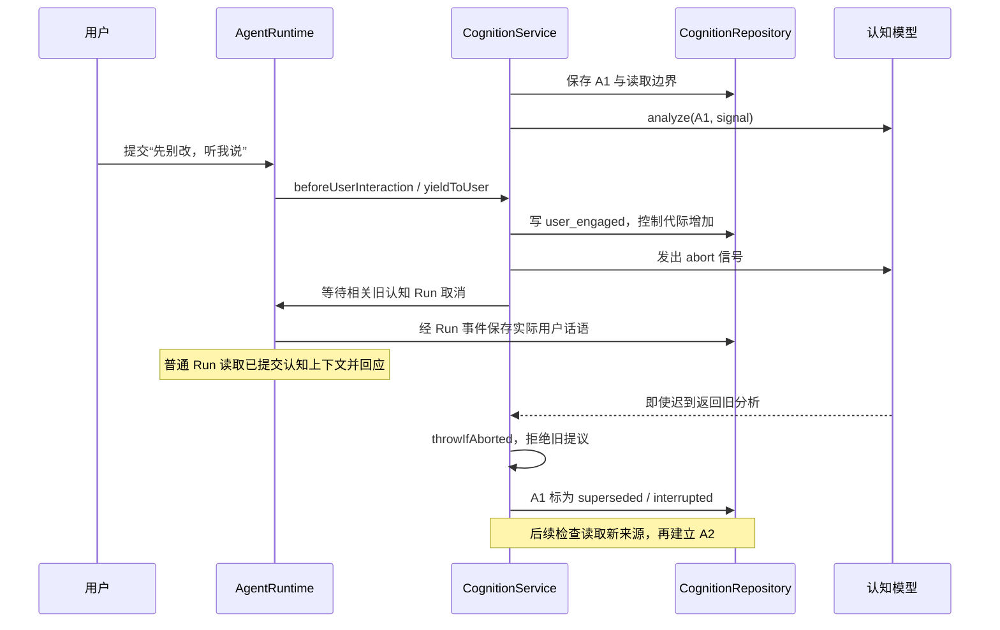

# 03 Cognition：从一个事件进入系统，到角色决定是否行动

一面后关于主动聊天分寸的补充见[第 19 章第 1–6 节](19-proactivity-and-product-feedback.md)：包括当前真实间隔、免打扰、连续忽略后的退避、展示反馈，以及任务边界和玩家级发言仲裁方案。

用户打开一封信，角色看到内容；用户说“先听我说，不用改”；后台分析还没结束，文档又变了；用户接着说“现在只帮我看看语气”。要解释这个场景，不能只说“感知、注意、记忆、规划协同”。必须说清楚谁接到输入、保存什么、谁调用模型、异步等待期间发生什么，以及返回结果为什么还能用或必须作废。

本章按当前实现展开。代码核对日期为 **2026-10-22**，基线为 `8e50d50f47fd961fbed9174d76f145a5e22b58d1`。前半章解释桌面项目的实际行为；咖啡馆部分明确标为迁移设计。文中 e101、A1、I1 等是方便推演的示例编号，真实实体使用项目合同规定的 ID；时间线不是实测延迟。历史实验与本轮代码阅读也分别标注。

对应 R02、R03、R06，重点验收 A03，并连接 A06、A07、A10。阅读顺序是：先看入口与唤醒，再看模型和事务，最后手推并发案例。读完应能回答：“三个事件先后到达，第一轮模型还没返回，现在数据库、调度器、模型请求和用户界面分别处于什么状态？”

Persona 的完整字段、版本表、Run 快照、12 例方案比较，以及未预设问题与百 NPC 一致性的游戏设计，继续见 [第 16 章第 1、4 节](16-npc-persona-hints-and-evaluation.md)。其中明确区分提示约束、规则校验与尚未建设的 OOC 检测能力。

## 1. 先分清四件事：收到、考虑、执行、交付

| 阶段 | 真正发生的事 | 不代表什么 |
| --- | --- | --- |
| 收到事件 | 保存来源、内容、接收顺序；必要时更新当前物理焦点 | 不代表模型已经读过 |
| 认知分析 | 模型根据实际供给的材料，提出情境、判断、意图和一个选择 | 不代表角色已经说话或调用工具 |
| 分配并执行 Run | 宿主验证条件，交给统一 Agent Runtime 生成或执行 | 不代表目标已经达成 |
| 交付与反馈 | 工具产生效果回执，或消息实际被选定界面接受 | 不代表用户读过、赞同或感到开心 |

这四件事有不同 owner。Activity、Run 等领域拥有原始事实；Cognition 保存工作状态并选择下一步；Agent Runtime 拥有模型与工具执行；具体界面拥有投递结果。Cognition 的分析驱动不提供工具，也不能直接向用户说话。

长期 Memory 解决跨会话形成、修订和回忆。Cognition 解决正在发生的事：当前在做什么、有哪些未完成目标、刚才的判断是否仍成立。这不是把聊天历史再存一遍。它保存了可更新、有来源、有版本的状态。

## 2. 工作状态里到底有什么

以下字段来自 [共享认知 Schema](../../../src/shared/schemas/cognition.ts)。把它们放回写信场景，就能理解为何需要这些对象。

| 对象 | 场景中的内容 | 关键约束 |
| --- | --- | --- |
| Evidence，来源证据 | 用户原话、文档观察、真实工具回执 | 有 actor、来源身份、观察时间和接收序号；不能把屏幕引语变成用户当前命令 |
| Situation，情境 | “用户正在准备一封给同事的信” | 有版本、相关对象和进行状态；切一下窗口不自动结束整件事 |
| Episode，经历片段 | “讨论收信对象”“检查语气”两段过程 | 有开始/结束和所属证据；时间过去不等于任务完成 |
| Claim，判断 | “用户暂时只想倾诉” | 区分观察、转述、推断；记录支持、反证、替代解释与被替代状态 |
| Intent，意图 | “按用户请求只检查语气” | 有 owner、依据、目标、完成标准、阻碍和恢复条件 |
| Attention，注意状态 | 当前前台对象、主要情境、当前意图、读到哪里、何时再考虑 | 物理焦点与语义情境是两回事 |
| Attempt，一次分析尝试 | “A1 根据哪些材料作了什么决定” | 有状态、读取边界、依赖版本、选择和后续 Run 绑定 |
| Persona，角色设定 | 身份、价值、说话方式、知识边界 | 调整解释和表达，不修改已经发生的事实 |

Claim 不只是一个字符串。例如“用户可能赶时间”应是 `basis=inferred`、`state=uncertain`，依据可能是一条看钟表的观察，并保留“也可能只是确认时间”的替代解释。用户说“我五分钟后要走”则是带用户来源的转述。即使内容接近，二者对行动的依据强度不同。

Intent 的 `basis` 区分 `explicit_user`、`inferred_user` 和 `character`。从屏幕推测“他可能想润色”不等于获得外部写入授权；角色自己想布置虚拟住处，也不应伪装成用户请求。完成状态同样要有依据：工具实际效果、用户报告，或确实满足有限对话目标的已完成回答。没有依据时不能靠一句“我做完了”改成 fulfilled。

## 3. 事件怎样真正进入：从生产者一直追到数据库

入口不是只有一个 `ingest` 函数。面试时必须能把它的调用者也说出来。

### 3.1 用户发消息的入口

当前文字路径是：

`Renderer 提交 → typed preload / Agent IPC → AgentRuntime.start → beforeUserInteraction → CognitionService.yieldToUser → 原有认知 Run 让路 → 分配普通 Run / 写 user_message Item → Run 事件观察 → CognitionRuntime.itemEvidence → observeFeedback → ingest`。

关键实现是 [AgentRuntime](../../../src/main/agent/agentRuntime.ts) 的 `start`、[Main 装配](../../../src/main/index.ts) 的 `beforeUserInteraction` 回调，以及 [CognitionRuntime](../../../src/main/app/cognitionRuntime.ts) 的 `observeRun`、`itemEvidence`。

注意这里有**两条记录**，不能只讲“把用户消息送给 Cognition”：

1. `yieldToUser` 先记录 `kind=control、control=user_engaged`，使控制代际增加，并对正在分析的请求发出取消信号。这发生在普通 Run 的模型准备之前。
2. 真正用户文本稍后作为 `user_message` Item 进入 Run 事件。`itemEvidence` 把它转换成 `actor=user、kind=utterance`，来源绑定实际 Run ID、Item ID 和 Item 状态。

前一条说“用户接管了交互”；后一条才包含“只帮我看语气”的具体语义。宿主不需要先用模型识别句子是不是纠正，才能停止旧自主行为。代码虽然支持 `user_correction` 控制类型，但不能据此声称线上有一个为每句话分类并自动发该控制的独立模型。

同一个 Run 的 steering、恢复和输入解答也有用户交互钩子；继续原 Run 时传入 `continuingRunId`，让路逻辑不会把正在被继续的那个 Run 一并取消。语音进入 listening 时，Main 也调用 `yieldToUser`；语音仍沿共享 Run/Item 合同留下可识别的输入与结果。

### 3.2 用户切换窗口、编辑内容的入口

当前桌面观察链为：

`ActiveApplicationSource.subscribe → ActivityCaptureCoordinator.#queueApplication → #applyCurrentApplication → ActivityService.startEvent / recordEvent → ActivityRepository.insertEvent → Main 注册的 setEventListener → CognitionRuntime.observeActivity → CognitionService.ingest → CognitionRepository.ingest`。

[捕获协调器](../../../src/main/activity/activityCaptureCoordinator.ts) 不是简单地把 OS 回调直接丢给模型。它先处理暂停、空闲、来源代际和队列；尚未处理的同一对象内容/交互更新可以合并。来源代际已变化的旧回调会退出，避免暂停后旧采集继续写入。

[ActivityService](../../../src/main/activity/activityService.ts) 先保存实际活动，再通知监听者。`observeActivity` 负责把领域事件翻译成认知证据：

- 普通前台事件带应用、标题、内容范围和对象身份。存在适配器的 surface 时，用 surface ID 与 epoch 建立对象 key；缺少这种稳定身份时，只能采用带有 provisional 标记的临时身份。
- 可访问性或 DOM 的文字带 `visibility.status`、来源、范围和截断标记。标题不是完整正文；只捕获当前视口，也不能假装看过整份文档。
- 受保护内容不被复制为证据正文；原内容不可用时应保留这个事实。
- `agent_run` 的 Activity 投影会被跳过，因为 Run 通道已经提供更直接的工具回执，重复接入会把同一动作记两次。

**Activity 保存与 Cognition 接入不是一个跨领域原子事务。** Main 的监听者异常会被捕获并记录错误。这条实时监听链本身不能证明“所有 Activity 已持久化记录都一定被 Cognition 消费”。若面试官追问监听失败后的完整补偿，必须区分现有路径与需要进一步验证的回放机制，不能仅凭用了 SQLite 宣称端到端恰好一次。

### 3.3 像素变化先是一个信号，真正图片另行读取

视觉有两条线，尤其容易讲错：

`原生 visual-change 通知 → ActivityCaptureCoordinator → ActivityService.notifyVisualChanged → CognitionService.notifyVisualChange`，这条线只告诉系统“当前表面可能变了”，没有给模型一张图片。

真正分析到期后，`drain` 先执行 Main 配置的 `beforeAnalysis`：

`consumeLatestVisualEvidence(signal) → 向 visual supplier 拉取最新帧 → stage / consume → 得到 ActivityEvent → observeActivity → 保存视觉证据`。

视觉证据带真实 surface、epoch、sequence、内容版本、截图时间、尺寸和 artifact 引用。随后认知驱动解析该引用，将可用图片作为实际模型图像输入；只把文件路径放进 JSON 不算模型看过图像。模型不支持视觉、原图不可用或预算装不下时，输入覆盖信息必须说明缺口。

刷新得到的 `trigger=frame` 证据**不会再给自己安排一次分析**，否则“分析前拉图”又会“因图调度分析”，形成自激循环。普通用户的 `prepareTurn` 不调用这个 beforeAnalysis 钩子。

### 3.4 执行结果、时间与重要时刻如何进入

| 生产者 | 实际调用链 | 给 Cognition 的材料 |
| --- | --- | --- |
| Run Item 完成 | Run 事件监听 → `observeRun → itemEvidence → observeFeedback` | 已完成用户/助手话语，或带实际工具结果的 effect；running Item 被忽略 |
| Run 结束、失败、取消 | `observeRun` 的 terminal 分支 | Run 生命周期事实；“completed”本身不证明工具效果或目标成功 |
| 消息界面接受、关闭等 | `observeBubbleOutcome`，成功投递另有 `surface:offered` | 具体界面结果；关闭气泡不能推断用户讨厌角色 |
| 重要时刻到期/撤销 | [ProactiveOpportunityService.emit](../../../src/main/journey/proactiveOpportunityService.ts) → `ingest` | 原 Memory/Revision、目标 Chat、考虑时间、事件时间、due/cancelled |
| 角色自己的计划 | `saveCharacterIntent` | 保存带版本的 Intent，再安排其 nextWakeAt |
| 系统休眠/唤醒、角色切换、用户点停止 | Main → `CognitionRuntime.control` | 显式 control；休眠还改变 Runtime 的 sleeping 状态 |
| Provider 配置改变 | Main → `retryAfterConfigurationChange` | 改变恢复条件、取消旧分析；有待处理工作时再安排考虑 |

时间到了不需要伪造一句“用户提醒你该做事了”。持久化的 `nextWakeAt` 已经足以使调度器检查到期工作。重要时刻虽然引用 Memory，却是有专门机会对象的输入；它与普通检索回来的历史记忆有不同触发规则。

## 4. 一条证据是什么样的：身份、顺序和去重

假设编辑器内容发生改变，适配器生成的认知输入在结构上类似下面这样。此处是可读示例，不是拷贝出的生产记录：

```json
{
  "id": "11111111-1111-4111-8111-111111111101",
  "personaId": "22222222-2222-4222-8222-222222222222",
  "actor": "user",
  "kind": "observation",
  "source": {
    "kind": "activity",
    "id": "33333333-3333-4333-8333-333333333333"
  },
  "observedAt": "2026-10-22T10:00:00.000Z",
  "boundary": "content",
  "object": {
    "key": "surface:editor-window:7",
    "identity": "adapter",
    "appName": "Editor",
    "title": "给同事的信"
  },
  "visibility": {
    "status": "available",
    "source": "accessibility",
    "scope": "viewport"
  },
  "text": "我想说明今天讨论中的误会。"
}
```

数据库接入时才增加 `receiptSequence` 和 `receivedAt`。观察时间来自来源，接收时间来自宿主，接收序号来自实际插入顺序。因此一条很早截图、刚刚才送达的记录，不会因为晚到就自动成为当前画面。

### 4.1 第一层去重：同一回执重复送达

`CognitionRepository.ingest` 先校验、清理持久化输入，再在事务里检查：

`id`，或组合 `personaId + source.kind + source.id + source.revision + source.fragment + kind` 是否已存在。

存在则返回原记录和 `inserted=false`。服务随即返回，不再唤醒。比如同一个 terminal 事件重放、同一工具 Item 的已完成回执重送，不应变成第二次现实动作。

### 4.2 第二层合并：新回执身份，内容仍完全相同

`CognitionService.ingest` 对符合条件的普通对象观察，比较最新同 actor 的观察。比较的是来源种类、epoch、boundary、object、text、visibility、visual 的结构值，并非向量相似度，也没有额外语义模型。

如果这些值一样，而且对 user/unknown 来说对象仍是当前前台，就调用 `recordCoalescedObservation` 维护来源时钟，返回而不新增认知证据。它不会因为每次截图都有新 event ID 就无限重分析。

如果用户从文档 A 去了网页 B，又返回内容没变的 A，当前前台 key 已不是 A，因此不能把“返回 A”吞掉。反过来，同一窗口新增正文、截断状态变化、画面变化等，也可能使结构比较不再相等。

### 4.3 保存晚到来源，不让它倒退当前焦点

`physicalFocusUpdate` 只用 user/unknown 的对象观察更新物理焦点。对同一来源 epoch 检查 sourceSequence，对观察时间也作比较；同 epoch 的旧序号或更早的观察不能覆盖新焦点。相同内容被合并时仍维护这个时钟，否则一个晚到包可能让后续真实切换被错误忽略。

这里有两个不同结果：“证据能留在历史中”和“证据能代表现在”可以一真一假。历史回放需要前者；点击当前窗口需要后者。

## 5. 哪些事件值得唤醒：先给出代码实际采用的判定表

所谓“值得”，先是**本地结构规则判断是否值得重新分析**，之后才是模型判断是否值得行动。当前没有一个先算“重要性 0.8”再决定是否调用大模型的独立分类器。

下表按 `ingest` 的实际分支顺序阅读；具体逻辑见 [CognitionService](../../../src/main/cognition/cognitionService.ts)。

| 输入 | 本地保存/合并 | 是否安排认知分析 | 是否直接取消在途分析 |
| --- | --- | --- | --- |
| 只有点击/按键/滚动数的 interaction 观察 | 按 Persona/actor 缓冲；对象改变、时间窗经过或后续输入时刷入 | 不单独安排 | 否 |
| 完全重复的对象观察 | 合并内容，必要时更新来源时钟 | 不安排 | 否 |
| 数据库已存在的同一回执 | 复用原记录 | 不安排 | 否 |
| 新窗口、内容等普通观察 | 入库并维护物理焦点 | 按批处理窗口安排 | 否 |
| 真实 utterance | 入库，保留实际 actor | 安排，trigger 为 user_turn；这个触发名本身不是授权判断 | 单纯 utterance 分支不取消；正常用户提交此前还有接管控制 |
| 工具 effect | 入库并关联相应 Attempt 的反馈 | 安排，trigger 为 feedback | 否 |
| user_engaged / user_stop / user_correction / persona_changed | 入库，并使控制代际增加 | 按普通窗口安排 | 是 |
| sleep | 入库；Runtime 标记睡眠 | 会留下调度状态，但睡眠时不运行 | 是 |
| wake | 入库；Runtime 清除睡眠状态 | 安排后重新检查 | 否 |
| 普通 memory recollection | 保存为这次 Attempt 的回忆材料 | 不自行唤醒 | 否 |
| boundary=idle | 保存空闲事实 | 不单独唤醒 | 否 |
| visual.trigger=frame | 保存实际刷新材料 | 不单独唤醒 | 否 |
| opportunity=due | 保存明确的考虑机会 | 立即安排，早于普通窗口规则 | 否 |
| opportunity=cancelled | 保存失效，传播到曾使用它的 Persona | 立即安排 | 是；相关已分配认知 Run 另请求让路 |

纯计数必须同时满足：`kind=observation`、`boundary=interaction`，且没有 text、visual、effect、opportunity、control。如果一个 interaction 回调还带来了真正变化的文字，就不能把文字当计数吞掉。现有测试专门覆盖这一点。

表里的“立即”是把到期时间设为当前时间，**不是承诺立即得到模型结果**。它仍受在途分析、调度检查、Provider 和运行条件影响。

### 5.1 纯计数为什么不等于无用数据

计数按批次累加，后台可以用 passive spans 表达已接收记录中一段时间的精确点击/输入数量；这不是对采集范围外全部操作的保证。`consumePassivePrefix` 可以本地推进纯被动记录的消费进度，但遇到真正文字或图像时应停下来。

这能让“输入了很多次”作为有限事实保留，又避免每个按键都付费推理。它不能推出用户焦虑、喜欢某文档或理解了内容。成本优化和心理推断是不同问题。

### 5.2 有没有漏唤醒风险

有。结构变化并不保证语义重要，结构不触发也不保证用户体验一定正确。当前规则是可解释的工程取舍，尚不能宣称达到全局最优。

例如只发生空闲变化时当前不会单独分析；如果希望 NPC 在玩家停下脚步后主动问候，就需要把游戏中的停留/可互动状态作为明确业务事件，并验证新增唤醒的收益。不能把桌面 idle 规则不加分析地搬到游戏，也不能把“少调用模型”当作唯一成功标准。

## 6. 谁真正唤醒模型：持久化时间与两层串行检查

### 6.1 schedule 保存最早考虑时间，不创建一个模型任务队列

Main 当前注入的 `batchWindowMs=1000` 是本地批处理配置。普通输入的计算相当于：

`候选时间 = 当前时间 + 1000 ms`；`attention.nextWakeAt = 已有时间与候选时间中较早的一个`。

例如 10:00:00.000 首次收到正文变化，考虑时间是 10:00:01.000；10:00:00.600 又来一条变化，仍保留 10:00:01.000。它不是每来一条都把截止时间向后拖的 debounce。这样连续输入不会无限推迟第一次考虑。

这个 1 秒不是脑科学常数，也不是 Provider 限制，更没有本轮数据证明它最佳。当前读取快照的配置为 131072 字节、回忆分配为 32768 token，它们也是宿主分配，不能混成模型总上下文硬限制。完整模型请求还要经过 Provider 输入测量。

服务中的 `#triggers` Map 只留下本轮触发说明，新的 trigger 可覆盖旧说明；**全部有效来源保存在数据库里，不保存在这个 Map 里**。不要把 Map 覆盖误说成事件丢失，也不要把一次 trigger 当成“本轮只发生了这一件事”。

### 6.2 AutomationScheduler：在检查时又来通知，只记“还要检查”

[AutomationScheduler](../../../src/main/automations/automationScheduler.ts) 从各服务的持久化时间里找最早值，用一个定时器提醒自己回来检查。

- `refresh` 设置 `#checkRequested=true`。
- 如果已有 `#checking`，不再启动第二个检查循环。
- 当前检查返回后，while 循环看到又有请求，再读一次各服务。
- 到期与否以持久化状态为准，计时器回调不是任务事实。

当前 Main 传入 Automation、重要时刻机会、Cognition 三个 runner，循环按顺序 await 它们。**这不是独立并发工作池。** 一个 runner 长时间不返回，会推迟本轮后续检查或下一轮检查；但异步等待不等于整个 Electron 事件循环被锁住，新的输入仍能进入。

### 6.3 CognitionService：已有分析时返回同一个 Promise

`runDue` 的关键逻辑是：

```ts
// 对当前实现的简化展示，省略 finally 中的清理与通知。
if (stopped) return Promise.resolve();
if (task) return task;
task = drain(now);
return task;
```

这个槽位在 **CognitionService 实例级**，不是每条事件一份，也不是每个 Persona 一份。`drain` 处理当前 active Persona；这不能直接扩成“所有游戏 NPC 并行思考”的架构。

新事件可继续写数据库并更新 nextWakeAt。只有原 Promise 结束、清理 `#task` 后，后续 runDue 才能发起新一轮。一个 Attempt 可能包含初次分析、补充证据后的分析以及有限的输出修复；“只允许一轮认知在途”不等于整轮只有一个 HTTP 请求。

Agent 的前台回答、其他领域后台工作并不由这个槽位统一串行。要分别统计“认知分析并发”“Agent Run 并发”和“Provider 请求并发”，不能只报一个数字。

## 7. 用户正常说话为什么不等认知模型先完成

`prepareTurn` 读取已提交的 Cognition 状态，用 `projectCognitionContext` 编译为有限上下文，不发起认知分析、不主动拉最新截图，也不为每句问候强制回忆。

因此用户说“现在只看语气”，普通 Agent 可以依据**当前真实消息 + 已提交情境**开始回应，不需要先等后台给它建一个 Intent。普通聊天并不是由 Cognition 的 `respond` 选择才获准发生。

这里有一个必要边界：`yieldToUser` 等待实际认知 Run 的取消，包括可协作的工具；它没有 `await #task` 来等待认知分析请求彻底结束。因此旧后台分析返回很慢，不必直接阻塞普通聊天的这一步。但若一个正在取消的工具迟迟不退出，或 Provider 资源拥塞，前台仍可能受影响，不能把函数结构描述为响应时间保证。

背景状态可能稍旧。上下文会声明它是有来源的状态，不是高于用户的新指令。普通 Agent 必须优先处理当前纠正；后台随后再更新持续状态。用一次额外分类调用把所有回答串起来，并不自然解决过时结果问题。

## 8. 一次 drain 给模型什么，哪些东西不能冒充已读

`drain` 的主要顺序是：

1. 找当前 Persona，先协调已分配认知 Run 的真实状态与反馈。
2. 若已停止、正在睡眠、没有到期工作，则退出。
3. 刷入计数、消费纯被动前缀，建立 AbortController。
4. `await beforeAnalysis` 刷新视觉，随后检查取消、Persona、用户控制和睡眠。
5. `readSnapshot` 按预算读取真实输入与已有状态，建立 Attempt，状态从 pending 到 analyzing。
6. `await driver.analyze`；返回后才尝试提交。

第 4、6 步都是别人可以继续写入的异步窗口。不是拿着 SQLite 事务一直等网络。

模型的输入包括实际 snapshot、覆盖说明、运行可用状态、Persona、时间上下文、执行材料可用性，以及真的供给的图片。状态快照中的“已有判断”与“这次给出的原文”也必须区分。

### 8.1 老积压不能把刚来的纠正挤出去

快照按有限预算分配历史来源，并为当前前台、最新未读真实用户来源及其同 Run 的已完成回答/终态提供专门覆盖信息。这里解决一个具体失败：积压了上百条观察后，“不是周五，是周六”不能因为处在历史页尾而完全不可见。

但把新消息提前放进输入，不代表中间所有旧记录都读完。需要同时保留：

- `receivedThroughSequence`：建立这次读取时，宿主实际上收到的最高序号。
- `throughSequence`：这次连续读取的进度边界。
- `sourceCoverage` 与 catalogueReviewedThroughSequence：哪些来源目录已审阅、哪些原文真的打开。
- `currentUserSource`：当前用户来源有没有实际正文、是否被截断，以及对应 Run 的回答是否已经观察到。

例如宿主已经接收至 150，历史连续页只读到 108，但额外给出了用户纠正 150。不能把连续进度直接改成 150，否则 109–149 会被虚假标成读过。反过来，行动检查的“新用户输入”边界也不能错误使用 108，把本轮已供给的 150 当成分析后才到达。

### 8.2 来源目录不是来源正文

来源目录可以说明“此处还有一条版本”“这一段发生过替换”，供模型选择需补读的原文。目录 ID、已保留来源 ID、统计计数都不能替代正文支撑新判断。

材料不够时模型可提出 sourceReadPlan 或 RecallPlan。截取内容要保持实际连续范围；被清理的正文要标为 released。不能拼接头尾后伪装成完整阅读，也不能从“没装进预算”推断“这件事不存在”。详见 [快照读取](../../../src/main/cognition/cognitionSnapshotReader.ts) 和 [投影与分配](../../../src/main/cognition/cognitionProjection.ts)。

## 9. 模型怎样判断要不要行动：读哪些依据，输出什么

本地门槛回答“要不要重新考虑”。真正“要不要插话、继续、澄清、安静”由 [ModelCognitionDriver](../../../src/main/cognition/cognitionDriver.ts) 的只读分析完成。

它获得当前情境与目标、来源及反证、Persona、当前运行条件，输出两类内容：`delta` 修改工作状态，`decision` 列出候选并选定一个。候选种类包括 remain_quiet、respond、clarify、continue_shared、start_conversation、continue_character；这些标签不是各自一套执行引擎。

以“用户说先听我说”为例，一份合理提议应表达：

| 输出部分 | 应表达的意思 | 宿主能机械检查什么 |
| --- | --- | --- |
| Claim | 用户现在要求倾听；不是从频繁输入推断出来 | 引用的是否实际用户来源，原文是否真的供给 |
| Intent | 暂不推进润色；保留写信这件事的连续性 | 更新对象是否已读，expectedRevision 是否匹配 |
| 候选与选择 | 普通聊天正在回答时，后台选择安静 | runtime guard 能否阻止重复开口 |
| selectedBasis | 本次选择依据哪条用户消息、哪个判断 | ID、来源用途和行动依赖能否合法绑定 |
| resumeConditions | 后续直接请求或新材料到来时重新考虑 | 时间条件能被调度；其他条件留下可解释描述 |

“该不该插话”的语义正确性不能靠 Schema 自动证明。Schema 能约束输出结构，宿主能限制权限和事实使用，但“这句话是否礼貌、是否真的有帮助”仍需行为评测。

同样不能把模型 rationale 当作真实内部推理过程。它是一段便于审阅的简短理由。是否成立，要回到可见证据、动作和结果检查。

### 9.1 模型提议的四道检查

第一，Driver 要求纯结构化输出，工具集合为空。返回若有工具调用或非完成终态，会报错。

第二，解码后校验来源 ID、状态 ID 和用途，避免虚构引用或把历史回忆当当前对象。对特定“引用未供给/来源用途错误”，Driver 允许带诊断作一次完整提议修复，修复仍基于原输入，不增加新授权。它不是无限自我反思循环。

第三，Service 解析分析 Schema、检查取消和当前 Persona，再进入 Repository 的事务校验。

第四，即使状态提交成功，也要重新检查所选行动的当前依据、Runtime 可用条件，以及分配与投递时的状态。

JSON 正确只通过第一类结构门槛。不能从“模型返回合法 decision”直接跳到“执行它”。

### 9.2 请求太大怎么办，为什么不能偷偷改变读取边界

Driver 测量的是完整 Provider 请求，包含指令、Persona、状态、Schema 和图像等。局部 snapshot 字节数不能直接当成模型 token 数。

若完整请求超出预算，Service 根据测量缩小读取分配并重读；原来的用户接收边界要保留，不能在缩小输入时把后来到达的纠正算作“旧分析已经看过”。无法继续缩小或语义必要材料供给不了时，应暴露失败/缺口，而不是无限请求或悄悄删掉关键依据。

## 10. 分析返回怎样提交：短事务里比较什么

`CognitionRepository.commitAnalysis` 是状态写入边界。它不是给全部系统加一把大锁，也不是只比较一枚全局版本号。

| 检查 | 读取什么作为期望值 | 不满足时怎样处理 |
| --- | --- | --- |
| Attempt 仍在 analyzing | 当前数据库中的 Attempt | 拒绝该提议 |
| 用户控制没改变 | Attempt 捕获的 userGeneration | 拒绝旧控制语境下的更新 |
| 本轮读过的情境/意图版本没变 | dependencies.situations / intents 的版本 | 拒绝整份基于旧实体版本的更新 |
| 修改对象确实已供给 | 本轮实体 ID 与 allocation | 不能覆盖没读到的实体 |
| 引用及用途合法 | 实际供给证据、状态引用、来源类型 | 不能把数据库里“存在”冒充模型已看到 |
| 部分读取不覆盖未读字段 | 分配记录及 preservedFields | 保留未读内容，拒绝越界解释 |
| 完成、继续请求等有真实依据 | 对应回执及请求原文 | 不能凭空完成任务或恢复用户工作 |

通过后，事务保存情境、意图、注意状态和 Attempt，登记该交给 Memory 的工作，并在这些更新之后编译行动依赖。事务失败则这些写入一起回滚。

**“检查完整分析依赖”准确地说，是检查本轮读取的实体版本集合，不是要求整个世界完全没有新事件。** 当前实现有两点尤其需要说明：

- 新观察只改变了物理焦点，而本轮读过的情境/意图版本没变时，分析可能仍可提交。提交只在 focusRevision 与快照一致时应用语义焦点选择，避免旧提议覆盖新的焦点选择；对旧对象的行动还会在下一层检查。
- 同一 userGeneration 内晚到一条用户 utterance，不一定使状态提交本身失败；后续行动检查会查它的接收顺序并阻止旧选择。不要声称每条新输入都会让整个数据库事务失败。

这种区分允许保留仍有价值的状态理解，同时阻止已失去条件的动作。也留下一个需要评测的风险：已提交的解释是否在下一轮及时被修正，不能只看“错误动作被挡住了”。

### 10.1 为什么先写状态，再编译行动依据

假设本轮把 I1 从 revision 4 改成 revision 5，所选动作要继续 I1。若先绑定 revision 4，再保存 revision 5，刚产生的动作立即就会被自己的写入判为过时。

因此当前代码在情境/意图更新、到期条件消费之后，读取最终版本并建立行动依赖。Claim 的实质内容、目标版本和生命周期都按最终已提交状态绑定。

### 10.2 Memory 交接为什么还要一个持久化待办

本轮 grounded Claim 改变或 Episode 关闭时，Repository 在同一事务中写入待交接记录。纯推断不自动变成新的用户事实。事务提交后，Service 的 `publishMemoryHandoff` 只是通知消费者醒来。

所以“保存状态后，发一个事件让 Memory 去做”还不够；进程可能在两步之间退出。持久化待办保证下次能找到未交接工作。随后 [CognitionMemoryBridge](../../../src/main/app/cognitionMemoryBridge.ts) 在本地同库事务里完成 Memory 入队与交接确认，真正模型形成仍是异步流程。完整链见 [第 06 章](06-correction-and-consistency.md)。

## 11. 需要检索时不是挂着事务等：两阶段分析怎样续接

例如用户提到“按上次说好的时间提醒”，当前材料缺少那个时间。分析可提出 RecallPlan，或者要求打开来源目录中的一段原文。

当前流程是：

`初次分析 → commitAnalysis 保存第一阶段状态，Attempt=awaiting_recall → 事务结束 → await memory.recall / 补读来源 → 重新分配完成阶段输入 → 第二次 analyze → 最终 commitAnalysis → 行动检查`。

这里有三个容易漏掉的事实。

**第一，第一阶段可能已经提交了状态。** 后面的检索或第二次模型失败，并不自动撤销第一阶段提交。失败的是完成过程；不能声称一个跨两次网络请求的大事务整体回滚。

**第二，检索结果作为 recollection 入库。** 它保留实际 Memory ID、Revision ID、当前/历史资格和本次 Attempt 身份。它不是新用户话语，不增加世界动作，也不会自己再次触发一轮分析。

**第三，完成阶段增加材料，不抬高原来的接收边界。** 它可以重新获取实际可见状态的版本、加入所选回忆，但不能把检索等待期间的新用户纠正默认为已处理。新的控制代际会使该流程拒绝继续；同代际的新话语由后续行动检查兜住。

完成阶段必须形成最终决定或保留缺口，不能又返回一个新的 recallPlan/sourceReadPlan 递归找下去。Driver 内有限的引用修复与这个补证据阶段也不是一回事，应分别统计调用量。

## 12. 六种版本与进度：别把它们都叫“版本号”

| 名称 | 回答的问题 | 一种典型错误 |
| --- | --- | --- |
| observedAt / receivedAt | 何时观察、何时进入宿主 | 把晚收到的旧截图当成最新画面 |
| receiptSequence / receivedThroughSequence | 收到的先后顺序、快照建立时已收至何处 | 两条同时间戳的纠正被认为相同 |
| throughSequence / analyzedThroughSequence | 连续来源处理到了哪里 | 提前看到新用户消息后跳过中间积压 |
| catalogueReviewedThroughSequence | 来源目录审阅到了哪里 | 目录看过就宣称原文全部读懂 |
| userGeneration | 用户接管、停止或角色切换是否改变控制语境 | 只看正文没变而继续旧自主动作 |
| focusRevision、对象 epoch/sequence、实体 revision | 前台选择、来源材料和工作状态分别是否变化 | 所有变化共用一个全局计数，合法动作被无关更新反复取消 |

还要单独保留 Memory 的确切修订与历史资格、Persona 的身份与修订、Run/Item 的真实状态。它们不受某个 Cognition 版本统一代表。

模型不能自己宣布“我已经看过收到的所有事件”，更不能改变这些宿主拥有的接收事实。它只对实际供给的材料提出解释。

## 13. 连续例子一：上一个分析没返回，又切窗口、改正文、回到原文档

先固定条件：没有用户发话，没有运行中的用户 Run，模型响应时间暂设为几秒。A1 是认知分析，不是写信的普通聊天 Run。

| 时刻 | 事件与持久化变化 | 在途工作 | 后续资格 |
| --- | --- | --- | --- |
| t0 | 文档 A 内容进入 e101，设置最早考虑时间 t0+1s | 无 | 只是安排分析 |
| t0+0.6s | 同内容观察被合并；纯按键数进入缓冲 | 无 | 不为它们各发请求 |
| t0+1s | 读取快照，A1 捕获用户代际 7、前台版本 12及实际接收边界 | A1 正在 analyze | 本轮读到文档 A |
| t0+1.2s | 用户切到网页 B，e102 入库，前台版本变为 13 | A1 继续；没有第二轮 analyze | 调度器记录还需检查 |
| t0+1.4s | 返回 A，e103 入库，前台版本变为 14；A 内容也更新 | A1 继续 | 回到 A 不是重复事件 |
| t0+4s | A1 返回“点评先前前台文稿” | 尝试提交，再检查动作 | 旧 current_foreground 依据失效 |
| 随后的到期检查 | 从数据库读取 A 的新材料和未处理来源，建立 A2 | A1 已结束，A2 才开始 | A2 根据当前状态重新判断 |

逐步解释最后两行：

1. e102/e103 的入库没有去调用 `#abort.abort`；普通观察走的是积累待处理工作。
2. A1 读过的情境/意图若没被别人改版本，状态提交可以成功；物理焦点变化本身不等于整份状态必须丢弃。
3. A1 若选择依赖“当前前台 A”的动作，行动清单仍绑定 focusRevision 12。现在虽然又回到 A，但版本已是 14，因此旧当前焦点选择失效。旧对象内容若变化，也会触发对象检查。
4. Attempt 被标为 superseded/deferred，尚未分配 Run，不会以旧决定发起这次主动消息。
5. 新观察早已入库并更新了待考虑状态；当前检查结束后，再从实际状态开始 A2。不是让 A1 的旧输出改几个字段就重试。

换一个选择，结果可能不同：A1 只是保留“刚才讨论过这封信”的历史判断，并选择安静，其依据不要求当前前台，未必需要因焦点变化废弃。正是这种用途差异，避免所有窗口变化都使历史理解失效。

如果同时到达十条不同正文，它们可能在采集协调层合并尚未处理版本，或在 Cognition 形成多条证据，但不会被转换成十个并发的认知模型任务。模型看到的内容仍受读取预算约束，不能承诺一轮必然读完十条完整原文。

## 14. 连续例子二：后台还在分析，用户说“先别改”

现在 A1 正在想是否主动建议润色。还可能有一个更早分配的自主 Run R0 在执行。



图中的 R→D 是经过 Run 事件与认知接入的简写；不是 AgentRuntime 直接写 Cognition 表。

这条流程需要能展开成六个答案：

1. **谁触发取消？** 普通用户交互钩子先调用 `yieldToUser`，它记录 user_engaged；接入该控制时取消当前认知 AbortController。
2. **取消了什么？** 正在刷新、测量、检索或 analyze 的认知链共享取消信号。另一个动作是 `yieldCharacterRun` 遍历本 Persona 已绑定 Cognition Attempt 的活动 Run，调用统一 AgentRuntime.cancel。名字虽叫 Character，它并不只按 continue_character 这一种 choice 取消。
3. **要等什么？** `yieldToUser` 等待相关 Run 的实际取消；并不等待 A1 的网络 Promise 彻底完成。若继续的是原 Run，会排除 continuingRunId。
4. **模型无视 abort 又返回呢？** Driver 与 Service 在 await 后检查 signal。A1 不会因为返回了合法 JSON 就恢复有效；取消结果记为 superseded，outcome 为 interrupted。
5. **A2 何时开始？** Cognition 的 `#task` 仍被 A1 占用，直到 A1 退出 finally。调度器合并了待检查通知，随后再处理持久化工作。正常用户 Run 可先走自己的回答路径。
6. **已经生效的事怎么办？** 已发生工具效果、已显示或已播放内容不会被取消信号倒转。记录效果和更正；未开始的旧动作不应继续。不能承诺“撤回后什么都没发生”。

### 14.1 如果旧请求永远不结束

这是当前实现的真实边界。`runDue` 复用未完成 Promise；abort 是合作式取消机制，不是强制终止远端计算的证明。若 Provider/驱动永远不结束这个 Promise，后续认知分析会被阻塞，共享调度检查也可能被拖住。

因此当前可以保证的说法是：“收到取消后不接受该链的迟到结果，并且不主动并发启动另一轮认知分析。”不能把它夸大为“任何故障下都立即切到最新分析”。

若未来要改善，需要明确设计独立取消完成机制或可回收的调度工作槽，区分网络请求仍在途与宿主不再等待；同时保留旧 Attempt 失效检查，避免晚结果重新进入。超时应依据 Provider 协议与实际尾延迟研究，不能现场随口编一个固定秒数称为标准做法。这是改进建议，本轮未实现。

## 15. 连续例子三：检索期间来了新话，但 userGeneration 没变

这是对“有取消就够了”的反例。为了隔离问题，假定通过一个已接管的 Run 或回执路径收到新 utterance，没有再增加 generation；现有测试也直接构造这个顺序。

初始：A1 的 `userGeneration=7`，`receivedThroughSequence=150`。模型知道用户要查旧约定，决定先回忆；第一次状态已提交，A1 进入 awaiting_recall。

检索等待期间，真正用户发来 e151：“我改主意了，先不要继续这个安排。”即便 observedAt 与 e150 一样，它的接收序号仍更大。因为它只是 utterance，不能假设必有一个新的 user_correction 控制替系统兜底。

之后：

1. Memory 返回“原约定周五”。回忆材料属于 A1，保留原 Memory/Revision。
2. 第二次认知分析可以读补充材料，但 A1 的 receivedThroughSequence 必须仍为 150；不能在重读数据库时悄悄改成 151。
3. 如果控制代际与已读实体版本未改变，最终状态提交仍可能通过。
4. `actionFreshness` 在数据库查 `receipt_sequence > 150`、同 Persona、`actor=user`、`kind∈{utterance,control}`、且不是 Memory 来源的记录，找到 e151。
5. 返回 `control_changed`，A1 成为 superseded/deferred，**不调度旧行动**。这个检查甚至不要求先用模型证明 e151 语义上与旧目标冲突。
6. 下一次读取将 e151 作为最新用户来源提供；未读积压仍保留自己的进度。

把 e151 换成网页里引用“先不要继续”的文字，结果不同：那是 observation，不满足真实用户 utterance/control 的条件。系统不能让网页引语冒充用户在当前回合下命令。

当前检查对同 Persona 的新真实用户发言采取保守策略，即使新话看起来不相关也能使旧选择失效。未来若为大量多人频道做更细分区，需要研究对话范围与目标依赖；不能声称现有代码已经在这里做了准确的语义相关性判断。

## 16. 行动检查为什么更细：一句话的用途决定失效条件

`compileActionReadSet` 将所选动作真正使用的状态固定下来。基础内容包括所选 Intent 版本、相关 Situation 生命周期、所选 Claim 的实质内容、当前对象、回忆资格和重要时刻来源。

Claim 的哈希覆盖 text、basis、state、支持、反证和 alternative。只比较文字不够：同一句“用户周五有空”加入新反证后，旧动作仍可能不可信。

来源的用途尤其重要：

| 用途 | 写信例子 | 后续什么变化会影响它 |
| --- | --- | --- |
| history | “刚才你提到这封信的收件人” | 普通焦点变化不使历史失真，但新用户控制仍有优先权 |
| current_object | “这份文稿目前的第二段” | 同对象有更新的材料或实际来源失效 |
| current_foreground | “你现在正在看的这段话” | 对象更新、前台切换/离开再返回、来源有效性 |
| current_recollection | “你现在的约定在周六” | 所引用 Memory 的当前资格、确切修订发生变化 |
| history 用于历史回忆 | “你此前曾说周五，后来纠正了” | 需要正确历史资格；旧修订 ID 没变不代表资格不会改变 |

历史回忆同样使用 `history`；是否能讲作真实过去事实，还取决于该回忆保存的历史资格。

检查分两层：[Repository 的行动检查](../../../src/main/cognition/cognitionActionReadSet.ts) 看持久化认知与来源；[Runtime 的 actionFreshness](../../../src/main/app/cognitionRuntime.ts) 再询问 Memory 当前资格、实际视觉来源、Persona、Chat、继续请求与运行条件。

例如动作只是提醒一个已有约定，编辑器 B 更新未必影响它；若动作是点评 A 的当前正文，A 更新就应阻止它。必要依赖漏了会放过错动作，绑定过多无关状态会让动作不断被取消，两者都需要测试。

## 17. 模型选了行动，宿主为什么仍可能保持安静

当前 `choiceBlockReason` 是确定性的执行门槛，不再调用一个审批模型。部分主要规则如下：

| 条件 | 当前处理 | 为什么 |
| --- | --- | --- |
| remain_quiet | 可正常结算为 quiet | 安静也是有意义选择 |
| sleeping 或 timing 不是 now | 推迟 | 还没到执行时机 |
| 用户 Run 正在 queued/running，或语音活跃 | user_has_attention | 防止后台抢占当前交互 |
| 已有不属于这次继续分支的角色 Run | character_run_active | 防止重复自主执行 |
| 原目标等待输入，但未绑定原问题 | waiting_input_requires_original_run | 不能靠新 Run 绕过旧问题 |
| 目标 Chat 有其他占用 | chat_has_active_turn | 保护会话执行顺序 |
| Intent 不存在或不再 active | intent_not_active | 计划不能越过目标状态 |
| inferred_user 要作非会话动作 | inferred_goal_is_not_authorization | 猜测不等于用户请求 |
| external 动作没有 explicit_user 依据 | external_action_requires_explicit_intent | 执行范围不能由猜测扩大 |
| 主动消息设置不允许或已有气泡 | conversation_delivery_unavailable | 避免重复打扰 |

这些门槛不意味着当前认知 dispatch 已实现任意 external 工具动作。实际分配仍受 `startAssistantInitiated` 的执行模式和工具集合限制；用户的普通 Agent 任务走它自己的授权流程。不要把 Schema 里有一个 external 枚举当成完整外部自动执行能力。

若被阻止，Attempt 记为 settled/deferred；模型主动选择安静则是 settled/quiet。关联 Intent 会更新恢复条件，代码从带 `after` 且在未来的条件中取最早时间作为 nextWakeAt；满足特定继续请求分支时，会保留原恢复条件再合并新条件。

### 17.1 “等他空下来”到底有没有执行器

当前条件结构有 new_evidence、user_engagement、run_terminal、time、world_change 等，但不能据此声称存在一套通用条件订阅 DSL，会自动精准匹配每句 description。

明确的未来时间可排进持久化唤醒；新事件、Run 结束等经现有接入路径重新触发分析，再由模型根据所保存条件判断。单写一段“等合适时机”的文字，却没有可产生新输入的来源或明确时间，并不能保证日后一定恢复。

这也解释了为何 quiet 要有评测：不是只测没有打扰，还要测到条件变化后是否能恢复。一个永远安静的实现不算成功。

## 18. 从 ready 到真正回答：分配、材料与交付还各有一次等待

### 18.1 分配 Run 之前已经检查过，为什么还要再查

`dispatchOrSettle` 先查行动资格和 availability，再调用 Runtime.dispatch。Runtime 解析真实 Chat/Journey、准备 Provider 与完整执行材料；这之间可能 await，也可能等待同 Chat 的 turn lock。

因此在 `startAssistantInitiated` 真正分配 Run 的事务里，allocation.bind 再检查 Persona 修订、行动依据、Chat 和运行条件，并调用 `bindDispatched`。Repository 要求此绑定处于 Run 分配的同一个数据库事务。

`dispatchKey=cognition:<attemptId>` 用于找回已有绑定。同一决定的两个调用即便同时进入，也应该得到同一个 Run，而不是两个任务。它保证的是**本地决定到 Run 的绑定幂等**，不是所有外部工具都恰好执行一次。

### 18.2 执行模型也必须拿到所选依据

A1 看过那条记忆，不代表执行模型自动看过。`prepareContext` 通过 `readActionContext` 读取选中的实际来源，再用 `attachSelectedRecollections` 获取精确回忆，交给执行 Runtime 测量完整输入。

不能把“要点评这封信”交给执行模型，却不给实际信件内容；也不能只传来源 ID，让模型猜原文。材料不完整或准备期间来源变化，就不应把旧动作硬塞进新 Run。

### 18.3 已有 Run 正在等材料，怎样继续

若选择声明并通过验证的 `waitingInputContinuation`，Runtime 调用 `continueWithCognitionContext`，把新的环境材料放到**那个 Run、那个等待 Item**中。

输入接受/检查点与 `bindContextContinuation` 在同一事务中完成；Attempt 直接 settled/context_supplied，保留 contextContinuation，不另拥有一个新 Run。这不是替用户捏造答案，也不会建立第二个消息投递 owner。

举例：角色问“请把那段文字打开让我看”；用户随后打开文档。环境可以补上“实际看到的文本”，但如果旧问题要求用户选择 A 还是 B，看到一个窗口并不能替用户选择。两种输入的合同不同。

### 18.4 模型写完并不等于主动消息已发出

`publishCompleted` 要求 Run 完成、有非空已完成助手消息、Persona 一致且行动依据仍当前，才调用消息投影。成功接受后写 `source.revision=surface:offered` 的反馈；重复 terminal 或恢复流程发现这条回执时不再重复投递。

如果旧文稿在生成期间改变，或者用户已经撤回，最终主动界面投递会被挡住。可恢复的完成消息则尽量复用原消息，避免再调用模型生成一份。own-life 的 continue_character 不走这个主动消息发布分支。

**这个检查不是全部输出的统一屏障。** 它保护认知主动消息的选定投递路径，不能据此宣称普通 Chat 的每个流式 token、已播出的语音或已执行工具效果都在发布前逐个检查了 Cognition 依赖。

### 18.5 执行结果如何反过来更新理解

`observeRun → itemEvidence` 只把实际输出转换为反馈。读工具成功会得到已执行回执，但世界可能 unchanged；companion.life 表示 planned；领地工具要区分 observed、placed、collected、modified。生成图片和把图片放进世界也不是一回事。

`reconcile` 看到 terminal 后，还要区分是否仍等待消息投递。有 offered 回执才是 delivered；只有动作回执则可能是 performed；没有充分效果依据不能靠 Run completed 认定目标成功。

这些反馈再成为下一轮分析输入，模型才有根据更新进度或完成 Intent。闭环不是“模型决定成功，所以写成功”。

## 19. “前一个模型还没出结果”到底是哪一种等待

这句话至少有四种含义，处理不能混答。

| 正在等待的东西 | 新普通观察来了 | 用户接管来了 | 能否马上启动另一轮认知 |
| --- | --- | --- | --- |
| beforeAnalysis 的视觉刷新/输入测量 | 保存新来源或刷新信号 | 对当前分析链发 abort | 仍等当前 #task 结束 |
| Cognition 初次 analyze | 保存并安排再检查，通常不 abort | abort；迟到结果检查 signal | 仍等当前 #task 结束 |
| Memory recall 或完成阶段 analyze | 新材料留在数据库，原读取边界不升级 | abort；控制与来源资格复查 | 仍等当前 #task 结束 |
| 已绑定的 Agent Run 正在生成/执行 | 新认知分析可以在后续到期时开始；行动分配受占用约束 | 用户交互钩子还会取消相关认知 Run | 认知 #task 结束后可以；不代表能再开第二个动作 |

最后一行很重要。`dispatch` 等到的是 Run 分配/接受，不是整个 Run 一生结束。Attempt 可能已经 dispatched，而 `runDue` 已经返回。此时再发生内容变化，Cognition 可以分析新局势，Agent 的旧执行也可能仍在运行；真正动作并发和交付由 availability、分配绑定与最终检查控制。

反过来，“每次有新观察都 abort 当前 Agent Run”也不是现有策略。当前实现对用户接管和特定机会撤销有明确取消路径，对普通相关来源变化则通过行动/发布资格等边界阻止失效行为；不能泛称所有工具每一步都自动重验这一整份认知清单。

在面试白板上，应画两个对象：**分析 Attempt A1** 和 **执行 Run R1**。它们各自有生命周期，只有成功分配后才绑定。把它们画成一个“LLM 任务”，后面所有取消与恢复说明都会混乱。

## 20. 失败、重复唤醒与重启：怎样不丢工作，也不空转

### 20.1 为什么失败后不能一直看到“到期了”就重试

假设 I1 的 nextWakeAt 已到，Provider 不可用。若保留到期时间后每次定时器都直接重发，同一个失败上下文会无限消耗请求。

当前服务使用两份状态协作：

- **持久化待考虑状态**：Attention 和 Intent 的 nextWakeAt，以及未完成/失败 Attempt。它保证重启后还能知道有工作。
- **进程内失败记录**：`#failedContexts` 保存本轮 recovery generation 与 consideredAt。它抑制没有新条件的重复请求。

这里的 recovery generation **不是 userGeneration**。前者是进程内“有没有新的恢复条件”的计数；新有效输入、机会变化、配置调整等会推动它。后者是持久化的用户控制语境，参与有效性检查。

同一失败条件下，反复 scheduler.refresh、纯计数、prepareTurn 都不应导致再付费分析。`earliestNextRunAt(personaId, consideredAt)` 仍允许一个此前已安排、确实晚于本次考虑时间的独立未来条件到期时被考虑；那不是重试旧机会。

### 20.2 连续例子四：失败发生前，恰好又收到一条新话

1. A1 捕获 recovery generation 5，Provider 请求在途。
2. 用户新 utterance 到达，服务保存 e201，恢复计数变成 6，并安排考虑。
3. A1 请求失败。catch 记录的是它原先捕获的 5，不是把现在的 6 一起标记为失败。
4. 后续检查发现当前恢复条件为 6，与失败条件不同，允许下一轮分析。
5. 如果下一轮在没有其他新条件的情况下再次失败，就对这份新条件停止空转。

这避免一个细小却严重的竞态：旧请求的失败不能把等待期间新到的工作一起封住。现有 due recovery 测试显式制造“请求挂起 → 新消息入库 → 旧请求 reject”的顺序。

视觉通知在失败后可以触发一次输入刷新，但若刷新没有带来能改变恢复条件的输入，就不应再次调用模型。单独 frame 本来就是不推进恢复计数的分支，不能笼统说“任意新截图都会自动解除失败抑制”。

### 20.3 到期条件何时算消费

Attempt 创建时记录这次实际供给且已到期的 wakeSources。最终决定提交时才消费相关时间；尚在 awaiting_recall 时不应提前认定整个考虑过程完成。

如果某个 Intent 没装进实际快照，它的到期条件不能因为“这次已经跑过模型”就被清掉。如果在等待期间另一个更新为它安排了未来时间，也不能用旧 Attempt 的结束覆盖新计划。

还没绑定 Run 的失败/失效 Attempt 可以尝试 `restoreAttemptWakes`。恢复会检查当前控制代际、对象版本、状态和既有新时间；有后续计划、已暂停、已完成或已绑定 Run 的情况不能简单重放。

### 20.4 重启时恢复工作，不复活旧网络调用

`initialize` 扫描未完成 Attempt。pending、analyzing、awaiting_recall、ready 这些未绑定阶段会恢复可恢复的唤醒，旧 Attempt 记为 superseded/interrupted；针对当前 Persona 的未读输入、未处理机会或失败工作安排一次 resume 考虑。

dispatched 的处理不同：它已有真实 Run，后续 reconcile/restoreSurfaces 检查那个 Run 的事实。不能因重启把相同决定再分配一个新 Run。

| 退出位置 | 持久化事实 | 正确恢复方向 |
| --- | --- | --- |
| 刷新失败，尚未建 Attempt | 原到期 Intent 仍在 | 下次恢复从当前输入重新考虑 |
| 正在 await 模型 | 有 analyzing Attempt，尚无有效结果 | 废弃旧尝试，读当前状态后新分析 |
| 状态已提交，尚未分配 Run | 有 ready 和待交接/到期来源 | 检查能否恢复考虑，不直接相信旧计划仍有效 |
| Run 已分配 | Attempt 与 Run 同事务绑定 | 找原 Run；不创建第二个 |
| 消息已生成，界面暂未接受 | 有原 Run 与消息，没有 offered 回执 | 复查资格后尝试原消息，不重新生成一份 |
| offered 回执已记录，terminal 重放 | 已有投递记录 | 跳过重复投递 |

此处的幂等保证有明确范围。当前消息投影与随后写 offered 回执是两个步骤，不是覆盖所有外部通知系统的同一数据库事务。不能将正常重放去重，夸大成任意崩溃点、任意跨设备渠道都绝不重复；跨渠道交付仍要看各渠道自己的合同。

## 21. 连续状态怎样更新：不是每次只保留最新一句话

回到“先听我说 → 现在只看语气 → 暂时不用了”的连续场景：

| 输入 | Claim 应如何变 | Intent 应如何变 | Attention 应如何变 |
| --- | --- | --- | --- |
| 看到用户在写信 | “看到了文稿”可为 observed；“想让我改”只能是 inferred | 最多形成候选理解，不凭猜测外部写入 | 前台是文档，未必有共同任务 |
| 用户说先听我说 | 建立有用户来源的当前交流要求 | 暂不推进修改，保留事情背景 | 当前交流优先 |
| 用户说只看语气 | 解释需求变化，保留此前阶段的来源 | 建立/修订有限目标与完成标准 | 对齐这次请求与文稿 |
| 用户撤回 | 原请求不再作为继续依据；旧说法保留为历史 | 取消/暂停应由新提议体现，旧执行先由控制机制让路 | 当前输入优先，不等后台理解完才撤销动作资格 |
| 次日再次提起 | 能描述昨日经过，不把历史请求当今天授权 | 根据今天的新话判断是否重启工作 | 新情境可链接过去，不直接恢复旧动作 |

这里要区分即时正确性和语义更新：用户接管可以先增加代际、取消旧分析/Run；Cognition 随后才由新模型提议更新 Intent 与 Claim。不是必须等它准确理解“暂时不用了”的心理含义，旧动作才失去执行资格。

修订 Claim 时也不应每次造一个无关新判断，把旧判断继续留在当前支持集合里。旧支持被撤下后，宿主可把它保留为中性的历史出处；它不自动成为反证，也不能仅凭历史关系继续支撑当前结论。

### 21.1 Persona 在哪里起作用

[characterContext.ts](../../../src/main/persona/characterContext.ts) 和认知 Driver 的 Persona 输入提供身份、背景、动机、价值、表达、主动倾向和知识边界。相同事实下，谨慎角色可以先确认、外向角色可以轻松提示，但事实和授权门槛不会因性格改变。

Persona 更新有单独修订检查；“用户停止”“Memory 被纠正”“角色设定改变”不是同一种变化。当前项目也没有因采用 Cognition 就自动拥有完整情绪动力学、亲密度数值或玩家关系模拟。关系首先可以表达为有来源的经历和未兑现承诺；是否做数值系统要由玩法需求决定。

### 21.2 三种“注意”仍要区分

Transformer attention 发生在模型内部；宿主注意机制选择来源、安排考虑并维护有效性；玩家感受到的注意，是角色是否理解重点、何时接话、是否记得未完成的事。

当前软件机制可以用部分可观测决策的思路分析，但没有显式、校准过的概率信念分布。模型写“信心 0.9”不能被称为已验证的后验概率。也不能因为字段名叫 Attention，就称项目实现了某个脑区。

## 22. 把这套机制迁到咖啡馆：一段完整 NPC 时间线

**以下是基于项目经验提出的游戏设计，不是 CharaMate 已有实现，也不是对星布谷地内部方案的断言。** 完整多人世界与行动合同见 [第 09 章](09-cafe-npc-design.md)。

### 22.1 入口要从游戏事件开始，不能让 NPC 每帧看完整世界

游戏服务器先产生带 eventId、serverSequence、世界/对象修订和参与者的事件。感知适配器根据该 NPC 的视野、听觉或玩法知识范围，形成它可以知道的观察。

“玩家 A 进入咖啡馆”可由区域进入事件产生；“A 与 B 交谈”来自会话参与状态及允许听见的内容；“订单已完成”来自订单系统的权威状态。每帧的位置抖动不应各调用一次 LLM，移动跨感知区域、离店、显式呼叫等才是候选边界。具体过滤效果要用场景评测，不预先假定某个距离或秒数最优。

当前 CognitionSourceKind 没有完整游戏协议。接入需要游戏领域自己的类型与适配边界，不能把全知服务器状态冒充桌面 Activity，或把所有玩家原话都绑定成桌面单用户控制。

### 22.2 NPC N 的完整过程

1. **A 入店。** 区域事件在 NPC 可见范围内，保存观察 e1。保留最早待考虑时间。此时“他想点单”是推断，不是已下订单。
2. **A 与 B 开始交谈。** 会话参与状态变化 e2 入库；如果 A1 尚在分析，不再为 e2 并发开 A2。普通更新先积累，计划迟到后的有效性检查会核对会话状态。
3. **A1 返回“欢迎并询问点单”。** 它若依赖“玩家可接受打招呼、会话空闲”，现在该条件已改变，不能直接发布。保留历史观察，重新分析 e2，可能选择安静。
4. **等待中订单 O42 完成。** 订单事实是新事件；可以触发一次“现在提醒是否有帮助”的判断。订单完成本身不表示 NPC 必须打断谈话。
5. **玩家直接说“店员，麻烦拿铁好了叫我”。** 路由到目标 NPC 的真实请求，建立有限条件任务。不能把附近 B 的闲聊、语音识别临时片段或聊天框引用算成 A 对 N 的请求。
6. **订单完成且请求仍有效，准备提醒。** 选择绑定 A 的会话身份、O42 的版本与归属、请求状态、当前可听见范围。准备一句简短提示；申请当前会话的发言机会。
7. **生成期间 A 离店或取消订单。** 离店使受众/可听见范围条件变化；取消使订单依据变化。即使生成文本已经完成，发布前复查也要阻止旧提醒。是否转为稍后消息取决于玩法合同，不能擅自改投递渠道。
8. **条件通过并实际播出。** 语音/字幕系统返回已接受、开始或完成等实际回执。只把合同承诺的阶段记为已交付；玩家有没有听懂仍未知。
9. **A 重新入店。** 使用新进入/会话代际，读取 O42 当前状态与是否已经提醒。不能只凭玩家位置再次变成店内，就重放旧音频。

面试官常会在第 6 步追问：“另一个 NPC 同时准备说话呢？”每个 NPC 的分析串行并不能解决多个 NPC 抢同一个听众。需要会话级发言权的权威 owner，在发布/开始说话边界原子竞争；失败者保留条件或放弃本次，不靠两个模型互相谦让。

发言权的形式、有效期、是否允许简短插话和可否打断，应由对话/动画系统与玩法共同定义。不能直接抄一个固定 TTL 当行业标准。

### 22.3 多 NPC 应怎样扩展当前单实例结构

可以保留“一个 NPC 同时只有一个可提交分析”的原则，再由共享预算调度器公平安排不同 NPC；不能让一个 NPC 的慢请求把整座咖啡馆的 runner 串行堵住。需要把感知、分析、行动和发言资源分别记录。

相比桌面实现，还要补齐：多人输入的目标路由、世界权威检查、NPC 各自所知、跨 NPC 发言竞争、服务器重放与外部效果幂等。优先实现这些具体合同，比再添加一个名字像脑区的模块更有实际价值。

## 23. 脑科学启发怎样落到这些机制，如何讲得可信

[第 10 章](10-research-and-industry.md) 已直接讲解原研究与工业材料，不要求你另读论文。本章把启发重新落回实际调用链。

前额叶目标维持理论关注：当前目标如何持续影响后续加工，使人不只跟着最新刺激走。可检验的软件问题是：“跨窗口、跨几轮输入后，显式 Intent 和约束是否帮助保留未完成目标？”因此项目保存目标、完成标准和恢复条件，并让新观察与它们共同进入分析。它没有实现神经生理仿真。

显著事件与网络切换研究关注：有意义的新刺激怎样促成处理模式切换。软件启发是把高频背景信号与应改变行为的输入区分。当前落实为结构合并、显式用户控制、待考虑时间和实际行动检查。脑成像相关性本身不能证明“批处理 1 秒最佳”，也不能直接生成我们的事件规则。

互补学习系统理论区分快速保存具体经历与较慢整合知识的作用。工程上对应原始来源、当前情境、持久化交接和异步 Memory 形成。快慢两个名字并不自动保证正确；用户纠正后，旧摘要和索引是否失效，仍由实际修订合同与测试决定。

可以这样讲个人思路：“米哈游交流给我的触发点，是 NPC 应该生活在连续变化里，而不只回答眼前一句话。我后来用目标维持和记忆整合的研究整理问题，但没有照脑区画软件模块。我把问题变成可检查的合同：新的用户控制能否及时改变执行，普通观察能否合并，异步返回有没有资格提交，经历怎样进入长期记忆。”

这是一条合理的解释主线，不是伪造项目时间线。哪个机制已实现、哪个是后来借理论解释、哪个尚未实验，要按自己的真实经历区分。

## 24. 为什么试过显式 Appraisal，最后没有保留

Appraisal 是把“这件事对当前目标意味着什么、应采用哪种互动方式”再保存为显式评估结构。项目已经有 Claim、Intent、Choice，新增表示是否值得，不能只靠它看起来像心理模型。

历史比较固定共同基础、Memory、编码器和输入，使用四组连续故事，每组四个检查点，比较原结构与增加 Appraisal 的结构。故事涉及倾听写信、共同画画、普通专注和恢复自主活动；执行顺序交替，失败和调用成本保留。

| 观察内容 | 原有结构 | 增加 Appraisal |
| --- | ---: | ---: |
| 行为判断符合要求的检查点 | 14/16 | 15/16 |
| 连同必要执行终态与材料供给一起满足要求 | 11/16 | 11/16 |
| 实际模型调用 | 258 | 265 |
| 输入 token | 2036491 | 2246065 |
| 输出 token | 143377 | 159032 |

新增结构有一处局部优势：恢复自主活动时更早实际观察书堆。但共同的材料预算和执行终态问题使完整流程没有提高，输入与输出成本分别增加约 10.29% 和 10.92%，还增加状态、引用、投影与校验成本。因此保留原结构。原始依据见 [Appraisal 比较](../../benchmarks/COGNITION-APPRAISAL-MODELING.md)。

这个实验不能说明 Appraisal 在所有任务中无效，更不能把四组相关故事的 16 个检查点当成 16 个独立玩家。原检查点 14/16 到 15/16 也不够宣称总体显著提升。

结合本章还能回答一个追问：“这个模块真的在当前回答之前生效了吗？”历史记录里 13 次普通用户上下文准备，有 9 次包含此前已有的 Appraisal；并不代表 13 条当前输入都先经过了新评估。`prepareTurn` 不会为了当前输入先等一次后台分析。一个模块是否有贡献，要看它实际进入了哪次请求、发生在行为之前还是之后。

## 25. 下一步如何优化：每个方案都写比较方法与尚缺的结果

下表是后续实验方案，**本轮没有新增实验成绩**。当前代码采用一个方案，并不意味着每个局部配置都已做过完整对照。

| 问题 | 可比较方案 | 保持相同的东西 | 主要观察 |
| --- | --- | --- | --- |
| 重复观察造成成本 | 每个原始边界都分析；当前结构去重/合并 | 相同原始来源回放、时间与用户请求 | 模型调用减少多少；关键纠正/对象返回是否漏掉 |
| 用户输入等待 | 每条消息先分析；当前已提交状态投影 | 同一模型与真实当前消息 | 首次响应延迟、目标一致性、纠正后错误延续 |
| 普通变化时如何处理在途请求 | 每条有效变化都取消重启；当前继续分析并在边界检查 | 相同延迟注入、事件与模型提议 | 丢弃请求成本、最新有效响应等待、是否长期无法完成 |
| 行动被无关变化取消 | 检查整个读过的状态；只检查必要行动依据 | 固定正确提议与事件序列 | 必要变化拦截率、无关变化误取消率 |
| 慢请求拖住调度 | 当前串行 runner；可独立推进但同 NPC 不重复提交 | 相同资源预算与慢请求分布 | 不同角色等待、公平性、重复分配和资源占用 |
| 模型不知道该等什么 | 只有自然语言理由；显式恢复条件与事件来源 | 相同等待场景和到来事件 | 应恢复却未恢复、无变化反复唤醒、解释可复核性 |

先做确定性回放：把模型返回先固定住，在 await 两边插入同一组变化，验证机械正确性。然后再接真实模型，测试它是否正确声明依赖、选择安静或行动。最后才测玩家体验。

分母要说清楚：触发成本用每百个原始事件、每个有意义事件与每个完成目标分别看；错过机会用应回应机会数；误打扰用实际曝光数和不应曝光场景数；时延分开记“输入到开始分析”“分析完成到执行接受”“执行到界面接受”。只报一项平均延迟会把排队和生成混在一起。

也要报告当前方案的代价：结构比较不能懂语义；取消后可能浪费远端已完成的计算；同 Persona 新用户发言的保守失效会取消一些仍相关的旧动作；单实例串行不能直接服务大量 NPC。这些是应评估的取舍，不是靠多写一句 prompt 能消除的问题。

## 26. 用现有测试定位问题，再做闭卷验收

以下是本轮实际阅读/定位的测试定义，**不代表本轮已运行通过**。当前工作区没有 node_modules/.bin/vitest.cmd，本轮仅改文档，未安装依赖、未运行生产测试或模型实验。

| 要证明的行为 | 现有测试入口与定位词 | 能证明到什么边界 |
| --- | --- | --- |
| 重复观察合并，文字变化仍分析 | [cognition.unit.test.ts](../../../src/main/cognition/cognition.unit.test.ts)：`merges identical snapshots`、`does not lose a changed AX text` | 构造输入下的接入行为，不代表真实采集永不漏报 |
| 模型迟到结果不能越过用户接管 | 同文件：`waits for character cancellation and rejects a stale model completion` | 用未立即返回的 Promise 验证取消后的处理 |
| 取消后下一轮得到真正用户原话 | [当前用户来源测试](../../../src/main/cognition/cognitionCurrentUserSource.unit.test.ts)：`keeps takeover cancellation` | 不只是更新代际，还检查后续输入供给 |
| 同代际新话语穿过检索等待 | 同文件：`keeps the original receipt boundary through recall` | 完成阶段不扩大原接收边界，旧行动失效 |
| 真实当前用户与屏幕引语分离 | 同文件：`does not treat screen quotations` | 来源类型与 actor 的差异 |
| 当前用户回答与普通终态配对 | [当前用户回答测试](../../../src/main/cognition/cognitionCurrentUserResponse.unit.test.ts)：`reports absence of observed response` | 在途 Run 不捏造已完成回答 |
| 相关变化失效，无关变化保留 | [行动依赖测试](../../../src/main/cognition/cognitionActionReadSet.unit.test.ts)：`keeps history current`、`still checks full entity CAS` | 区分状态提交与动作资格 |
| Provider 失败后不会反复空转 | [到期恢复测试](../../../src/main/cognition/cognitionDueRecovery.unit.test.ts)：`does not spin the actual scheduler` | 重复 refresh、计数与 prepareTurn 不重发同一失败分析 |
| 旧请求失败不封住新消息 | 同文件：`does not treat an actual new message arriving during failure` | 在失败前插入新输入的竞态 |
| 回滚与重开不丢原到期工作 | 同文件：`actual state commit rolls back`、`actual disk reopen` | 使用实际 SQLite 文件的恢复场景 |
| 同一决定并发分配只绑定一个 Run | [Runtime 集成测试](../../../tests/integration/cognitionRuntime.test.ts)：`reserves one Run and one provisional Chat` | 本地绑定幂等，不是所有工具副作用恰好一次 |
| 完成消息在新纠正后不能继续投递 | 同文件：`does not offer the old reply`、`does not replay a generated message` | 认知主动消息的投递路径 |
| 原 Run 等材料时原地续接 | 同文件：`settles context acceptance through the real Cognition service` | 不分配第二个 Run，不制造用户回答 |
| 定时器只是检查信号 | [调度器测试](../../../src/main/automations/automationScheduler.unit.test.ts)：`treats the timer as a wake-up signal` | 从持久化时间重查，不把 timer 当业务事实 |

### 26.1 现场口述的完整主线

“我的 Cognition 不是每来一个事件就开一个 Agent。事件先由 Activity、Run 和时间机会等 owner 产生，转成带来源与接收顺序的证据。重复快照和纯操作计数在本地处理，有效变化更新持久化的最早考虑时间。调度器合并检查，认知服务只保留一个在途分析。

模型异步读取有预算的当前状态，提出判断、意图和选择。普通观察到来时先积累；用户接管会改变控制代际并取消旧分析及相关执行。旧请求即使晚返回，也必须经过取消与事务版本检查。状态能提交不代表动作还有效，动作还要检查新用户话语、所选目标和证据，并在 Run 分配和主动消息投递时复查。最后依据真实效果和界面回执更新状态。这个设计能解释很多并发情况，但当前单实例和合作式取消仍有扩展边界。”

这段是提纲，不是背诵目标。下一问如果是“到底谁调用了 ingest”，应能回到第 3 节把具体调用链展开。

### 26.2 本章必须独立交出的五份材料

1. **入口图**：至少覆盖真实用户提交、窗口文字变化、像素通知与拉图、Run 工具结果、时间到期五条链。每条写 owner、数据内容、数据库边界。
2. **触发表**：亲自判定纯计数、带文字的 interaction、重复前台、离开后返回、idle、frame、机会撤销、新用户原话。分别写“是否入库、是否安排、是否取消”。
3. **三条时间线**：闭卷重建第 13–15 节，标明当前 Attempt、控制代际、原接收边界、新输入、是否产生 Run、最终是否投递。
4. **四处中断恢复表**：分析在途、补证据在途、ready 未分配、dispatched 已分配。解释恢复原对象还是建立新尝试，以及防止重复的依据。
5. **迁移与证据说明**：把同一过程换成咖啡馆，指出新增的世界权威和发言竞争；说明哪些行为由测试定义支持、哪些优化尚未测量。

统一验收见 [A03](12-mastery-acceptance.md)，追问见 [Q09–Q16](11-interview-drills.md)。不能只答“加队列、加锁、检查版本”：每次都应说出哪个队列、哪份持久化事实、哪一个版本、失败后继续等待还是重新读取。

## 27. 普通聊天会读取 Cognition 吗，多条认知怎样对应一个 Chat

这一组补充核对于 2026-10-24，代码基线仍为 `8e50d50f47fd961fbed9174d76f145a5e22b58d1`。先把“多个 cognition”拆成具体对象，再讨论路由，否则很容易把多条活动状态误认为多个同时思考的 Agent。

### 27.1 一个服务，可以维护多个持续事项

| 对象 | 当前含义 | 是否等于一条聊天 |
| --- | --- | --- |
| CognitionService / CognitionRuntime | Main 各装配一个实例；前者维护与分析状态，后者把决定接到既有 Agent、Chat 和界面 | 不是；当前也不是每个事项启动一个独立模型循环 |
| Persona | 状态按角色身份隔离；桌面后台主要服务当前激活角色 | 不是 Chat ID，多个 Chat 可以使用同一 Persona |
| Situation | 一件有持续语义的活动，例如写论文、准备旅行、看一段视频；可以有多个 | 不是应用窗口，也不与 Chat 一一对应 |
| Intent | 一个目标及其依据、进展、阻塞和恢复条件 | 一个 Situation 可有多个目标；知道一个目标不等于获准执行 |
| AttentionState | 有一个 currentSituationId 和一个 committedIntentId 指针 | 当前注意谁不意味着其他事项被删除 |
| Chat / Run | 对话容器／一次实际执行 | 同一 Chat 里可有很多轮 Run，同一事项也可能跨 Chat |
| Journey / Together Session | 已建立的长期共同事项／一次具体参与；Journey 可绑定 homeChatId | 不是独立执行器；主动开口本身不会自动建立或恢复它们 |

例如论文与旅行两个 Situation 可以同时存在；当前关注论文，旅行保持后台状态。论文的写作、查文献、讨论都可能属于同一个 Situation，虽然发生在 Overleaf、浏览器和 CharaMate 三个界面。

“一次主动发言只能选一个”准确地说，是一次决定用 `selectedChoiceId` 选定一个候选行动，执行时绑定一个目标 Chat、一个 Run。它不要求整次分析只读取一个 Situation，也不禁止将一个新事件关联到多个相关事项。一个事件能同时关联论文内容和某个约定；这不代表要分别发两次消息。

### 27.2 普通 Chat 的实际上下文路径

[AgentRuntime](../../../src/main/agent/agentRuntime.ts) 准备普通请求时，会在输入预算允许的情况下调用：

```text
用户发送本轮输入
  → 普通 Agent Run 准备
  → CognitionService.prepareTurn(personaId, chatId, currentInput, budget)
  → Repository.readConversationContext(personaId)
  → projectCognitionContext
  → createCognitionContextInput
  → 与真实聊天历史和当前用户输入一起进入回答模型
```

`prepareTurn` 本身不调用认知分析模型、不临时抓屏，也不先运行一个“这句话属于哪个事项”的分类器。它把已经提交的认知状态投影为有预算限制的背景。读取优先围绕当前 Situation、已承诺 Intent、当前事项内的活跃／暂停 Intent、最近一次合法选择的 Intent、必要证据及一跳相关事项。不会因为上下文窗口大，就把所有后台目标和历史材料塞满。

这里有一个必须诚实说明的实现细节：接口传入 chatId 和 currentInput，但当前 `CognitionService.prepareTurn` 的这段实现没有用它们执行按 Chat 或当前问题的语义路由；读取以 personaId 和已保存的注意状态为核心。因此“每个 Chat 自动选择最相关的一条 Cognition”不是现有能力。

这条差异有什么实际影响？同一角色当前注意论文，用户在另一个 Chat 问旅行，普通上下文仍可能带入论文背景。回答模型必须优先服从真实当前输入，必要时查 Memory；不能把这些背景当成本轮要求。若要提升跨 Chat 的准确性，应另行比较“当前 Chat 的已知事项和显式指代优先，再补角色注意背景”的选择策略，而不是宣称当前已经实现。

若最新观察尚未分析，投影会说明仍有新输入待解释。若预算不够，可能只提供部分材料或不注入。用户现在明确纠正“我没在写论文”，必须优先于旧的论文判断，不能为等后台分析完成而阻塞普通回答。

### 27.3 主动聊天比普通上下文多了什么

主动路径先由分析模型维护状态，提出“保持安静／澄清／接着共同事项／开始聊天”等候选，再选择一个。宿主检查当前性、角色、目标、执行范围和投递条件。

`CognitionRuntime.availability.userEngaged` 的硬判断主要来自正在运行的用户 Run 和 Voice，**并不是“检测到 Overleaf 持续打字就一定为 true”**。用户在其他应用专心写作是否值得打扰，还要根据证据由认知选择解释。另有安静设置、已有气泡、同一 Chat 已有活动回合等产品门槛，不能只凭模型说“我想关心一下”就发消息。

通过检查后，[CognitionRuntime.dispatch](../../../src/main/app/cognitionRuntime.ts) 解析目标：

1. 选择带 journeyId 时，读取真实 Journey 的 homeChatId。
2. 否则使用 choice.chatId，但它必须是实际存在的 Chat，选择时也必须有来源支持。
3. 没有可用目标、且这是一个新的聊天邀请时，创建 provisional Chat。
4. 特殊情况：原来的 Run 正在等待输入，且新增环境证据确实满足该等待的绑定条件，可以给原 Run 补上下文；不另起一个回答同样问题的 Run。

不能仅因“都提到了论文”就猜某个 Chat ID。只有旧 Situation、没有可用会话关联时，系统不能声称一定找回原论文 Chat。

正常主动贡献通过 `AgentRuntime.startAssistantInitiated` 进入同一套 Run/Item、Provider、消息保存和工具执行路径。它携带“这是主动机会，不是用户命令”的指令，以及为所选行动重新读取的完整必要依据。当前主动聊天使用 Chat 模式，工具允许集合为 `memory.search`、`activity.search`、`activity.observe`；看见 Overleaf 不会自动获得修改文稿、操纵浏览器或提交论文的执行权限。

生成后，`publishCompleted` 读取真实已保存的助手消息，并再次核对角色和行动依据，才能投射为气泡。不能把分析模型写的 choice.instruction 当成最终用户消息，也不能把生成完成当成用户已看过。

### 27.4 新邀请什么时候成为正式 Chat

当前 [ProactiveConversationSurface](../../../src/main/journey/proactiveConversationSurface.ts) 的行为如下：

| 情况 | 会话生命周期 |
| --- | --- |
| 已有论文 Chat 的续接 | 直接使用该 Chat，消息从一开始就属于它 |
| 没有已有 Chat 的新邀请 | 先创建临时 Chat；主动消息已经有真实 Chat / Run / Message 身份，但临时会话尚不作为正式历史保留 |
| 用户在气泡里文字接话 | `#engage` 正式建立同一个临时 Chat，再用 `startInlineConversation` 在同一 chatId 开始用户回合 |
| 用户在绑定 Chat 开始 Voice | 视为接话，正式建立临时 Chat；不会另造语音专属聊天 |
| 用户没有接话、关闭或邀请到期 | 清理仍是临时的邀请会话；不会因为展示过一次就把每次试探都留成永久聊天 |
| 正式 Chat 又开始其他回合 | 界面可以交回完整 Chat；气泡只是同一对话的一种显示方式 |

当前临时邀请回复窗口是代码中的 20 秒产品参数，不是模型协议限制，也不是“人类注意力最佳阈值”。如果讨论是否应调整，要做体验与误清理测试。单纯看到或打开气泡不能被概括成“用户已经回应”；源码明确处理的是文字接话和绑定 Chat 的语音开始。

对用户而言，接话后就是正常聊天：原主动消息保留为历史，随后是实际用户输入，再是普通助手回复。区别保留在**第一句话的触发、必要依据、初始工具范围和界面生命周期**；不会为主动聊天再建一套 Harness。普通回复是否建立／恢复 Together Session，则要根据用户真的开始共同参与的语义，由常驻工具更新；打开窗口、一个“嗯”或网页跳转都不自动完成这一步。

### 27.5 这种跨 Chat 背景注入如何改进、怎样比较

这是潜在改进，不是本轮生产变更。可先保留当前策略作为基线，再实现一次只改变选择依据的候选：优先当前 Chat 已明确绑定的事项、真实当前输入中的明确指代和未完成请求，再补当前角色注意状态；有歧义时不强制单路由，而是保留最少必要的多个候选及不确定性。

比较要固定来源、模型、上下文预算及问题，包含“论文进行中另开 Chat 问旅行”“两个论文项目同在 Overleaf”“过去的 Chat 已归档”“用户纠正当前活动”等输入。统计错带背景、漏掉必要依据、跨事项错误续接、额外调用与延迟；不能只测分类准确率，更不能把一次提高主题命中率当成主动时机已解决。

## 28. 完整案例：Overleaf 写论文、查资料、再去 B 站

以下是依据当前合同设计的预期轨迹，不是本轮实际运行回放。假设活动感知已启用、适配器确实提供可用内容；已有论文 Situation S论文，目标 I第三章，以及能从真实旧对话追溯的论文 Chat C论文。若已经由用户确认建立长期事项 J论文，其 homeChatId 也可以指向 C论文。

仅知道应用名称并不总能识别具体项目。下面假设来源中能看到足够的项目名称、文档或段落线索；只有“Overleaf”标题而无法区分两个论文项目时，系统应保留歧义。

### 28.1 打开 Overleaf：观察入库，旧事项被重新关注

`ActivityCaptureCoordinator → ActivityService → CognitionRuntime.observeActivity → CognitionService.ingest` 送入一次前台对象／内容观察。证据保存原来源、对象身份、时间和可见范围。纯操作计数走轻量合并，不因每次按键另调模型。

到期分析读取现有状态及本次材料。如果 S论文 的关联在可读范围中，模型可以把当前文档识别为旧论文工作的延续；旧状态没被供给时，需要可用的补读／检索依据，不能根据标题凭空编出以前的约定。

它可能提出：

- S论文 保持／恢复 current，记录现在在第三章的某段落。
- I第三章 保留尚未完成的目标和进展，不因重新打开应用就声称已经完成。
- 当前注意指向 S论文；物理前台对象则指向 Overleaf 的具体表面。
- 根据旧对话和当前可见困难，考虑一次有实际内容的邀请。

若旧对话是“我想先把实验设计讲顺，今天再继续”，可提出：“上次实验设计那段还没接顺，要不要先把这节的三点论证列出来？”若当前没有有用贡献、用户正在顺畅推进或之前拒绝打扰，合理结果就是 remain_quiet。打开应用只产生证据，不天然产生讲话义务。

### 28.2 形成邀请：先定行动与依据，再选会话和执行

分析选择一个有来源支持的 continue_shared 或 start_conversation。**如果只是提供独立、轻量的聊天邀请，并未执行用户此前的目标，就不要为了“挂上论文主题”硬塞一个无执行资格的 intentId。** 若确实续做已有目标，则必须保留该目标的当前状态和恢复条件。

宿主确认 C论文 的关联是真实的、当前未被其他回合占用，主动设置允许且没有尚未处理的气泡。Run 分配阶段再次检查依据，随后用论文旧约定和当前可用内容生成实际邀请。

若邀请依赖“屏幕此刻这段缺一句转折”，它还应绑定相应 current_object／current_foreground 条件；生成期间段落已换，不能继续声称在点评当前那段。若只是谈“上次约定了什么”，物理焦点变化未必让历史陈述失效。依赖按实际用途声明，不能给所有行动都加一个全局焦点锁。

有 C论文 就在原 Chat 续接，没有可靠会话关联就走新临时邀请。一个事件可能更新多个状态，但本次只生成一条选定贡献，不会对每个相关 Situation 各弹一个气泡。

### 28.3 用户接话：正常用户回合接管

用户在气泡回复：“好，先列三点，我来填数据。”

这是真实用户消息，走 `startInlineConversation`，在气泡绑定的同一个 Chat 启动用户 Run。用户接管控制会使相关旧自主工作让路，真实输入仍单独保存为来源；控制事件不能替代用户那句原话。

这一轮按普通 Chat 注入已提交 Cognition 背景，必要时调用 Memory 搜索此前约定，再给出三点。若从这句话和后续行为可以确认真的开始共同参与，Agent 可以更新对应 Together Session。Cognition 之后收到已完成的用户和助手 Item，更新“已列出三点”的进展。

提供三点文字可以证明完成了这个有限的对话贡献；它不证明用户已经填完数据，更不证明第三章写完、Overleaf 文件已改或用户已经采用建议。

### 28.4 切去 ChatGPT、搜索网页：前台改变，论文事项可以不变

用户从 Overleaf 切到浏览器，搜索某个实验指标，又在 ChatGPT 网页核对解释。

需要分别维护：

| 状态维度 | 可以发生的变化 | 不应自动发生的变化 |
| --- | --- | --- |
| 物理 foregroundObject / focusRevision | Overleaf→搜索页→ChatGPT 页面 | 不等于每次都开始一项新任务 |
| Situation S论文 | 追加“为第三章查资料”的经历与实际对象关联 | 不应把 S论文 关闭并忘掉 I第三章 |
| Intent I第三章 | 保留目标；有明确证据才更新进展 | 打开网页不能证明已经理解或采纳内容 |
| Chat C论文 | 保留当前讨论归属 | 不因浏览器窗口不同就开一个新 Chat |
| Together Session | 语义仍是共同写论文，可以继续 | 窗口切换、沉默和时间经过本身不自动暂停／结束 |
| 行动选择 | 当前没有新的协助价值，可以 remain_quiet | “新应用”不能自动触发介绍和闲聊 |

当前 [认知模型指令](../../../src/main/cognition/cognitionDriver.ts) 已明确要求按目标、对象和因果顺序判断持续事项，允许浏览器研究与编辑器工作属于同一 Situation。这是当前模型应遵守的行为，不是硬编码的“Overleaf、ChatGPT、搜索网站归为一类”。

网页里的 ChatGPT 对话也是活动观察。用户在外部网页输入的问题，不自动成为对 CharaMate 的直接指令；模型不能把屏幕上另一段聊天当成用户正在向自己发问。输入来源与接收对象仍要区分。

“这期间不怎么说话”可以由持续选择安静实现，但不代表系统完全停止分析。新语义观察可能使宿主提前安排下一轮；要做到不打扰，关键是维持正确事项、知道自己刚说过什么、没有新价值就不再开场，而不是只设一个很长计时器。

### 28.5 去 B 站：先判活动变化，再判断有没有聊天机会

这里不能跳过信息来源：故事叙述者知道“用户写累了”，Agent 只看见打开 B 站时未必知道。

- 如果播放的是论文相关课程，这仍可能属于 S论文 的资料查阅。
- 如果是明显不同主题的视频，可以把“正在浏览另一段内容”作为观察，把“可能暂时休息”保留为推断；不应宣称已经判断出疲劳。
- 如果用户直接对 CharaMate 说“写累了，休息会，先别提论文”，这才是明确输入。当前回复先按普通聊天回答它，不能又让后台重复回答一遍。后续论文提醒要尊重这条暂停要求。

假设可见内容表明正在看一个轻松视频，而且有此前真实交谈支持的共同兴趣，也没有“不想聊”的约束。模型可以建立／关联 S休息，把 S论文 放到后台，保留未完成论文目标和回来时的上下文，再考虑一句贴近眼前内容的轻量交流。

例如：“这段剪辑的节奏挺有意思，你平时也看这个系列吗？”只有确实看到相应内容才成立。只看到 B 站首页，或者无法读到视频时，不应编造点评；安静同样是完整决定。

若这句新闲聊与 C论文 没有合理关联，就不应为了省建 Chat 强塞回论文对话；可走新的临时邀请 C休息。若用户已在原 Chat 说“先聊点别的”，按真实对话承接仍可留在原 Chat。**事项是否切换和 Chat 是否切换，要分别根据证据判断。**

### 28.6 用户之后回到 Overleaf

前台重新回到原文档是一条新观察，即使截图与离开前相同，也不能简单当重复事件丢掉。当前代码的相同观察合并会考虑是否真的返回了此前表面。

系统可重新关注 S论文，并保留已经发生的休息经历；I第三章 和此前三点结构仍在。是否现在开口，还要检查用户是否已经要求保持安静、是否有未完成约定、是否有新的有用贡献。

如果用户明确说“继续刚才第二点”，普通聊天用当前话语、C论文 历史与合格认知／记忆证据恢复。若文档仍有两个同名候选，应澄清具体内容，不能因为应用名匹配就选错项目。

### 28.7 一张表检查自己有没有把状态混在一起

| 事件 | 物理焦点 | 当前事项可如何变化 | 论文目标 | Chat 与发言 |
| --- | --- | --- | --- | --- |
| 打开第三章 | Overleaf | S论文 | 保留／按证据恢复 | 有具体帮助机会才在 C论文 邀请 |
| 接受列三点 | CharaMate 或气泡 | S论文 | 增加明确的有限请求 | 同一 C论文 的普通用户 Run |
| 搜索实验指标 | 搜索页面 | 仍为 S论文 | 未完成，补充真实进展 | 可分析，但通常没有必要再说 |
| 看 ChatGPT 解释 | 外部网页 | 仍可为 S论文 | 不把网页回答当已执行效果 | 不把外部网页问题当对自己说 |
| 看论文课程 | B 站 | 仍可为 S论文 | 未完成 | 网站名不能决定闲聊 |
| 看轻松视频 | B 站 | 可转 S休息，论文保留后台 | 不等于放弃或完成 | 有明确内容和合适时机才邀聊 |
| 明确“先别提论文” | 任意 | 按真实输入更新 | 保留暂停／恢复条件 | 普通回答先接住，后台不重复开场 |
| 回到原文档 | Overleaf | 重新关注 S论文 | 根据请求与状态继续 | 仍要重查时机，不自动再发欢迎语 |

## 29. 多人 NPC 的信息洪峰：注意力要前移，但不能只靠筛选提示词

本节是从当前桌面机制推导的服务端设计，**尚未在 CharaMate 实现或压测，也不是米哈游已公开的内部方案**。目标是让大量玩家与 NPC 共存时，输入处理、模型排队和真实世界执行都有明确边界。

### 29.1 先纠正“分析一次就安排下一次，再攒一批”的理解

当前确实可以保存下一次考虑时间，但不是每次分析都必须给一个固定时间：

- 新语义事件由宿主 `schedule` 安排考虑。当前装配的 batchWindowMs 为 1000 ms，已有更早 nextWakeAt 时保留较早值；不是每来一个事件就把时间后推。
- 模型可以给 Intent 保留 nextWakeAt，或提出带 after 的恢复条件；宿主在相应延后分支取未来最早时间。也可以只有“新证据／用户接话”等条件，没有时间。
- 未读语义输入仍存在时，服务可继续安排分析；正在执行时 `#task` 合并重复唤醒，不能一次定时触发就叠加一个新分析。
- 普通新观察、真实用户接管、控制取消和被动计数有不同处理，不能都等到一个大批次末尾再说。

因此，计时器负责“什么时候重新检查”，事件负责“实际什么变了”，状态负责“旧目标和判断现在是否仍成立”。合并窗口只是减少重复安排的一层。

桌面规模也不能以“人点击得不快”为保证。页面重绘、编辑器文字变化、光标、滚动、字幕和不同捕获来源，都可能比用户有意识地点击更频繁；模型却可能等待较长时间。真正决定积压的是输入工作量与处理能力，不是手速。

### 29.2 第一层要在游戏事件生产和分发时减少无关输入

推荐的整体路径是：

```text
游戏权威状态与领域事件
  → 按房间／空间／感知／会话／任务依赖查订阅者
  → 为目标 NPC 维护轻量的已知世界状态和待处理事件
  → 按事件语义合并，保留关键转折与来源
  → 判断此次变化是否需要新的语言模型决策
  → 全局公平调度模型请求
  → 向模型提供必要状态、关键变化、目标与证据
  → 复核实际依赖，提交选择并竞争发言／动作资源
  → 接收效果与玩家反馈
```

用户说的“提前分类”很有用，但不必先让 LLM 给每一帧分类。游戏引擎本来就知道谁进入了区域、谁在发言、订单是否完成、任务状态是否改变。用结构化事件和订阅规则，往往比先生成一大段文字再请模型删掉更直接。

可以借鉴 Epic 的 [Replication Graph](https://dev.epicgames.com/documentation/en-us/unreal-engine/replication-graph-in-unreal-engine)：它维护可复用的分组与候选列表，避免让每个 Actor 逐一检查所有连接，也可按空间、休眠状态和游戏角色分组。这是网络复制的一手实践；这里借鉴的是**提前维护相关对象集合**，并非声称复制图本身就是 LLM 注意系统。页面读取于 2026-10-24，显示为 UE 5.8 文档。

对 NPC，订阅键可包括所在房间、能感知的对象、当前会话参与者、自己的订单、正在等待的任务条件、明确承诺中的玩家。远处完全无关的移动不必送进这个 NPC 的语义处理队列，但真实呼叫、订单完成和远程承诺到期不能仅因距离远就漏掉。

服务器知道某个秘密，不等于 NPC 知道。来源应先经过角色感知／知识范围判断，再进入候选；不能先把全服私聊送进模型，再希望它自己忽略不该知道的内容。

### 29.3 分类后还要按语义决定能不能合并

| 事件类型 | 可以做的轻量处理 | 必须保留什么 |
| --- | --- | --- |
| 连续位置、朝向、无意义重绘 | 在相同有效期与对象身份内保留最新状态；只在有意义边界变化时形成事件 | 可见性变化、进出区域、碰撞等不能被最后一个坐标抹掉 |
| 反复输入／交互计数 | 累加范围和数量，不逐条交给模型 | 范围、来源与是否还有未解释内容 |
| 同一订单状态通知重复到达 | 按事件 ID／订单版本去重 | 完成、撤销、退款等不同转折及顺序 |
| 真实玩家话语与纠正 | 按会话和说话人排序，可打包交付 | 原话、接收序号、指向对象；不能只保留最后一句 |
| 玩家离开后返回 | 创建新的进入经历／阶段，更新参与状态 | 中间离开的事实，避免旧行动被新位置“复活” |
| 影响当前行动的取消、目标消失 | 先更新执行资格，必要时停止旧动作；再决定是否需要模型解释 | 不等待低优先级摘要或普通合并窗口 |
| 周边闲聊、可选氛围 | 只对真正听得到且相关的 NPC 建候选，必要时压缩有用片段 | 原话引用和角色实际听到的范围，不伪造情绪或承诺 |

“把一秒里所有事件总结成一句话”不是充分方案。比如玩家先说“加糖”，随后说“不，别加糖”，摘要若只写“玩家讨论了糖量”，就删除了会改变动作的纠正。再比如玩家离开又回来，最终坐标相同，但旧发言可能已经失去原接收者与会话阶段。

应分别保存当前状态、关键转折和可追溯来源；是否把全文都长期保存又是保留策略的问题。压缩后的场景描述不能代替发奖励、扣库存、执行订单时读取权威领域状态。

### 29.4 第二层注意力：不是相关就值得立即调用模型

筛选至少回答四个不同问题：

1. **这个 NPC 是否有资格知道？** 来源和角色知识范围。
2. **这与它的什么事情有关？** 正在服务的玩家、当前目标、未完成承诺、潜在会话。
3. **是否改变下一步决定？** 事实新颖度和对行动条件的影响。
4. **现在是否值得花一次模型请求、是否适合讲话？** 时效、用户打断成本、资源与发言空间。

一个订单进度从 31% 到 32%，可能相关却不改变决定；订单完成则可能使“做好后告诉玩家”满足条件。玩家说“先不要了”，更应直接使原订单相关动作停止，而不是先打一个“重要度 0.9”的分数等待队列。

首版可以用显式订阅和状态变化规则判断这些已知事件，模型负责开放语义、歧义、叙事和选择解释。若再引入小模型判断模糊变化，也必须证明它减少的主模型调用足以抵消新增延迟和漏判；不能让“便宜分类器”变成每帧另一套必须运行的 Agent。

输入预算不足时，可以按“当前用户请求及纠正→当前目标必要条件与反证→重要变化→相关历史”的顺序组织。但这只是候选工程原则，不能把后面都当垃圾：例如一条低频旧承诺可能正是本次行动最重要的依据，需要由目标依赖把它提升进必要集合。

### 29.5 快速反应与语言推理使用不同时间尺度

游戏角色的转向、寻路、被撞反应、基础服务动画等可以由现有玩法系统、行为树或状态机完成。LLM 负责需要语义理解的任务分解、对话与较慢规划；不能把动画或战斗每帧都锁在一次远端请求后面。

Epic 的 [事件驱动行为树](https://dev.epicgames.com/documentation/en-us/unreal-engine/behavior-tree-in-unreal-engine---overview) 用 Blackboard 状态变化触发相关分支，并支持条件失效后中止正在执行的行为，减少逐帧无意义遍历。本方案借鉴“观察关键条件并响应变化”；LLM 可以提出受合同约束的行动意图，再交给已有执行器。这里没有要求 CharaMate 换成 Unreal，也没有假设所有行为树都具有相同实现。页面读取于 2026-10-24，显示为 UE 5.8 文档。

例如玩家离店，普通服务状态机立即停止“把咖啡交到这个玩家手里”的动作；模型之后再决定保留订单、等待回来还是说一句话。快速层阻止无效执行，不需要先理解完整人生故事。

### 29.6 大量玩家并不必然意味着一个全局 NPC 大脑

先确认游戏语义：

- 多个房间或副本各有同名 NPC：通常按世界实例／房间／NPC 身份管理各自状态，再共享允许共享的设定与规则。
- 一个 NPC 同时服务多个会话：玩家各自的对话与长期知识可以分开，但库存、任务奖励、NPC 的身体动作和公共发言空间仍要有明确所有者。
- 全服玩家真的都与同一个公共角色交流：这是一个热点实体问题。分片可以扩展检索和候选计算，却不能把一个公共嘴巴复制成很多同时讲话的副本来假装解决。

路由目标因此不是“全服所有事件→唯一一个 Cognition”。它首先是实体与会话归属。每个处理单元可容纳多个 Situation，但同一共享状态的提交仍串行。桌面目前的单个 `#task` 服务实例不能直接被描述成已经支持这种多实体调度。

### 29.7 在途模型返回前，新事件仍要能够改变状态

可为 NPC／会话建立拥有明确边界的邮箱和串行状态写入者。这里的“串行”指本地状态转换，**不代表持有锁等待 LLM 几秒不接收消息**。

```text
读取本次必要状态、事件接收边界、依赖版本
  → 启动模型请求，释放本地状态处理权
  → 新事件继续接收；控制和关键前提变化立即反映到状态
  → 模型结果作为一条带 requestId 与原依赖的消息回来
  → 只检查它真正依赖的用户请求、目标、会话阶段和对象版本
  → 仍有效则提交；失效则放弃旧行动并按新状态重算
```

不要用“世界全局 tick 变化了就取消所有结果”作版本校验。大型世界每帧都变化，这会使较慢模型永远失效。正在回答订单问题的结果，应关心这笔订单、玩家的最新纠正、实际接收者和发言条件；不该因为远处一棵树晃了一下就作废。

同样，不是每条无关新消息都 abort 当前模型。直接撤销、对象删除、目标被改写等应尽快使执行失效；可选背景变化可以留给下一次分析。客户端取消未必能停止服务商计算，最终仍需提交检查。

动作和公共发言还要竞争相应资源。两个 NPC 各自分析都正确，也可能同时抢着对同一个玩家说话；会话级发言权应在实际播放／发布前由权威所有者确认，不能期待两个独立 LLM 自然谦让。

### 29.8 只有优先级，没有容量控制，队列仍会无限增长

设经过过滤后需要启动模型的请求率为 λ，平均服务时间为 S，可用并发为 c，则理想化的持续处理能力约为 c/S。λ 接近这个值时尾延迟会变差；超过它并持续发生，队列就会增长。这个近似只用于容量核算，真实值还受输入长度、批处理、服务商限额和长尾影响。

教学例子：λ=40 次/秒，S=2 秒，c=20，理想处理能力只有 10 次/秒。优先级排得再聪明，也不能让全部 40 次得到及时处理。可以减少本来无须模型的工作、缩短有效请求成本、增加经验证的服务容量，或明确延后／拒绝部分服务。数字不是项目测量或推荐配置。

必须同时安排：

| 控制 | 解决的问题 | 实施时的边界 |
| --- | --- | --- |
| 有界待处理集合 | 不让低价值事件占满内存 | 可覆盖的状态合并；已接受的重要请求持久保存或明确反馈，不能静默消失 |
| 按玩家／会话公平调度 | 高频玩家不占满全部模型机会 | 轮转与等待时间补偿；不能只全局取重要度最高的几条 |
| 独立的控制处理 | 取消、目标消失不等普通闲聊队列 | 立即更新事实与执行资格，不意味着每项控制都调用 LLM |
| 请求准入与背压 | 工作量超过能力时有明确行为 | 调用方知道是否接受；可选闲聊可以推迟，已接受任务保留恢复条件 |
| 时效检查 | 不花钱处理早已错过的开场机会 | 过期动作撤销，事实／未完成任务按各自生命周期保存 |
| 降低远处／无人交互 NPC 的推理频率 | 不为没有相关变化的角色反复思考 | 明确承诺和领域事件仍可唤醒；不能用距离删掉一切义务 |

“重要事件绝不丢”也有前提：应说明什么阶段算已接受，保存在哪里，超出容量如何反馈。不能宣称一个有限内存队列能够永远吸收无限请求。

### 29.9 一个多人咖啡馆的小例子

房间里许多人移动、聊天。店员 N 正在等 A 的订单完成：

1. 走廊另一头的无关位置变化不进入 N 的对话材料；房间的相关玩家集合由轻量系统维护。
2. A 在吧台前移动的多个位置更新只改变可达／接收状态，不逐次调用模型。
3. B 对另一名 NPC 的话不自动成为 A 与 N 的私聊内容；N 真正可听到的公开谈话，才可能作为周边候选。
4. A 说“我改喝热的”，原话与订单引用保留；具体订单修改先走游戏领域规则，旧的送冷饮动作立即失去前提。
5. 订单完成事件触发已有等待条件。系统安排 N 的一次相关推理，把订单当前值、A 的最新要求和仍在场的依据交给模型。
6. 模型等待期间 A 离开，参与阶段改变。旧结果即使正确地写成“你的热饮好了”也不能直接发布；不靠重新计算一遍相似度解决。
7. A 返回形成新的阶段。系统根据当前订单与服务规则决定是否重新通知，不把之前未播出的消息原封不动补出来。
8. C 同时叫店员，调度器公平处理新请求；公共发言由单一资源协调，不把“两个请求都合法”变成同时两路音频。

这条链把高频运动、关键业务变化、自然语言和模型结果分别处理。注意力确实重要，但它由订阅、语义合并、任务依赖、准入、模型选择和提交资格共同承担。

### 29.10 怎样验证，避免只画一张漂亮架构图

按阶段比较，避免一次同时更换全部算法：

1. 固定模型和原始事件流，比较“仅按时间打包”与“先按角色订阅过滤，再按类型合并”。检查重要信息保留、输入量和延迟。
2. 在相同过滤结果下比较“相关就请求模型”与“只有变化可能改变决定才请求”。检查省下的调用和漏响应。
3. 在相同准入条件下比较普通队列与按会话公平调度。加入突发玩家、慢模型和长短混合请求，检查尾延迟及最差玩家的等待。
4. 最后加入迟到结果、离店重返、连续纠正和不同世界对象频繁变化，验证不会旧话复活，也不会因为无关版本改变一直重算。

至少报告关键纠正保留率、该响应却没响应、无价值插话、任务完成、每玩家等待的高分位、过期行动比例、积压长度、每个成功交互的模型调用与 token。减少 token 若同时漏掉玩家取消，不能称为改进。

### 29.11 本轮追加的闭卷验收

对应 A03、A08、A09、A13，初始均未执行：

- 画出三个 Situation、两个 Chat、一个当前注意指针；说明普通上下文可读哪些，主动发言最后绑定哪个。
- 从 Overleaf 开始，逐步加入搜索页、外部 ChatGPT、论文课程、娱乐视频、明确暂停；每一步分别写物理焦点、事项、目标、Chat 和是否开口。
- 解释为什么普通 prepareTurn 不等分析模型，为什么它也不是当前问题的语义路由器。
- 解释新临时邀请、首次文字接话、Voice、忽略与过期的同一 Chat 生命周期。
- 在一个模型未返回时，注入取消、无关移动、离开重返三种事件，分别决定是否取消、是否保留、提交检查什么。
- 给定 λ、S、c 计算是否有持续积压，再说明排序之外还需要哪些控制。不得把减少输入 token 说成必然减少排队。
- 把旧论文承诺设为低频远程事件，验证空间过滤不会把它永远丢掉。
