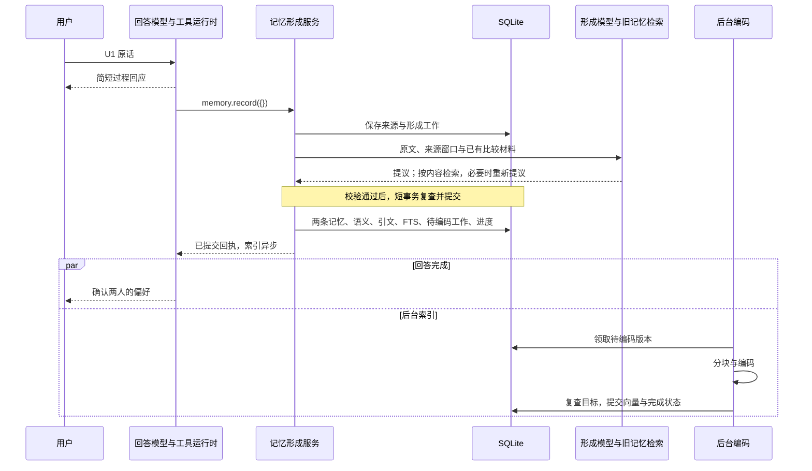

# 04 长期记忆：从用户原话、字段生成到事务写库

一面后“是否全由 Agent 决定读写”的专门分析见[第 17 章第 1–5 节](17-memory-control-and-retrieval-evolution.md)，区分聊天工具、认知后台交接、宿主处理保证及拟建改进，并直接讲解相关官方实践与论文。

本章沿一段完整对话解释：谁决定记忆、程序从哪里取原文、模型收到什么、模型返回什么、每个字段由谁填写、数据库写哪些表、哪些索引当场生成、哪些工作留到后台，以及用户纠错后怎样接着处理。对应 R04、R06，主要验收 A04，并衔接 A05、A06、A07。

当前行为按 2026-10-22 工作区源码核对，Git 基线为 `8e50d50f47fd961fbed9174d76f145a5e22b58d1`。下面的咖啡案例是依据代码构造的教学推演，**不是本轮真实模型运行结果**。示例给出一种符合合同的提议，不承诺模型每次输出完全相同的句子。历史实验仍按原记录说明分母和局限。

## 1. 先固定一个完整例子，别从抽象模块开始

用户在一个新 Chat 中说：

> 请记住，我朋友林岚平时喝咖啡喜欢燕麦拿铁，不加糖。我自己更喜欢美式；今天只是替她点单，不要把她的偏好记成我的。

这段话至少需要分清四件事：

| 原话中的信息 | 本例怎样处理 | 判断理由 |
| --- | --- | --- |
| 林岚平时喜欢燕麦拿铁、不加糖 | 一条以林岚为主体的长期偏好 | 人物、对象和条件明确，未来还会用到 |
| 用户自己更喜欢美式 | 另一条以用户为主体的长期偏好 | 不能与朋友的口味合成同一个人的偏好 |
| 今天替她点单 | 保留在本次来源中，帮助解释人物关系 | 这句话不足以证明订单已经提交或咖啡已经买到；本例不另建长期事件 |
| 不要把她的偏好记成我的 | 约束这次主体解析 | 新库里没有待纠正对象，因此本例不是对旧记录执行 revise |

最后一项尤其重要：语言中出现“不要记错”，不代表数据库里已经存在一条错记忆。新增、修订还是补充证据，要结合真正查到的旧记录决定。

为使后面的表可以逐项核对，固定本例的条件：当前库还没有这两人的咖啡偏好；没有前一个 Run；没有外部下单工具结果；输入很短，可以放进一个形成片段。普通文本交互中，助手先给一句不声称已保存的过程回应：“这两个人的口味需要分开。”随后调用 `memory.record({})`。假定这句过程回应已作为完成消息保存，也会进入本次主要来源，但不能充当第二份用户确认。

下文用 U1 表示用户消息，A1 表示这句助手消息，C1 表示 Chat，R1 表示 Run，P1 表示当前 Persona。真正的数据库使用稳定 ID；例中的缩写只为了阅读。需要展示结构化提议时，U1 用示例 UUID `11111111-1111-4111-8111-111111111111` 表示。

```text
用户原话 U1 + 已完成回应 A1
  → 回答模型调用 memory.record({})
  → 宿主解析实际消息和工具结果，建立来源窗口
  → 原文登记 + 形成任务入队
  → 形成模型提出两条候选
  → 用候选内容检索旧记忆，必要时重新提议
  → 宿主校验主体、来源、引文、归属、目标版本
  → 一个短事务写两条记忆、语义、引文、全文索引、后台任务和进度
  → 工具返回已提交回执，回答模型完成回应
  → 后台另行分块、编码、保存向量
```

这里始终有四类对象：原始证据、系统对证据的理解、帮助寻找理解的索引、某次回答真正收到的材料。把它们都叫“记忆”，就很难解释后面的更新和故障。

## 2. 第一个决定是谁作出的：为什么会调用记忆工具

普通对话入口不是在每句话后面无条件启动一次抽取。当前 [Agent 指令](../../../src/main/agent/agentInstructions.ts) 要求回答模型在出现值得跨会话保留的事实、偏好、经历、进行中的事项、纠正或承诺时调用常驻工具 `memory.record`。问候、一次性命令、虚构角色扮演、助手猜测和没有变化的重复内容不应机械记忆。

因此有两次不同的判断：

1. 回答模型判断“这轮是否值得进入记忆形成”。它已经在理解对话，本例又有明确的“请记住”，应调用工具。
2. 形成模型在真实来源和旧记忆约束下，判断“具体保存什么，如何与已有知识衔接”。它仍可以返回零条，不是每次调用都必须新增记录。

[memoryTool.ts](../../../src/main/memory/memoryTool.ts) 中 `MemoryRecordInputSchema` 是不允许额外字段的空对象。下面才是实际工具参数：

```json
{}
```

不能传 `{"content":"用户喜欢拿铁"}`，也不能把主回答模型自己总结的事实列表当成原始证据。工具执行函数用 Run ID、当前工具 Item ID 调用 `resolveEpisode`，宿主再回到已经保存的消息与执行结果取材料。

这并不意味着形成过程不使用模型。回答模型负责提出调用，随后形成运行时通过 `ModelMemoryFormation` 发送自己的结构化请求；是否采用相同模型配置与这两个职责是不是独立调用，是两回事。形成模型的返回也不是 SQL，它是待宿主检查的提议。

还要明确当前保证的范围：指令要求调用，不等于程序能确定性证明每条重要事实都被记住。如果回答模型漏掉工具，后面的正确写库机制不会自动补救这个入口错误。评测应分别统计“该触发却未触发”和“触发后形成错误”，不能只测抽取器。

其他入口也不是复制这套对话触发：认知经历通过持久交接进入形成队列，用户管理界面的直接创建和编辑走明确操作。第 18 节单独解释认知交接；不要把所有入口都说成“用户说完就自动抽取”。

## 3. 宿主究竟从哪里取原文：Run、Message、Item 的对应关系

实际装配在 [Main](../../../src/main/index.ts)，来源窗口由 [runMemoryIntake.ts](../../../src/main/app/runMemoryIntake.ts) 构造，具体来源转换在 [memoryFormationSources.ts](../../../src/main/app/memoryFormationSources.ts)。

### 3.1 普通对话取哪些消息

`ChatRepository.memoryFormationMessageReferences` 读取当前 Run 的完成消息，以及同一个 Chat 中紧接在当前 Run 之前的那个 Run 的完成消息。按消息创建时间和 ID 排序。前一轮提供解释代词、纠正和省略句需要的上下文。

当前 Run 的消息标为 `primary=true`，前一个 Run 的消息标为 `primary=false`。当前工具调用还构成一个截止边界：晚于工具开始时间的消息不进入这次来源窗口。并非读取整份聊天历史，也不是固定取最近二十条。

前一轮按当前首条完成消息之前最近的一条完成消息定位；若那条消息没有 Run 身份，不再跳过它往更早处寻找。空白内容先参与轮次边界选择，随后才被来源转换过滤，也不因此自动补上更早的对话。已经选中的前一轮若有迟到但仍在调用截止前的完成回复，可以作为上下文进入，不能冒充本轮新的用户确认。[来源窗口集成测试](../../../tests/integration/runMemoryIntake.test.ts) 专门覆盖这些边界。

“主要来源”只表示本轮新材料的身份，**不表示其内容一定正确，更不表示都是用户说的**。本例 U1 和 A1 都是主要来源，但 U1 的 speaker 是 user，A1 是 assistant。形成用户明确偏好，仍需要 U1 的支持。

### 3.2 工具结果怎样进入

`RunRepository.memoryFormationItemReferences` 枚举当前 Run 的工具项；达到当前 `memory.record` Item 的 sequence 就停止。转换器只采用已完成或失败、确实有输出、且工具名称不以 `memory.` 开头的项。

失败回执也可以成为原始材料，例如“下单失败”。它不能证明“下单成功”。排除记忆工具自身，可以避免把“刚刚记住了某事”的回执再次当作该事实的新证据，循环增强自己的结论。

本例没有下单工具，所以“今天替她点单”仍然只是用户的话，不能转成已经完成购买的观察。

### 3.3 一条来源实际长什么样

U1 转换后的对象如下；其中 referenceId 是 Chat ID，不是另一条消息 ID：

```json
{
  "id": "11111111-1111-4111-8111-111111111111",
  "referenceId": "22222222-2222-4222-8222-222222222222",
  "type": "chat",
  "speaker": "user",
  "content": "请记住，我朋友林岚平时喝咖啡喜欢燕麦拿铁，不加糖。我自己更喜欢美式；今天只是替她点单，不要把她的偏好记成我的。",
  "occurredAt": "2026-10-22T02:00:00.000Z"
}
```

这里的 `occurredAt` 是消息发生时间，来自 `message.createdAt`；不是模型推断出的“林岚开始喜欢拿铁的日期”。A1 使用自己的 Message ID、assistant 身份和原始创建时间。工具来源则使用 Item ID、Run ID 和实际结束／开始时间。

同一条 U1 之后经 Cognition 再进入 Memory，仍映射回这条真实 Message ID。认知摘要的 ID 不能取代原始来源 ID，否则一句话经多个入口处理就会被误算成多次独立经历。

## 4. 模型尚未抽取之前，数据库已经保存了什么

来源窗口先变成 `MemoryFormationIntake`：包含 episode 元数据、来源引用，以及需要时读取原文的函数。它还不是两条偏好，也没有向量。

`createMemoryFormationIntake` 先去重来源、按发生时间和 ID 排序，再根据来源元数据、主要／上下文身份和已经供给的记忆引用生成 episode version。这个版本不是模型摘要的哈希。Run 以后多了一个真实结果，来源窗口改变，就可能产生新的版本。

episode 的 `id` 在普通入口使用 Run ID，`personaId` 来自该 Run；`recordedAt` 取最新主要来源时间。本例有 A1，因此它可能晚于 U1。它表示这份来源材料的记录时点，并不等于稍后记忆表的写入时钟。

随后 `MemoryFormationRepository.enqueue` 在同步事务中完成以下工作：

| 步骤 | 保存位置与实际内容 | 此时尚未发生什么 |
| --- | --- | --- |
| 建立形成工作 | `memory_work`：kind=form、subject_id=episode.id、source_version=episode.version、processor_version、status=pending、payload_json | 没有生成 Memory ID 和正文 |
| 确保原始材料可读 | `memory_sources` 的来源身份、说话人、长度、摘要校验值和原文是否存在；`memory_source_text_chunks` 保存正文块 | 没有运行语义编码 |
| 记录该工作读哪些来源 | `memory_work_sources`：work_id、ordinal、source_id、is_primary、occurred_at | 不为每个工作复制一份完整原文 |

形成工作 ID 由 `"form:" + SHA256(episode.id + ":" + episode.version)` 得到。同一输入再次入队会复用这项工作，并核对载荷与来源引用一致。处理器版本另有字段，不能说换模型后任意换个 work ID 就能把同一来源全部重跑一遍；当前实现有明确的进度与处理器变更处理。

### 4.1 原文的“规范来源”怎样建立

`registerSource` 校验来源结构，在持久边界去除检测到的秘密，随后为正文登记：

- `raw_speaker`：实际说话人。
- `raw_length`：JavaScript UTF-16 长度，本例 U1 为 55。
- `raw_json_bytes`：正文经 JSON 转义后、去掉两侧引号的 UTF-8 字节成本，供后续预算估算使用。
- `raw_digest`：正文 UTF-16LE 字节的 SHA-256。
- `raw_present=1`：当前仍保留完整原文。
- 原文块：`source_id + start_utf16 + content BLOB`，内容按 UTF-16LE 存储。

重复使用同一个 source ID 时，必须核对类型、引用身份、时间、说话人、长度和摘要校验值，不能悄悄把这个 ID 换成另一段话。已有可用原文时直接复用。原文此前已按保留规则释放时，能否从原始领域重新解析也有明确检查。

当前物理原文块上限为 32768 个 UTF-16 单元，这是存储实现参数，不是模型 token 上限，不是“记忆一次最多 32768 字”，更不是检索的语义分块。本例很短，一条来源只需一块。

这一步的意义是先保存可恢复工作的输入。如果程序此时退出，恢复后仍可从队列和规范来源继续形成；不必依赖内存里的聊天数组还活着。

## 5. 长对话怎样交给模型：三种分块不能混讲

[segmentMemoryEpisode](../../../src/main/memory/memoryFormationSegments.ts) 按来源 ordinal 和原文 UTF-16 偏移逐步读取。它优先放入主要来源，再在预算允许时补上下文；过长来源可以按句末附近切开，并记录继续处理的位置。

给模型的不只有片段文字，还包括：

| 字段 | 本例含义 | 长来源时解决的问题 |
| --- | --- | --- |
| `episode.sources` | U1 与 A1 的实际文本和来源元数据 | 模型只能引用真正读到的材料 |
| `episode.evidenceSourceIds` | U1、A1 是本轮主要来源 | 前一轮上下文不能冒充新的确认 |
| `sourceWindows` | U1 的窗口为 [0,55)，A1 使用自己的范围 | 片段内的位置可以还原成原文全局位置 |
| `sourceCoverage` | 主要来源数 2、上下文数 0，本例无遗漏 | 明确有多少上下文未提供或被截短 |
| `nextCursor` | 下一条来源或同一来源下一个偏移 | 提交一段后可恢复，不必重复已完成部分 |

第一轮切片使用保守的 JSON 字节成本估算；**它不是精确 token 数**。生成前还要对完整请求分配预算并进行实际输入计量，计入指令、结构化输出合同、来源、旧记忆、实体和反馈。不能把“原话只有几十字”当成整个请求只有几十个 token。

必要的当前证据不能靠静默删除来假装放得下；当前实现会按分配规则调整可选材料，无法满足请求预算时明确失败。上下文缺失可能让代词无法消解，模型应延后那条事实，不能强行猜主语。

三种块分别服务不同目的：

| 层次 | 切的是什么 | 切分依据 | 是否进入向量表 |
| --- | --- | --- | --- |
| 原文物理块 | U1 的原始文字 | UTF-16 存储块大小 | 否 |
| 形成片段 | 本次供模型理解的来源窗口 | 来源覆盖、请求预算和句子边界 | 否 |
| 检索分块 | 已形成的 Revision 正文 | 本地编码器 tokenizer 和上下文限制 | 是 |

一个原始长段落可能形成多条短记忆；一条很长的记忆又可能编码成多块。三者数量没有一一对应关系。

## 6. 形成模型实际读什么，为什么先提取再查旧记忆

[ModelMemoryFormation](../../../src/main/memory/memoryModels.ts) 构造独立的结构化生成请求。除了上面的来源，它还收到已知旧记忆 `existing`、已知实体 `entities`、比较缺口 `retrievalIncompleteReasons`、时间上下文；发生提议校验失败时还会收到完整原提议和逐项错误反馈。

初始旧记忆不是把整库塞进去。形成服务先读取与本次实际来源有关的记录、此前真实供给的记忆引用、前一段已形成的版本，以及版本冲突后需要重新绑定的对象；可选材料受预算约束。本例库为空，初始 `existing=[]`、`entities=[]`。

接着分三步：

1. **先提出理解。** 模型从 U1 提出林岚和用户的两条咖啡偏好。现在说 create 只是提议，不证明整库没有旧记录。
2. **按候选内容找旧知识。** 对每条非 support 提议，使用其正文作为一个比较问题；support 则使用目标旧正文。调用 `recall.recall`，purpose 为 formation，并结合已知实体寻找可能相同或冲突的记录。
3. **比较材料变化时重新决定。** 把检索到的旧版本、必要目标和实体合并，再分配请求预算。如果实际比较材料发生变化，重新调用形成模型；如果没有变化，不为了流程整齐再调用一次。

本例检索后仍没有已有偏好，因此可以沿用第一次提议。若检索找到“林岚喜欢不加糖燕麦拿铁”，第二次就应考虑 support；找到“林岚喜欢加糖拿铁”，则需要结合原话判断是否真的有修订依据，不能只凭相似度覆盖。

形成时调用 Recall，也可能涉及查询编码、证据选择等模型工作。因此不能把一次 `memory.record` 等同于“恰好一次 LLM 请求”。总调用次数取决于片段数、比较材料、检索过程和是否发生校验修复。

检索未完成同样不能忽略：例如旧记忆正文与全文索引已存在，向量仍在生成。此时已找到的词法或实体证据依然可以支持正确比较；没有搜到的部分则应报告缺口，不能宣称“已经排除全部历史冲突”。当前流程降低重复和误修订风险，并没有数学上证明语义去重完备。

## 7. 两条偏好会被提议成什么：展示完整内部对象

下面是**严格模型输出经过解码后的内部 `MemoryFormationBatch`**，不是直接发送给 Provider 的原始 JSON，也不是已经写入数据库的 Memory。没有旧记录，所以不填 targetRevisionId；时间没有可靠边界，所以不造日期；没有关系目标，所以 links 为空。

```json
{
  "entities": [
    {
      "key": "friend_linlan",
      "name": "林岚",
      "kind": "person",
      "aliases": []
    },
    {
      "key": "self",
      "name": "用户",
      "kind": "person",
      "aliases": []
    }
  ],
  "units": [
    {
      "operation": "create",
      "type": "preference",
      "content": "用户的朋友林岚平时喝咖啡喜欢燕麦拿铁，不加糖。",
      "semantics": {
        "kind": "claim",
        "owner": "user",
        "basis": "explicit_user_statement",
        "subjectEntityId": "friend_linlan",
        "predicate": "prefers_coffee",
        "objectValue": "燕麦拿铁",
        "qualifiers": {
          "sugar": "不加糖",
          "context": "平时喝咖啡"
        }
      },
      "entityKeys": ["friend_linlan"],
      "citations": [
        {
          "sourceId": "11111111-1111-4111-8111-111111111111",
          "quote": "我朋友林岚平时喝咖啡喜欢燕麦拿铁，不加糖"
        }
      ],
      "links": []
    },
    {
      "operation": "create",
      "type": "preference",
      "content": "用户自己更喜欢美式咖啡。",
      "semantics": {
        "kind": "claim",
        "owner": "user",
        "basis": "explicit_user_statement",
        "subjectEntityId": "self",
        "predicate": "prefers_coffee",
        "objectValue": "美式",
        "qualifiers": {}
      },
      "entityKeys": ["self"],
      "citations": [
        {
          "sourceId": "11111111-1111-4111-8111-111111111111",
          "quote": "我自己更喜欢美式"
        }
      ],
      "links": []
    }
  ]
}
```

`friend_linlan`、`self` 是模型在这份提议中的局部引用键，**尚不是数据库实体 ID**。虽然字段名叫 subjectEntityId，形成提议允许使用这些键；宿主校验后才替换成真正 ID。两条正文是模型改写，quote 则必须逐字来自 U1，不能改写。

`prefers_coffee`、`sugar`、`context` 是本例选用的语义标签。当前 predicate、qualifier 名称主要是自由字符串，没有一套已经强制统一的咖啡本体；不能把本例标签讲成生产系统固定枚举。标签不一致可能削弱精确结构查询，需要另外用规范化方案和数据评测解决。

### 7.1 Provider 输出与这个对象哪里不同

源码特意分开了两种结构：

| 项目 | Provider 严格输出 | 解码后内部提议 |
| --- | --- | --- |
| 未知可选字段 | 按严格输出合同填 null | 还原为对应分支中的可选字段 |
| 新实体 | `existingEntityIndex:null` | 没有 existingId，等待宿主分配 |
| 已有实体 | 指向本次实际供给实体列表的整数下标 | 宿主查表得到 existingId |
| qualifiers | `[{key:"sugar",value:"不加糖"}]` | `{"sugar":"不加糖"}` |
| create 的目标 | targetRevisionId 为 null | 不填写目标 |
| revise 的类型 | 不让模型另选 type | 根据实际目标记录继承类型 |

下标超出本次供给范围会被拒绝。模型不能凭空输出一个听起来像 UUID 的实体 ID 来修改任意人物。

### 7.2 这里为什么是两条，而不是每个属性拆一条

“燕麦拿铁”和“不加糖”共同限定林岚在咖啡场景里的选择，本例放在一条正文和一组语义字段中，可以一起检索和修订。用户自己的美式偏好有不同主体，所以分成另一条。

这是一种合理粒度，不是宿主硬编码的“两条规则”。若拆得过细，最终回答可能只拿到拿铁而漏掉不加糖；若把两个人压成一条，主体过滤和局部修订又变困难。评价应检查未来问题能否得到完整条件、局部纠正是否误伤其他人、成本是否可接受。不能只把“抽出多少条”当作质量指标。

## 8. 字段到底由谁填写：分四组对照数据库

“自动抽取”容易让人误以为所有字段都由模型生成。实际只有理解层需要模型提议，身份、执行进度和索引元数据大多来自程序。

### 8.1 原始输入直接带来的字段

| 字段 | 本例值或来源 | 写入／用途 |
| --- | --- | --- |
| source id | U1 的 Message ID | `memory_sources.id`，跨入口保持同一身份 |
| source type | chat，来自 Run 的渠道 | `memory_sources.type` |
| referenceId | C1 的 Chat ID | `memory_sources.reference_id`，回到原对话 |
| speaker | user | `raw_speaker`，校验明确用户陈述的依据 |
| source occurredAt | U1 的 message.createdAt | 来源 created_at；不是偏好的起始日期 |
| source content | 已保存的用户原文，经过持久边界处理 | 规范原文块；不能让模型重写后冒充原文 |
| episode personaId | R1 绑定的 P1 | 限制角色经历归属；不自动让每条记忆都属于角色 |
| 引文 quote | 模型选择 U1 中哪段支持这条事实 | 文字本身必须是原文子串，宿主计算位置 |

### 8.2 模型提出、宿主检查后才接受的字段

| 字段 | 本例值 | 含义与检查重点 |
| --- | --- | --- |
| operation | create | 结合实际旧记录决定新增、修订或支持 |
| type | preference | 记忆的产品类别；不是 source type |
| content | 两条完整偏好句 | 供阅读、全文索引和文档编码使用 |
| semantics.kind | claim | 知识形态；还可表达经历、承诺、体验、推断总结 |
| owner / personaId | user；本例不填 personaId | 知识作用范围，不能由谁说话直接推出 |
| basis | explicit_user_statement | 用户确实这么说；不等于第三人已独立确认 |
| subject / predicate / object | 林岚／偏好咖啡／燕麦拿铁 | 谁的什么事实；实体引用必须可解析 |
| qualifiers | 不加糖、平时喝咖啡 | 保留条件，不应只存在于丢给模型的临时提示里 |
| occurredFrom / To、timePrecision | 本例不填 | 事情发生时间及精度；有可靠信息才解析 |
| validFrom / To | 本例不填 | 适用时间；未知不能伪造一个起点 |
| commitmentState | 本例不填 | 只在承诺类语义中使用，不能把“打算”直接填 completed |
| entity 名称、kind、aliases | 林岚、person、空别名 | 提议人物身份和别名；同名不自动等于同一个人 |
| citations、links、priorDispositions | 本例只有两段 U1 引文 | 目标必须在本次实际提供范围内；历史处置另有证据要求 |

`type=preference` 与 `kind=claim` 并不矛盾：前者表达“这是哪类产品记忆”，后者表达“这是一个陈述”。同理，`owner=user` 是桌面记忆的作用范围，subject 才是这条偏好说的谁。本例朋友偏好仍存在用户知识范围内，主体必须是林岚。

### 8.3 宿主填写的身份、生命周期与默认值

| 字段 | 生成规则 | 本例 |
| --- | --- | --- |
| Entity ID | 复用合法 existingId，或由 ID 生成器创建 | friend_linlan→E林岚，self→E用户 |
| Memory ID | 新增时生成，后续修订沿用 | M林岚、M用户 |
| Revision ID | 新增／修订时生成；support 沿用目标 | V林岚1、V用户1 |
| currentRevisionId | 写入逻辑维护 | 指向本次创建的版本 |
| status | 创建时 active | 不由模型决定“已归档” |
| createdAt / updatedAt | 宿主时钟的写入时间 | 假设为 02:00:02Z |
| reason | 创建时固定为“从原始情境形成” | 不是模型随便写的解释 |
| sourceType | 从实际来源类型导出 | 本例 chat；混合来源可能标为 distillation |
| importance | 当前形成创建路径固定 0.5 | 不是模型计算的“值得记忆程度” |
| confidence | inference 为 0.5，其他依据为 1 | 本例为 1；不是校准后的正确概率 |
| predecessor / history status | 根据修订关系及旧内容处置保存／计算 | 新建没有前驱，读取时为 current |
| pinnedAt、deletedAt、supersededById | 创建时为空，后续明确操作维护 | 本例不填 |
| claimSlot | 仅特定明确写入路径使用 | 当前形成 create 没传它，不会自动登记“咖啡偏好槽” |
| importantMoment、occursAt、timeZone | 该创建路径不主动设置 | 默认为 false、空、空，不可与语义发生时间混淆 |

说“用户亲口讲，所以 confidence=1”只能解释目前的赋值规则。用户可能记错、撒谎或是在转述；这个数字不能推出客观事实百分之百正确。如果以后需要概率意义的置信度，要定义标签、采样和校准评测，不能直接复用这个初值作概率。

### 8.4 程序派生的引用与索引字段

| 派生内容 | 输入 | 生成时机 |
| --- | --- | --- |
| 引文 start / end | 实际来源窗口、逐字 quote、必要时 occurrence | 形成校验时 |
| 规范别名 | name 和 aliases | 实体写入时，NFKC、转小写、去前后空白 |
| FTS tokens | Revision.content | 同一形成事务内 |
| 待编码 source_version | Revision.content 的哈希 | 同一形成事务内 |
| chunk 文本、序号与哈希 | 已提交正文与真实 tokenizer | 后台编码时 |
| model_key、dimensions | 当前固定编码配置 | 后台安排和完成索引时 |
| vector | 分块的编码结果 | 后台计算、检查后写入 |

用户不需要填写这些技术字段，模型也不应编写向量或自报引文偏移。时间、主体等业务语义需要判断，哈希、ID、位置和持久化状态交给程序才能得到可复核的一致结果。

## 9. 宿主怎样把“看起来合理的 JSON”变成可接受提议

[MemoryFormationService.#prepare](../../../src/main/memory/memoryFormationService.ts) 先检查完整批次，构造稍后执行的写入函数。此时可以分配 ID、计算引文位置，但不提前提交其中一条事实。

### 9.1 本例的引文怎样定位

模型没有填写 start、end，只提供 sourceId 和 quote。宿主先确认 U1 在当前片段里，再在真正给模型的文本中查找：

```text
U1 全文 UTF-16 长度：55
“我朋友林岚平时喝咖啡喜欢燕麦拿铁，不加糖”
  start = 4，end = 24，区间 [4,24)
“我自己更喜欢美式”
  start = 25，end = 33，区间 [25,33)

最终全局 start = sourceWindow.start + 窗口内引文起点
最终全局 end   = start + quote.length
```

end 不包含最后一个位置。本例全部是基本多文种平面中的字符，因此字符数与 UTF-16 单元数碰巧相同；遇到 emoji 就不能直接用肉眼数出来的“第几个字”。窗口起点若为 1000，局部引文起点为 12，写库位置应为 1012，而非 12。

同一引文在当前窗口内重复时，模型可给 `occurrence` 指明第几次匹配，从 0 开始。它不是原文偏移，也不是这条经历出现过几次。引文不匹配、指向其他片段、没有当前主要来源，都不能作为本次有效写入依据。

### 9.2 校验不止检查 JSON 类型

| 检查 | 本例怎样通过 | 一个应被拒绝的变式 |
| --- | --- | --- |
| Schema 与操作分支 | create 有正文、语义和至少一段引文 | support 带着自编的新正文要求覆盖 |
| 来源资格 | 两条都引用当前主要用户来源 U1 | 只引用 A1 的复述就写成用户明确确认 |
| 实体引用 | 两个局部 key 都在 entities 声明 | subject 写了一个未提供的人物 ID |
| 归属 | user 不带 personaId | 把别的 Persona 的经历写给当前角色 |
| 依据类型 | explicit_user_statement 有用户引文 | 从用户打开咖啡页面推断“他喜欢咖啡”却标成明确偏好 |
| 语义组合 | claim 不填写完成承诺状态 | 普通偏好带 commitmentState=completed |
| 时间 | 本例无可靠边界，保持空 | 用“今天”的字面词伪造不明时区的 UTC 时间 |
| 旧目标 | 本例 create 无目标 | revise 指向从未供给或已经不再是当前的版本 |
| 保留旧引文 | 本例不需要 | 修订时把旧版全部引文自动复制，包括已经被纠正的句子 |
| 批次内部一致性 | 两条是不同 Memory 的新增 | 同一批既 revise 又 support 同一个 Memory，含义冲突 |

这里还存在一道模型不能代替的边界：逐字引文存在，只能证明引用没有编造，不能形式化证明正文完全被引文蕴含。若模型把“朋友喜欢”理解成“用户喜欢”，类型检查未必足以发现所有语言错误。人物归属、否定、条件、转述仍需要代表性样本评测。当前代码的强项是限制证据来源和写入资格，不应夸成已解决语言理解正确性。

### 9.3 不合格后怎样处理

如果是 `MemoryFormationValidationError`，服务把**整个失败提议**和具体 unitIndex、field、message 返回形成模型；在完整反馈仍满足输入预算时允许一次修复。要求返回完整替代批次，不能只补坏掉的那一条而丢掉另一个人的偏好。

修复后再次检查，仍不合法就失败。网络错误、取消、执行者已变化、目标修订已变化不是同一类错误，不能全都“让模型重试一次”。此前同一来源的已提交片段也不会因此全部回滚；原子范围是这一个片段，详见第 17 节。

## 10. 新增、修订和补充证据，分别会改变哪些数据

现在给本例增加三种不同的旧库状态，形成模型必须结合实际比较结果选择：

| 操作 | 什么时候合理 | Memory / Revision 身份 | 关键写入 |
| --- | --- | --- | --- |
| create | 本例确实没有可合并的偏好 | 新 Memory、新 Revision | 正文、语义、来源、引文、全文索引、待编码任务 |
| revise | 已有记录需要改变事实、条件、有效期或承诺进展 | 沿用 Memory，新 Revision | 新正文与语义、前驱、旧内容处置、新旧有效引文、当前指针、索引任务 |
| support | 内容与语义没变，但有另一份合格原始证据支持 | 同一个 Memory、同一个 Revision | 附加来源、精确引文及合法关系；不为改写制造新版本 |

例如次日用户再次明确说“林岚还是喝不加糖的燕麦拿铁”，可以补充 U2 的来源与引文；不能把一次重复说法当成口味变化。当前 support 不修改正文，不自动增加 confidence 或检索分数，也不需要因正文未变而再生成一套向量。

同一 U1 被任务重放与真正的新 U2 不一样：重放复用来源和任务回执，重复关联有唯一约束；新 U2 才可能提供新的支持。即使有两条来源，也仍要判断它们是否只是转述同一件事，不能机械当成独立观察。

宿主会检查已经提供的当前记录中是否存在正文、语义、实体完全相同的提议，并要求合适的 support，而非无理由 create。但是它没有用全局唯一的“人物＋谓词”约束保证所有语义等价句只出现一次：同一人可以有不同条件下的偏好，实体解析与语义比较也可能遗漏。应说“结合检索和校验减少重复”，不要说“任何并发和改写都绝不重复”。

## 11. 真正写库时发生什么：按源码顺序展开一个事务

主调用关系是：

```text
memory.record.execute
  → memory.enqueueEpisode                 保存工作输入
  → memory.formEpisode
      → MemoryFormationService.form
      → 领取工作，读取／恢复 progress
      → #form：分段、生成、比较、校验
      → formation.transaction
          assertRunning(execution)
          apply()                        内部使用同一数据库连接
          保存 changes、lastRevisionIds、nextCursor
      → 所有片段完成后 finish(work)
  → 发布变化／onFormed
  → 返回 Tool Result
```

实际写入由 [MemoryRepository](../../../src/main/memory/memoryRepository.ts) 与 [MemoryRecallRepository](../../../src/main/memory/memoryRecallRepository.ts) 执行，使用 prepared SQL。服务之间的嵌套 transaction 都在同一个本地 SQLite 连接上；它们没有把一批事实拆成独立提交。

### 11.1 事务里的顺序

| 顺序 | 实际动作 | 本例结果 |
| --- | --- | --- |
| 1 | 确认工作仍由本次 execution 执行；核对目标仍活跃、未删除、仍是期望版本，保留引文仍存在 | 本例无 revise 目标，但工作身份仍要检查 |
| 2 | 写入／复用实体，再登记规范别名 | E林岚、E用户及各自名称别名 |
| 3 | 为第一条 create 分配 Memory ID 与 Revision ID | M林岚、V林岚1 |
| 4 | 插入 memories，再插入 memory_revisions | 当前指针先填 V林岚1，同事务内补齐版本 |
| 5 | 对这版正文建立 FTS 行，登记 embed 占位工作 | 全文可检索，尚未算向量 |
| 6 | 附加该 Revision 的实际来源引用 | V林岚1→U1 |
| 7 | 写入语义及 mentioned／subject 实体关联 | 主体确定为 E林岚 |
| 8 | 插入精确引文及实际提议的关系 | 本例引文 [4,24)，没有关系链接 |
| 9 | 登记该记忆变化的后续处理工作 | 给后续学习／巩固处理留下持久入口，不当场生成总结 |
| 10 | 用相同顺序处理第二条 create | M用户、V用户1 与 [25,33) 引文 |
| 11 | 保存本片段的 changes、最后产生的版本及 nextCursor | 两条写入和来源进度一起生效 |
| 12 | 提交 | 外部消费者此时才能读到这一整批结果 |

“先插 memories，但 current_revision_id 指向还没插入的版本，外键不报错吗？”当前 schema 将这条复合外键设为 `DEFERRABLE INITIALLY DEFERRED`，允许在事务提交前补齐，而且要求版本属于同一个 Memory。提交时不满足仍会失败。不能照搬一个立即检查外键的表定义后说顺序相同也能工作。

### 11.2 哪些东西不能出现在这个事务中

形成模型请求、检索模型等待、本地编码器加载和向量生成都不在写事务内。锁住数据库不能锁住远端模型，也不能让用户停止编辑。正确做法是等待结束后，在短事务里重新验证依赖，失败就放弃本次旧提议。

本例两条偏好处于同一个片段：第二条的数据库写入若失败，第一条、实体关联、FTS、索引任务和该片段进度一起回滚。更早的“来源入队事务”已经完成，因此原文和失败工作的诊断材料仍可保留。**批次没有部分生效，不等于输入原文也被抹掉。**

所有片段完成后，服务再保存工作完成回执。片段提交与最终 finish 之间仍有崩溃窗口，依靠已提交进度续跑，而不是假装这整条含模型的流程只有一个事务。

## 12. 最终的记忆在哪里：把数据库行摊开看

“形成一条完整记忆”并不是把第 7 节 JSON 原封不动塞进一列。字段分属有不同职责的表。以下是林岚这条记忆的数据库行示意，**字段名对应真实列，ID 值用缩写；这不是可直接调用的 API 返回体**。T1 假设为 `2026-10-22T02:00:02.000Z`，仅用于说明写入时间。

### 12.1 稳定记录与不可变正文

```json
{
  "memories": {
    "id": "M林岚",
    "type": "preference",
    "status": "active",
    "current_revision_id": "V林岚1",
    "importance": 0.5,
    "confidence": 1,
    "valid_from": null,
    "valid_to": null,
    "pinned_at": null,
    "superseded_by_id": null,
    "deleted_at": null,
    "created_at": "2026-10-22T02:00:02.000Z",
    "updated_at": "2026-10-22T02:00:02.000Z"
  },
  "memory_revisions": {
    "id": "V林岚1",
    "memory_id": "M林岚",
    "predecessor_revision_id": null,
    "prior_dispositions_json": "[]",
    "content": "用户的朋友林岚平时喝咖啡喜欢燕麦拿铁，不加糖。",
    "occurs_at": null,
    "time_zone": null,
    "important_moment": 0,
    "source_type": "chat",
    "reason": "从原始情境形成",
    "created_at": "2026-10-22T02:00:02.000Z"
  }
}
```

Memory 保存稳定身份和当前指针；Revision 固定这次理解的正文与出处类型。后续变化新增版本，不能把 V林岚1 的正文悄悄改成另一种咖啡，导致旧请求再也查不到当时真正读的材料。

`historyStatus=current` 是读取时结合版本关系算出的资格，不是本例在 memories 表又写了一份“历史状态”列。`source_type=chat` 只概括来源渠道；证据细节仍要查来源关联。

### 12.2 语义行

```json
{
  "revision_id": "V林岚1",
  "kind": "claim",
  "owner": "user",
  "persona_id": null,
  "basis": "explicit_user_statement",
  "occurred_from": null,
  "occurred_to": null,
  "time_precision": null,
  "valid_from": null,
  "valid_to": null,
  "subject_entity_id": "E林岚",
  "predicate": "prefers_coffee",
  "object_entity_id": null,
  "object_value": "燕麦拿铁",
  "qualifiers_json": "{\"sugar\":\"不加糖\",\"context\":\"平时喝咖啡\"}",
  "commitment_state": null
}
```

这行存入 `memory_revision_semantics`。没有把“燕麦拿铁”强行建成实体，所以使用 object_value，object_entity_id 为空；有明确对象实体时才使用后者。qualifiers 在 TypeScript 中是对象，存库时序列化为 JSON 文本。空时间表示输入没有可靠边界，不能解释为“从系统创建那一秒起才有效”。

### 12.3 来源、引文和实体如何连起来

| 表 | 本例相关行 | 回答的问题 |
| --- | --- | --- |
| memory_sources | U1，type=chat，reference_id=C1，created_at=02:00:00Z，raw_speaker=user，raw_length=55，raw_present=1 | 证据是哪条原始消息 |
| memory_source_text_chunks | U1，start_utf16=0，content 为 U1 的 UTF-16LE 原文 | 需要重新处理时怎样读到整句 |
| memory_revision_sources | V林岚1→U1；V用户1→U1 | 哪些版本依赖这条消息 |
| memory_revision_source_spans | V林岚1、U1、4、24、对应原句；V用户1、U1、25、33、对应原句 | 每条知识具体由哪段话支持 |
| memory_entities | E林岚/person/林岚；E用户/person/用户 | 人物的稳定身份 |
| memory_entity_aliases | E林岚/林岚；E用户/用户；本例 source_id 未填 | 名称怎样回到候选实体 |
| memory_revision_entities | 每个版本分别关联自己的实体，role 各有 mentioned 和 subject | 提到谁，主体又是谁 |
| memory_work_sources | 形成工作关联 U1、A1，两者都 is_primary=1 | 本次形成究竟看过什么 |

A1 是形成输入，但本例没有被引用成偏好的依据。不是 episode 里的每条来源都会自动成为每条 Memory 的证据。相反，一条 U1 可以用不同引文支持两个版本，不必复制两份原文。

同名实体也不自动合并：别名表的主键是 `entity_id + normalized_alias`，并不要求别名全库唯一。两个叫林岚的人可以同时存在。已有实体由检索供给、模型选择已有下标、宿主检查范围后复用。若信息不足，应保留歧义或澄清；没有证据证明“全局人物消歧已经解决”。

### 12.4 这一刻应当有多少行

在本例两条 create 已完成、后台索引尚未开始、也未执行来源释放的逻辑时点：

| 数据 | 预期数量 | 原因 |
| --- | ---: | --- |
| 规范来源、原文块、工作来源引用 | 各 2 | U1 和 A1 均为短来源 |
| memories、memory_revisions、memory_revision_semantics | 各 2 | 两个不同人物的偏好 |
| 实体、名称别名 | 各 2 | 本例没有已有实体和额外别名 |
| memory_revision_sources、精确引文 | 各 2 | 两条都引用 U1，但区间不同 |
| memory_revision_entities | 4 | 每个版本各有 mentioned 与 subject 两种角色 |
| memory_fts | 2 | 每个新版本生成一个词项文档 |
| memory_work 中本例形成工作 | 1，complete | 一个来源窗口、一个形成片段 |
| memory_work 中待编码占位 | 2，pending | 两个新正文等待编码 |
| memory_search_chunks、memory_chunk_embeddings | 0 | 尚未执行后台编码 |
| memory_revision_links、咖啡偏好 claimSlot | 0 | 没有提议关系，形成路径未写槽位 |

后续学习处理还有自己的工作记录，未混入这张 `memory_work` 计数表。这是固定条件下的教学核账，不是当前用户真实数据库的盘点。

要追一条记忆，可以从 `memories.current_revision_id` 连接 `memory_revisions` 与 `memory_revision_semantics`，再按 revision_id 连接来源和引文。检索要换成旧版本时仍保留确切 Revision ID，不能查完当前指针后把新正文冒充旧引用。

## 13. 哪些字段建立索引，哪些只是保存：沿本例查一次

“有这个字段”和“为这个字段建了搜索索引”不是一回事。准确的表与索引定义见 [current.ts](../../../src/main/db/schema/current.ts)、[cognitiveMemory.ts](../../../src/main/db/schema/cognitiveMemory.ts)。

### 13.1 关系型索引组织身份和范围

| 需求 | 实际字段／索引 | 本例怎样使用 |
| --- | --- | --- |
| 按 Memory 找当前正文 | memories 主键、current_revision_id；revisions 主键 | M林岚→V林岚1 |
| 列出某记忆历史版本 | memory_revisions_memory_idx：memory_id、created_at、id | 找林岚后来发生过哪些修订 |
| 从一个来源追到受影响版本 | memory_revision_sources_source_idx：source_id、revision_id | U1 被核对时找到两个不同偏好 |
| 从原对话找来源 | memory_sources_reference_idx：type、reference_id、id | C1 的消息来源 |
| 名字定位人物候选 | memory_alias_lookup：normalized_alias、entity_id | “林岚”→一个或多个可能的实体 |
| 人物定位相关版本 | memory_entity_revisions：entity_id、revision_id | E林岚→提到林岚的版本 |
| 主体与谓词定位陈述 | memory_claim_lookup：subject_entity_id、predicate、revision_id | 林岚的咖啡偏好候选 |
| 时间查询 | memory_occurrence_lookup、memory_validity_lookup | 有明确发生／适用时间时缩小范围 |
| 找待处理工作 | memory_work_pending：status、updated_at、id | 待编码、失败和完成不能混在一起 |
| 列表与生命周期过滤 | memories_list_idx 的 deleted_at、status、type 等 | 正常查询排除已删或归档记录 |

这些是 B-tree 等数据库访问结构，不是每个字段的语义向量。别名的全角半角、大小写、前后空白由规范化处理；“小岚”是否就是林岚，需要已有别名或语义判断，NFKC 本身不会理解昵称。

`owner`、`persona_id`、`basis`、`object_value`、`qualifiers_json` 虽然保存为结构化字段，也会参与读取、资格判断或模型解释，但并非每一列都有独立索引。当前没有为任意 qualifier 的键自动创建索引。需要优化某个实际查询时，应看执行计划、数据规模和比较结果，不是把所有列都建一遍。

### 13.2 全文索引只从 Revision 正文生成

`MemoryRepository.#indexRevision` 调用 [memorySearchDocument](../../../src/main/memory/memorySearchText.ts)，先 NFKC 规范化、转小写，再用 `Intl.Segmenter` 切词；纯汉字词补相邻双字，最后用 Set 去重。

结果写入 `memory_fts(tokens,memory_id,revision_id)`。真正参与 FTS5 分词索引的是 tokens；两个 ID 列标为 UNINDEXED，用来把搜索结果连回具体版本。它们的 UNINDEXED 不是“数据库里不存在 ID”，而是“不参与这张 FTS 表的词项索引”。

本例编码的词项来自：

> 用户的朋友林岚平时喝咖啡喜欢燕麦拿铁，不加糖。

不会自动把 `owner=user`、所有 qualifier JSON、整段 U1 原文都拼入索引。实际中文分词边界依运行时而定，不能把教学词项列表当作固定输出快照。查询也采用对应的词项规范化，再由 SQL 过滤与后续选择处理主体、时间和证据资格。

### 13.3 向量输入同样是正文，不是整条数据库行

文档编码器读取已提交的 `Revision.content`，再按 tokenizer 分块。它不会自动知道 SQL 里的 subject 是谁，也不会额外读一遍所有来源。

因此正文要能独立表达人物和条件。本例把“林岚”“平时”“不加糖”写在正文里，同时用结构字段保留可检查的含义。如果正文仅写“喜欢拿铁”，而不加糖只藏在 qualifiers 里，当前向量输入就缺少这个条件；模型仍可能在完整证据中读到 qualifier，但候选召回阶段已经可能受损。

向量只负责相似内容的表示。谁能使用、是否当前版本、是否已删除、原依据是否有效，仍由结构化读取与最终证据检查决定。不能把这些正确性条件寄希望于距离远近。

## 14. 后台怎样把正文变成可检索向量

当前实现是 SQLite 保存向量、本地编码器生成向量、Worker 做精确余弦扫描。不是已经部署了一套 HNSW 向量数据库。模型与维度的历史选型、质量分母和性能问题见[第 05 章](05-retrieval-and-context.md)；这里沿 V林岚1 把写入路径走完。

### 14.1 先登记任务，再绑定编码配置

形成事务中的 `enqueueRevision` 创建：

```text
id                = "embed-pending:" + V林岚1
kind              = "embed"
subject_id        = V林岚1
source_version    = hash(这一版正文)
processor_version = "pending-model"
status            = "pending"
```

本例另有 V用户1 的对应占位。后台 `scheduleIndex(modelKey)` 检查未删除版本缺哪些分块或当前模型的向量，创建绑定具体模型键的工作，再移除该版本的占位工作。具体工作 ID 基于 modelKey 与 Revision ID，source_version 另存正文哈希。

之所以不在最初写库时就加载编码器，是因为“保存事实”不需要等模型资源准备完毕；只要待处理意图持久化，进程退出后仍能继续。已有 failed 任务不会因普通调度被悄悄当成全新任务，它有显式重试路径。

### 14.2 领取、分块与编码

`MemoryRecallPipeline.indexPending` 在同一实例中复用正在执行的 Promise，数据库领取也要求任务能从 pending 更新为 running。读取完一项工作后结束短读，再等待编码器，避免 SQLite 语句跨异步等待一直占着资源。

[LocalEmbedding.splitDocument](../../../src/main/providers/localEmbedding.ts) 用真实 tokenizer 检查文档长度，超过分配上下文时寻找能放下的前缀，并尽量在句子边界切开。切块保持原文顺序，当前没有人为重叠。这个过程切的是已形成正文，不是 U1 的原始消息。

本例正文很短，教学上按每个版本一个块推演。真正运行仍以 tokenizer 结果为准；本轮没有调用本地模型来实测块数或生成向量值。

当前选定配置生成 512 维 Float32 向量。查询编码另加任务指令，文档直接编码正文。编码器按当前规则截取输出前缀并归一化；`modelKey` 还绑定权重、引擎、维度和语义处理配置，不能只写一个“512”就认为新旧模型兼容。

### 14.3 返回时在另一笔短事务中提交

`finishIndex` 重新读取 V林岚1：

1. Revision 是否仍存在，所属 Memory 是否未删除。
2. 正文哈希是否仍等于任务 source_version。
3. 块数是否非零并与向量数一致。
4. 每个向量维度是否正确、数值是否有限、是否不是全零。

通过后写入：

| 表／状态 | V林岚1 对应内容 |
| --- | --- |
| memory_search_chunks | id=V林岚1:0、revision_id、ordinal=0、实际分块文字、content_hash |
| memory_chunk_embeddings | chunk_id、当前 model_key、dimensions=512、向量 BLOB、created_at |
| memory_work | status=complete，result_json 记 modelKey 与块数 |

向量 BLOB 用 Float32 小端写入，512 维为 2048 字节；这是表示尺寸的计算，不是本例真实编码结果。数据库检查字节数，应用检查数值有效性。若分词配置改变导致相同块序号对应了另一段文字，会先清掉那块旧向量；新分块减少还要移除多余旧块。

向量完成时不会修改 `memories.current_revision_id`。任务晚完成不能改变事实先后顺序。r1 已变成历史版本，但仍存在且正文匹配时，可以保留它的向量供历史查询；当前回答是否能用它，要另做版本与用途判断。

### 14.4 失败时用户已经保存的记忆怎么办

编码报错留下 failed 工作，正文、语义、来源和 FTS 仍然存在。取消把可续跑的任务恢复为待处理；启动恢复处理上次中断的工作。不能因一次模型装载失败就删除已保存的用户偏好。

此时系统能用词法和结构化路径找已有材料，但语义召回存在缺口。报告索引未完成，比假装所有同义表达都已经可查更准确。当前本地资源发布的平台范围也有限，不能因为读到了代码就声称这个 Windows 工作区已跑通同一编码器。

## 15. 用户什么时候可以听到“记住了”

普通 `memory.record` 的执行会等待 `formEpisode` 返回，不是只把任务扔进后台就立即报成功。它等待的是来源支持的修订完成，而不是向量完成。认知入口则由后台工作处理；两条入口不要混为一谈。

形成完成后，服务发布变化，Main 的 `onFormed` 唤醒维护处理并建立相关关联。工具回执的核心字段如下，ID 仍用本例缩写，省略可选的处理器版本信息：

```json
{
  "changes": [
    {
      "memoryId": "M林岚",
      "revisionId": "V林岚1",
      "operation": "created"
    },
    {
      "memoryId": "M用户",
      "revisionId": "V用户1",
      "operation": "created"
    }
  ],
  "replayed": false,
  "unavailableChanges": [],
  "retrievalIncompleteReasons": [],
  "storage": "source_and_revision_committed",
  "indexing": "asynchronous"
}
```

有实际成功回执后，可以自然说：“记住了：你喜欢美式，林岚平时喜欢不加糖的燕麦拿铁。”这句话确认的是本例两条事实已保存，不必向用户解释向量任务和索引队列，也不能额外宣称所有旧冲突都已查清。

要区分以下状态：

| 当时状态 | 能够确认什么 | 不能提前声称什么 |
| --- | --- | --- |
| 仅调用工具／仅入队 | 正在处理这段材料 | 两条偏好已经保存 |
| 修订事务完成且收到有效回执 | 回执中的事实已持久化 | 所有语义索引均已完成 |
| 向量任务完成 | 这些正文在当前编码空间中已有表示 | 每次未来检索都一定命中 |
| 回执 changes 为空 | 可能没有新的持久信息，或已处理结果发生变化 | 工具 status=success 就必定新增一条记忆 |
| 重放时旧结果已被编辑、归档或删除 | unavailableChanges 说明先前结果目前不可继续这样宣称 | 把先前回执当成当前事实恢复回来 |

整体时序可以在白板上这样画：



图中的并行不保证谁先结束。向量可能在最终回应前完成，也可能更晚；最终回应确认保存的依据是工具回执，而不是等编码恰好结束。

## 16. 接着出现纠错：这次到底更新哪条，保留什么

现在用户补充 U2：

> 我刚才把林岚的咖啡说错了，她平时喜欢的是卡布奇诺；不加糖这点没变。我自己的美式偏好没变。

宿主仍从真实 U2 和允许的前文取材料。形成比较找到 V林岚1 和 V用户1 后，合理处理是：修订林岚这条；用户那条不需要新正文，有新的合格支持时可 support，也可以不为没有额外价值的重复信息新增变化。

### 16.1 修订提议多出哪些内容

| 字段／动作 | 本例要求 |
| --- | --- |
| operation / targetRevisionId | revise，目标是实际提供的 V林岚1 |
| content / semantics | 主体仍是 E林岚，对象改为卡布奇诺，保留不加糖条件 |
| citations | 引用当前主要来源 U2 中确实说明纠正的原句 |
| priorDispositions | 明确 V林岚1 被 corrected，并引用 U2 的纠错依据 |
| retainedCitations | 只在继续依赖旧证据时，选择目标证据中仍有效的具体子句 |
| 新 Memory / Revision | 沿用 M林岚，生成 V林岚2 |
| 当前指针 | M林岚.current_revision_id→V林岚2 |

`retainedCitations` 使用已供给目标证据的 sourceIndex、spanIndex、quote 和可选 occurrence 指明保留范围。宿主确认子句确实属于旧版的实际引文，并在提交前再检查它还存在。若仍需保留 U1 的“不加糖”，可只保留那一段；不能把包含错误“燕麦拿铁”的整句未经判断继续当成新版本全部依据。本例 U2 也重新确认不加糖，因此可以直接使用新来源的完整支持，不要求无意义地复制旧引文。

旧内容处置也不是模型随口输出 corrected 就通过：必须针对实际同一 Memory 的可用历史，且有当前来源中的处置依据。范围为 all_prior 时，同样要解析成具体历史目标，不意味着可以纠正库里所有相似句子。

### 16.2 三种历史关系不能混成“旧版本已过期”

```text
本例纠错：
M林岚
  V林岚1：燕麦拿铁、不加糖  ← corrected：不是可继续相信的昔日偏好
  V林岚2：卡布奇诺、不加糖  ← current
  V林岚2.predecessor = V林岚1

若用户说“她以前喜欢燕麦拿铁，最近改喝卡布奇诺”：
  前版应按证据保留为 retained_history，而不是说以前记错

若用户直接在管理页改正文，没有解释原因：
  当前手动修订把前版标 unresolved，不猜到底是改口味还是改错字
```

[历史资格实现](../../../src/main/memory/memoryRevisionHistory.ts) 沿前驱与旧内容处置解释版本。若 V林岚2 已纠正 V林岚1，后来 V林岚3 只补充了一个条件，不能因 V林岚3 没重复纠错文字，就让 V林岚1 再变回可信历史。

修订事务同样同步更新新正文的 FTS 和待编码工作。旧向量仍可能在库里，但当前查询应走 V林岚2；新向量未准备好时使用已提交的词法、结构化证据，并如实处理语义索引缺口。改事实不是等待所有向量算完才生效。

## 17. 上一次形成还没返回，又来一次：并发与崩溃怎样解释

不要把“任务幂等”“单个在途 Promise”“数据库短事务”说成同一层机制。它们分别处理重复执行、进程内调度和提交一致性。

### 17.1 同一个来源工作再次被请求

`MemoryFormationService.form` 先查看是否已有完成回执，再查看 `#running` 中该 workId 的 Promise。已有相同工作正在运行时返回同一个 Promise，不在这个服务实例里再发一次相同形成请求。

持久工作也记录 status、attempt 和 processorVersion，启动执行要成功领取工作。进程内 Promise 在崩溃后不存在，但数据库记录仍在；恢复不是靠那个 Map。完成工作重放时还要检查先前结果今天是否仍可用，不能把后来删掉的记忆重新当成已保存当前事实。

这不是“所有 Memory 模型请求全局串行”。不同 workId 需要分别考虑；维护循环顺序处理其待形成工作，也不等于所有显式工具入口都共用一个全局模型锁。

### 17.2 模型等待时用户编辑了它正在比较的版本

固定时间线：

| 时刻 | 发生的事情 | 必须维护的事实 |
| --- | --- | --- |
| t0 | 形成请求读取 M林岚 / V林岚1 | 这是本次提议的实际基线 |
| t1 | 等待模型或 Recall | 不持有数据库写事务 |
| t2 | 用户手动编辑，当前指针变成 V林岚2 | 已提交用户编辑立即成为新的当前版 |
| t3 | 旧请求返回“基于 V林岚1 修订” | 返回成功不表示仍可执行 |
| t4 | 服务在等待边界及提交前发现目标变化 | 抛出 MemoryFormationInputChangedError，拒绝这次旧写入 |
| t5 | 保留已提交片段进度，重新绑定当前目标、重新比较剩余材料 | 不覆盖用户编辑，也不清空此前已成功工作 |

就算新版本是在 Recall 等待期间出现，也不能把原本读到的“当前 V林岚1”事后悄悄改称“我本来就是按历史读的”，从而绕过冲突。源码保留实际初始比较基线，直到按新输入重新开始这一段。

版本检查也不能只检查正文：同一 Revision 新增了支持来源，实际比较材料可能已经改变；正文没变不代表所有形成依据都没变。相关测试同时覆盖同版来源补充和纯问题标签变化，防止该重读时不重读、无关变化又无休止重试。

### 17.3 两个不同来源都想新建相同事实

这是需要诚实说明的边界。当前比较能发现模型等待期间已经提交、并被后续检索读到的旧事实，再决定 support；但不是数据库中一条“语义等价事实唯一”约束。

若未来游戏服多个 worker 同时给同一个 NPC 建知识，需要先确定状态所有者、工作领取范围和实体身份合同，再评估按 NPC 串行提交、提交时重读相关事实等方案。不能只说 SQLite 只有一个写者，所以模型理解层的重复事实自然不可能出现。两个事务依次提交，也可能分别保存同义的新记录。

### 17.4 崩溃恢复要看最后完成的是哪个边界

| 退出／失败位置 | 已持久化内容 | 恢复应做什么 |
| --- | --- | --- |
| 来源入队后，模型请求前 | 原文、引用、pending 工作 | 从已保存输入开始 |
| 第一个片段提交前 | 工作输入与执行状态 | 此片段没有生效，恢复后重新处理 |
| 第一个片段提交后，第二片段失败 | 第一片段的事实、索引工作和 nextCursor | 只继续未完成部分，不重复第一段 |
| 最后一个片段提交后，finish 前 | 全部片段事实及最终游标，工作还未完成 | 根据进度结束，不再重复造事实 |
| 形成回执已存，通知／最终回答前 | 可读取的事实和完成回执 | 后续按真实回执读取；用户未看到确认不代表未保存 |
| 向量计算完成，提交前 | 原文、版本和可恢复编码工作 | 可能重算，但按版本和模型身份写入，不新增一条 Memory |

模型请求取消后，底层计算未必立即停止。迟到提议提交时仍必须属于有效 execution；旧 attempt 不能抢回新执行者的工作。取消通常保留可续跑状态，普通失败保存原因；当前工具的新执行可以针对自己的工作请求重试，不能无边界重跑全库失败任务。

因此可承诺的是可恢复的工作进度、受检查的提交和幂等关联，而不是模型只调用一次、用户一定看到一次回应或所有不同来源自动合并。第 06 章把这一层继续接到 Cognition、行动和最终回答。

## 18. 认知经历交给 Memory，为何入队与确认要同事务

[Cognition 到 Memory 的桥](../../../src/main/app/cognitionMemoryBridge.ts) 读取认知领域已经持久化的待交接项，将 episode 放入 Memory 队列，并确认该交接已处理。

若先确认、后入队，进程在两步之间崩溃，经历会丢失；若先入队、后确认而没有一致性措施，重启可能重复处理。当前使用同一个本地 SQLite 事务完成入队和确认，提交后唤醒后台处理。

这仍不意味着整个“认知分析→记忆形成→编码→最终回答”只有一次事务。跨模型请求不能维持一个几秒甚至几十秒的数据库事务。系统通过多个短事务和稳定身份把链路接起来，每个边界有自己的恢复办法。

游戏服如果将认知和记忆分到不同数据库，就不能直接复用这个原子保证。届时可以用事务性发件箱、消费者去重和回执处理，或者把必须同步的当前工作状态保留在同一个房间权威所有者处。那是新的部署方案，需要明确一致性合同。

## 19. 早期为什么放弃关键词形成规则

[早期形成实验](../../benchmarks/memory-formation.md) 比较过三种方式：完全手动、关键词规则、当前回答模型通过工具提出记忆。

16 条中文输入里，完全手动只符合 6 条“不应形成”的情况；关键词规则判断对 14/16，漏掉两条普通表达：

- “我的项目下个月发布 1.0 版本。”
- “写方案时，先把决定放在第一段，对我更有帮助。”

继续增加关键词可以修这两题，却会把自然改写、否定、引用和多语言处理逐渐变成另一套语言理解系统。采用模型提出结构化记忆，宿主绑定来源和执行版本校验，更符合产品需要。

这份历史记录还有必须说清的限制：当时环境只有图像 deployment，文字形成的真实调用预检失败，16 个样本没有实际跑起来。因此最终采用模型形成是结合产品要求和宿主正确性测试作出的工程选择，不能说“真实实验已经证明模型优于规则”。

后续实现又演进为当前来源窗口、三类操作和修订历史机制。现在的推断保留 inference 身份，并非沿用早期“所有推断必须进入待确认候选”的规则。介绍时要用当前代码说明行为，用旧实验解释为什么走到这里。

## 20. 巩固怎样从经历中形成有限理解

原始记忆越来越多时，可以从多条经历归纳条件和规律。例如用户在写技术材料时偏好先给结论，闲聊时却喜欢自然展开。合理总结应保留这两个条件，而不是写“用户永远喜欢简短回答”。

当前 [memoryConsolidation.ts](../../../src/main/memory/memoryConsolidation.ts) 接受已经形成的记忆，输出以下选择之一：

- 对一段经历作有来源的总结；
- 对多次相关经历形成有范围的模式；
- 证据不足或没有额外价值，保留原始记录。

生成的理解以 inference 保存，绑定确切的原始版本及引文，使用 derived_from 关系记录依赖。原事实继续存在。更新已有总结时，还要保留仍有效的旧依据，不能只看最新一条输入就重写全部结论。

这是与类脑研究可以建立联系的地方：保留具体经历，再在非交互阶段做有限综合。工程实现仍是有来源的文本推断和数据库依赖，并没有模拟神经突触或证明人脑巩固机制被复现。

## 21. 巩固实验到底优化了什么

历史运行暴露两个不同问题，分别比较过，不能混成一个收益数字。

**第一个问题是覆盖范围解释错误。** 全库还有形成失败的经历，旧总结流程就经常放弃本次已经有充分引文的局部总结。修正后，模型分别看到全库未完成范围、本题检索覆盖、本次实际提供的引文，以及这些来源与未完成工作的已知关联。

四个开发案例中，旧描述全部保留原件，新描述产生四份有限总结；之后的八次问题回答中，新总结被实际供给五次。但总查询成本没有下降，不能说“摘要成功，所以压缩成功”。

**第二个问题是重复检索成本。** 同一次实际形成回执产生的多条事实，原来逐条付费召回。新方式在同一归属和角色范围内，将这些问题放入一次共享检索，每条事实仍单独判断、提交和保留回执。

四组关联材料的比较中，后台预处理调用减少 36.8%、输入 token 减少 52.2%；把后续实际回答也计入，总调用减少 17.0%、输入减少 18.8%。其中音乐场景的回答成本反而上升，原记录保留了这一点。相机场景两种方案还共同遗漏一次最新打印进展，因为上游形成失败，库里没有这条事实。

这次选择支持的是“共享同一批来源的检索能减少这组负载的重复成本”，不是证明所有总结都提高质量，也不是证明数据库变小。细节与原始分母见 [MEMORY-ADAPTIVE-CONSOLIDATION](../../benchmarks/MEMORY-ADAPTIVE-CONSOLIDATION.md)。

## 22. 为什么多条记忆不能直接算多次独立经历

同一句用户原话可能被普通对话处理一次，被认知经历再处理一次，又被摘要引用一次。如果按 Revision 数量统计，就会把一次经历算成三次，最终推断出虚假的稳定偏好。

当前有限模式至少需要两个实际引用的原始用户主要来源，来源按真实身份去重；助手复述和后台重放不增加计数。这个要求只是最低结构条件，两个来源也可能描述同一次事件。

曾经用“两天”“两个情境标签”作为硬条件，同样有问题：同一天可以发生不同经历，一次长对话跨午夜也不会自动变成两次独立支持；普通记忆入口没有认知标签，不代表经历不独立。因此当前把日期和标签作为材料，仍由语义判断结合原话、条件和反例解释独立性。

面试可以用“收到两封转发的同一新闻，不等于有两个独立消息源”解释这个问题，再映射回规范来源身份与记忆修订的区别。

## 23. 来源被纠正，摘要为什么也要失效

假设摘要 r_summary 根据两个原始版本，推断“用户在公开场合不喜欢别人主动帮助”。后来用户纠正其中一句：“那天是因为我赶时间，不是讨厌帮助。”

摘要文字本身没有被编辑，但依据已经改变。如果只给原记录打 corrected 标记而不检查派生依赖，摘要仍会从向量搜索中出现，再把错误结论传给模型。

因此当前读取派生记忆时要检查原始依据的身份、当前或历史用途，以及后续历史处置。引用原事实作为“当前状态”与引用它解释“过去当时的情况”有不同资格。删除必要来源、纠正关键事实和正常释放冗余原文也必须区别处理：前两者可能破坏依据，最后一种在精确引文仍保留时不应误删合法知识。

## 24. 遗忘、归档、删除和释放原文不是同一个操作

降低检索分数，只是减少被优先拿出来的机会。归档表示正常查询不再使用。纠错改变旧内容的事实资格。删除涉及知识和关联记录的生命周期。释放原文则是存储维护：在消费者都不再需要完整原文时，保留来源身份和必要引文，释放中间副本。

[原文保留决定](../../benchmarks/MEMORY-CANONICAL-RETENTION.md) 检查形成任务，以及认知中的未分析事件、未结束决策、待交接、开放经历、仍有效判断和未完成意图。其他 Persona 仍使用同一来源时也不能提前释放。候选检查、跨域来源映射和最后释放位于同一同步事务，避免查完可删后又被新工作占用的窗口。

如果来源映射缺失，当前做法是保留并报告无法确认，而不是猜它已经无人使用。代价是一些原文可能长期保留，需要测量实际增长。

删除正文块后，SQLite 页面可以被复用，数据库文件不一定立即变小；当前也没有每次清理自动 VACUUM。精确引文、版本和回执仍会增长，所以这套机制没有证明存储规模永久有界。

## 25. 为什么选择 WAL/FULL，以及这不能保证什么

SQLite 的 WAL 让读者可在已有快照上工作，同时写入新事务；它并不会让多个写事务任意并行。FULL 是当前同步级别，配合数据库和存储栈的语义保障提交耐久性，应用层仍要处理版本冲突。[SQLite 官方说明](https://sqlite.org/wal.html)

[存储比较](../../benchmarks/memory-storage.md) 用相同混合负载，各配置运行五次。Memory 写事务第 95 百分位的五次中位值，DELETE/FULL 为 0.369 ms，WAL/FULL 为 0.073 ms，WAL/NORMAL 为 0.045 ms；读取延迟差异很小。WAL/FULL 相比 DELETE/FULL 已明显降低写入时间，NORMAL 的额外收益不足以支持改变当前耐久性取舍，因此保留 WAL/FULL。

所有配置都通过完整性、外键和正常关闭重开检查。这说明当时负载下的性能与逻辑恢复，不能把正常重开当作真实断电实验。当前使用默认的自动检查点机制，没有为普通产品添加多套调参选项。

## 26. 从桌面记忆迁移到游戏，需要补哪些东西

NPC 记忆至少要分开世界真相与角色所知。服务器知道玩家完成隐藏任务，不代表咖啡馆店员知道；玩家 A 告诉 NPC 的私事，也不应因另一个玩家问得相似就被召回。

游戏版本还应定义游戏时间、现实时间、任务阶段、角色死亡或重置、房间切换、跨服和剧情修订。关系最好先用可解释事件表示，例如“玩家帮过店员”“有一项尚未兑现的承诺”，再由玩法决定是否需要数值关系系统。

一致性也需要按用途分层：一条闲聊措辞可以容忍短暂知识滞后，发任务奖励却必须核对权威任务状态。将这两类操作统一要求“全部强一致”，成本可能过高；统一容忍“最终一致”又可能重复发奖励。第 09 章会落实到动作提交。

## 27. 学到什么程度才算掌握：从空白纸重建这条链

先不用背表名，连续讲清这个例子：

> 回答模型认为这段话有长期价值，调用无参数的 memory.record。宿主按当前 Run 与工具调用边界读取真实消息，把用户原话和助手回应区分开，保存规范来源及形成工作。形成模型提出两个人的偏好，再据此查旧记忆；比较材料变化时重新决定新增、修订还是支持。宿主检查主体引用、当前主要来源和逐字引文，填写真正的身份、时间和默认值。在同一个短事务中写正文、当前指针、语义、来源区间、实体关系、全文索引、待编码任务与片段进度。工具拿到提交回执后才确认已经记住；向量在后台另外生成，失败不撤销已保存事实。后续纠正则沿同一 Memory 新建 Revision，重新判定旧版资格。

这段口述只是路线。以下产物缺一项，仍容易在追问时断掉：

| 必须独立完成的产物 | 通过条件 | 不能接受的答案 |
| --- | --- | --- |
| 一张输入与调用图 | 写出真实入口、完成消息范围、主要／上下文来源、空参数工具、两次判断 | “用户输入交给模型抽取” |
| 一份两条记忆的内部提议 | 区分朋友与本人，保留不加糖条件；声明实体、提供原文引用；未知日期不编 | “content + embedding” |
| 一张字段归属表 | 能逐项指出原输入、模型、宿主和索引派生值；说明 owner 与 subject 的区别 | 说 ID、重要度、置信度都由模型生成 |
| 一张写库核账表 | 能画出两 Memory、两 Revision、同一 U1 的两个引文、四条实体角色关系、两个待编码工作 | 只画一张 memory 表，或以为每条记忆复制整段聊天 |
| 一条事务与索引时间线 | 说清来源入队、模型等待、片段提交、最终完成、编码提交的不同边界 | “全部放一个事务，向量完成才算记住” |
| 一组故障推演 | 第二条非法、旧版被编辑、重复来源、编码失败、向量迟到，各说明写了什么、没写什么、如何继续 | 用“重试”两个字概括所有错误 |
| 一张修订与依赖图 | 分清 corrected、retained_history、unresolved，说明摘要引用旧依据后的影响 | 当前指针改了就认为旧内容所有影响自然消失 |

再随机接受这些追问，不能提前只挑熟悉的：

1. 把 U1 前面加一个 emoji，哪些字段和位置变化，哪些身份不应被模型重新生成？
2. 林岚与另一个朋友同名，别名命中了两个人，程序有什么保证、什么仍要语义判断？
3. “不加糖”只写进 qualifier、正文遗漏了，哪些访问路径受影响？
4. 第一个片段已提交，第二个片段失败，为什么既不能全部重跑，也不能宣布整段成功？
5. 用户在模型等待期间改成 V林岚2，为什么不能把 V林岚1 当“合法历史目标”直接继续原修订？
6. 工具回执成功但 changes 为空，用户应该听到什么？
7. V林岚1 的向量比 V林岚2 更晚返回，为什么不会改变当前口味？
8. 用户只说“她现在换口味了”，没有准确日期，哪些时间字段应留空，原话放在哪里？

需要复核时按下面的路径找代码；本章已经解释机制，不要求读者先自行读懂这些文件才理解正文。测试列表示已存在的测试定义，**本轮没有执行这些测试**。

| 核对点 | 源码 | 可追到的测试定义 |
| --- | --- | --- |
| 原始消息身份与失败工具结果 | [来源转换](../../../src/main/app/memoryFormationSources.ts)、[来源窗口](../../../src/main/app/runMemoryIntake.ts) | [规范来源测试](../../../src/main/app/memoryFormationSources.unit.test.ts) |
| 真实请求预算与严格结构 | [形成模型](../../../src/main/memory/memoryModels.ts)、[来源切片](../../../src/main/memory/memoryFormationSegments.ts) | [形成请求集成](../../../tests/integration/memoryFormationRequest.test.ts) |
| 原文入队、来源和进度 | [形成仓库](../../../src/main/memory/memoryFormationRepository.ts) | [处理器恢复集成](../../../tests/integration/memoryFormationProcessorRecovery.test.ts) |
| 新增／修订／支持、引文与竞争 | [形成服务](../../../src/main/memory/memoryFormationService.ts) | [形成服务测试](../../../src/main/memory/memoryFormationService.unit.test.ts)：主体、逐字引文、同版新支持、片段恢复、迟到提议 |
| 实际事务、FTS、语义和索引任务 | [记忆仓库](../../../src/main/memory/memoryRepository.ts)、[召回仓库](../../../src/main/memory/memoryRecallRepository.ts) | [Memory 集成](../../../tests/integration/memory.test.ts)、[索引工作测试](../../../src/main/memory/memoryIndexWork.unit.test.ts) |
| 历史语义与派生资格 | [修订历史](../../../src/main/memory/memoryRevisionHistory.ts)、[巩固](../../../src/main/memory/memoryConsolidation.ts) | [历史测试](../../../src/main/memory/memoryRevisionHistory.unit.test.ts)、[巩固恢复](../../../tests/integration/memoryConsolidationRecovery.test.ts) |
| 后台编码与故障边界 | [索引流水线](../../../src/main/memory/memoryRecallPipeline.ts)、[维护处理](../../../src/main/memory/memoryMaintenance.ts) | [召回流水线测试](../../../src/main/memory/memoryRecallPipeline.unit.test.ts)、[维护测试](../../../src/main/memory/memoryMaintenance.unit.test.ts) |

正式提交与评分见 [A04](12-mastery-acceptance.md)。完成后再接 A05 的检索、A06 的整条纠错链和 A07 的恢复表；“文档已读完”不等于这些个人验收已经通过。
