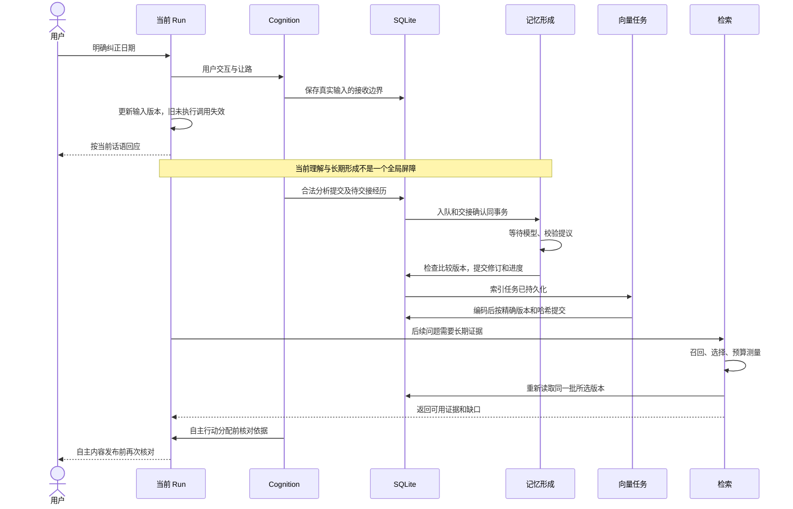

# 06 用户纠正以后：旧依据怎样失效，最终回答怎样保持一致

这一章把前几章连成一次完整执行。题目是：系统保存着“周五 15 点在松柏咖啡馆见”，旧认知分析尚未返回，旧版本向量仍在生成，自主提醒也在准备。用户突然说：“我刚才说错了，是周六，地点不变。”系统从这一刻到最终回答会发生什么？

对应 R04、R06，A06 是本套材料最重要的综合验收。回答时要能标出实际等待、事务与检查位置，不能只说“加版本号就行”。

## 1. 先明确这道题要求什么

用户这次明确说“刚才说错了”，因此旧日期属于被纠正内容；若原话是“原来约周五，现在改到周六”，则旧约定可能曾经有效，两种历史处置不同。

我们希望做到：

- 当前对话尽快理解周六，不等后台所有任务处理完才响应。
- 已经过时的后台分析不能覆盖新状态。
- 长期知识最终保存新日期及其来源，旧日期不能继续作为当前计划。
- 旧向量即使晚返回，也不能使旧事实重新变成当前事实。
- 自主提醒在真正曝光前重新检查依据。
- 如果旧话已经显示或播出，停止后续错误内容并更正，承认已发生事实。

这不是一个把所有操作包起来的大事务。模型请求和外部环境有异步边界，系统用多个短事务、稳定身份和条件检查保持可恢复的一致性。

## 2. 先给出全貌，再分别解释

图中的认知交接是其中一条来源路径。显式 `memory.record` 和对话接入也能形成记忆，不是所有用户纠正必须绕 Cognition 一圈才能保存。

当前还保留同步 `memory.record` 的完整形成路径。文字指令允许先作自然回应，再完成记录并收尾；提前那句话不能宣称“已经保存”。[回应与记录顺序决定](../../benchmarks/TEXT-MEMORY-ACK-ORDER.md) 讨论的是具体交互顺序和成本，不能解释成“后台永远保证立即记住”。

## 3. 第一阶段：新输入先影响当前执行

[AgentRuntime.steer](../../../src/main/agent/agentRuntime.ts) 检查当前 Run、预期输入版本和等待状态，再处理用户补充。期间需要让自主工作让路，异步让路完成后还会复查状态，避免依据已经过期的开始条件继续执行。

模型步骤绑定当时的输入版本。假设旧步骤基于版本 12，纠正后为 13，那么旧步骤返回的未执行工具就不能照原计划开始。已完成工具保留，运行时带着新消息和真实结果继续。

[CognitionService](../../../src/main/cognition/cognitionService.ts) 同时区分真实用户控制与引用材料。“网页里有一句别提醒我”不等于用户现在取消提醒；另一个 Persona 的输入也不能未经区分改变当前控制。

为什么需要接收序号？两条消息可能拥有同一毫秒的时间戳，仍有清晰先后。旧快照只读到第 100 条，新纠正在第 101 条，不能因为时间相同就认为模型已经看过它。

## 4. 第二阶段：旧分析返回，怎样拒绝过时更新

旧分析可能已经收到取消信号，也可能正在返回途中。取消只是减少浪费；提交检查才决定结果能否生效。

`commitAnalysis` 在事务里核对 Attempt、用户控制代际、本轮已读情境/意图的版本和实际阅读范围。这些实体版本或控制语境改变时，拒绝旧更新。新观察不一定使整份状态提交失败；同代际晚到的真实用户话语还会在行动阶段按接收边界检查，完整时间线见第 03 章。不能因为 JSON 格式正确就直接覆盖新的 Claim、Intent 或注意状态。

这里还要区分分析依赖与行动依赖：分析会修改工作局势，因此检查它读过的全部相关状态；行动只检查实际选中的依据，避免无关变化导致反复取消。第 03 章给出了两个层次的理由。

如果旧分析仅完成了一部分来源阅读，也不能把未读部分标为“分析完毕”。否则新纠正可能被进度游标跳过去，后续再也没有机会处理。

## 5. 第三阶段：经历交接在哪里原子化

[CognitionMemoryBridge](../../../src/main/app/cognitionMemoryBridge.ts) 把认知的待交接经历转成 Memory 的持久化工作。经历任务入队与交接确认 在同一 SQLite 事务里完成，随后才唤醒处理器。

可以用三个崩溃点检查：

| 崩溃点 | 数据库应是什么状态 | 下次启动 |
| --- | --- | --- |
| 事务提交前 | 入队与确认都未完成 | 重新读取待交接项 |
| 提交后、唤醒前 | 已确认交接，工作已存在 | 从持久队列继续 |
| 模型处理期间 | 任务和来源仍可定位 | 按恢复状态续处理 |

“提交后再唤醒”解决的是通知丢失不会导致任务丢失。它不保证后台立即完成，也不保证每次模型计算只发生一次；完成回执和来源身份负责避免重复结果。

## 6. 第四阶段：形成模型怎样更新旧日期

形成过程读到来源和已有约定 r1，提出新修订 r2，并给出旧内容的处置依据。宿主先验证整个批次，确认来源、引文、目标、类型和归属都符合要求。

真正提交时再读取当前版本。若用户在模型等待期间已经手动改为 r3，基于 r1 的提议不能直接覆盖 r3。当前抛出 `MemoryFormationInputChangedError`，保留同一持久工作中已经提交的前缀，重新读取实际当前版本继续处理。

成功事务会同时写入新 Revision、来源与语义、旧内容处置、当前版本指针、全文索引、后续索引工作及处理进度。不能只保存正文却漏掉进度，否则重启可能重复处理；也不能先推进进度再写正文，否则可能永久漏记。

| 错误类型 | 应做什么 | 为什么 |
| --- | --- | --- |
| 输出结构或来源引用非法 | 给明确反馈，按规定修复一次或失败 | 模型需要修正输出 |
| 当前比较版本改变 | 重新读取并绑定真实当前版本 | 不是措辞修一修就能安全提交 |
| 网络失败或取消 | 保存相应可恢复状态 | 未取得合法提议 |
| 目标已删除或失效 | 不用旧提议复活它 | 用户后来的操作优先 |

代码入口为 [MemoryFormationService](../../../src/main/memory/memoryFormationService.ts)。完整形成语义见第 04 章。

## 7. 第五阶段：向量晚返回，为何不会覆盖新事实

向量任务绑定 Revision ID、正文哈希、模型标识和维度。它没有修改 Memory 当前版本指针的权力。

如果 r1 仍存在且正文没变，r1 的编码可以作为历史索引完成；查询当前会面日期时，资格过滤应排除它。若 r1 已经删除，或任务哈希与正文不符，`finishIndex` 不写入这份向量。源码见 [MemoryRecallRepository](../../../src/main/memory/memoryRecallRepository.ts)。

新版本 r2 尚未编码时，全文索引已经随记忆修订事务提交，精确引用也可能直接读取。当前对话还可以根据刚收到的用户输入回答周六。可是完全换一种说法的新会话，不一定能在语义索引未完成时找齐材料；这一点必须通过缺口信息和冷回访测试说明。

还有更早的窗口：观察可能尚未交接成形成任务。此时 形成队列没有待办，也不证明全部原话已成为长期知识。判断完整性必须说明检查的是哪条队列、哪个阶段。

## 8. 第六阶段：为什么证据选择之后还要重读

假设搜索找到 r2，证据选择模型认为它可以回答日期。之后消费者进行 token 测量，这是一个可能等待的操作。等待期间用户删除或纠正 r2。

如果不重新读，最终就把失效材料送出。当前 [MemoryRecallPipeline](../../../src/main/memory/memoryRecallPipeline.ts) 在异步选择及最终容量测量后，读取同一批精确版本并重查资格。

为什么不是顺手换成该 Memory 的最新版本？因为选择模型看的是 r2，选择理由和问题覆盖也是根据 r2 作出的。r3 可能已经改了主体或条件，自动换正文会产生一份从未被评估的证据集合。

正确处理是移除不合格项，更新问题覆盖和缺口；必要时后续重新检索、重新选择。若仍有足够独立材料，可以回答能支持的部分。缺少材料时用自然语言说明，而不把内部 coverage 状态码念给用户。

这里的检查保护的是读到和返回的证据身份。它不能自动保证后续普通流式生成期间全世界不再变化，下一阶段还需要自己的控制。

## 9. 第七阶段：自主提醒为什么有三处检查

[CognitionRuntime](../../../src/main/app/cognitionRuntime.ts) 的行动资格包括当前角色、会话条件、目标、判断材料、所需对象与精确记忆引用。

| 检查位置 | 关闭哪个变化窗口 | 失败后意味着什么 |
| --- | --- | --- |
| 调度前 | 分析完成到准备行动之间 | 不启动明显过时的行动 |
| Run 原子分配绑定时 | 异步材料准备到实际 Run 落库之间 | 不把失效提议分配成合法 Run |
| 完成内容投射到表面前 | Run 生成期间 | 不展示已经过时的自主内容 |

三次检查不是持有同一把长锁。中间允许正常交互和状态变化，因此需要在各自边界重新判断。

无关笔记更新不应取消“周六提醒”；用户说“不用提醒”、当前目标被替代、所用约定被纠正则应取消。若检查所有全局版本，会误取消；若只检查 Run 是否 completed，又会漏掉生成期间发生的新控制。

## 10. 最终回答能保证到哪里

普通用户对话主要依靠输入版本、运行中追加输入、取消与新一轮上下文继续执行；自主内容的最终投射还有 `publishCompleted` 检查。

当前不能宣称“每个普通流式 token 在发布前都重查全部 Memory”。已经显示的字、已经播出的音频和已完成外部动作无法通过本地数据库事务撤回。收到纠正后应停止后续错误内容，并明确修正：“刚才日期说错了，以周六为准。”

这种可见修复本身也要被记录为真实交互。否则后续记忆若只保存“系统最后回答正确”，会丢掉用户曾经被错误信息影响的事实。

移植到游戏时，发言和发奖励还应区别对待：发言需要管理实际曝光片段；奖励需要服务端动作幂等与任务前置条件。二者不能共用一句“取消生成就撤销了”。

## 11. 所有版本字段各自保护什么

| 标识 | 保护的对象 | 例子 |
| --- | --- | --- |
| inputRevision | 本 Run 使用的用户输入 | 新纠正到来后旧未执行调用失效 |
| userGeneration | 控制语境 | 停止、切换等控制变化 |
| receivedThroughSequence | 建立快照时宿主实际已接收的边界，与连续已读进度不同 | 同时间戳晚到消息仍被识别 |
| Intent revision / lifecycle | 目标及其阶段 | 已取消的提醒不能继续 |
| Claim material hash | 选中判断、支持、反证和替代解释 | 新反证出现使旧判断不再完整 |
| 对象 epoch / sourceSequence / focusRevision | 当前对象及其用途 | 不能点击已经变更的当前界面 |
| Memory ID + Revision ID | 一份知识及确切正文 | 选择和最终读取对应同一版 |
| historyStatusRevisionId | 旧正文后来的历史处置 | 正文没变，但已被标为纠正 |
| modelKey + content hash | 编码空间及文本身份 | 旧模型向量不混入新查询 |

这些字段不是越多越好。每增加一个，都应该能回答它防止哪个具体竞态、何时更新、谁负责核对。未表达的语义依赖仍可能漏掉，所以机械版本校验和模型依赖选择必须分别评估。

## 12. 六种常见“简单方案”为何不够

**只用时间戳。** 时间可能相同、精度不足或来源不一致；需要稳定接收顺序与内容身份。

**只 abort 旧请求。** 返回可能已到达，外部动作可能已发生；取消不能替代提交检查。

**从接收消息到向量完成放进一个事务。** 模型和网络等待会长时间占用写锁，也无法把外部服务纳入本地事务。

**给 Memory 加一个 version 就行。** Run 输入、认知目标、对象当前性、历史处置和模型空间是不同维度。

**始终读取最新正文。** 会偷换证据选择模型实际读过的版本，破坏判断与依据对应。

**每次全局版本变化都取消。** 动态环境下合法行动可能一直被无关事件打断，形成饥饿。

完整设计的价值正是对这些取舍作出具体边界，而不是在图上多画几个“校验”框。

## 13. 怎样用确定性测试验证这些竞态

不要靠“让模型慢一点，再手速点击”。测试应在具体异步边界放一个可控制的暂停点。

以形成冲突为例：先创建 r1，启动形成并让模型替身停在返回前；通过真实服务把记录改成 r2；释放替身返回基于 r1 的提议；断言 r2 没被覆盖，工作进度和冲突状态符合预期。这样重复运行仍能稳定命中同一个窗口。

类似地可以验证：

- 入队事务内故意让确认失败，断言两者都回滚。
- 让证据选择完成，在容量测量时删除所选版本，断言最终证据移除它。
- 暂停自主生成，提交用户停止事件，再完成生成，断言没有新的表面投射。
- 暂停 Worker 查询，提交新版本，确认本次保持快照、下次能看到新增记录。
- 使旧历史向量晚完成，断言当前版本指针没有回退。

已有测试入口：[用户来源](../../../src/main/cognition/cognitionCurrentUserSource.unit.test.ts)、[交接事务](../../../tests/integration/cognitionMemoryBridge.test.ts)、[形成恢复](../../../tests/integration/memoryFormationProcessorRecovery.test.ts)、[历史处置](../../../src/main/memory/memoryRevisionHistory.unit.test.ts)、[检索重读](../../../src/main/memory/memoryRecallPipeline.unit.test.ts)、[自主运行](../../../tests/integration/cognitionRuntime.test.ts)。

这些测试证明所设置时序下的执行约束。真实模型是否正确理解“我刚才说错了”，仍需要独立语义实验。

## 14. 三分钟回答应该怎样组织

先说用户新输入如何立即改变当前执行；再说后台形成与索引如何分别持久化；接着说读取和发布为何需要复查；最后说明已曝光内容的限制。

可以这样开头：“我把当前意图和长期记忆分开处理。用户纠正先进入 Run 输入版本和认知接收序列，使旧未执行提议失效。后台形成在事务外等模型，短事务内核对它比较的版本，再一起提交新正文、旧内容处置和进度。”

继续讲：“向量属于具体修订和编码配置，旧向量晚完成不会修改当前指针。召回选择之后还要重读同一版本，不能自动换成没有评估的新正文。自主提醒在分配和最终展示前复查依据。”

最后补边界：“已经显示或播出的旧话不能回滚，只能停止并更正。新会话也不能仅凭后台队列暂时为空，就声称所有观察都已经成为长期知识。”

A06 的通过标准是把这些因果关系连起来，并在任意一步被加入新修改后重新推演。背出函数名却无法说明数据库和用户各看到什么，仍需继续练习。
