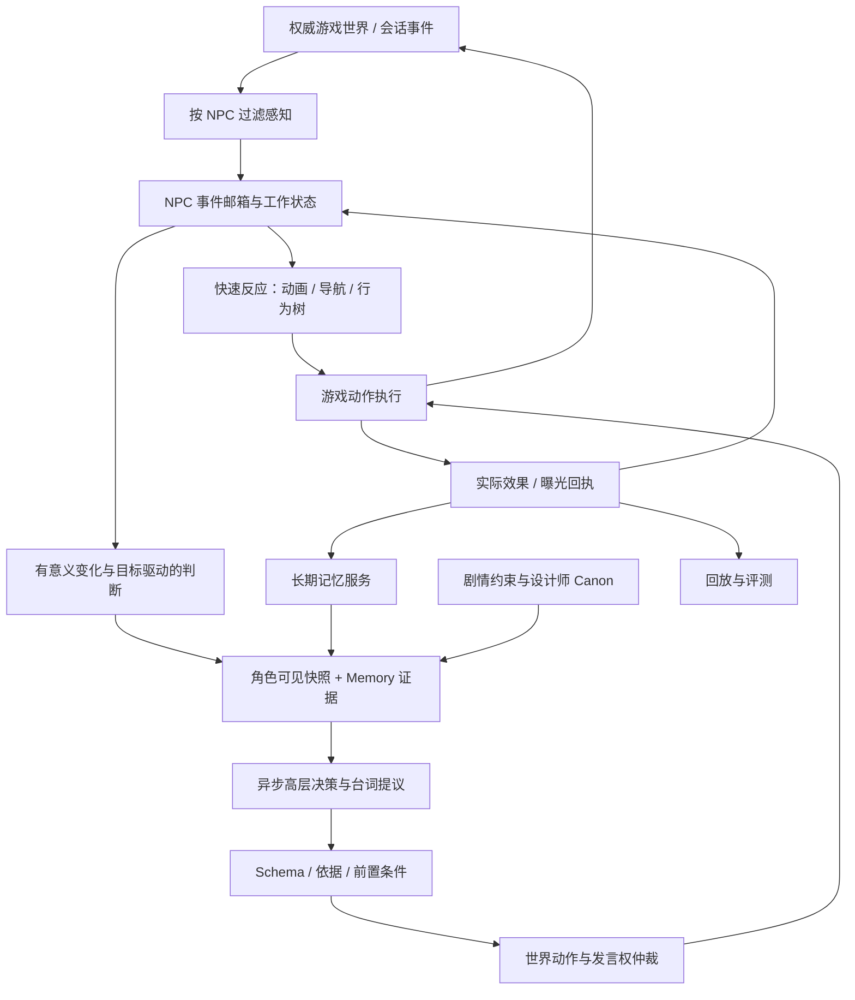

# 09 从 CharaMate 到咖啡馆 NPC：一份可白板的技术设计

对应 R04、R06、R08；验收 A08、A13。全文为**面试设计方案**。它以用户给出的星布谷地式咖啡馆体验为题，不代表该游戏或米哈游内部架构，也不把 CharaMate 改成游戏产品。

开放对话的角色边界、战斗快速响应、卡关分层提示、百 NPC 一致性与版本化 Boss 攻略，在 [第 16 章](16-npc-persona-hints-and-evaluation.md) 用另一组完整场景展开。它同时说明规则与模型各自判断什么、置信度如何验证、误判如何复盘。

## 1. 需求：先定义什么叫“表现得好”

题目：NPC 看见玩家进入咖啡馆，玩家随后与其他玩家交谈，NPC 决定是否插话。

行为目标是角色自然、有记忆、能推动合理互动，同时尊重玩家当前活动。任务完成不是“每次都主动讲话”。可能的合格动作包括点头、继续工作、等空隙、提供服务、回答直接呼叫、放弃已过期机会。

| ID | 功能或不变量 | 验收例 |
| --- | --- | --- |
| N01 | NPC 只使用其可见/可听/已获知的信息 | 私聊提到生日，NPC 不应无来源送上生日祝福 |
| N02 | 记得有来源、有主体和时效的历史 | 玩家自己的偏好不串到同桌朋友；改期后不用旧约定 |
| N03 | 行动遵循目标、角色和剧情约束 | 店员忙于完成订单时不无缘由长篇闲聊 |
| N04 | 插话尊重轮次和玩家意图 | 玩家正在说话时等待；直接叫 NPC 时优先回应 |
| N05 | 世界效果由服务端确认，重复提交不重复执行 | 同一 actionId 重试不会重复出单或奖励 |
| N06 | 延迟结果必须重新核对相关状态 | 玩家已离开或拒绝聊天，迟到台词不再曝光 |
| N07 | 多 NPC 不同时争抢一个会话空间 | 同桌只有一个合法发言权持有者 |
| N08 | 体验、正确性、成本可回放评估 | 能复现为何插话/安静、哪些事实变更使行动失效 |

非目标：首版不做每帧 LLM 决策、不让 LLM 替代导航和物理、不对玩家建立无依据的情感诊断、不让单个 NPC 私自改写主线 剧情事实、不承诺无限规模和零延迟。

## 2. 迁移映射：复用原则，重建环境边界

| CharaMate | 咖啡馆版本 | 需要新增的能力 |
| --- | --- | --- |
| Activity/桌面观察 | 游戏语义事件与 Perception Adapter | 距离、遮挡、听觉范围、频道、说话人和 world tick |
| Cognition | NPC 工作状态、Claims、Intent、Attention | 多人会话状态、服务职责、角色所知与世界事实分离 |
| Memory | 角色-玩家经历、任务/关系事件与来源 | player/NPC/world/party 作用域、游戏时间、剧情版本 |
| Agent Runtime | 高层决策 Run 与 Action proposal | 权威动作提交、房间所有者、动作回执和排队 |
| 桌面 Tool executor | 游戏动作适配器 | 导航、动画、服务订单、发言请求的前置条件与效果 |
| Persona | 设计师角色设定与表达约束 | 知识可见范围、任务职责、剧情阶段允许的表达 |
| 记忆/反思 | 离线学习与角色经历更新 | 正式剧情/奖励不能由反思草稿直接修改 |

共享的是生命周期和证据原则。不能把 Electron Main、单机 SQLite 和桌面审批 UI 原封不动复制到万人在线服务器。

## 3. 目标架构



快路径负责不需要语义推理的响应：转头、避免碰撞、继续倒咖啡、停下当前可取消动画。慢路径负责“这位玩家之前说过什么、这次是否适合聊”。两条路径仍消费同一权威状态和动作合同，不能各自偷偷修改订单或会话状态。

推荐首版按房间或 simulation shard 指定唯一的权威动作负责方，单 NPC 的事件在所属 mailbox 中按序处理。LLM worker 不拥有世界写权限，只返回提议。具体部署可同进程起步，规模需要时再拆，不先为图上每个框建微服务。

## 4. 事件与状态合同

以下为教学伪类型，不是当前项目已存在的文件：

```ts
type PerceivedEvent = {
  eventId: string;
  worldTick: number;
  receivedSequence: number;
  npcId: string;
  actorId?: string;
  channel: "public_room" | "direct_to_npc" | "allowed_party";
  kind: "entered" | "utterance" | "turn_changed" | "left" | "action_result";
  sourceObjectId: string;
  sourceVersion: number;
  evidenceRef: string;
};

type ActionProposal = {
  decisionId: string;
  npcId: string;
  intentRef?: { id: string; revision: number };
  action: "continue_work" | "greet_nonverbal" | "wait" | "offer_service" | "speak";
  audienceIds: string[];
  selectedEvidenceIds: string[];
  memoryRefs: Array<{ memoryId: string; revisionId: string; use: "current" | "history" }>;
  preconditions: Array<{ objectId: string; version: number; condition: string }>;
  conversationRef?: { id: string; turnEpoch: number };
  content?: string;
};
```

生产应把 `condition` 改成有限的类型化条件，不能执行模型提供的任意表达式。宿主从合法对象生成可选引用，校验 ID、范围和条件含义；模型只能引用看过的对象，不凭空造玩家、订单和剧情节点。

例如，首版动作前置条件可以是下面的有限集合。模型可以选择允许的条件与对象，最终版本由宿主绑定，不能让模型填写“我认为版本正确”：

```ts
type Precondition =
  | { kind: "actor_present"; actorId: string; presenceEpoch: number }
  | { kind: "order_pending"; orderId: string; revision: number }
  | { kind: "conversation_available"; conversationId: string; turnEpoch: number }
  | { kind: "invitation_active"; invitationId: string; revision: number }
  | { kind: "quest_stage"; questId: string; stage: string; revision: number };
```

`presenceEpoch` 用于区分“这次在场”和“离开后重新进入”。如果只看 `present=true`，旧提议可能在玩家重返房间后误通过。`turnEpoch` 表示会话占用状态的变化；它不是客户端时间戳，也不假定不同机器时钟完全一致。

`worldTick` 表示事件发生在哪个模拟时刻，`receivedSequence` 表示此 NPC 实际接收的顺序。网络延迟下二者可能不同：旧事件迟到时可以补历史经历，但不能倒退当前订单状态。事件 ID 用于去重，房间权威序列用于决定当前状态；客户端上报的“我刚才说了什么”仍需经过游戏协议校验。

工作状态至少分四类：

- **权威事实**：位置、订单、任务阶段、当前说话人、玩家是否在房间。
- **角色所知**：角色确实观察/被告知的事实及 来源；可能落后于真实世界。
- **角色推断**：比如“他可能赶时间”，带依据与替代解释，不写成玩家真实心理。
- **行为意图**：接待、完成订单、稍后提醒、暂不打扰；需要恢复/失效条件。

剧情服务器可以知道隐藏真相，角色知识投射不应把它全部放进 prompt。否则再写“不要剧透”也无法替代正确的信息边界。

### 4.1 谁负责每一种状态

同一个“玩家想喝热咖啡”会在不同地方出现，但语义不能混为一谈。

| 对象 | 唯一负责方 | 其他模块怎样使用 |
| --- | --- | --- |
| 订单品类和支付状态 | 订单系统 | NPC 查询或提交受验证的订单动作 |
| 玩家当前纠正 | 房间事件与 NPC 工作状态 | 立即撤销旧行动依据，不等长期记忆 |
| NPC 记得的长期偏好 | 记忆服务 | 按角色、玩家、时间和精确修订读取 |
| NPC 对玩家意图的推断 | 认知模块 | 带来源与不确定性，不能直接改订单 |
| 角色背景与章节约束 | 叙事配置和任务系统 | 生成可见投射，限制合法动作 |
| 当前谁能发言 | 会话仲裁器 | 动作提交时申请，客户端验证发言代次 |

第一次实现可以把这些职责放在一个房间进程里，用模块划分所有权；并不要求六个微服务。只有独立扩容、可靠性或存储需求出现时再拆。拆开后，原来同进程能够保证的顺序和事务也要重新设计。

### 4.2 记忆的检索范围先于相似度

给 NPC 检索玩家 A 的偏好时，不能先从所有玩家记忆中取最相似的 20 条，再在模型提示里写“别串人”。范围过滤至少应考虑 NPC 身份、玩家身份、房间/世界版本、允许知晓的来源和事实有效时间。属于朋友 B 的偏好即使语义更相近，也不能进入 A 的直接个人偏好候选。

公共经历与私人知识需要不同的可用范围。例如店员确实在场时听到 A 公开介绍自己的生日，才有来源可用；世界服务器知道生日不等于角色已经知道。检索结果也不能让 NPC 提前得知任务系统中的隐藏真相。

长期记忆与任务状态的冲突由职责解决：旧聊天写“配方任务完成了”，任务系统却显示未完成，任务效果以权威状态为准，记忆可作为“曾经说过”的历史。不能把向量相似度最高的一句话当作世界数据库。

## 5. 插话算法：资格、选择与提交分开

### 5.1 第一层：硬资格

确认 NPC 在场、感知来源合法、对象/话题仍相关、没有明确不打扰约束、动作不会破坏必要剧情条件。直接点名、服务请求和普通闲聊有不同优先级，紧急剧情也应由明确游戏规则定义。

若玩家正在发言，默认不竞争普通插话。等待不是“睡固定三秒再说”，而是订阅相关条件：话轮结束、被点名、订单完成、目标玩家离开。服务端时间可用于机会有效期和资源回收，但具体阈值由产品体验与测试确定，不当作论文结论。

### 5.2 第二层：合法动作中的选择

可先用明确规则建立 基线，再评估 LLM 的语境收益。候选包含 quiet、nonverbal、wait、offer_service、speak；让模型解释所选依据和用途，而非要求它每次生成热情台词。

需要 utility model 时，可提出实验形式：

```text
U(action) = 目标推进价值 + 与当前话题相关性 + 玩家邀请程度
            - 打扰成本 - 证据不确定性 - 资源成本
```

系数和阈值是候选，不是已经验证的心理学量表。身份/频道/剧情红线先过滤，不允许靠高“相关性分数”抵消越权。LLM 可以比较候选，不应把一堆无校准的 0–1 自评分相加就宣称可控。

### 5.3 第三层：发言权与最终提交

生成台词前可以判断机会，但不要持有整段生成时长的独占发言锁。生成后，在房间权威处理点申请实际发言权，核对最新 turnEpoch、audience、选中依赖和必要 Memory 资格。成功时原子分配 `actionId`、speech lease/epoch 并记录发言开始；同一会话的其他提议等待或失效。

发言权和商店订单属于不同资源，不必锁整个世界。因灯光变化而改变全局 world revision，不能取消一个与灯光无关的“订单好了”。但玩家离开、话轮被占用或请求撤销会使相关前置条件失败。

### 5.4 等待必须有恢复条件

一个最小决策状态机可以这样定义：

| 状态 | 进入原因 | 能使它前进的事件 | 退出时要清理什么 |
| --- | --- | --- | --- |
| 工作中 | 无当前社交机会，继续职责 | 直接呼叫、订单完成、相关观察 | 无需取消正常导航 |
| 待判断 | 有值得处理的新信息 | 成功取得当前状态快照 | 合并已处理事件 |
| 生成中 | 允许异步做高层判断 | 模型返回、相关纠正、玩家离开 | 作废旧请求关联，释放推理名额 |
| 等待机会 | 台词或意图合理，但会话被占用 | 话轮结束、邀请恢复、机会过期 | 删除已失效订阅 |
| 待提交 | 已有合法提议 | 权威检查通过或拒绝 | 不保留隐式发言权 |
| 发言中 | 已分配发言代次 | 播完、打断、目标离开 | 回收发言权，记录实际曝光 |

“等待机会”不一定保存已经生成的整段话。若时机改变会影响内容，可以只保存意图和必要证据，机会重新出现时再生成；若内容是“您的咖啡好了”，短暂等待后可复用文本，但仍检查订单、对象和发言资格。这是按动作语义做取舍，不能用一个全局缓存有效期解决。

等待过程中收到无关灯光变化，不重新请求模型；收到“这杯改成热的”，则取消依赖旧订单的提议。系统需要观察当前状态是否有**相关变化**，而不是把每个游戏事件都转换成一次模型调用。

### 5.5 提交伪代码：到底原子地做什么

以下是单房间权威处理器的设计伪代码，尚未实现于 CharaMate：

```ts
function commitSpeech(proposal: SpeechProposal): CommitResult {
  return room.atomic(() => {
    const previous = room.actionResult(proposal.actionId);
    if (previous) return previous;

    const reason = checkCurrentPreconditions(proposal, room);
    if (reason) return room.recordRejected(proposal.actionId, reason);

    if (!room.conversation(proposal.conversationId).isAvailable()) {
      return room.recordDeferred(proposal.actionId, "conversation_busy");
    }

    const speechEpoch = room.allocateSpeechEpoch(proposal.conversationId);
    room.reserveSpeaker(proposal.npcId, speechEpoch);
    return room.persistAcceptedActionAndOutbox(proposal, speechEpoch);
  });
}
```

`room.atomic` 可以是单线程房间事件循环中的不可交错操作，也可以结合持久化事务；具体实现必须说明崩溃后以哪份状态恢复。它不能包住模型调用或网络播放。

“接受动作”和“客户端播完”是两个状态。提交时保存动作和待发送事件，发送器随后把事件交给客户端。客户端按 `actionId + speechEpoch` 去重，只播放当前有效代次；播放开始、结束或取消再回传曝光信息。回执丢失时状态是未知，不能擅自改成没说过。

`deferred` 表示这一次提交没有取得机会。再次尝试应经过新的当前状态核对，并按设计生成新的提交尝试标识；不能既把它当终局缓存返回，又期待复用相同请求突然成功。幂等对象、决策对象和重试尝试必须在合同中分清。

## 6. 一条完整咖啡馆轨迹

| 时刻 | NPC 可得到的事件 | 判断与持久状态 | 可见行为 |
| --- | --- | --- | --- |
| e1 | 玩家 A 进入且在视野内 | 接待意图可建立；不知道 A 今天一定点什么 | 可点头或短问候，不必启动长推理 |
| e2 | A 转向玩家 B，两人在公开可听范围聊天 | 会话占用；相关性不足时 quiet，记录等待条件 | NPC 继续工作 |
| e3 | A 在允许 NPC 听到的公开话语中说“今天还是别喝冰的” | 当前场景条件与历史偏好不同，不把一时条件永久改成一生偏好 | 可等待服务机会 |
| e4 | A 与 B 的话轮有自然空隙，A 看向服务台并叫店员 | 邀请证据成立；按 A 的记忆检索必要偏好与例外 | 生成“今天要不要试试热的？”等角色化提议 |
| e5 | 生成期间 B 又开口 | 与发言权有关的 turnEpoch 改变，台词还没获准曝光 | 等待或重新判断，不抢话 |
| e6 | A 明确说“先别打扰我们” | 当前意图/控制更新，旧机会取消 | 停止未播出的后续片段，继续服务工作 |
| e7 | 之后 A 主动问“我平时喜欢什么？” | 结合长期偏好与今天临时例外，不混淆 | 回答长期偏好并保留条件 |

若 e3 是 A/B 私聊频道，整条观察不会进入 NPC 输入；e4 不能引用 e3。若 A 没看向店员、没点名，只是静默，空隙本身不等于邀请。不能从视线或停留时间直接推断玩家心理。

## 7. 多人并发、取消与崩溃

| 故障/竞态 | 设计处理 | 必须验证的结果 |
| --- | --- | --- |
| 两个 NPC 同时提出插话 | 同一 conversation 的权威仲裁分配一个 speech epoch | 无重叠抢话；另一个有明确等待/放弃结果 |
| 玩家离开后模型返回 | 提交时 audience presence/version 检查失败 | 无对空台词，无错误“玩家已听到”记忆 |
| 玩家新纠正但 Memory 尚未形成 | 当前用户事件/工作状态先使旧提议失效 | 不能只等向量索引更新 |
| 世界接受订单后响应丢失 | 以 actionId 查询/去重，回放同一 receipt | 不重复下单、不重复发奖励 |
| 写本地决策日志后服务崩溃 | durable proposal/outbox 续发；外部执行去重 | 不用跨网络数据库事务制造虚假的 exactly-once |
| 语音播到一半被打断 | 停播放、撤后续片段、按 speech epoch 丢迟到包 | 记录实际已曝光片段，不能称整段都未说 |
| 某 NPC 的模型连续失败 | 该角色继续合法基础行为，暂停无新信息的重试 | 不阻塞房间 simulation 或制造付费热循环 |

如果 Memory 和 world authority 分在不同服务，仅做“先查记忆、再提交动作”有 TOCTOU 窗口。首版可把影响行动的当前工作状态/版本投射到房间权威 负责进程；重要纠正先进入该 负责进程 的事件序列，再更新长期存储。若要求跨服务严格同步，必须明确一致性协议和延迟成本，不能说分布式事务天然存在。文本建议与不可逆奖励可选择不同一致性等级，但必须写清合同。

### 7.1 一个更难的竞态：纠正与订单同时到达

假设旧提议为“提交冰咖啡订单”，同时收到玩家改成热咖啡。房间权威处理器必须给两者确定顺序：

- **先应用纠正**：订单或当前请求版本改变，旧提议检查失败；随后按新请求处理。
- **先提交旧订单**：旧动作在当时合法且已经生效；纠正应变成修改或取消订单请求，不能把过去的提交事实抹掉。
- **外部制作已开始**：是否还能改由订单规则决定。NPC 应说“我确认一下能否更改”，不能直接声称已改好。

这说明版本检查保证的是“提交时与最新已处理状态一致”，不是预知下一毫秒输入。面试时若被问“那仍可能做错吗”，应说明真实世界操作有生效边界，必要时需要补偿动作和明确反馈。

### 7.2 房间迁移和服务重启怎样避免双重执行

首版可以让房间只有一个活动负责进程。迁移或恢复时需要新的所有权代次，动作执行器拒绝旧代次的写入；否则旧进程网络恢复后可能再次提交。代次必须来自一致的所有权机制，不能由两个进程各自加一。

持久化的待发送动作解决“保存后尚未发出就崩溃”；效果端的幂等记录解决“已生效但确认丢失”。二者合用才覆盖主要窗口。它仍然不是任意外部系统上的数学意义“恰好执行一次”：如果外部工具既不接受幂等键，又无法查询结果，就必须把结果未知暴露给恢复逻辑。

NPC 的长期记忆只消费确认过的效果和实际曝光。例如“我告诉 A 咖啡好了”需要发言曝光依据；只有提议而未播放，应记成尝试或待办，不能变成双方共同经历。

## 8. AI 叙事与 AI 玩法怎么扩展

叙事层维护作者定义的 剧情事实、章节阶段、角色知识、不可违反的因果约束，以及允许的事件/台词空间。NPC 负责从自己的知识和动机提出行动；Director 可以分配机会或控制节奏；世界服务器确认实际效果。

例子：NPC 想介绍新咖啡配方。自由度可以是措辞、提出时机、关联已知玩家偏好；若“介绍配方”会解锁任务，则 `offer_quest` 必须由任务系统确认前置条件，NPC 说了“送你配方”不能直接改背包。不同玩家的剧情进度也不能通过公共台词把未解锁内容泄露给旁人。

可实现的 AI 玩法是有闭环的机制：玩家提供线索→NPC 形成有限假设→选择询问/查阅游戏内物品→玩家可验证结果→任务状态变化。不要把无限生成剧情等同可玩的系统；玩家需要稳定规则、可理解后果和可恢复失败。

传统 GOAP/行为树适合动作前置条件、导航与确定性恢复；LLM 适合语义理解、表达与高层意图。FEAR 的规划设计和 Left 4 Dead 的动作/节奏架构可作为工业参照，来源与限制见第 10 章。

### 8.1 把“自由叙事”落成一个有限玩法

可以设计“找回咖啡馆遗失的配方”：

1. 玩家给出线索，NPC 只接收角色有权看到的内容。
2. 认知层维护几个可修订假设，例如配方可能在仓库，也可能被借走；假设与已确认事实分开。
3. NPC 从合法动作中选择询问店员、查看已解锁账本或请玩家寻找物品。
4. 世界返回真实结果：账本是否可读、借阅记录是什么、玩家是否找到物品。
5. NPC 根据新证据修订假设和对话。任务系统只在条件满足时推进阶段。
6. 失败有可理解后果：证据不足就继续查，走错方向能返回，不凭空宣布找到配方。

设计师控制角色目标、关键事实、任务状态机与可发生的事件；模型负责在这些范围内组织表达和选择下一步。这样玩家可以用自然语言影响过程，同时仍然理解什么行动会产生什么后果。

两名玩家进度不同时，公共台词应使用双方都能获知的内容；针对某人私下解锁的信息应进入受控的一对一互动。剧情知识投射在输入与动作提交两端检查，不能只要求生成器“注意不要剧透”。

## 9. 延迟、吞吐与成本预算

先确定体验目标：玩家入店的视觉反馈可以由快路径立即给出；语义对话受模型和网络延迟影响；过期机会应放弃而非迟到强行插话。具体毫秒目标要依据游戏网络、动画和真人试验定，不沿用聊天 benchmark。

**仅用于容量估算的假设：**1000 个 NPC，5% 当前活跃，每个活跃 NPC 平均每 10 秒产生一次需 LLM 判断的事件，则到达率约 5 请求/秒。若平均模型处理耗时 3 秒，Little 定律给平均在途约 15 个请求；这是稳态平均，不是安全并发上限。若每请求 800 输入、100 输出 token，则约 4000 输入 token/秒、500 输出 token/秒，尚未计召回、工具 continuation 与重试。真实事件突发和输出分布会改变结果。

据此需要：按 NPC/房间顺序处理、无关高频事件合并、只对有意义变化唤醒、在 admission 前判断机会是否仍有效、限制实际在途资源并公平排队。玩家直接呼叫优先于后台闲聊，但不能使低优先任务永久饥饿。排队长度、机会过期率和 p95/p99 比平均延迟更能暴露问题。

缓存静态 Persona/公共 剧情事实 可以减少重复前缀，动态玩家事实则必须按 作用域和版本 失效；不能跨玩家复用包含个人记忆的完整回答。远处 NPC 可用低成本确定性模拟，只在成为交互焦点时建立更丰富认知，但恢复状态必须与此前世界事件一致。

这些是拟验证方案；当前 100k 本地记忆扫描结果不能证明此游戏容量。没有真实服务配额、模型吞吐和玩家分布前，不承诺“支持十万 NPC 实时自治”。

### 9.1 方案怎样选，而不是一上来全用模型

建议分开比较三个问题，避免一次同时改模型、记忆和调度：

| 问题 | 最小基线 | 候选改进 | 配对比较时固定什么 | 决策依据 |
| --- | --- | --- | --- | --- |
| 是否需要插话 | 明确邀请与服务规则 | 模型处理隐含语境 | 同一可见事件、合法动作、角色设定 | 打扰、漏机会、解释依据与成本 |
| 如何选择记忆 | 按主体和时间过滤的文本搜索 | 加入语义候选与证据选择 | 同一问题、记忆库与最终上下文预算 | 多证据覆盖、过时事实误用、最终回答 |
| 如何验证行动 | 整份快照变化即拒绝 | 检查选中行动实际依赖 | 同一提议和事件插入位置 | 相关变化拒绝率、无关变化保持率 |

这里没有已经得到的胜者。规则基线并不天然落后：明确叫店员、订单做好等场景可能已经足够；模型的价值更可能出现在含蓄请求、条件偏好和复杂话题上。只有这部分收益能覆盖调用成本与错误风险时，才值得加入。

实验先使用确定性事件回放检查机械正确性，再让真实模型生成提议，最后由玩家评价自然程度。这三个阶段分开报告，不能把“回放 100% 没有重复订单”写成“玩家 100% 满意”。

### 9.2 队列拥堵时应牺牲什么

把所有请求排成一条先来先服务队列，会让玩家直接呼叫排在后台闲聊后面。可按任务语义分级，并在每次取队列项时重查机会是否仍存在。主动寒暄过期可以放弃，用户订单不能默默丢弃，应反馈等待或交给确定性服务流程。

对同一 NPC 的重复背景观察可以合并成最新状态，但明确纠正、任务完成和效果回执不能只保留最后一句。合并策略必须依据事件语义，而不是统一“只保留最新 10 条”。

具体并发数由模型吞吐、内存、服务配额和尾延迟试验决定。先测无排队服务时间，再施加正常与突发负载，观察排队、丢弃、机会过期与回应完成率。平均在途估算只是容量起点，不是部署结论。

## 10. 分阶段实施与验收

| 包 | 交付 | 必须通过 |
| --- | --- | --- |
| G0 单 NPC 可回放环境 | 感知事件、权威动作、确定性假模型 | N01/N05/N06；同 actionId 重放不重复效果 |
| G1 当前状态与等待 | Claim/Intent、当前用户控制、quiet/恢复条件 | 玩家说话期间不误判空闲，明确呼叫能响应 |
| G2 记忆与条件偏好 | 来源、Revision、作用域、纠错链 | 跨会话使用新事实，朋友偏好不串人，旧索引不复活 |
| G3 多 NPC/多人 | conversation 仲裁、audience、时序故障 | N07；重复/乱序/离店/重连轨迹可解释 |
| G4 叙事与语音体验 | 剧情事实 合同、实际曝光、打断、真实模型 | 无剧情越权，已播和未播清晰，真人评价时机 |
| G5 优化与数据循环 | 第 08 章评测、排队容量与版本发布 | 质量/打扰/漏机会/成本同时报告，有回滚与未见集 |

这些包是学习中的实施设计，不在当前仓库新增模块或 schema。

## 11. 白板结尾与深入追问

白板交付应有五件东西：一张职责图、一组事件与动作类型、一条完整时序、一组失败恢复规则、一张方案比较卡。画出了模型、向量库和消息队列，还不足以说明系统能运行。

给自己加三个现场变式：玩家说“别打扰”时音频已播一半；另一个 NPC 已拿到发言权；订单提交成功但回执丢失。每个变式都要说出谁负责判断、读取哪个版本、写入什么结果、玩家最终看到什么。

**五分钟讲法：**先画世界事实与角色所知的分界；再画事件邮箱、认知与 Memory；然后画 LLM 提议到权威动作提交；最后讲 e5/e6 的过期插话、多 NPC 发言权与数据闭环。别先画五个模型服务再解释为什么要它们。

**面试官说“玩家每天来，你要记住所有聊天吗？”** 保留足够来源和有用经历，形成条件化知识；压缩、归档与删除语义清楚；检索按玩家、角色、剧情与时间范围，评测记忆污染和忘记重要承诺，而非单看存储量。

**“要拟人，有时就应该打断吧？”** 可以。产品可以定义紧急事件、熟悉角色的特定玩笑和被邀请的插话；让设计师和玩家评测决定合法机会。技术合同控制谁能做、依据什么、是否仍有效，不把所有 NPC 限制成永远沉默。

**“LLM 说话很慢，还算实时吗？”** 把视觉响应、语义决策和持续动作分层，先做合法非语言反馈；慢结果要检查有效期。报告实际分层延迟和机会失效率，再决定小模型、蒸馏、缓存或减少往返，不用一个首 token 数字掩盖整体体验。
