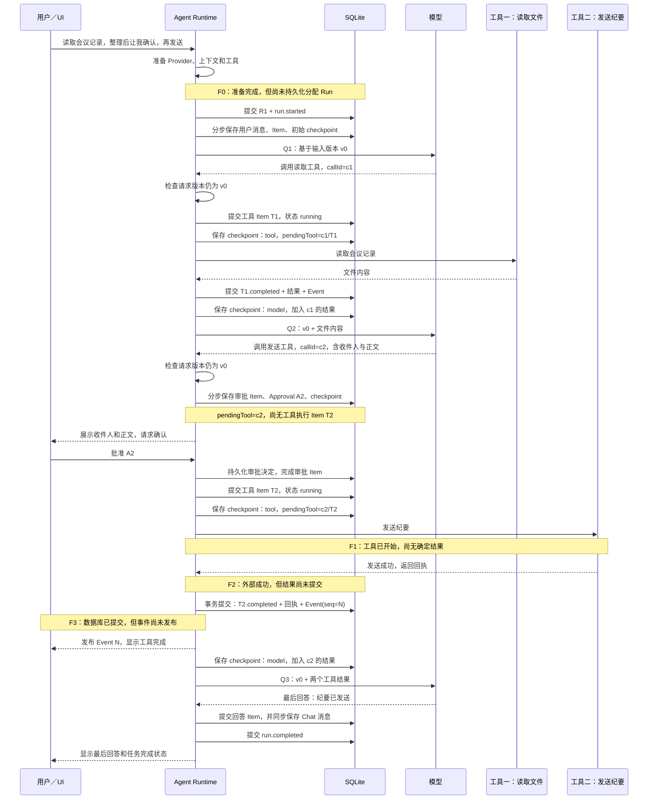

# 侧边聊天问答记录

记录日期：2026-10-20。

这份记录保存侧边聊天中的六组技术追问，供关闭聊天后继续学习。问题保留原文，回答整理为可独立阅读的学习笔记，不作为客户端逐字导出的聊天记录。最后一组保留完整的两工具时序、四个故障点分析和实验解释。

内容以记录时的 CharaMate 源码与仓库实验记录为依据。教学例子与历史实验分别标明；历史实验没有在这次记录工作中重跑，故障分析是沿代码推演，不是本次实际执行的故障注入结果。

目录：

1. Chat、Run、Item、Event 的关系。
2. 区分这些对象以后，断线和审批恢复具体有什么变化。
3. 数据库事务在什么时候提交。
4. Context engineering、上下文压缩、handoff 和 checkpoint。
5. Chat 摘要的增长、300 个工作流的评测、Cognition 与 Chat 路由。
6. 两工具 Run 时序、四个故障点、规划与循环检测、压缩实验。

相关章节：[Agent Runtime](02-agent-runtime.md)、[认知与注意](03-cognition-attention-persona.md)、[索引与上下文](05-retrieval-and-context.md)、[掌握验收](12-mastery-acceptance.md)。

## 1 Chat Run Item Event 的关系

**问题原文**

> 以实际例子讲一下Chat  Run Item Event的关系

**回答**

用“读取会议记录，整理纪要，经我确认后发送给同事”来区分。

| 对象 | 在例子中是什么 | 主要负责什么 |
| --- | --- | --- |
| Chat | “项目会议”这个会话 | 保存会话归属、消息和跨任务的对话连续性 |
| Run | 本次“读记录并发送纪要”的执行 | 管理一次任务的执行状态、等待、恢复和终止 |
| Item | 读取文件、审批、发送工具、助手回答等具体内容或执行单元 | 保存每个单元的输入、输出、状态和身份 |
| Event | 某个 Item 开始、输出增加、完成，或者 Run 进入等待等变化 | 持久化变化顺序，把状态更新交给界面，并支持补读 |

可以把一次执行展开为：

```text
Chat C1：项目会议
  └─ Run R1：读取会议记录并发送纪要
       ├─ 用户消息 Item
       ├─ 助手输出 Item
       ├─ 读取文件 Item T1
       ├─ 助手输出 Item
       ├─ 审批 Item
       ├─ 发送纪要 Item T2
       └─ 最后回答 Item
```

每个 Item 又可能对应多个 Event。例如读取文件：

```text
item.started
item.delta（如果工具有增量输出）
item.completed
```

因此，Item 与 Event 不是一一对应。Item 是持续存在的对象；Event 是这个对象发生过的变化。

用户接着说“把刚才的纪要改成英文”，通常会在同一个 Chat 中启动新的 Run。若用户在当前 Run 还没结束时纠正收件人，则可能作为当前 Run 的补充输入继续执行，不能简单把每条用户消息都理解成必然创建一个新 Run。

另外还需要区分两个编号：

- `itemId` 标识产品中的执行单元。
- `callId` 对应模型提出的某次工具调用，用来把结果准确接回那次调用。

例如模型提出 `callId=c2` 的发送调用，工具结果必须作为 `c2` 的结果送回模型，不能仅靠“第二个工具结果”或自然语言猜测。恢复时重新执行一个幂等工具，也可能创建新的执行 Item，但仍是在解决原来的调用。

**最重要的理解：**Chat 表达会话归属，Run 表达任务生命周期，Item 表达具体工作，Event 表达这些工作怎样变化。把四者混在一张“聊天消息表”里，会很难分辨“模型正在说话”“工具已经开始”“等用户批准”和“任务已经完成”。

源码入口：[Run 合同](../../../src/shared/contracts/run.ts)、[Run 仓库](../../../src/main/agent/runRepository.ts)、[Agent Runtime](../../../src/main/agent/agentRuntime.ts)。

## 2 区分对象以后恢复具体有什么变化

**问题原文**

> 区分这些对象的直接收益是恢复：UI 重新连接时不需要猜模型是否还在生成，而是从最后收到的事件序号继续读取；工具结果与原调用有稳定对应关系；一个 Run 在等待审批时也不用伪装成“结束，稍后重建另一个任务”。以及这个的实际表现也讲一下

**回答**

这里要分开“界面断线”和“执行进程退出”。前者不一定中断任务，后者需要恢复执行边界。

**情况一：界面断开，Main 进程仍在执行**

假设界面最后知道这个 Run 已处理到事件 41。界面断线期间，Main 又提交了：

```text
42：读取工具完成
43：助手开始整理结果
44：助手输出了一段内容
45：Run 进入等待审批
```

重新连接时，界面读取持久化状态，并可从序号 41 之后补读事件。它不需要根据“最后一句话似乎没句号”来判断任务状态。

用户实际看到的是：原来显示“正在读取”的工具变成“已完成”，同一个任务下面出现审批卡片。已经完成的读取不会因为界面断开而重新执行。

当前 Renderer 的具体实现是：忽略已经包含在本地快照中的旧事件；发现序号缺口时请求 replay，随后重新加载 Chat 快照。不能把它描述成已经完全依赖逐事件 reducer 的增量恢复。代码见 [chatStore](../../../src/renderer/features/chats/chatStore.ts)。

**情况二：执行进程也退出了**

重启时不能只恢复 UI，还要查询 Run、Item 和 checkpoint：

- 工具已经完成并保存结果：复用结果。
- 工具尚未完成、而且可以安全重复：可以按恢复规则重新执行。
- 工具可能改变了外部世界、结果却没保存：标记结果不确定，先核实。
- 正在等待审批：找回原审批和原待执行调用，继续这个等待。

因此“恢复”不等于把上次的 prompt 再发给模型一遍。盲目重发可能导致重复发送、重复创建或重复修改。

**情况三：用户隔了一段时间才批准**

等待期间仍然是 `R1`。数据库中有审批 Item、独立的 Approval 记录，以及 checkpoint 里的待执行调用。

用户批准后，运行时先确认审批仍然属于当前有效的请求，再继续创建工具执行 Item。用户看到同一张任务卡片从“等待确认”进入执行，再变成完成。

如果用户在等待时改了收件人，旧审批不能自动授权新的发送参数；如果用户取消了任务，迟到的批准也不能让旧动作复活。

这也是为什么不能把“等待审批”伪装成任务已经完成。完成是终局，等待只是当前 Run 的一种持续状态。

**情况四：工具结果先保存，界面通知后丢失**

如果发送回执已经入库，而通知没有到达 UI，恢复界面时读取结果即可。通知丢了，不等于业务结果丢了，更不意味着应该再次发送。

数据库中的 Event 是可补读的持久化记录；IPC 通知只是让界面及时知道有变化。当前实现先提交事件和状态，再发布通知。代码见 [RunEventService](../../../src/main/agent/runEventService.ts)。

## 3 数据库事务在什么时候提交

**问题原文**

> 这个数据库事务提交的时机是什么？也是结合具体例子来讲一下

**回答**

不是从用户点击发送开始，一直开着数据库事务等到模型和工具全部结束。事务围绕一个需要原子完成的状态变化，尽量短；模型请求、网络工具、用户审批这些慢操作放在事务外。

**先看 Run 与工具执行。**

以发送纪要为例，实际顺序是：

```text
短事务一：登记工具执行 Item，并保存 item.started 事件
提交

保存工具阶段 checkpoint

事务外：调用外部发送服务，等待结果

短事务二：保存结果，更新 Item，追加 item.completed 事件
提交

向 UI 发布事件

把工具结果接回模型上下文，保存新的 checkpoint
```

这里的“保存 checkpoint”与前后的 Item 事件通常是不同写入边界，不能画成一笔统一大事务。

短事务二内，Item 的完成状态与完成事件必须一致：不能出现数据库已经宣称工具完成，却没有对应事件；也不能事件说完成，Item 仍没有结果。当前 `RunRepository.appendEvent` 将这部分状态投影与事件插入放在同一个 SQLite 事务中。

最后回答也有类似要求。助手回答 Item 完成时，对应的 Chat 完整消息在同一事务里写入，然后发布完成事件。但整个 Run 的 `completed` 状态仍是后续独立的状态变化。

**为什么不把发送服务也包进事务？**

因为 SQLite 事务不能撤销外部服务已经做过的事。

假设邮件已经发送，但本地事务回滚了：收件人的邮件不会因此消失。把网络调用放进长事务，既占着数据库资源，又没有得到跨系统原子性。

所以必须承认一个真实窗口：

```text
外部成功
  ↓
本地尚未保存成功回执
```

这个窗口只能通过外部幂等机制、状态查询或人工核实处理，不能靠“事务回滚”解决。

**再看 Cognition 的异步分析提交。**

举例：系统观察到用户在写信，准备分析是否应该提出措辞建议。

1. 读取认知快照，记录本次实际读到的来源、对象版本和接收边界，并登记分析 Attempt。
2. 退出短事务，在事务外调用模型。
3. 模型生成期间，用户说“先别提建议，只听我说”。这条新输入先被系统持久化。
4. 旧分析返回，提议“主动修改语气”。
5. 提交分析时，在新的短事务内复查 Attempt、控制状态和相关依赖。
6. 如果新输入已经使旧分析不再有效，就拒绝旧结果；不能先写入再希望后续模型自行纠正。
7. 若仍有效，提交判断、意图和注意状态等变更；行动所依赖的版本应对应提交后的状态。

这类似“读取快照 → 慢计算 → 检查版本 → 短事务提交”。但不能把所有校验都压缩成一个全局版本号：新用户消息可能在同一控制代际里到达，对象也可能独立发生变化，必须核对本次实际依赖。

分析提交成功也不代表以后永远有效。行动分配前、异步准备后和最终发布前，仍可能需要再次检查相关依据。事务解决某个提交瞬间的原子性，不会冻结之后的世界。

源码入口：[Run 事件事务](../../../src/main/agent/runRepository.ts)、[工具执行顺序](../../../src/main/agent/agentRuntime.ts)、[Cognition 分析提交](../../../src/main/cognition/cognitionRepository.ts)、[自主行动调度与发布](../../../src/main/app/cognitionRuntime.ts)。

## 4 Context engineering 压缩 handoff 与 checkpoint

**问题原文**

> 上下文压缩和context engineering具体是怎么做的？比如handoff和checkpoint这些似乎都没讲

**回答**

Context engineering 是为每一次模型请求选择、组织、校验和计量信息。压缩只是其中一个环节。

对“读取会议记录并发送纪要”这个任务，下一次模型调用通常需要：

- 当前有效的系统与角色要求。
- 用户本次请求和后续纠正。
- 必要的 Chat 历史，或者已经形成的 Chat 摘要。
- 与当前任务相关的认知状态、记忆和证据。
- 当前计划、已完成工作、审批决定和待解决问题。
- 必要的工具调用与结果，以及模型当前可用的工具描述。

不应该每轮把数据库所有内容都塞进 prompt，也不能只看“最近几条聊天”而丢掉当前审批和工具状态。

**几个对象各管什么。**

| 对象 | 主要给谁使用 | 回答的问题 |
| --- | --- | --- |
| Chat 摘要 | 后续模型请求 | 这个会话较早部分谈过什么，哪些约束和未完成问题要延续 |
| Handoff | 压缩后的任务执行上下文 | 当前 Run 做到了哪里，作过什么决定，接下来做什么 |
| Checkpoint | 程序恢复逻辑 | 当前处在哪个阶段，正在等哪个调用、审批或输入，恢复时如何接上 |
| 长期 Memory | 后续检索与跨会话使用 | 有哪些仍有效、带来源的经历和事实与当前问题相关 |
| Item 与 Event | 执行账本和 UI | 实际发生过什么状态变化，哪些结果已经持久化 |

**Handoff 是给后续模型看的交接材料。**

项目中的基本字段是 `currentProgress`、`decisions`、`constraints`、`nextSteps`。下面是教学示例，不是某次真实数据库内容：

```json
{
  "currentProgress": [
    "已读取会议记录，整理出三个待办事项",
    "发送草稿已准备好，尚未发送"
  ],
  "decisions": ["采用用户确认的中文简版"],
  "constraints": [
    "发送前必须取得批准",
    "收件人已由张三改为李四，旧收件人要求失效"
  ],
  "nextSteps": ["等待当前发送请求的审批结果"]
}
```

这段文字能帮助模型继续工作，但不能单独证明“审批已通过”或“邮件已发送”。真正的审批状态和工具结果仍以持久化记录为准。

也不应假定每次更新 handoff 都需要再调用一个“总结模型”。当前 Runtime 会在工具结果、审批和新输入等边界更新这些结构，压缩时由 ContextCompiler 将它们组织成交接消息。

**Checkpoint 是给程序读的恢复状态。**

概念上包括：

```text
runId
phase：model / tool / approval / input / interrupted
generation：第几次保存 checkpoint
lastCompletedSequence：保存时看到的 Run 事件边界
context：
  模型输入
  handoff
  当前计划
  当前及最新用户输入
  pendingTool 或 pendingInput
  上下文限额和调用用量
  循环与恢复状态
```

例如 checkpoint 说正在执行 `c2/T2`，但 Item 表已经保存 `T2.completed`，恢复程序应使用已完成结果，推进 checkpoint，而不是再次发送。

所以 checkpoint 是恢复入口，并不意味着它比所有其他表更新。恢复时需要和持久化 Item、审批、用户输入等记录对照。

**一次压缩具体怎样发生。**

1. 为即将发出的完整请求计量，包括消息、指令、工具和相关材料。
2. 根据当前模型或 Provider 返回的限制解析实际输入预算；不能用一个固定百分比替代所有模型限制。
3. 如果需要压缩，构造新的输入集合，保留 handoff、Chat 摘要、仍相关的认知材料、当前计划和关键用户输入。
4. 对工具信息保留必要的调用与结果配对，避免留下一个没有原调用的孤立结果。当前代码还会保留最近相关边界、失败结果和实际图片读取所需的材料。
5. 重新计量，并在异步步骤之后检查用户输入版本等条件，防止按过时要求发送请求。
6. 持久化新的运行状态，再继续模型执行。

压缩改变的是“下一次模型实际能看到什么”。它不等于删掉 Chat 原始消息、工具账本或所有历史事件。

早期压缩实验曾比较过不同触发比例和不同表示方式；当前实现应以源码为准，不能把历史实验中的某个比例当成模型协议常量，也不能把早期方案名称直接当成如今的完整行为。

源码入口：[ContextCompiler](../../../src/main/agent/contextCompiler.ts)、[RuntimeCheckpoint](../../../src/main/agent/runtimeCheckpoint.ts)、[CheckpointRepository](../../../src/main/agent/checkpointRepository.ts)、[ChatContextService](../../../src/main/agent/chatContextService.ts)。

## 5 摘要 工作流评测与认知路由

**问题原文**

> 1. 这个chat摘要是什么样的？如果这个chat摘要也已经长到达到上下文界限了，是怎么做的？如果进行了compact的话，是从compact前的chat摘要就不再放入上下文了吗？
> 2. 最终 Harness 组合做过 300 个未提前使用的工作流确认，覆盖不同工具规模、上下文长度、语言和任务类型。这部分比如能不能讲几个具体的工作流的例子，以及如何去评估这个回答结果的
> 3. cognition是会有很多个吗？然后agent自行决定和管理当前的一个场景是嘛？这里可以讲一下。以及我记得agent识别到用户在做什么以后，还能自主路由到指定的chat，这个又是怎么做的

### 5.1 Chat 摘要长什么样

Chat 摘要有两部分：一部分是模型生成的摘要文字，一部分是程序维护的覆盖范围和版本。

摘要文字按以下四类组织：

- 目标与上下文。
- 约束与偏好。
- 已完成的行动与决定。
- 尚未解决的问题。

例如下面这份摘要内容是教学示例：

```text
目标与上下文
用户正在准备米哈游游戏 Agent 岗位面试。
目前重点学习 CharaMate 的运行时、认知、记忆与恢复。

约束与偏好
解释必须结合实际执行过程和源码。
不能把历史实验结果讲成此次重新测得的结果。
用户希望先读完讲解，不要求其自行阅读论文。

已完成的行动与决定
已讨论 Chat、Run、Item、Event 的职责。
已区分运行时恢复和界面断线恢复。

尚未解决的问题
需要继续解释 Chat 摘要变长以后的处理。
需要用具体工作流说明 Harness 评测。
```

注意“讨论过”和“完成外部动作”的区别。助手说“我准备发送”不等于发送成功；最终回答标签也不是工具效果的证据。摘要生成指令明确要求保留这种区别。

程序维护的快照大致如下，标识和值仅作示意：

```text
chatId: C1
generation: 3
coveredThroughMessageId: M80
coveredThroughCreatedAt: M80 的创建时间
summary: 上述摘要文字
formatVersion: 1
updatedAt: 本次更新时间
```

其中 `coveredThroughMessageId` 是覆盖边界：这一版摘要已经包含到哪一条消息。新的请求通常组合为：

```text
覆盖 M1～M80 的摘要 S3
+ M81 之后尚未被摘要覆盖的消息
+ 本次请求的其他必要上下文
```

这样不会一边放摘要，一边又重复重放它已经覆盖的全部原文。消息原文仍保存在会话存储中，摘要只是模型输入投影的一部分。

### 5.2 摘要继续变长以后怎么办

正常的增量整理是：

```text
旧摘要 S3 + 新增的一批旧消息
                ↓
            生成新摘要 S4
                ↓
保存 S4，并推进覆盖边界
```

它不是把 S3 原封不动粘到 S4 前面。新摘要应重新整合已有事实、纠正和未完成事项，淘汰重复表达。

项目会按消息所属 Run 等边界组织输入段，并测量摘要请求能否装下。候选批次太大时，缩小本次纳入的消息段；摘要生成后，再检查新摘要能否放入预算。更新快照时使用 `expectedGeneration`，防止两个异步整理结果覆盖彼此。

但这里有一个必须承认的边界：**当前实现不是无限层级的摘要系统。**

如果旧摘要加上最小可处理消息段，已经无法装入摘要请求，或者模型返回的新摘要自身仍超预算，代码会返回上下文超限错误。它没有实现“无论多大都自动继续递归压缩”的保证，也不应静默截掉约束和审批信息后继续执行。

后续若要支持更极端的长会话，可以研究按话题分层摘要、给摘要设置可验证的输出预算、将少用的历史转成可检索材料等。但这些应作为待实现和待评测方案，不能算成当前已完成能力。

### 5.3 compact 后到底保留哪份摘要

必须区分两种 compact。

| 操作 | 发生了什么 | 压缩前的 Chat 摘要是否继续放入 |
| --- | --- | --- |
| Chat 历史整理 | 用旧摘要与新增消息生成新的覆盖摘要 | 下一次使用新摘要，旧摘要不再作为另一份完整摘要并排加入 |
| 当前 Run 的上下文压缩 | 重建本次执行的模型输入，用 handoff 等材料替代大量执行历史 | 当前代码仍保留现有 Chat 摘要，它与 Run handoff 同时承担不同职责 |

因此，不能一概回答“compact 后旧 Chat 摘要都不再放入”。如果只是 Run 压缩，Chat 摘要仍可能被保留；如果更新的是 Chat 摘要本身，则使用最新版本。

源码入口：[Chat 摘要结构](../../../src/main/chat/chatContext.ts)、[摘要生成与覆盖边界](../../../src/main/agent/chatContextService.ts)、[Run 压缩保留内容](../../../src/main/agent/contextCompiler.ts)。

### 5.4 300 个工作流具体可能是什么

仓库记录保留了任务分层、评分规则、汇总结果和原始证据哈希，没有在这份问答中取得那 300 条外部原始任务的完整内容。下面按记录中的类别构造教学示例，用来理解怎样评测，不冒充原始任务逐条复述。

最终组合验证中，工具规模为 256 和 512，各 150 个任务；上下文有短、约 272K、接近当时端点输入预算三层，各 100 个任务。任务类型中，Long Run 和 Recovery 各 50 个，其余十类各 20 个；语言为英语 120、中文 120、中英混合 60。不同工具规模不意味着每个任务都应该调用大量工具，很多工具只是干扰候选。

| 教学工作流 | 怎样算完成 | 不能漏掉的检查 |
| --- | --- | --- |
| 读取两份文件并汇总差异 | 汇总中的差异能对应两份实际文件 | 读对文件、参数正确、不编造没有读到的内容 |
| 查看网页上的任务进度 | 返回网页实际显示的状态 | 只读请求不能顺手提交或修改页面 |
| 整理纪要并等待批准后发送 | 批准后发送到正确对象，有实际成功回执 | 审批前外部写入次数为零；没有回执不能宣告发送成功 |
| 用户中途把收件人从甲改成乙 | 后续行动遵循新收件人 | 迟到的旧模型调用不能发送给甲，旧审批不能授权新参数 |
| 原读取方式失败后使用独立来源恢复 | 用合法替代能力取得材料，并继续完成最终任务 | 不能仅因“成功调用了恢复工具”就判整个任务成功 |
| 长任务在上下文压缩后继续 | 完成剩余步骤，保留限制和必要证据 | 不重复已发生的外部动作，不丢失取消或最新纠正 |
| 用户只说谢谢或没有提出行动需求 | 正常回应或按任务合同结束 | 不必要的工具发现和业务调用应为零 |

### 5.5 评测不能只看最后一句回答

如果模型说“已发送成功”，但外部系统没有对应消息，这个答案即使文笔很好也失败。反过来，任务可能正确完成，只是采用了与参考路径不同但合法的工具顺序，不能仅凭路线不同就断言产品行为错误。

一条可评测工作流需要同时记录：

```text
任务目标和限制
初始环境状态
用户后续输入及其到达时机
实际模型与工具调用
审批、取消和恢复过程
外部环境的最终状态
最终回答和所引用的证据
```

可以分几层评分：

1. **业务终局。** 用户要求的结果是否真的存在，任务是否结束在正确状态。
2. **过程正确性。** 是否在审批前执行、取消后继续执行，或者重复不可重复的外部动作。
3. **工具与参数。** 是否选择正确能力，实际参数是否符合要求。
4. **证据。** 回答是否有真实材料支持，压缩和恢复有没有丢失必须保留的依据。
5. **交互。** 需要等待时是否正确等待，用户改口后是否遵循最新要求。
6. **回答表达。** 是否准确区分成功、失败、部分完成和结果未知；不以漂亮措辞替代执行事实。

比如纪要发送任务的确定性检查可以是：

```text
收件人 = 最新用户要求的对象
正文 = 审批所覆盖的内容
批准之前的发送次数 = 0
已确认发送次数 = 1
存在可对应原调用的回执
最终回答中的完成声明与回执一致
```

这组数字是此教学任务的完成条件，不是要求所有工具都采用同一种外部执行语义。

### 5.6 怎样解释 236/300 292/300 和 300/300

三个数字来自不同评分口径，不能互换：

| 口径 | 历史结果 | 说明 |
| --- | --- | --- |
| 原严格路径评分 | 236/300 | 对预期调用路径等要求较严格；机械失败保留 |
| 原注册业务完成评分 | 292/300 | 按实验前注册的业务规则评分 |
| 后续产品语义终局分析 | 300/300 | 逐条分析最终结果后，认为全部达到产品可接受终局 |

8 个 Recovery 任务的分歧来自额外附带的 72 条内部压缩证据。原评分器要求证据集合完全相等，因此把“预期证据完整，但额外多了有效内部证据”判为失败。后续产品分析允许附加有效证据，同时仍要求预期证据完整、最终状态正确、没有越过审批或取消边界。

这不意味着可以抹掉原来的 292/300。正确记录是同时保留原评分与后续解释，说明评分合同和产品判断为何不同。

最终的 300 条验证只测试已经选定的组合，不能据此证明其中某个组件单独造成了收益，也不能外推真实用户的任务成功率必然为 100%。专门的最终延迟实验没有继续执行，质量轨迹中的耗时只能作为描述性结果。

证据：[Harness 历史决定](../../benchmarks/harness-loop.md)。

### 5.7 Cognition 会有很多个吗

要区分“Cognition 模块”和它管理的对象。

它不是每识别一个场景，就创建一个独立大模型 Agent。当前架构由 Cognition 领域维护按角色归属的状态，其中可以有多个 Situation、Intent、Claim 和 Episode；注意状态则记录当前关注的情境、承诺中的意图以及已读取的事件边界。

例如：

```text
角色的认知状态
  ├─ 情境 S1：用户在准备面试
  │    ├─ 判断：当前正在学习 Run 恢复
  │    └─ 意图 I1：帮助理解四种故障边界
  ├─ 情境 S2：用户还有一封未完成的信
  │    └─ 意图 I2：等待用户明确请求后再给措辞建议
  └─ 注意状态：当前主要关注 S1
```

当前关注 S1，不代表必须删除 S2。用户切到浏览器查资料，也未必开启了新情境：浏览器和编辑器中的活动可能仍服务于同一个面试目标。反过来，同一个编辑器里的两份文档也可能属于完全不同的事情。

情境判断需要结合目标、对象、来源和事件关系，不能仅凭应用名、窗口切换或经过了多少时间。

模型可以提议创建、更新、连接、暂停或关闭情境和意图，也可以提议调整注意焦点。宿主负责检查引用、版本、读写范围和来源，再持久化有效结果。它不是模型随意生成几个 ID 就可以改变全局状态。

普通用户聊天也不必先等待一次后台 Cognition 分析。前台 Run 可以读取已提交的相关状态开始回答；后台持续分析则处理跨事件的情境变化。两者共享证据和执行合同，但不是每条消息前强制串行运行两次模型。

这里的 Situation 也不等于游戏引擎场景、Chat 或 Run。它们是不同维度，不要求一一对应。

### 5.8 自主路由到指定 Chat 是怎么做的

举例：用户昨天在 `C17` 里说“等我把这段材料打开，再帮我继续分析”。今天出现了与这个请求直接相关的有效观察。

一个合理的执行链是：

```text
新观察进入 Cognition
  → 与未完成情境和用户请求建立关联
  → 找到原来源的 Chat C17
  → 生成带 chatId 的行动选择
  → 宿主核对来源、Chat、任务边界和行动是否仍有效
  → 在 C17 内启动或继续 Run
  → 生成完成后再次检查发布资格
  → 将对应消息投影到合适的用户界面
```

这不是模型根据一句“用户似乎在写作”随意搜索一个会话并往里面发消息。

当前代码中，行动 Choice 可以携带 `chatId` 和 `journeyId`。分析指令要求 `chatId` 来自实际引用的证据，不能编造；宿主会查询真实 Chat。若存在相应 Journey，则优先使用它的 `homeChatId`。某些角色自主活动可以复用既有角色 Run 所属的有效 Chat；没有可复用目标时，宿主可以创建临时 Chat，而不是把模型生成的字符串当成新 Chat 主键。

还要区分两种继续：

- **旧 Run 正在等待材料。** 新环境观察确实补齐了原问题所缺的材料时，可以把材料送回精确的原 `runId/itemId`，继续同一个 Run。
- **在既有 Chat 中继续一个话题。** 如果不属于原等待边界，则可能在该 Chat 中启动新的 Run。

环境观察不能替用户作选择，不能把“看到了相关文档”当成用户批准发送，也不能通过新建 Chat 绕过原来还在等待的审批或问题。

生成结束后仍需要检查角色版本、行动依据和真实终态是否有效，才发布对应消息。因此“选择了 Chat”与“允许把话展示给用户”是两步。把结果归入某个 Chat，也不等于可以任意抢占当前前台界面。

源码入口：[Cognition 对象合同](../../../src/shared/schemas/cognition.ts)、[认知分析指令](../../../src/main/cognition/cognitionDriver.ts)、[Chat 解析与 Run 调度](../../../src/main/app/cognitionRuntime.ts)、[认知状态提交](../../../src/main/cognition/cognitionRepository.ts)。

## 6 两工具时序 四个故障点与实验解释

**问题原文**

> 画一条包含两个工具的 Run 时序，标出模型请求版本、待执行 Item、审批、工具结果和最后回答。在四个位置分别注入故障：准备后未分配、工具开始后、外部成功但未保存、保存后未发布。
> 每个位置要回答：数据库里有什么，外部世界可能有什么，重启时读什么，哪些操作能重试，用户会看到什么。随后解释为什么按需规划被选中、循环检测如何误伤合法任务，以及压缩实验为什么要看实际发生压缩的子集。

**回答**

用“读取会议记录，整理纪要，经用户确认后发送给同事”这个任务来讲。下面按当前代码推演；四个故障都指进程突然退出，不是普通工具报错。这次没有实际运行故障注入测试。

### 6.1 完整执行时序

假设：

- Chat 是 `C1`，本次任务的 Run 是 `R1`。
- 工具一：读取文件，调用编号 `c1`，对应工具 Item `T1`。
- 工具二：发送纪要，调用编号 `c2`，对应工具 Item `T2`。这里用发送工具举例，不代表项目已经内置该工具。
- 执行模式允许直接读取文件，但发送前必须审批。
- 整个过程中用户没有修改要求，输入修订版本一直是 `v0`。

图中省略了流式文字和部分界面事件；“分步保存”包含多次数据库提交。



这里有三个容易混淆的地方。

**第一，Q1、Q2、Q3 是第几次模型请求；v0 是用户要求的修订版本。** 不能每调用一次模型就把它说成输入版本升级。

如果 Q2 还在生成，用户补充“改发给李四”，输入版本变成 `v1`。Q2 按 `v0` 生成的发送调用就不能直接执行。当前代码会比较请求所依据的版本与最新版本，跳过已经过时的调用，再根据新输入继续处理。已经发生的外部动作则不能靠版本判断撤销。

**第二，等待审批时，“待执行调用”和“工具执行 Item”不是同一个东西。** 当前实现先保存审批 Item、Approval，以及 checkpoint 中的 `pendingTool`；批准后才创建 `T2`。而 `T2` 标为 `running`，表达的是运行时已经登记执行尝试，不能证明外部服务已经收到请求。

**第三，工具结果、checkpoint、界面通知没有包在一个大事务里。** 当前实现把 Item 状态变化与对应 Event 放在同一事务，提交后发布事件，随后推进 checkpoint。模型调用、网络请求、等待审批都在事务外。这正是 F3 会出现“Item 已完成，但 checkpoint 还停在工具阶段”的原因。

源码入口：[模型版本与工具执行边界](../../../src/main/agent/agentRuntime.ts)、[数据库事务](../../../src/main/agent/runRepository.ts)、[提交后发布](../../../src/main/agent/runEventService.ts)。

### 6.2 F0 准备完成但尚未分配 Run

这里把故障点明确放在 `startRun` 持久化之前，以普通文本请求为例。

- **数据库里有什么：**已有 Chat 和历史消息，但本次还没有持久化的 `R1`、工具 Item 或 Run checkpoint。准备阶段可能已经更新了 Chat 摘要，所以不能说“数据库完全没变化”。
- **外部世界可能有什么：**两个业务工具都没有执行。准备阶段可能做过 Provider 信息查询或摘要生成，但没有发送纪要。
- **重启时读什么：**加载 Chat 历史，并查询是否存在本次已落库的 Run。这个明确的故障点下，没有可恢复的 `R1`。
- **哪些操作能重试：**可以重新准备并发起任务。不能把一个只在内存中生成过的 Run ID 当成已创建的任务。
- **用户会看到什么：**重新打开后，没有本次任务的持久化执行记录；如果提交尚未被确认，用户需要重新发起。不能凭界面曾经出现过加载动画，就声称任务已经接收成功。

这里考察的是：准备完成，不等于任务已被持久化接收。当前代码确实在上下文准备之后才调用 `startRun`。

### 6.3 F1 发送工具已经开始但还没有确定结果

假设 `T2` 和工具阶段 checkpoint 都已保存，发送请求已经交给适配器，随后进程退出。

- **数据库里有什么：**`T1` 已完成，审批 `A2` 已批准；`T2` 仍是 `running`，没有最终结果；checkpoint 记录 `pendingTool=c2/T2`，阶段为 `tool`。
- **外部世界可能有什么：**请求可能尚未发出、正在传输，也可能已经发送成功。仅凭数据库无法区分。
- **重启时读什么：**读取 Run、checkpoint、`T2` 的状态与输出、工具的幂等性声明。普通运行中的任务会先被标记为中断；继续该 Run 时，再处理这个未完成边界。
- **哪些操作能重试：**读取文件这种可重复操作可以重试；发送纪要这种非幂等操作不能盲目重试。当前实现会进入 `needs_input`，记录 `AGENT.SIDE_EFFECT_UNKNOWN`。
- **用户会看到什么：**先看到任务中断；尝试继续后，被告知“无法确认动作是否已生效，请检查实际状态”。不能显示“发送失败”，也不能直接显示“发送成功”。

如果 F1 发生在读取工具上，可以重新读取，但文件可能已经变化，所以新结果代表新的观察，不能冒充第一次读取的结果。

### 6.4 F2 外部已经成功但结果尚未保存

例如服务端已经发出邮件，回执也到了进程内存，但 `T2.completed` 的事务还没提交，进程就退出了。

- **数据库里有什么：**与 F1 基本相同：`T2` 没有持久化的完成结果，checkpoint 仍指向它。未提交的数据库修改不能算数。
- **外部世界可能有什么：**在我们设定的故障中，纪要已经发送，收件人已经收到。
- **重启时读什么：**仍然读取 Run、checkpoint 和 Item。由于回执只存在于崩溃前的内存，恢复程序看不到它。
- **哪些操作能重试：**不能直接重发。可以查询外部状态，或要求用户核实；确认后再决定下一步。
- **用户会看到什么：**仍然是“执行结果不确定，需要核实”，而不是完成通知。虽然我们作为故障注入者知道成功了，程序没有证据就不能这样说。

F1 和 F2 最关键的关系：外部真实情况不同，但数据库可能完全一样。因而恢复程序不可能仅凭本地 checkpoint，判断邮件到底发没发。

如果希望自动恢复，需要外部服务配合，例如：

- 使用服务端支持的幂等键，让同一发送请求重复提交时不会再次发送。
- 按稳定业务编号查询结果，找回原来的发送回执。

这些是适配器与外部协议需要提供的能力。`callId=c2` 只保证工具结果能对应原调用，不天然保证服务端去重。当前通用恢复路径采用的是“结果不确定时停下来核实”。

### 6.5 F3 结果已经保存但还没发布事件

假设 `T2.completed`、回执以及事件 `N` 都已提交，随后在发布事件前进程退出。

- **数据库里有什么：**`T2` 已完成，结果和事件 `N` 都存在。checkpoint 可能仍是 `tool/pendingTool=c2/T2`，因为后续更新尚未执行。
- **外部世界可能有什么：**纪要已经发送；数据库也已经保存了成功证据。
- **重启时读什么：**既读 checkpoint，也读它指向的 `T2`。发现 Item 已完成且有有效结果，就把这个结果作为 `c2` 的输出补回模型上下文。
- **哪些操作能重试：**可以补读事件、重建界面、推进 checkpoint、继续下一次模型请求；不应再次执行发送工具。
- **用户会看到什么：**崩溃前可能还显示“正在发送”；重连后会看到发送工具已完成。整个 Run 仍可能显示中断，继续后再生成最后回答。

当前恢复代码会优先复用已保存的工具结果，这使它能容忍 checkpoint 比 Item 落后。界面发现事件序号缺口时会请求补读，然后重新加载快照，并非只靠之前显示的文字推测状态。

如果丢失的是最后完成通知，而最终回答和 `run.completed` 都已经提交，重连后直接显示已完成即可，无须重新调用模型。

源码入口：[工具执行与恢复](../../../src/main/agent/agentRuntime.ts)、[界面恢复逻辑](../../../src/renderer/features/chats/chatStore.ts)。

### 6.6 为什么选择按需规划

按需规划的意思是：

> 模型根据任务需要，在普通执行过程中创建或更新计划；运行时不要求所有任务都先经过固定的规划阶段。

对上面的任务，依赖关系很清楚：

```text
读取记录 → 整理内容 → 请求确认 → 发送 → 报告结果
```

强制先输出一份计划，未必增加有用信息。对于“比较三份材料、解决冲突、完成多个交付物”的任务，显式计划则有价值，可以帮助记录进展和调整后续工作。

历史实验比较了三种方式：

| 方式 | 具体做法 |
| --- | --- |
| 按需规划 | 模型自行决定是否创建计划 |
| 强制首轮规划 | 多步任务的第一次普通响应必须包含计划 |
| 独立预规划 | 先单独调用一次模型生成计划，再开始执行 |

其中前两种进入了 600 个配对任务的比较：

| 指标 | 按需规划 | 强制首轮规划 |
| --- | ---: | ---: |
| 完成任务 | 585/600 | 586/600 |
| 工具选择完全正确 | 512/520 | 509/520 |
| 首个 Token 延迟 P95 | 5.54 秒 | 7.13 秒 |

强制首轮规划只多完成一个任务，没有显示出明确的整体质量收益，首个 Token 的 P95 延迟却高了约 29%。因此选择机制更简单、响应更快的按需规划。独立预规划方案在前期实验中还出现了大量未完成任务却宣告完成的情况，没有进入后续比较。

面试时准确的说法应该是：

> 我们保留了规划能力，但没有强制规划阶段。在这批任务和模型条件下，强制先列计划没有带来足以抵消延迟和复杂度的收益。

不能据此推导“规划没有用”，也不能把某个独立预规划实现的失败推广到所有 Planner 架构。

证据：[规划方案与实验结果](../../benchmarks/harness-loop.md)。

### 6.7 循环检测为什么会误伤合法任务

循环检测真正要判断的是：继续执行是否还有合理的推进路径。调用重复，只是一个信号。

例如这三种情况：

| 看起来重复的行为 | 为什么可能合法 |
| --- | --- |
| 连续查询同一个导出任务，状态都是 `running` | 外部任务还在执行，查询本来就会重复 |
| 同一读取请求连续遇到暂时性错误 | 服务端允许稍后重试，下一次可能成功 |
| 连续检查审批状态，仍未批准 | 系统正在等用户，不是模型陷入循环 |

假设规则是“同一个调用重复三次就停止”，一个正常需要几十秒才能完成的导出任务，就可能在前三次查询后被提前终止。

反过来，真正的死循环也不一定连续重复同一个调用：

```text
读取文件 A：不存在
读取文件 B：不存在
读取文件 A：不存在
读取文件 B：不存在
……
```

因此既要识别重复模式，也要核实有没有新证据、外部任务是否仍有效、是否存在合法等待或恢复路径。

项目早期实验已经暴露过这个问题：即使把门槛提高到“四次相同失败”，140 条合法轨迹中，也只有 106 条被正确放过。单纯调高重复次数，没有解决语义误判。后续实验才加入外部任务、审批、取消处理、可重试错误等状态来判断是否允许继续。

当前生产代码需要单独说明：

- 主要对失败调用累积签名，签名包含工具、参数、结果状态和错误类别。
- 检测长度为 1～5、完整重复 5 次的模式。
- 成功结果会清空这段失败历史。
- 发现循环后，尝试可用的恢复能力，或允许满足条件的幂等读取进行一次有实质变化的恢复；否则明确结束并报告限制。

这些是当前实现和项目选定的规则，不能直接说当前代码已经完整实现了实验记录中的所有外部状态判断，也不能宣称绝不会误伤。例如合法轮询返回成功的 `running` 状态，通常不会累积失败循环；但连续暂时性错误仍需要关注误判。

证据：[早期误判与后续实验](../../benchmarks/harness-loop.md)、[当前循环检测](../../../src/main/agent/loopGuard.ts)、[触发后的处理](../../../src/main/agent/agentRuntime.ts)。

### 6.8 为什么看实际发生压缩的子集

先明确比较的问题：

> 压缩以后，简单摘要和复杂摘要，哪一种更能保留完成任务所需的信息？

如果某个任务很短，从头到尾没有触发压缩，那么两种摘要方案都没被使用。这个任务成功或失败，不能直接证明哪种摘要更好。

举一个假设例子：

```text
共 100 个任务
其中 90 个没有触发压缩
只有 10 个真正使用了压缩后的摘要
```

复杂摘要如果导致其中两个任务丢失关键信息：

- 放在全体任务里看，是 2/100。
- 放在真正受摘要影响的任务里看，是 2/10。

只看全体平均值，会明显淡化压缩带来的问题。反过来，没有压缩的任务中出现随机差异，也可能被错误解释成某种摘要的收益。

项目的历史记录是：

| 比较范围 | 简单交接摘要 | 更复杂的结构化摘要 |
| --- | ---: | ---: |
| 全部任务 | 186/200 | 185/200 |
| 两种方案都实际触发压缩的任务 | 69/69 | 69/69 |

因此，这批数据没有观察到复杂摘要带来的完成率提升，而且它还略微增加了输入 Token。最终选择简单的交接摘要。这里的“简单”仍包含当前进展、已做决定、约束和下一步，并不是随意缩短一段聊天记录。

评估时要同时保留三个要求：

1. **全体任务仍然报告。** 用来判断产品整体成功率、成本和延迟，不能只挑触发压缩的任务展示。
2. **实际压缩的任务单独比较。** 用来观察摘要或工具结果表示方式真正生效后的影响；筛选规则需要提前确定，不能看到结果后再挑样本。
3. **区分“何时压缩”和“压缩成什么”。** 比较摘要时，可以固定触发策略，再分析共同触发压缩的任务；比较触发策略时，触发范围本身就是方案差异，不能只保留共同触发的部分，否则会漏掉“某个方案提前压缩避免溢出”这样的真实收益。

所以，全体结果回答的是“整个系统表现如何”，实际压缩子集回答的是“压缩内容发挥作用时表现如何”。两者都需要，而且 69/69 只能说明这批样本没有观察到失败，不能证明摘要永远不会丢失信息。

证据：[压缩摘要与工具结果表示实验](../../benchmarks/harness-loop.md)。
