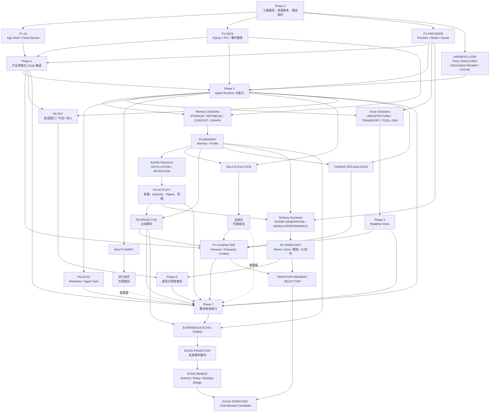

# CharaMate 实施路线图

> 状态：Phase 0–7 Done；“经历回响与跨设备陪伴”增量正在实现，Desktop Companion Bridge 已进入 Main 集成
> 日期：2026-09-01
> 权威来源：`REFACTOR_PRODUCT_DESIGN.md`、`CHARA_MATE_UI_DESIGN.md`、已接受的 `docs/benchmarks/<decision-id>.md`

本文件记录里程碑依赖、工作包边界和验收，不记录逐命令历史。Phase 编号表示产品集成与验收顺序，不要求所有开发工作全局串行；只有共享契约、Schema、IPC 和同一可变资源的写入必须串行。

## 固定工程基线

| 关注点 | 唯一生产选择 | 约束 |
| --- | --- | --- |
| 仓库与包 | 单 package、npm、精确 lockfile | 不建 monorepo，不维护第二套 package manager |
| 桌面与打包 | Electron + Electron Forge + Forge Vite Plugin | 只保留一个构建路径；Plugin 精确锁版本并先做 packaged smoke |
| 语言 | TypeScript strict、ESM | Main、Preload、Renderer 和共享契约统一使用 TypeScript |
| 代码质量 | ESLint flat config + typescript-eslint/React Hooks + Prettier | 唯一 lint/format 路径；不同时维护 Biome 配置 |
| Renderer | React、CSS Modules、CSS Custom Properties | Main 是业务状态真源；不引入第二套前端业务状态机 |
| UI 基础 | Radix Primitives、Lucide、TanStack Virtual | 不使用完整主题型 UI 框架；Voice 波形和产品专用图标自绘 SVG |
| 内容渲染 | `react-markdown`/remark/rehype、KaTeX、懒加载 Shiki/Mermaid | 源 Markdown 是复制真源；完成后确定性重渲染 |
| 像素渲染 | PixiJS | 桌宠与领地共享 sprite/animation 语义，不引入完整游戏引擎 |
| 契约 | TypeBox + Ajv、JSON Schema-first | Tool、IPC、事件和持久化边界复用同一 Schema 来源 |
| IPC | typed `contextBridge` API | 每个领域暴露窄方法；Renderer 不直接拿 `ipcRenderer` |
| 数据 | `better-sqlite3`、prepared SQL、领域 Repository | 不引入 ORM；journal、批量和向量布局仍由 Decision 决定 |
| Agent | CharaMate 自有事件驱动 Harness | 不引入 LangChain/LangGraph 类总框架；Provider SDK 仅留在 Adapter 内 |
| 外部协议 SDK | 官方 OpenAI JavaScript SDK、官方 MCP TypeScript SDK | 只在 Provider/MCP Adapter 边界使用，不拥有 Run、Tool 或 Approval 状态 |
| Browser | `playwright-core` + 产品管理的固定 Chromium | 与 Electron E2E 的 Playwright runner 职责分开 |
| Secrets | Electron async `safeStorage` + 统一 redaction | SQLite 只存引用；密钥不进入日志、Run、Memory 或错误 |
| Observability | Pino + typed events/metrics | 不预建外部监控平台，不把研发指标放进产品 UI |
| 测试 | Vitest、Testing Library、Playwright Electron E2E | 默认离线、确定性；Live 与 Benchmark 单独运行和报告 |

算法、模型、数据库参数、Voice Transport、并行度和保留阈值不属于这张固定栈表，必须经过对应 Decision。

## Phase DAG

## 交付波次

1. **Wave 0 — 串行入口（已完成）**：来源刷新、工具链兼容性、共享 Contract/Schema 所有权和测试命令基线。
2. **Wave 1 — Phase 1 并行（已完成）**：UI fixture、持久化/IPC、Provider/Secret 三条所有权不重叠的路径并行，随后由一个集成 owner 收口 Chats。
3. **Wave 2 — Phase 2 主干（已完成）**：后继 H2–H6、source-derived Discovery 与 Cache 的选择已重写为唯一 Agent Runtime、Tool/Approval、Local/Browser/Computer/MCP/Skills、可观测性和固定 Cache On 生产路径。H7 W2 Quality 300/300 valid；机械失败、产品 amendment 与专用 H7 Timing 100 的 scope closure 原样保留，不声称 timing Gate 通过。完整 offline、Electron E2E、build、package 和开发/打包 smoke 已通过。
4. **Wave 3 — 多支线并行**：Agent 主干稳定后，Memory 研究、Voice Contract/实验、Automation 基础、桌宠基础与 Multi-agent 实验可并行；Memory 的语义/检索/UI、基础自动形成与跨 Chat 精确更新均已完成，其他支线仍按独立所有权推进，候选代码只在隔离 worktree。
5. **Wave 4 — 长期理解与领地支线**：Memory 自动形成闭环与 Activity 完成后，主动聊天、Self-evolution 实验和 Territory 沙盒的设计/Decision 可按各自 Gate 与所有权边界推进；Territory 共享合同由单一 integration owner 串行冻结，World runtime、Renderer fixture 和 AI 生成研究随后按所有权拆分。
6. **Wave 5 — 全产品收口**：只集成已通过 Gate 的路径，运行完整离线、打包、E2E 和明确要求的 Live 检查。
7. **Wave 6 — Persona 与角色对话补全（已完成）**：`CHARACTER-DIALOGUE` 已选择并实现 A1；生产具有版本化 Persona、唯一 Character Context 及跨 Text/Voice/Automation/主动对话 snapshot。显式叙事与 NPC 行动留作后续独立问题。
8. **Wave 7 — 经历回响与跨设备陪伴（推进中）**：未来事件时机已完成最小选择，跨设备 v1 合同已冻结；当前仓库已由单一 owner 接入 Desktop Bridge 的 Main 配对、Relay mailbox、手机分享导入、Assistant Message 单表面投影、稳定 Android enqueue/recovery、Devices UI 与生命周期。下一步分别实现独立 Relay、Android Companion 和三部署单元联合验收，再让 Chat Moment 复用既有 Territory Candidate。任何阶段都不建立云端 Agent、第二 Chat 真源或固定拍立得/纪念品模板。

## Phase 0 — 工程基线与稳定契约

> 里程碑状态：Done（2026-08-01）；退出条件全部通过，最新证据见 `docs/progress/STATUS.md`。

### 目标

建立唯一可构建、可测试、可打包的 Electron 基线，以及所有后续领域共同依赖的最小稳定契约。

### 工作包

- `FND-TOOLCHAIN`：验证 Electron/Forge/Vite、React、`better-sqlite3` rebuild/ASAR、Playwright Electron、macOS package smoke；成功后精确锁定版本。
- `FND-CONTRACTS`：定义 Chat、Message、Run、RunItem、Approval、Provider snapshot、错误和 sequence envelope 的 TypeBox Schema 与 TypeScript 类型。
- `FND-IPC`：定义 typed Preload 请求/响应/订阅形状及 `afterSequence` 重放契约，不实现业务服务。
- `FND-CORRECTNESS`：统一 ID/clock/AbortSignal、artifact 引用、redaction 和测试 fixture 约定。
- `FND-QUALITY`：建立真实的 fast check、focused test、full offline、build/package、E2E 和 live/benchmark scripts，再把命令写回 `AGENTS.md`。

### 验收

- 开发窗口、Main/Preload/Renderer 构建、打包应用和 packaged smoke 均成功；
- `better-sqlite3` 在开发与打包应用中完成一次事务、关闭并重开读取；
- Renderer 只能通过窄 typed preload API 访问 Main；
- Contract 正反例、redaction、sequence 和取消语义有确定性测试；
- 没有业务空目录、ORM、通用 AI 框架、第二套构建路径或候选算法代码。

## Phase 1 — 产品骨架与 Chats

> 里程碑状态：Done（2026-08-01）；退出条件全部通过，最新证据见 `docs/progress/STATUS.md`。

### 依赖

Phase 0 完成。UI、Data/IPC、Provider 三个工作包可以并行；共享契约变更由唯一 integration owner 串行合入。

### 工作包

- `P1-APP-SHELL`：主窗口、融合窗口标题栏、侧栏、无重复 Page Header 的六个一级页面占位、窗口状态恢复。
- `P1-CHAT-DATA`：Chat/Message/Attachment/Run/RunItem 初始 Schema、领域 Repository、append-first 事件和重放。
- `P1-CHAT-SERVICE`：多会话创建、重命名、置顶、搜索、归档、恢复、删除、首次发送后落库、首条消息兜底/AI 摘要标题和同 Chat Turn 串行。
- `P1-CHAT-UI`：消息列表、空状态、用户/助手消息、附件、Composer 模式/模型/权限位置。
- `P1-CONTENT`：GFM、代码、KaTeX、表格、Mermaid、媒体/文件卡与各级复制；流式容错后确定性重渲染。
- `P1-RUN-PROJECTION`：运行中展开、完成折叠、Tool 二级详情、停止反馈、刷新和重启恢复。
- `P1-PROVIDER`：Provider Profile、模型发现/手填、连接测试、Model snapshot、async `safeStorage` 与 redaction；空库首次写入源码所有的 `copilot_api`/`azure` 非密钥元数据，已有库不覆盖。

### 验收

- Chat 模式不能执行外部效果 Tool，一键切 Agent 不丢输入；
- Composer、Markdown/LaTeX、复制、Run 折叠与 Approval fixture 满足 UI 验收；
- Main 先持久化再广播，Renderer 重载后按 sequence 恢复；
- Provider Key 不出现在 SQLite、日志、错误或 IPC fixture；
- 受影响的 L0/L1/L2、React component test、Electron Chats E2E 和 package smoke 通过。

## Phase 2 — Agent Runtime 与能力

> 里程碑状态：Done（2026-08-08）。Decision、单一生产实现与全部退出验收均已完成；专用 H7 Timing 100 仍按 owner scope closure 记为 waived，而非通过。

### 依赖与 Gate

- Phase 1 的 Run/Item、IPC、Provider 与持久化稳定；
- `HARNESS-LOOP`、`TOOL-DISCOVERY`、`PROVIDER-PROMPT-CACHE` 已更新中文 Decision Record，并记录设置校准、逐轮晋升/淘汰、机械结论、产品 amendment 与 Timing scope closure 的完整链路；生产组合已选定，专用 H7 Timing 100 不再是实现前 Gate；
- 后继 H2 使用新 detector、未曝光任务和仓库外可覆盖工作 Manifest；修订直接覆盖工作文件，每次计分记录实际 hash 与 lane map，不为每次修改复制版本或重跑无关阶段；不能把 HS0、T0、GD4 或 PC0-OFF 当 fallback；
- 后继所有选择实验遵守现实负载准入：小 fixture、单步任务、少量 Schema 或缩小 window 只作 smoke/AR1/规模校准，不能选择生产方案；D1 的 256/512 Tool 现实工作流与 512 极限压力保留为 Discovery 证据，1024 scored 层已经在首个计分请求前退休；H3 使用完整发现 inventory 与失败后续步骤；H4–H6 同时验证真实长上下文和目标 endpoint resolved-budget 高压层；Cache 重放最终请求形状；H7 在 256/512 Tool 与短/长/近预算 context 上做未曝光联合确认。所有阶段都分别保存业务终局、Tool/参数正确、误调/漏调、虚假完成、实际请求 shape 与 Provider usage，只有规模标签或合并“成功率”不算充分证据；
- 后续 live 阶段先通过已有 compatibility/preflight 或首轮 evidence barrier，再并行互不依赖的 cohort：同一 paired block 内 Arms 保持串行，quality 与 timing 使用隔离 namespace、固定 lane map 和相同的阶段前并发配置；H5→H6→Cache→H7 Quality 已完成，专用 H7 Timing 不再运行，性能转入生产单路径集成/E2E 与实际遥测；
- 主仓库没有候选 Harness/Discovery/Cache Arm、Adapter、Schema、依赖或实验模式；胜者已经按 CharaMate domain contract 重写为单一路径，失败候选不得回流生产。

### 工作包

- `P2-H2-DETECTOR-REDESIGN`：仓库外可覆盖 detector/任务/scorer，H2 selection/holdout 与后续 H3–H7/Discovery Gate；不进入生产路径。
- `P2-RUNTIME`：唯一循环、ContextCompiler 接口、steering、compaction、checkpoint、恢复与 Loop Guard。
- `P2-TOOLS`：JSON Schema Tool Registry、结构化结果、AbortSignal、artifact、deadline 和错误分类。
- `P2-APPROVAL`：三档权限、Chat/气泡共用 Approval Item、拒绝结果、过期与取消。
- `P2-LOCAL`：File、Command、App Tool 与子进程生命周期。
- `P2-BROWSER`：Managed Chromium Profile、Playwright DOM/AX 优先、上传下载和证据 artifact。
- `P2-COMPUTER`：App Action/CLI/API 优先，Accessibility 其次，视觉坐标兜底的 OS Adapter。
- `P2-EXTENSIONS`：MCP stdio/Streamable HTTP、Skills 渐进披露、重新发现与配置管理。
- `P2-OBSERVABILITY`：Run/Tool/Approval/Context trace 与 Dev Dashboard 第一版。

### 验收

- Direct、File、Command、Browser、Computer、MCP、Long Run、Steering、Recovery、Approval 和 No-op 旅程通过；
- 长任务不被固定全局步数、墙钟、Token 或成本静默截断；
- 审批前副作用、取消后副作用和虚假完成均为零；
- 进程中断后只恢复未完成边界，已完成副作用不重放；
- Phase 2 领域测试、相关 contract/IPC integration、Electron Agent E2E、full offline 和 build 通过。

完成证据见 `docs/progress/STATUS.md`：生产树只保留一个 Harness/Discovery/Cache 路径；开发版与 packaged app 均实际完成主窗口、桌宠、SQLite 和固定 Chromium round-trip。

## Phase 3 — 输入闭环、Memory 与 Activity

> 里程碑状态：Done（2026-08-09）。八项 Decision 与单一生产实现全部完成；`MEMORY-FORMATION` 已补齐跨 Chat 稳定身份、合法修订目标、冲突双活防护和重启恢复。

### 依赖与 Gate

- Phase 2 提供稳定 Agent、ContextCompiler 接口、Tool/Run evidence；
- `P3-STRUCTURED-INPUT` 与 `P3-MULTIMODAL-INPUT` 只依赖 Phase 1 Attachment/Composer 和 Phase 2 Run/Provider/Tool 契约，不受 Memory Decision 阻塞，可与 Memory 研究并行；
- `MEMORY-STORAGE`、`MEMORY-RETRIEVAL`、`CONTEXT-RECIPE`、`MEMORY-GRAPH` 依研究依赖完成；`MEMORY-FORMATION` 在 Agent Runtime 与上述 Memory 契约稳定后完成；
- `ACTIVITY-DISTILLATION`、`ACTIVITY-RETENTION` 在 Activity Digest/source 契约稳定后完成；后续产品修订把原来的跨日累计时长 proposal 收口为 Activity 独立检索与跨自然周稳定候选。

### 工作包

- `P3-STRUCTURED-INPUT`：实现直接、非 deferred 的宿主交互能力 `request_user_input`、持久化 `input_request` RunItem、选项/自由文本回答卡与同一 Run continuation；刷新或重启后仍可回答，回答只消费一次，不经过 Tool Search，也不伪装成 Approval。
- `P3-MULTIMODAL-INPUT`：建立一条 Main-owned 图片解码与 Provider 多模态输入路径；用户显式附加的图片直接进入模型输入，Agent 查看已知本地图片、截图或图片 artifact 时使用仅在模型与环境支持时直载的 `image.inspect`。两种入口复用媒体校验与尺寸处理；不按文件名假装看过图片，也不增加未验证的 OCR fallback。
- `P3-MEMORY-SEMANTICS`：Memory/Revision/Source、validity、supersede、pin、archive/delete 和 Profile 投影。
- `P3-MEMORY-RUNTIME`：唯一 Retrieval Pipeline、唯一 Context Recipe、获胜索引生命周期和 `memory.search`；模型只消费无内部 UUID、无逐条来源展开的紧凑 evidence，完整 provenance 留在 Memory 详情。
- `MAINT-MEMORY-PROFILE-RECALL`（已完成）：在不改变 R0 的前提下，把已绑定 profile/preference 作为有界稳定画像注入 Text/Voice Context；证据不足时允许当前模型一次结构化 `memory.search`；旧无字段记录由 Memory 详情显式绑定或合并，手动新建画像/偏好必须选择字段。
- `P3-MEMORY-FORMATION`：Chat/Agent 始终加载的唯一 `memory.record`，明确陈述直接形成/修订，推断与执行观察候选化；profile/preference 使用闭集稳定 claim slot，宿主从当前 Run 私有 allowlist 解析字段 owner，模型不接触 Memory/Revision ID；缺失目标、内部错 ID、冲突和旧数据首次绑定转候选或拒绝；Main 绑定来源并保证重复/恢复幂等。
- `P3-MEMORY-UI`：搜索、筛选、来源、Revision、画像、候选与领地入口；Graph 未晋级时没有入口。
- `P3-ACTIVITY-CAPTURE`：Active App、Managed Browser、Screenshot/OCR metadata、Idle 和 Agent Run 区分；macOS Active App 使用 `NSWorkspace`/Accessibility 事件通知，15 秒只采样进程内 idle 状态，不周期性启动 AppleScript。Activity 截图以逻辑像素获取一次 PNG并异步落盘，不阻塞 metadata event 队列。
- `P3-ACTIVITY-DISTILL`：确定性 Episode 边界与 Daily/Weekly Digest、evidence 和保留生命周期；不把跨日累计时长与全部 Episode 来源直接写成长期 Memory 候选。
- `MAINT-ACTIVITY-AGENT-RECALL`：增加 Activity-owned `activity.search` 紧凑事实检索；同一标签跨至少两个已完成自然周时，只用最近两个 Weekly Digest 形成可确认、可更新且不持续膨胀的 `activity_digest`，不推断偏好或用途。
- `P3-ACTIVITY-RETENTION`：获胜保留策略、文件/缩略图/OCR/索引/行一致清理、orphan sweep。
- `P3-BENCHMARK`：LongMemEval、LoCoMo 与冻结中文产品集的 Retrieval、Answer、Storage 和 Activity 记录。

### 验收

- 结构化问题可在 Chat/Agent 中显示、回答、重启恢复并继续原 Run；同一回答不重复注入，取消或自由文本路径明确；
- 用户图片附件及 Agent 已知的本地图片/artifact 都能让支持视觉输入的目标 Provider 读取真实像素内容；不支持的模型明确说明能力不可用，路径文字或缩略图不算语义读取成功；
- Memory 编辑产生 Revision，改口后旧事实不进入默认 Context，所有投影可追溯；
- Chat/Agent 的明确耐久陈述无需手动新建即可进入后续 Run Context；跨 Chat 改口在证据可辨识时沿同一 Memory ID 产生 Revision，错 ID、未命中、同字段冲突与同类字段歧义不制造第二条 active 事实；推断和执行观察只进入带原因/来源的待确认候选，重复调用与重启不重复写入；
- Text 与 Voice 都能在自然同义问法未命中 R0 时读取已绑定稳定画像；证据不足时只通过同一 R0 完成一次结构化再检索；旧无字段画像/偏好不被静默猜测绑定，用户确认合并后只有一个 active 字段 owner；
- 发布物只加载一个 Retrieval/Context/Graph 结果，失败候选模型、依赖、表和设置不存在；
- Activity 被压缩成少量 Episode/Digest，原始事件不进入普通长期检索；
- Text/Voice Agent 能按需检索不含内部 ID、窗口原文或逐条来源的 Activity 聚合；同一稳定行为候选拒绝后不重复、接受后不堆叠，旧累计时长 Memory 只经用户确认的替换 Revision 收口；
- 清理引用完整率达到 Decision 门槛，长期 Memory/Territory evidence 不随原始资产删除；
- 相关 contract、DB/integration、UI、benchmark regression、full offline、build 和受影响 E2E 通过。

## Phase 4 — Realtime Voice

> 里程碑状态：Done（2026-08-11）。按真人体验反馈切换为单一 Orchestrated Native Realtime 路径；离线、Live、E2E、package 与目标硬件人工验收均已完成，生产只保留本节描述的一条 Voice 路径。

### 依赖与 Gate

- Phase 2 的 Run、Tool、Approval、steering、generation 和 Provider Adapter 稳定；
- 目标 Azure deployment Contract Test 已刷新；
- `VOICE-ARCHITECTURE` 已透明修订为 Realtime 原生语音 Agent，`VOICE-TRANSPORT` 保持 WebRTC，`VOICE-TOOL-JOIN` 恢复为最小串行 continuation；旧 TTS/Shared Runtime 代码必须删除。

### 工作包

- `P4-VOICE-DRIVER`：唯一媒体 Transport、鉴权、VAD、音频采集/播放和断线重连。
- `P4-COORDINATOR`：完整输入转写创建正常 Voice Run；Realtime 原生生成音频、输出转写与 Function Call，应用显式驱动 response 并投影到同一 Chat/Run/Item。
- `P4-VOICE-TOOLS`：Session 获得同一 Tool Registry 的权限过滤快照；Realtime Function Call 沿既有校验/Approval/executor 执行，`function_call_output` 回注后继续同一 generation。
- `P4-VOICE-DATA`：VoiceSession/Turn、实际播放边界、interrupted 标记与 Chat 草稿原子完成。
- `P4-VOICE-UI`：Voice Dock、波形、连接/聆听/工具/批准/说话状态、静音和结束。
- `P4-VOICE-ENTRY`：Composer 继承当前模式/权限，桌宠声波入口创建 Agent 完全访问，新建 Chat 先结束活动 Voice；Approval 使用同一 Item 的桌宠气泡投影。
- `P4-VOICE-HARNESS`：文字 Chat/Agent 使用 CharaMate Harness，Voice 使用 Realtime Agent；两者共用核心 instructions、Skill/Memory/Chat Context、Tool Registry、入口权限、Approval、Run/Item 与标题链路。Azure Realtime 没有 Responses 托管 `web_search`，不伪造本地 Tool。
- `P4-VOICE-LANGUAGE`：多语言转写不固定语言，普通话落为简体，英文与混合语言保持原语言，输出音频跟随当前语言。
- `P4-VOICE-SETTINGS`：音色试听、Persona 默认音色和 Realtime instructions。
- `P4-VOICE-CONNECTION-LIFECYCLE`：Voice Dock 暂停/恢复与结束分离；健康连接按稳定身份复用并刷新 instructions/tools，不兼容或断线时冷重连；麦克风与临时凭据并行初始化，开发看板记录五段建连耗时。
- `P4-VOICE-ENTRY-HANGUP`：一个活动 Session 固定归属一个 Voice Chat；桌宠共享暂停/恢复控制，主窗口浏览或隐藏不迁移连接；Realtime Agent 以 Session 专属 `voice.end` Tool 在简短告别音频排空后主动挂断。
- `P4-VOICE-WAKE`：默认关闭的本地固定短语 `Hi Mika` 由 Character Renderer 的 AudioWorklet/Web Worker 匹配；命中前不建立 Provider Session，命中后复用桌宠 `Agent + 完全访问` quick-start 与唯一麦克风租约，不打开主窗口、不复制 Voice Runtime；Realtime 真正就绪后由 Mika 通过 out-of-band response 主动给出连接欢迎语。

### 验收

- 真实 endpoint、麦克风和扬声器满足预注册首音频、打断和一致性门槛；
- 任一时刻只有一个 audible response，旧 generation 注入和重复副作用为零；
- Realtime 输出转写增量立即留在同一 Chat，音频由同一 response 连续播放，不等待文字 Run 完成，也不拆句做 TTS；
- 实际听到的自然语言、同一 response 的输出转写、Tool Item 和重启历史一致；文字 Agent 不参与 Voice 回答；
- Voice 标题按“语音对话 → 首条转写兜底 → 既有 AI 摘要”更新，未复制标题服务；
- Composer 与桌宠入口权限明确，新建 Chat 能结束活动 Voice；桌宠 hover 后显示深色圆形声波图标，移开自动隐藏且点击不唤起主窗口；Chat 与 Agent 都有计划和幂等查询能力，简单查询不被强制计划化；
- Voice 获得与入口相同的客户端 Tools 和权限；仓库不存在本地 `web.search`、Voice Tool 副本、TTS 或第二条回答 fallback；
- 普通话、英文和混合语言的真实 Azure 输入转写与原生发声通过，且生产无翻译/繁简正则修补；
- 暂停立即停止采集和播放但保留健康 PeerConnection/DataChannel，恢复同身份会话不重新申请凭据或协商 SDP；配置不兼容与断线走冷重连，End 始终释放全部媒体资源；
- 冷启动并行申请麦克风和临时凭据，开发看板分别报告 credential、microphone、ICE、SDP 与 DataChannel 的真实观测耗时；
- 选择 Chat B、关闭主窗口和桌宠声波点击都不改变 Chat A 的 Voice 归属：活动时桌宠点击暂停、暂停时恢复原连接；显式 End 后下一次桌宠入口创建新 Voice Chat；
- `voice.end` 仅在 Voice Session 中可见，无审批且只接受当前 Voice Run；模型明确告别后继续一次简短 response，WebRTC 输出缓冲排空才关闭，普通文字 Agent 不发现该 Tool；
- `Hi Mika` 唤醒默认关闭且只在本机处理待机音频；Settings 与 Tray 共用一个开关，活动 Voice、锁屏和休眠停止 KWS，恢复后按持久设置重新布防；ready cue 区分本地命中，Realtime ready 后立即进入回应并由 Mika 的极短欢迎语确认连接；欢迎语不进入默认 conversation 且不创建 Run，10 秒无真实用户输入窗口只从欢迎语完整停止后开始；
- 桌宠上的 Voice 连接失败提示可显式关闭；关闭只清 Renderer 展示态，不改变真实 Session、持久错误记录或 `wake_enabled`，下一次尝试仍展示新的真实结果；
- production build、Electron E2E 与 packaged smoke 能加载同一固定哈希的 Worker/WASM/INT8 模型和许可证；仓库无候选模型开关、云端 wake fallback、同一口气 pre-roll 或第二套 Voice/Tool/Approval 状态机；
- mock 测试只证明状态机，不代替 Live 体验结论；离线与 Live 结果分开报告。

## Phase 5 — Automations、主动聊天与可选成长能力

### 依赖与 Gate

- Reminder/Agent Task 只依赖 Phase 2；
- 主动聊天依赖 Phase 3 的 Digest/Memory；
- `P5-AUTOMATIONS-CONTRACT` 串行冻结共享 Schema、IPC、DB 与完成事件；Main Core 和冻结 fixture UI 在其后并行；
- `MULTI-AGENT` 已完成并选择无用户开关的 Agent 按需只读协作；`SELF-EVOLUTION` 已由 Decision 选择“触发式异步 Review + 用户确认 + Skill replay”并完成唯一生产实现。

### 工作包

- `P5-AUTOMATIONS-CONTRACT`（已完成）：一次/每天/每周/POSIX 五段 Cron 与显式时区、Reminder/Agent Task 定义、revision/运行快照、`automation.run.finished`、typed IPC/Preload、`automations`/`automation_runs` Schema 和迁移；不实现调度器、Repository/Service 或页面。
- `P5-AUTOMATIONS-CORE`（已完成）：来源复核后实现唯一 schedule 计算与休眠恢复策略、Repository/Service、Reminder 投递记录、Agent Task 普通 Chat Run、暂停/编辑/试跑、历史、事件发布和 Main IPC 注册。
- `P5-AUTOMATIONS-UI`（已完成）：使用冻结 fixture 实现卡片、单页表单、暂停/编辑/试跑、历史及 Agent Task Chat Run 跳转；最终只消费 typed Preload API。
- `P5-PROACTIVE`：安静时段、主动程度、触发来源、普通 Chat 持久化和气泡投影。
- `P5-COMPANIONSHIP-MVP`：在 Chats 与 Agent 内部实现 Journey/Together Session 两级时间尺度、唯一活跃共处、系统 Home Chat 路由、稀疏节点和续接记录；Activity 只发布当前活动事实，陪伴 Agent 语义判断保持沉默、发起全新话题或回到既有 Journey，并经统一 Run 先写真实助手消息再投影气泡。全新话题先进入不出现在 Chats 的 provisional Chat，20 秒内首个文字/语音回复后原地转正，超时、关闭或崩溃恢复时级联清理；已有 Chat 的续接不自动删除。用户可不打开主窗口，在气泡内连续短文字往返；气泡始终绑定发起时的精确 Chat，复用普通 Chat-mode Run，并只把附件、完整历史、富内容、结构化输入、审批和复杂执行交给转正后的完整 Chat。用户接住对话且 Agent 实际参与后才在内部建立共处，长期性明确且用户确认自然承诺后才创建 Journey。正常界面只保留普通 Chat 列表和一条不带状态动作的当前在场提示；开始、切换、暂停、续接、完成与范围纠正均由 Agent 从日常表达语义判断，不向用户暴露 Journey/Session/Home Chat 或状态名。一次明确跟进复用 Automation，显著记忆复用 Memory；不新增显式创建按钮、详情抽屉、一级页面、第三种 Composer 模式、任务看板、气泡专属历史或第二套 Runtime。
- `P5-MULTI-AGENT`（已完成）：Agent 自主调用 `collaboration.dispatch`，宿主校验两个 child 的只读性、当前 Tool scope、互斥资源和可变会话禁用，再并发执行确切读取与独立分析；父 Run 等待并合并，统一 Subtask Item 承载状态/证据/Token，取消与恢复复用既有边界；没有 Composer/Settings 开关、候选 Arm 或额外表/依赖。
- `P5-EVOLUTION`（已完成）：Run 完成事件只在明确纠正、明确教学、客观验证成功或重复流程时持久化异步 Review；单次无 Tool 结构化调用生成四类候选，全部经用户确认，Skill 再经 replay 后激活；patch 使用内部目标 revision/hash 防止覆盖后续手动编辑，Settings/Agent Skill 变更会同步候选状态；候选生效后只由普通 Skill 管理器负责 pin、归档和恢复，崩溃恢复和 typed IPC/UI 已进入单一生产路径。
- `MAINT-EVOLUTION-VOICE-REVIEW`（已完成）：修正 Voice Run 错把 Realtime deployment 用作 Structured Outputs Reviewer 的协议错误；无兼容 Chat Model 时 skipped，失败 Review 可关闭，Memory 候选进入有界区域，并以真实桌面几何回归保护搜索栏与列表/详情布局。
- `MAINT-PROACTIVE-ACTIVITY-EVIDENCE`（已完成）：把 macOS 前台应用/窗口观察收敛为 Electron Main 进程内原生模块，移除独立 helper 身份；主动陪伴在没有窗口标题时不请求 Provider，并删除气泡之外的重复等待态。
- `MAINT-PROACTIVE-FREQUENCY`（已完成）：每条主动消息被唯一即时表面接受后执行 5 分钟全局冷却；桌面以气泡真实展示为接受，Android 只以稳定投影选择为接受，不伪造系统展示或交互结果。持久化最近 3 次观察依据、实际话术和回应结果，冷却结束后由 Agent 做语义重复判断，不增加标题关键词、字符串相似度或无限历史。
- `P5-SKILL-DELETE`（已完成）：Settings 对当前或已归档用户 Skill 提供二次确认的永久删除；当前 Skill 在删除事务内部先归档，Extension 再删除目录和全部内部 revision，Evolution 只保留来源证据并解除目标绑定，普通 UI 不提供第二条恢复路径，workspace Skill 拒绝删除；不新增表、后台清理任务或候选状态。

### 验收

- `P5-AUTOMATIONS-CONTRACT` 的四种 Schedule、revision/定义快照、运行生命周期、完成事件、typed IPC/Preload 与 v8→v9 迁移分别通过确定性 contract、IPC 和 SQLite 回归；契约闸门不注册无 Service 的 Main handler，也不夹带调度器或页面占位实现；
- Core 对 UTC/每天/每周/Cron、DST gap/fold、DOM/DOW、无效扩展、休眠合并与 occurrence 幂等有确定性回归；timer 只负责唤醒，数据库 projection 与 claim 是真源；
- 创建、暂停、编辑、立即运行、历史、完成事件和跨 Electron 重启通过真实 typed desktop boundary；Agent Task 复用普通持久化 Chat/Run 及既有 Model、Tool、Approval、取消和失败路径；
- Automation 的 Tool、审批、取消、结果和失败与手动 Run 完全同构；
- 内部 Journey/Session 在多条长期经历、多次共同活动、切换和重启后仍保持全局唯一活跃态、准确 Home Chat 与续接点；自然语言歧义只询问具体事情，不让用户选择 Chat 或内部对象；
- Activity 观察不会直接创建 Session/Journey；Agent 对证据不足或歧义观察保持沉默，合适时通过普通 Chat Run 发起对话，匹配既有 Journey 时自动路由到其 Home Chat，关闭气泡不会追问；
- macOS Settings 展示的辅助功能授权进程与实际读取窗口标题的进程一致；没有非空标题时不产生陪伴 Provider 请求；主动消息被唯一即时表面接受后的 5 分钟内不再次请求语义门，冷却结束后只向 Agent 提供最近 3 次主动记录并由其判断是否语义重复；桌面气泡要求真实展示，Android 投影不伪造操作系统展示；
- 全新话题气泡在首个回复前不进入最近、搜索或归档列表，也不提供“打开完整 Chat”；20 秒无回复、主动关闭或异常重启后临时 Chat/Run/消息被清理，首个文字或气泡语音回复原子转正同一个 Chat。已有 Chat 的气泡可在主窗口关闭时完成至少两轮连续短文字往返；每轮用户消息、助手回答和 Run 都出现在发起时绑定的同一 Chat，回复期间不会被新主动开场替换，关闭气泡不删除已正式建立的 Chat 或 Run，“打开完整 Chat”准确进入该 Chat；
- 当前在场提示跨六页可见但不含计时、所属长期经历或状态按钮；Chats 只有普通最近/已归档列表，不出现“同行中 / 待续共处 / 同行回望”、详情抽屉或 Journey/Session/Home Chat 名词；通过普通对话完成开始、切换、暂停、结束、完成、重开、一次跟进、范围纠正和可见 Memory 旅程；
- 后台 Approval 不被伪装为成功，气泡始终跳转同一 Chat Item；
- Self-evolution 的同 Run 幂等、Review 重启恢复、证据绑定、确认前不落库、Skill replay 失败可编辑重试、过期 patch 防护与真实 typed desktop journey 通过确定性回归；Skills Settings 不暴露历史版本或候选历史；
- 当前与已归档用户 Skill 的永久删除通过 service、SQLite、typed IPC/Preload 和 Settings 组件回归；删除后旧成长记录只保留来源证据，不会调用不存在的 Skill，也不在普通 UI 提供恢复或重建入口；
- 未晋级能力的表、协议、组件、设置、依赖和空入口不存在；
- 能力的机械 Gate、任何 owner amendment、成功率、冲突、Token、复杂度与不能声称的范围均透明保存在对应中文 Decision Record；生产只保留最终单路径。

## Phase 6 — 桌宠与领地

> 里程碑状态：Done（2026-08-13）。空间粒度、统一 2.5D 深度、高密度起始房、类型化生成物与探索态左右键交互均已通过最终离线、E2E、打包、Live 与实机视觉验收。

### 依赖

- 桌宠基础窗口和 Pet 导入可在 Phase 1 后并行开发；状态与审批投影依赖 Phase 2；
- Memory 物件依赖 Phase 3，Activity 趋势候选依赖 Activity；二者只向 Territory 提供来源快照，不拥有 World 表；
- Image Generation/Edit 共用一套 deployment 配置，依赖 Provider Adapter 和真实 Azure Contract Test；
- `P6-TERRITORY-SANDBOX-DESIGN` 已冻结可扩建 World/Zone 与多层组合的产品/UI 方向，旧固定场景原型不再是生产路径；
- `TERRITORY-SCENE-GENERATION` 已选择结构化 compiler + 每个实际 Definition 一张视觉 + 原子 Asset Pack；`TERRITORY-WORLD-PERFORMANCE` 已选择活动 Zone + 直接 scene tree + Pixi Assets cache。两项都不产生普通用户设置或并行 runtime 模式。

### 工作包

- `P6-PET-WINDOW`（已完成）：透明常驻窗口、自由拖动、多显示器、位置/尺寸/朝向恢复、托盘和 earcon。
- `P6-PET-RUNTIME`（已完成）：PixiJS sprite runtime、CompanionState 动画、气泡和 Voice envelope 联动。
- `P6-PET-IMPORT`（已完成）：Codex v1/v2 校验、复制安装、自有目录和缺失 look row 降级；发布包内置 Columbinya v2 与 Linnea v1，首次启动沿同一路径幂等复制且不覆盖同 ID 用户资产。
- `P6-TERRITORY-SANDBOX-DESIGN`（已完成）：产品 §10、UI §11.1、Phase DAG 与 Decision 状态已改为固定视角但可扩建的单一 2.5D Territory World、相连 Zone、多层组合、游览/布置、AI Preview、完整物件生命周期和无全局物件数量上限。
- `P6-TERRITORY-WORLD-CONTRACT`（已完成）：World/Zone/World Revision、Style Profile/Asset Pack、Entity Definition/Instance、组合/锚点、来源、Change Candidate、删除恢复、typed IPC/Preload 与数据库 Schema 已冻结；旧 scene/capacity 合同、Adapter 和行为回归已删除。
- `P6-TERRITORY-WORLD-RUNTIME`（已完成）：Main Repository/Service 与 PixiJS runtime 实现 terrain/underlay/structure/object/attachment/foreground/effect 七层、镜头、活动 Zone 直接树投影、寻路、碰撞、遮挡、组合、Revision 提交和恢复；桌宠只消费同一个 World projection。
- `P6-TERRITORY-BUILD-UI`（已完成）：游览/布置工作区、收藏与搜索、直接放置与拖动、多选、移动/复制、组合/拆分、锁定、删除/恢复、Undo/Redo、检查器和可访问控制只消费 typed Preload；探索态右键移动到 24 px 原子落点，左键选择/互动，underlay 可同时踩踏与点击。
- `P6-TERRITORY-AI-CREATION`（已完成）：统一 Image Adapter 与 Territory compiler 可生成/编辑单物件、选区、完整 Zone、扩建和 Style Profile；所有结果进入同一种 Preview/change set，确认前不改当前 World。
- `P6-TERRITORY-MEMORY-LIVING`（已完成）：Memory/Activity 来源、稳定记忆物件身份和版本已接入新 Entity 合同；时间/季节氛围、类型化物件能力、桌宠上下文行为和可跳过的记忆形成演出完成，不增加经济或养成数值。
- `P6-TERRITORY-SPATIAL-DEPTH`（已完成）：以 24 px 整数原子单位承载细粒度家具、碰撞和寻路，以 48 px 宏格承载地形/结构；Definition 显式声明 depth mode，桌宠、家具、可遮挡结构及其附件使用共享脚底 Y 排序，背景与前景保持确定层级。
- `P6-TERRITORY-RICH-ROOM`（已完成）：随包起始蓝图为 48 × 30 原子格、403 个 Zone 实例的可平移高密度生活房，包含多个用途角落、附件、使用痕迹、灯光/前景与可重复验证的前后遮挡样例；所有内容仍是普通可编辑 Definition/Instance/Group。

### 包边界与验证

- `P6-TERRITORY-SANDBOX-DESIGN` 只修改产品/UI/研究/进度 Markdown；以格式检查、链接/Decision 引用审计、旧假设搜索和人工阅读作为验证，不运行或改变生产数据。
- `P6-TERRITORY-WORLD-CONTRACT` 是 shared Schema、typed IPC/Preload 和 Territory 数据边界的唯一 integration owner。它必须提供 World/change 正反例 contract test、Repository 原子 Revision/冲突/删除恢复 integration test，并删除旧 scene/capacity Schema、常量、fixture 和回归；Memory、Activity、Provider 与 Pet 只消费冻结合同，不并行编辑这些文件。
- `P6-TERRITORY-WORLD-RUNTIME` 拥有纯几何/组合/寻路 focused test、活动 Zone projection 与 asset 生命周期 integration test，以及镜头、遮挡、视口离开/返回和重启恢复的 Electron E2E。`TERRITORY-WORLD-PERFORMANCE` 的 runner、失败策略、截图和原始结果已删除或按 hash 记录，只保留胜者产品回归。
- `P6-TERRITORY-BUILD-UI` 只使用冻结 fixture 开发 React 工作区，覆盖工具状态、Undo/Redo、检查器、组合、删除恢复、AI Preview diff、键盘与 reduced motion 的 component test；真实 Main 接入和跨重启旅程由 Territory integration owner 完成。
- `P6-TERRITORY-AI-CREATION` 的确定性测试注入 Image/Compiler adapter，覆盖锁定内容、base Revision 冲突、取消、失败、重试、Asset Pack 原子安装与回滚；真实 GPT Image 只进入显式 live/benchmark。`TERRITORY-SCENE-GENERATION` 的失败 Arms、prompt/processor、临时依赖、素材和设置在胜者重写前全部删除。
- `P6-TERRITORY-MEMORY-LIVING` 覆盖 Memory/Activity 来源幂等、上游删除后快照保留、Definition Revision、桌宠能力与环境投影；用户可见 E2E 从 Memory 形成物件、放入组合、编辑版本、删除/恢复并重启，确认不会反写或删除 Memory。
- `MAINT-TERRITORY-NARRATIVE`：把名称/诗意故事与视觉 prompt 分离；补全随包和仍为系统首版描述的既有 Definition，并保证未来 Agent/Tool/UI 生成都得到 1–2 句可展示、忠于来源且无内部元数据的描述。
- 整个 Phase 6 的非目标是第一人称/3D 体素、物理引擎、挖矿/锻造/战斗、经济/收益、关系等级、无限开放世界、任意生成脚本和用户可调渲染/生成参数。

### 验收

- 桌宠跨重启与显示器变化保持可见和位置语义，v1/v2 动画正确；
- Approval 气泡、Voice 状态和 Chat Run 使用同一真源；
- 首次领地无需等待生图即可完整显示，起始地形、结构、背景和物件均可编辑、删除和恢复；
- 用户可以扩建相连 Zone，并用地形、结构、家具、附件、组合和效果形成明显不同但风格统一的结果；
- 角色、地形、结构、物件和多层附件按同一个结构化 World contract 确定碰撞、遮挡、承载与寻路，父子变换、视口离开和重启不破坏关系；
- 大 Zone 默认以接近素材原生比例显示局部，布置时可见原子格与宏格；起始房在默认视口和继续平移后都保持高密度、连贯且可编辑；
- 探索态右键只负责移动、左键只负责选择/查看且绝不触发寻路；右键点击地毯等 underlay 能走到该原子落点，左键点击同一物件仍能查看故事且不产生不可达错误，连续右键从桌宠当前渲染位置平滑改道，画布不弹出系统菜单；
- 桌宠与物件按共享脚底 Y 深度在前后两侧产生相反遮挡顺序，并绕过 collision cells；不能使用角色固定高层伪装 2.5D；
- 物件名称/故事、外观、版本、结构、收藏、组合、删除和恢复形成完整生命周期；删除 Territory 内容不删除 Memory/Activity 来源；
- AI 可经统一 Run/Tool/Approval 与 Preview 生成单物件、套装、选区和扩建候选；锁定内容不变，失败或取消不损坏当前 World Revision；
- 不存在固定场景、全局物件数量常量、超限自动收回、旧 Territory Adapter、双 Renderer、生成算法设置或经典模式；
- 目标窗口和硬件上的真实大型组合世界通过 `TERRITORY-WORLD-PERFORMANCE` 获胜路径滚动、缩放、活动 Zone 重建、恢复和 packaged E2E，视口外内容不丢失。

## Phase 7 — 整体体验收口

> 里程碑状态：Done（2026-08-31）。Persona + Character Dialogue 缺口于 2026-08-27 重新打开，并在 A1 真实 Pilot、唯一生产实现、完整 offline/build/E2E 与 packaged smoke 通过后关闭；2026-08-14 的其他收口项保持原有绿色基线。

### 工作包

- `P7-CHARACTER-DIALOGUE-DECISION`（`done`）：当前 `main@5be8e28` 的 12 case 真实 Pilot 完成；A1 相对 A0/A2 的角色表现更稳，A2 的单次状态写入应归 Memory，Decision Record 已形成。
- `P7-PERSONA-CONTRACT`（`done`）：Persona/Revision/Run/Automation/Voice snapshot 的 TypeBox Schema、Main repository/service、数据库边界和 typed IPC/Preload 已由单一 integration owner 完成；没有第二人格存储或模型专用分支。
- `P7-PERSONA-UI`（`done`）：Settings → Character、侧栏当前 Persona、预设复制/编辑、默认音色与切换语义已完成。普通 UI 不显示实验字段、关系分数或动态状态。
- `P7-CHARACTER-CONTEXT`（`done`）：A1 Persona revision 已接入同一 Text/Voice/Automation/主动对话上下文；非唤醒场景不再使用固定 Mika 临时接线。
- `P7-CHARACTER-STATE`（`not-applicable`）：A2 未晋级；生产不创建 Character State 表、Tool、设置或测试分支。
- `P7-CHARACTER-ACCEPTANCE`（`done`）：角色/开放域 Pilot、跨入口一致性、长 Chat summary/重启、Tool/Approval/任务终局回归、full offline、build、Electron E2E 和 package smoke 已通过。
- `P7-CONTENT-HIERARCHY`：移除主内容重复 Page Header；Chats 会话动作归左侧会话项，Automations 创建入口归页面列表页头，窄屏侧栏入口不占布局高度。
- 六个一级页面、Character Window、Tray、Managed Browser 和 Dev Dashboard 的完整旅程；
- 多会话并发、崩溃恢复、取消、审批、资源引用、获胜存储/索引和 asset 长时观察；
- Provider 自动发现与手填、Chat/Realtime/Image、MCP、Computer Use 和生图 Live 验证；
- 浅/深主题、响应式、减少动态效果、键盘与可读性验收；
- 首次体验、Persona、文案、错误恢复、展示脚本、签名/notarization 和安装包；
- 单路径审计：无失败 Arm、兼容 flag、候选 Adapter、临时 Schema、未使用依赖或隐藏设置。

### 退出条件

- `docs/benchmarks/character-dialogue.md` 已形成，明确来源、真实 Pilot、复杂度、胜者和限制；Mock 不被当作模型质量。
- 用户可以使用版本化 Persona；每个 Run、Automation 和 Voice Session 冻结实际 revision，切换只影响新回答，历史不被改写。
- Text、Voice、主动气泡、Journey 和长 Chat summary 共享一个 Character Context；不存在 A0/A1/A2 开关、第二 Runtime、角色专用 Memory 或隐藏兼容分支。
- 生产没有 Character State 表、Tool、设置或隐藏分支；用户事实、共同活动和 Territory 继续由各自现有真源拥有。
- 角色一致性、知识边界、开放域自然度与人类偏好证据，和 Tool/Approval/任务终局、Token/延迟/复杂度一起报告并满足最终 Decision。
- 产品设计的所有必测旅程和完成定义满足；
- full offline、build/package、受影响 Electron E2E 全绿；
- Live/Benchmark 按功能明确运行并单独报告，未运行项有原因；
- 文档、共享契约、Schema、Decision Record 和实际产品路径一致。

## 后续产品增量 — 经历回响与跨设备陪伴

> 当前状态：`implementing`。`EXPERIENCE-ECHO-TIMING` 已按用户要求以最小验证选择固定提前 30 分钟的一次性机会；第一个父工作包和 `ECHO-MOBILE-CONTRACT` 已完成。当前仓库 Desktop Bridge 已推进到 Schema v23，并在 Main 接入真实配对 handler/Relay HTTP client、mailbox 串行消费与 ack、受管附件导入同一 Agent Runtime 的 User Message/Attachment 与 Run/Item、已完成 Assistant Message 的稳定 Android enqueue/recovery、桌面/手机唯一表面选择、黏性协议状态、typed IPC、Devices UI 及启动/休眠恢复/取消配对生命周期。独立 Relay 服务、Android app、手机只读消息详情和三部署单元联合验收仍未实现。Desktop 数据库/IPC 只由 Bridge owner 实现，Android Companion 与 Relay 属于独立仓库/部署单元，不把当前桌面单 package 改造成 monorepo。Territory 后续继续复用现有 Candidate/生成能力自主决定生成物，不增加固定拍立得模板。

### 1. `ECHO-PROACTIVE-OPPORTUNITY`

- **状态**：`done`（2026-09-01）。Schema v20、Memory 明确时间、类别许可、持久机会、启动/恢复重查、取消/恢复、同一 Chat Run 与气泡投影均已完成并通过完整离线层、build 和 25/25 Electron E2E。
- **Outcome / authority**：落实产品设计 §4.9、§6.3、§9.2 与 UI §4.4。用户一次允许“重要时刻主动联系我”后，明确未来 `event/commitment` 可以形成一个持久、可取消、到点仍会重判的机会；消息继续由同一 Persona、Chat Run 和 P2 主动策略产生。
- **Scope / owner**：`main` 是 Memory/Settings/Journey shared contract、Schema/migration 和集成 owner；范围包含 `occursAt/timeZone`、许可状态、`ProactiveOpportunity` repository/service、启动/恢复重查、同一语义门、单一消息投影结果合同和 Settings 最小开关。
- **Dependencies / Gate**：依赖既有 Memory Formation、Chat Context、Automation 已验证的“数据库 claim 是真源、timer 只唤醒”语义、P2 Policy 和 Journey/Home Chat；`EXPERIENCE-ECHO-TIMING` 已完成并写入中文 Decision Record。
- **Non-goals**：不从模糊日期或纯模型推断创建机会，不预写通知，不承诺精确到秒，不增加日历 recurrence、事件管理页、长期外呼状态机、云端 Agent 或新的主动频率策略。
- **Acceptance / tests**：fake clock 覆盖形成、改期、取消、删除、关闭许可、许可重新开启或 Memory 恢复时仍在未来的同 Revision 重开、到点静默/发送、休眠恢复和重复 claim；每个有效 Revision 至多一个开放机会，旧机会不发送；消息先写唯一 Chat/Run，再交付一个表面；运行 shared contract、DB/integration、Settings component、focused、full offline、build 和受影响 Electron E2E。
- **Candidate deletion**：Decision 的失败 timing Arm、窗口参数、runner、临时字段和设置全部删除；生产只保留一个机会创建器，不把 Arm 变成运行时模式。

### 2. `ECHO-MOBILE-COMPANION`

- **状态**：`implementing`。`ECHO-MOBILE-CONTRACT` 已于 2026-09-01 冻结 `protocolVersion = 1` 的 pairing/device、分方向 opaque cursor mailbox、稳定 submission、单素材 upload request/receipt、completed Assistant notification、最近 Chat 目标和 ack Schema；正反例同时通过 Ajv codegen 与无 codegen validator。`ECHO-DESKTOP-BRIDGE` 已在 Main 接入配对、Relay mailbox 串行消费/ack、手机分享导入同一 Run/Item、稳定 Android mailbox enqueue/recovery、Assistant Message 单表面投影、黏性协议状态、Devices UI 和应用生命周期；稳定 submission 会在 Provider 晚失败后恢复既有 User Message/Attachment，持久前序游标阻止重试回退 mailbox 水位。当前离线证据覆盖 domain unit、SQLite share-ingress/projection integration、Settings component 与无配对 Main IPC smoke；paired Relay、电源恢复、解绑和关闭联合链路留待 `ECHO-MOBILE-ACCEPTANCE`。独立 `ECHO-MAILBOX-PUSH-RELAY`、`ECHO-ANDROID-COMPANION`、手机只读消息详情与三部署单元联合验收尚未实现。
- **Outcome / authority**：落实产品设计 §5.2、§9.2.1 与 UI §4.4/§5.6/§11.5。Android 能收到同一 Assistant Message 的普通通知，并把单个图片或受支持文档及附文送入用户确认的 Chat；Desktop 仍是唯一 Agent/Memory/Run/Territory 真源。
- **Scope / ownership**：父包依次包含 `ECHO-MOBILE-CONTRACT`（当前仓库 integration owner 冻结 pairing、device、Mailbox Envelope、upload、notification、cursor/ack v1 Schema）、`ECHO-MAILBOX-PUSH-RELAY`（独立 Relay）、`ECHO-ANDROID-COMPANION`（独立 Android）、`ECHO-DESKTOP-BRIDGE`（当前仓库 `src/main/companion/`）与 `ECHO-MOBILE-ACCEPTANCE`（三部署单元联合验收）。Contract 完成后 Relay/Android 可并行；Desktop Bridge 在冻结合同上实现。
- **Dependencies**：依赖前一父包的单一消息投影结果合同、现有 Chat/Attachment/Run/Persona，以及 Android/FCM 2026-09-01 来源快照。跨设备附件统一复制到 CharaMate 管理资产，手机临时 URI、PC 绝对路径和 Relay URL 不成为持久真源。
- **Non-goals**：不做完整移动 Chat、移动桌宠、Voice、移动端 Agent/Memory/Provider、全量 Chat 同步、多设备矩阵、大文件传输、Office 全格式解析或 PC 离线云端推理。通知只打开精确消息的只读轻量详情，不在手机继续多轮 Run。MVP 支持单图片、附文、UTF-8 文本/Markdown 与 PDF；其他格式只作为未解析文件，不声称理解。
- **PC-online boundary**：PC 唤醒、Main 运行且在线时可以重新判断事件、分析附件并回复；PC 睡眠/离线时 Relay 只排队上传或投递此前已生成消息。Android/FCM 延迟不承诺准确到秒。最近动作来自 Android 时回复 Android；否则 Desktop 活跃用气泡，Desktop idle/锁屏且 Android 可用时投递手机，任何消息不双发。
- **Acceptance / tests**：Android 13+ 权限流程、通知深链 `chatId/messageId`、`ACTION_SEND` 临时 URI 私有缓存、WorkManager 断网恢复、Relay 幂等/cursor/ack、Desktop 重启恢复、相同 User/Assistant Message 不重复；分别报告 desktop offline regression、Relay contract/integration、Android unit/instrumentation 和经用户授权后的真实 FCM smoke。
- **Candidate deletion**：开发 fake 只进入测试；如果比较传输实现，失败 adapter、临时协议版本和部署脚本在 v1 冻结后删除，不在客户端保留 fallback。

### 3. `ECHO-TERRITORY-MOMENT`

- **Outcome / authority**：落实产品设计 §4.9、§10.4/§10.6/§10.8 与 UI §11.1。获得领地惊喜许可后，少量显著 Chat Moment 可以稀疏准备现有 `TerritoryChangeCandidate`；Territory 自主决定生成什么，用户应用前不改变 World。
- **Scope / owner**：当前仓库 Territory integration owner 串行扩展 `chat_moment` 来源快照、宿主绑定的 `momentKey`、Run/Message/Attachment/Memory provenance、候选幂等、“换一种表达 / 放进领地 / 这次不要”和桌宠待查看提示；复用现有 Image Adapter、compiler、Preview、Asset Pack 与 World Revision。
- **Dependencies / Gate**：依赖跨设备 Attachment ingress 和既有 Territory 生成路径；`TERRITORY-MOMENT-SELECTION` 先决定唯一选择位置。共享 Territory Source Schema 由该包单一 owner 修改，其他消费者只在合同冻结后接入。
- **Non-goals**：不增加拍立得、奖杯或纪念品模板，不创建第二生成器、新页面、奖励/稀有度/关系分数，不自动扩建、移动/删除现有内容或永久保存原始附件；自主候选最多新增一个普通物件或附件 Preview。领地惊喜许可只授权同一 Candidate service 准备候选资产，不增加 Composer 权限档位、不绕过普通 Run 的 Tool Approval，也不授权应用 World。
- **Acceptance / tests**：真实图片字节与附件 hash 一致，文档使用实际解析正文；同一 `momentKey` 恢复/重试不重复；候选准备、通知、取消、失败、stale 和来源删除不改变 World；只有应用产生一个原子 Revision；删除原 Chat 后生成物仍可用但来源不可打开且无秘密原图副本；运行 contract、Territory unit/integration、Renderer component、full offline、build、受影响 E2E，真实 Image Live 仅在用户明确授权后运行。
- **Candidate deletion**：失败 selection Arm、reviewer、实验 prompt/runner 和样本原图删除；生产只保留一个选择位置与既有 Territory Candidate 路径。

### 增量退出条件

- 用户故事可以从“明天下午有重要 presentation”形成有来源的未来事件；在获准的时机只获得一次重判机会，可能静默，也可能经同一 Chat/Persona 产生一条消息。
- Android 只投影已持久化消息和投递用户明确分享的素材；PC 离线边界诚实，三部署单元没有第二 Agent/Memory/Chat 真源。
- 手机分享的图片/文档和 Desktop 拖放进入同一 Attachment/Run 路径；图片读取真实像素，未解析文档不伪称理解。
- Territory 可以根据显著经历自主提出不同合理物件，但没有固定模板；用户确认前 World 不变，来源、拒绝、重试、删除和恢复均可解释且幂等。
- 两个 Decision Record、跨部署合同、默认离线回归、build/E2E 和经授权的 Live 项分开报告；失败 Arm、候选协议和隐藏兼容路径不存在。

## 后续 Decision Gate

- `PROACTIVE-POLICY`（`done`）：P2 已在 48 个确定性场景中 48/48 通过并实现为用户主动程度、本地安静时段、最近 3 次结果有界退避和气泡“少一点”的单一生产路径。20 秒 provisional Chat 生命周期不作为 cooldown，用户明确约定的 Automation/Journey 跟进不纳入未请求打扰策略。
- `NARRATIVE-AGENCY`（`done`）：48 次有效目标模型 Pilot 选择 N0-RULES；保留当前 Chat summary/Journey，只补共享 Agent 的玩家角色所有权、虚构事实隔离和自然出戏规则。结构化 projection 与 boundary director 不进入生产。
- `TERRITORY-NPC-ACTION`（`done`）：真实 Pilot 选择同一 Agent 按需 `territory.observe → territory.act`；生产已实现 typed affordance、显式动作、宿主碰撞/精确路径/Revision 裁决、Renderer 路径事件与最终行为投影，并通过完整 offline、25/25 Electron E2E、package 与 packaged smoke。全局 World 注入和额外 planner 均未进入生产，也不启动常驻游戏模拟。
- `EXPERIENCE-ECHO-TIMING`（`done`）：按用户要求不开展大规模 Arm/Pilot，选择固定提前 30 分钟的一次性机会；只做确定性边界、恢复和投影验证，不重做 P2、话术、Chat 路由或设备投递。
- `TERRITORY-MOMENT-SELECTION`（`pending`）：只选择哪些有真实来源的 Chat Moment 值得调用既有 Candidate，以及判断位于同一 Run 还是额外 Review；不重做 Territory 生图/World 架构或固定物件形态。

`PROACTIVE-POLICY`、`NARRATIVE-AGENCY` 与 `TERRITORY-NPC-ACTION` 已完成。`EXPERIENCE-ECHO-TIMING` 在 §8E 按用户要求收窄为轻量选择并已完成；`TERRITORY-MOMENT-SELECTION` 仍登记在 §8F，待进入第三个父工作包时再处理。

## 串行化与并行所有权

- shared contract、IPC namespace、数据库 Schema 和跨领域 event 每次变更只能有一个 integration owner。
- UI 使用冻结 fixture 后可与 Main 服务并行；契约变化先由 owner 更新 Schema 和 contract test，再通知消费者。
- 同一源文件、迁移、SQLite fixture、可变 Browser Profile、真实音频设备和同一副作用账户不允许并发写。
- 只读研究、独立 Provider Contract Test、不同 UI 页面和独立领域 Repository 可并行。
- 候选实验使用独立 branch/worktree；胜者重新实现进生产，失败候选不通过 feature flag 留存。
- 并行量由独立所有权、测试容量与集成 review 能力决定，不设置任意固定团队上限。
