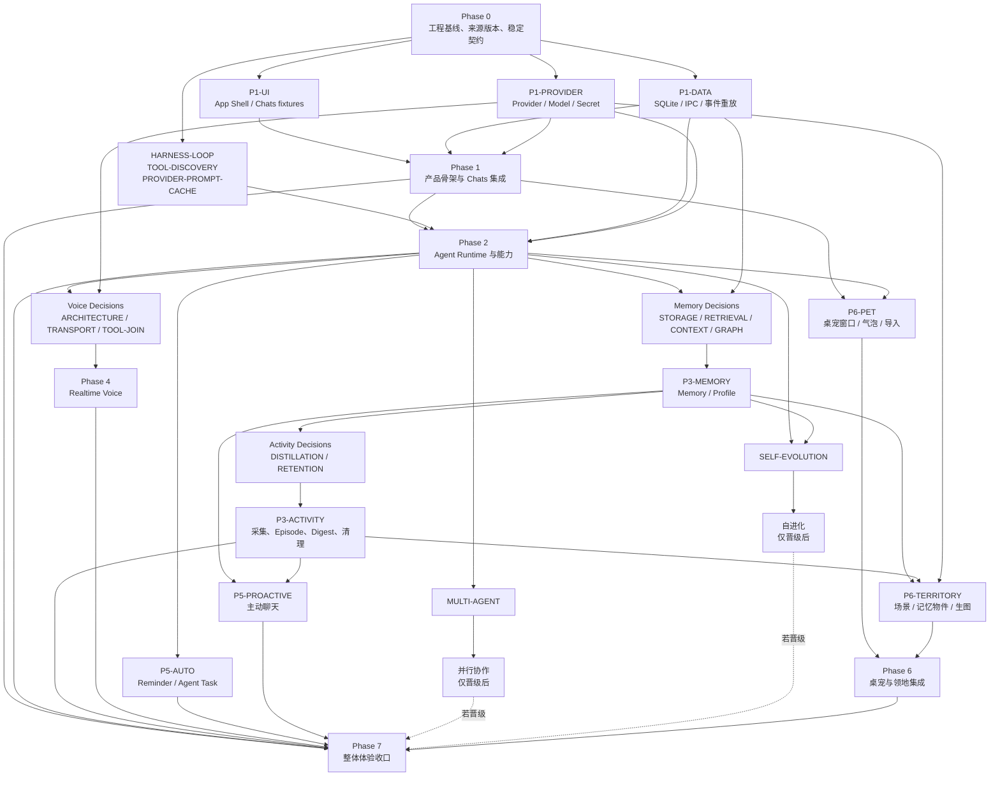

# CharaMate 实施路线图

> 状态：Phase 0 Done；Phase 1 Done；Phase 2 Done；Phase 3 Done；Phase 4 Done
> 日期：2026-08-11
> 权威来源：`REFACTOR_PRODUCT_DESIGN.md`、`CHARA_MATE_UI_DESIGN.md`、已接受的 `docs/benchmarks/<decision-id>.md`

本文件记录里程碑依赖、工作包边界和验收，不记录逐命令历史。Phase 编号表示产品集成与验收顺序，不要求所有开发工作全局串行；只有共享契约、Schema、IPC 和同一可变资源的写入必须串行。

## 固定工程基线

| 关注点 | 唯一生产选择 | 约束 |
| --- | --- | --- |
| 仓库与包 | 单 package、npm、精确 lockfile | 不建 monorepo，不维护第二套 package manager |
| 桌面与打包 | Electron + Electron Forge + Forge Vite Plugin | 只保留一个构建路径；Plugin 精确锁版本并先做 packaged smoke |
| 语言 | TypeScript strict、ESM | Main、Preload、Renderer 和共享契约统一使用 TypeScript |
| 代码质量 | ESLint flat config + typescript-eslint/React Hooks + Prettier | 唯一 lint/format 路径；不同时维护 Biome 配置 |
| Renderer | React、CSS Modules、CSS Custom Properties | Main 是业务状态真源；不引入第二套前端业务状态机 |
| UI 基础 | Radix Primitives、Lucide、TanStack Virtual | 不使用完整主题型 UI 框架；Voice 波形和产品专用图标自绘 SVG |
| 内容渲染 | `react-markdown`/remark/rehype、KaTeX、懒加载 Shiki/Mermaid | 源 Markdown 是复制真源；完成后确定性重渲染 |
| 像素渲染 | PixiJS | 桌宠与领地共享 sprite/animation 语义，不引入完整游戏引擎 |
| 契约 | TypeBox + Ajv、JSON Schema-first | Tool、IPC、事件和持久化边界复用同一 Schema 来源 |
| IPC | typed `contextBridge` API | 每个领域暴露窄方法；Renderer 不直接拿 `ipcRenderer` |
| 数据 | `better-sqlite3`、prepared SQL、领域 Repository | 不引入 ORM；journal、批量和向量布局仍由 Decision 决定 |
| Agent | CharaMate 自有事件驱动 Harness | 不引入 LangChain/LangGraph 类总框架；Provider SDK 仅留在 Adapter 内 |
| 外部协议 SDK | 官方 OpenAI JavaScript SDK、官方 MCP TypeScript SDK | 只在 Provider/MCP Adapter 边界使用，不拥有 Run、Tool 或 Approval 状态 |
| Browser | `playwright-core` + 产品管理的固定 Chromium | 与 Electron E2E 的 Playwright runner 职责分开 |
| Secrets | Electron async `safeStorage` + 统一 redaction | SQLite 只存引用；密钥不进入日志、Run、Memory 或错误 |
| Observability | Pino + typed events/metrics | 不预建外部监控平台，不把研发指标放进产品 UI |
| 测试 | Vitest、Testing Library、Playwright Electron E2E | 默认离线、确定性；Live 与 Benchmark 单独运行和报告 |

算法、模型、数据库参数、Voice Transport、并行度和保留阈值不属于这张固定栈表，必须经过对应 Decision。

## Phase DAG

## 交付波次

1. **Wave 0 — 串行入口（已完成）**：来源刷新、工具链兼容性、共享 Contract/Schema 所有权和测试命令基线。
2. **Wave 1 — Phase 1 并行（已完成）**：UI fixture、持久化/IPC、Provider/Secret 三条所有权不重叠的路径并行，随后由一个集成 owner 收口 Chats。
3. **Wave 2 — Phase 2 主干（已完成）**：后继 H2–H6、source-derived Discovery 与 Cache 的选择已重写为唯一 Agent Runtime、Tool/Approval、Local/Browser/Computer/MCP/Skills、可观测性和固定 Cache On 生产路径。H7 W2 Quality 300/300 valid；机械失败、产品 amendment 与专用 H7 Timing 100 的 scope closure 原样保留，不声称 timing Gate 通过。完整 offline、Electron E2E、build、package 和开发/打包 smoke 已通过。
4. **Wave 3 — 多支线并行**：Agent 主干稳定后，Memory 研究、Voice Contract/实验、Automation 基础、桌宠基础与 Multi-agent 实验可并行；Memory 的语义/检索/UI、基础自动形成与跨 Chat 精确更新均已完成，其他支线仍按独立所有权推进，候选代码只在隔离 worktree。
5. **Wave 4 — 长期理解支线**：Memory 自动形成闭环与 Activity 完成后，主动聊天、Self-evolution 实验和 Territory 记忆物件可按各自 Gate 与所有权边界推进。
6. **Wave 5 — 全产品收口**：只集成已通过 Gate 的路径，运行完整离线、打包、E2E 和明确要求的 Live 检查。

## Phase 0 — 工程基线与稳定契约

> 里程碑状态：Done（2026-08-01）；退出条件全部通过，最新证据见 `docs/progress/STATUS.md`。

### 目标

建立唯一可构建、可测试、可打包的 Electron 基线，以及所有后续领域共同依赖的最小稳定契约。

### 工作包

- `FND-TOOLCHAIN`：验证 Electron/Forge/Vite、React、`better-sqlite3` rebuild/ASAR、Playwright Electron、macOS package smoke；成功后精确锁定版本。
- `FND-CONTRACTS`：定义 Chat、Message、Run、RunItem、Approval、Provider snapshot、错误和 sequence envelope 的 TypeBox Schema 与 TypeScript 类型。
- `FND-IPC`：定义 typed Preload 请求/响应/订阅形状及 `afterSequence` 重放契约，不实现业务服务。
- `FND-CORRECTNESS`：统一 ID/clock/AbortSignal、artifact 引用、redaction 和测试 fixture 约定。
- `FND-QUALITY`：建立真实的 fast check、focused test、full offline、build/package、E2E 和 live/benchmark scripts，再把命令写回 `AGENTS.md`。

### 验收

- 开发窗口、Main/Preload/Renderer 构建、打包应用和 packaged smoke 均成功；
- `better-sqlite3` 在开发与打包应用中完成一次事务、关闭并重开读取；
- Renderer 只能通过窄 typed preload API 访问 Main；
- Contract 正反例、redaction、sequence 和取消语义有确定性测试；
- 没有业务空目录、ORM、通用 AI 框架、第二套构建路径或候选算法代码。

## Phase 1 — 产品骨架与 Chats

> 里程碑状态：Done（2026-08-01）；退出条件全部通过，最新证据见 `docs/progress/STATUS.md`。

### 依赖

Phase 0 完成。UI、Data/IPC、Provider 三个工作包可以并行；共享契约变更由唯一 integration owner 串行合入。

### 工作包

- `P1-APP-SHELL`：主窗口、融合标题栏、侧栏、六个一级页面占位、窗口状态恢复。
- `P1-CHAT-DATA`：Chat/Message/Attachment/Run/RunItem 初始 Schema、领域 Repository、append-first 事件和重放。
- `P1-CHAT-SERVICE`：多会话创建、重命名、置顶、搜索、归档、恢复、删除、首次发送后落库、首条消息兜底/AI 摘要标题和同 Chat Turn 串行。
- `P1-CHAT-UI`：消息列表、空状态、用户/助手消息、附件、Composer 模式/模型/权限位置。
- `P1-CONTENT`：GFM、代码、KaTeX、表格、Mermaid、媒体/文件卡与各级复制；流式容错后确定性重渲染。
- `P1-RUN-PROJECTION`：运行中展开、完成折叠、Tool 二级详情、停止反馈、刷新和重启恢复。
- `P1-PROVIDER`：Provider Profile、模型发现/手填、连接测试、Model snapshot、async `safeStorage` 与 redaction；空库首次写入源码所有的 `copilot_api`/`azure` 非密钥元数据，已有库不覆盖。

### 验收

- Chat 模式不能执行外部效果 Tool，一键切 Agent 不丢输入；
- Composer、Markdown/LaTeX、复制、Run 折叠与 Approval fixture 满足 UI 验收；
- Main 先持久化再广播，Renderer 重载后按 sequence 恢复；
- Provider Key 不出现在 SQLite、日志、错误或 IPC fixture；
- 受影响的 L0/L1/L2、React component test、Electron Chats E2E 和 package smoke 通过。

## Phase 2 — Agent Runtime 与能力

> 里程碑状态：Done（2026-08-08）。Decision、单一生产实现与全部退出验收均已完成；专用 H7 Timing 100 仍按 owner scope closure 记为 waived，而非通过。

### 依赖与 Gate

- Phase 1 的 Run/Item、IPC、Provider 与持久化稳定；
- `HARNESS-LOOP`、`TOOL-DISCOVERY`、`PROVIDER-PROMPT-CACHE` 已更新中文 Decision Record，并记录设置校准、逐轮晋升/淘汰、机械结论、产品 amendment 与 Timing scope closure 的完整链路；生产组合已选定，专用 H7 Timing 100 不再是实现前 Gate；
- 后继 H2 使用新 detector、未曝光任务和仓库外可覆盖工作 Manifest；修订直接覆盖工作文件，每次计分记录实际 hash 与 lane map，不为每次修改复制版本或重跑无关阶段；不能把 HS0、T0、GD4 或 PC0-OFF 当 fallback；
- 后继所有选择实验遵守现实负载准入：小 fixture、单步任务、少量 Schema 或缩小 window 只作 smoke/AR1/规模校准，不能选择生产方案；D1 的 256/512 Tool 现实工作流与 512 极限压力保留为 Discovery 证据，1024 scored 层已经在首个计分请求前退休；H3 使用完整发现 inventory 与失败后续步骤；H4–H6 同时验证真实长上下文和目标 endpoint resolved-budget 高压层；Cache 重放最终请求形状；H7 在 256/512 Tool 与短/长/近预算 context 上做未曝光联合确认。所有阶段都分别保存业务终局、Tool/参数正确、误调/漏调、虚假完成、实际请求 shape 与 Provider usage，只有规模标签或合并“成功率”不算充分证据；
- 后续 live 阶段先通过已有 compatibility/preflight 或首轮 evidence barrier，再并行互不依赖的 cohort：同一 paired block 内 Arms 保持串行，quality 与 timing 使用隔离 namespace、固定 lane map 和相同的阶段前并发配置；H5→H6→Cache→H7 Quality 已完成，专用 H7 Timing 不再运行，性能转入生产单路径集成/E2E 与实际遥测；
- 主仓库没有候选 Harness/Discovery/Cache Arm、Adapter、Schema、依赖或实验模式；胜者已经按 CharaMate domain contract 重写为单一路径，失败候选不得回流生产。

### 工作包

- `P2-H2-DETECTOR-REDESIGN`：仓库外可覆盖 detector/任务/scorer，H2 selection/holdout 与后续 H3–H7/Discovery Gate；不进入生产路径。
- `P2-RUNTIME`：唯一循环、ContextCompiler 接口、steering、compaction、checkpoint、恢复与 Loop Guard。
- `P2-TOOLS`：JSON Schema Tool Registry、结构化结果、AbortSignal、artifact、deadline 和错误分类。
- `P2-APPROVAL`：三档权限、Chat/气泡共用 Approval Item、拒绝结果、过期与取消。
- `P2-LOCAL`：File、Command、App Tool 与子进程生命周期。
- `P2-BROWSER`：Managed Chromium Profile、Playwright DOM/AX 优先、上传下载和证据 artifact。
- `P2-COMPUTER`：App Action/CLI/API 优先，Accessibility 其次，视觉坐标兜底的 OS Adapter。
- `P2-EXTENSIONS`：MCP stdio/Streamable HTTP、Skills 渐进披露、重新发现与配置管理。
- `P2-OBSERVABILITY`：Run/Tool/Approval/Context trace 与 Dev Dashboard 第一版。

### 验收

- Direct、File、Command、Browser、Computer、MCP、Long Run、Steering、Recovery、Approval 和 No-op 旅程通过；
- 长任务不被固定全局步数、墙钟、Token 或成本静默截断；
- 审批前副作用、取消后副作用和虚假完成均为零；
- 进程中断后只恢复未完成边界，已完成副作用不重放；
- Phase 2 领域测试、相关 contract/IPC integration、Electron Agent E2E、full offline 和 build 通过。

完成证据见 `docs/progress/STATUS.md`：生产树只保留一个 Harness/Discovery/Cache 路径；开发版与 packaged app 均实际完成主窗口、桌宠、SQLite 和固定 Chromium round-trip。

## Phase 3 — 输入闭环、Memory 与 Activity

> 里程碑状态：Done（2026-08-09）。八项 Decision 与单一生产实现全部完成；`MEMORY-FORMATION` 已补齐跨 Chat 稳定身份、合法修订目标、冲突双活防护和重启恢复。

### 依赖与 Gate

- Phase 2 提供稳定 Agent、ContextCompiler 接口、Tool/Run evidence；
- `P3-STRUCTURED-INPUT` 与 `P3-MULTIMODAL-INPUT` 只依赖 Phase 1 Attachment/Composer 和 Phase 2 Run/Provider/Tool 契约，不受 Memory Decision 阻塞，可与 Memory 研究并行；
- `MEMORY-STORAGE`、`MEMORY-RETRIEVAL`、`CONTEXT-RECIPE`、`MEMORY-GRAPH` 依研究依赖完成；`MEMORY-FORMATION` 在 Agent Runtime 与上述 Memory 契约稳定后完成；
- `ACTIVITY-DISTILLATION`、`ACTIVITY-RETENTION` 在 Memory proposal/source 契约稳定后完成。

### 工作包

- `P3-STRUCTURED-INPUT`：实现直接、非 deferred 的宿主交互能力 `request_user_input`、持久化 `input_request` RunItem、选项/自由文本回答卡与同一 Run continuation；刷新或重启后仍可回答，回答只消费一次，不经过 Tool Search，也不伪装成 Approval。
- `P3-MULTIMODAL-INPUT`：建立一条 Main-owned 图片解码与 Provider 多模态输入路径；用户显式附加的图片直接进入模型输入，Agent 查看已知本地图片、截图或图片 artifact 时使用仅在模型与环境支持时直载的 `image.inspect`。两种入口复用媒体校验与尺寸处理；不按文件名假装看过图片，也不增加未验证的 OCR fallback。
- `P3-MEMORY-SEMANTICS`：Memory/Revision/Source、validity、supersede、pin、archive/delete 和 Profile 投影。
- `P3-MEMORY-RUNTIME`：唯一 Retrieval Pipeline、唯一 Context Recipe、获胜索引生命周期和 `memory.search`。
- `P3-MEMORY-FORMATION`：Chat/Agent 始终加载的唯一 `memory.record`，明确陈述直接形成/修订，推断与执行观察候选化；profile/preference 使用闭集稳定 claim slot，更新目标必须来自当前 Run allowlist 并匹配 type/slot，缺失目标、错 ID、冲突和旧数据首次绑定转候选或拒绝；Main 绑定来源并保证重复/恢复幂等。
- `P3-MEMORY-UI`：搜索、筛选、来源、Revision、画像、候选与领地入口；Graph 未晋级时没有入口。
- `P3-ACTIVITY-CAPTURE`：Active App、Managed Browser、Screenshot/OCR metadata、Idle 和 Agent Run 区分。
- `P3-ACTIVITY-DISTILL`：确定性 Episode 边界、获胜 Digest/候选流程、evidence 与冲突处理。
- `P3-ACTIVITY-RETENTION`：获胜保留策略、文件/缩略图/OCR/索引/行一致清理、orphan sweep。
- `P3-BENCHMARK`：LongMemEval、LoCoMo 与冻结中文产品集的 Retrieval、Answer、Storage 和 Activity 记录。

### 验收

- 结构化问题可在 Chat/Agent 中显示、回答、重启恢复并继续原 Run；同一回答不重复注入，取消或自由文本路径明确；
- 用户图片附件及 Agent 已知的本地图片/artifact 都能让支持视觉输入的目标 Provider 读取真实像素内容；不支持的模型明确说明能力不可用，路径文字或缩略图不算语义读取成功；
- Memory 编辑产生 Revision，改口后旧事实不进入默认 Context，所有投影可追溯；
- Chat/Agent 的明确耐久陈述无需手动新建即可进入后续 Run Context；跨 Chat 改口在证据可辨识时沿同一 Memory ID 产生 Revision，错 ID、未命中、同字段冲突与同类字段歧义不制造第二条 active 事实；推断和执行观察只进入带原因/来源的待确认候选，重复调用与重启不重复写入；
- 发布物只加载一个 Retrieval/Context/Graph 结果，失败候选模型、依赖、表和设置不存在；
- Activity 被压缩成少量 Episode/Digest，原始事件不进入普通长期检索；
- 清理引用完整率达到 Decision 门槛，长期 Memory/Territory evidence 不随原始资产删除；
- 相关 contract、DB/integration、UI、benchmark regression、full offline、build 和受影响 E2E 通过。

## Phase 4 — Realtime Voice

> 里程碑状态：Done（2026-08-11）。按真人体验反馈切换为单一 Orchestrated Native Realtime 路径；离线、Live、E2E、package 与目标硬件人工验收均已完成，生产只保留本节描述的一条 Voice 路径。

### 依赖与 Gate

- Phase 2 的 Run、Tool、Approval、steering、generation 和 Provider Adapter 稳定；
- 目标 Azure deployment Contract Test 已刷新；
- `VOICE-ARCHITECTURE` 已透明修订为 Realtime 原生语音 Agent，`VOICE-TRANSPORT` 保持 WebRTC，`VOICE-TOOL-JOIN` 恢复为最小串行 continuation；旧 TTS/Shared Runtime 代码必须删除。

### 工作包

- `P4-VOICE-DRIVER`：唯一媒体 Transport、鉴权、VAD、音频采集/播放和断线重连。
- `P4-COORDINATOR`：完整输入转写创建正常 Voice Run；Realtime 原生生成音频、输出转写与 Function Call，应用显式驱动 response 并投影到同一 Chat/Run/Item。
- `P4-VOICE-TOOLS`：Session 获得同一 Tool Registry 的权限过滤快照；Realtime Function Call 沿既有校验/Approval/executor 执行，`function_call_output` 回注后继续同一 generation。
- `P4-VOICE-DATA`：VoiceSession/Turn、实际播放边界、interrupted 标记与 Chat 草稿原子完成。
- `P4-VOICE-UI`：Voice Dock、波形、连接/聆听/工具/批准/说话状态、静音和结束。
- `P4-VOICE-ENTRY`：Composer 继承当前模式/权限，桌宠声波入口创建 Agent 完全访问，新建 Chat 先结束活动 Voice；Approval 使用同一 Item 的桌宠气泡投影。
- `P4-VOICE-HARNESS`：文字 Chat/Agent 使用 CharaMate Harness，Voice 使用 Realtime Agent；两者共用核心 instructions、Skill/Memory/Chat Context、Tool Registry、入口权限、Approval、Run/Item 与标题链路。Azure Realtime 没有 Responses 托管 `web_search`，不伪造本地 Tool。
- `P4-VOICE-LANGUAGE`：多语言转写不固定语言，普通话落为简体，英文与混合语言保持原语言，输出音频跟随当前语言。
- `P4-VOICE-SETTINGS`：音色试听、Persona 默认音色和 Realtime instructions。
- `P4-VOICE-CONNECTION-LIFECYCLE`：Voice Dock 暂停/恢复与结束分离；健康连接按稳定身份复用并刷新 instructions/tools，不兼容或断线时冷重连；麦克风与临时凭据并行初始化，开发看板记录五段建连耗时。
- `P4-VOICE-ENTRY-HANGUP`：一个活动 Session 固定归属一个 Voice Chat；桌宠共享暂停/恢复控制，主窗口浏览或隐藏不迁移连接；Realtime Agent 以 Session 专属 `voice.end` Tool 在简短告别音频排空后主动挂断。

### 验收

- 真实 endpoint、麦克风和扬声器满足预注册首音频、打断和一致性门槛；
- 任一时刻只有一个 audible response，旧 generation 注入和重复副作用为零；
- Realtime 输出转写增量立即留在同一 Chat，音频由同一 response 连续播放，不等待文字 Run 完成，也不拆句做 TTS；
- 实际听到的自然语言、同一 response 的输出转写、Tool Item 和重启历史一致；文字 Agent 不参与 Voice 回答；
- Voice 标题按“语音对话 → 首条转写兜底 → 既有 AI 摘要”更新，未复制标题服务；
- Composer 与桌宠入口权限明确，新建 Chat 能结束活动 Voice；桌宠 hover 后显示深色圆形声波图标，移开自动隐藏且点击不唤起主窗口；Chat 与 Agent 都有计划和幂等查询能力，简单查询不被强制计划化；
- Voice 获得与入口相同的客户端 Tools 和权限；仓库不存在本地 `web.search`、Voice Tool 副本、TTS 或第二条回答 fallback；
- 普通话、英文和混合语言的真实 Azure 输入转写与原生发声通过，且生产无翻译/繁简正则修补；
- 暂停立即停止采集和播放但保留健康 PeerConnection/DataChannel，恢复同身份会话不重新申请凭据或协商 SDP；配置不兼容与断线走冷重连，End 始终释放全部媒体资源；
- 冷启动并行申请麦克风和临时凭据，开发看板分别报告 credential、microphone、ICE、SDP 与 DataChannel 的真实观测耗时；
- 选择 Chat B、关闭主窗口和桌宠声波点击都不改变 Chat A 的 Voice 归属：活动时桌宠点击暂停、暂停时恢复原连接；显式 End 后下一次桌宠入口创建新 Voice Chat；
- `voice.end` 仅在 Voice Session 中可见，无审批且只接受当前 Voice Run；模型明确告别后继续一次简短 response，WebRTC 输出缓冲排空才关闭，普通文字 Agent 不发现该 Tool；
- mock 测试只证明状态机，不代替 Live 体验结论；离线与 Live 结果分开报告。

## Phase 5 — Automations、主动聊天与可选成长能力

### 依赖与 Gate

- Reminder/Agent Task 只依赖 Phase 2；
- 主动聊天依赖 Phase 3 的 Digest/Memory；
- `P5-AUTOMATIONS-CONTRACT` 串行冻结共享 Schema、IPC、DB 与完成事件；Main Core 和冻结 fixture UI 在其后并行；
- `MULTI-AGENT` 已完成并选择无用户开关的 Agent 按需只读协作；`SELF-EVOLUTION` 仍决定能力是否存在，而不是决定默认开关。

### 工作包

- `P5-AUTOMATIONS-CONTRACT`（已完成）：一次/每天/每周/POSIX 五段 Cron 与显式时区、Reminder/Agent Task 定义、revision/运行快照、`automation.run.finished`、typed IPC/Preload、`automations`/`automation_runs` Schema 和迁移；不实现调度器、Repository/Service 或页面。
- `P5-AUTOMATIONS-CORE`（已完成）：来源复核后实现唯一 schedule 计算与休眠恢复策略、Repository/Service、Reminder 投递记录、Agent Task 普通 Chat Run、暂停/编辑/试跑、历史、事件发布和 Main IPC 注册。
- `P5-AUTOMATIONS-UI`（已完成）：使用冻结 fixture 实现卡片、单页表单、暂停/编辑/试跑、历史及 Agent Task Chat Run 跳转；最终只消费 typed Preload API。
- `P5-PROACTIVE`：安静时段、主动程度、触发来源、普通 Chat 持久化和气泡投影。
- `P5-MULTI-AGENT`（已完成）：Agent 自主调用 `collaboration.dispatch`，宿主校验两个 child 的只读性、当前 Tool scope、互斥资源和可变会话禁用，再并发执行确切读取与独立分析；父 Run 等待并合并，统一 Subtask Item 承载状态/证据/Token，取消与恢复复用既有边界；没有 Composer/Settings 开关、候选 Arm 或额外表/依赖。
- `P5-EVOLUTION`：仅晋级后实现异步 Review、四类候选、Skill replay、版本、归档和恢复。

### 验收

- `P5-AUTOMATIONS-CONTRACT` 的四种 Schedule、revision/定义快照、运行生命周期、完成事件、typed IPC/Preload 与 v8→v9 迁移分别通过确定性 contract、IPC 和 SQLite 回归；契约闸门不注册无 Service 的 Main handler，也不夹带调度器或页面占位实现；
- Core 对 UTC/每天/每周/Cron、DST gap/fold、DOM/DOW、无效扩展、休眠合并与 occurrence 幂等有确定性回归；timer 只负责唤醒，数据库 projection 与 claim 是真源；
- 创建、暂停、编辑、立即运行、历史、完成事件和跨 Electron 重启通过真实 typed desktop boundary；Agent Task 复用普通持久化 Chat/Run 及既有 Model、Tool、Approval、取消和失败路径；
- Automation 的 Tool、审批、取消、结果和失败与手动 Run 完全同构；
- 后台 Approval 不被伪装为成功，气泡始终跳转同一 Chat Item；
- 未晋级能力的表、协议、组件、设置、依赖和空入口不存在；
- 能力的机械 Gate、任何 owner amendment、成功率、冲突、Token、复杂度与不能声称的范围均透明保存在对应中文 Decision Record；生产只保留最终单路径。

## Phase 6 — 桌宠与领地

### 依赖

- 桌宠基础窗口和 Pet 导入可在 Phase 1 后并行开发；状态与审批投影依赖 Phase 2；
- Memory 物件依赖 Phase 3，Activity 趋势候选依赖 Activity；
- Image Generation/Edit 共用一套 deployment 配置，依赖 Provider Adapter 和真实 Azure Contract Test。

### 工作包

- `P6-PET-WINDOW`：透明常驻窗口、自由拖动、多显示器、位置/尺寸/朝向恢复、托盘和 earcon。
- `P6-PET-RUNTIME`：PixiJS sprite runtime、CompanionState 动画、气泡和 Voice envelope 联动。
- `P6-PET-IMPORT`：Codex v1/v2 校验、复制安装、自有目录和缺失 look row 降级；发布包内置 Columbinya v2 与 Linnea v1，首次启动沿同一路径幂等复制且不覆盖同 ID 用户资产。
- `P6-TERRITORY-BASE`：基础像素场景、图层、nav grid、角色移动、布置和收藏库。
- `P6-TERRITORY-ITEM-MANIFEST`：2.5D 深度锚点、地面平面、占用/碰撞 mask、单层承载插槽、附件关系与结构化 authoring 校验；接收已落盘图片和 manifest，完成归一化 asset、不可变 definition/item、受控 URL 与 Renderer 投影；该包只拥有 Territory 安装入口，不自行分叉 Agent Runtime。
- `P6-TERRITORY-MEMORY`：Memory/Activity candidate、来源追溯、容量回收、版本与 pin；容量由 `TERRITORY-CAPACITY` 一次冻结为 12，不形成产品模式。
- `P6-TERRITORY-IMAGE`：同一 deployment 的 Generation/Edit 路由、统一 style prompt、去背景、候选确认和失败恢复；注册一个延迟发现的内建 `territory.generate_item` Tool，模型只必填名称、含义和视觉意图，活动场景/Provider 由宿主解析，可选结构参数由 Territory 编译为同一 manifest；接受后调用唯一的 Territory asset + manifest 领域入口，不另建资产存储路径。

### 验收

- 桌宠跨重启与显示器变化保持可见和位置语义，v1/v2 动画正确；
- Approval 气泡、Voice 状态和 Chat Run 使用同一真源；
- 首次领地无需等待生图即可完整显示，移动/放置/追溯/收回确定性；
- 角色、地面物件和附件按结构化 manifest 确定碰撞、遮挡与承载关系，父物件变换和重启不会破坏附件；
- 生图失败不损坏场景，超过容量只回收藏库，不删除 Memory 或资产版本。
- Agent 可经统一 Run/Tool/Approval 路径生成持久化候选；Tool 不绕过用户确认，默认结构和显式尺寸、占地、锚点、插槽都能恢复为同一 manifest。

## Phase 7 — 整体体验收口

### 工作包

- 六个一级页面、Character Window、Tray、Managed Browser 和 Dev Dashboard 的完整旅程；
- 多会话并发、崩溃恢复、取消、审批、资源引用、获胜存储/索引和 asset 长时观察；
- Provider 自动发现与手填、Chat/Realtime/Image、MCP、Computer Use 和生图 Live 验证；
- 浅/深主题、响应式、减少动态效果、键盘与可读性验收；
- 首次体验、Persona、文案、错误恢复、展示脚本、签名/notarization 和安装包；
- 单路径审计：无失败 Arm、兼容 flag、候选 Adapter、临时 Schema、未使用依赖或隐藏设置。

### 退出条件

- 产品设计的所有必测旅程和完成定义满足；
- full offline、build/package、受影响 Electron E2E 全绿；
- Live/Benchmark 按功能明确运行并单独报告，未运行项有原因；
- 文档、共享契约、Schema、Decision Record 和实际产品路径一致。

## 串行化与并行所有权

- shared contract、IPC namespace、数据库 Schema 和跨领域 event 每次变更只能有一个 integration owner。
- UI 使用冻结 fixture 后可与 Main 服务并行；契约变化先由 owner 更新 Schema 和 contract test，再通知消费者。
- 同一源文件、迁移、SQLite fixture、可变 Browser Profile、真实音频设备和同一副作用账户不允许并发写。
- 只读研究、独立 Provider Contract Test、不同 UI 页面和独立领域 Repository 可并行。
- 候选实验使用独立 branch/worktree；胜者重新实现进生产，失败候选不通过 feature flag 留存。
- 并行量由独立所有权、测试容量与集成 review 能力决定，不设置任意固定团队上限。
