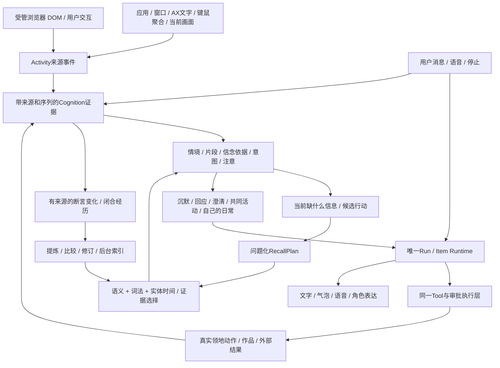

# CharaMate：从桌面形象到有日常的 AI 陪伴

更新：2026-09-17。本文是研究与本地实现的阅读入口。最终产品契约由根目录 Product/UI Design 约束；选型结果由对应 Decision 约束，当前验证与缺口见 STATUS。历史修订、接收边界、恢复、资源回收及模型选择恢复已进入 Main；动态行动材料、实际计数接线、准备阶段取消/退出和失败反馈续接也已合入。当前 Main 的 2285 项全离线与生产构建通过，相同运行源码的候选受影响 Electron 20/20 通过。真实语义、吞吐、合并资源和最终安装仍需同版验收，不能由工程检查或旧包结果替代。全部本地工作及独立组合验收仍在推进，尚未宣布整体商业化成熟。

用户已允许可控时钟与 mock 经历替代真人跨日、跨月等待。本轮按[本地成熟度验收](../progress/LOCAL_MATURITY_ACCEPTANCE.md)运行真实形成、检索、决策、数据库、模型与本地进程；模拟长期功能可据此验收。真人长期情感收益仍是未测推论，不作为本轮等待数月的前提。

## 1. 用户最终感受到什么

你打开电脑，她已经有自己的小事想做：看看房间、找个角落待着，或做一个与自己兴趣有关的小物件。她可以把完成的东西摆进去，没有位置就先放在收藏里。你不需要不断回答“生成什么、放在哪里、下一步做什么”。你想参与时，可以看、移动、修改或撤销。

你读一篇文章、写一段代码、在窗口间切换，她能获得比“你在浏览器里”更细的局部情境。连续输入表示你正在交互，不自动等于焦虑；看到标题不等于读完文章。她会判断此刻是否值得说话，更多时候保持安静。你说话或接管活动时，你的请求优先。

你半年前认真说过的约定，不因六个月没登录被机械删掉；刚才连续说了十遍的琐事，也不应因此盖过那件重要的事。普通“早上好”不需要引出一长串旧记忆。她能区分曾经的偏好和现在的改口，能承认不确定、没有看到或没有做成。

“把角色当作一个人”在产品中落实为持续的意图、可验证的经历、自主选择、注意力与表达节奏。它不意味着向用户声称模型有真实人类意识，也不需要亲密度、饥饿值、付费养成或让用户维持角色情绪。

当前连续观察还保留来源时钟：切走后返回相同页面是新事件；只有连续同内容才合并。合并不保存重复正文，但保存宿主的最新观察时钟，防止迟到旧事件覆盖当前焦点。模型不能改这个时钟；它在进程恢复和在途分析提交后仍有效。详见[连续观察决策](../benchmarks/COGNITION-CONTINUOUS-OBSERVATION.md)。

## 2. 阅读路线与研究结论

| 文件                                                                                                                   | 内容                                                                                  |
| ---------------------------------------------------------------------------------------------------------------------- | ------------------------------------------------------------------------------------- |
| [认知、注意与自主生活](ai-companion-cognition-and-life-2026-09-15.md)                                                  | PFC/功能网络/情绪支持的可借鉴机制；前沿主动 Agent、细粒度感知、角色生活及当前源码差距 |
| [多维长期记忆](ai-companion-memory-research-2026-09-15.md)                                                             | 情境/事实/约定/反思、存储与提取分离、用户互动时钟、自然遗忘、研究与工业版本比较       |
| [在线与跨平台未来](ai-companion-online-futures-2026-09-15.md)                                                          | 身份、多人分区、写入所有权、事件流、存储分层、角色社区、成本与扩展路线                |
| [前瞻实验计划](ai-companion-experiment-plan-2026-09-15.md)                                                             | 各问题单变量条件、文本预算、冻结场景和评价口径                                        |
| [认知有界读取](../benchmarks/COMPANION-COGNITION-BOUNDED.md) / [吞吐](../benchmarks/COMPANION-COGNITION-THROUGHPUT.md) | 持续状态的有界投影、准确消费水位、纯计数合并与仍存在的语义积压                        |
| [视觉来源](../benchmarks/ACTIVITY-VISUAL-SOURCE.md)                                                                    | 原生当前对象画面、按需 OCR/PNG、来源保护与实际覆盖边界                                |
| [记忆生命周期 Decision](../benchmarks/COMPANION-MEMORY-LIFECYCLE.md)                                                   | 移除曝光强化，否决损伤旧事召回的年龄淡化；保留一条检索路径                            |
| [回应策略 Decision](../benchmarks/COMPANION-RESPONSE-STRATEGY.md)                                                      | gpt-6-astra 24 对 Pilot、偏好/持平、成本与结果后取舍                                  |
| [请求预算 Decision](../benchmarks/COMPANION-CONTEXT-BUDGET.md)                                                         | 完整请求 258k 约束、首次压缩、代理精确计数缺口                                        |
| [本地编码器 Decision](../benchmarks/LOCAL-MEMORY-ENCODER.md)                                                           | Qwen3 量化模型、512维、真实选择器、内存和微调判断                                     |
| [向量执行 Decision](../benchmarks/MEMORY-VECTOR-EXECUTION.md)                                                          | 精确扫描移出 Main、取消、SQLite并发读取和资源实测                                     |
| [来源查找 Decision](../benchmarks/MEMORY-SOURCE-LOOKUP.md)                                                             | 十万形成任务下的来源快照索引、覆盖与实际Main查询延迟                                  |
| [情节来源上下文 Decision](../benchmarks/COGNITION-FORMATION-CONTEXT.md)                                                | 同情节一跳原文、主材料与消歧上下文分离、十万无关情境索引测量                          |
| [结构化输出 Decision](../benchmarks/STRUCTURED-OUTPUT-COMPACT.md)                                                      | 未闭合空白流的实际SSE诊断、紧凑JSON与尚未证明的稳定性                                 |
| [修订生命周期 Decision](../benchmarks/MEMORY-REVISION-LIFECYCLE.md)                                                    | 手动编辑归属、归档资格、删除后旧回执与当前修订分离                                    |
| [认知 reasoning 对照](../benchmarks/COGNITION-ASTRA-REASONING-EFFORT.md)                                               | 六组配对的速度、失败与回应差异；本轮不选择low                                         |
| [连续场景与实际采用](../benchmarks/COMPANION-LONGITUDINAL-EVAL.md)                                                     | 三次冻结开发运行、错误归因、真实Agent承接与冷检索验收边界                             |
| [独立连续陪伴验收](../benchmarks/COMPANION-CONTINUITY-HOLDOUT.md)                                                      | 36 检查点完整复核、自然搜索与暖上下文分开、形成/来源/完成依据缺陷及后验回归           |
| [完成依据与普通承接](../benchmarks/COGNITION-INTENT-COMPLETION.md)                                                     | 完成归因、当前意图、原始来源供给；原八例与固定状态后的八次真实消费分别记录            |
| [聊天形成来源窗口](../benchmarks/CHAT-MEMORY-SOURCE-WINDOW.md)                                                         | 按两个Run定向读取、十万消息实测、原始来源语义与索引成本                               |
| [待处理工作读取](../benchmarks/COMPANION-MEMORY-PENDING-READ.md)                                                       | 形成和索引短查询、完整联合游标、真实队列处理顺序与内存                                |
| [同窗口分段成本](../benchmarks/MEMORY-SOURCE-SEGMENT-COST.md)                                                          | 保留同一正文/窗口/预算结果，消除重复全段计量；后续唯一原文块与按需窗口已进入 Main     |
| [问题规划与消费](../benchmarks/MEMORY-QUERY-PLAN.md)                                                                   | 明确引用、时间/主体范围、真正可回答的查询与最终消费者分配                             |
| [通道融合](../benchmarks/MEMORY-RANK-FUSION.md)                                                                        | 66 次实际选择比较、交替去重单一路径及真实形成库候选额度边界                           |
| [来源容量与实际反馈](../benchmarks/COGNITION-SOURCE-ALLOCATION.md)                                                     | 六对真实持续输入、128 KiB 选择、用户接管与重复回应反例                                |
| [当前用户来源优先](../benchmarks/COGNITION-CURRENT-USER-SOURCE.md)                                                     | 不跳消费水位，优先供给用户当下原话与真实语义纠正                                      |
| [当前用户与同 Run 回复](../benchmarks/COGNITION-CURRENT-USER-RESPONSE.md)                                              | 同预算供给真实已完成话语与 Run 终态；两个实际请求、独立复核与不跳水位                 |
| [打包产品实际验收](../benchmarks/COMPANION-PACKAGED-ACCEPTANCE.md)                                                     | 同版离线/E2E/原生包、两次真实Chat及可见界面、实际用量与延迟边界                       |
| [局部 Intent 依据](../benchmarks/COGNITION-PARTIAL-INTENT.md)                                                          | 保留 canonical 用户请求资格；19 项新增回归与 6 次旧 SSE 宿主回放，不新增模型样本      |
| [唯一原文回收](../benchmarks/MEMORY-CANONICAL-RETENTION.md)                                                            | 实际消费者保护、精确引文、按来源释放全文与持久引用边界                                |
| [按Revision形成向量候选](../benchmarks/MEMORY-VECTOR-REVISION.md)                                                      | 长记忆分块不挤占其他记忆；精确组内最大分数与真实Worker验证                            |

核心结论有四点。第一，PFC/ECN 适合作为功能分工的启发，不应该逐脑区创建进程或为每个事件加一次模型调用。第二，形成内容、检索可达性和使用方式的任一短板都会影响体验；用户给出的乘法公式是很好的诊断框架，还不是经过标定的概率模型。第三，“忘记”首先应表现为当下不提取不相关内容，不能简单等同于删除。第四，自主性来自实际状态和动作，不来自定时生成一段“我刚才做了什么”的故事。

用户举出的“20% 用户占 65% 存储”“54% 旧词调用”尚未找到支持本场景的一手来源，因此未将它们作为真实业务量或算法阈值。本项目当前没有海量线上用户或跨年的运行样本。

## 3. 一条本地运行链

`Cognition` 是明确的领域，不逐脑区创建进程。它拥有持续情境、意图和决策尝试；Run 仍拥有实际模型续步、Tools、停止与恢复。用户消息直接进入 Run，读取当前认知投影，并由该 Run 按需要搜索记忆；后台 PFC 使用同一 Memory 公共合同形成证据需求。两者不会向每次问候自动塞入整份画像，也不复用另一情境的旧检索包。

### 3.1 事件感知：丰富输入，但先知道每条证据是什么

`ActivityPerception` 扩展现有 typed 合同，增加 `boundary`、`content`、`contentStatus`、`interaction`、`lifecycle`：

| 来源               | 实际新增信息                               | 如何解释                                               |
| ------------------ | ------------------------------------------ | ------------------------------------------------------ |
| macOS 应用生命周期 | launched / activated / terminated          | 启动/退出是系统事实，不直接推断用户正在关注该应用      |
| 前台窗口和焦点     | 同应用换窗口、标题/焦点变化                | 能触发新情境，不再只依赖 App 切换                      |
| Accessibility      | focused_element / viewport 的有界文字      | 明确记录局部范围；不可访问或受保护时保留不可用状态     |
| 键鼠操作           | clicks / keystrokes / scrolls 聚合计数     | 只描述操作节奏；不保存按键内容、不读取密码字段或剪贴板 |
| 受管 Browser       | 同 URL 的 DOM 内容变化、真实页面用户交互   | 页面脚本变化、用户输入与 Agent 操作保留不同 actor      |
| Run / Tool         | started / completed / cancelled / 真实结果 | 用于执行协调与已完成经历，不冒充用户兴趣               |

原生聚合每秒发布是本次工程启发式，不是生理采样率。Addon 的 `setAgentActive` 为必需合同：角色开始/结束操作时先刷新旧批次、保留旧 actor，然后切换状态，避免迟到的操作被标成用户行为。Activity Coordinator 只把用户前台观察送给注意力；系统生命周期仍可进入活动事实。普通浏览器并未因此获得受管 Browser 的完整 DOM 权限。

Activity 继续拥有可浏览的 Raw → Episode → Digest。当前原生适配层通过 ScreenCaptureKit 保留前台对象可见区域的最新像素缓冲；像素变化只合并元数据唤醒，在语义分析前按需生成 OCR/PNG。模型取得真实图像字节或明确的不可用/预算缺口，不能把引用路径当作已看过。AX、视觉和实际窗口共用对象身份，dispatch、Run 绑定和发布时检查当前来源；历史图片不会冒充此刻画面。实测以自有合成窗口进行，未外推多应用全天能耗。

长期形成使用真实 Message、Run Item 和 Activity 原始来源；有依据的断言发生实质变化就可触发，不必等情节结束。重复来源集合复用任务，断言修改保留被移出的历史来源。每个点击不创建 Memory。原始事件清理尊重 Cognition/Memory 消费集合；重新使用来源时读取仍在的完整 canonical 原文，或向实际来源 owner 恢复并核对身份与内容；不能用节选补造全文，原图删除则诚实显示不可用。

当前还有一项实现收口：Product §6.9 已取消独立跨周待确认候选，但 `ActivityService.distill` 仍残留旧生成与替换链路。该包正在移除这条路径，保留确定性摘要、按需查询和已保存记忆；在完成实际回归前，不把“统一形成”称为已全部清理。

### 3.2 决策中枢：持续状态、证据依据与执行条件

替换旧 `CompanionAttentionWorkset` 和独立开场判断。现在的合同包含：

| 对象                | 内容与职责                                                                                                                                 |
| ------------------- | ------------------------------------------------------------------------------------------------------------------------------------------ |
| Evidence            | 来源类型/ID/版本、actor、对象身份、发生/接收时间、到达序列、可访问范围；原始观察不是用户偏好的结论                                         |
| Situation / Episode | 当前或挂起的情境、跨窗口对象、片段边界和真实来源；相关情境可以引用，不因换 App 就自动结束共同活动                                          |
| Claim               | observed / reported / inferred 依据，以及 supported / uncertain / disputed / superseded 状态、支持和反证；不把鼠标频繁移动解释为已证实焦虑 |
| Intent              | 用户显式/推测目标与角色自己的目标分开，含成功条件、阻碍、恢复条件、进度、实际效果证据和下次唤醒                                            |
| Attention           | 当前情境、承诺推进的意图、焦点版本、用户接管代次、已分析事件水位；没有自造亲密度或注意力评分                                               |
| DecisionAttempt     | 触发原因、读到的证据和状态版本、RecallPlan、候选行动、选择理由、唯一dispatchKey、实际Run和终态                                             |

驱动先分析局部证据与持续状态；缺少相关历史时提出可回答的问题，经过 Memory 检索和证据选择后再完成决策。每个候选行动说明会不会打断、操作范围、是否可撤销、执行时机和恢复条件。沉默同样是完整选择结果，但不是丢弃尚未处理的约定。

模型结果不能直接覆盖状态或发气泡。提交核对它读到的版本、证据ID和当前用户代次；Run 绑定与 `run.started` 在同一事务提交。异步检索期间用户改口、取消约定、切换角色，旧结果不能越过这些变化执行。Run 完成后，展示之前再次检查证据、机会时效和当下可用性，避免“生成时合适、说出口时已过期”。

长期容量也必须在读取数据库时约束，不能先把所有未读事件和所有历史情境 `.all()` 进 Main，再截短提示词。Main 已经实现按字节预算的连续事件页、优先持续状态、部分视图分配记录和 SQL 版本检查：只推进实际读过的连续水位；未显示的事实和片段保留；局部摘要不能覆盖完整原文。该改动属于有界读取正确性，不是已经证明的最优召回策略。

原文读取与最终模型上下文分别计量。前轮六组真实持续输入比较选择 128 KiB 的分析原文页；较大页降低了共同成功轨迹的追赶时间和已知 Token 用量，但 120 秒时两条件完整事实数量相同，不能把页变大宣传为即时理解。该比较没有选定普通对话或行动材料的最佳额度。最近已分析但未实际使用的原文不自动回带；当前事实的支持与反证、真实采用的历史、在途 Recall 及反馈仍按用途读取。

当前 Main 已取消普通 prepare 与行动材料的固定 8k 上限，也不改成固定 32k。普通背景按真实请求剩余空间选择；必要行动材料则先按 PFC 声明的目标、条件、反证与来源完整读取，再编译完整请求并裁决。原始读取字节不再冒充模型 Token；本次以实际资源比较和 GUI 观察选择 16 MiB 初始原始字节护栏，近 15 MiB 的两次真实 App 读取约 212/184 ms，接受这一材料下约 0.2 秒的 Main 等待。它不是模型上下文上限、RSS 上限或所有设备的性能保证。

必要行动材料优先于可摘要的旧 Chat 历史；无法完整放入时在分配 Run 前明确失败，目标与到期条件仍保留。最新实际失败先以生命周期视图进入 PFC，同次 Recall 续接仍保留反馈和当前用户，不跳过中间未读来源。准备任务在第一次异步等待前登记，Stop/退出会取消并等待它结束。最终完整 wire 经同一 Provider 守门，输入取用户 258000 与较低 Provider 限制的交集。详见[动态行动预算](../benchmarks/COGNITION-DYNAMIC-ACTION-BUDGET.md)；这些是已验证的完整性和生命周期行为，最终自然任务的成功率、重复观察与总成本仍按独立场景验收。

PFC 的按需历史检索和普通 `memory.search` 的证据包仍有各自的宿主分配，当前分别以 32768 和 8192 为检索工作预算；它们不是整个 Run 或行动依据的硬顶，也不证明最佳检索额度。候选、问题覆盖、完整事实、引文节选和缺失原因分别返回；重要问题不足时可继续有明确目的的搜索。固定相同读取预算的选择性目录与持续原文页比较已关闭前两个家族的 4/8 条件，剩余条件继续使用原冻结源码。目录在已完成条件中成本较低，路线场景也实际主动提醒；但次日回答遗漏北门信息，基线保留了这条信息，尚不能按成本晋级。目录审阅、真实正文供给、记忆形成、候选召回与最终采用分别计量，详见 [STATUS](../progress/STATUS.md)。

最新未消费的用户原话在同一预算内优先，最旧未读来源仍保留，消费水位不跳过中间事件。普通 prepare 先给当前情境，再给实际声明关联的情境；每项仍包含当前 revision 的必要支持与相反来源，不递归加载全部历史。真实比较另发现已完成回答与用户请求被 FIFO 拆页造成重复回应；Main 现按同 Persona、同 Run 精确关联，把已有 completed 助手话语与 terminal 来源放入同一预算，先保留身份再扩展正文，并明确节选/缺口。两个实际请求均提交：缺回复时再次回应，供给实际回复后保持安静。completed 只证明已记录助手话语，terminal 只证明 Run 生命周期，不证明表面投递、用户阅读或世界动作完成。1 秒批次窗口等数字属于本产品可复核的工程取舍，不是脑科学或协议常数。

partial Intent 更新沿原合同保留未展示的 canonical 引用。Main 的资格检查现能读取同 Persona、同版本、同 owner/basis 的真实用户请求依据，避免局部视图误拒已有请求；这份保留资格不变成其它 Claim/Choice 的可引用正文，也不能单独证明新的完成效果。19 项新增回归与三份旧 SSE 的六次宿主回放已通过，新增模型调用为 0，旧失败和原分母保留。

独立完成依据已进入 Main：`completion.evidenceUses` 将“用户要做什么”和“这件事为什么算完成”分开。工具结果只能证明其实际完成范围；用户亲口说做完保持 `user_report`，不会包装成独立核验。任务重新开始后清掉当前完成声明，已发生的效果历史保留。局部读取对该声明整体保留、替换或清除，避免旧完成依据混入新要求。八个前瞻开发场景的完成资格符合预设规则；真实普通对话第一次只有六例正确承接，两例暴露了读取链路缺口，不能把完成判断与对话成功合并计分。

刚结束的事项也需要自然承接。当前普通上下文读取最新实际已提交决策选中的完成意图，带回当下 revision、完成归因和相关原文；无需把它继续标成待执行目标。选中关系由实际 Choice、read-set 和依赖配对核实，最新决策转向别处后不倒找旧成功，也不重放旧指令。原文回收同步检查这个当前消费者。两例原先只有 466 字节说明前缀，修复后实际输入带回了浇水报告和食谱回执；这部分的真实普通 Agent 回归与原八例结果分别保存在[完成依据与承接 Decision](../benchmarks/COGNITION-INTENT-COMPLETION.md)。

后台只因有意义的新证据、反馈、恢复条件或真实到期事件而工作；键鼠计数先合并，不逐键调用模型。持续状态可区分“看到了事实”“已经回应”“世界动作完成”，三者由不同的实际来源支持。

### 3.3 行为模式：同一角色的情境行为

决策合同显式包含 remain_quiet、respond、clarify、continue_shared、start_conversation、continue_character。它们决定是否启动 Run、给它什么目标和证据、何时恢复，不是只给一句回应加标签。倾听、支持、协作和轻松交流继续影响 Text/Voice 的表达，而非新增人格副本或用户必须管理的模式按钮。

前一轮 24 对策略 Pilot 为 4 胜、20 平、0 负，只支持有限的表达取舍；不能证明新的中枢或长期陪伴质量。新一轮直接测量事件到情境、意图、记忆、行动、反馈的连续链路，并保留失败输出。

### 3.4 自主生活：与用户目标共用意图和执行路径

旧 `companion_life` 原型表及独立运行状态已删除。角色日常由 Cognition 的 character-owned Intent 表达；`CompanionLifeService` 只把自然的 `companion.life` Tool 调用转为该意图，不再另建目标库或执行器。既有 AutomationScheduler 消费到期安排；不再用固定五分钟/一小时来决定角色应该做什么。

她自己选择小活动、恢复时间或暂停，用户无需安排领地和每日任务。`continue_character` 进入同一 `startAssistantInitiated`，内部指令标为 developer；每角色已建立的日常 Chat 被复用，真实经历与 Run/Item 留在历史。用户接管时先取消角色的在途工作，用户请求优先。日常不会逐条转成手机通知。

自主 Run 取得本地日常所需的 `memory.search / memory.record / companion.life / territory.observe / territory.act / territory.generate_item`。这来自当前产品范围，不是多套执行策略。其他用户请求仍使用 Composer 选择的 Chat/Agent 和审批模式。

隔离共同 v20 还把当前真实 Registry 中、对本次角色执行范围可用的工具说明交给 PFC，和“是否此刻适合行动”分开。已有日常计划中的“先观察”不代表工具永远只读，过去失败也不自动成为永久能力限制。宿主仍按当前执行范围校验工具。两家族原库对照中，旧实现均未启动新 Run；新实现均启动，其中一例真实观察并移动，另一例只观察且明确书页和照明仍未知。恢复工作增加了调用，不能称节费或长期成熟已证明，见[当前能力](../benchmarks/COGNITION-CURRENT-CAPABILITY.md)。

“生成了”“收藏了”“摆好了”“计划做”是不同结果。实际 Tool 回执才构成效果证据，助手自述只构成“角色说过这句话”。失败、取消和离线不能补造经历；重启不重放未完成生图。日常意图可以持续，已完成效果不会因为取消后续步骤而被擦掉。

### 3.5 领地：小事自主，大编辑可参与

`territory.generate_item` 在当前 Run 内等待实际生成结果；完成后重查 Run、取消信号、来源有效性和 World revision，再原子应用。能放则放，没有空间则进入收藏；只有真实应用成功才能说“放好了”。用户编辑或切换状态使结果过期时，不用自动重试覆盖用户安排。

普通角色创作用 `character_creation` 来源保存 Tool Item、Run、Persona revision 与发生时间，不伪造用户共同经历。重要共同记忆使用 `territory.propose_moment` 的真实用户消息/Memory 来源，重查既有类别选择；用户不需要逐件决定造型与位置。大规模场景改造仍有编辑器预览，用户也随时可以自行编辑。

撤销基于 `expectedCurrentRevisionId`：只有当前版本仍对应那次改动才直接恢复，防止撤销覆盖用户之后的编辑。自动创作完成后的撤销入口可跨重启恢复。旧成功结果被再次查询时，会说明 World 后来已变化，不把旧位置当作此刻位置。

## 4. 记忆：内容、可达性、使用分开负责

### 4.1 多维形成与修订

Memory / Revision 保留稳定身份和历史；新增语义描述区分 episode、claim、commitment、experience、reflection，并区分 user / character 所有者和 explicit_user_statement / direct_observation / inference 依据。记录时间、发生时间、有效时间分别存储；“周五”在时区不足时保留限定语，不猜一个UTC时刻。

闭合情境、实际 Run 消息和 Tool 回执作为形成来源；`memory.record({})` 从当前真实经历读取内容，不接受模型随手编造一段待记事实。形成分为两个步骤：从带来源片段提炼候选；按候选主题/实体检索旧记忆，决定 create、revise 或 support。修订保留旧版，支持追加真实来源；单会话重复和助手复述不等于多次用户确认。

每个单位必须引用真实 source ID 与精确原文，宿主解析引用区间；批次在来源、实体、版本、FTS和工作状态一起成功时原子落盘。推测保持推测，角色经历不能写成用户经历。闭合片段的恢复幂等，处理器版本明确，失败不会在后台无止境重试。

当前形成链路将“记住了”的完成边界放在来源与修订持久化；向量索引异步更新，不让一次记忆形成等待全库历史队列排空。索引尚未完成的事实仍参加同一词法/实体检索，并向选择器和调用者说明语义索引缺口。真实连续场景发现的混合 chat/tool 引用拒绝、唯一引文的冗余序号、结构输出空白及不必要二次抽取已有对应修复；旧结果保留。形成 v11 已区分当前主材料与同 Episode 一跳消歧原文，并按实际形成单元确定归属；模型统一得到当前时间/时区，原始事件时间不改写。旧 553 文件快照的 12 故事开发链路已完成 198 次真实形成请求，语义质量由各场景审阅负责，不把 HTTP 完成当作形成内容正确。归档不再被历史关系扩展绕过，手动编辑保留已知角色，重复形成回执不把已经改过或删除的旧版本当作当前已保存事实。

当前形成处理器为 v18-segment-validation-feedback，并保留 v12 的实体引用合同：模型复用实体时只能选择本次提供列表的合法索引，adapter 用同一快照还原 Memory Entity ID，避免把 Persona 身份误写成已有实体。原 holdout 的一次失败保留；同材料的单次新请求已实际持久化 4 个实体、3 个 Revision 和 4 条精确原文引文，未启动后续向量索引。这证明该实例写入通路修复，不推断总体稳定率，见[实体引用 Decision](../benchmarks/MEMORY-ENTITY-REFERENCE.md)。

修订的分类也有明确所有者：创建时模型选择类型，修订/补充已有 Memory 时模型只输出实际目标，宿主沿用同一次请求中目标的类型。正文、语义与时间仍能纠正；event 分类不表示已经执行。真实对照中旧合同再因 event→project 被拒，新合同更新了原 Memory 的 currentRevision，并保留旧版本与用户纠正原话。详见[类型字段归属](../benchmarks/MEMORY-FORMATION-TYPE-OWNERSHIP.md)。

### 4.2 先说明需要什么，再决定搜索和带回什么

`RecallPlan` 包含 purpose、query、逐个可回答的问题、实体名称/ID、时间范围、用户/角色范围、排除版本和证据预算。当前用户 Run 通过始终可发现的 `memory.search` 按需提出计划；后台 PFC 可在完成行动选择前提出同一计划。没有一次聊天只允许搜索一次的固定上限，也没有全画像自动注入。

检索按问题执行语义和词法召回，再加入有明确实体或事件发生区间的结构化候选；`validAt`、`knownAt` 和历史版本开关只决定使用资格，不把整个合格记忆库按最近时间加入相关候选。融合后由 Astra 选择能够回答各问题的最小充分证据。每个问题返回 supported / partial / missing / conflicting，以及可核查的版本引用。主题相似、同名或向量排名高不等于能回答问题。必要时进行一次有预算的来源/关系扩展；仍不足时让 Run 针对缺口继续问或继续检索，不能宣称不存在。

最终包优先保留完整事实与各问题的首要证据，再分配余量给来源细节。来源数大于已显示引用数会明确标注节选，不把多次支持的同一事实挤成几十条回忆。模型调用后重新检查删除、当前修订和时间可见性；期间发生改口时不能返回已失效事实冒充当前偏好。

当前选中的融合是按各通道原排名交替取项并去重；明确引用先于普通排序，资格和主体/时间过滤保持一致。66 次真实 Astra 选择比较中，主比较必要材料两者同为 29/30；交替在较小预算保留更多单通道相关细节，并省去 RRF 常数。没有保留算法开关，也未把有限开发集结果称为总体显著提升。

候选池与最终对话包分开：候选额度仍为 `min(32,000, finalBudget×4)` 成本边界，最终 Pack 受调用者预算约束。一次真实形成库比较显示，较小池也能回答窄问题且少用 1,850 输入 tokens，但大池带回不同的真实状态限定；该一例不足以普遍缩小候选池，倍率也未被证明最优。一次关系扩展已按真实需要材料比较后选入，缺口仍由 Run 继续提出针对性问题处理，不用递归扩大图谱掩盖检索失败。

精确 Memory/Revision 成对读取与关联搜索过滤分开，current 与 history 用途明确；纯读取不触发模型或向量搜索，Persona、归档/删除、当前资格和预算仍须校验。Memory ID 不当作 entityId；未来约定可能早已被知晓，不能用 occurredTo=now 自动排除。形成、后台判断与实际对话分别提出自己能用来源回答的问题。搜不到已发送回执时先检查 Run 来源，不能靠语义相似度认证实际送达。

### 4.3 本地编码器、执行资源与微调

已测 Qwen3-Embedding 的 0.6B、4B、8B 量化模型；当前生产路径为 4B Q4_K_M、512维、LAST pooling、L2规范化，通过固定版本 llama.cpp 本地执行。模型、引擎和编码参数共同构成索引版本；长文按实际 tokenizer 分段，不截掉后半段假装已索引。

在 28 个开发问题、60 条受控记忆上，4B/512 与8B/1024经过同一 Astra 选择器均为27/28；共同错例的问题标注本身有歧义，后补澄清只作为诊断，未重写原始成绩。4B本机常驻约3.1–3.3GB，8B约5.3–5.5GB。样本小且非独立验收；4B/512 已作为唯一生产编码器进入 Main，并通过当前打包应用实际加载与 Worker 冒烟。该工程验收不能宣称长期记忆质量已达标。

向量精确扫描由持久 Worker 读取 SQLite，Main 不跑同步大循环。100k×512合成容量测试单查询约0.90–0.96秒，三问题约2.41–2.81秒，Main事件循环延迟约1.3–8.9毫秒；这证明容量与响应隔离，不证明100k真实记忆语义质量。取消、索引版本和重启读取均使用同一执行路径。

现在没有证据说明微调是首要瓶颈。后续把错误拆成形成遗漏、候选未召回、选择误判、证据预算挤出和最终使用错误；只有稳定落在embedding表示能力、且4B/8B原模型都不能解决的错误，才构建真实正例/难负例并比较微调。训练与独立测试按用户/时间/故事家族隔离；检查领域收益、通用退化、512维截断效果和运行成本。具体当前一手训练实现与限制见 LOCAL-MEMORY-ENCODER，尚未启动训练。

### 4.4 仿生遗忘的完成边界

`lastAccessedAt` 仅表示被检索/暴露，不证明用户重提或成功使用，不用于循环强化旧命中。当前不机械按日历删除长期事实。前一轮年龄淡化伤害旧相关情节召回的结果保留为否决证据，但它发生在旧检索基线上，不能代替新链路比较。

当下的抑制主要由问题相关性、时间可见性、纠错关系、去重和证据预算完成；历史版本仍可在明确回忆时取回。原始全文回收与遗忘事实分开。Main 已实现按实际 Cognition 和未完成形成等全文消费者决定能否释放完整 canonical 文本；同一来源在事务内回收，精确引文、来源身份和完成回执保留，重读恢复仍校验原始 owner 与内容。尚被消费、定位不全或只能推测不再使用的来源不回收。这减少无消费者全文，不宣称引用表与总存储永久有界。

当前生产没有独立交互时钟、互动日/engagement 表、未来需求预测器、按预测价值排序的巩固调度或额外 userFeedback 投影；这些候选没有进入当前单一实现，相关本地效果仍须完成 Goal 的有效比较与验收。真实反馈仍可沿普通有来源形成保存，不等于单独的“成功使用强化”。跨日材料依据实际来源的 UTC 日期桶、去重来源与情境标识核对，不把它们称为用户当地活动日、独立会话或稳定性的充分证明。巩固已选 Coverage/G 的同来源批次共享检索与 FIFO 工作边界；需求排序的旧比较没有有效资源竞争，不能据此宣称预测永远无用或复杂排程已全面验收。

当前 Main v21 的巩固复用同来源工作批次的实际检索，保留逐个事实、适用条件和可撤销的派生依赖；前台 Run/Voice 活跃时让出后台模型工作。已发生的纠正、删除与来源失效在读取和真正采用前重新核对，原文回收不抹掉仍合法的引文与历史。处理器更新或同一实际模型恢复可恢复失败工作，已提交前缀保持幂等；不对语义拒绝无限重试。开发比较中总调用和输入有所下降，但消费者采用率没有同步提升，因此自然巩固收益、跨月查询和删除后的实际回答继续由最终独立场景验收。

## 5. 258k 请求限制与本地资源

所有 Responses 文本请求——对话、主动判断、摘要、工具续步——最终在 Provider Adapter 组装完整 wire payload 后检查。输入预算取用户 258,000、Provider 明示较小输入限额、总窗口减本次输出预留的交集；Tools/schema、历史、Memory、图像也在其中。缓存命中不扣除逻辑输入量。

支持标准 input-token count 时用同一完整输入计数，保守估计不能先拒绝仍可取得实际计数的请求；只缓存已经完成且 token-bearing wire 相同的计数。当前 localhost 代理对此端点返回 404，普通文本仍使用完整 UTF-8 字节和结构余量估算，并在 90% 包络内才放行。已核对 Astra 的图像采用单图最坏接受量预留。PDF、opaque continuation 和未知图像部署不能凭压缩大小估算，须取得真实计数，否则明确提示。

这能让正常小请求继续可用，也能在首请求发现明显过大内容；**没有精确 tokenizer/服务端上限的当前代理，仍无法证明每次真实计数绝对 ≤258k**。此前 Pilot 和编码器/选择器比较的最大输入仍归各自实验记录；最近一次实际 gpt-6-astra 引用修复请求为 55206 输入、1637 输出，也不构成近 258k 计数证明。资源实验注入的计数响应只验证接线，不作为真实服务能力。实时语音启动也预检完整静态指令、工具、摘要和历史：已核实的 gpt-realtime-2.1 按128k总窗口减32k输出预留取96k，与用户258k取交集；短历史保留不依赖可选Chat凭据的行为。不能声称 Responses count 覆盖音频计费；未知部署映射和真实音频验收另列边界。

Chat 摘要按完整已结束 Run 分批；每批成功才推进 generation/水位。单个 Run、当前输入或摘要自身过大时明确拒绝，避免无限压缩。用户可见完整历史保留，模型只拿工作集。没有为大上下文添加第二个 Provider fallback。

细事件、长历史与生成图片分开计量：领域读取和形成按窗口分配，首次外域来源加载仍可能物化大字符串；Episode/Digest 沿现有 SQLite/索引，资产仍归 Territory 仓库。原文回收减少无消费者全文，不代表持久引用、回执和总容量永久有界。每次唤醒/生成都可能产生现有 Provider 费用，角色暂停和实际下次唤醒可自然控制生活节奏。本轮用户已解除先前64次文本实验额度，真实文本使用gpt-6-astra；每次实验仍记录调用数、实际Token和未返回usage的失败，不把缓存命中当作输入变少。

## 6. 落地包、所有者与验收

| 包               | 所有者 / 主要代码                                          | 当前实现与验收边界                                                                                       |
| ---------------- | ---------------------------------------------------------- | -------------------------------------------------------------------------------------------------------- |
| 细事件与视觉证据 | Activity / native observer / ManagedBrowser；root 共享合同 | 实际 actor、同 App 内容、可访问范围与视觉缺口已接入；多应用长期质量与能耗待验收                          |
| 持续认知         | Cognition；root Main/Run 集成                              | 有界读取、状态版本、信息需求、候选选择、实际效果、停止和恢复；独立完成依据及刚结束话题的普通承接均已晋级 |
| 多维记忆         | Memory；root Worker 资源集成                               | 有来源形成、原记录纠错、语义/词法/实体时间检索、证据覆盖、异步索引与并发修订                             |
| 本地编码器       | Provider 本地适配器 / 构建资源                             | 4B/512 单一路径、真实 tokenizer、原生进程生命周期；已有打包实际加载与向量 Worker 冒烟                    |
| 产品连续性       | root Text/Voice/Activity/Life/Surface                      | 用户接管优先，角色生活使用同一 Intent 和 Run；完成状态与当前执行计划分开                                 |
| 质量研究         | 仓外隔离候选，root 最终裁定                                | 旧独立连续验收保留缺陷；最终48故事仍待执行，已知输入回归和前瞻开发例不替换独立分母                        |

共享合同与数据库由 root 唯一集成。2026-09-17 用户确认尚无用户，直接创建当前 v26 新库，本轮不要求旧开发库兼容，删除旧版本迁移链、停止旧库升级验收；当前Schema、新库的来源约束和正常重开仍须验证，此前实验及失败原样保留。未发布的 Life 原型不留兼容路径；没有新增通用编排框架、第二个聊天 Runtime、算法 Settings 或线上基础设施。未执行提交或推送。

当前 Main 的 **2285 项全离线与生产构建已通过**，676 个运行/测试/脚本/配置文件与最终候选逐项一致；该候选同版受影响 Electron 20/20 在一次运行中通过。最终 package、实际安装、独立48故事、互动时钟与需求排程比较、三域合并存储及真实语音/图像通路仍待执行。历史 Main v6 的 1734 项离线检查、26/26 Electron E2E、macOS arm64 package 和实际 4B/512 编码器及向量 Worker 冒烟保持原版本归属。原失败和后验修复各自保留；真实 Provider 结果与机械检查分开记录，详见 [STATUS](../progress/STATUS.md)。

质量证据分别保留：

- [连续开发记录](../benchmarks/COMPANION-LONGITUDINAL-EVAL.md)：旧 553 文件版本的 448 次生成，以及后续两故事 118 次生成。相关新 Chat 首步都有旧事语义，属于 warm，不能证明 cold 检索。
- [独立连续验收](../benchmarks/COMPANION-CONTINUITY-HOLDOUT.md)：最终 v3 的 12 故事 / 36 检查点 / 433 次生成与独立复核；已知形成、来源和完成缺陷保留，后验修复另测。
- [完成依据与普通承接](../benchmarks/COGNITION-INTENT-COMPLETION.md)：八条新普通任务的完成判断及数据库结果正确，但第一次普通对话仅六条正确承接，两条丢失刚完成话题；18 次真实生成全部计量。固定原有认知状态后，仅重测普通 Agent，八例均正确承接；新增 8 次生成，未重跑 PFC，也不覆盖原两次失败。
- [打包产品实际通路](../benchmarks/COMPANION-PACKAGED-ACCEPTANCE.md)：前一 v2 包在独立新 userdata 中真实形成、跨 Chat 自然搜索并正确采用；实际截图和调用成本保留。原用户数据库未修改，未保存首个完整 wire，因此不计已证实 cold。

测试、实际模型结果和使用边界分开报告。本轮以模拟长期经历配合真实实现验证连续一致性，并实际测量容量、后台资源及打包通路；这些新增结果尚待同一最终版本收口。近 258k 的代理精确计数、正式签名公证及外部分发身份须分别记录实际能力；既不以 mock 服务宣称真实服务可用，也不以等待真人长期使用替代已授权的模拟验收。

## 7. 未来线上形态与推进条件

详细方案见[在线研究](ai-companion-online-futures-2026-09-15.md)。可按产品收益分阶段推进：

1. **连续陪伴**：用户先得到稳定 companionId/personaId、跨设备最近对话与有效记忆。桌面持有实时事件，服务端拥有同步游标和明确写入所有权；先解决离线重连/冲突，不能多端各自改同一记忆后靠提示词协调。
2. **多人和多角色**：私有事实按 user/companion/relationship 分区，共享场景是另一个有来源的范围。群聊中的“谁说了什么、谁相信什么”与对某个人的长期事实分开。每个会话/关系分区有单一提交序列，消费幂等与派生索引异步更新。
3. **角色社区**：先让角色在虚拟社区写小日记、展示真实作品、和少量角色交流。默认把公共角色经历与私有用户记忆分开，信息传播保留直接观察/转述来源；每天分享新鲜事来自已发生社区事件。角色社区不是先接真实社交账号自动发帖。
4. **海量数据**：先测真实活跃用户、每秒事件、每用户存储分布、检索 p95 与生成成本，再选分区和服务。PostgreSQL/对象存储/事件流是在线候选；SQLite 本地继续作为端侧工作集。原始多模态占比、热/温/冷分层与索引重建成本要单独建模。

不用“百万 Agent 离线模拟”推导“百万并发在线用户”，也不预先部署 Kafka、向量集群或全局社交图来证明可扩展。触发迁移的是测到的写入争用、延迟、容量和恢复需求；跨平台身份连续与角色生活连续首先是产品合同，不只是数据库选型。
