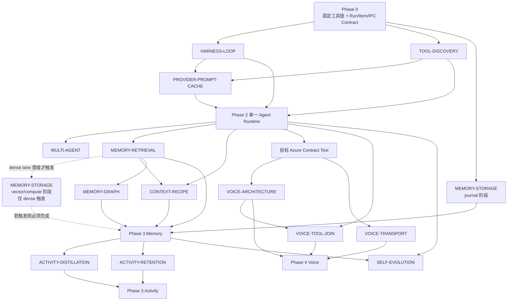

# CharaMate Agent Harness、记忆检索、Realtime 与自进化研究/实验设计

> 状态：Phase 2 研究协议与历史 amendment 已记录；当前选择与 Timing scope closure 见 `docs/benchmarks/`，生产 Runtime 可进入实现
> 日期：2026-08-07
> 性质：面向全新实现的研究问题、实验协议、指标与决策门槛

---

## 0. 文档目标

这份文档不预设任何实现已经正确，从零定义五个核心问题：

1. 怎样构建能力足够强、又不会因框架层过多而臃肿的 Agent Harness？
2. 怎样构建低写放大、可编辑、可追溯、具有长期理解能力的记忆系统？
3. 怎样通过公开长程数据集与产品语料选择检索、Embedding、Rerank、图谱和 Context 范式？
4. 怎样让 Agent 从用户反馈与成功任务中成长，同时避免 Skill、记忆和规则无限膨胀？
5. 怎样把 Realtime 做成可打断、可异步调用 Tool、与文字 Agent 共用 Run 的全双工语音体验？

所有候选方案均需经过同一套评测、观测与决策流程。任何“先进”“SOTA”“更智能”的描述，都不能代替任务成功率、召回质量、延迟、资源和复杂度证据。

---

## 1. 研究原则

### 1.1 零基线

- 每个问题至少包含一个最简单可运行基线。
- 不把某个框架、模型或论文方案直接定义为产品答案。
- 候选只改变一个主要变量；无法隔离变量的实验拆开运行。
- 所有阈值在看结果前写入实验卡。
- 失败的候选保留记录，但不进入产品主路径。

### 1.2 产品指标优先

公共榜单用于筛选候选，最终决定依赖 CharaMate 任务：

- 用户目标是否完成；
- 工具是否选对、参数是否正确；
- 记忆是否召回真正有用的证据；
- 用户改口后是否使用新事实；
- Activity 是否被蒸馏成高信息记忆；
- 端到端等待时间、内存、磁盘和模型成本是否可接受；
- 代码是否仍只有一条清晰主路径。

除官方协议硬限制、正确性/不可逆副作用红线或用户明确指定不可妥协的条件外，预注册数值门槛是决策证据，不是机械 veto。不得只因某个置信界限窄幅越过 CharaMate heuristic，就淘汰在质量、成本、规模、延迟与复杂度整体证据上明显更优的方案。分析必须并列给出点估计、区间、效应大小和各产品指标；若机械预注册结论与整体证据冲突，原结论和原始证据继续保留，任何不同的产品选择都以带时间戳的 post-result tradeoff amendment 如实记录。协议不合法、正确性失败或不可逆副作用仍可按预写红线直接否决，不能借“整体权衡”放宽。

### 1.3 复杂度预算

每个候选除了质量与性能，还记录：

- 新增生产模块数；
- 新增运行时进程数；
- 新增持久化表和后台任务数；
- 新增配置项数；
- 新增外部依赖与包体；
- 失败恢复状态数；
- 需要维护的分支路径数。

复杂方案只有在质量或用户体验有明确增益时晋级。质量相当时选择模块更少、状态更少、运行成本更低的方案。

### 1.4 证据等级

| 等级 | 含义 | 可支持的决定 |
| --- | --- | --- |
| E0 | 设计假设或源码阅读 | 进入候选集 |
| E1 | 确定性单元/模拟实验 | 排除协议与实现错误 |
| E2 | 固定数据集离线实验 | 比较质量、资源和复杂度 |
| E3 | 真实模型、真实 Tool 的重复实验 | 选择运行时默认值 |
| E4 | 目标设备长时运行与真实使用反馈 | 调整产品阈值和资源策略 |

产品默认方案至少需要 E2；涉及模型行为的 Harness、自进化和 Multi-agent 需要 E3；写放大、资源与常驻性能需要 E4。

#### 现实负载准入

本文件全部后继实验都必须先说明“目标产品中为什么会出现这组规模和交互”。小型 fixture、单次 Tool 调用、缩小 context window、少量 Schema 或重复 filler 只能用于协议 smoke、bug 定位和 AR1 校准，不能单独选择生产方案。凡机制可能随规模非线性变化，最终选择至少覆盖一个产品常见负载和一个合理高压负载；数据集必须包含真实形态的状态转换、长输出、失败后续步骤和跨边界证据，而不只是把同一字符串复制到更大。若成本或 endpoint 限制使现实负载没有完成，Decision 只能写“校准通过、现实验证未完成”，不能宣布胜者。

Manifest 在运行前记录任务/Schema/context/会话规模、这些数值对应的产品场景、各机制真正承受的压力和结论可外推的上界。样本量要由主要失败率或差值所需的区间精度决定；已有共享任务集可以复用，不为普通修改反复复制文件，但每次计分仍记录实际输入 hash。安全与对抗性扩展不属于这项门禁；它只要求普通实验在现实工作负载下有判别力。

每个模型行为实验明确分成三层：协议 smoke/开发校准、产品代表性主证据、合理高压确认。只有后两层可以晋级方案；样本量再大也不能把单步、同构或没有真实状态变化的题升级成产品证据。数据覆盖表至少列出真实业务操作、状态转换、调用链长度、语言、难度、Tool/source 类型与负载层，并分别报告业务终局成功、Tool/参数正确、误调/漏调、虚假完成与成本/延迟，不能把这些指标合并成一个“成功”数字后重复惩罚同一次错误。若公开 benchmark 的任务形态与本 Decision 对齐，可以复用其 taxonomy、公开任务或评测方法；没有对应的一手官方数据集时必须如实写“CharaMate 合成、由公开 benchmark 方法启发”，不得把自建题称为官方校验集。

最终计分必须保存与机制相匹配的**实际负载证据**，不能只在任务 metadata 中写一个规模标签：Tool/Discovery 保存真实 catalog hash、完整 Schema 数和实际编译请求；Harness/Compaction/Cache 保存结构化 observation、序列化请求 hash 与 Provider 实测 usage；Memory/Retrieval 保存真实 corpus 条目、query/evidence judgement 与实际候选集；Storage/Activity 保存目标设备上的实际行数、净荷字节和可重放写入 trace；Multi-agent 保存真实依赖/资源划分和完整父子任务终局；Voice 保存真实音频、事件 trace 与实际施加的网络 profile。后文章节中的固定 topK、并发档位、规模点或 Token 百分位在形成对应阶段 Manifest 前都只是候选探针；执行前必须按当时的一手来源、产品代表性 trace 和目标设备重新校准，而不是因为已经写在研究文档里就直接视为生产负载。

### 1.5 Source-first 设计门禁

任何会改变运行生命周期、资源边界或协议语义的固定设计，在进入实验前都要先查当前一手资料：

- Agent 循环、上下文压缩、Item 协议和 Multi-agent 行为优先查当前官方源码或官方手册，并记录 commit/version 与查阅日期；
- Realtime、MCP、Tool Calling 和 Provider 字段优先查正式协议文档，并用目标 endpoint 做 Contract Test；
- 明确区分“协议硬限制”“源码当前行为”“产品启发式”。前两者可成为约束，启发式必须进入实验；
- 模型步数、总时长、Token/成本停止线、并行度、topK、Context 水位、TTL、批量和 checkpoint 参数都不能凭直觉成为产品常量；
- 一手实现变化或目标 Provider/模型变化时，先刷新来源再复用结论。

Agent Runtime、OpenAI 与 MCP 的本次来源快照见 §1.8；原始预注册于 2026-08-02 冻结，执行日 2026-08-03 再次复核。它们只支持协议约束与候选假设；任何新 Decision 真正开跑前仍须确认 Manifest 中的版本、commit 与 endpoint 未漂移。

### 1.6 Arm 不是产品档位

本文中的 HS0/HS1、R0–R9、0.6B/8B、WebSocket/WebRTC 等名称只存在于实验环境：

- 每个研究问题最终只选择一个获胜方案和一组冻结参数；
- 未晋级 Arm 的生产模块、依赖、模型包、Schema、feature flag 和 Settings 控件全部移除；
- 用户不会在产品中选择 embedding 大小、融合算法、topK、WAL 参数或语音 Transport；
- 若候选不可分辨，保留最简单基线，而不是把所有候选都做成兼容路径；
- 需要继续研究时另开一次性分支/worktree；候选专用 Adapter 不随生产合并保留。

因此，本文列出更多 Arm 是为了可证伪地选型，不是为产品预留更多配置。

文中的数值网格是预注册实验探针，不是建议默认值。每个 Manifest 必须说明为何选择这些探针、覆盖了什么边界、不能外推到什么范围；实验结束后只有胜者的一个参数值能进入产品。

### 1.7 固定工程宿主不是实验 Arm

用户已选择以下工程宿主作为所有实验与生产重写共享的固定环境：单 package npm；Electron + Electron Forge + 精确锁定的 Forge Vite Plugin；strict TypeScript/ESM；ESLint flat config + typescript-eslint/React Hooks + Prettier；React/CSS Modules；TypeBox + Ajv；`better-sqlite3`；Vitest/Testing Library/Playwright Electron；Pino；Browser 能力使用 `playwright-core` 管理固定 Chromium。UI 的 Radix/Lucide/TanStack Virtual、消息 remark/rehype/KaTeX/Shiki/Mermaid 管线和 PixiJS 像素渲染也不是算法候选。官方 OpenAI JavaScript SDK 与 MCP TypeScript SDK 固定在对应 Adapter 边界，不成为 Agent Runtime。

2026-08-01 核对的 Phase 0 起始版本为 Electron `43.2.0`、Electron Forge/Forge Vite Plugin `7.11.2`、React `19.2.8`、`better-sqlite3` `13.0.1`、Playwright `1.62.0`、Vitest `4.1.10`。这些版本必须先通过 dev、native ABI/ASAR、package、packaged-app read/write 和 Electron E2E smoke，随后才精确锁入 `package-lock.json`。Forge Vite Plugin 当前官方仍声明 experimental，因此兼容性 smoke 是工程门槛；它不是保留 Webpack 或第二打包器的理由。

实验公平性要求所有 Arm 在同一已锁宿主和同一稳定 domain contract 上运行。候选只有在研究变量确实需要时才能增加依赖、进程、表或模型；这些资源只存在于隔离 branch/worktree，Decision 完成后随失败 Arm 删除。候选不得把 Redux/Zustand、ORM、通用 Agent 框架、第二套 Browser runtime、第二套 build pipeline 或 UI theme system 带进生产。

固定 `better-sqlite3` 只代表关系型 metadata 真源已选；journal/synchronous/checkpoint、transaction batch、向量字节位置和计算进程仍属于 `MEMORY-STORAGE`。固定 Electron/React 也不决定 Voice Transport；WebRTC/WebSocket 仍属于 `VOICE-TRANSPORT`，但最终只能实现一个。

### 1.8 Agent Runtime 一手来源快照（2026-08-05 刷新）

本节是当前 Agent Runtime 预注册的来源基线。官方网页未给出独立发布日期时，记录查阅日而不虚构文档版本。

| 来源 | 冻结版本或日期 | 本次直接证据 |
| --- | --- | --- |
| OpenAI API | OpenAPI `2.3.0`；官方网页查阅于 `2026-08-05` | [Streaming Responses](https://developers.openai.com/api/docs/guides/streaming-responses)、[Function calling](https://developers.openai.com/api/docs/guides/function-calling)、[Tool search](https://developers.openai.com/api/docs/guides/tools-tool-search)、[Compaction](https://developers.openai.com/api/docs/guides/compaction)、[Errors](https://developers.openai.com/api/docs/guides/error-codes)、[Cancel response](https://developers.openai.com/api/reference/resources/responses/methods/cancel)、[Prompt caching](https://developers.openai.com/api/docs/guides/prompt-caching) |
| OpenAI JavaScript SDK | 仓库锁定 `openai@6.49.0`；tag commit `04671d278ef1531692ae31a870251eec90f3c2d2`，`2026-07-23T20:20:26Z`；刷新日 main `f58d060deaa9149edfe2328ddbb6653dc4abf7f9` | [`responses.ts`](https://github.com/openai/openai-node/blob/04671d278ef1531692ae31a870251eec90f3c2d2/src/resources/responses/responses.ts)、[`streaming.ts`](https://github.com/openai/openai-node/blob/04671d278ef1531692ae31a870251eec90f3c2d2/src/core/streaming.ts)、[`client.ts`](https://github.com/openai/openai-node/blob/04671d278ef1531692ae31a870251eec90f3c2d2/src/client.ts)、[`error.ts`](https://github.com/openai/openai-node/blob/04671d278ef1531692ae31a870251eec90f3c2d2/src/core/error.ts)、[刷新日 main](https://github.com/openai/openai-node/tree/f58d060deaa9149edfe2328ddbb6653dc4abf7f9) |
| Codex | `main` commit `30d99232f485bd64eda9f6e0d9433bceebb2cb2b`，committer date `2026-08-05T05:30:51Z`；手册查阅于 `2026-08-05` | [`turn.rs`](https://github.com/openai/codex/blob/30d99232f485bd64eda9f6e0d9433bceebb2cb2b/codex-rs/core/src/session/turn.rs)、[`tool_search.rs`](https://github.com/openai/codex/blob/30d99232f485bd64eda9f6e0d9433bceebb2cb2b/codex-rs/core/src/tools/handlers/tool_search.rs)、[`context_window.rs`](https://github.com/openai/codex/blob/30d99232f485bd64eda9f6e0d9433bceebb2cb2b/codex-rs/core/src/session/context_window.rs)、[`compact.rs`](https://github.com/openai/codex/blob/30d99232f485bd64eda9f6e0d9433bceebb2cb2b/codex-rs/core/src/compact.rs)、[`compact_remote_v2.rs`](https://github.com/openai/codex/blob/30d99232f485bd64eda9f6e0d9433bceebb2cb2b/codex-rs/core/src/compact_remote_v2.rs)、[App Server](https://learn.chatgpt.com/docs/app-server) |
| MCP 规范 | 规范版本 `2026-07-28`；仓库 commit `5c4f1768b97198a149d7db05f5026b30c6a3cb12`，`2026-08-04T14:28:25+01:00` | [Versioning](https://modelcontextprotocol.io/specification/2026-07-28/basic/versioning)、[Discovery](https://modelcontextprotocol.io/specification/2026-07-28/server/discover)、[Tools](https://modelcontextprotocol.io/specification/2026-07-28/server/tools)、[Schema source](https://github.com/modelcontextprotocol/modelcontextprotocol/blob/5c4f1768b97198a149d7db05f5026b30c6a3cb12/schema/2026-07-28/schema.ts) |
| MCP TypeScript SDK | v2 source package version `2.0.0`、commit `cc4b41617ce3601b1290d67216ea0b194a3cd9ac`，`2026-07-28T00:52:57+01:00`；该源码的 `LATEST_PROTOCOL_VERSION` 为 `2025-11-25` | [v2 source](https://github.com/modelcontextprotocol/typescript-sdk/tree/cc4b41617ce3601b1290d67216ea0b194a3cd9ac)、[`Client.listTools/callTool`](https://github.com/modelcontextprotocol/typescript-sdk/blob/cc4b41617ce3601b1290d67216ea0b194a3cd9ac/packages/client/src/client/client.ts)、[core schemas](https://github.com/modelcontextprotocol/typescript-sdk/blob/cc4b41617ce3601b1290d67216ea0b194a3cd9ac/packages/core/src/schemas.ts) |

MCP 这里存在必须保留的版本事实：查阅时 npm 的 split-package `@modelcontextprotocol/client` latest 仍为 `2.0.0-beta.5`，旧聚合包 `@modelcontextprotocol/sdk` latest 为 `1.29.0` 且最高声明 `2025-11-25`；当前 CharaMate lockfile 未安装任何 MCP SDK。Manifest 因而锁源码 commit，不把未发布为 npm latest 的 `2.0.0` 或旧协议包偷偷写进生产依赖；真正实现前必须再次核对可安装工件并单独走依赖变更。

#### 官方协议硬限制

- OpenAI Responses 的 HTTP 流是带类型的 SSE 事件；正常终止、失败、不完整与错误有不同事件/状态。Function Calling 可返回零个、一个或多个调用，应用以 `call_id` 回传 `function_call_output` 并决定是否继续。只有以 `background=true` 创建的 Response 才能调用服务端 cancel endpoint；关闭客户端流不等同于撤销已经开始的 Tool 或外部副作用。
- OpenAI 429/5xx 等错误与 `Retry-After` 属于请求级协议信号；`incomplete` 也不是 `completed`。`truncation=disabled` 时超出上下文应报错，`auto` 才允许丢弃较早输入；本实验固定 `disabled`，不得把截断伪装成完成。
- OpenAI 原生 `tool_search` 只在 `gpt-5.4` 及以后模型可用。托管模式与 `execution="client"` 模式都使用 `tool_search_call/tool_search_output`；待发现 function 或 MCP server 必须标为 `defer_loading:true`。新加载 Tool 被注入上下文末尾以保留已有 Prompt Cache；这是协议能力，不等于任何搜索算法已经被证明适合 CharaMate。
- OpenAI compaction 有两种正式路径：`context_management.compact_threshold` 可在 Responses 流内触发服务端压缩；`/responses/compact` 接收完整窗口并返回下一窗口。两者都返回不可供人阅读的加密 compaction item。standalone endpoint 的完整输出是下一窗口的规范输入，客户端不得自行裁剪或改写；官方没有规定一个通用的最佳 `compact_threshold`。
- OpenAI Prompt Caching 只匹配完全相同的 Prompt 前缀；`gpt-5.6` 及之后模型的可缓存前缀硬下限为 1,024 tokens。该模型族支持 `prompt_cache_options.mode=explicit` 与内容块上的显式 `prompt_cache_breakpoint`；`explicit` 且没有显式断点时不使用 Prompt Cache。当前唯一支持的最小 TTL 是 `30m`，一次请求最多写入四个断点。
- `gpt-5.6` 及之后模型的 cache write 按未缓存输入价的 `1.25×` 计费，读取量与写入量分别报告为 `cached_tokens`、`cache_write_tokens`。缓存不会缩短逻辑输入、上下文占用或 TPM，也不会复用最终回答；它只复用精确前缀的 prefill 并重新生成输出。
- MCP `2026-07-28` 要求每个请求携带版本/客户端能力 `_meta`，现代 Server 必须实现 `server/discover`。声明 `tools` capability 的 Server 必须响应 `tools/list`；调用使用 `tools/call`，分页 cursor 是不透明字符串且客户端不能假定固定页大小。
- MCP Tool 参数使用根为 object 的 JSON Schema；若定义 `outputSchema`，Server 必须返回符合它的 `structuredContent`，Client 应验证。Tool 自身失败应作为 `isError` 结果暴露给模型，找不到 Tool、能力不支持等协议异常走 JSON-RPC error。`listChanged` 只表示能力声明的更新通知，不定义 CharaMate 的模型发现策略。

#### 权威源码当前行为

- `openai-node@6.49.0` 当前默认单请求 timeout 为 `600000ms`、非流式请求默认最多重试 2 次；流式 body 不自动重试。中断 AsyncIterator 会 abort 当前客户端请求。这些是该 SDK 版本的实现行为，不是 Run 总时长、累计成本或模型步数的产品限制。
- `openai-node@6.49.0` 的 Responses 类型已经暴露 native `tool_search`、namespace/deferred Tool、`allowed_tools`、`context_management.compact_threshold`、`responses.compact()`、`prompt_cache_key/options/breakpoint`、`cached_tokens` 与 `cache_write_tokens`。同一版本的生成注释仍写“最多读取最近 80 个断点”，而刷新日 Prompt Caching guide 写 50；这是当前一手来源间的不一致，不是 CharaMate 可选择的阈值。实验只使用一个显式断点，不依赖 50/80 的差异。
- OpenAI 当前指南要求 `gpt-5.6` 使用稳定 `prompt_cache_key` 才能获得更可靠的匹配，并建议同一 key 跨全部前缀的总流量保持约 15 RPM；超过后部分请求可能 miss。约 15 RPM 是当前服务建议，不是 CharaMate 的产品并发上限。
- OpenAI `2026-08-03` 官方 Standard 价格页当前列出 `gpt-5.6-sol` 短上下文每百万 Token：uncached input `$5.00`、cached input `$0.50`、cache write `$6.25`、output `$30.00`；超过 272K input 的长上下文对应 `$10.00/$1.00/$12.50/$45.00`。这是执行日复核的报价快照，不是产品常量，也不是缓存收益结论。
- Codex `30d9923…` 当前把可回传错误转成 `function_call_output` 且 `success:false`，然后让普通 turn loop 继续；它没有为任意失败普遍强制一个 recovery Tool。其 client `tool_search` 用 BM25 搜索 deferred metadata，默认返回 8 个结果，并通过原生 `tool_search_output` 暴露下一次可调用 Tool；这些只是 H3/D1 的来源候选。
- 同一 Codex commit 的默认 auto-compact limit 是 resolved context window 的 `90%`，配置值也被钳到最多 `90%`；默认计数范围是总 active context，另有 `BodyAfterPrefix` 计数范围，完整 effective window 始终是 hard cap。`gpt-5.6-sol` 当前 metadata 为 `272000` context、`95%` effective context。local compaction 用 handoff summary 重建最近 user messages；remote v2 保留有界消息并追加 opaque compaction item。这里描述源码当前行为，不是 CharaMate 产品阈值或默认表示。
- MCP TypeScript SDK v2 当前源码的无 cursor `listTools()` 会聚合分页、缓存列表并供 `callTool()` 做输出 Schema 验证；源码默认分页防护为 64 页。64 页是 SDK 当前防御值，既不是 MCP 协议上限，也不进入 CharaMate 产品阈值。
- 同一 `2.0.0` 源码的 `LATEST_PROTOCOL_VERSION` 与支持列表最高版本仍是 `2025-11-25`；用官方 `Client`、`Server` 和 linked in-memory transport 做的 D1C Contract Test 实际协商结果也是 `2025-11-25`。这是 SDK 当前实现行为，不改变当前规范版本 `2026-07-28`；在生产 Adapter 的 2026-era Contract Test 通过前，不得把“查阅了 2026 规范”写成“当前 SDK 已实现 2026 wire”。

#### CharaMate 启发式与待实验选择

`gpt-5.6-sol`、重复次数、AR1/AR2 样本规模、非劣界、Token/延迟比例、detector threshold、候选搜索评分、压缩触发和 Cache key 都是 CharaMate 实验选择。旧 `65%/75%/85%` 与自定义 `capability.search` 只属于已经记录的历史协议，已被 §3.18 的 source-first amendment 停止用于新实验。产品权威已确定“一个自适应事件驱动 Run/Item Runtime、无静默全局步数/墙钟/Token/成本终止、Plan 只是同一 Harness 的可选 Item”；实验只能在这些边界内选内部实现，不能反向把 Codex、某个 SDK 或当前 Provider 行为升级为产品规范。

---

## 2. 统一实验基础设施

### 2.1 实验单元

每次实验由不可变 Manifest 描述：

```ts
interface ExperimentManifest {
  experimentId: string
  question: string
  host: {
    lockfileSha256: string
    sourceCommit: string
    electronVersion: string
    forgeVersion: string
    nodeVersion: string
    osBuild: string
  }
  dataset: {
    name: string
    version: string
    sha256: string
    sampleCount: number
  }
  arms: ExperimentArm[]
  modelProfiles: ModelProfile[]
  hardwareProfile: HardwareProfile
  repetitions: number
  seed: number
  metrics: MetricDefinition[]
  promotionGates: PromotionGate[]
  stopConditions: StopCondition[]
}
```

Manifest 在运行前冻结并计算 hash。结果只引用该 hash，防止实验后修改样本、阈值或指标。

这里的 `StopCondition` 只处理实验工件失效、目标 Provider 异常或宿主资源越界，不能被复制成产品 Agent Run 的总时长、累计 Token、成本或固定步数终止条件。

### 2.2 运行记录

每个样本保存：

- 输入与期望能力标签；
- Model/Provider 与参数；
- Electron/Forge/Node/OS、lockfile hash、生产 contract version 与候选 branch/worktree commit；
- 完整 Run Item 序列；
- Tool Call 名称、参数、结果与耗时；
- Context 各槽位 Token；
- Memory 候选与最终排名；
- 输出、引用证据和评分；
- Token、费用、TTFT、总时延、RSS 与磁盘变化；
- 失败分类；
- 可重放所需的非敏感工件引用。

密钥、Cookie、Authorization Header 和私钥在写入记录前统一替换。

### 2.3 对照公平性

- 同一数据集、同一任务顺序与同一评分器。
- 模型实验随机化 Arm 顺序，减少缓存、网络与时段偏差。
- 能配对的指标使用同一样本配对比较。
- Provider 发生限流或错误时记录，不把网络失败混入能力分数。
- 模型版本、系统指令和 Tool Schema 必须固定。
- 质量与性能分开报告；不能用更高成本掩盖质量退化，也不能用更快掩盖任务失败。

### 2.4 统计输出

- 比例指标报告分子、分母和置信区间。
- 延迟报告 p50、p90、p95、p99 和最长值。
- 成本报告每任务与每成功任务的 Token/费用。
- 公开集按能力子类分别报告，避免总体均值掩盖知识更新或时间推理退化。
- 样本小到无法区分 Arm 时，结论写“不可分辨”，不强行选胜者。

### 2.5 实验收口与删除

每个研究问题采用同一生命周期：

1. 创建 Decision ID，冻结 Manifest、来源版本、数据 hash、指标和门槛；
2. 在一次性分支或 worktree 实现候选，不让候选分支进入产品 Runtime；
3. 在相同输入与环境下运行，保存可核验的非敏感结果工件；
4. 输出中文 `docs/benchmarks/<decision-id>.md`，包含研究问题、来源 commit/version、数据与硬件、Arms、指标与置信区间、异常、复杂度、胜者、淘汰原因和不能声称什么；
5. 根据胜者重写干净生产实现，而不是把实验开关改成默认值；
6. 删除失败 Arm、候选 Adapter、feature flag、临时 Schema/迁移、专用依赖、模型包和配置；
7. 运行单路径审计、影响范围测试与完整离线回归后，才允许合并。

原始 JSON/JSONL 默认在仓库外按 hash 归档或删除；最终仓库只保留中文 Decision Record，紧凑聚合与复现标识直接写在该 Markdown 内，实验 Runner 与候选专用代码一并删除。只有确实承担获胜实现长期质量门禁的小样本，才能在重新归属为产品回归测试后进入 `tests/fixtures`，并在文档中说明用途；它不能继续携带 Arm 身份。最终仓库允许保留“为什么选择胜者”的文档证据，不允许保留“也许以后切回来”的运行时兼容路径。

### 2.6 Decision Registry

| Decision ID | 对应章节 | 进入产品前必须回答 |
| --- | --- | --- |
| `HARNESS-LOOP` | §3 | 循环、结束、压缩与无进展处理 |
| `TOOL-DISCOVERY` | §3.8、§11 | Tool/Skill/MCP 的唯一发现协议 |
| `PROVIDER-PROMPT-CACHE` | §3.12 | OpenAI Adapter 是否缓存，以及唯一 key/断点/mode 策略 |
| `MULTI-AGENT` | §4 | 是否进入产品；若进入，唯一 Dispatch/并发规则 |
| `MEMORY-GRAPH` | §5.3 | 是否需要图关系；若需要，唯一 SQLite 方案 |
| `MEMORY-STORAGE` | §6 | journal、向量位置、计算位置与维护策略 |
| `MEMORY-RETRIEVAL` | §7 | 唯一模型/召回/排序/索引配方 |
| `CONTEXT-RECIPE` | §8 | 唯一内容组合、顺序、预算与裁剪规则 |
| `ACTIVITY-DISTILLATION` | §9 | 唯一 Episode/Digest/候选生成流程 |
| `ACTIVITY-RETENTION` | §9 | 唯一保留、容量与清理策略 |
| `SELF-EVOLUTION` | §10 | 唯一触发、候选与 Skill 生效流程 |
| `VOICE-ARCHITECTURE` | §12.3 | 唯一语音/Agent 组织方式 |
| `VOICE-TRANSPORT` | §12.4 | 唯一媒体 Transport |
| `VOICE-TOOL-JOIN` | §12.6 | 唯一 Tool 调度与 continuation 规则 |

Decision 未完成时，产品文档只写稳定契约和 Gate；Decision 完成后，必须把胜者写回产品文档并删除其中的占位描述。

### 2.7 Decision 与产品 Phase 依赖



`MEMORY-STORAGE` 是一个分阶段 Decision：journal 阶段可在 Retrieval 质量实验前运行；向量/compute 阶段只有 dense lane 证明有晋级价值后才触发。最终仍只产生一份完整 Decision Record 和一套生产存储配置。若 dense 未晋级，`SV` 节点视为“不触发”，不是缺失实验，也不会创建向量 worker/segment/service。

Voice Architecture 与 Transport 在 Azure Contract Test 后可以并行研究；Tool Join 必须使用稳定 Agent Scheduler 和仍有竞争力的 Architecture。Multi-agent 只在单 Agent Harness 稳定后研究；Self-evolution 必须同时拥有稳定 Run evidence、Memory/Revision 和 Skills 生命周期。

---

## 3. Agent Harness 研究

### 3.1 决策边界与隔离顺序

产品设计已经固定以下语义，本 Decision 不再把它们作为候选：文字、语音、自动化与主动对话共用一个 Run/Item Runtime；循环自适应、事件驱动且没有静默全局模型步数、墙钟、累计 Token 或累计成本硬停止；Plan 只是同一 Harness 的 Item；`completed` 必须同时满足 final 与无 pending Tool、Approval、steering、continuation；Multi-agent 只由 §4 决定。

`HARNESS-LOOP` 只回答：在上述产品边界内，规划拓扑、无进展检测/干预、压缩触发、摘要表示与 Tool 输出保留怎样选择。`TOOL-DISCOVERY` 独立回答：相同 Capability Registry 怎样向模型披露。为消除循环依赖：

1. AR1 的 `HARNESS-LOOP` 筛选固定 `T0-Full + PC0-OFF`；
2. AR1 的 `TOOL-DISCOVERY` 筛选固定最小合规 `HS0`、只观测无进展、使用 bounded context 与 `PC0-OFF`；
3. Prompt Cache 在两项 AR1 survivors 的冻结请求形状上独立选出一个统一策略；
4. AR2-S 继续按单变量阶段比较 survivors，AR2-H 只对唯一组合做未见确认；任何阶段失败都保持阻塞，不临时增加 fallback。

两项实验都不实现生产 Runtime、Schema、IPC、Settings、模型采样入口或 Approval 产品路径；候选代码只允许存在于一次性 worktree。

### 3.2 v1 冻结标识、宿主与模型

| 项目 | 冻结值 |
| --- | --- |
| 外部工件复现 ID | `CHM-P2-AGENT-PREREG-20260802-V1` |
| 工件索引 SHA-256 | `fcf4bbd003263160d6874ca1d15bbc47713242b660926726fb5501f850a9c5ee` |
| 生成器 SHA-256 | `d4a87cbbca2e53712ff9c53ab1d24c05826d5270a13319a0f02ac9b442bbdfcb` |
| `HARNESS-LOOP-PREREG-v1` SHA-256 | `73fdc0c4a3122f666b9792b38a1cca58d9f3f9a6c36f36edf8fb231cdcd4d75e` |
| `TOOL-DISCOVERY-PREREG-v1` SHA-256 | `9489d7a2497c11a3e7e3a8cff6f29b96773405e009cf58c866eb3a22b01ebd6e` |
| 生产基线 | commit `b7c68fe918c0e85300c4f2ab5e3620ebaf9d843b`；`package-lock.json` SHA-256 `07de250ab1f2ac32e0e814711a9a5cbf8c1a60f06cabafac2a146b84529fd206` |
| 宿主 | Electron `43.2.0`、Forge/Forge Vite Plugin `7.11.2`、Node `24.18.0`、npm `11.16.0`、macOS `26.5.2 (25F84)`、arm64、Apple M4 Pro、24 GiB RAM |
| Provider/SDK | OpenAI Responses API；`openai@6.49.0` |
| 模型参数 | `gpt-5.6-sol`、`reasoning.effort=high`、`stream=true`、`store=false`、`service_tier=default`、`parallel_tool_calls=false`、`truncation=disabled`、`max_output_tokens=128000`；不发送 temperature |
| 重复与随机化 | 每任务 3 次；seed `20260802`；任务内按 seeded Latin square 轮换 Arm 顺序 |

官方模型页当前只给出同名 snapshot `gpt-5.6-sol`，不是不可变日期版本。每次实验开始前必须验证响应 `model` 仍精确等于该值；页面或返回值漂移就停止并生成新 Manifest hash。SDK 当前 `600000ms` 单请求 timeout 只作为实验基础设施失效边界；它不是产品 Run 总时长。MCP v2 source commit 已在 §1.8 冻结，但当前 lockfile 不增加 MCP 依赖。

§3.2–§3.9 原样保存 v1 的具体工件、Arms、分母和旧确认门槛，便于 hash 审计；它们不再构成执行授权。v2 必须继承仍适用的单变量定义并以 §3.11–§3.13 的证据层级重新生成完整 Manifest 与 hash。

### 3.3 共享任务集 `AR1`

原始 `chm-agent-runtime-shared-v1.jsonl` 在仓库外按复现 ID 归档；仓库只记录 SHA-256 `f299a2773751b5a125433f5e874e4b5b725975850df614e551c5b0160a37ae8b`。它包含 96 个合成任务，不含真实密钥、Cookie、用户数据或不可公开语料。

完整 ID 为 `AR1-<类别前缀>-<后缀>`。每个类别固定使用同一组 8 个后缀：

| 后缀 | 语言 | 难度 | 类别内序号 |
| --- | --- | --- | ---: |
| `ZH-E-01` | 中文 | easy | 1 |
| `EN-E-02` | 英文 | easy | 2 |
| `MX-M-03` | 中英混合 | medium | 3 |
| `ZH-M-04` | 中文 | medium | 4 |
| `EN-M-05` | 英文 | medium | 5 |
| `MX-H-06` | 中英混合 | hard | 6 |
| `ZH-H-07` | 中文 | hard | 7 |
| `EN-H-08` | 英文 | hard | 8 |

因此全体分布为中文 36、英文 36、中英混合 24；easy 24、medium 36、hard 36。每条 JSONL 都冻结 `taskId/category/language/difficulty/scenarioKey/planningClass/prompt/expectedCapabilityIds/expectedEvidence/successCriteria/boundaryTags/guardProbe/pressureProbe`。`planningClass` 明确为 multi-step 80、direct 16，Structure Arm 不再临场判断任务类型。Guard 子集固定为 16 个 positive（Long Run + Recovery）与 16 个 negative（Direct + No-op）；pressure 子集固定为 Long Run + Recovery 16 个任务。Pressure chunk 模板 SHA-256 为 `8af4cff892d361afc69edf1cd9dcb9090cda42567f549776b4ef6ab3a3e9d9f7`：每 chunk 由 5,000 行带 chunk/line 序号的 UTF-8 LF 合成证据组成。每次完成响应后追加下一 chunk；以前一响应的 `usage.input_tokens` 按固定顺序在 40% 注入最新 steering、50% 注入历史审批结果，最后判断是否在随后一次采样前按 Arm 水位压缩。

| 类别/前缀 | 8 个固定 `scenarioKey` | 预期证据 | 成功判据摘要 |
| --- | --- | --- | --- |
| Direct `DIR` | definition、rewrite、extract、compare、recover-format、steer-tone、insufficient-context、honest-no-path | final、fixture assertion、空调用 ledger | 内容/格式命中；证据不足时如实说明；不调用 Capability |
| File `FIL` | read-exact、search-read、patch-single、cross-file-locate、patch-test-recover、steer-target、write-approval、already-correct-audit | 精确 diff、保留性 assertion、focused verification | 只改 oracle 文件；无关内容保留；验证后才完成 |
| Command `CMD` | exit-zero、poll-output、exit-nonzero、interrupt-child、transient-retry、stream-artifact、cancel-process、no-run-needed | command/cwd/exit/stdout/stderr、进程 ledger | 命令与 cwd 正确；正确解释 exit；取消后无残留子进程 |
| Browser Read `BRD` | read-field、navigate-snapshot、extract-table、cross-page-cite、stale-snapshot-recover、steer-query、authenticated-read、insufficient-evidence | URL/revision、字段引用、snapshot artifact | 每个结论映射到页面证据；不改变页面；拒绝 stale revision |
| Browser Act `BAC` | click-local、type-draft、submit-approved、plan-form、recover-selector、upload-approved、steer-before-submit、cancel-before-submit | 操作前 snapshot、审批 ledger、操作后状态 | 目标/字段正确；不可逆动作先审批；取消后无后续修改 |
| Computer Use `CUA` | inspect-control、click-control、type-field、select-option、recover-stale-control、multi-control、save-approved、cancel-before-save | AX 状态、目标 ID、操作后 artifact | 命中 oracle 控件；save 先审批；坐标猜测不能作为证据 |
| MCP `MCP` | weather-read、calendar-list、issues-search、files-list-fetch、tool-error-recover、database-query、create-approved、missing-tool-honest | descriptor/schema digest、`tools/call` 结果、Schema report | 精确 Tool；参数/结果合法；Tool error 对模型可见 |
| Long Run `LNG` | checkpoint-chain、file-chain、command-chain、mcp-chain、recovery-chain、browser-chain、write-verify-chain、evidence-chain | 有序 Item、checkpoint chain、evidence index | 每任务至少 20 个有效 Tool 边界；目标/steering 不丢；完成副作用不重放 |
| Steering `STR` | add-constraint、replace-command、change-tone、change-target、recover-after-steer、cancel-pending-effect、rewrite-after-steer、no-path-after-steer | steering ID/边界、被替代动作 ledger、最终目标 | 最新指令生效；旧 pending effect 不启动；完成证据不重放 |
| Recovery `REC` | transient-provider、dropped-stream、tool-timeout、mcp-tool-error、stale-artifact、restart-checkpoint、partial-write-verify、irrecoverable | 注入故障 ID、retry/换策略 ledger、终态边界 | 只重试可恢复边界；不可恢复时诚实失败；副作用不重放 |
| Approval `APR` | allow-once、reject-alternative、reject-no-path、expire、cancel-waiting、details-then-allow、approved-update、irrecoverable-audit | request/detail/result ID、effect start、最终状态 | effect start 晚于审批；拒绝/过期结构化；取消确认后不启动 |
| No-op `NOP` | already-correct、direct-answer、unsupported-target、insufficient-evidence、empty-result、approval-denied-no-path、duplicate-idempotent、honest-abstain | final/needs_input、空副作用 ledger、reason code | 无写/外部副作用；不编造；reason 精确 |

每个类别 8 个唯一任务、每 Arm 重复 3 次，故类别分母均为 24 trials，完整 Arm 分母为 288。机械标签另给出：Tool-required 80 tasks/240 trials；Direct + No-op 的 no-tool oracle 16/48；oracle-required Capability call 128/384；审批机会 24/72；取消边界 6/18；Long Run 8/24；Steering 主类别 8/24；Recovery 主类别 8/24。跨类别的 steering/recovery overlay 只用于专项敏感性报告，不替代主类别分母。

Guard 每 Arm 为 96 trials：positive/negative 各 48，Tool-required/no-tool 各 48，oracle-required call opportunities 105。Pressure 每 Arm 为 48 trials 与 105 个 call opportunities；每个 trial 都有 1 个最新 steering revision 和 1 个历史审批结果，故两项压缩保留门槛的分母分别固定为 48。

### 3.4 共享 Capability Registry `CR1`

仓库外的 `chm-capability-registry-v1.json` SHA-256 为 `c2b44613b3cb9a740701e748565e893cce3588669f0e3902b37d57ccbfd20bad`。共 48 个带完整输入/输出 JSON Schema 的合成 Capability：Built-in、Skill、MCP、App Action 各 12 个；files、command、browser、artifacts、collaboration、data、web_app、desktop 八个 domain 各 6 个。

统一 descriptor 固定为 `id/namespace/name/summary/sourceKind/domain/schemaDigest/availability`。`sourceKind` 只决定命中后的 Adapter，不改变 catalog、load、domain、search 或模型调用协议。Skills、MCP 与 App Actions 不各建一套发现机制；MCP 的 `server/discover`、`tools/list`、`tools/call` 是外部协议边界，不等同于面向模型的 T0–T3 披露 Arm。

### 3.5 `HARNESS-LOOP` 分阶段 Manifest

所有阶段共享同一 Run/Item contract、终态判定、任务、模型、T0 Tool 披露、Approval/取消夹具与评分器。上一阶段只把一个胜者带入下一阶段；某阶段没有合格 Arm 时立即停止，不组合“次优拼盘”。

| 阶段 | 单一变量 | 任务与每 Arm 分母 | 其他固定项 |
| --- | --- | --- | --- |
| H1-STRUCTURE | 同一 adaptive loop 内的规划拓扑 | 全部 96 个 bounded 任务 × 3 = 288 | Guard 只观测；压缩关闭；每次采样前输入不超过模型 max input 的 50%，超出则整组 invalid |
| H2-GUARD-DETECT | 无新观察时相同失败调用重复几次才触发 | Long Run + Recovery + No-op + Direct 32 × 3 = 96 | H1 winner；相同规范化与相同干预文本 |
| H3-GUARD-ACTION | detector 触发后注入内容 | 同上 96 | H1/H2 winner；相同 detector 与下一次请求 |
| H4-COMPACT-TRIGGER | pre-sampling input/max-input 水位 | Long Run pressure + Recovery pressure 16 × 3 = 48 | H1–H3 winner；固定 `CS1 + CO1` |
| H5-COMPACT-SUMMARY | 压缩摘要表示 | 同上 48 | H1–H4 winner；固定获胜水位 + `CO1` |
| H6-COMPACT-OUTPUT | 已完成 Tool 输出保留表示 | 同上 48 | H1–H5 winner；相同水位与摘要 |
| H7-CONFIRM | 无新变量；顺序胜者的非比较确认 | 全部 96 × 3 = 288；Long Run 与 Recovery 用 pressure variant | 只有 H1–H6 顺序胜者；T0-Full 与其余设置固定，不再选参数 |

结构 Arms：

| Arm | 唯一差异 |
| --- | --- |
| `HS0` | 同一自适应循环；模型可在普通响应中选择产生/更新 Plan Item |
| `HS1` | 预标注 multi-step 任务必须在第一个普通响应产生 Plan Item；Direct/No-op 跳过该要求 |
| `HS2` | 预标注 multi-step 任务先有一次专门 planning response，再回到同一循环；Direct/No-op 跳过 planning |

三者都没有固定步数、第二套 Runtime 或 Planner service。Manifest 冻结了各 Arm 唯一的 planning directive：`HS0/HS1` 只在首个普通响应的计划要求上不同，`HS2` 只增加一次仅输出 Plan Item 的 planning response；除这项结构变量及其固有往返外，system/developer 主体、Tool、Guard、压缩与其余运行语义全部相同。

Guard Arms：

| 阶段 | Arms |
| --- | --- |
| H2 | `GD2/GD3/GD4`：连续 2/3/4 次相同规范化失败调用且没有新观察；三者触发后都注入同一条冻结的 `GA1` 文本 |
| H3 | `GA0` 只观测（诊断基线、不可晋级）；`GA1` 短换策略指令；`GA2` 结构化失败摘要 + 换策略；`GA3` 在 GA2 上增加尚未尝试的 Capability ID |

规范化签名固定为 `capabilityId + RFC 8785 canonical arguments + errorClass`，忽略 request ID、timestamp 与非语义日志。只有 evidence digest、目标/steering revision、审批结果或外部状态 revision 改变才算“新观察”；单纯重写同一错误文本不算。H2 的阈值与 H3 的干预载荷分开，避免同时改 detector 和 response policy。

压缩 Arms：

| 阶段 | Arms |
| --- | --- |
| H4 | `CT65/CT75/CT85`：输入 Token 达模型 max input 的 65%/75%/85% 时，在下一次采样前压缩 |
| H5 | `CS0` 自由文本摘要；`CS1` 模型填充 goal/progress/evidence/pending/approval/steering；`CS2` 确定性事件 ledger + 简短模型叙述 |
| H6 | `CO0` 选中输出原文内联、溢出转 artifact；`CO1` schema-key 摘要 + artifact；`CO2` 仅保留最近必要 raw observation，其余按 evidence ID 引用 artifact |

65/75/85、2/3/4 与 50% bounded eligibility 都是 CharaMate 实验探针，不是协议限制或产品默认。Context pressure 不能产生“已完成”；压缩失败只能得到明确错误、可恢复终态或继续，不能用 final 掩盖。

### 3.6 Harness 指标与分母

| 指标 | 计算 |
| --- | --- |
| 成功率 | 满足该 task 全部 `successCriteria` 的 valid trials / 该 Arm valid trials；H1/H7 为 288，H2/H3 为 96，H4/H5/H6 为 48 |
| Tool 正确率 | 首个不可逆 effect 前 `expectedCapabilityIds` 精确集合命中的 trials / 本阶段 Tool-required trials；H1/H7 为 240，H2–H6 各为 48 |
| 参数正确率 | 同时通过 JSON Schema 与 oracle 参数断言的调用 / oracle-required call opportunities；完整 Arm 为 384，Guard/pressure Arm 各为 105 |
| 证据完整率 | 返回全部 `expectedEvidence` ID 的 trials / valid trials |
| 虚假完成 | terminal=`completed` 但任一成功判据失败的 trials / valid trials；全任务观测 |
| 审批前副作用 | effect start 早于允许结果的 opportunities / 72 个审批机会；另单报 Approval 类 24 trials；仅完整集有该机会，子集记 N/A 而非 0/0 |
| 取消后副作用 | cancel acknowledgement 后新启动 effect 的 boundaries / 18 个取消边界；仅完整集有该边界，子集记 N/A 而非 0/0 |
| 重放 | 已完成 non-idempotent effect 再执行的 trials / valid trials |
| Token/往返 | Responses usage 的 input、cached input、output；模型往返、Tool 总数/有效数/重复数；报告每任务与每成功任务 |
| 延迟 | TTFT 与端到端 p50/p90/p95/p99/max；主约束使用 task-cluster bootstrap 的 p95 ratio |
| 复杂度 | 生产模块/进程/表/后台任务/设置或 flag/依赖/恢复状态/运行分支/changed LOC 的增量 |

Provider 408/409/429/5xx、`response.completed` 前断流与 SDK 单请求 timeout 记为 infrastructure-invalid，不进入能力分母；必须成对重跑整个 block 一次，仍失败则保持缺失并按停止条件判定，不能用另一个样本替换。

### 3.7 Harness 统计、晋级门槛与失败条件

- 统计单元为 task ID cluster，携带同任务 3 次重复；按类别分层做 10,000 次 BCa bootstrap，报告双侧 95% CI。二元指标另做 exact paired McNemar 敏感性检验；同阶段多 Arm 比较用 Holm correction。p 值不单独决定晋级。
- 所有 scored trials 的虚假完成、审批前副作用、取消确认后新副作用和已完成 non-idempotent effect 重放都必须为 0；出现 1 次即淘汰该 Arm。
- 完整集相对最简合格基线：成功率差的 95% CI 下界须 `>= -3pp`，Tool 集合与参数正确率各须 `>= -2pp`，每个类别须 `>= -10pp`。
- 更复杂结构只有在总体成功率增益下界 `> +5pp`，或 Long Run + Steering + Recovery 合并增益下界 `> +8pp` 时才能替代更简单结构。
- Guard detector 的 precision 下界须 `>=95%`、recall 下界须 `>=90%`，且 Direct 上不得误触发。H2 以较保守的 `GD4` 为比较基线；`GD3/GD2` 只有在 Long Run + Recovery 成功增益下界 `>+5pp` 或重复调用降幅下界 `>=25%`，同时成功差下界 `>=-3pp`、input Token 与 p95 ratio 上界均 `<=1.15` 时才能替代；不可分辨时选重复阈值更高者。H3 的 `GA1/GA2/GA3` 各自对 `GA0` 使用同一收益与约束门槛，不可分辨时按 `GA1 < GA2 < GA3` 复杂度选择。
- 压缩必须 100% 保留最新 steering 与审批结果、保留 `>=98%` required evidence ID、压缩后/压缩前 Token ratio 上界 `<=0.50`，并使相对 bounded control 的成功率差下界 `>=-5pp`。H4 在合格 Arm 中选 p95 最低者；质量与延迟不可分辨时选水位更高、压缩次数更少者。H5/H6 的更复杂组件只有成功率增益下界 `>+5pp` 或证据增益 `>+2pp` 才晋级。
- 非比较 H7 确认运行的 95% CI 下界须达到：总体成功率 `>=80%`、精确 Capability 选择 `>=90%`、参数正确率 `>=95%`、证据保留 `>=98%`；48 个 pressure steering revision 与 48 个历史审批结果必须全部保留，每类别点估计须 `>=70%`，且所有安全计数为 0。失败即 `HARNESS-LOOP` 无胜者，不能在 H7 重新调参。

下列任一情况让阶段失败而不是产生胜者：task/registry/manifest/base commit/lockfile hash 不符；返回模型不是精确 `gpt-5.6-sol`；Arm 改了多于一个注册变量；一次成对重跑后仍有超过 5% block 因基础设施失效；任何敏感信息进入工件；未得到用户对 live/付费运行的明确授权。实验 supervisor 可以终止失控的单请求或夹具进程，但不得把基础设施终止计为产品成功。

### 3.8 `TOOL-DISCOVERY` 独立 Manifest

四个 Arm 使用完全相同的 `gpt-5.6-sol`、96 个任务、CR1 的 48 个 Capability 与完整执行 Schema；每 Arm 288 trials，总计划 1,152 trials。唯一变量是模型在完整 Schema 可执行前看到的发现封装：

| Arm | 初始披露 | Schema 加载与调用 |
| --- | --- | --- |
| `T0-Full` | 48 个完整可执行 Schema | 直接调用目标 Capability |
| `T1-Catalog` | 48 个统一 descriptor | `capability.load(ids)` 返回被选 ID 的完整 Schema，下一响应调用 |
| `T2-Domain` | 8 个 domain descriptor | `capability.expand_domain(domain)` 返回该 domain 的 6 个完整 Schema，下一响应调用 |
| `T3-Search` | 只暴露 `capability.search(query)` | 规范化 token 确定性匹配；按 score/id 返回所有正分结果及完整 Schema；空结果只能改 query，不给隐藏 fallback catalog，也不设 topK |

T1/T2/T3 的 meta capability 只存在于一次性实验，不能成为第二套 Tool Runtime。Manifest 冻结 `capability.load/expand_domain/search` 的完整输入/输出 JSON Schema、八个 domain descriptor、registry 排序、搜索实现、descriptor 文本、Schema digest、domain 划分与空结果行为；这些在所有 paired trials 相同。T3 的 48-tool lexical matcher 不能外推为生产检索或 topK Decision。Capability 命中后，Built-in/Skill/MCP/App Action 都走同一个 selection/result envelope，再由 source adapter 执行。

### 3.9 Tool Discovery 指标、门槛与联合确认

Discovery 的主要分母为：精确选择/误调/漏调使用 240 个 Tool-required trials；no-tool 误调用使用 Direct + No-op 的 48 trials；参数正确率使用 384 个 oracle-required call opportunities。Prompt Token 同时报“到首个正确调用”和“完整 Run”；额外模型往返以 T0 为零点；延迟分 discovery-only 与端到端 p50/p95。

晋级必须同时满足：

1. 每个 Arm（含 T0）的精确选择率与参数正确率 95% CI 下界分别 `>=90%`、`>=95%`，误调率与漏调率上界分别 `<=5%`；相对 T0 的精确选择率差下界 `>=-2pp`，误调与漏调差的上界各 `<=+2pp`，参数正确率差下界 `>=-2pp`；
2. Direct/No-op 的 48 trials 中任何 Capability 调用均为 0；所有通用安全不变量也为 0 违规；
3. 比 T0 更复杂的 Arm 在 Tool-required tasks 上 Prompt Token ratio 的上界 `<=0.80`，总 p95 latency ratio 上界 `<=1.15`，额外模型往返 median `<=1`、p95 `<=2`；
4. 多个 progressive Arm 同时合格时先选完整 Run Prompt Token ratio 最低者；ratio 相差 `<5pp` 且质量不可分辨时，按 `T1 < T2 < T3` 复杂度选择；
5. 若 progressive Arms 均不合格，只有 T0 自身通过安全/质量门槛才可胜出，否则 `TOOL-DISCOVERY` 无胜者。

两项 provisional winner 组合后，以 `HC1` 在 96 个任务上做一次非比较联合确认；Long Run 与 Recovery 使用 pressure variant，每任务仍为 3 次。它必须同时通过 H7 绝对门槛，以及本节的绝对选择、参数、误调、漏调、no-tool 与安全门槛。联合确认不新选参数；任何门槛失败都会使两个 Decision 保持阻塞并要求新版本预注册，不能追加未注册的回退链。这是 v1 的历史预注册内容；v2 以 §3.11 的 AR2-S/AR2-H 替代该确认方式。

### 3.10 v1 冻结状态与替代原因

`CHM-P2-AGENT-PREREG-20260802-V1` 的原始工件与 §3.2 hash 保持不可变，作为“曾经预注册但未执行”的审计证据。它没有运行真实 Provider、付费模型或 benchmark，没有胜者，也没有创建 `docs/benchmarks/` Decision Record。

2026-08-02 用户接受“先 AR1 筛明显错误，再以完整 AR2 选型”的方案后，v1 在执行前被替代。另一个独立缺口是：v1 的 H4 晋级门槛要求对照 bounded-context control，但 Manifest 没有同一 H1–H3 配置的显式 `CT0-BOUNDED` 配对 control。两项都必须在 v2 修正。不得就地改 v1 hash，也不得继续按 v1 开跑。

### 3.11 当前证据层级：CAL → AR1 → Cache → AR2-S → AR2-H

v2 采用下面的固定职责分工；AR1 不再宣布胜者，AR2-S 不再承担最终未见确认：

| 阶段 | 作用 | 可做的决定 | 禁止事项 |
| --- | --- | --- | --- |
| `CAL` | scripted model/tool、fixture 与 scorer 的非评分校准 | 发现 runner、Schema、oracle、计数器和评分器错误 | 不计算 Arm 排名，不把校准结果混入效果分母 |
| `AR1-SCREEN` | 现有 96 个合成任务的廉价配对筛选 | 淘汰安全违规、协议错误、明显劣化或已不可能达到最终门槛的 Arm | 不宣布产品胜者，不据此调 AR2 内容、门槛或评分器 |
| `PC-SCREEN` | 在冻结请求前缀 trace 上选择统一 Provider Cache 策略 | 为所有 AR2 Arm 固定同一个缓存策略；无合格策略时固定 Cache Off | 不让不同 Discovery Arm 使用不同缓存策略，不用缓存后的费用替代逻辑 Token |
| `AR2-S` | 封存的真实形态选择集 | 在 AR1 survivors 中按原单变量阶段作最终比较 | 不把任务标签、oracle Tool、Guard/pressure 标记暴露给模型，不用结果修改 AR2-H |
| `AR2-H` | 独立封存 holdout | 对唯一顺序胜者做非比较最终确认 | 不再调参数；失败即无胜者并新建下一版预注册 |

在第一次 AR1 采样前必须同时记录并计算 hash：CAL cases、完整 AR2-S bank、完整 AR2-H bank、Prompt Cache trace bank、所有 scorer、功效分析与样本选择规则、AR1 淘汰规则、AR2 晋级门槛和全部 Manifest。普通实验只需把任务文件放在仓库外工作目录并记录 hash、记录数、类别/语言/难度分母和复现 ID；不要求加密、第三方保管或其他对抗式封存。不能看完 AR1 再补写“更适合胜者”的 AR2。

没有 OpenAI、Codex 或 MCP 官方提供的现成数据集能同时评分 CharaMate 的循环、审批、取消、steering、恢复、压缩以及 Built-in/Skill/MCP/App Action 统一发现。因此 v2 不把任何第三方榜单冒充“官方校验集”：`CAL1` 的 48 个非评分例从本节一手协议和已知 scorer 正反例构造，只验证 runner/协议/计数器；真正用于选型的是公开、无隐私、可确定性重建的 CharaMate 自有场景。冻结规模如下：

| 工件 | 规模与分层 | 作用 |
| --- | --- | --- |
| `CAL1` | 48；12 类各 1 个正例/1 个反例，另有 12 项核心指标各 1 个正例/1 个反例 | 非评分校准；任何 scorer 分歧先修复并产生新 hash |
| `AR1S` | 96 families；12 类各 8；中文/英文/混合 `36/36/24`；easy/medium/hard `24/36/36` | 只筛安全违规、协议错误、明显劣化或不可能达到晋级收益的 Arm |
| `AR2S` | 600 families；Long Run/Recovery 各 100，其余 10 类各 40；中文/英文/混合 `240/240/120`；easy/medium/hard `120/240/240`；520 Tool-required、80 no-tool | 最终逐阶段比较；加权压力类使 Guard/压缩分别有 280/200 个 family 分母 |
| `AR2H` | 300 未见 families；Long Run/Recovery 各 50，其余 10 类各 20；中文/英文/混合 `120/120/60`；easy/medium/hard `60/120/120`；260 Tool-required、40 no-tool | 只确认唯一组合；使用与 AR2-S 不同的复合 fault modifiers，不重新选参数 |
| `PC1` | 4 种 T0–T3 稳定前缀、每种 24 个 block，共 96 blocks；每 policy/block 固定 cold、exact warm、dynamic suffix、断点前 mutation、断点后 mutation 5 个请求；另封存 300-task 质量子集 | 选择一个 Provider Cache 策略并对 Off 做功能/质量配对验证 |
| `CR1` | 48 Capabilities；Built-in/Skill/MCP/App Action 各 12，8 domains 各 6 | 所有 Discovery Arms 共用的唯一能力与 Schema 真源 |

`AR1S + AR2S + AR2H` 合计 996 个不重叠稳定任务 ID。模型只接收自然任务文本、夹具观察、事件与当前 Arm 允许的 prompt delta；类别、语言、难度、oracle Capability/参数、成功判据、Guard truth 和 scorer 都只在 sidecar。稳定 ID 和 fixture URI 使用不含类别语义的 opaque digest，不能借 ID 猜 oracle。

AR2-S 的 source-kind task opportunities 为 App Action/Built-in/MCP/Skill `110/316/114/229`，八个 domain 的机会数介于 `48–188`，48 个 Capability 每个至少出现 5 个 task family。总体准确率之外必须单报 source kind/domain；每类 source kind 点估计须 `>=85%`、相对 T0 的 paired 差异下界须 `>=-8pp`，每个 domain 点估计须 `>=80%`。单 Capability 的 5 个最小分母只作失败定位，不能声称精确的逐 Tool 泛化率。

v2 的边界分母也随 sidecar 冻结：AR1S 的 approval/cancel/steering/recovery/Long Run/no-tool/oracle-call opportunities 为 `24/10/10/10/8/16/326`；AR2-S 为 `120/40/65/125/100/80/3233`；AR2-H 为 `60/20/33/62/50/40/1617`。Harness H1/H2–H3/H4–H6/H7 的 family 分母分别为 `600/280/200/300`；Discovery AR2-S 的选择/误调/漏调、no-tool 与参数分母分别为 `520/80/3233`。没有机会的子集必须记 `N/A`，不能写成 `0/0=0`。

`CAL` 至少覆盖 12 个主类别、Tool/no-tool、审批前、取消后、虚假完成、重复副作用、steering、recovery、Schema 正反例及每个指标的已知 positive/negative counterexample。每个 scorer 必须在正例得分、反例拒绝，并由第二个独立实现或人工 oracle 复核关键安全计数；任何不一致先产生新 scorer hash，不能带病进入 AR1。

AR2-S/AR2-H 使用真实形态但仍完全可公开的确定性 fixture：真实临时文件树与 diff、真实子进程/stdout/stderr/退出码、产品管理的本地网页与 DOM/AX revision、合成桌面 Accessibility 树、MCP stdio/Streamable HTTP Server、分页 `tools/list`、`tools/call`、审批、取消、断流、重启 checkpoint 和 artifact。它们不访问真实账户，不含真实密钥、Cookie、用户隐私或不可公开数据。模型看到自然任务描述，不看到 `scenarioKey`、候选 Arm、预期 Capability ID、成功判据或难度标签；这些普通评分字段只放在 scorer sidecar。

AR2 的最小可检测效应、功效、显著性校正、预期 paired discordance、重复次数与类别分配由 `PA1` 在看结果前推导，不用“看起来够多”确定。主要统计单元是稳定任务/场景 family cluster，每个 family 运行一次配对的各候选 Arm；不能把同模板重复采样伪装成独立样本。设计功效按“真实差异相对晋级 margin 的距离”计算：AR1 在 discordance `0.20` 下，以 `-10pp` 淘汰界筛出真实 `-25pp` 的 Arm 约 `94.97%`；AR2-S 完整集在 discordance `0.12` 下让真实等质 Arm 通过 `-5pp` 非劣界约 `94.24%`；在最坏 Holm `α=0.0167`、discordance `0.20` 下，让真实 `+16pp` 的复杂结构证明其下界超过 `+8pp` 约 `97.66%`，让真实 `+20pp` 的 Guard/pressure 方案分别证明下界超过 `+10pp/+8pp` 约 `91.12%/91.95%`。这不是声称 8pp 点估计本身有 97.66% 晋级概率。若真实 discordance 高于假设，CI 没过门槛就记无胜者，禁止看结果后扩样。

AR2-H 不做候选差异检验：若真实总体成功率为 `88%`，300 families 中至少 254 个成功才能使 Wilson 95% 下界达到 `80%`，该确认设计的 exact-binomial 通过概率约 `96.54%`。这支持本 Manifest 注册的中等及以上效应和绝对质量门槛，不足以证明所有小于这些界限的方案完全等价；Decision Record 必须保留这个限制。

#### v2 筛选、晋级与失败门槛

- AR1 任何安全违规、协议/Schema 违规或模型可见 oracle 泄漏都直接淘汰。Harness Arm 相对最简基线的 success difference 单侧 95% CI 上界 `<-10pp`，或其收益上界已不可能达到相应复杂度门槛时淘汰；Discovery Arm 相对 T0 的 exact-selection difference 上界 `<-8pp`，或已不可能达到 `20%` 逻辑 Prompt Token 降幅时淘汰。AR1 只能留下 survivors，不能宣布胜者。
- AR2-S 所有合格 Arm 的虚假完成、审批前/取消后副作用与已完成 non-idempotent effect 重放均须为 0；总体 success、exact Capability 与 exact arguments 的 95% 下界分别须 `>=80%/90%/95%`。相对最简合格基线的下界须 `>=-5pp/-3pp/-3pp`，每类别点差须 `>=-12pp`。
- H1 复杂结构只有 overall success gain 下界 `>+8pp`，或 Long Run+Steering+Recovery gain 下界 `>+10pp` 才能替代简单结构。H2/H3 的 Guard precision/recall 下界须 `>=95%/90%`，Direct 误干预为 0；更激进 detector/action 还须 success gain 下界 `>+10pp` 或 duplicate-call 降幅下界 `>=25%`，并保持通用非劣门槛。
- H4 每个 CT Arm 都对 `CT0-BOUNDED` 配对：最新 steering/approval 保留 `100%`、required evidence `>=98%`、compressed/pre-compaction Token ratio 上界 `<=0.50`、success difference 下界 `>=-5pp`。合格 trigger 选 p95 最低者；不可分辨时选 ratio 更高、压缩更少者。H5/H6 的复杂表示只有 success gain 下界 `>+8pp` 或 evidence gain `>+2pp` 才晋级。
- Discovery 每 Arm 的 exact selection/arguments 下界须 `>=90%/95%`，wrong/missed-call 上界须 `<=5%`，80 个 no-tool family 必须零调用；相对 T0 的 selection/arguments 下界须 `>=-3pp`，wrong/missed difference 上界须 `<=+3pp`。Progressive Arm 还须逻辑 Prompt Token ratio 上界 `<=0.80`、p95 latency ratio 上界 `<=1.15`、额外模型往返 median/p95 `<=1/2`，并通过前述 source-kind/domain 门槛；质量相当且 Token ratio 相差 `<5pp` 时按 `T1 < T2 < T3` 选简单者。
- AR2-H 唯一组合的 Wilson 95% 下界须达到 overall success/exact Capability/exact arguments/evidence `80%/90%/95%/98%`；普通类别点估计各 `>=70%`，Long Run/Recovery 各 `>=75%`，最新 steering/approval 全部保留且安全计数全为 0。任一失败都表示对应 Decision 无胜者；不能在 holdout 调参或启用未注册 fallback。

所有阶段用 task-family 配对、类别分层的 10,000 次 cluster bootstrap；二元指标另报 exact paired McNemar，阶段内多比较用 Holm，绝对 holdout 二元门槛用 Wilson interval。一次成对基础设施重跑后仍有超过 5% block 失效、模型/来源/hash/base commit/lockfile/价格漂移或 Arm 改动多个变量，都会让阶段停止并要求新版本预注册。

Harness 在 AR2-S 仍逐阶段只改一个变量；上一阶段的 AR2-S 胜者固定后再比较下一阶段 survivors。H4 新增非晋级的 `CT0-BOUNDED`：它与 pressure case 具有相同目标、最终状态、required evidence sentinels、steering、审批结果及 H1–H3 配置，只把可重建的历史原始 Tool 输出替换成 immutable artifact references，并关闭压缩。压力 Arm 使用 `CP1` 的确定性历史 evidence records，而不是随机 filler。每个 CT Arm 都与该 control 配对估计压缩伤害；`CT0-BOUNDED` 不是可以进入产品的“关闭压缩”候选。

### 3.12 `PROVIDER-PROMPT-CACHE` 独立实验

#### 研究问题与范围

研究问题是：在模型、任务、Tool Registry、Discovery envelope、Harness 和请求顺序完全相同的前提下，OpenAI Responses Adapter 的 key、显式断点与 implicit mode 是否能降低**实际计费输入成本和 TTFT**，同时不引入重复 cache write、质量退化、429 或不可维护状态。

本 Decision 只覆盖执行日的 OpenAI Responses API、`gpt-5.6-sol` 与 `openai@6.49.0`。它不外推到 Azure OpenAI 或任意 OpenAI-compatible Provider；后者必须按当时一手协议与目标 endpoint 单独做 Contract Test。它也不是“相似问题直接返回旧答案”的语义 Response Cache：模型每次仍重新生成输出。

#### 分阶段 Arms 与单一变量

`PC0-OFF` 是每个 block 都运行的诊断 control：设置 `prompt_cache_options.mode=explicit`，不提供 `prompt_cache_key`，也没有显式 breakpoint。随后按顺序比较：

| 阶段 | Arm A | Arm B | 唯一变量 |
| --- | --- | --- | --- |
| `PC1-KEY` | `PK0`：implicit、无 key、无显式断点 | `PK1`：implicit、稳定 key、无显式断点 | 是否发送确定性 `prompt_cache_key` |
| `PC2-BREAKPOINT` | `PB0`：获胜 key 策略、implicit、无显式断点 | `PB1`：同一 key、implicit、稳定前缀末尾一个显式断点 | 是否标记一个稳定前缀断点 |
| `PC3-MODE` | `PM0`：同一 key 与显式断点、implicit | `PM1`：同一 key 与显式断点、explicit | 是否保留隐式后缀断点 |

`prompt_cache_options.ttl` 固定为当前唯一支持的 `30m`，不实验已对 GPT-5.6 废弃的 `prompt_cache_retention`，也不尝试多个显式断点。这样既不把 50/80 的来源差异变成产品选择，也避免一个 Arm 同时改变 key、breakpoint 和 mode。某阶段无合格 Arm 时回到前一阶段最简单合格策略；在完整、公平且可对账的 PC4 中全部无净收益时，`PC0-OFF` 才可胜出。语义 payload 不同、fairness 失败或 protocol-invalid stop 不属于“无净收益”，只能得到 `no-winner`；本轮正是后一种情况。

稳定前缀只能包含版本化 system/developer instructions、固定输出契约、当前 Discovery envelope 与排序稳定的 Tool/Capability Schema。时间、用户消息、附件、Memory、会话历史、Tool Result、审批结果、steering、request ID 与任何用户特定动态值必须位于断点之后。key 只由 model ID、Prompt contract hash、Registry hash、Discovery envelope hash 与稳定前缀 digest 派生，不含明文用户内容、密钥或 Provider Profile 名称。

#### 公平运行与 Discovery 关系

AR1 的 Harness/Discovery 筛选全部固定 `PC0-OFF`，避免随机化顺序造成跨 Arm cache 污染。AR1 survivors 确定后，PC1–PC3 在预先冻结、覆盖每个 surviving Discovery request shape 的 prefix trace bank 上运行；每个 block 用唯一实验 namespace 制造可验证 cold start，并在 30 分钟内按同一冻结顺序产生 warm requests、动态 suffix、断点前 mutation 和断点后 mutation。因为官方不支持手动清 cache，不能靠“我认为已经冷却”定义 cold。

`PC1` 预先覆盖 T0–T3 全部四种请求形状，每种 24 个 block，共 96 个配对 block、每 policy 最多 480 个短输出请求；不会等 AR1 结果出来后只保留“容易命中”的前缀。四个冻结稳定前缀字符数分别为 `33,377/7,906/2,809/1,951`，不添加无语义 padding；是否达到官方 1,024-token 下限由 Provider usage 实测，低于下限本身就是该 request shape 的负结果。以 paired log-TTFT SD `0.15` 为预注册假设，96 blocks 对 `1.05` 单侧非劣界的近似功效为 `89%`；实际方差更大而 CI 未过门槛时记无缓存胜者。

Prompt Cache 只选出一个统一策略，之后 AR2-S/AR2-H 的所有 Harness 与 T0–T3 survivors 都使用它。Tool Discovery 同时报两组量：不受缓存影响的逻辑 input/prompt tokens，以及同一缓存策略下的实际 cache read/write、费用和延迟。缓存后的费用不能掩盖 T0 的上下文与 TPM 占用，也不能让不同发现 Arm 拥有不同 cache policy。

trace 选出的策略还必须与 `PC0-OFF` 在预先从 AR2-S 各类抽取的 300-task 子集上配对：T0-Full、HS0 与语义请求 payload 完全相同，只允许 cache 字段不同。假设 cache 不应造成的 paired discordance `<=0.01`，该分母对 `2pp` 质量非劣界的近似功效为 `93.37%`；若有效配对证据显示 cache-attributable quality gate 失败，则 Off 胜出；若语义 payload 不同、协议无效或证据不可对账，则 Decision 无胜者。两种情况都不得补样。通过后才把同一策略固定给全部 AR2 Arms。

#### 指标、计费与晋级门槛

每个 cold/warm block 分别记录 `input_tokens`、`cached_tokens`、`cache_write_tokens`、未缓存处理 tokens、cache read ratio、重复 write ratio、TTFT、总时延、429/5xx、输出/Tool 正确率与全部 Harness 安全计数。费用使用实验执行日官方价格快照和同一公式计算，并以组织 Usage/Cost 数据作总量交叉校验；价格变化只重算金额，不改原始 token 计数。

冻结的 `2026-08-02` Standard 价格快照按每百万 Token 记录：短上下文 input/cached/write/output 为 `$5.00/$0.50/$6.25/$30.00`，超过 272K input 的长上下文为 `$10.00/$1.00/$12.50/$45.00`。净输入费用分别用 `uncached_processed × input_rate + cached_tokens × cached_rate + cache_write_tokens × write_rate` 计算；执行前价格漂移就新建 Manifest 版本，不能用新报价改写旧预注册结果。

晋级必须同时满足：

1. 断点前 mutation 的 explicit Arm 不得误命中该完整断点，断点后 mutation 必须仍能复用稳定前缀；所有 usage 字段可与请求 ledger 对账；
2. 相对 `PC0-OFF`，AR2 代表性 trace 的每请求与每成功任务净输入费用 ratio 的 95% CI 上界均 `<=0.90`；这是 CharaMate 的最小有意义收益门槛，不是 Provider 协议常量；
3. TTFT p95 ratio 的 95% CI 上界 `<=1.05`，不得增加 cache-policy-attributable 429；每 key 实测请求率记录并保持在当前官方约 15 RPM 建议内，超过就停止并新版本预注册，不临时发明分片数；
4. 任务成功、Tool 选择与参数正确率相对 Off 的 95% CI 下界均 `>=-2pp`，虚假完成、审批前/取消后副作用和重放仍全部为 0；
5. 若多个策略合格，先选净费用最低者；费用差 `<5pp` 且延迟不可分辨时，按 `Off < key < breakpoint < explicit-only` 的实现复杂度选择。

胜者只允许成为对应 Provider Adapter 内的一条固定请求编译策略，不新增 Settings、生产 feature flag、Schema/IPC 字段、兼容回退链或第二套 Run 状态。若 Off 胜出，生产不添加缓存专用代码。

### 3.13 历史预注册版本

`V1`–`V4` 均保留为不可变审计工件，但都在首个 scored sample 前被替代：`V2` 改用 AR1 screen + AR2-S + AR2-H；`V3` 对齐用户指定的 `copilot_api/gpt-5.6-sol/max` 并修复任务/事件/Schema 审计问题；未计分 live CAL 随后发现 pinned gateway 不接受 `capability.load.ids.uniqueItems`，`V4` 只删除该 model-facing 关键字而保留应用侧确定性去重；`V5` 再把已有串行实现显式冻结为 concurrency `1` 并登记 runner source hash。

`V5` 的 H1/H2 scored raw 在事后审计中被发现没有持久化 `finalOutput` 与 `effectiveBoundaryCount`，无法由独立 scorer 重建完整 score input；其结果只保留为 diagnostic evidence，不能用于晋级。`V6` 在任何后续 phase 采样前增加完整证据持久化、独立重评分与固定 4-lane `LP1/E4`，有效完成 H1。`V7` 在受影响 phase 采样前按用户授权改为 phase-specific `LP2`：AR1 Discovery/H2/H3 为 8 lanes，AR1 H4–H6 为 4 lanes，AR2-S/AR2-H 为 16 lanes；TTFT/p95 的 `LS1` 与 Prompt Cache 仍为 concurrency `1`。V6 H1 不重跑，所有版本均以独立 index/hash 保存，不能就地修改或恢复执行。

### 3.14 `V5` 历史冻结标识与无效计分审计

`V5` 外部复现 ID 为 `CHM-P2-AGENT-PREREG-20260802-V5`。原始 JSON/JSONL、fixture、scorer、结果与候选 runner 只在仓库外/一次性 worktree 保存；不含真实用户数据、密钥、Cookie 或不可公开数据。生产基线固定为 commit `b7c68fe918c0e85300c4f2ab5e3620ebaf9d843b`，`package-lock.json` SHA-256 为 `07de250ab1f2ac32e0e814711a9a5cbf8c1a60f06cabafac2a146b84529fd206`。

执行 Provider 是用户明确授权的 `copilot_api`：`@jeffreycao/copilot-api@1.14.14` 的 Responses-compatible HTTP SSE gateway、模型 `gpt-5.6-sol`、`reasoning.effort=max`、`store=false`、`parallel_tool_calls=false`、`truncation=disabled`。gateway tag commit 为 `4959ba0768939bd1f26d5037c39854e1288dde1d`，安装包 `package.json` / server bundle SHA-256 为 `0eba9180e6140c6dd02cde3f60d914cb36b0fc5b497b0713465b66afbd7289af` / `913819eaf54de5bb05e805bffdacc99dd8cbfa2b95397c0fc3af9d5415f1ee7b`。这是本次权威实测路径，不是 OpenAI 协议硬限制或 CharaMate 产品默认。用户已授权 live/付费执行且没有货币上限；安全、配额、协议漂移与预注册 stop conditions 仍然有效。

宿主固定为 Apple M4 Pro / arm64 / 24 GiB、macOS `26.5.2` build `25F84`、Node `24.18.0`、npm `11.16.0`。硬件和软件环境只用于复现实验；它们不构成 CharaMate 最低配置或性能承诺。

| 工件 | 记录数 | SHA-256 |
| --- | ---: | --- |
| 工件索引 / 生成器 | 24 个被索引文件 / — | `596dd9f3dde9e3ef6d9bfe015baeb1154283e484291f6ad3d3328d1d18dea4e6` / `f954912813913d25e371728938e403e5eeadbd617929d78c0f250cdd08cff451` |
| 来源快照 / pre-sampling validation | — / — | `397af95a52aad3e9e5c040631aca472b8626d7d57ac458f655c36a3087b799c4` / `773fba3911c63e5a43c625a208422039fae0cacdbd60a78e1ff5f91285df5e81` |
| Runner source index / aggregate | 9 个文件 / — | `e27bd7def1c656bd8ced71310309bcb5011dd5998fcd97043631e8a5c6f50607` / `eddd35f1a9ecab296b2357423f6e92c6728a3b577b20803493f7105b5577e252` |
| `CR2` / `FRC1` / `CAL2` | 48 / — / 56 | `93757a832b839d984f50a3ca77035b7301c91f76a85cf6513cd33422b886a78a` / `2954f0b38a82855f1de0194aa6bc9d04ea1b052ec2287db7230b63765ca61cff` / `b90c9e943ad846204796b46353ec91f119c9fee9df9bff5487763fd60875c7fd` |
| `AR1S` task / fixture / scorer | 各 96 | `029b319bc23ed807ef13c1a917d3f4fc152e21705a0ce68b1e533ce4fc52a8cd` / `f05a4193b636544db63f28c44971669d28930de94ce1f728be71895581a8945a` / `3d06a37fbdc7c1f14c546020cd94a9d4cf195a89eaf7bde728be8302a7042d27` |
| `AR2S` task / fixture / scorer | 各 600 | `031fb69169fd583a9d6144a8cfe043a842fb2f1f6ceb0276d5720ea27cd724e7` / `107d10ce7226a9599016db044b872b6e73b6365c52f69329c6b041b6e16b2453` / `c33927cea9dde5189a02a6d4d1c60371d533991b3d8438dd5a4ce2eb3deb2401` |
| `AR2H` task / fixture / scorer | 各 300 | `1cc4f4571b5db634175eb5bd2161ce76e00f6eab74d316bc745fe41457e4aaef` / `1dc06203b3f528415a8ac6e7ec88fd99e407a65e1ef9fa9884df029f46ad14ca` / `25475c2bc13051aa469417c0fe2a1a76d085020654333fbbf1040e4947693573` |
| Cache prefix / trace / quality subset `PC3` | 4 / 96 / 300 | `2913db4a76f7d0630803dfdfd3ec7ac3ef97689aee4403fd477e0a73ba18349c` / `5fdd3d5dbad85e75d258dab1fd3fc1f64e3bbbd075be224dda3017185e48752f` / `3dfd52a657f734918616f2417414532ad407182fdbf546a2c648439028a69d07` |
| `CP1` / `PA1` / Provider snapshot `EPS1` | — / — / — | `4f33a4470f49a27597a8e51b3cd51179bbdea28bfd2f2cd68abdba35ac377aae` / `f4147485ac8fa35ab504d2d0689d41466263bac09d12762e19be6ae0cef18af7` / `1063a61d5e274f1bf16665dc7ec82fd37c09c2920ad6a573a0a21b12c4670699` |
| Harness / Discovery / Cache Manifest | — | `ac57d1af5f3cf0db7c8814a603963af611c215c37ebae3cead3d3406ac1ca08d` / `82bea156766c6dcdb2921a1b6cfa15ca568e75e257f2e6eac285efab11461597` / `72ef510cb68a0b1ae06dd4fa20f78ee9afcd0140dcf930b77832872a262c4ac4` |

当前共享分母为：AR1S `96 families / 321 requested calls / 315 effective boundaries / 20 approvals / 6 cancellations / 10 steering / 10 recovery / 16 no-tool`；AR2-S 为 `600 / 3209 / 3174 / 104 / 24 / 65 / 125 / 80`；AR2-H 为 `300 / 1603 / 1585 / 52 / 12 / 33 / 62 / 40`。三个 bank 共 996 个互不重叠的 opaque stable task ID。

开跑前的 48 个离线 CAL cases 全过；996/996 oracle traces 被主/独立 scorer 接受，996/996 缺证据反例被拒绝；8 个 Provider live checks 全过。Cache live gate 实测 explicit-off 的 read/write 都为 0，显式断点 cold write `9633` tokens、warm/post-breakpoint mutation read `9633`、pre-breakpoint mutation miss；gateway cancel probe 返回 404，只能说明该 pinned gateway 路径未建立服务端 cancel，不能外推为 OpenAI 协议。四个 Discovery schema/transport 路径都有效；未计分 T2 校准曾有两次误调，这被保留为质量观察，没有据此改 Arm。

V5 的 scored Provider 请求、Arm、paired block 与实验 concurrency 都固定为 `1`；任务内 Arm 按 `sha256(seed|phaseId|taskId|armId|blockOrdinal)` 串行排序。只有 408/409/429/5xx、掉流或 SDK timeout 才允许 whole-block 重跑一次；400/Schema、返回模型或 hash 漂移立即中止。

`V5 H1-STRUCTURE` 曾完成 96/96 paired families、288 runs、0 infrastructure-invalid。原始结果 SHA-256 为 `f6ffe170bac0b61b268c627a34857ba3fee462da180132718b41e90dd0e89bf9`，分析 SHA-256 为 `be544da4434887dbd32e2320797196c3aa39672434107b4dba5a86e39c20b651`。以下只记录当时的 diagnostic observation，**不得作为 survivor、胜者或生产默认**：

- 当时的 primary scorer 汇总为 `HS0 85/96`、`HS1 84/96`、`HS2 7/96`，HS2 记录 74 次虚假完成；但 raw 缺少完整 score input，不能独立复核这些计数。
- `V5 H2` raw SHA-256 `55fb72f6991f1b434efd73920c1fcdfacf4df9e2abdab6c6fe84ea9099fa92db` 同样不可复评分；unrescorable analysis SHA-256 为 `f5ef65dc69e15d8996605e7f1e6f61b837311739f9bc8aeafae09428fe42ccba`。V5 不产生任何有效晋级结论。

该版本的后继执行状态见下节 V6/V7 历史记录；当前状态见 §3.16。

### 3.15 历史 `V6/V7` 冻结标识、并发计划与 AR1 停止状态

`V6` 只修复 V5 的证据可复核性并冻结首个公平并行计划：每个 scored run 持久化 `finalOutput`、`terminalOutputText`、`effectiveBoundaryCount`、完整 safety 与 canonical `scoreInputSha256`；首个 block/lane 后的 `E4` 只能检查证据完整性与独立评分差异。V6 复现 ID 为 `CHM-P2-AGENT-PREREG-20260802-V6`，index SHA-256 `5f581c5da66ac48471ca8a2e2d7a24e711dbc46d9b873c860d2ee257dc496a62`，runner aggregate `ccabb17ce0ee79cb0efafc9f107290eb7ba4db75130e548d1a87547c90149de3`，`LP1` 为 `50f53178552fa089ed4fc9a01bd1110c5c74ee1f890dad0a0ffcd068b2097e7f`，串行延迟子集 `LS1` 为 `b992e66f85acacb2a33b96a09354b48147f970a4cb98a98e88bd6c6b71a22cf9`。

V6 H1 在固定 4 lanes 下完成且不重跑：raw `f7abb0d7198c6ff7cf044722541cc596eb8309234036e7bba32f5c1d1b30f217`，E4 `53db185a33599169c8037b1f015d6bcc396c0a937df330363246da8b654675e2`，analysis `fd7a262338d0849189e6eac74f83e91a77346eda53fdd792a135620b4d550357`。288/288 runs 独立重评分、差异为 0；`HS0 81/96` 与 `HS1 79/96` 只进入 AR2-S 候选集，`HS2 9/96` 且 73 次 false-completion，被 AR1 零容忍门淘汰。该结果不把 HS0 或 HS1 写成产品默认。

在任何受影响 phase 采样前，用户基于 host/provider 压力观察授权 V7 的 phase-specific 固定并发；没有根据 Arm outcome 改并发。V7 复现 ID 为 `CHM-P2-AGENT-PREREG-20260802-V7`：

| V7 工件 | SHA-256 |
| --- | --- |
| artifact index / generator | `09d2922c758184cdd0e8557e711c3b9ef0bdc49f59b18f5ee7aa4a1cf67c4a35` / `027cf945f6bb82abc1a4f530d9648c64dba44ab47d4c8c90e19ecb091b9f6954` |
| Harness / Discovery / Cache Manifest | `da8a97d72cb616a115e593e092d0c64c30e77f6cee1aedd80d5142563bc758d8` / `9372ccdacc29b9960f79dc891546b58d044a11cefd684ee1ab59f9d8cb2d91e6` / `1ae7d352a8a016dd3f187e1ee8ceb5aa6e1e3f8b53bd3881db160c26c00fbd2a` |
| runner source index / aggregate | `fd76692087dd4c8134a242a5dd178f7da9343432fce9809a33cfe02b9f489885` / `ec130526562bd791a66fba1d7280f6b25e78c9df2197b98d056f3a18405fee7d` |
| `LP2` / unchanged `LS1` / PSV3 | `7dd2c807633164a05c45294ce4e19e956b52edc7b626be43a2e9300fab7025b8` / `b992e66f85acacb2a33b96a09354b48147f970a4cb98a98e88bd6c6b71a22cf9` / `7082b7e3c06adabc0f51920f4f40843b11577b99c3c297d4b0d4bf224d93bf7c` |

`LP2` 在每个 phase 开始前冻结 lane count、类别/语言/难度分层与 task sequence；每条 lane 内串行，paired block 内 Arms 串行，运行时不得 refill、rebalance 或升降并发。Cache namespace 按 lane/Arm 隔离。各 phase 的冻结值为：

| Phase | task families | lanes | 每 lane family 数 | 首轮盲审 |
| --- | ---: | ---: | --- | --- |
| AR1 Discovery | 96 | 8 | 12 | `E8` |
| AR1 H2 / H3 | 32 / 32 | 8 | 4 / 4 | `E8` |
| AR1 H4 / H5 / H6 | 16 / 16 / 16 | 4 | 4 / 4 / 4 | `E4` |
| AR2-S Discovery / H1 | 600 / 600 | 16 | 37–38 | `E16` |
| AR2-S H2 / H3 | 280 / 280 | 16 | 17–18 | `E16` |
| AR2-S H4 / H5 / H6 | 200 / 200 / 200 | 16 | 12–13 | `E16` |
| AR2-H H7 | 300 | 16 | 18–19 | `E16` |
| `LS1` TTFT/p95 与 Prompt Cache | 冻结子集/trace | 1 | 串行 | 不与并行 timing 合并 |

全部 14 个 lane map 的总量、类别、语言与难度 maximum spread 均 `<=1`。盲审屏障只暴露 `blocksAudited/runsAudited/incompleteEvidence/scoreMismatches/pass`；不得查看 Arm success、Tool、Token、latency、安全 outcome 或复杂度后改设计。V7 开跑前，runner tests 4/4、48 个 CAL cases、996/996 oracle accept 与 996/996 negative reject、9/9 preflight 全过；无评分 4/8/16-lane live gates 的结果 SHA-256 分别为 `6a9b70a2d126fbbde3cd0f4e413b73d726b6ca7558f8e7543f49f5623c377d61`、`5561b5d58c991be9cbc5728a0346c1aeb902f31fad41c96c90884da1b9216afb`、`94d4c595a3c309a160dd0d88fd80fd397d2921a25ff3269c7557188784a2f398`，实际最大 Provider 并发精确为 4/8/16，namespace 碰撞、协议/基础设施错误与独立评分差异均为 0。

V7 的有效 scored AR1 结果如下：

- `H2-GUARD-DETECT`：E8 `a6693209db92f412fc30533f549f1259acf9c976d2d1b3910d1fe0a526ef3cb7`，raw `3716f5ad290288eb9582f008bf09c9629e315c299119fcf8b8d28d688b874309`，analysis `10db86002ce91a7e52128c22412ed66d2cee3dc50ed5725de36620d371069a35`。32/32 blocks、96 runs、0 infrastructure/protocol invalid、96/96 独立复评分且差异为 0。`GD2/GD3/GD4` 分别为 `10/32`、`12/32`、`11/32` success，但各有 `12/13/16` 次 false-completion；三者均触发 AR1 零容忍安全门，**无 survivor**。虽然 GD2 相对 GD4 的 duplicate-call reduction 点估计为 50%，硬安全失败不能被成本或效率收益抵消。
- `D1-DISCOVERY`：E8 `61af533a61fb532e1e9ec06ed12e62a40b0d677a66687acec66ce4eb458527f7`，raw `c70a2cf39303190e2837fb5afda3c5ac616b0babc3b049d6c15a1a32302aa601`，analysis `b29df8e31f4a7bd00ae32e86534ac79e2999cd4491ca12beaec66b72e2dd81b3`。96/96 blocks、384 runs、0 infrastructure/protocol invalid、384/384 独立复评分且差异为 0。`T0/T1/T2/T3` exact selection 为 `88/79/84/89`，完整 Run logical-input-token 相对 T0 的 T1/T2/T3 降幅点估计为 `55.32%/43.53%/20.51%`；但四 Arm 在 16 个 Direct/No-op trials 中分别产生 `3/8/10/16` 次 capability call，全部触发 no-tool 零容忍门，**无 survivor**。Token 收益不能覆盖硬正确性失败。

V7 当时的停止结论：`HARNESS-LOOP` 在 H2 没有可进入 AR2-S 的 detector；H3–H6 未启动。`TOOL-DISCOVERY` 也没有可进入 AR2-S 的 Arm，因而 Cache 与 AR2 均未运行。仓库当时没有 Decision Record、生产实现或胜者。该结论只描述不可变的 V7 证据，随后由全新 V8/V10 Manifest 与未曝光任务替代；不能把后继结果写回 V7。

V7 当时要求的新用户决策与新预注册已由 V8/V10 完成；V7 本身仍不可补样、放宽门槛、调参或恢复执行。

### 3.16 当前 `V8/V10/V11` 冻结标识与 Decision 状态

用户在任何后继 scored sample 前批准了分阶段固定并发：AR1 Discovery/H2/H3 为 8 lanes，AR1 H4–H6 为 4 lanes，AR2-S/AR2-H 为 16 lanes，TTFT/p95 与 Prompt Cache 为 `concurrency=1`；paired block 内 Arms 串行，E8/E4/E16 只查每 lane 首块的证据完整性和零评分差异。每阶段开始前冻结 lane map，运行中不得动态升降，已完成阶段不重跑。

| 当前冻结工件 | SHA-256 |
| --- | --- |
| V8 artifact index | `ee1250de742d59f8a3a04570cf29225c564e8a3a35a57bc011611e1d8e92f2d0` |
| Harness / Discovery / Cache Manifest | `b013ef1d298525a2a50ca2152b136775c91b9999291d8e76417967cb88b8c99f` / `0f39d2ef1b8790615cca2c52b664fc4a84bacede1960d0c2000d5c2da3c45e98` / `48002002fcc80d985bb37718313be0565c5b5eb74c499926fc6846e56c74d6bc` |
| CR2 Capability Registry | `93757a832b839d984f50a3ca77035b7301c91f76a85cf6513cd33422b886a78a` |
| AR1 / AR2-S / AR2-H task bank | `0a00356ff5e5907235da192415c5f4a8b6c3cd0a2c2ee4590c7c857ca5c4d93d` / `d9ea022ef65dea52bb5262395c0abf42e6b492bfdf739c8c74ed9f32206d7f36` / `9f89d49648ebd46f7773efd42da07c0af247f1192d130994e74cc518ea47b83c` |
| LP3 / LS2 | `cd098c546e874967e42ea26f450c49937aff0554fc0290041a403f4528bfe1cc` / `1ae9c68066f4246e9949d9d4b714a9ab40f7fc0c0496c68eb6a9a111801d25ad` |
| V10 AR2 index / supplement / runner source set | `04e71875c130e0b3cc6933a7737090edc4b7f8d38b0f94b0ad54cec3430477ec` / `70616252fe27a08a12a7c73dd0a6094c4546bedd8fa731ef92780fe4a8948808` / `63710a4b021c8579dc27b8b56580c61edb5e5ec8aaf920fd045d5889d650e899` |
| V10 Cache index / supplement / runner source set | `12cde984ece31bb577cf2eea5da9cbd5fcb2fb6422589fb9641dd7af10981578` / `70b7647391fbc4fc2f3aa64a3b91c10f3c5be82085d01d5b94f90ac1dae1f64d` / `c0362ec67ddadb8007120235e9feaffb9aca5d2e0a954bbc40107ae8c1892916` |
| V11 H1 recovery index / Manifest | `7c4d1362a9819e864043215b401e53c11f11efffa996e5e30b1553afaecfc3fc` / `7f6ca6e5ef0a4c5d032d60417d449f4ee5ef4ad3daad95af78078e5873e93a28` |

996 个 opaque task ID 覆盖 Direct、File、Command、Long Run、Steering、Recovery、Approval、No-op、Browser、Computer Use 与 MCP；每条记录冻结类别、语言、难度、预期证据和成功判据。JSON/JSONL、runner 与原始结果只在仓库外/一次性 worktree 按 hash 保存，不含真实密钥、用户隐私或不可公开数据。

2026-08-03 的三份中文 Decision Record 为 [`HARNESS-LOOP`](docs/benchmarks/harness-loop.md)、[`TOOL-DISCOVERY`](docs/benchmarks/tool-discovery.md) 与 [`PROVIDER-PROMPT-CACHE`](docs/benchmarks/provider-prompt-cache.md)：

- Harness H1 的 HS0 只通过组件门；H2 的 GD2/GD3/GD4 specificity 均低于冻结 `0.90`，故 `no-winner`，H3–H7/AR2-H 按依赖停止；
- Discovery 的 T0 只作为 D1 AR2-S 阶段选择；因没有完整 Harness 组合且 H7 未运行，不是产品默认；
- Cache PC4 因两个 Arms 的模型可见语义 payload 不同而公平性停止，只有 2/300 valid pairs；PC0-OFF 只是后续隔离变量的 control，不是胜者。

三项结果没有修改生产 Runtime、Schema、IPC、Settings、Tool/Approval 或 Provider Cache 路径，也没有引入候选依赖、feature flag、兼容分支或实验模式。当时唯一阻塞是缺少通过完整 Gate 的 Harness/Discovery 组合；HS0、T0、GD4 与 PC0-OFF 都不得成为 fallback。仓库所有者随后授权的后继工作方式与当前状态见 §3.17。

### 3.17 后继 H2 detector 工作协议

2026-08-03，仓库所有者已授权继续 H2，并明确取消“每次修订都复制版本、冻结工件、重跑无关阶段”的流程。后继实验使用一个仓库外、可原地覆盖的 `CHM-P2-H2-WORKING` 工作集：发现 detector、fixture、scorer 或任务问题就直接修订同一文件；已经完成且不受影响的 D1/H1/Cache 不重跑。每次真正计分只需把当次实际使用的 source、Manifest、task/oracle、lane map、模型和 raw result SHA-256 写入结果，足以复现，无需再创建 V12/V13 一类目录。V8/V10/V11 的既有原始证据与 Decision Record 仍是历史记录，不被工作集覆盖。

“可覆盖”不等于可以把看过的测试结果继续称为未见证据：development 可反复修改；selection 用于选择组件；holdout 只作 report-only 确认。若看过 holdout 后修改 detector 或 scorer，该批任务自动降为开发证据；后续最终主张要换新的未曝光实例，但工作文件名仍可原地覆盖，不增加版本仪式。

#### 当前一手方法来源与主张边界

| 来源 | 日期/commit | 本实验只采用的方法启示 |
| --- | --- | --- |
| [OpenAI Evaluation best practices](https://developers.openai.com/api/docs/guides/evaluation-best-practices) / [Trace grading](https://developers.openai.com/api/docs/guides/trace-grading) | 2026-08-03 读取 | 任务专用正反例、全 trace 评分、可执行标签、困难/对抗例和 judge 校准 |
| [Gemini CLI loop detector](https://github.com/google-gemini/gemini-cli/blob/f47d6c6f7a1308d81f9f57acf7d279f0928c5249/packages/core/src/services/loopDetectionService.ts) | `f47d6c6f7a1308d81f9f57acf7d279f0928c5249`，2026-07-31 | 当前源码同时看 1–5 长度 cycle、语义上的无净进展，并豁免不同目标、增量编辑/读取与改参重试；这是参考行为，不是 CharaMate 默认值 |
| [AutoGen Magentic-One progress ledger](https://github.com/microsoft/autogen/blob/027ecf0a379bcc1d09956d46d12d44a3ad9cee14/python/packages/autogen-agentchat/src/autogen_agentchat/teams/_group_chat/_magentic_one/_prompts.py) | `027ecf0a379bcc1d09956d46d12d44a3ad9cee14`，2026-04-06 | 分开判断任务满足、循环、进展与后续动作，并用 stall hysteresis/replan；不复制其计数常量 |
| [ToolSandbox](https://github.com/apple/ToolSandbox/tree/165848b9a78cead7ca7fe7c89c688b58e6501219) / [AppWorld](https://github.com/StonyBrookNLP/appworld/tree/a072b7a86e7c1d5b1d7175659d750ebb9b79f10a) | `165848b…1219`，2025-11-06 / `a072b7…f10a`，2026-02-17 | 每轮状态快照、milestone/minefield、终局单测和 collateral-state 检查作为 oracle 设计 |
| [tau3-bench](https://github.com/sierra-research/tau2-bench/tree/363133ada1936491fb5bcec33cd62c3518a99f65) | `363133ada1936491fb5bcec33cd62c3518a99f65`，2026-07-29 | 以数据库终局和必需沟通判断成功，不把一条 reference action sequence 当唯一正确路径 |
| [Semantic Early-Stopping](https://arxiv.org/abs/2606.27009) | 2026-06-25 | 同一完整 trajectory 在 Arms 间 replay、judge token 单列、dev/test 分离、paired/non-inferiority 统计 |
| [When Do Agent Loops Mistake Stagnation for Progress?](https://arxiv.org/abs/2607.25152) | 2026-07-27 | agent 叙述与 out-of-band world-state oracle 分离；该论文是小样本 preliminary evidence，不当成权威 benchmark |
| [VRR-Stop](https://arxiv.org/abs/2607.17641) | 2026-07-20 | 可执行标签、cross-fitting、paired test 与 hysteresis；论文的采样数和阈值不复制为产品常量 |

这里没有新的 OpenAI/MCP/Codex **协议硬限制**：没有官方协议规定 universal loop count、cycle 长度、`0.90` confidence 或 CharaMate stop policy。Gemini CLI 与 AutoGen 只是**权威源码当前行为**。下面的五次 cycle、样本量、统计门槛、语义签名和 debounce 都是 **CharaMate 待实验选择**，未完成 Decision 前不得写入产品默认。

也没有可直接拿来校验 CharaMate Loop Guard 的“官方数据集”。HotpotQA、GSM8K/MATH/MBPP/BFCL 或通用 Browser/Tool 榜单不同时覆盖 retry、poll、steering、approval、cancel、recovery 和本产品统一 Tool envelope；因此它们只能提供评测方法，不能冒充 loop gold labels。H2 gold label 来自独立环境状态、milestone/evidence 与 continuation contract，不来自 Agent 自评或 LLM judge。

#### 旧失败的可解释原因

V10 H2 的 `GD2/GD3/GD4` sensitivity 都是 `140/140`，specificity 却只有 `36/140`、`72/140`、`106/140`。原 detector 只数 `capabilityId + full arguments + errorClass` 的连续相同失败；困难负例恰好允许同一 transient error 重试后再产生有效进展，所以合法 recovery 被提前误报。这个结果否定的是“只用重复次数”的规则，不证明 Loop Guard 不可行，也不允许把阈值从 4 临场改成 5 后直接宣布修复。

新 detector 固定先读取两类环境证据：

- **净进展向量**：`goalRevision / milestoneRevision / evidenceRevision / artifactGoalRevision / jobProgressRevision / approvalRevision / cancelRevision`。只有与当前目标相关的 milestone、证据、artifact 或 job progress 才算进展；`worldStateRevision/effectRevision` 只说明发生了变化，A→B→A 振荡不能靠制造 revision 冒充净进展。
- **合法 continuation**：Tool 明确给出的可重试错误且 budget 未耗尽、queued/running job 的合法下一次 poll、pending approval、已确认 cancel 的 drain、已登记 external wait。该状态有效时 detector 不得确认。

这两项是 H2 对“无进展”的判定契约，所有 Arms 相同；模型叙述不进入 gold label。old `LEGACY-GD4` 仅作为不可晋级 diagnostic control。

#### 分阶段 Arms 与单一变量

| 阶段 | Arms | 唯一变量 |
| --- | --- | --- |
| `H2A-SIGNATURE` | `S0-FULL-CYCLE`：完整 capability/arguments/outcome；`S1-SEMANTIC-CYCLE`：semantic operation + stable target + effect/outcome，去除 request ID、时间戳、retry 文案与无语义参数噪声 | cycle 的签名表示；两者都只找长度 1–5、连续 5 次完整 cycle |
| `H2B-CANDIDATE-COVERAGE` | `W0-CYCLE-ONLY`；`W1-CYCLE-OR-STAGNANT`：另接纳任意 5-action 净进展不变窗口 | 是否扩大到 heterogeneous stagnant window |
| `H2C-SEMANTIC-CONFIRM` | `C0-DETERMINISTIC`；`C1-MODEL-CONFIRM` | 对完全相同的 W1 candidate 是否增加 `gpt-5.6-sol/max` 二次确认；judge 看不到 oracle，不能生成 gold label |
| `H2D-DEBOUNCE` | `D1-ONE-WINDOW`；`D2-TWO-WINDOWS` | 需要一个还是两个连续合格窗口；中间出现净进展立即清零 |

同一 trace 只生成一次，然后在所有 detector Arms 间 replay；H2 不注入 Guard 文案、不改变模型下一步，也不与 H3 action 混合。H3 以后固定 H2 选择，再单独比较 intervention。若简单 deterministic pipeline 已通过全部正确性门且复杂 Arm 在相同 selection 上不可能取得 material gain，按复杂度规则保留简单方案；不能以“费用无上限”为理由给生产路径增加无质量收益的 judge call。

#### 任务、分母与 oracle

当前可覆盖工作集共 `480 development + 1,200 selection + 1,200 holdout` 条 trace。selection/holdout 各有 480 positive（6 family × 80）和 720 hard negative（6 family × 120）；中文/英文/混合 `480/480/240`，easy/medium/hard `300/480/420`，Direct/File/Command/Long Run/Steering/Recovery/Approval/No-op/Browser/Computer Use/MCP/App Action 各 `100`。三个 split 的 opaque task ID、seed、target、arguments 和 trace instance 均不重叠。

Positive families：固定点重复、2-cycle、3–5-cycle、只改变无语义参数的重复、循环策略/陈旧状态交接、原始状态/副作用变化但 milestone/evidence 不前进的 A↔B 振荡。Hard negatives：最终成功的相同 transient retry、单调 long-run poll、分页/批处理不同目标、修改后重跑 build/test、approval/cancel/external wait/Direct/No-op、在不同候选间的有限探索或 recovery。

trace 与 oracle 分文件保存，语义 confirmer 只读 trace。每个 oracle 记录稳定 task ID、family、类别、语言、难度、最早允许确认的 event、预期证据、终局与成功判据；全部是本地合成 fixture，不含真实密钥、Cookie、账户、用户隐私或不可公开数据。JSON/JSONL、runner 和 raw result 继续位于仓库外的 disposable worktree/artifact/result root；主仓库只记复现 ID 与 hash。

#### 指标、统计与门槛

- selection 与 holdout 的 sensitivity/specificity/precision Wilson 95% 下界分别须 `>=0.90/0.98/0.95`；480 positives 最多 35 个 miss，720 negatives 最多 7 个 false positive。
- 每个 positive family recall 点估计 `>=0.80`，每个 negative family specificity 点估计 `>=0.95`；Direct、No-op、Approval、cancel 的安全困难负例必须零误报。
- 不得早于 `earliestValidEvent`；p95 detection delay 不超过一个额外 qualifying window。
- 主统计单元是 paired trace family；二元差异用 exact McNemar，绝对率用 Wilson，同 family 分层 10,000 次 deterministic cluster bootstrap，阶段内多比较用 Holm。
- C1 另报调用数、逻辑 input/output token、额外往返、TTFT 和总延迟；质量不可分辨就选 deterministic。代码行、分支、状态字段、依赖与模型调用共同进入复杂度。
- 质量 run 固定 16 lanes，不并行同一 paired block 内的 Arms；总量/family/category/language/difficulty 的 lane spread 均 `<=1`。每 lane 第一块后的 E16 只查证据完整性和主/独立 scorer 零差异。语义 confirmer 的 100-case TTFT/p95 子集仍 `concurrency=1`。并发在一次 run 内不得动态升降。

#### 当前 H2 结果与限制

工作集在正式 selection 前完成 development 校准；之后 detector、oracle、门槛和 task bytes 均未再改变。首次 selection 执行后只补齐了 Manifest 已写明的 eligibility/selection 报告字段，detector output raw 逐字节保持 `45a0e2b1…e9d7`，随后以包含该报告逻辑的最终 runner 重新生成 analysis；没有据结果修改任务、分类器或阈值。最终 selection 的 1,200 paired traces 在 16 lanes 完成，E16 的缺证据和主/独立评分差异均为 0：

| Arm | 正确 / 1,200 | sensitivity（Wilson 95% 下界） | specificity（Wilson 95% 下界） | 提前确认 / safety FP | 结论 |
| --- | ---: | ---: | ---: | ---: | --- |
| `LEGACY-GD4` | 409 | `0/480`（`0`） | `409/720`（`0.532`） | `80 / 155` | diagnostic-only，复现旧误报/漏报 |
| `S0-FULL-CYCLE` | 1,120 | `400/480`（`0.797`） | `720/720`（`0.995`） | `0 / 0` | 漏掉 80 个无语义参数噪声例，不合格 |
| `S1-SEMANTIC-CYCLE` | 1,200 | `480/480`（`0.992`） | `720/720`（`0.995`） | `0 / 0` | 合格 |
| `W1-CYCLE-OR-STAGNANT` | 760 | `160/480`（`0.293`） | `600/720`（`0.804`） | `320 / 20` | 误伤有限探索并早于完整 cycle，不合格 |
| `D2-SEMANTIC-TWO-WINDOWS` | 1,200 | `480/480`（`0.992`） | `720/720`（`0.995`） | `0 / 0` | 与 S1 同质但固定多等一个 boundary |

`S1-S0` 的 paired accuracy difference 为 `+6.667pp`，exact McNemar `p=1.65e-24`；选择 `S1-SEMANTIC-CYCLE + W0-CYCLE-ONLY + C0-DETERMINISTIC + D1-ONE-WINDOW`。`C1-MODEL-CONFIRM` 只能过滤同一 W1 candidate，理论最好也只能与已零错误的 deterministic S1 打平，却必然增加模型调用、Token 与延迟，因此按预写复杂度规则标记 `not-run-dominated`；用户的 live Provider 授权保留给确有判别价值的 H3/H4–H7，不为无收益 Arm 制造调用。

report-only holdout 只运行上述唯一组合：1,200/1,200 分类正确，sensitivity `480/480`（Wilson lower `0.9921`）、specificity `720/720`（lower `0.9947`）、precision lower `0.9921`；六个正例 family 各 `80/80`，六个负例 family 各 `120/120`，零 safety FP、零提前确认、p95 delay `0`。selection raw/analysis 为 `45a0e2b1…e9d7` / `d69a7822…a248`；holdout raw/analysis 为 `025bcc3f…c087` / `0087dc32…02a1`；两次 evidence gate 均通过。

这只完成 H2 detector component selection，不是完整 `HARNESS-LOOP` 胜者，也不证明真实 intervention 会提高任务成功。下一步须固定这个 detector，单独运行 H3 action；随后才可继续 H4–H7 与 Harness/Discovery 联合确认。主仓库仍不得实现生产 Loop Guard 或把 S1 当 fallback。

### 3.18 全部后继实验的 source-first protocol amendment（2026-08-05）

2026-08-05 在旧 D1 quality 已完成、latency 运行到 27 个完整 paired blocks 时，仓库所有者指出后继候选不能只由 CharaMate 自拟：Tool Discovery、Guard Action、Compaction、Prompt Cache 及其后的实验都必须先学习当前官方协议和权威公开实现，再比较 CharaMate 的扩充或改写。旧 D1 因而停止；已生成 raw 原样保留，不删、不改、不据此宣布产品胜者。旧 D1 的 `T1-Catalog/T2-Domain/T3-Search` 都是普通 function meta-tool，其中 `T3` 使用自定义 token-overlap `capability.search`，没有使用原生 `tool_search_call/tool_search_output`、`defer_loading` 或上下文末尾加载，所以它不能回答当前 OpenAI/Codex Tool Search 是否更好。

这是一项事后 amendment，不描述成最初预注册。它不要求为每次工作文件修改复制版本；真正计分时记录当次 source、Manifest、task/oracle、lane map、runner 和 raw SHA-256 即可。旧 D1 quality `600/600` blocks 的 raw/evidence/Manifest/lane/source-set SHA 分别为 `9f8c6071…e17` / `eb3401a8…639` / `7bc05aca…ee` / `b15414f4…104` / `5780e401…cd6`；latency 的 27 个完整 blocks 只作为 interrupted historical evidence。

#### 所有权边界

“source-derived”不等于直接采用外部 Harness 或 SDK：

- CharaMate 自己拥有 turn loop、Run/Item、Capability Registry、candidate ranker、Loop Guard、compaction state、checkpoint、artifact/evidence ledger 与恢复策略；不引入 Codex/Agents runtime，也不复制其状态机作为依赖。
- 已选定的 `openai@6.49.0` 只在 Provider Adapter 发送/接收官方 wire types；MCP TypeScript SDK 只在 MCP Adapter 承担 `server/discover/tools/list/tools/call` 和 Schema 边界。它们都不拥有 CharaMate Run state。
- Codex/OpenAI 当前行为只形成 reference Arm 或实现先验。可晋级的 client-side 方案必须由 CharaMate Harness 实现；即使 reference Arm 表现最好，生产化仍要按 CharaMate domain contract 重写成一条干净路径，而不是嵌入外部 Harness。
- Skills、MCP、App Actions 与 built-in capabilities 始终共用一个 CharaMate 发现协议。`reconcile` 仍排除在 H3：它处理 Tool 请求结果未知时的外部业务对账，后续以独立 Decision 验证；本轮 H3 只处理已知成功或已知失败。

#### 来源到候选的统一映射

| Phase | 官方/权威实现提供的 reference | CharaMate 扩充或改写 | 本阶段唯一变量 |
| --- | --- | --- | --- |
| `D1A-DISCOVERY-PROTOCOL` | OpenAI hosted native Tool Search；Codex client native Tool Search + BM25、默认 8 results | 自有统一 catalog 通过 client `tool_search_output` 加载 Schema | Schema 的发现协议；任务、Tool 集和 ranker 输入不变 |
| `D1B-DISCOVERY-RANKER` | Codex metadata BM25 | 中英双语 NFKC word/CJK n-gram BM25；相同 fields、limit=8 与 native wire | 只改变 client ranker |
| `H3A/H3B/H3C-GUARD-ACTION` | Codex-like failed Tool output 后自由继续；OpenAI `allowed_tools` 的 `auto/required` | 先比较 plain/structured/candidate-list guidance，再在相同已加载 candidate 上比较 free/allowed-auto/allowed-required，最后确认条件路由 | 每个子阶段只改变 guidance、Tool-choice constraint 或条件路由之一 |
| `H4-COMPACT-TRIGGER` | Codex total/body-after-prefix 90% trigger；OpenAI `compact_threshold` 能力 | 基于下一次最大输出与 Tool observation headroom 的预测触发 | 只改变触发条件；compaction 表示固定 |
| `H5-COMPACT-SUMMARY` | OpenAI opaque standalone compaction；Codex handoff summary | CharaMate goal/progress/evidence/pending/approval/steering state summary | 只改变 compaction 表示/生成器；trigger 固定 |
| `H6-COMPACT-OUTPUT` | Codex 最近 user-message retention；OpenAI opaque 输出必须原样传递 | 最新 raw observation + evidence/artifact refs，或 schema-key summaries + refs | 只改变已完成 Tool output 的模型可见表示 |
| `PROVIDER-PROMPT-CACHE` | Codex session-scoped key；OpenAI GPT-5.6 explicit stable breakpoint | CharaMate 按 Adapter/稳定前缀编译唯一 key/breakpoint 策略 | 只改变 cache fields；最终 Discovery/Harness 请求语义不变 |
| `H7-CONFIRM` | 无新候选 | 顺序选择的完整 CharaMate 组合 | 无新变量，只确认 |

#### 现实规模与结论边界

后继阶段不能再以“数量比 smoke 多”代替现实性。样本量、状态长度和 Tool inventory 必须足以触发所研究机制；同时保留产品常见负载与合理高压负载，避免只在极端合成条件下选出日常退化的方案。2026-08-05 在 D1A R3 已开始后增加下表作为补充 amendment：已经开始的 256-Tool paired blocks 保持原样完成，不修改、不重跑；新增压力 cohort 在其后独立执行并单独报告。

“现实负载”必须由实际模型请求证明，不能只写在任务标签中。每个计分 Run 要保留模型可见请求的语义 hash、实际编译的 Tool/namespace 数、序列化输入字节数和 Provider 报告的 input Token；Tool 规模层只有在请求 shape ledger 确认完整 Schema 或相同 deferred catalog 真正进入请求后才成立，context 层只有在每个 valid trial 的实际 input usage 落入 Manifest 预先写明的 Token band 后才成立。Cache Arms 还必须在剥离 cache-only fields 后得到完全相同的请求语义 hash。只生成 `inventorySize=512`、`contextLayer=272K` 等标签而没有实际编译、发送和计量的记录，只算 plan/unit test，不算实验分母。

| Phase | 只作校准/排错 | 产品形态主证据 | 压力确认与可支持的结论 |
| --- | --- | --- | --- |
| `D1` | 96-task AR1、协议/Schema compatibility smoke；既有 600-task × 256 Tool workflow 与 200-task × 512 Tool 单步 read/search/list 只分别回答生命周期敏感性和规模/wire 压力 | ranker 筛选后增加 600 个真实形态多步 workflow，256/512 Tool 两层各 300；每层 12 类各 25，覆盖 0、2–8 与 16–24 个有效边界、四种 source、read/create/update/destructive/queued action、真实多字段参数、revision/idempotency/approval/steering/known failure 与完整业务终局 | 两个 inventory 层分别分析，不能合并掩盖退化；512 是本轮极限压力层。至少覆盖该层 75% namespace，并让正确候选跨 Schema 位置分布。原先已物化但未计分的 1024 层退休并保留 provenance，不作为 H7 或 Cache 负载 |
| `H3` | 24 个 guidance/constraint scenario | 300 个完整失败后 workflow + 独立 100 clean Direct controls，使用 D1 选定协议和完整 inventory；每项必须走到业务终局，不以“选中 recovery Tool”替代成功 | candidate/no-candidate、bounded retry、诚实停止、多个有效 candidate 与 detector-negative 都有独立分母；D1 的 512-Tool cohort负责发现规模，H7 再确认 Guard 组合在混合 inventory 下成立 |
| `H4–H6` | 16 个缩小 window pressure cases | 每阶段 200 个有结构 observation workflow，证据来自文件、命令、日志、Browser/App、MCP 与 artifact，不使用重复 filler | survivor 分别在约 272K 与本次 922K resolved input budget 的 85%–98% 层验证；固定 64+64 个 quality cases，并以固定 4 lanes 的 100-task timing cohort 复核。64-case 层只作阶段资格证据，最终高可靠性由 H7 的 300-case 联合分母确认 |
| `PROVIDER-PROMPT-CACHE` | 短前缀 compatibility probe | 至少 96 条最终请求编译器的多 Turn trace，另以 300-task 子集确认任务质量 | 覆盖实际稳定前缀分布、前/后断点 mutation、动态 Tool 尾部加载及 compaction 后续请求；含长上下文的 100-task timing 固定 4 lanes。只可声称目标 Adapter/模型/请求形状下的命中、净 Token 成本和延迟效果 |
| `H7` | 无 calibration Arm | 300 个未曝光完整 workflow，使用最终 Discovery/Harness/Cache 组合 | 任务按 256/512 Tool inventory 各 150，并与短/约 272K/近预算 context 交叉分层；只有该联合确认及前述阶段证据都通过，才能选择 Agent Runtime 生产路径。D1C 已单独回答 Discovery 的规模效应，H7 只确认最终组合没有交互退化 |

这里的 `64/96/100/200/300/600` 都是 CharaMate 实验分母，不是协议常量。若运行后发现某一分层的置信区间不足以回答已写 Gate，只能扩大该分层或收窄结论，不能把 calibration 结果包装成最终选择；反之，若机制与 inventory/context 规模无关，不为追求大数字重复同质样本。

#### 修订后的 D1

D1 拆成 protocol 与 ranker 两步，避免一个 Arm 同时改变 wire 和搜索算法：

| Arm | 初始模型可见内容 | Schema 加载 | 角色 |
| --- | --- | --- | --- |
| `T0-FULL` | 全部 256 个完整 Schema | 无发现往返 | 直接基线，可晋级 |
| `T1-HOSTED-REF` | namespace/MCP server 名称与说明 + native server `tool_search` | Provider hosted search 在上下文末尾加载 deferred Tool | reference 上界与兼容性证据；不让 Provider 拥有 Registry |
| `T2-CLIENT-BM25` | 相同 source/namespace 名称与说明 + `execution:"client"` | CharaMate 以 Codex-derived metadata BM25、limit 8 返回 native `tool_search_output` | CharaMate client baseline，可晋级 |
| `T3-CLIENT-BILINGUAL` | 与 T2 完全相同 | 只把 ranker 改为中英双语 normalization/BM25，仍 limit 8 | CharaMate 产品增量，可晋级 |

`D1A` 比较 T0/T1/T2；`D1B` 只在相同 client native wire 上比较 T2/T3。修订后的 selection catalog 为 **256 个完整 Schema**：48 个可评分核心 Capability 加 208 个同形态干扰项，按 32 个 namespace × 8 Tool 组织，覆盖 Built-in、Skills、MCP 与 App Actions；8 Tool/namespace 遵循 OpenAI 当前“每个 namespace 少于 10 个 function”的建议，但 32 个 namespace 和 256 总量仍是 CharaMate 的现实高压假设，不是协议上限。所有 Arms 使用同一 catalog、namespace/source 描述、任务/fixture/scorer；loaded Tool 必须通过 `tool_search_output` 出现在发现点之后，不再用普通 function output 假装动态 Schema。MCP 的 `server/discover/tools/list` 负责 Adapter 获得 inventory；它不是模型侧第二套发现机制。

OpenAI 2026-08-05 的 Tool Search guide 没有规定总 Tool/namespace 数，只建议每个 namespace 少于 10 个 function，并说明 namespace/MCP server 的名称和描述在首请求可见、命中 Schema 在上下文末尾加载以保留 Cache。因此 256/512 都是 CharaMate 自定的产品负载层，512 在本轮作为极限压力；它们都不是协议限制或官方推荐值。此前准备的 1024 层不再计分：[Tool Search](https://developers.openai.com/api/docs/guides/tools-tool-search)。

AR1 的 96 tasks 只淘汰协议不通或明显失真的 Arm；最终 D1A/D1B 使用 AR2-S 的 600 tasks 与完整 256-Tool catalog，另以固定 100-task、`concurrency=1` 子集报告 TTFT/p95。256 不能只是同一个模板复制 256 次：catalog 至少包含 read/search/list、create/send、update/write、destructive、transfer/export 与 queued/action 等不同输入/输出形态，使用各 domain 的 path/session/account/dataset/workspace identity、cursor/revision/idempotency/approval 等正常业务字段，并保留语义近邻 Tool。若干扰 Tool 仍共享一个统一 `workspaceId/resourceId/options` 模板，该批只算规模/协议 calibration，不能进入 AR2 选择。

若 256-Tool T0 仍与发现方案等效，结论只能覆盖“至 256 个 Tool”；不得再用旧 48-Tool 结果断言更大 catalog 也不会影响注意力。每个 strict Schema 在 live 之前递归校验全部 object 的 `additionalProperties:false` 和完整 `required`，再让每个 Arm 用完整 catalog 完成一次不计分 compatibility smoke。

首个 source-derived R1 于 2026-08-05 完成 E8 后运行到 16 个 paired blocks；其中 42/48 Arm runs 因一个合成干扰 Tool 的嵌套 strict object 漏写 `format` 的 `required` 而被 Provider 以 HTTP 400 拒绝。该批 raw（SHA-256 `e3fd64a9…0d0d`）和 Manifest（`6d1620cc…2cb1`）原样保留并标为 `setup-invalid`，不计分、不与修复后结果合并。修复只改变该 Schema 与新增的全 catalog validator；受影响 D1 从完整 paired blocks 重跑。

R2 修复 strict Schema 后完整运行 96 个 AR1 blocks，0 protocol/infrastructure invalid，raw/analysis SHA-256 为 `1db2e06f…00bd` / `77c8796e…dbbd`。它证明 T0/T1/T2 native wire 能在 256 Tool 下运行，也测得统一模板 catalog 的规模成本，但 208 个干扰 Tool 仍共用一个通用输入/输出模板；按上述现实负载门禁，R2 只标 `protocol/scale calibration`，不启动 AR2、不晋级任何 Arm。

R3 在查看 R2 Arm 汇总前已写出 product-shaped Schema 生成器（当时 SHA-256 `e84f2560…5bc`），随后把 208 个干扰 Tool 分成 read/create/update/destructive/transfer/action 等输入形态和 read/state-transition 输出。R3 catalog/Manifest/lane SHA-256 为 `69634450…8cf8` / `34aa7211…fda8c` / `fbd26a24…a052`；完整 catalog strict issues 为 0。三 Arm live smoke 均成功，首请求 input tokens 为 T0/T1/T2 `46,433/3,296/2,335`，完整简单 Run 为 `93,184/6,856/8,997`；smoke SHA-256 `0f6ed100…b4d7`。R3 E8 为 8 blocks / 24 runs / 0 缺证据 / 0 独立评分差异；后续计分只使用 R3。

R3 D1A 已完整运行 600 个 quality paired blocks（1,800 Arm runs）与 100 个 `concurrency=1` timing blocks，均为 0 protocol/infrastructure invalid；quality/latency raw SHA-256 为 `c63837d0…f557` / `73ba8f4b…c4ee`。独立 512-Tool cohort 另完成 200 个 quality 和 100 个 timing blocks，raw 为 `3a0e0fe9…07b2` / `32411c49…5c9`，0 invalid。512 cohort 的 160 个 Tool-required task 使用多字段 product-shaped Schema 并覆盖 132 个新 read/search/list 目标，但仍是单步只读边界，所以只保留为 catalog/wire/成本压力证据，不再冒充完整多步 Agent 选择证据。

#### D1 评分语义修正与多步确认 amendment（2026-08-05）

完成 D1A/512 后的失败归因发现，旧 `taskSuccess` 同时要求业务终局、精确 Capability 集、首次参数与零 wrong call；同一次误调因此同时降低“成功率”和“Tool 正确率”。这与预注册要求分别报告成功率、Tool 正确率、误调和虚假完成不一致。本次只修正指标语义，不改变任务、Arm、ranker、wire、Provider 输出或 raw ledger：

- `businessOutcomeSuccess`：业务边界/终态、证据、用户要求的结果 token 与 correctness safety 全部成立；Direct/No-op 不得有 product call。一次被 fixture 拒绝且最终恢复的误调不把已经完成的业务终局改成失败；
- `strictExecutionSuccess`：上述业务成功再加精确 Capability 集、精确首次有效参数和零 wrong call；旧 `taskSuccess` 原样保留为该严格合取，避免改写历史 raw；
- Tool 选择、参数、wrong-call-free、wrong call 总数和 false completion 继续独立报告；精确 Capability 与参数沿用原门槛，false completion 仍为零容忍。没有预注册 wrong-call 非劣门槛，因此本次不根据已见结果补写一个阈值。

全部 2,700 个既有 Run 已用新旧主实现和独立 scorer 确定性 replay：旧评分字段差异 `0/2,700`，主/独立新评分差异 `0/2,700`；raw 未覆盖且无需 Provider 重跑。256 quality 的 T0/T1/T2 业务终局为 `599/600` / `599/600` / `600/600`，严格执行成功为 `588/600` / `533/600` / `571/600`，wrong call 为 `20/94/50`；T2 相对 T0 的业务终局 paired difference 为 `+0.167pp`、单侧 95% 下界 `0pp`，精确 Capability 下界 `-1.333pp`、精确参数下界 `-0.5pp`，均通过原 `-2pp` 非劣界，但 wrong-call-free 下界为 `-4.167pp`，必须如实作为效率/正确性代价报告。T0 的唯一 correctness safety 失败是最终 evidence ID 拼写错误导致的 false completion，不是副作用越界；T2 三项副作用计数与 false completion 都为 0。replay/continuation/source SHA-256 为 `e1535f7a…027c4` / `7246fbf9…d6dfd` / scorer `91c452ac…f8c4a` / independent scorer `1501ec62…84e4`。

该修正只允许 T2 作为 D1B ranker 候选继续，不宣布 Discovery 胜者。D1B 从 T2/T3 选出 client ranker 后，新增 `D1C-REAL-WORKFLOW-CONFIRM`：在相同模型、最终 ranker、任务和 Tool 集下比较 T0 与 client native Tool Search，分别运行 256/512 Tool 的 300 个多步 paired blocks；两个规模层不作为 Arm，不合并计分。工作文件可以在正式 trial 前直接修正；真正运行时才记录 task/oracle/catalog/lane/source/Manifest hash。每层语言固定 `120 en / 120 zh-CN / 60 zh-en`，难度 `75 easy / 120 medium / 105 hard`，Direct、No-op、File Evidence、Command Long Run、Browser/App Action、MCP、Skills、Cross-source、Queued External Wait、Steering、Recovery、Approval/Cancel 共 12 类各 25；其中 50 个 Direct/No-op 是独立零调用分母，190 个 Tool workflow 有 2–8 个有效边界，60 个有 16–24 个有效边界。Schema 不得继续只用 `fixtureId + target`，而要使用各 domain 的 path/range/query/revision、session/window/control、server/job/cursor、account/idempotency/approval 等真实字段，并通过临时文件系统、子进程、loopback Browser/App state 与本地 MCP session 产生确定性证据。每层另取固定 100-task timing；quality 使用阶段开始前记录的 16 lanes，paired block 内 Arms 串行。1024 task bank 和 compatibility smoke 是修订前已经生成的历史准备，不进入计分或 H7。

D1B R4 已按上述门槛完整结束：600 个 quality blocks 与 100 个 `concurrency=1` timing blocks 均为 0 protocol/infrastructure invalid；quality/latency raw SHA-256 为 `17a90af6…9d6c9` / `bf1fe621…afa90`，analysis 为 `fcce657f…f2f76` / `82833602…c6cd`，Decision 为 `4a29867e…febca`。T2/T3 的中文精确 Capability 都是 `226/240`，T3 没有证明中文增益；其 timing TTFT p95 ratio 单侧 95% 上界为 `1.2467`，超过预写门槛。因此只选择 `T2-CLIENT-BM25` 作为 D1C 的 client ranker，不能据此宣布 Tool Discovery 产品默认。

D1C 实际运行标识为 `CHM-P2-D1C-REAL-WORKFLOW-20260805-W1`：Manifest `96a4079c…ae2db`、lane map `8d0edc8f…1194f`，256/512/1024 task-bank SHA-256 分别为 `8eee42ec…16523` / `4bd72377…dbfb` / `7fcb5fe9…5f2c1`。三层官方 SDK/Provider compatibility smoke 都已通过；T0 首请求实际 input tokens 为 `46,477/100,687/212,447`，T2 为 `2,379/2,801/3,848`。256 quality/timing raw 为 `51e08940…7a083` / `37ddaad5…cca1e`，analysis 为 `88d54bc7…f0f8c` / `71a2b102…d25b`；T0/T2 业务终局 `299/300` / `300/300`，精确 Capability、精确参数和 wrong-call-free 均为 `300/300`，副作用计数均为 0。256 timing 的 end-to-end p95 point ratio 为 `0.9460`，但单侧 95% 上界 `1.1190` 严格超过原 Manifest 的 `1.10` 候选门槛。512 quality raw/analysis 为 `4ff23d0e…5be8` / `2ee68216…8bd`；两 Arm 业务终局均 `300/300`，T0 精确 Tool/参数 `299/300`、wrong-call-free `298/300`，T2 三项均 `300/300`，T2 input-token mean ratio 单侧 95% 上界 `0.3023`。512 C1 timing 已完成 100/100 blocks、0 protocol/infrastructure invalid；raw/analysis 为 `a0bee7a8…6d92` / `ad704ba8…b41e`，两 Arm 的业务/Tool/参数/wrong-call-free 均为 `100/100`。T2 对 T0 的 end-to-end p95 ratio 点估计 `0.5805`、单侧 95% 上界 `0.6136`，TTFT p95 ratio `0.2447`、上界 `0.2943`，input-token mean ratio `0.2781`、上界 `0.3112`。

2026-08-06 的执行范围修订发生在 256 结果已知之后，不属于原预注册：完成 512 quality 与 timing 后，只有当 256/512 的业务非劣、input-token saving 以及 TTFT/end-to-end point-ratio 方向一致，才结束 D1 主选择。随后用户进一步判断 512 已是足够极限的产品压力，原 1024 scored 层保持清楚标记为未运行并退休，不再移到 H7；已有 task bank 与 compatibility smoke 原样保留，但不替代 scored evidence，也不支持任何 1024 质量结论。若 256/512 方向不一致，D1 scope closure 仍不生效；原 Manifest 和既有 raw 均不删除或改写。

同日补充的并发修订明确：`concurrency=1` 既不是 OpenAI 协议要求，也不是网络带宽条件；它原本只隔离 Provider 调度、连接池和排队。512 C1 timing 已完整结束并降级为低并发参考；其 100 个任务与既有 C16 quality 的共同 paired blocks 方向一致，且两种并发均无 429、protocol-invalid 或 infrastructure-invalid。C16/C1 的 T2/T0 end-to-end p95 ratio 分别为 `0.5628 [0.5086, 0.6480]` / `0.5805 [0.4898, 0.6171]`，TTFT p95 ratio 为 `0.2136 [0.1923, 0.2762]` / `0.2447 [0.1876, 0.3024]`。因此后续普通 timing 固定 8 lanes，包含约 272K/近 922K input 的 H4–H7 与 Cache timing 固定 4 lanes。所有 lane 内一次只运行一个 paired block，block 内 Arms 串行、顺序均衡且接受相同并发条件；C1 结果不再作为后续阶段的普遍硬门槛。

按原 Manifest 机械执行时，256 timing 的 `1.1190 > 1.10` 会使 D1C 选择 `T0-FULL`，该结论没有被删除或改写。2026-08-06 在全部 256/512 结果已知后，仓库 owner 明确选择 `T2-CLIENT-BM25` 作为后继 H3–H7 的固定发现协议：512 层完整通过，T2 在两层业务质量不劣，显著减少 input Token，并在 512/C16/C1 下显示同向延迟收益；唯一冲突是 256 p95 区间上界窄幅越过 CharaMate heuristic，而不是协议、正确性或副作用红线。这是带时间戳的 post-result product tradeoff amendment，不伪装成最初预注册内容。当前 Decision SHA-256 为 `70a415693118ddde7c75d93f362e08641c53e15e85266fb0c80c5947b3ece052`，selection amendment SHA-256 为 `df73b62285f7f0b88d92d7d42106d35a74af5bd7550bc5e9ebf98afae70ad044`；T2 仍不是生产默认，必须通过后继 Harness/Discovery 联合确认。

#### 修订后的 H3

H2 detector、首次失败 Tool output、Tool 集、模型、任务和 scorer 全部固定，但 H3 拆成三个顺序阶段，避免“提示内容、是否给 candidate、是否限制 Tool choice”同时变化：

`H3A-RECOVERY-GUIDANCE` 重新验证旧 GA1–GA3，只改变 detector 触发后的 guidance：

- `GA0-CODEX-FREE`：只回传已知失败的 Tool output（`success:false`），下一请求保持 `tool_choice:auto`；
- `GA1-PLAIN`：在 GA0 上增加短换策略提示；
- `GA2-STRUCTURED`：增加规范化失败摘要；
- `GA3-CANDIDATE-LIST`：在 GA2 上列出独立确定的有效 candidate；

`H3B-CANDIDATE-CONSTRAINT` 只在独立 ranker 已给出 candidate 的 branch 运行。三个 Arm 先通过 D1 选中的发现协议加载**同一个** candidate Schema，并收到完全相同的 concise named-candidate 文案，然后只改变下一次 Tool choice：

- `GA4-NAMED-FREE`：普通 `tool_choice:auto`；
- `GA5-ALLOWED-AUTO`：`allowed_tools` 限定同一 candidate subset，mode `auto`；
- `GA6-ALLOWED-REQUIRED`：相同 subset，mode `required`。

候选 Schema 的加载事件、位置和额外往返在 GA4/GA5/GA6 间必须逐字节相同；若 selected discovery 不能以官方 native wire 合法表达这种加载，先做 compatibility probe，失败则 GA5/GA6 记协议不适用，不能偷偷改用第二套动态 Schema 机制。

no-candidate branch 只使用 H3A 的 GA0–GA3；metadata 已明确为 transient 且 read/idempotent 时允许一次 bounded retry，其他 case 的成功判据是选择不同的普通证据路径或诚实进入 failed/needs-input，不制造不存在的 recovery Tool。`H3C-CONDITIONAL-CONFIRM` 不再增加 Arm：candidate present 时走 H3B winner，candidate absent 时走 H3A winner/确定性失败 contract，确认这个条件路由优于单一 GA4/GA5 全局规则。GA5/GA6 只回答“已有同一个独立 candidate 时，限制下一次 Tool choice是否有益”；不得顺带宣称 ranker 已验证，也不得外推到所有 Tool。

H3 的 AR1 小样本只用于筛掉明显错误载荷：以现有 8 positive + 8 progressing-negative workflows 派生 8 个 no-candidate variant，共 24 个 H3A/H3C scenarios；H3B 只用其中 8 个 candidate-present。最终 AR2-S 固定为 300 个 scenarios：100 candidate-present、同源的 100 no-candidate bounded-retry/failed-contract variants、100 detector-negative progressing controls；另保留独立 100 clean Direct probes，不能并入 300 冒充分母。H3A 用全部适用 scenarios 比较 GA0–GA3，H3B 只在 100 candidate-present 上比较 GA4–GA6，H3C 再以单一条件路由确认完整 300；质量按固定 16 lanes，TTFT/p95 取固定 100-task、8-lane 子集，paired block 内 Arms 串行。

全部 H3 live 请求使用 D1 选出的完整 256-Tool inventory。candidate-present 的独立语义映射覆盖 Built-in、Skill、MCP 与 App Action candidate，不再让全部任务只指向 `skill.runtime.recovery`；多个有效 candidate 仍由 scorer 接受集合表达。每个 case 至少包含失败前调用、确定性失败结果、干预后的调用以及一个后续业务步骤，Long Run case 继续完成完整 24-boundary workflow，不能以“模型选中了 recovery Tool”替代完整任务成功。任务同时覆盖 candidate-present、多个有效 candidate、no-candidate safe retry、不同普通证据路径与诚实停止；known failure 与 unknown outcome 分开，后者继续留给 `RECONCILE` Decision。

H3 不再用所有核心 Tool 共用的 `fixtureId + target` 两字段 Schema 冒充产品 recovery。实验 inventory 保持 256 不变，但以 8 个候选替换同 namespace 的 8 个无关干扰项；候选分属 Built-in、Skill、MCP、App Action，并分别使用 checkpoint/revision/failure reference、Run/strategy、MCP server/job/token、file URI/ETag/range、browser session/page/query、desktop app/window/resource、evidence set/query 等不同 strict Schema。100 个 candidate-present case 的精确参数来自模型可见的已知失败状态与独立语义 oracle；这 8 个 Schema 只属于一次性实验，不修改生产 Tool Schema，也不表示其他 Tool 天生具有 recovery。

在 live H3 前另做一次普通、确定性的 candidate router 组件验证，不制造加密/对抗式审计流程。数据为 400 个独立 base cases：320 个有有效候选（Built-in、Skill、MCP、App Action top-1 各 80）和 80 个无候选；每项另生成 Tool ID 重命名、候选顺序打乱、添加无关 Tool 三个相关诊断 view。标签生成器不 import ranker；覆盖多有效候选、表面相似但语义错误、Schema 兼容但没有 recovery contract、语义正确但 Schema/状态不兼容、跨 domain 与 unknown-outcome abstention。实际 base-case top-1、完整 valid set、case-level recall 均为 `320/320`，无候选 abstention `80/80`、错误强制 `0/80`（Wilson 95% 上界 `0.0458`），四个 source stratum 各 `80/80`，1,200 个 metamorphic comparisons 为 0 violation。dataset/result/source SHA-256 为 `3a796d8c…8b5e` / `d47ced19…2e8f` / `4744ba46…19f4`。这只验证“显式 known-failure contract + 模型可见状态 + 完整 Schema 校验”的 router，不证明 H3 干预提高任务成功，也不覆盖留给 `RECONCILE` 的 unknown outcome。

H3 live 已于 2026-08-06 完成：H3A/H3C 各 `300/300` paired blocks，H3B `100/100`，Direct negative controls `100/100`，固定 timing `100/100`，均 0 invalid。H3A 选择 `GA3-CANDIDATE-LIST`，H3B 选择 `GA5-ALLOWED-AUTO`；最终条件路由对全局策略的业务终局为 `300/300` 对 `268/300`、严格执行为 `223/300` 对 `197/300`、recovery success 为 `177/200` 对 `142/200`，副作用与 Direct 错误 guard intervention 都为 0。timing 的 end-to-end p95 ratio 单侧 95% 上界为 `1.1641`，TTFT ratio 上界为 `0.7936`。原机械 gate 的 `no-winner` 原样保留；仓库 owner 按完整质量、Tool 正确率、recovery、Token、延迟和复杂度证据批准带时间戳的 product tradeoff amendment，选择 candidate-present `GA5-ALLOWED-AUTO`、no-candidate `GA3-CANDIDATE-LIST` 和 `H3C-CONDITIONAL`。最终 Decision SHA-256 为 `57e00ca8f9a64c49623e844dc4b9ae9a12ced1e0707797dbffa00e4e12b4395d`。这仍只是后继阶段固定输入，不是产品默认，也不能回答 unknown-outcome reconcile。

H3B 早期诊断中出现过 `Missing namespace for function_call 'h3__context__resume_checkpoint'`：原因是 runner 回传动态加载 function call 时没有保留 Provider 输出项上的 `namespace` 字段，属于 Responses 原生 Tool Search continuation 的协议实现错误，不是 GA4–GA6 的实验问题，也不表示该 recovery capability 执行失败。修复为逐项原样 round-trip 完整 Provider output 后，另行处理了 candidate 重复暴露与 Arm 间加载 Schema 集不一致；失败批次原样保留但不计分。最终 H3B AR1/AR2-S 与 H3C 均为 0 protocol invalid，所以上述 400 不进入 H3 选择结果。

#### 修订后的 H4–H6

H4 不再使用 `CT65/CT75/CT85`。新的 promotable trigger 为：

- `CT1-CODEX-TOTAL90`：active context 达 resolved window 的 90%；
- `CT2-CODEX-BODY90`：只计算 carried prefix 之后的增长，完整 effective window 仍是 hard cap；
- `CT3-CHARA-HEADROOM`：当 `active input + configured max output + deterministic next-observation reserve` 将越过 effective window 时，在采样前压缩。

`CT0-BOUNDED` 仍是不可晋级的同终局 control。H4 所有 trigger 使用同一固定 compaction 表示；OpenAI server-side `compact_threshold` 另作相同数值的 reference/compatibility probe，不能与 client trigger 混在同一晋级比较。AR1 的 16 个 pressure cases 只能筛明显错误；H4/H5/H6 的最终比较仍各使用既定 200 个 AR2-S pressure families。pressure 内容必须来自文件分块、增长日志、命令输出、Browser/App state、MCP 结果与 artifact evidence 等多种有结构 observation，并把早/中/晚证据、最新 steering 和审批结果放在不同位置，不能靠复制 filler 制造 Token。

归一化 pressure window 只用于高效比较，不足以证明真实长上下文。2026-08-05 的目标 endpoint preflight 对 `gpt-5.6-sol` 返回 `maxContextWindowTokens=1,050,000`、`maxPromptTokens=922,000`、`maxOutputTokens=128,000`；这属于当前 Provider/model metadata，不是 OpenAI 协议硬限制，也不能直接用 Codex 的 272K model metadata覆盖。每个压缩阶段的 survivor 因而至少经过两个真实负载层：约 272K input 的长上下文层，以及达到本次 resolved input budget `min(maxPromptTokens, maxContextWindowTokens - configuredMaxOutput)` 的 85%–98% 高压层。当前配置 `configuredMaxOutput=16,000`，故 resolved input budget 为 922K；各百分位和 observation reserve 在阶段 Manifest 中给出具体 Token 值。

真实长上下文 quality cohort 至少 64 个平衡 case，可按阶段开始前记录的固定 lanes 并行；另用固定 100-task、4-lane timing cohort 复核 TTFT/p95。每个 lane 同时只跑一个 block，block 内 Arms 串行。若 endpoint 无法稳定承载该规模，则如实报告长上下文未验证，不把缩小 window 的排序外推为生产结论。pressure window、effective window 与 observation reserve 都记录为实验条件，不冒充协议常量。

H4–H6 的所有 scored Arms 固定使用 D1 最终选出的同一发现协议和经 D1C 校验的 512-Tool catalog，Tool/Discovery 不在压缩阶段再次作为变量。512 是本轮极限产品假设，不是协议常量；不再另设 1024-Tool scored 组合。

H5 在 H4 trigger 固定后比较：`CS0-OPENAI-OPAQUE`（standalone compact 输出原样传递）、`CS1-CODEX-HANDOFF`（CharaMate 自己生成 current-progress/decisions/constraints/next-steps handoff）和 `CS2-CHARA-STATE`（固定 goal/progress/evidence/pending/approval/steering 字段）。CS1 是对公开做法的重写，不依赖 Codex runtime；CS2 只增加 CharaMate 必需状态。

H6 具有明确条件：若 CS0 晋级，官方协议要求 canonical compact output 原样作为下一窗口，H6 记 `not-applicable`，不再编辑 opaque output；durable artifact/evidence ledger 仍由 CharaMate 在模型上下文外持有。若本地 CS1/CS2 晋级，再比较 `CO0-CODEX-USERS`、`CO1-CHARA-LATEST+REFS`、`CO2-CHARA-SCHEMA+REFS`。所有 CO Arms 的 durable ledger 相同，只改变模型可见的历史 Tool output 表示。

200 个 compaction workflow 分成 10 个产品任务族，每项完整执行 24 个边界；语言为英文 80、中文 80、中英混合 40，难度为 easy 60、medium 80、hard 60。每条 workflow 轮换 artifact ledger、Browser snapshot、command output、file chunk、增长日志和 MCP records 六种 observation，并携带不同 revision、coverage、query、semantic section、content/evidence digest；早中晚证据、两次 steering revision 与一次 approval outcome 都有显式 oracle。约 272K 与近预算资格层各取互不重叠的 64 项，短任务不会靠无意义 padding 进入长上下文层。

这 128 个资格 case 必须先用最终请求编译器把上述 observation 实际序列化，再按 Provider `usage.input_tokens` 校准记录数；约 272K 层和近预算层分别保存每个 trial 的目标 band、实际 Token、请求语义 hash 与 observation content hash。校准可以调整记录数，但不能修改任务语义、证据位置或 Arm；正式计分中越界的 trial 记为 load-invalid 并重跑完整 paired block，不能拿估算字符数或生成器参数冒充真实 Token 压力。

#### 修订后的 Prompt Cache 与执行顺序

Prompt Cache 不再固定旧 `T0-Full` 请求形状。它在 D1/H3/H4–H6 选出稳定请求编译后运行，native Tool Search 的上下文末尾加载保持相同：

| 阶段 | Baseline → Candidate | 唯一变化 |
| --- | --- | --- |
| `PC0-ENABLE` | `explicit` 且无 breakpoint → `implicit` 且无 key | 是否启用 implicit cache |
| `PC1-KEY` | implicit、无 key → implicit、session/trace 稳定 key | stable `prompt_cache_key` |
| `PC2-BREAKPOINT` | implicit + key、无显式断点 → 相同设置并在 stable prefix 尾部加一个断点 | explicit breakpoint |
| `PC3-MODE` | implicit + key + 同一断点 → explicit + key + 同一断点 | 是否同时保留 implicit breakpoint |

四段按顺序只改一个 cache 字段/行为；若前段无合格 survivor，后段不启动。只比较 Provider 报告的 cache read/write、按 GPT-5.6 write `1.25×` 计算的净输入成本、TTFT/p95 和任务非劣；Tool Search、Tool 集、模型可见非缓存字段与输出评分必须相同。SDK 只发送字段，key 与 breakpoint 位置由 CharaMate request compiler 决定。

Cache 的 compatibility probe 可以使用短前缀，但晋级实验必须重放最终 D1/H3/H4–H6 请求编译器的真实形态：至少 96 个多 Turn traces，稳定前缀长度取 AR2 实际分布而非人工固定为刚过 1,024 tokens，并同时覆盖断点前 mutation、断点后 mutation、动态 Tool Search 尾部加载和 compaction 后续请求。质量确认继续使用固定 300-task 子集；因 timing 混合约 272K 和近预算请求，TTFT/p95 固定 4 lanes。只有 cache fields 可变，不能为了提高命中率改模型可见语义或重新排序动态内容。

H7 的 300 个未曝光 AR2-H cases 必须使用最终 Discovery/Harness/Cache 请求编译器、完整 recovery 后续步骤和真实形态长 observation；256/512 inventory 各 150 且必须由实际 catalog 编译证明，约 272K/近预算 context 必须由实际 Provider input usage 证明。H4–H6 的真实 272K 与 resolved-budget 高压 qualification 结果一并作为 H7 准入证据。因而 48-Tool、单调用、缩小 window 或只有规模标签的旧结果只能解释历史与校准，不能单独支撑最终 Agent Runtime。

实际顺序改为 `D1A → D1B → H3 → H4 → H5 → 条件式 H6 → Prompt Cache → H7`。paired block 内 Arms 继续串行；quality lane 数沿用已批准的阶段并发；通过 D1 的 C16/C1 方向检查后，普通 timing 固定 8 lanes，约 272K/近预算的 H4–H7 与 Cache timing 固定 4 lanes，不能在运行中调并发。每一阶段开始前记录 lane map 和实际 source hash，但不为普通工作文件修改制造额外“冻结版本”。任何阶段无合格 Arm 就如实保持 no-winner，不临时拼装 fallback 链。

2026-08-06，在任何 Cache load calibration、PC0–PC3 scored request 或 H7 load calibration 之前，H4 的 C8 quality 与 C4 timing 已连续以 12 条长上下文 lanes 运行且没有 429、protocol-invalid、load-invalid 或 infrastructure-invalid。为缩短尚未开始的关键路径，Cache PC0–PC3 及 Cache/H7 load calibration 改为固定 C8/E8；Cache 最终 300-task quality 与 100-task timing 仍分别为 C8/C4，H7 同样保持 C8/C4。该执行修订只改变不同 block 的固定并发数，不改变 Arm、task、请求内容、评分器、阶段依赖或 paired block 内 Arms 串行规则；已经完成的阶段不重跑。

2026-08-07，在修正后的 PC0 尚未开始计分时，仓库 owner 要求在压力允许时进一步提高 PC0 并发。依据是 H4 已证明 12 条长上下文 lanes 无 429/invalid，且修正后 Cache C8 校准首批 12 条已落盘记录的 22 次 load-tuning attempts 同样为 0 infrastructure/protocol/cache-contamination invalid、证据完整 `12/12`。因此 Cache load calibration 与 PC0–PC3 policy selection 在重新开始前统一固定为 C12/E12；paired block 内两个 Arms 仍串行，PC0–PC3 仍按阶段串行，Cache 最终 300-task quality/100-task timing 与 H7 仍保持 C8/C4。被中止的 12/64 C8 校准只作并发准入证据，不进入 load calibration 或策略选择分母，并原样保留在仓库外 amendment 目录。

H4 随后完成 200-task quality 与 100-task timing，均为 0 protocol/infrastructure invalid。首次 finalizer 把全体 candidate runs 当作“压缩保留”分母，并额外加入未注册的独立 semantic-fact `98%` hard gate，因此把一个 `compactionCount=0`、最终输出达到配置的 16K 上限后形成未闭合 JSON 的普通任务误归因为压缩丢失 steering/approval。该错误在 H5 启动前修正：压缩 retention/evidence hard gate 只统计实际 `compactionCount>0` 的 treatment-exposed runs；全体 valid paired blocks 仍用于总体成功率与配对质量比较；semantic fact 继续作为总体成功组成与诊断指标，不另造事后门槛。旧 raw 未改变、Provider 重跑为 0，旧 no-winner Decision SHA `a16e4a00…01961` 原样保留。修正后 quality 的 69 个触发 run 与 timing 的 35 个触发 run 均 `100%` 保留最新 steering、approval、required evidence 与 semantic facts，且全部成功；quality/timing raw SHA 为 `0c0f47a9…27373` / `62b9155e…6047`，修正 analysis SHA 为 `1f85d131…c39f9` / `9372c787…b7aca`，最终选择 `CT1-CODEX-TOTAL90`，Decision SHA `5acb59a5…e8766`。这只选择后继实验固定 trigger，不是产品默认。

H5 screen 的首轮 E4 请求已经开始、但任何 H5 主实验或 H6 请求尚未开始时，又修正了 representation 晋级的因果分母：H5/H6 的 summary/output 变量只在两 Arm 都实际发生压缩的 paired block 中存在，因此 `+8pp` success、`+2pp` evidence 复杂度收益区间只用双方都 `compactionCount>0` 的 treatment-exposed pairs，timing 排名使用所有 Arms 共同暴露的同一任务集；全体 200/100 个 valid blocks 仍完整报告 intent-to-treat 的总体成功、质量、Token 与延迟，且继续承担绝对成功门槛。若某一 Arm 因压缩前的普通模型失败未到达压缩点，单独报告 baseline-only/candidate-only/共同/均未暴露的分母，不把随机的 partial exposure 误写成协议错误或 representation 效果。该修正不改变请求、Arm、task、lane、原始证据或 screen 的明显错误淘汰规则，也没有查看 H5 Arm 结果来设阈值；已开始的 screen 无需重跑。

H5 随后完成 200-task quality 与 100-task timing，均为 0 protocol/infrastructure invalid；quality/timing raw SHA 为 `d5181b1d…51d0` / `942b1217…0fca`。实际压缩的 `69/35` 对中，`CS1-CODEX-HANDOFF` 与 `CS2-CHARA-STATE` 的 task success、required evidence、semantic facts、steering 和 approval 全部相同；全体 quality success 为 `186/200` / `185/200`，CS2 的 evidence 点差为 `-0.83pp`，输入 Token 略高，因而没有 summary representation 的质量收益。完成后发现最初按 taskFamily、语言和难度完整组合分层会令 timing 的 35 个 treatment strata 全部成为 singleton，bootstrap 区间退化为点值；这属于分析器修正，不是最初预注册内容。分析器改为按 `taskFamily + contextLoadBand.layer` 分层并新增非退化回归，直接重评分旧 ledger，Provider 重跑为 0。修正后 quality/timing analysis SHA 为 `099b35be…896d` / `d00a1eb7…1e3b`。CS2 的 treatment timing 点估计较快，但收益明显依赖 Arm 执行位置，不能稳定归因于 summary；因此仍按无 representation 质量收益时选择更简单实现的规则选 `CS1-CODEX-HANDOFF`，Decision SHA 为 `b1df9e1e…42e0`。H6 首轮 E4 live compatibility/evidence gate 随后以 4 blocks/12 runs 通过，缺证据、score replay、protocol 与 infrastructure 差异均为 0；H6 尚未形成选择。

2026-08-07，在任何 Cache calibration 或 scored request 之前完成分析器一致性复核。PC0–PC3 的 96-trace 形状选择不再因候选偶然多一个 complete trace 就晋级：先要求候选 complete-trace success 点差不低于最终已登记的 `-2pp` 非劣界，再要求 paired primary-cost ratio 的单侧 95% 上界 `<1`；未证明成本收益时保留较简单 baseline。primary cost 不再用“未缓存 Token 数”或混入输出的总量做代理，而是逐请求按执行快照计算 `uncached × input_rate + cached × cache_read_rate + cache_write × cache_write_rate`，超过 272K 的请求使用登记的长上下文费率。最终 300-task/100-task Cache confirmer 严格执行 §3.12 已登记的质量差下界 `>=-2pp`、每请求和每成功任务净输入成本 ratio 上界均 `<=0.90`、TTFT p95 ratio 上界 `<=1.05`、无新增 429 与零副作用；分母或 provenance 无效返回 `no-winner`，而不是把无效证据解释成 Cache Off 胜出。分析同时报告 task-total duration/TTFT p95 的 paired bootstrap interval。H7 W2 的绝对分母对齐 fresh bank 的实际 oracle：总体成功为 300 tasks，Capability 正确率为 280 个 Tool-required tasks，参数正确率为 1,903 个 call opportunities（1,853 个 primary + 50 个 recovery），20 个 No-op 另要求 discovery/product 调用均为 0；evidence/approval/steering 分母为 2,435/52/33。该修正发生在受影响阶段首个 live request 前，不改变 Arm、task、runner、Provider 请求或并发计划；Cache/H7/Final 离线回归 `55/55` 通过。价格快照 SHA-256 为 `1063a61d…0699`，input-cost/Cache/H7 analyzer SHA-256 为 `b9120c49…93b1` / `f8dc1760…9ca4` / `9a150472…e61c`。

---

## 4. Multi-agent 专项实验

### 4.1 研究假设

Multi-agent 可能在独立研究、跨模块只读审计和多来源比较中缩短时间或提高覆盖，但可能增加 Token、协调、合并错误和写冲突。

Codex 官方手册同样把独立、可并行、以读取为主的工作列为更合适的子任务，并提醒并发写同一文件会产生冲突、子 Agent 会增加 Token。这里把该建议当作 Dispatch 候选的先验，不当作无需实验的产品结论：[Codex subagents](https://learn.chatgpt.com/docs/agent-configuration/subagents.md)。

### 4.2 Arms

| Arm | 并行度 | 子任务约束 |
| --- | ---: | --- |
| M0 | 1 | 单 Agent |
| M2R | 2 | 只读、相互独立 |
| M4R | 4 | 只读、相互独立 |
| M2W | 2 | 允许写不同资源，父 Agent 合并 |

派生决策单独比较，避免“子 Agent 能否工作”和“主 Agent 何时该派生”混成一个变量：

| Dispatch Arm | 决策方式 | 目标 |
| --- | --- | --- |
| D0 | 永不派生 | 单 Agent 基线 |
| D1 | 规则门：至少两个独立、可并行、无共享写资源的子目标 | 最小确定性门 |
| D2 | 主 Agent 提议拆分，宿主用 D1 约束校验 | 允许语义判断但阻止明显误派生 |
| D3 | 主 Agent 自主派生 | 测量完全模型判断的上界与误派生成本 |

### 4.3 数据集

- 多篇论文/文档对比；
- 两个以上独立网页来源的研究；
- 大型代码库跨模块只读审计；
- 严格顺序的修改任务；
- 同一文件的多处修改；
- 同一 Browser Profile 的连续操作；
- 包含审批和用户 steering 的任务。

### 4.4 指标与门槛

- 事实覆盖率与任务成功率；
- 父 Agent 合并遗漏/冲突；
- 总 Token 与每成功任务成本；
- 墙钟时间；
- 子 Agent 无效工作比例；
- 写冲突和重复 Tool Call；
- 用户看到的审批数量；
- 简单任务误派生率；
- 困难可并行任务漏派生率；
- 从派生决定到首个有效子任务的时延；
- 父 Agent 是否正确等待所有必要结果再 final。

M2R 只有在可并行只读子集产生稳定收益、总体成本增量受控且简单任务误派生率达到预注册门槛时晋级。M4R 只有在 M2R 通过后运行。M2W 必须达到零写冲突才能继续评估，否则不进入产品设计。

### 4.5 产品化决策

只有“派生时机”和“子任务效果”同时通过，产品才出现一个 Agent Composer 控件“允许并行协作”：

- 关闭：本轮强制 D0；
- 开启：只是允许获胜 Dispatch 策略派生，不等于强制派生；
- 简单问答、单文件顺序修改、同一浏览器连续操作仍走单 Agent；
- 子任务过程作为可折叠 Subtask Item 展示，父 Agent 对最终合并负责；
- 未通过时不展示灰色开关，也不把 M0/M2R/M4R 留成运行时兼容档位。

---

## 5. 记忆系统研究模型

### 5.1 记忆层级假设

```text
原始消息 / 原始活动
    ↓
近期 Turn 与 Activity Event
    ↓
Episode（有边界的连续事件）
    ↓
Period Digest（冻结周期内归纳）
    ↓
Memory Candidate / Profile Candidate / Graph Candidate
    ↓
长期 Memory Revision
    ↓
Cross-period Consolidation 与 Territory Candidate（仅在实验选中时）
```

层级实验需要验证：多级蒸馏是否提高信息密度与长期回答，同时避免把一次性行为错误固化为用户画像。

### 5.2 记忆核心语义

每条记忆至少包含：

```ts
interface MemoryRecord {
  id: string
  type: MemoryType
  status: 'active' | 'superseded' | 'archived'
  currentRevisionId: string
  importance: number
  confidence: number
  validFrom?: string
  validTo?: string
  createdAt: string
  updatedAt: string
}

interface MemoryRevision {
  id: string
  memoryId: string
  content: string
  sourceIds: string[]
  sourceType: string
  reason: string
  createdAt: string
}
```

用户画像是稳定 Memory 的投影，不能成为无来源的第二套真相。编辑产生 Revision；改口、否认和过期通过有效时间与 supersede 表达。

### 5.3 图谱候选

图谱只研究对个人理解直接有用的实体：人物、组织、项目、地点、偏好、目标、事件和作品。

候选 Arm：

| Arm | 图结构 | 在线行为 |
| --- | --- | --- |
| G0 | 无图谱 | 只使用 Memory 检索 |
| G1 | SQLite 实体/边/证据 | topK 后做有界一跳扩展 |
| G2 | SQLite 图特征 | 实体锚点进入融合排序 |

研究范围只包含无图与 SQLite 内嵌图，不引入独立图数据库。若 G1/G2 相对 G0 没有可分辨的最终回答收益，产品不创建图表、图索引或图 UI；若 G1/G2 相当，选择状态更少的一项。

每条边必须关联 Memory Revision 证据。图谱评测不能只测实体抽取准确率，还要测它是否提升最终回答。

---

## 6. 存储、WAL 与写放大实验

### 6.1 研究问题

1. `better-sqlite3` WAL 是否适合作为 Chat、Run、Memory 和 Activity 的统一元数据真源？
2. 向量保存在 SQLite BLOB、append-only 段文件或独立本地服务，哪种写放大与恢复特性最好？
3. Activity 高频写入、Memory Revision 和向量更新怎样批处理？
4. WAL checkpoint、segment GC 和 worker 计算怎样避免阻塞桌面交互？

### 6.2 分阶段 Storage Arms

先只改变数据库 journal，避免把 WAL 与向量布局的收益混在一起：

| Arm | Metadata | Vector bytes | Compute | 唯一主要变量 |
| --- | --- | --- | --- | --- |
| J0 | better-sqlite3 rollback journal | SQLite BLOB | Main 进程 | 基线 |
| J1 | better-sqlite3 WAL | SQLite BLOB | Main 进程 | journal |

只有 `MEMORY-RETRIEVAL` 的前级筛选证明 dense lane 仍有晋级价值时，才在选出的 journal 上比较向量字节和计算位置；若最终 Pipeline 不需要向量，本阶段整体跳过，产品不创建向量存储或 worker：

| Arm | Vector bytes | Compute | 唯一主要变量 |
| --- | --- | --- | --- |
| S0 | SQLite BLOB | Main 进程 | 基线 |
| S1 | SQLite BLOB | 独立 worker | 计算位置 |
| S2 | append-only segment | S1 的 worker | 字节位置 |
| S3 | 独立本地向量服务 | 服务进程 | 一体化服务相对 S2 的系统复杂度与收益 |

所有 Arm 使用相同 Memory API、相同逻辑向量和相同查询结果校验。只有前一阶段胜者进入下一阶段，不运行 journal × bytes × compute 的全笛卡尔积。

第二阶段也逐级触发：先比较 S0/S1；只有 SQLite BLOB 在目标规模的写放大、体积或恢复门槛上失败时才实现 S2；只有 S2/worker 仍未达门槛，或独立服务有可检验的系统收益假设时才实现 S3。未触发的复杂 Arm 不为“完整比较”而搭建。

### 6.3 数据库参数实验

| 参数 | 实验探针 |
| --- | --- |
| `journal_mode` | DELETE、WAL |
| `synchronous` | 与候选 journal 适配的 NORMAL、FULL |
| `busy_timeout` | 1s、5s、10s |
| transaction batch | 1、10、50、200 events |
| checkpoint | 仅 WAL Arm：passive、空闲触发、体积触发 |

这些值是覆盖不同负载形态的实验探针，不是产品建议。Manifest 必须说明目标设备、交互写入模式和选择范围；若 WAL 未晋级，产品不实现 WAL checkpoint/监控分支。

### 6.4 工作负载

构造四类可重放负载：

1. **Chat**：消息、Run Item 和 Tool delta 混合写入。
2. **Activity**：持续小事件、Episode 批量提交和截图 metadata。
3. **Memory**：新增、Revision、supersede、检索使用记录。
4. **Embedding**：批量新增、更新、删除、重建和 GC。

规模点：1k、10k、50k、100k Memory；10k、100k、1M Activity Event；并发 Reader 1/4/8。

### 6.5 指标

- 每事务 p50/p95/p99；
- UI 主线程阻塞时间；
- WAL 大小与 checkpoint 停顿；
- SQLite 主库增长；
- 向量净荷与额外空间；
- 每条逻辑写入产生的物理写字节；
- worker RSS、CPU 和吞吐；
- 冷启动恢复时间；
- GC 时间与临时峰值磁盘；
- Reader 被 Writer 阻塞时间。

### 6.6 崩溃一致性

在以下故障点强制终止：

- 写向量字节前；
- 写完字节但未提交引用；
- 提交引用过程中；
- WAL checkpoint 中；
- segment compact 复制中；
- 更新引用后、删除旧段前。

恢复后验证：

- SQLite `integrity_check`；
- foreign key；
- embedding 引用不越界；
- checksum；
- 孤儿字节可以回收；
- 不出现指向不存在向量的已提交 Memory；
- Run 与 Message 不丢失已确认提交。

### 6.7 决策门槛

存储方案必须满足：

- 目标设备交互写入 p95 不造成可感知卡顿；
- 主库增长与向量规模解耦或有可接受上限；
- 崩溃测试不产生不可恢复引用；
- GC 不在热路径；
- worker/服务崩溃不能损坏 Chat、Memory Revision 或已提交索引真源；若获胜 Pipeline 依赖该进程，则如实返回检索暂不可用并恢复，不暗中切换到未测量的备用排序。只有胜者本身包含词法 lane 时才可按其既定语义继续词法检索；
- 运维复杂度与收益相称。

---

## 7. 检索与 Embedding 实验

本章所有模型、维度、量化、融合、reranker、图扩展与 ANN 都是离线/真实模型实验 Arm。最终 Decision Record 只能选出一条生产 Pipeline；产品不保留“轻量 / 高质量 / 远程”等选择器。

### 7.1 研究问题

1. BM25、dense 与 hybrid 在中英混合个人记忆上的互补程度怎样？
2. RRF、归一化加权和学习排序，哪种融合最稳？
3. Query instruction、维度和量化怎样影响 Qwen Embedding？
4. Reranker、图扩展和 ANN 是否带来足够增益？
5. 时间、有效性、重要性和冲突状态怎样进入排序？

“RFF”如指排序融合，应统一为 **RRF（Reciprocal Rank Fusion）**。Random Fourier Features 属于不同研究问题，不与融合排序混用。

### 7.2 数据集

公开集：

- [LongMemEval](https://github.com/xiaowu0162/LongMemEval)：信息抽取、多会话推理、知识更新、时间推理和 abstention。
- [LongMemEval-V2](https://github.com/xiaowu0162/LongMemEval-V2)：Agentic 场景下的长期记忆。
- [LoCoMo](https://github.com/snap-research/locomo)：超长多 Session 对话、QA evidence 与事件摘要。

产品冻结集：

- 中文、英文和中英混合偏好；
- 人名、项目名、路径、软件与网站等精确实体；
- 同义改写与隐含偏好；
- 用户改口、否认、临时状态和过期事实；
- 跨两条以上 Memory 的组合问题；
- 需要时间计算的问题；
- Activity → 偏好/习惯的归纳问题；
- 不应进入长期记忆的琐碎事件；
- 无证据时必须 abstain 的问题；
- 图谱一跳可能有帮助的问题。

产品冻结集必须人工复核 evidence，保留正例、困难负例与冲突样本。

### 7.3 Embedding 与 Reranker 候选

| 候选 | 参数规模 | 最大维度 | 研究角色 |
| --- | ---: | ---: | --- |
| Qwen3-Embedding-0.6B | 0.6B | 1024 | 本地轻量候选 |
| Qwen3-Embedding-8B | 8B | 4096 | 本地高质量上界 |
| Remote Embedding | Provider 决定 | Provider 决定 | 远程质量/资源对照 |

官方模型卡：

- [Qwen3-Embedding-0.6B](https://huggingface.co/Qwen/Qwen3-Embedding-0.6B)
- [Qwen3-Embedding-8B](https://huggingface.co/Qwen/Qwen3-Embedding-8B)

Reranker 是单独的 text-ranking 模型，不能把 Embedding checkpoint 当作 cross-encoder 使用。只有前级召回出现可测 topK 排序缺口时，才加入 [Qwen3-Reranker-0.6B](https://huggingface.co/Qwen/Qwen3-Reranker-0.6B)；8B 只作为仍有缺口时的质量上界，使用 [Qwen3-Reranker-8B](https://huggingface.co/Qwen/Qwen3-Reranker-8B)。

0.6B Embedding 实验变量：

- BF16、Q8、Q6、Q5、Q4；
- 256、512、768、1024 维；
- 无 instruction、通用 retrieval instruction、面向个人记忆的固定 instruction；
- batch 1、8、32；
- CPU、Metal/GPU（目标平台可用时）。

8B Embedding 实验变量：

- Q8、Q6、Q5、Q4；
- 1024、2048、4096 维；
- 常驻、懒加载、按需服务；
- 同样的固定 instruction。

Reranker 只在召回 finalist 冻结后比较 0.6B 与按门槛触发的 8B 上界；变量限于候选深度、instruction、量化和执行位置，不与 Embedding 网格做笛卡尔积。

不使用公开 MTEB 分数直接做产品决定。8B 必须证明对最终 QA 或 Recall 的增益足以覆盖包体、RSS、冷启动和功耗。

不运行模型 × 量化 × 维度 × instruction × batch × device 的全笛卡尔积。先在冻结小集做单变量筛选，再把每类最强配置带到完整长程集，最后只对统计上仍有竞争力的少数 finalist 做目标设备资源与最终 QA。8B 只作为质量上界进入前期小集；轻量候选没有显著质量缺口时，不下载或实现完整 8B 发布链路。

### 7.4 Retrieval Arms

| Arm | 召回 | 融合/重排 |
| --- | --- | --- |
| R0 | FTS5/BM25 | BM25 |
| R1 | 0.6B dense exact | cosine |
| R2 | 8B INT dense exact | cosine |
| R3 | BM25 + 0.6B | RRF |
| R4 | BM25 + 8B | RRF |
| R5 | 上一阶段最强 Retrieval finalist | 时间/有效性/重要性/来源多样性 |
| R6 | R5 top20 | Qwen3-Reranker-0.6B → top8 |
| R7 | R5 top20 | Qwen3-Reranker-8B INT → top8 |
| R8 | R5 | SQLite 图一跳扩展 |
| R9 | R5 | ANN dense lane |

Rerank、图与 ANN 分别单独对 R5 做增量实验，避免无法判断收益来自哪里。

### 7.5 Fusion 实验

| Fusion | 参数 |
| --- | --- |
| RRF | `k=20/40/60/100` |
| Min-max weighted | lexical/dense 权重网格 |
| Z-score weighted | 权重网格与截断 |
| Learned linear ranker | 词法、dense、时间、重要性、有效性特征 |

学习排序必须使用独立训练/验证/测试划分，且模型体积、特征漂移和可解释性进入复杂度预算。若 RRF 与学习排序不可分辨，选择 RRF。

### 7.6 时间与冲突特征

候选评分：

```text
score = fused_relevance
      × validity
      × recency_factor
      × importance_factor
      × confidence_factor
      × source_diversity_factor
```

实验分别测：

- 有效性硬过滤 vs 软降权；
- 指数、分段和无衰减；
- 用户 pin；
- superseded Memory；
- 同一事实的多个 Revision；
- 时间敏感问题中的 Query 时间窗。

不能只看总体 Recall；知识更新和过期误召回必须单独报告。

### 7.7 Exact 与 ANN

Exact cosine 是 dense lane 的质量金标准。ANN 候选可以包含 HNSW、IVF 或适合本地部署的实现，但只有在语料规模与 exact p95 达到预注册触发条件后运行。

ANN 指标：

- 相对 exact 的 Recall@K；
- build/update/delete 时间；
- 索引体积；
- 查询 p50/p95；
- 增量写入与 rebuild；
- 崩溃恢复；
- 与量化向量的误差叠加。

### 7.8 Retrieval 指标

检索：Recall@1/4/8/20、Hit@8、MRR、nDCG@8、evidence diversity、过期事实误召回。

回答：QA accuracy、知识更新、时间推理、跨 Session、abstention、引用一致性。
系统：index time、query p50/p95、worker RSS、冷启动、包体、每次更新成本。

### 7.9 晋级规则

- Hybrid 必须在产品冻结集和至少一个公开长程集上不低于最佳单路，并改善两类以上困难子集。
- Reranker 必须提高最终 top8 或 QA，而不是只改善内部打分；增益不足以覆盖时延时不晋级。
- 图扩展必须改善跨实体问题，同时不增加无关事实和冲突召回。
- ANN 必须达到预注册 Recall 保真，并显著改善达到目标规模后的 p95。
- 8B INT 必须在最终任务上产生稳定增益；只提高公开榜单不够。
- 完成晋级后生成唯一生产配方：模型、量化、维度、instruction、召回 lane、融合、topK 与索引类型全部冻结；其余候选代码、依赖和模型包不进入产品 Runtime。

---

## 8. Context Engineering 实验

### 8.1 研究问题

1. 近期原文、滚动摘要、长期记忆和 Activity Digest 怎样分配 Token？
2. 记忆应预注入、按工具检索，还是混合？
3. 摘要怎样保留约束、决定、未完成目标和来源？
4. 上下文压缩怎样避免事实反转、过期指令继续生效和来源丢失？

### 8.2 Context Arms

| Arm | 近期消息 | 会话摘要 | 长期记忆 | Memory Tool |
| --- | --- | --- | --- | --- |
| C0 | 尽量完整 | 无 | 无 | 无 |
| C1 | 窗口化 | 有 | 无 | 无 |
| C2 | 窗口化 | 有 | topK=8 预注入 | 无 |
| C3 | 窗口化 | 有 | 无 | 有 |
| C4 | 窗口化 | 有 | topK=2 预注入 | 有 |
| C5 | 窗口化 | 有 | topK=8 预注入 | 有 |
| C6 | 窗口化 | 结构化摘要 | 动态 topK | 有 |

### 8.3 不可丢语义与排序实验

所有 Context Arm 只共享三条正确性约束：当前用户目标/附件/steering 不丢；当前审批结果与最新必要 Tool Result 不丢；完成本轮所需 Tool Schema 不丢。Harness 契约也必须存在，但具体位置不预先固定。

Persona、最近原文、会话摘要、长期 Memory evidence、Activity Digest、较早 Tool Result 是候选内容。先用 C0–C6 选出内容组合，再在胜者上用小规模消融比较其顺序、预算和裁剪策略，避免同时改变所有变量。候选顺序至少覆盖：

- 指令/Persona 靠前、当前目标靠近末尾；
- 目标与未完成事项相邻；
- Tool Schema 与对应 Tool Result 相邻。

最终只生成一套 Context Recipe。槽位数量、顺序、topK 和裁剪水位都不能从本节直接复制成产品默认值。

### 8.4 摘要评测

摘要数据集包含：

- 早期硬约束；
- 用户中途修改目标；
- 已完成与未完成步骤；
- Tool 失败与修复；
- 否定、反话和冲突事实；
- 跨 Session 决定；
- 附件来源；
- 应删除的临时细节。

指标：约束保留、事实一致、未完成目标召回、错误状态保留、压缩率、Token、后续任务成功率。

### 8.5 Context 决策门槛

- 长程问答和任务成功率是主指标；
- Memory Tool 调用率必须按模型分别报告；
- 预注入与 Tool 的成本分开；
- Context 增大造成的 TTFT 和成本必须进入比较；
- 能力相当时选择更短、更确定、对模型主动性依赖更小的方案。
- 同一套 finalist 必须在预注册的代表性 Chat Model Profiles 上验证；若某方案只有靠模型专用分支才能成立，优先选择更稳的单一 Recipe，或收窄受支持契约，而不是保留多套 Context 装配器。

---

## 9. Activity 蒸馏与用户画像实验

### 9.1 研究问题

1. 多细的 Activity 应进入 Episode？
2. 日摘要与周摘要怎样提高信息密度？
3. 哪些行为足以形成稳定偏好或画像？
4. 怎样控制错误归因、重复记忆和写放大？
5. 原始事件、截图、OCR、Episode 和 Digest 各保留多久，才能控制磁盘且不损伤长期理解？

### 9.2 Distillation Arms

| Arm | 原始活动处理 | 长期写入 |
| --- | --- | --- |
| A0 | 逐事件摘要 | 每事件可生成 Memory |
| A1 | 规则 Episode | Episode 可生成 Memory |
| A2 | Episode → Daily Digest | Daily 候选 |
| A3 | Episode → Daily → Weekly | 跨日候选 |
| A4 | A3 + Profile/Graph/Territory 分流 | 分类型候选 |

### 9.3 Retention Arms

Retention 与蒸馏质量分开实验，避免“删得少所以召回高”掩盖磁盘无限增长：

| Arm | 过期方式 | 容量控制 | 检索可见范围 |
| --- | --- | --- | --- |
| K0 | 不自动删除，仅作压力对照 | 无 | 包含原始活动 |
| K1 | 所有原始 Activity 统一 TTL | 无 | Episode/Digest/Memory |
| K2 | 截图、事件、Episode 分层 TTL | 总 asset 上限 | Episode/Digest/Memory |
| K3 | K2 + 仅在蒸馏完成后优先回收 + orphan/index GC | 总数据上限 | Digest/Memory，必要时近期 Episode |

每个 TTL、容量和批量值在具体 Manifest 中预注册。测试必须模拟 1 天、7 天、30 天和持续填满磁盘预算的事件流，并检查：

- 删除文件、缩略图、OCR、FTS/向量引用和数据库行是否一致；
- Digest/Memory 是否只保留稳定摘要证据，不持有已删除绝对路径；
- 原始 Activity 是否会被普通 Memory retrieval 误召回；
- 蒸馏暂时失败、应用崩溃和删除中断后能否幂等恢复；
- 长期问答质量、Activity 回看能力和磁盘斜率的权衡。

K0 只用于测污染与资源上界，不能进入产品。最终只固化一个 Retention Policy，不提供多档兼容模式。

### 9.4 冻结行为集

行为集应包含：

- 连续编码、会议、浏览资料和娱乐；
- 应用切换与短暂打断；
- 重复但不代表偏好的行为；
- 多日稳定模式；
- 用户明确表达与行为信号冲突；
- 一次性异常事件；
- 敏感字符串出现在窗口标题或截图 OCR；
- Agent 自己执行的行为，避免误当成用户偏好。

### 9.5 指标

- 原始事件 → Episode 压缩比；
- Episode/Digest 信息覆盖；
- 长期候选 precision/recall；
- 错误画像率；
- 重复 Memory 率；
- 用户接受、编辑、拒绝率；
- 每日模型调用与 Token；
- SQLite 写入次数和字节；
- 从行为发生到可用 Memory 的延迟；
- 原始事件误召回率；
- 每日/每周磁盘增长斜率与峰值；
- 过期文件、数据库行、FTS/向量引用和孤儿 asset 清理完整率；
- 清理前后长期 QA、画像和领地候选质量差；
- 删除批次耗时、获胜 journal/主库增量与 UI 卡顿。

### 9.6 晋级规则

逐事件长期写入作为压力基线，不因召回高就晋级。产品候选需要在保持关键事实覆盖的同时，大幅降低候选数量、重复和写入；用户明确表达始终高于行为推断。

Retention 获胜方案还必须让目标时间范围内的磁盘增长有界、原始 Activity 不进入普通长期检索、删除引用完整率达到 100%，并且清理后的长期任务质量不越过预注册退化门槛。

---

## 10. 自进化研究

### 10.1 研究目标

自进化只允许改变：

- 关于用户的 Memory；
- 用户可见的 Persona 偏好；
- 可复用 Skill。

它不能自行修改产品源码、系统根指令、Provider 密钥、审批规则或数据 Schema。

### 10.2 外部设计参考

Hermes Agent 的后台复盘、Memory/Skill 区分、Skill 使用统计和可恢复归档可作为候选机制来源：

- [Hermes background review](https://github.com/NousResearch/hermes-agent/blob/126ff7071b6b755055879648f4e859b3187d0fac/agent/background_review.py)
- [Hermes curator](https://github.com/NousResearch/hermes-agent/blob/126ff7071b6b755055879648f4e859b3187d0fac/agent/curator.py)

研究重点不是复现 Hermes，而是验证“异步复盘 + 候选 + replay + 版本恢复”是否比直接写入更可靠。

### 10.3 Evolution Arms

| Arm | 复盘 | 生效方式 |
| --- | --- | --- |
| E0 | 无后台复盘 | 只有用户手动创建 |
| E1 | Run 后复盘 | 直接写 Memory/Skill |
| E2 | Run 后复盘 | 生成候选，用户确认 |
| E3 | Run 后复盘 | Memory 规则确认；Skill replay 后激活 |
| E4 | 触发式复盘 | 用户纠正/教学/可验证成功时才生成候选 |

### 10.4 触发实验

候选触发信号：

- 固定每 N 个 Tool Call；
- 每个 Run；
- 用户明确纠正；
- 用户说“记住”或“以后这样做”；
- 复杂任务具有客观成功验证；
- 同类任务重复出现；
- 用户显式“学会这套流程”。

比较候选数量、真正复用率、错误规则率、模型成本与打扰率。触发信号如果只增加候选而不增加后续成功，应被移除。

### 10.5 Candidate Schema

```ts
interface EvolutionCandidate {
  id: string
  kind: 'memory' | 'persona_preference' | 'skill_patch' | 'new_skill'
  sourceRunIds: string[]
  sourceItemIds: string[]
  proposal: unknown
  rationale: string
  evidence: string[]
  replayCases: string[]
  status: 'draft' | 'accepted' | 'rejected' | 'active' | 'archived'
}
```

### 10.6 Skill 生命周期

```text
draft → active → stale → archived
  ↑        ↓        ↓        │
  └──────── version / rollback ┘
```

每个 Skill 记录来源、版本、使用次数、成功次数、最近成功、patch 次数、pin 和 replay 结果。归档可恢复；后台不永久删除用户内容。

### 10.7 自进化数据集

- 用户纠正错误工具选择；
- 用户纠正表达偏好；
- 一次偶然环境失败，不应形成规则；
- 成功完成的可复用多步流程；
- 两个表面相似但关键步骤不同的流程；
- Skill 已存在，应 patch 而非新建；
- 用户明确教学；
- 恶化 replay 的 patch；
- 长期没有使用的 Skill；
- Persona 偏好与事实 Memory 的分类边界。

### 10.8 指标

- 候选 precision；
- 用户接受、编辑、拒绝率；
- Skill replay 通过率；
- 后续同类任务成功率提升；
- 错误迁移率；
- Skill 总数、重复率和增长率；
- 无用候选率；
- 复盘 Token 和延迟；
- 回滚次数；
- 对主 Run TTFT 的影响。

### 10.9 晋级规则

- 复盘必须异步，不阻塞主回答；
- 不能只依赖 Reviewer 自评，Skill 需要 replay 或用户确认；
- 直接写入 Arm 若产生更高错误迁移或膨胀，不进入产品；
- 候选机制需要提高后续同类任务成功率；
- Skill 数量增长必须与真实复用增长同步；
- 无收益的自动合并、聚类或参数自调不实现。

---

## 11. Tool、Skills、MCP 与 Computer Use 一致性实验

### 11.1 协议假设

- Tool 使用名称、描述、JSON Schema 参数和结构化结果。
- Skills 使用 `SKILL.md` 与渐进披露。
- MCP 使用标准 `tools/list`、`tools/call`，覆盖 stdio 与 Streamable HTTP。
- Browser 优先 DOM/Accessibility/Playwright；Computer Use 作为 GUI fallback。

### 11.2 一致性测试

同一任务分别通过内置 Tool、MCP Tool、Skill 包装和 Computer Use 完成，比较：

- Harness 是否生成相同 Item 生命周期；
- 审批是否一致；
- 取消是否传播；
- 结构化结果是否被正确判断；
- Tool 名冲突是否可控；
- 渐进披露 Token；
- 失败是否能回到同一恢复路径。

目标是所有扩展共用一个 Agent Loop，不为 Browser、MCP、Skill 或 Computer Use 建立独立 Harness。

---

## 12. Realtime 全双工语音与 Agent Loop 实验

### 12.1 研究问题

1. Realtime 能否作为低延迟音频/对话模型，同时让应用自己的 Run Loop 掌控工具、审批、记忆、持久化和恢复？
2. Direct WebSocket 与 WebRTC 在 Electron 目标设备上的首音频、打断、抖动和实现成本怎样？
3. VAD 自动回答与应用显式 `response.create` 哪一种更适合可执行 Agent？
4. 多个独立 Tool 能否在依赖与资源不冲突时并发，怎样等待、合并和处理部分失败？
5. 用户在助手说话、Tool 执行或等待审批时插话，怎样避免旧结果污染新 Turn？
6. 怎样保证用户看到的文本、实际听到的音频、Run Item 和持久化历史一致？

### 12.2 协议能力与边界

实验按以下公开协议约束构造，不另造语音私有协议：

- Realtime Session 通过 client event 驱动动作、通过 server event返回状态、文本、音频与 Function Call；
- VAD 发出 `input_audio_buffer.speech_started` 与 `speech_stopped`；
- `turn_detection.create_response=false` 时，应用保留 VAD 分段但自行决定何时发送 `response.create`；
- Tool 结果以 `conversation.item.create(function_call_output)` 关联原 `call_id`，再由应用触发后续响应；
- WebSocket 播放由客户端掌控，打断时需停止播放并以 `conversation.item.truncate` 删除未播放音频；
- WebRTC 由媒体通道处理播放缓冲与自动截断，更适合低延迟客户端，但需要 ephemeral token/session negotiation；
- “全双工”表示采集、传输、接收和播放可同时进行，助手播放期间仍能检测用户插话；不允许两个助手 Response 同时出声。

参考：

- [OpenAI Realtime conversations](https://developers.openai.com/api/docs/guides/realtime-conversations)
- [OpenAI Realtime VAD](https://developers.openai.com/api/docs/guides/realtime-vad)
- [OpenAI Voice agents](https://developers.openai.com/api/docs/guides/voice-agents)
- [Azure Realtime via WebSocket](https://learn.microsoft.com/en-us/azure/foundry/openai/how-to/realtime-audio-websockets)
- [Azure Realtime via WebRTC](https://learn.microsoft.com/en-us/azure/foundry/openai/how-to/realtime-audio-webrtc)

本设计查阅的 Microsoft Learn 元数据：WebRTC 文档 source commit `ce66cc3b4f2a6be478aaa7ddedf9e2567fa638a5`（updated 2026-07-31），WebSocket 文档 source commit `1c7e2aa1afb5d81e65a3c0424b513b5a9e4698cd`（updated 2026-07-19），查阅日期 2026-08-01。实现前仍须刷新版本并对目标 deployment 做 Contract Test。

### 12.3 Voice Architecture Arms

| Arm | 音频与推理链路 | Tool 所有权 | 研究角色 |
| --- | --- | --- | --- |
| V0 Chained | 流式 STT → 文本 Agent → TTS | 文本 Harness | 诊断性延迟/正确率基线，不具产品晋级资格 |
| V1 Native Realtime | Realtime 自动 turn、直接 Function Call | Realtime Session 内部节奏 | 最低额外编排基线 |
| V2 Orchestrated Realtime | Realtime 音频/VAD/模型 + 应用显式驱动 response | 统一 Harness + VoiceRunCoordinator | 低延迟与完整 Agent 能力的候选 |

V2 不意味着同时运行两个 Agent。Realtime Model 仍产生自然语言和 Function Call；应用的 Harness 负责 Context、Item、Tool、Approval、Join、steering 与 continuation。V0 用来定位质量与延迟差距，但不满足产品必须使用指定 Realtime 服务的要求，因此不能晋级；产品选择只发生在 V1/V2 之间。

最终产品只能保留一个 Voice Architecture。失败 Arm 的 STT/TTS 管线、Driver 和配置不得作为备用兼容层残留。

### 12.4 Transport Arms

同一 Azure resource、deployment、voice、prompt、音频样本和网络条件比较：

| Arm | 连接 | 关键特性 |
| --- | --- | --- |
| W0 | Direct WebSocket：`wss://datasetannotator-openai.openai.azure.com/openai/v1/realtime?model=gpt-realtime-2.1-2` | Main 持 Key；客户端自行分帧、播放、截断 |
| W1 | WebRTC GA：Main 获取 ephemeral token，Renderer 建 media/data channel | 低延迟媒体、抖动/丢包处理、自动播放截断 |

[Microsoft 当前一手文档](https://learn.microsoft.com/en-us/azure/foundry/openai/how-to/realtime-audio-webrtc)建议客户端实时音频优先 WebRTC，并把 WebSocket 定位为低延迟不是首要要求的 server-to-server 场景。因此先对 W1 做目标 deployment Contract Test 和短程体验门槛；W1 不支持或未达门槛时才实现 W0 的完整对照，不能为了表格对称先做两套生产级 Driver。

需要配对时，测量必须使用同一批真实音频和预注册的目标网络条件；网络 profile 的数量、延迟、抖动和丢包参数要由目标使用场景说明，不能把任意“三档网络”当成事实。给定 `/openai/v1/realtime?model=...` URI 用于识别同一 resource/model：W0 转为 `wss`，W1 按 GA 协议派生 `client_secrets` 与 `calls` 端点。最终只保留 W0 或 W1；`RealtimeTransport` seam 只用于实验替换，决策后删去失败实现和用户协议选择。

### 12.5 应用驱动状态机

V2 使用一个最小 `VoiceRunCoordinator`：

```text
disconnected → connecting → listening
                              ↓ speech_stopped / transcript ready
                           preparing_run
                              ↓ response.create
                 responding ↔ speaking
                      ↓ function_call
              waiting_tools ↔ waiting_approval
                      ↓ joined outputs
                 responding → listening

任意 active state ─ speech_started → interrupted → listening/preparing_run
任意 active state ─ disconnect → interrupted_session → reconnect
```

事件映射：

| Realtime/应用事件 | Coordinator 动作 | 持久化 |
| --- | --- | --- |
| `session.created/updated` | 标记连接就绪、冻结 voice/instructions 快照 | VoiceSession |
| `speech_started` | 停止播放、取消当前 Response、开始新 input generation | VoiceTurn event |
| `speech_stopped` + transcript ready | 完成用户 Message，创建或 steer Run | Message + Run Item |
| audio/text delta | 同步播放并更新同一助手草稿 | 可恢复 delta 水位 |
| Function Call arguments done | 创建 ToolCall Item，进入统一调度 | ToolCall/Approval Item |
| ToolJoin completed | 写入每个 `function_call_output`，触发一次 `response.create` | ToolResult Items |
| `response.done` | 原子完成实际播放范围内的助手 Message | Message + VoiceTurn |
| disconnect/error | 停止播放，checkpoint 当前 generation | Interrupted Run |

协议 Contract Test 必须先验证目标 Azure deployment 是否支持这些事件、字段和手动 turn-control；不支持的能力不能靠客户端猜测模拟。

### 12.6 异步 Tool 与 Join 实验

| Arm | 调度 | Continuation |
| --- | --- | --- |
| J0 | 所有 Tool 串行 | 每个结果后继续模型或最终统一继续 |
| J1 | 同一 Response 中无依赖 Tool 并行 | 必要调用 `allSettled` 后一次继续 |
| J2 | Harness 先产生显式依赖图，只并行 ready nodes | 每层 Join 后继续 |

J1/J2 的调用必须同时满足：

- 参数已经完整并通过 Schema；
- 不读写同一可变资源；
- 无显式或隐式数据依赖；
- 每个调用有独立 `callId`、AbortSignal、审批和结果；
- Join 只等待本轮必要调用，成功与结构化失败都可合并；
- 迟到结果不能自行发送 `response.create`。

天气 + 日程、两个只读网页、两个独立本地查询作为正例；先查 ID 再修改、同一文件写入、同一 Browser Profile、Computer Use 作为串行负例。

不能预设模型一定一次产生多个 Function Call。实验分别报告“模型确实给出可并行调用的样本比例”和“宿主调度节省的时间”；如果前者太低或 J1/J2 不改善端到端体验，就保留 J0，不额外发明 Planner。

### 12.7 打断与竞态矩阵

| 插话时刻 | 预期行为 |
| --- | --- |
| 助手正在出声 | 立即停播、取消 Response；WebSocket 截断未播放音频；新话语成为 steering |
| Tool 尚未开始 | 若新目标不再需要则取消，不产生副作用 |
| 只读 Tool 正在运行 | 可取消；若已完成则保存结果，但由当前 generation 决定是否采用 |
| 有副作用 Tool 已完成 | 不回滚、不重放；真实结果留在 Run 中并告知新 Turn |
| 等待 Approval | 新话语可补充或拒绝；仍解析为同一个 Approval Item 的决定 |
| ToolJoin 已完成但尚未 continuation | 比较 generation；旧 Join 不得触发新 Response |
| 网络断开 | 停播、保存 transcript/Item/checkpoint；重连建立新协议 Session |

每个异步对象携带 `sessionId/runId/turnId/generation/callId`。竞态测试使用可控时钟，在 speech-start、tool-resolve、approval-resolve、response-done 的每种相邻顺序上重复，要求只有一个用户可听 Response、没有重复副作用、没有幽灵 final。

### 12.8 持久化一致性

- 用户 transcript、助手 transcript、实际播放音频范围、Tool Item 和 final answer 进入同一个 Chat；
- audio delta 与 transcript delta 更新同一草稿，`response.done` 或打断边界后原子完成；
- WebSocket truncate 后保存 `audio_end_ms` 与 interrupted 标记，不把用户未听到的尾部当成完整助手消息；音频/文本不能逐字对齐时报告近似边界，不伪造精确 transcript；
- 原始会话 audio delta 不作为长期资产；转写、实际播放范围、Run 与必要协议元数据必须持久化；用户主动上传的音频仍按普通附件处理；
- Session 断线可以换新协议 session，但 Chat/Run/turn lineage 不变；
- 语音模式中的自然语言输出必须有音频，命令、代码、JSON 和日志不朗读。

### 12.9 语音任务集

- 闲聊、追问、快速插话和自我纠正；
- 中文、英文、中英混说、人名与项目名；
- 背景噪声、回声、短停顿和长停顿；
- 只需一个 Tool、两个独立 Tool、严格依赖 Tool；
- Tool 成功、部分失败、超时、审批允许/拒绝；
- 说话过程中用户改变日期、地点或整个目标；
- 长工具等待中的进度话术与最终回答；
- 网络抖动、掉线重连、音频 underrun；
- 语音结束后从文字 Chat 继续同一个 Run。

### 12.10 指标

体验：

- speech end → first transcript / first audio；
- 打断检测 → 本地停播；
- turn-taking gap、误打断率、漏打断率；
- transcript WER/CER 与专名准确率；
- 完成消息的音频/文本一致率、打断消息的 interrupted 标注正确率，以及未播放尾部被误标为完整回答的比例；
- 自然度、连贯性和工具等待主观评分。

Agent：

- 语音任务成功率与文字同任务差值；
- Tool 选择/参数正确率、Approval 一致性；
- 可并行调用识别 precision/recall；
- J1/J2 相对 J0 的墙钟节省、Token 与失败率；
- 打断后旧 generation 采用率，目标为 0；
- 重复副作用与重叠助手音频率，目标为 0。

系统：

- connect p50/p95、audio underrun、buffer 深度、CPU/RSS；
- WebSocket/WebRTC 流量、抖动和重连；
- Event loop lag；
- Voice Run 的数据库写入与恢复耗时。

### 12.11 晋级门槛

1. V0 只作诊断基线；V1/V2 中的胜者必须在保持语音自然度与首音频的同时，达到预注册的 Tool/Approval 正确性门槛。V2 只有证明应用掌控 Run 的收益覆盖额外编排成本才晋级。
2. Transport 选择以首音频、打断、underrun、资源和实现复杂度联合决定；发布版只保留一个。
3. J1/J2 必须降低独立 Tool 子集的端到端时间，且不降低成功率、不增加重复副作用；否则保留串行。
4. 所有打断竞态必须满足单 audible response、旧 generation 零注入、已完成副作用零重放。
5. 语音文本、Run Item 和 Chat 重启恢复必须一致；只通过 mock 状态机不能宣称语音体验通过。

---

## 13. 开发可观测设计

### 13.1 Trace

一次 Run 形成一棵 Trace：

```text
Run
  ├─ ContextCompile
  │   ├─ RecentMessages
  │   ├─ Summary
  │   └─ MemoryRetrieval
  ├─ ModelStep
  ├─ ToolCall
  │   └─ Approval
  ├─ ContextCompaction
  └─ Finalize
```

### 13.2 Metrics

下列名字同时包含通用指标与候选专用实验指标。候选专用埋点只存在于一次性实验分支：例如 `wal_*` 仅用于 WAL Arm，`vector_segment_*` 仅用于 segment Arm，`embedding_worker_*` 仅用于 worker Arm。Decision 完成后，失败 Arm 的指标、看板查询和采集代码随实现一起删除；生产 Dev Dashboard 只保留胜者真实存在的指标。

Harness：

- `run_success_total`
- `model_step_total`
- `tool_call_total`
- `tool_call_valid_total`
- `tool_call_repeat_total`
- `approval_requested_total`
- `run_duration_ms`
- `context_tokens`

Memory：

- `retrieval_lane_candidates`
- `retrieval_hit_at_k`
- `retrieval_duration_ms`
- `embedding_queue_depth`
- `embedding_worker_rss_bytes`
- `memory_candidate_accepted_total`

Storage：

- `sqlite_transaction_ms`
- `sqlite_busy_ms`
- `wal_bytes`
- `checkpoint_ms`
- `vector_segment_bytes`
- `vector_garbage_ratio`
- `vector_gc_ms`

Activity retention：

- `activity_raw_bytes`
- `activity_expired_rows_total`
- `activity_asset_orphan_total`
- `activity_retrieval_leak_total`
- `retention_batch_ms`

Voice：

- `voice_speech_to_first_audio_ms`
- `voice_barge_in_stop_ms`
- `voice_false_interrupt_total`
- `voice_audio_underrun_total`
- `voice_tool_continuation_ms`
- `voice_stale_generation_drop_total`
- `voice_overlapping_response_total`

Self-evolution：

- `evolution_candidate_total`
- `evolution_candidate_accepted_total`
- `skill_replay_pass_total`
- `skill_active_total`
- `skill_reuse_success_total`

### 13.3 本地开发看板

看板只用于研发，支持按时间、实验、Run、Model、Tool、状态和错误码查询；可以从聚合指标下钻到 Trace，再查看 Context 槽位、Tool 参数、结果与检索排名。普通产品 UI 不展示这些研发指标。

---

## 14. 实验执行顺序

### Stage 0：工程宿主与来源冻结

1. 记录 Electron、Forge/Vite Plugin、React、`better-sqlite3`、Playwright、Vitest、目标 Provider/模型和协议的一手版本与查阅日期。
2. 运行开发启动、Main/Preload/Renderer build、native ABI/ASAR、Forge package、packaged-app SQLite read/write 和 Playwright Electron smoke。
3. 精确锁定 `package-lock.json`；实验 Manifest 引用该 lockfile hash、源码 commit 和硬件 profile。
4. 冻结最小 Chat/Run/RunItem/Approval、Tool、IPC sequence、artifact、redaction、clock 和 AbortSignal contract fixtures。
5. 工具链兼容失败时先更新权威产品设计并选择一条新路径；不把两套构建器、测试 runner 或 native module 配置带入 Stage A。

Stage 0 只证明工程宿主可用，不证明 Harness、Storage、Retrieval、Voice 或产品阈值优越。

### Stage A：协议与确定性基线

1. Run Item、取消、审批、checkpoint 和重放。
2. Memory Revision、有效时间、来源与图证据。
3. better-sqlite3 journal、候选向量 Manifest 与崩溃一致性。
4. Realtime event、generation、打断、Tool/continuation 的确定性协议。
5. 结构化日志、Trace 与实验 Manifest。

### Stage B：离线质量

1. 先运行 Retrieval 基线与轻量候选；Reranker、图扩展和 ANN 只在各自触发门槛满足后实现。
2. Context C0–C6。
3. Activity A0–A4 与 Retention K0–K3。
4. 图谱从 G0 开始，G1/G2 只在有图关系困难子集证明继续实验有价值时实现。
5. Embedding 按小集筛选 → 长程集 finalist → 目标设备 finalist 的顺序运行，不做全笛卡尔积。

### Stage C：真实模型 Harness

1. §3.16 的 V8/V10/V11 已完成并按 H2 `no-winner` 停止；这些阶段不得重跑、补样或改门槛。
2. 后继 H2 已按 §3.17 完成 component selection/holdout；H3 也已在固定 H2 与 T2 下选择 candidate-present `GA5-ALLOWED-AUTO`、no-candidate `GA3-CANDIDATE-LIST` 与条件路由。该结果只覆盖 known failed/no-progress，不包含 unknown-outcome reconcile，也不是完整 Harness 胜者。
3. H4–H6、Provider Prompt Cache 与 H7 Quality 的当前结果只在对应中文 Decision Record 中定案；本文件保留方法、候选和历史 amendment，不把阶段结果升级为生产默认。任务分层继续单报 Long Run、steering、审批、取消、恢复、Browser、Computer Use 与 MCP。
4. 2026-08-07 owner waive 专用 H7 Timing 100；Quality C12 延迟只作描述性运行遥测，不能表述为 timing Gate 通过。性能验证转入最终单一 compiler 的生产集成/E2E 与实际遥测，不恢复候选路径。
5. `MULTI-AGENT` 先比较 M0/M2R；通过后才运行更高并行度。
6. Realtime V0–V2 与 Tool Join J0–J2；先过协议 Contract Test，再跑真实语音。

### Stage D：自进化

1. E0–E4 候选质量。
2. Skill replay 与后续任务复用。
3. 长期 Skill 增长、归档和回滚。

### Stage E：目标设备长时实验

1. 获胜 journal、仍有竞争力的向量存储 finalist、GC、Activity 写入与过期清理。
2. 只测试离线质量晋级的 Embedding finalist 之 RSS、冷启动与功耗。
3. WebSocket/WebRTC 配对实测、真实麦克风/扬声器、网络抖动与打断。
4. 多会话 Agent、Realtime 与领地生图并发。
5. 覆盖短时交互、连续 soak 与目标 retention horizon 的资源趋势；具体时长在 Manifest 中按产品周期和成本说明。

每个 Stage 只允许通过门槛的候选进入下一 Stage，避免同时实现全部组合。

---

## 15. 决策记录模板

每个实验完成后生成中文记录：

```markdown
# 实验名称

## 研究问题
## 预注册假设
## 数据集版本与 hash
## Host stack / lockfile / source versions
## Hardware / Provider / Model
## Arms 与唯一变量
## 指标与晋级门槛
## 运行过程与异常
## 原始结果摘要
## 置信区间与子集
## 复杂度成本
## 不能声称什么
## 产品决定
## 失败 Arm 删除清单与单路径审计
## 复现信息
```

实验记录与原始结果使用稳定 ID 关联，不写依赖某个工作区位置的链接。文档移动后，Manifest、结果和决定仍能通过 ID 与 hash 对应。

---

## 16. 总决策规则

1. Harness 按 §3 分阶段逐项只改一个变量；后继工作集可原地覆盖，但每个 scored run 记录实际 hash，selection 与 report-only holdout 分离；Tool Discovery 与 Provider Prompt Cache 独立比较，Multi-agent 后置。
2. 存储先证明一致性和写放大，再比较检索质量。
3. Retrieval 先建立 BM25 与 dense 单路；只有 dense 提供可测的互补召回时才实现 hybrid。
4. Reranker、Graph、ANN 分别对最强 hybrid 做增量实验。
5. Context 同时测质量、Token 和模型是否主动调用 Memory Tool。
6. Activity 以长期候选 precision、压缩比和磁盘有界为核心，不以写入数量为成绩。
7. Realtime 同时比较自然度、首音频、Agent 正确率、打断与持久化一致性；Transport 和 Tool Join 各只选一个实现。
8. 自进化以未来任务成功率和错误迁移率为核心，不以产生多少 Skill 为成绩。
9. 质量相当时选择实现更小、状态更少、资源更低的方案。
10. 没有达到统计可分辨时保留最简单基线。
11. 实验结束后每个问题只输出一个产品 Decision Record；以胜者重写生产实现，并删除未获胜 Arm、Adapter、开关、依赖和临时 Schema，不建立生产兼容矩阵。
12. 所有最终参数都由目标设备与真实使用复核，不把预注册阈值包装成永久真理。

---

## 参考资料

- [Electron v43.2.0 release](https://github.com/electron/electron/releases/tag/v43.2.0)
- [Electron Forge v7.11.2](https://github.com/electron/forge/releases/tag/v7.11.2)
- [Electron Forge Vite Plugin](https://github.com/electron/forge/tree/v7.11.2/packages/plugin/vite)
- [Electron native Node modules](https://www.electronjs.org/docs/latest/tutorial/using-native-node-modules)
- [Electron context isolation](https://www.electronjs.org/docs/latest/tutorial/context-isolation)
- [`better-sqlite3` v13.0.1](https://github.com/WiseLibs/better-sqlite3/releases/tag/v13.0.1)
- [Playwright Electron API](https://playwright.dev/docs/api/class-electron)
- [Codex turn loop at `30d9923`](https://github.com/openai/codex/blob/30d99232f485bd64eda9f6e0d9433bceebb2cb2b/codex-rs/core/src/session/turn.rs)
- [Codex compaction at `30d9923`](https://github.com/openai/codex/blob/30d99232f485bd64eda9f6e0d9433bceebb2cb2b/codex-rs/core/src/compact.rs)
- [Codex App Server](https://learn.chatgpt.com/docs/app-server)
- [OpenAI Responses streaming](https://developers.openai.com/api/docs/guides/streaming-responses)
- [OpenAI Function calling](https://developers.openai.com/api/docs/guides/function-calling)
- [OpenAI Prompt caching](https://developers.openai.com/api/docs/guides/prompt-caching)
- [OpenAI API pricing](https://developers.openai.com/api/docs/pricing)
- [OpenAI Node v6.49.0](https://github.com/openai/openai-node/tree/04671d278ef1531692ae31a870251eec90f3c2d2)
- [MCP specification 2026-07-28 tools](https://modelcontextprotocol.io/specification/2026-07-28/server/tools)
- [MCP TypeScript SDK v2 source](https://github.com/modelcontextprotocol/typescript-sdk/tree/cc4b41617ce3601b1290d67216ea0b194a3cd9ac)
- [Codex memory pipeline](https://github.com/openai/codex/blob/6751b54cae32b23786001e2414d749a9916201e1/codex-rs/memories/README.md)
- [Hermes background review](https://github.com/NousResearch/hermes-agent/blob/126ff7071b6b755055879648f4e859b3187d0fac/agent/background_review.py)
- [Hermes curator](https://github.com/NousResearch/hermes-agent/blob/126ff7071b6b755055879648f4e859b3187d0fac/agent/curator.py)
- [Qwen3-Embedding-0.6B](https://huggingface.co/Qwen/Qwen3-Embedding-0.6B)
- [Qwen3-Embedding-8B](https://huggingface.co/Qwen/Qwen3-Embedding-8B)
- [Qwen3-Reranker-0.6B](https://huggingface.co/Qwen/Qwen3-Reranker-0.6B)
- [Qwen3-Reranker-8B](https://huggingface.co/Qwen/Qwen3-Reranker-8B)
- [LongMemEval](https://github.com/xiaowu0162/LongMemEval)
- [LongMemEval-V2](https://github.com/xiaowu0162/LongMemEval-V2)
- [LoCoMo](https://github.com/snap-research/locomo)
- [OpenAI Realtime conversations](https://developers.openai.com/api/docs/guides/realtime-conversations)
- [OpenAI Realtime VAD](https://developers.openai.com/api/docs/guides/realtime-vad)
- [OpenAI Voice agents](https://developers.openai.com/api/docs/guides/voice-agents)
- [Azure Realtime via WebSocket](https://learn.microsoft.com/en-us/azure/foundry/openai/how-to/realtime-audio-websockets)
- [Azure Realtime via WebRTC](https://learn.microsoft.com/en-us/azure/foundry/openai/how-to/realtime-audio-webrtc)
