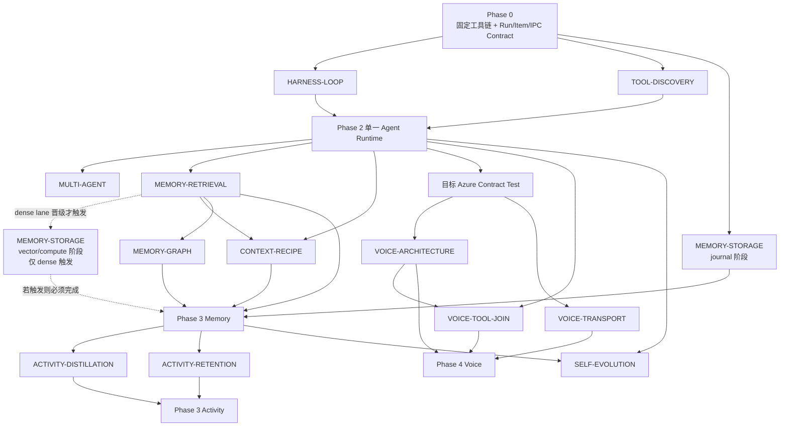

# CharaMate Agent Harness、记忆检索、Realtime 与自进化研究/实验设计

> 状态：Pre-registration
> 日期：2026-08-01
> 性质：面向全新实现的研究问题、实验协议、指标与决策门槛

---

## 0. 文档目标

这份文档不预设任何实现已经正确，从零定义五个核心问题：

1. 怎样构建能力足够强、又不会因框架层过多而臃肿的 Agent Harness？
2. 怎样构建低写放大、可编辑、可追溯、具有长期理解能力的记忆系统？
3. 怎样通过公开长程数据集与产品语料选择检索、Embedding、Rerank、图谱和 Context 范式？
4. 怎样让 Agent 从用户反馈与成功任务中成长，同时避免 Skill、记忆和规则无限膨胀？
5. 怎样把 Realtime 做成可打断、可异步调用 Tool、与文字 Agent 共用 Run 的全双工语音体验？

所有候选方案均需经过同一套评测、观测与决策流程。任何“先进”“SOTA”“更智能”的描述，都不能代替任务成功率、召回质量、延迟、资源和复杂度证据。

---

## 1. 研究原则

### 1.1 零基线

- 每个问题至少包含一个最简单可运行基线。
- 不把某个框架、模型或论文方案直接定义为产品答案。
- 候选只改变一个主要变量；无法隔离变量的实验拆开运行。
- 所有阈值在看结果前写入实验卡。
- 失败的候选保留记录，但不进入产品主路径。

### 1.2 产品指标优先

公共榜单用于筛选候选，最终决定依赖 CharaMate 任务：

- 用户目标是否完成；
- 工具是否选对、参数是否正确；
- 记忆是否召回真正有用的证据；
- 用户改口后是否使用新事实；
- Activity 是否被蒸馏成高信息记忆；
- 端到端等待时间、内存、磁盘和模型成本是否可接受；
- 代码是否仍只有一条清晰主路径。

### 1.3 复杂度预算

每个候选除了质量与性能，还记录：

- 新增生产模块数；
- 新增运行时进程数；
- 新增持久化表和后台任务数；
- 新增配置项数；
- 新增外部依赖与包体；
- 失败恢复状态数；
- 需要维护的分支路径数。

复杂方案只有在质量或用户体验有明确增益时晋级。质量相当时选择模块更少、状态更少、运行成本更低的方案。

### 1.4 证据等级

| 等级 | 含义 | 可支持的决定 |
| --- | --- | --- |
| E0 | 设计假设或源码阅读 | 进入候选集 |
| E1 | 确定性单元/模拟实验 | 排除协议与实现错误 |
| E2 | 固定数据集离线实验 | 比较质量、资源和复杂度 |
| E3 | 真实模型、真实 Tool 的重复实验 | 选择运行时默认值 |
| E4 | 目标设备长时运行与真实使用反馈 | 调整产品阈值和资源策略 |

产品默认方案至少需要 E2；涉及模型行为的 Harness、自进化和 Multi-agent 需要 E3；写放大、资源与常驻性能需要 E4。

### 1.5 Source-first 设计门禁

任何会改变运行生命周期、资源边界或协议语义的固定设计，在进入实验前都要先查当前一手资料：

- Agent 循环、上下文压缩、Item 协议和 Multi-agent 行为优先查当前官方源码或官方手册，并记录 commit/version 与查阅日期；
- Realtime、MCP、Tool Calling 和 Provider 字段优先查正式协议文档，并用目标 endpoint 做 Contract Test；
- 明确区分“协议硬限制”“源码当前行为”“产品启发式”。前两者可成为约束，启发式必须进入实验；
- 模型步数、总时长、Token/成本停止线、并行度、topK、Context 水位、TTL、批量和 checkpoint 参数都不能凭直觉成为产品常量；
- 一手实现变化或目标 Provider/模型变化时，先刷新来源再复用结论。

本文核对 Codex 行为所用源码 commit 为 `6751b54cae32b23786001e2414d749a9916201e1`，查阅日期为 2026-08-01。它只支持本文的候选假设；开始实现时仍需确认该 commit 是否代表当时要参考的版本。

### 1.6 Arm 不是产品档位

本文中的 H0/H1、R0–R9、0.6B/8B、WebSocket/WebRTC 等名称只存在于实验环境：

- 每个研究问题最终只选择一个获胜方案和一组冻结参数；
- 未晋级 Arm 的生产模块、依赖、模型包、Schema、feature flag 和 Settings 控件全部移除；
- 用户不会在产品中选择 embedding 大小、融合算法、topK、WAL 参数或语音 Transport；
- 若候选不可分辨，保留最简单基线，而不是把所有候选都做成兼容路径；
- 需要继续研究时另开一次性分支/worktree；候选专用 Adapter 不随生产合并保留。

因此，本文列出更多 Arm 是为了可证伪地选型，不是为产品预留更多配置。

文中的数值网格是预注册实验探针，不是建议默认值。每个 Manifest 必须说明为何选择这些探针、覆盖了什么边界、不能外推到什么范围；实验结束后只有胜者的一个参数值能进入产品。

### 1.7 固定工程宿主不是实验 Arm

用户已选择以下工程宿主作为所有实验与生产重写共享的固定环境：单 package npm；Electron + Electron Forge + 精确锁定的 Forge Vite Plugin；strict TypeScript/ESM；ESLint flat config + typescript-eslint/React Hooks + Prettier；React/CSS Modules；TypeBox + Ajv；`better-sqlite3`；Vitest/Testing Library/Playwright Electron；Pino；Browser 能力使用 `playwright-core` 管理固定 Chromium。UI 的 Radix/Lucide/TanStack Virtual、消息 remark/rehype/KaTeX/Shiki/Mermaid 管线和 PixiJS 像素渲染也不是算法候选。官方 OpenAI JavaScript SDK 与 MCP TypeScript SDK 固定在对应 Adapter 边界，不成为 Agent Runtime。

2026-08-01 核对的 Phase 0 起始版本为 Electron `43.2.0`、Electron Forge/Forge Vite Plugin `7.11.2`、React `19.2.8`、`better-sqlite3` `13.0.2`、Playwright `1.62.1`、Vitest `4.1.10`。这些版本必须先通过 dev、native ABI/ASAR、package、packaged-app read/write 和 Electron E2E smoke，随后才精确锁入 `package-lock.json`。Forge Vite Plugin 当前官方仍声明 experimental，因此兼容性 smoke 是工程门槛；它不是保留 Webpack 或第二打包器的理由。

实验公平性要求所有 Arm 在同一已锁宿主和同一稳定 domain contract 上运行。候选只有在研究变量确实需要时才能增加依赖、进程、表或模型；这些资源只存在于隔离 branch/worktree，Decision 完成后随失败 Arm 删除。候选不得把 Redux/Zustand、ORM、通用 Agent 框架、第二套 Browser runtime、第二套 build pipeline 或 UI theme system 带进生产。

固定 `better-sqlite3` 只代表关系型 metadata 真源已选；journal/synchronous/checkpoint、transaction batch、向量字节位置和计算进程仍属于 `MEMORY-STORAGE`。固定 Electron/React 也不决定 Voice Transport；WebRTC/WebSocket 仍属于 `VOICE-TRANSPORT`，但最终只能实现一个。

---

## 2. 统一实验基础设施

### 2.1 实验单元

每次实验由不可变 Manifest 描述：

```ts
interface ExperimentManifest {
  experimentId: string
  question: string
  host: {
    lockfileSha256: string
    sourceCommit: string
    electronVersion: string
    forgeVersion: string
    nodeVersion: string
    osBuild: string
  }
  dataset: {
    name: string
    version: string
    sha256: string
    sampleCount: number
  }
  arms: ExperimentArm[]
  modelProfiles: ModelProfile[]
  hardwareProfile: HardwareProfile
  repetitions: number
  seed: number
  metrics: MetricDefinition[]
  promotionGates: PromotionGate[]
  stopConditions: StopCondition[]
}
```

Manifest 在运行前冻结并计算 hash。结果只引用该 hash，防止实验后修改样本、阈值或指标。

这里的 `StopCondition` 只处理实验工件失效、目标 Provider 异常或宿主资源越界，不能被复制成产品 Agent Run 的总时长、累计 Token、成本或固定步数终止条件。

### 2.2 运行记录

每个样本保存：

- 输入与期望能力标签；
- Model/Provider 与参数；
- Electron/Forge/Node/OS、lockfile hash、生产 contract version 与候选 branch/worktree commit；
- 完整 Run Item 序列；
- Tool Call 名称、参数、结果与耗时；
- Context 各槽位 Token；
- Memory 候选与最终排名；
- 输出、引用证据和评分；
- Token、费用、TTFT、总时延、RSS 与磁盘变化；
- 失败分类；
- 可重放所需的非敏感工件引用。

密钥、Cookie、Authorization Header 和私钥在写入记录前统一替换。

### 2.3 对照公平性

- 同一数据集、同一任务顺序与同一评分器。
- 模型实验随机化 Arm 顺序，减少缓存、网络与时段偏差。
- 能配对的指标使用同一样本配对比较。
- Provider 发生限流或错误时记录，不把网络失败混入能力分数。
- 模型版本、系统指令和 Tool Schema 必须固定。
- 质量与性能分开报告；不能用更高成本掩盖质量退化，也不能用更快掩盖任务失败。

### 2.4 统计输出

- 比例指标报告分子、分母和置信区间。
- 延迟报告 p50、p90、p95、p99 和最长值。
- 成本报告每任务与每成功任务的 Token/费用。
- 公开集按能力子类分别报告，避免总体均值掩盖知识更新或时间推理退化。
- 样本小到无法区分 Arm 时，结论写“不可分辨”，不强行选胜者。

### 2.5 实验收口与删除

每个研究问题采用同一生命周期：

1. 创建 Decision ID，冻结 Manifest、来源版本、数据 hash、指标和门槛；
2. 在一次性分支或 worktree 实现候选，不让候选分支进入产品 Runtime；
3. 在相同输入与环境下运行，保存可核验的非敏感结果工件；
4. 输出中文 `docs/benchmarks/<decision-id>.md`，包含研究问题、来源 commit/version、数据与硬件、Arms、指标与置信区间、异常、复杂度、胜者、淘汰原因和不能声称什么；
5. 根据胜者重写干净生产实现，而不是把实验开关改成默认值；
6. 删除失败 Arm、候选 Adapter、feature flag、临时 Schema/迁移、专用依赖、模型包和配置；
7. 运行单路径审计、影响范围测试与完整离线回归后，才允许合并。

原始 JSON/JSONL 默认在仓库外按 hash 归档或删除；最终仓库只保留中文 Decision Record，紧凑聚合与复现标识直接写在该 Markdown 内，实验 Runner 与候选专用代码一并删除。只有确实承担获胜实现长期质量门禁的小样本，才能在重新归属为产品回归测试后进入 `tests/fixtures`，并在文档中说明用途；它不能继续携带 Arm 身份。最终仓库允许保留“为什么选择胜者”的文档证据，不允许保留“也许以后切回来”的运行时兼容路径。

### 2.6 Decision Registry

| Decision ID | 对应章节 | 进入产品前必须回答 |
| --- | --- | --- |
| `HARNESS-LOOP` | §3 | 循环、结束、压缩与无进展处理 |
| `TOOL-DISCOVERY` | §3.8、§11 | Tool/Skill/MCP 的唯一发现协议 |
| `MULTI-AGENT` | §4 | 是否进入产品；若进入，唯一 Dispatch/并发规则 |
| `MEMORY-GRAPH` | §5.3 | 是否需要图关系；若需要，唯一 SQLite 方案 |
| `MEMORY-STORAGE` | §6 | journal、向量位置、计算位置与维护策略 |
| `MEMORY-RETRIEVAL` | §7 | 唯一模型/召回/排序/索引配方 |
| `CONTEXT-RECIPE` | §8 | 唯一内容组合、顺序、预算与裁剪规则 |
| `ACTIVITY-DISTILLATION` | §9 | 唯一 Episode/Digest/候选生成流程 |
| `ACTIVITY-RETENTION` | §9 | 唯一保留、容量与清理策略 |
| `SELF-EVOLUTION` | §10 | 唯一触发、候选与 Skill 生效流程 |
| `VOICE-ARCHITECTURE` | §12.3 | 唯一语音/Agent 组织方式 |
| `VOICE-TRANSPORT` | §12.4 | 唯一媒体 Transport |
| `VOICE-TOOL-JOIN` | §12.6 | 唯一 Tool 调度与 continuation 规则 |

Decision 未完成时，产品文档只写稳定契约和 Gate；Decision 完成后，必须把胜者写回产品文档并删除其中的占位描述。

### 2.7 Decision 与产品 Phase 依赖



`MEMORY-STORAGE` 是一个分阶段 Decision：journal 阶段可在 Retrieval 质量实验前运行；向量/compute 阶段只有 dense lane 证明有晋级价值后才触发。最终仍只产生一份完整 Decision Record 和一套生产存储配置。若 dense 未晋级，`SV` 节点视为“不触发”，不是缺失实验，也不会创建向量 worker/segment/service。

Voice Architecture 与 Transport 在 Azure Contract Test 后可以并行研究；Tool Join 必须使用稳定 Agent Scheduler 和仍有竞争力的 Architecture。Multi-agent 只在单 Agent Harness 稳定后研究；Self-evolution 必须同时拥有稳定 Run evidence、Memory/Revision 和 Skills 生命周期。

---

## 3. Agent Harness 研究

### 3.1 研究问题

1. 固定步数 ReAct、自适应单循环与 Planner/Executor 哪一种最适合桌面 Agent？Multi-agent 作为正交问题在 §4 单独验证。
2. Run 应以什么条件结束，才能同时支持一句话回答和长程任务？
3. 自动压缩、用户中途追加输入、审批暂停和恢复怎样进入同一状态机？
4. Tool Schema 数量、渐进披露和 Skill/MCP 发现怎样影响工具选择正确率？
5. 怎样让 UI 展示真实执行过程，而不暴露隐藏推理或解析自然语言猜状态？

### 3.2 外部设计参考

Codex 的公开实现可作为候选机制来源：`run_turn` 以 `needs_follow_up` 驱动持续循环，Tool Result 后继续采样；达到上下文压力时先自动压缩再继续；没有待跟进工作时才正常结束。Token/Rollout Budget 在当前源码中属于默认关闭的开发中能力，而不是普通 Turn 的默认终止条件。研究只把这些机制转写成可测试假设，不直接复制完整协议或模块数量。

参考：

- [Codex turn loop](https://github.com/openai/codex/blob/6751b54cae32b23786001e2414d749a9916201e1/codex-rs/core/src/session/turn.rs)
- [Codex feature registry](https://github.com/openai/codex/blob/6751b54cae32b23786001e2414d749a9916201e1/codex-rs/features/src/lib.rs)
- [Codex ThreadItem protocol](https://github.com/openai/codex/blob/6751b54cae32b23786001e2414d749a9916201e1/codex-rs/app-server-protocol/src/protocol/v2/item.rs)

### 3.3 Harness Arms

| Arm | 结构 | 终止方式 | 研究目的 |
| --- | --- | --- | --- |
| H0 Fixed-ReAct | 单 Agent，固定最大模型轮数 | final、轮数、超时 | 最小实现基线 |
| H1 Adaptive-Loop | 单 Agent，Item 驱动 | final、用户取消、确需输入、不可恢复错误 | 验证无固定步数主循环 |
| H2 Plan-Execute | 规划模型生成计划，执行循环逐步完成 | final、用户取消、确需输入、不可恢复错误 | 验证显式规划收益 |

H1 的 Plan 只是可选 Item；H2 则要求单独规划阶段。这一区分用于回答“可见计划是否需要第二套 Harness”。Multi-agent 不作为第四种 Harness 混在本表，避免同时改变循环与派生两个变量。

### 3.4 Run 状态假设

```text
queued
  → running
  ↔ waiting_approval
  ↔ compacting
  ↔ waiting_tool
  → completed
  → needs_input
  → interrupted
  → failed
  → cancelled
```

所有 Arm 使用相同 Run Item 协议：

```ts
type RunItem =
  | UserMessageItem
  | AssistantMessageItem
  | PlanItem
  | ToolCallItem
  | CommandItem
  | FileChangeItem
  | ApprovalItem
  | ContextCompactionItem
  | ErrorItem
```

每个 Item 必须带 `id/sequence/status/startedAt/completedAt/durationMs`。隐藏推理不进入协议。

`SubtaskItem` 只在 §4 的候选环境扩展该协议；若 `MULTI-AGENT` 未晋级，生产协议、Schema、表和 UI 都不包含它。

### 3.5 任务集

Harness 任务集至少覆盖：

| 类别 | 示例形态 | 关键能力 |
| --- | --- | --- |
| Direct | 解释概念、改写文本 | 快速 final，不滥用 Tool |
| File | 跨文件定位、修改、测试 | 搜索、patch、验证、恢复 |
| Command | 构建、测试、分析日志 | 命令参数与结果判断 |
| Browser Read | 登录态页面读取 | 结构化 Browser、引用 |
| Browser Act | 填表、下载、上传、提交前确认 | 审批与真实副作用 |
| Computer Use | 无 API 应用操作 | Accessibility、视觉 fallback |
| MCP | 发现并调用未知 server Tool | 渐进披露与 Schema |
| Long Run | 20 个以上有效 Tool 边界 | 压缩、延续、checkpoint |
| Steering | Run 中途修改目标 | 在 Run 一致性边界合入用户输入 |
| Recovery | Tool 崩溃、模型超时、过期引用 | 重试、换策略、诚实失败 |
| Approval | 允许、拒绝、超时、打开详情 | 状态一致性 |
| No-op | 无需修改或无足够证据 | 不制造动作或事实 |

每类任务同时包含中文、英文和中英混合表达。

### 3.6 Harness 指标

主要指标：

- 端到端任务成功率；
- Tool 选择正确率；
- Tool 参数完全正确率；
- 验证步骤覆盖率；
- 虚假完成率；
- 审批前执行率，目标必须为 0；
- 取消后继续产生副作用率，目标必须为 0。

效率指标：

- 模型调用数；
- Tool Call 总数、有效数和重复数；
- 输入/输出 Token；
- TTFT 与端到端 p50/p95；
- 每个成功任务成本；
- 自动压缩次数与压缩后恢复成功率。

复杂度指标：

- 生产状态数；
- Harness 模块数；
- Provider 特殊分支数；
- 为 Arm 新增的持久化字段；
- 单一任务跨模块事件数量。

### 3.7 循环、压缩与延续实验

循环策略 Arms：

| Arm | 全局模型步数 | Context 压力 | 无进展 | 时间/Token/成本 |
| --- | --- | --- | --- | --- |
| P0 Hard Cap | 8/16/32 | 到上限结束 | 无 | 仅记录 |
| P1 Continue | 无固定上限 | 自动压缩后继续 | 仅记录重复 | 只观测与软提醒 |
| P2 Recover | 无固定上限 | 自动压缩后继续 | 先要求换策略，再 `needs_input`/失败 | 只观测与软提醒 |

其他实验变量：

- 重复失败调用检测：连续 2、3、4 次相同规范化调用且没有新观察；
- 压缩触发：上下文窗口的 65%、75%、85%；
- Tool 输出保留：全文、结构摘要、artifact 引用；
- 策略恢复提示：只提示“换一种办法”、附失败摘要、附可用能力目录；
- 单次 Provider/Tool timeout 与 retry 次数；它们约束单个外部调用，不是整个 Run 的总时长硬杀。

正常完成必须满足：模型给出 final，且没有待处理 Tool、Approval、continuation 或 steering。审批拒绝先成为结构化结果，只有确实不存在替代路径时才进入 `needs_input`；上下文 Token 压力先触发压缩，不等同于任务 Token 预算耗尽。

长程任务成功率、虚假完成率和用户可恢复性是主指标；Token、费用、p95 和重复调用率是约束。P0 用于量化硬截断风险，不作为默认假设。P2 是受当前 Codex 循环启发的重点候选，不因来源优秀而预先获胜。

### 3.8 Tool 发现实验

| Arm | 常驻 Tool 信息 | 命中后行为 |
| --- | --- | --- |
| T0 Full | 所有 Tool 完整 Schema | 直接调用 |
| T1 Catalog | 名称与一句描述 | 选择类别后加载 Schema |
| T2 Domain | 只加载当前领域目录 | 需要时继续展开 |
| T3 Search | 常驻一个 Tool 搜索器 | 搜索后加载目标 Tool |

指标：工具选择、误调、漏调、Prompt Token、额外模型往返和总时延。Skills、MCP 和大量 App Action 使用同一实验，不为每类扩展单独发明机制。

### 3.9 Harness 晋级规则

候选必须同时满足：

1. 总体成功率不低于最强 Arm 的统计可分辨范围；
2. 长程、审批、取消和恢复子集没有关键退化；
3. 虚假完成和审批前副作用为 0；
4. Token 与 p95 在产品预算内；
5. 代码复杂度增量与质量收益相称。
6. 长程任务不会因为默认墙钟、累计 Token 或累计成本阈值被静默截断；上下文压缩后能继续并保持目标。

如果 H2 与 H1 质量相当，则选择 H1。是否派生以及派生范围只由 `MULTI-AGENT` Decision 决定，不从 Harness Arm 顺带带入。

---

## 4. Multi-agent 专项实验

### 4.1 研究假设

Multi-agent 可能在独立研究、跨模块只读审计和多来源比较中缩短时间或提高覆盖，但可能增加 Token、协调、合并错误和写冲突。

Codex 官方手册同样把独立、可并行、以读取为主的工作列为更合适的子任务，并提醒并发写同一文件会产生冲突、子 Agent 会增加 Token。这里把该建议当作 Dispatch 候选的先验，不当作无需实验的产品结论：[Codex subagents](https://learn.chatgpt.com/docs/agent-configuration/subagents.md)。

### 4.2 Arms

| Arm | 并行度 | 子任务约束 |
| --- | ---: | --- |
| M0 | 1 | 单 Agent |
| M2R | 2 | 只读、相互独立 |
| M4R | 4 | 只读、相互独立 |
| M2W | 2 | 允许写不同资源，父 Agent 合并 |

派生决策单独比较，避免“子 Agent 能否工作”和“主 Agent 何时该派生”混成一个变量：

| Dispatch Arm | 决策方式 | 目标 |
| --- | --- | --- |
| D0 | 永不派生 | 单 Agent 基线 |
| D1 | 规则门：至少两个独立、可并行、无共享写资源的子目标 | 最小确定性门 |
| D2 | 主 Agent 提议拆分，宿主用 D1 约束校验 | 允许语义判断但阻止明显误派生 |
| D3 | 主 Agent 自主派生 | 测量完全模型判断的上界与误派生成本 |

### 4.3 数据集

- 多篇论文/文档对比；
- 两个以上独立网页来源的研究；
- 大型代码库跨模块只读审计；
- 严格顺序的修改任务；
- 同一文件的多处修改；
- 同一 Browser Profile 的连续操作；
- 包含审批和用户 steering 的任务。

### 4.4 指标与门槛

- 事实覆盖率与任务成功率；
- 父 Agent 合并遗漏/冲突；
- 总 Token 与每成功任务成本；
- 墙钟时间；
- 子 Agent 无效工作比例；
- 写冲突和重复 Tool Call；
- 用户看到的审批数量；
- 简单任务误派生率；
- 困难可并行任务漏派生率；
- 从派生决定到首个有效子任务的时延；
- 父 Agent 是否正确等待所有必要结果再 final。

M2R 只有在可并行只读子集产生稳定收益、总体成本增量受控且简单任务误派生率达到预注册门槛时晋级。M4R 只有在 M2R 通过后运行。M2W 必须达到零写冲突才能继续评估，否则不进入产品设计。

### 4.5 产品化决策

只有“派生时机”和“子任务效果”同时通过，产品才出现一个 Agent Composer 控件“允许并行协作”：

- 关闭：本轮强制 D0；
- 开启：只是允许获胜 Dispatch 策略派生，不等于强制派生；
- 简单问答、单文件顺序修改、同一浏览器连续操作仍走单 Agent；
- 子任务过程作为可折叠 Subtask Item 展示，父 Agent 对最终合并负责；
- 未通过时不展示灰色开关，也不把 M0/M2R/M4R 留成运行时兼容档位。

---

## 5. 记忆系统研究模型

### 5.1 记忆层级假设

```text
原始消息 / 原始活动
    ↓
近期 Turn 与 Activity Event
    ↓
Episode（有边界的连续事件）
    ↓
Period Digest（冻结周期内归纳）
    ↓
Memory Candidate / Profile Candidate / Graph Candidate
    ↓
长期 Memory Revision
    ↓
Cross-period Consolidation 与 Territory Candidate（仅在实验选中时）
```

层级实验需要验证：多级蒸馏是否提高信息密度与长期回答，同时避免把一次性行为错误固化为用户画像。

### 5.2 记忆核心语义

每条记忆至少包含：

```ts
interface MemoryRecord {
  id: string
  type: MemoryType
  status: 'active' | 'superseded' | 'archived'
  currentRevisionId: string
  importance: number
  confidence: number
  validFrom?: string
  validTo?: string
  createdAt: string
  updatedAt: string
}

interface MemoryRevision {
  id: string
  memoryId: string
  content: string
  sourceIds: string[]
  sourceType: string
  reason: string
  createdAt: string
}
```

用户画像是稳定 Memory 的投影，不能成为无来源的第二套真相。编辑产生 Revision；改口、否认和过期通过有效时间与 supersede 表达。

### 5.3 图谱候选

图谱只研究对个人理解直接有用的实体：人物、组织、项目、地点、偏好、目标、事件和作品。

候选 Arm：

| Arm | 图结构 | 在线行为 |
| --- | --- | --- |
| G0 | 无图谱 | 只使用 Memory 检索 |
| G1 | SQLite 实体/边/证据 | topK 后做有界一跳扩展 |
| G2 | SQLite 图特征 | 实体锚点进入融合排序 |

研究范围只包含无图与 SQLite 内嵌图，不引入独立图数据库。若 G1/G2 相对 G0 没有可分辨的最终回答收益，产品不创建图表、图索引或图 UI；若 G1/G2 相当，选择状态更少的一项。

每条边必须关联 Memory Revision 证据。图谱评测不能只测实体抽取准确率，还要测它是否提升最终回答。

---

## 6. 存储、WAL 与写放大实验

### 6.1 研究问题

1. `better-sqlite3` WAL 是否适合作为 Chat、Run、Memory 和 Activity 的统一元数据真源？
2. 向量保存在 SQLite BLOB、append-only 段文件或独立本地服务，哪种写放大与恢复特性最好？
3. Activity 高频写入、Memory Revision 和向量更新怎样批处理？
4. WAL checkpoint、segment GC 和 worker 计算怎样避免阻塞桌面交互？

### 6.2 分阶段 Storage Arms

先只改变数据库 journal，避免把 WAL 与向量布局的收益混在一起：

| Arm | Metadata | Vector bytes | Compute | 唯一主要变量 |
| --- | --- | --- | --- | --- |
| J0 | better-sqlite3 rollback journal | SQLite BLOB | Main 进程 | 基线 |
| J1 | better-sqlite3 WAL | SQLite BLOB | Main 进程 | journal |

只有 `MEMORY-RETRIEVAL` 的前级筛选证明 dense lane 仍有晋级价值时，才在选出的 journal 上比较向量字节和计算位置；若最终 Pipeline 不需要向量，本阶段整体跳过，产品不创建向量存储或 worker：

| Arm | Vector bytes | Compute | 唯一主要变量 |
| --- | --- | --- | --- |
| S0 | SQLite BLOB | Main 进程 | 基线 |
| S1 | SQLite BLOB | 独立 worker | 计算位置 |
| S2 | append-only segment | S1 的 worker | 字节位置 |
| S3 | 独立本地向量服务 | 服务进程 | 一体化服务相对 S2 的系统复杂度与收益 |

所有 Arm 使用相同 Memory API、相同逻辑向量和相同查询结果校验。只有前一阶段胜者进入下一阶段，不运行 journal × bytes × compute 的全笛卡尔积。

第二阶段也逐级触发：先比较 S0/S1；只有 SQLite BLOB 在目标规模的写放大、体积或恢复门槛上失败时才实现 S2；只有 S2/worker 仍未达门槛，或独立服务有可检验的系统收益假设时才实现 S3。未触发的复杂 Arm 不为“完整比较”而搭建。

### 6.3 数据库参数实验

| 参数 | 实验探针 |
| --- | --- |
| `journal_mode` | DELETE、WAL |
| `synchronous` | 与候选 journal 适配的 NORMAL、FULL |
| `busy_timeout` | 1s、5s、10s |
| transaction batch | 1、10、50、200 events |
| checkpoint | 仅 WAL Arm：passive、空闲触发、体积触发 |

这些值是覆盖不同负载形态的实验探针，不是产品建议。Manifest 必须说明目标设备、交互写入模式和选择范围；若 WAL 未晋级，产品不实现 WAL checkpoint/监控分支。

### 6.4 工作负载

构造四类可重放负载：

1. **Chat**：消息、Run Item 和 Tool delta 混合写入。
2. **Activity**：持续小事件、Episode 批量提交和截图 metadata。
3. **Memory**：新增、Revision、supersede、检索使用记录。
4. **Embedding**：批量新增、更新、删除、重建和 GC。

规模点：1k、10k、50k、100k Memory；10k、100k、1M Activity Event；并发 Reader 1/4/8。

### 6.5 指标

- 每事务 p50/p95/p99；
- UI 主线程阻塞时间；
- WAL 大小与 checkpoint 停顿；
- SQLite 主库增长；
- 向量净荷与额外空间；
- 每条逻辑写入产生的物理写字节；
- worker RSS、CPU 和吞吐；
- 冷启动恢复时间；
- GC 时间与临时峰值磁盘；
- Reader 被 Writer 阻塞时间。

### 6.6 崩溃一致性

在以下故障点强制终止：

- 写向量字节前；
- 写完字节但未提交引用；
- 提交引用过程中；
- WAL checkpoint 中；
- segment compact 复制中；
- 更新引用后、删除旧段前。

恢复后验证：

- SQLite `integrity_check`；
- foreign key；
- embedding 引用不越界；
- checksum；
- 孤儿字节可以回收；
- 不出现指向不存在向量的已提交 Memory；
- Run 与 Message 不丢失已确认提交。

### 6.7 决策门槛

存储方案必须满足：

- 目标设备交互写入 p95 不造成可感知卡顿；
- 主库增长与向量规模解耦或有可接受上限；
- 崩溃测试不产生不可恢复引用；
- GC 不在热路径；
- worker/服务崩溃不能损坏 Chat、Memory Revision 或已提交索引真源；若获胜 Pipeline 依赖该进程，则如实返回检索暂不可用并恢复，不暗中切换到未测量的备用排序。只有胜者本身包含词法 lane 时才可按其既定语义继续词法检索；
- 运维复杂度与收益相称。

---

## 7. 检索与 Embedding 实验

本章所有模型、维度、量化、融合、reranker、图扩展与 ANN 都是离线/真实模型实验 Arm。最终 Decision Record 只能选出一条生产 Pipeline；产品不保留“轻量 / 高质量 / 远程”等选择器。

### 7.1 研究问题

1. BM25、dense 与 hybrid 在中英混合个人记忆上的互补程度怎样？
2. RRF、归一化加权和学习排序，哪种融合最稳？
3. Query instruction、维度和量化怎样影响 Qwen Embedding？
4. Reranker、图扩展和 ANN 是否带来足够增益？
5. 时间、有效性、重要性和冲突状态怎样进入排序？

“RFF”如指排序融合，应统一为 **RRF（Reciprocal Rank Fusion）**。Random Fourier Features 属于不同研究问题，不与融合排序混用。

### 7.2 数据集

公开集：

- [LongMemEval](https://github.com/xiaowu0162/LongMemEval)：信息抽取、多会话推理、知识更新、时间推理和 abstention。
- [LongMemEval-V2](https://github.com/xiaowu0162/LongMemEval-V2)：Agentic 场景下的长期记忆。
- [LoCoMo](https://github.com/snap-research/locomo)：超长多 Session 对话、QA evidence 与事件摘要。

产品冻结集：

- 中文、英文和中英混合偏好；
- 人名、项目名、路径、软件与网站等精确实体；
- 同义改写与隐含偏好；
- 用户改口、否认、临时状态和过期事实；
- 跨两条以上 Memory 的组合问题；
- 需要时间计算的问题；
- Activity → 偏好/习惯的归纳问题；
- 不应进入长期记忆的琐碎事件；
- 无证据时必须 abstain 的问题；
- 图谱一跳可能有帮助的问题。

产品冻结集必须人工复核 evidence，保留正例、困难负例与冲突样本。

### 7.3 Embedding 与 Reranker 候选

| 候选 | 参数规模 | 最大维度 | 研究角色 |
| --- | ---: | ---: | --- |
| Qwen3-Embedding-0.6B | 0.6B | 1024 | 本地轻量候选 |
| Qwen3-Embedding-8B | 8B | 4096 | 本地高质量上界 |
| Remote Embedding | Provider 决定 | Provider 决定 | 远程质量/资源对照 |

官方模型卡：

- [Qwen3-Embedding-0.6B](https://huggingface.co/Qwen/Qwen3-Embedding-0.6B)
- [Qwen3-Embedding-8B](https://huggingface.co/Qwen/Qwen3-Embedding-8B)

Reranker 是单独的 text-ranking 模型，不能把 Embedding checkpoint 当作 cross-encoder 使用。只有前级召回出现可测 topK 排序缺口时，才加入 [Qwen3-Reranker-0.6B](https://huggingface.co/Qwen/Qwen3-Reranker-0.6B)；8B 只作为仍有缺口时的质量上界，使用 [Qwen3-Reranker-8B](https://huggingface.co/Qwen/Qwen3-Reranker-8B)。

0.6B Embedding 实验变量：

- BF16、Q8、Q6、Q5、Q4；
- 256、512、768、1024 维；
- 无 instruction、通用 retrieval instruction、面向个人记忆的固定 instruction；
- batch 1、8、32；
- CPU、Metal/GPU（目标平台可用时）。

8B Embedding 实验变量：

- Q8、Q6、Q5、Q4；
- 1024、2048、4096 维；
- 常驻、懒加载、按需服务；
- 同样的固定 instruction。

Reranker 只在召回 finalist 冻结后比较 0.6B 与按门槛触发的 8B 上界；变量限于候选深度、instruction、量化和执行位置，不与 Embedding 网格做笛卡尔积。

不使用公开 MTEB 分数直接做产品决定。8B 必须证明对最终 QA 或 Recall 的增益足以覆盖包体、RSS、冷启动和功耗。

不运行模型 × 量化 × 维度 × instruction × batch × device 的全笛卡尔积。先在冻结小集做单变量筛选，再把每类最强配置带到完整长程集，最后只对统计上仍有竞争力的少数 finalist 做目标设备资源与最终 QA。8B 只作为质量上界进入前期小集；轻量候选没有显著质量缺口时，不下载或实现完整 8B 发布链路。

### 7.4 Retrieval Arms

| Arm | 召回 | 融合/重排 |
| --- | --- | --- |
| R0 | FTS5/BM25 | BM25 |
| R1 | 0.6B dense exact | cosine |
| R2 | 8B INT dense exact | cosine |
| R3 | BM25 + 0.6B | RRF |
| R4 | BM25 + 8B | RRF |
| R5 | 上一阶段最强 Retrieval finalist | 时间/有效性/重要性/来源多样性 |
| R6 | R5 top20 | Qwen3-Reranker-0.6B → top8 |
| R7 | R5 top20 | Qwen3-Reranker-8B INT → top8 |
| R8 | R5 | SQLite 图一跳扩展 |
| R9 | R5 | ANN dense lane |

Rerank、图与 ANN 分别单独对 R5 做增量实验，避免无法判断收益来自哪里。

### 7.5 Fusion 实验

| Fusion | 参数 |
| --- | --- |
| RRF | `k=20/40/60/100` |
| Min-max weighted | lexical/dense 权重网格 |
| Z-score weighted | 权重网格与截断 |
| Learned linear ranker | 词法、dense、时间、重要性、有效性特征 |

学习排序必须使用独立训练/验证/测试划分，且模型体积、特征漂移和可解释性进入复杂度预算。若 RRF 与学习排序不可分辨，选择 RRF。

### 7.6 时间与冲突特征

候选评分：

```text
score = fused_relevance
      × validity
      × recency_factor
      × importance_factor
      × confidence_factor
      × source_diversity_factor
```

实验分别测：

- 有效性硬过滤 vs 软降权；
- 指数、分段和无衰减；
- 用户 pin；
- superseded Memory；
- 同一事实的多个 Revision；
- 时间敏感问题中的 Query 时间窗。

不能只看总体 Recall；知识更新和过期误召回必须单独报告。

### 7.7 Exact 与 ANN

Exact cosine 是 dense lane 的质量金标准。ANN 候选可以包含 HNSW、IVF 或适合本地部署的实现，但只有在语料规模与 exact p95 达到预注册触发条件后运行。

ANN 指标：

- 相对 exact 的 Recall@K；
- build/update/delete 时间；
- 索引体积；
- 查询 p50/p95；
- 增量写入与 rebuild；
- 崩溃恢复；
- 与量化向量的误差叠加。

### 7.8 Retrieval 指标

检索：Recall@1/4/8/20、Hit@8、MRR、nDCG@8、evidence diversity、过期事实误召回。

回答：QA accuracy、知识更新、时间推理、跨 Session、abstention、引用一致性。
系统：index time、query p50/p95、worker RSS、冷启动、包体、每次更新成本。

### 7.9 晋级规则

- Hybrid 必须在产品冻结集和至少一个公开长程集上不低于最佳单路，并改善两类以上困难子集。
- Reranker 必须提高最终 top8 或 QA，而不是只改善内部打分；增益不足以覆盖时延时不晋级。
- 图扩展必须改善跨实体问题，同时不增加无关事实和冲突召回。
- ANN 必须达到预注册 Recall 保真，并显著改善达到目标规模后的 p95。
- 8B INT 必须在最终任务上产生稳定增益；只提高公开榜单不够。
- 完成晋级后生成唯一生产配方：模型、量化、维度、instruction、召回 lane、融合、topK 与索引类型全部冻结；其余候选代码、依赖和模型包不进入产品 Runtime。

---

## 8. Context Engineering 实验

### 8.1 研究问题

1. 近期原文、滚动摘要、长期记忆和 Activity Digest 怎样分配 Token？
2. 记忆应预注入、按工具检索，还是混合？
3. 摘要怎样保留约束、决定、未完成目标和来源？
4. 上下文压缩怎样避免事实反转、过期指令继续生效和来源丢失？

### 8.2 Context Arms

| Arm | 近期消息 | 会话摘要 | 长期记忆 | Memory Tool |
| --- | --- | --- | --- | --- |
| C0 | 尽量完整 | 无 | 无 | 无 |
| C1 | 窗口化 | 有 | 无 | 无 |
| C2 | 窗口化 | 有 | topK=8 预注入 | 无 |
| C3 | 窗口化 | 有 | 无 | 有 |
| C4 | 窗口化 | 有 | topK=2 预注入 | 有 |
| C5 | 窗口化 | 有 | topK=8 预注入 | 有 |
| C6 | 窗口化 | 结构化摘要 | 动态 topK | 有 |

### 8.3 不可丢语义与排序实验

所有 Context Arm 只共享三条正确性约束：当前用户目标/附件/steering 不丢；当前审批结果与最新必要 Tool Result 不丢；完成本轮所需 Tool Schema 不丢。Harness 契约也必须存在，但具体位置不预先固定。

Persona、最近原文、会话摘要、长期 Memory evidence、Activity Digest、较早 Tool Result 是候选内容。先用 C0–C6 选出内容组合，再在胜者上用小规模消融比较其顺序、预算和裁剪策略，避免同时改变所有变量。候选顺序至少覆盖：

- 指令/Persona 靠前、当前目标靠近末尾；
- 目标与未完成事项相邻；
- Tool Schema 与对应 Tool Result 相邻。

最终只生成一套 Context Recipe。槽位数量、顺序、topK 和裁剪水位都不能从本节直接复制成产品默认值。

### 8.4 摘要评测

摘要数据集包含：

- 早期硬约束；
- 用户中途修改目标；
- 已完成与未完成步骤；
- Tool 失败与修复；
- 否定、反话和冲突事实；
- 跨 Session 决定；
- 附件来源；
- 应删除的临时细节。

指标：约束保留、事实一致、未完成目标召回、错误状态保留、压缩率、Token、后续任务成功率。

### 8.5 Context 决策门槛

- 长程问答和任务成功率是主指标；
- Memory Tool 调用率必须按模型分别报告；
- 预注入与 Tool 的成本分开；
- Context 增大造成的 TTFT 和成本必须进入比较；
- 能力相当时选择更短、更确定、对模型主动性依赖更小的方案。
- 同一套 finalist 必须在预注册的代表性 Chat Model Profiles 上验证；若某方案只有靠模型专用分支才能成立，优先选择更稳的单一 Recipe，或收窄受支持契约，而不是保留多套 Context 装配器。

---

## 9. Activity 蒸馏与用户画像实验

### 9.1 研究问题

1. 多细的 Activity 应进入 Episode？
2. 日摘要与周摘要怎样提高信息密度？
3. 哪些行为足以形成稳定偏好或画像？
4. 怎样控制错误归因、重复记忆和写放大？
5. 原始事件、截图、OCR、Episode 和 Digest 各保留多久，才能控制磁盘且不损伤长期理解？

### 9.2 Distillation Arms

| Arm | 原始活动处理 | 长期写入 |
| --- | --- | --- |
| A0 | 逐事件摘要 | 每事件可生成 Memory |
| A1 | 规则 Episode | Episode 可生成 Memory |
| A2 | Episode → Daily Digest | Daily 候选 |
| A3 | Episode → Daily → Weekly | 跨日候选 |
| A4 | A3 + Profile/Graph/Territory 分流 | 分类型候选 |

### 9.3 Retention Arms

Retention 与蒸馏质量分开实验，避免“删得少所以召回高”掩盖磁盘无限增长：

| Arm | 过期方式 | 容量控制 | 检索可见范围 |
| --- | --- | --- | --- |
| K0 | 不自动删除，仅作压力对照 | 无 | 包含原始活动 |
| K1 | 所有原始 Activity 统一 TTL | 无 | Episode/Digest/Memory |
| K2 | 截图、事件、Episode 分层 TTL | 总 asset 上限 | Episode/Digest/Memory |
| K3 | K2 + 仅在蒸馏完成后优先回收 + orphan/index GC | 总数据上限 | Digest/Memory，必要时近期 Episode |

每个 TTL、容量和批量值在具体 Manifest 中预注册。测试必须模拟 1 天、7 天、30 天和持续填满磁盘预算的事件流，并检查：

- 删除文件、缩略图、OCR、FTS/向量引用和数据库行是否一致；
- Digest/Memory 是否只保留稳定摘要证据，不持有已删除绝对路径；
- 原始 Activity 是否会被普通 Memory retrieval 误召回；
- 蒸馏暂时失败、应用崩溃和删除中断后能否幂等恢复；
- 长期问答质量、Activity 回看能力和磁盘斜率的权衡。

K0 只用于测污染与资源上界，不能进入产品。最终只固化一个 Retention Policy，不提供多档兼容模式。

### 9.4 冻结行为集

行为集应包含：

- 连续编码、会议、浏览资料和娱乐；
- 应用切换与短暂打断；
- 重复但不代表偏好的行为；
- 多日稳定模式；
- 用户明确表达与行为信号冲突；
- 一次性异常事件；
- 敏感字符串出现在窗口标题或截图 OCR；
- Agent 自己执行的行为，避免误当成用户偏好。

### 9.5 指标

- 原始事件 → Episode 压缩比；
- Episode/Digest 信息覆盖；
- 长期候选 precision/recall；
- 错误画像率；
- 重复 Memory 率；
- 用户接受、编辑、拒绝率；
- 每日模型调用与 Token；
- SQLite 写入次数和字节；
- 从行为发生到可用 Memory 的延迟；
- 原始事件误召回率；
- 每日/每周磁盘增长斜率与峰值；
- 过期文件、数据库行、FTS/向量引用和孤儿 asset 清理完整率；
- 清理前后长期 QA、画像和领地候选质量差；
- 删除批次耗时、获胜 journal/主库增量与 UI 卡顿。

### 9.6 晋级规则

逐事件长期写入作为压力基线，不因召回高就晋级。产品候选需要在保持关键事实覆盖的同时，大幅降低候选数量、重复和写入；用户明确表达始终高于行为推断。

Retention 获胜方案还必须让目标时间范围内的磁盘增长有界、原始 Activity 不进入普通长期检索、删除引用完整率达到 100%，并且清理后的长期任务质量不越过预注册退化门槛。

---

## 10. 自进化研究

### 10.1 研究目标

自进化只允许改变：

- 关于用户的 Memory；
- 用户可见的 Persona 偏好；
- 可复用 Skill。

它不能自行修改产品源码、系统根指令、Provider 密钥、审批规则或数据 Schema。

### 10.2 外部设计参考

Hermes Agent 的后台复盘、Memory/Skill 区分、Skill 使用统计和可恢复归档可作为候选机制来源：

- [Hermes background review](https://github.com/NousResearch/hermes-agent/blob/126ff7071b6b755055879648f4e859b3187d0fac/agent/background_review.py)
- [Hermes curator](https://github.com/NousResearch/hermes-agent/blob/126ff7071b6b755055879648f4e859b3187d0fac/agent/curator.py)

研究重点不是复现 Hermes，而是验证“异步复盘 + 候选 + replay + 版本恢复”是否比直接写入更可靠。

### 10.3 Evolution Arms

| Arm | 复盘 | 生效方式 |
| --- | --- | --- |
| E0 | 无后台复盘 | 只有用户手动创建 |
| E1 | Run 后复盘 | 直接写 Memory/Skill |
| E2 | Run 后复盘 | 生成候选，用户确认 |
| E3 | Run 后复盘 | Memory 规则确认；Skill replay 后激活 |
| E4 | 触发式复盘 | 用户纠正/教学/可验证成功时才生成候选 |

### 10.4 触发实验

候选触发信号：

- 固定每 N 个 Tool Call；
- 每个 Run；
- 用户明确纠正；
- 用户说“记住”或“以后这样做”；
- 复杂任务具有客观成功验证；
- 同类任务重复出现；
- 用户显式“学会这套流程”。

比较候选数量、真正复用率、错误规则率、模型成本与打扰率。触发信号如果只增加候选而不增加后续成功，应被移除。

### 10.5 Candidate Schema

```ts
interface EvolutionCandidate {
  id: string
  kind: 'memory' | 'persona_preference' | 'skill_patch' | 'new_skill'
  sourceRunIds: string[]
  sourceItemIds: string[]
  proposal: unknown
  rationale: string
  evidence: string[]
  replayCases: string[]
  status: 'draft' | 'accepted' | 'rejected' | 'active' | 'archived'
}
```

### 10.6 Skill 生命周期

```text
draft → active → stale → archived
  ↑        ↓        ↓        │
  └──────── version / rollback ┘
```

每个 Skill 记录来源、版本、使用次数、成功次数、最近成功、patch 次数、pin 和 replay 结果。归档可恢复；后台不永久删除用户内容。

### 10.7 自进化数据集

- 用户纠正错误工具选择；
- 用户纠正表达偏好；
- 一次偶然环境失败，不应形成规则；
- 成功完成的可复用多步流程；
- 两个表面相似但关键步骤不同的流程；
- Skill 已存在，应 patch 而非新建；
- 用户明确教学；
- 恶化 replay 的 patch；
- 长期没有使用的 Skill；
- Persona 偏好与事实 Memory 的分类边界。

### 10.8 指标

- 候选 precision；
- 用户接受、编辑、拒绝率；
- Skill replay 通过率；
- 后续同类任务成功率提升；
- 错误迁移率；
- Skill 总数、重复率和增长率；
- 无用候选率；
- 复盘 Token 和延迟；
- 回滚次数；
- 对主 Run TTFT 的影响。

### 10.9 晋级规则

- 复盘必须异步，不阻塞主回答；
- 不能只依赖 Reviewer 自评，Skill 需要 replay 或用户确认；
- 直接写入 Arm 若产生更高错误迁移或膨胀，不进入产品；
- 候选机制需要提高后续同类任务成功率；
- Skill 数量增长必须与真实复用增长同步；
- 无收益的自动合并、聚类或参数自调不实现。

---

## 11. Tool、Skills、MCP 与 Computer Use 一致性实验

### 11.1 协议假设

- Tool 使用名称、描述、JSON Schema 参数和结构化结果。
- Skills 使用 `SKILL.md` 与渐进披露。
- MCP 使用标准 `tools/list`、`tools/call`，覆盖 stdio 与 Streamable HTTP。
- Browser 优先 DOM/Accessibility/Playwright；Computer Use 作为 GUI fallback。

### 11.2 一致性测试

同一任务分别通过内置 Tool、MCP Tool、Skill 包装和 Computer Use 完成，比较：

- Harness 是否生成相同 Item 生命周期；
- 审批是否一致；
- 取消是否传播；
- 结构化结果是否被正确判断；
- Tool 名冲突是否可控；
- 渐进披露 Token；
- 失败是否能回到同一恢复路径。

目标是所有扩展共用一个 Agent Loop，不为 Browser、MCP、Skill 或 Computer Use 建立独立 Harness。

---

## 12. Realtime 全双工语音与 Agent Loop 实验

### 12.1 研究问题

1. Realtime 能否作为低延迟音频/对话模型，同时让应用自己的 Run Loop 掌控工具、审批、记忆、持久化和恢复？
2. Direct WebSocket 与 WebRTC 在 Electron 目标设备上的首音频、打断、抖动和实现成本怎样？
3. VAD 自动回答与应用显式 `response.create` 哪一种更适合可执行 Agent？
4. 多个独立 Tool 能否在依赖与资源不冲突时并发，怎样等待、合并和处理部分失败？
5. 用户在助手说话、Tool 执行或等待审批时插话，怎样避免旧结果污染新 Turn？
6. 怎样保证用户看到的文本、实际听到的音频、Run Item 和持久化历史一致？

### 12.2 协议能力与边界

实验按以下公开协议约束构造，不另造语音私有协议：

- Realtime Session 通过 client event 驱动动作、通过 server event返回状态、文本、音频与 Function Call；
- VAD 发出 `input_audio_buffer.speech_started` 与 `speech_stopped`；
- `turn_detection.create_response=false` 时，应用保留 VAD 分段但自行决定何时发送 `response.create`；
- Tool 结果以 `conversation.item.create(function_call_output)` 关联原 `call_id`，再由应用触发后续响应；
- WebSocket 播放由客户端掌控，打断时需停止播放并以 `conversation.item.truncate` 删除未播放音频；
- WebRTC 由媒体通道处理播放缓冲与自动截断，更适合低延迟客户端，但需要 ephemeral token/session negotiation；
- “全双工”表示采集、传输、接收和播放可同时进行，助手播放期间仍能检测用户插话；不允许两个助手 Response 同时出声。

参考：

- [OpenAI Realtime conversations](https://developers.openai.com/api/docs/guides/realtime-conversations)
- [OpenAI Realtime VAD](https://developers.openai.com/api/docs/guides/realtime-vad)
- [OpenAI Voice agents](https://developers.openai.com/api/docs/guides/voice-agents)
- [Azure Realtime via WebSocket](https://learn.microsoft.com/en-us/azure/foundry/openai/how-to/realtime-audio-websockets)
- [Azure Realtime via WebRTC](https://learn.microsoft.com/en-us/azure/foundry/openai/how-to/realtime-audio-webrtc)

本设计查阅的 Microsoft Learn 元数据：WebRTC 文档 source commit `ce66cc3b4f2a6be478aaa7ddedf9e2567fa638a5`（updated 2026-07-31），WebSocket 文档 source commit `1c7e2aa1afb5d81e65a3c0424b513b5a9e4698cd`（updated 2026-07-19），查阅日期 2026-08-01。实现前仍须刷新版本并对目标 deployment 做 Contract Test。

### 12.3 Voice Architecture Arms

| Arm | 音频与推理链路 | Tool 所有权 | 研究角色 |
| --- | --- | --- | --- |
| V0 Chained | 流式 STT → 文本 Agent → TTS | 文本 Harness | 诊断性延迟/正确率基线，不具产品晋级资格 |
| V1 Native Realtime | Realtime 自动 turn、直接 Function Call | Realtime Session 内部节奏 | 最低额外编排基线 |
| V2 Orchestrated Realtime | Realtime 音频/VAD/模型 + 应用显式驱动 response | 统一 Harness + VoiceRunCoordinator | 低延迟与完整 Agent 能力的候选 |

V2 不意味着同时运行两个 Agent。Realtime Model 仍产生自然语言和 Function Call；应用的 Harness 负责 Context、Item、Tool、Approval、Join、steering 与 continuation。V0 用来定位质量与延迟差距，但不满足产品必须使用指定 Realtime 服务的要求，因此不能晋级；产品选择只发生在 V1/V2 之间。

最终产品只能保留一个 Voice Architecture。失败 Arm 的 STT/TTS 管线、Driver 和配置不得作为备用兼容层残留。

### 12.4 Transport Arms

同一 Azure resource、deployment、voice、prompt、音频样本和网络条件比较：

| Arm | 连接 | 关键特性 |
| --- | --- | --- |
| W0 | Direct WebSocket：`wss://datasetannotator-openai.openai.azure.com/openai/v1/realtime?model=gpt-realtime-2.1-2` | Main 持 Key；客户端自行分帧、播放、截断 |
| W1 | WebRTC GA：Main 获取 ephemeral token，Renderer 建 media/data channel | 低延迟媒体、抖动/丢包处理、自动播放截断 |

[Microsoft 当前一手文档](https://learn.microsoft.com/en-us/azure/foundry/openai/how-to/realtime-audio-webrtc)建议客户端实时音频优先 WebRTC，并把 WebSocket 定位为低延迟不是首要要求的 server-to-server 场景。因此先对 W1 做目标 deployment Contract Test 和短程体验门槛；W1 不支持或未达门槛时才实现 W0 的完整对照，不能为了表格对称先做两套生产级 Driver。

需要配对时，测量必须使用同一批真实音频和预注册的目标网络条件；网络 profile 的数量、延迟、抖动和丢包参数要由目标使用场景说明，不能把任意“三档网络”当成事实。给定 `/openai/v1/realtime?model=...` URI 用于识别同一 resource/model：W0 转为 `wss`，W1 按 GA 协议派生 `client_secrets` 与 `calls` 端点。最终只保留 W0 或 W1；`RealtimeTransport` seam 只用于实验替换，决策后删去失败实现和用户协议选择。

### 12.5 应用驱动状态机

V2 使用一个最小 `VoiceRunCoordinator`：

```text
disconnected → connecting → listening
                              ↓ speech_stopped / transcript ready
                           preparing_run
                              ↓ response.create
                 responding ↔ speaking
                      ↓ function_call
              waiting_tools ↔ waiting_approval
                      ↓ joined outputs
                 responding → listening

任意 active state ─ speech_started → interrupted → listening/preparing_run
任意 active state ─ disconnect → interrupted_session → reconnect
```

事件映射：

| Realtime/应用事件 | Coordinator 动作 | 持久化 |
| --- | --- | --- |
| `session.created/updated` | 标记连接就绪、冻结 voice/instructions 快照 | VoiceSession |
| `speech_started` | 停止播放、取消当前 Response、开始新 input generation | VoiceTurn event |
| `speech_stopped` + transcript ready | 完成用户 Message，创建或 steer Run | Message + Run Item |
| audio/text delta | 同步播放并更新同一助手草稿 | 可恢复 delta 水位 |
| Function Call arguments done | 创建 ToolCall Item，进入统一调度 | ToolCall/Approval Item |
| ToolJoin completed | 写入每个 `function_call_output`，触发一次 `response.create` | ToolResult Items |
| `response.done` | 原子完成实际播放范围内的助手 Message | Message + VoiceTurn |
| disconnect/error | 停止播放，checkpoint 当前 generation | Interrupted Run |

协议 Contract Test 必须先验证目标 Azure deployment 是否支持这些事件、字段和手动 turn-control；不支持的能力不能靠客户端猜测模拟。

### 12.6 异步 Tool 与 Join 实验

| Arm | 调度 | Continuation |
| --- | --- | --- |
| J0 | 所有 Tool 串行 | 每个结果后继续模型或最终统一继续 |
| J1 | 同一 Response 中无依赖 Tool 并行 | 必要调用 `allSettled` 后一次继续 |
| J2 | Harness 先产生显式依赖图，只并行 ready nodes | 每层 Join 后继续 |

J1/J2 的调用必须同时满足：

- 参数已经完整并通过 Schema；
- 不读写同一可变资源；
- 无显式或隐式数据依赖；
- 每个调用有独立 `callId`、AbortSignal、审批和结果；
- Join 只等待本轮必要调用，成功与结构化失败都可合并；
- 迟到结果不能自行发送 `response.create`。

天气 + 日程、两个只读网页、两个独立本地查询作为正例；先查 ID 再修改、同一文件写入、同一 Browser Profile、Computer Use 作为串行负例。

不能预设模型一定一次产生多个 Function Call。实验分别报告“模型确实给出可并行调用的样本比例”和“宿主调度节省的时间”；如果前者太低或 J1/J2 不改善端到端体验，就保留 J0，不额外发明 Planner。

### 12.7 打断与竞态矩阵

| 插话时刻 | 预期行为 |
| --- | --- |
| 助手正在出声 | 立即停播、取消 Response；WebSocket 截断未播放音频；新话语成为 steering |
| Tool 尚未开始 | 若新目标不再需要则取消，不产生副作用 |
| 只读 Tool 正在运行 | 可取消；若已完成则保存结果，但由当前 generation 决定是否采用 |
| 有副作用 Tool 已完成 | 不回滚、不重放；真实结果留在 Run 中并告知新 Turn |
| 等待 Approval | 新话语可补充或拒绝；仍解析为同一个 Approval Item 的决定 |
| ToolJoin 已完成但尚未 continuation | 比较 generation；旧 Join 不得触发新 Response |
| 网络断开 | 停播、保存 transcript/Item/checkpoint；重连建立新协议 Session |

每个异步对象携带 `sessionId/runId/turnId/generation/callId`。竞态测试使用可控时钟，在 speech-start、tool-resolve、approval-resolve、response-done 的每种相邻顺序上重复，要求只有一个用户可听 Response、没有重复副作用、没有幽灵 final。

### 12.8 持久化一致性

- 用户 transcript、助手 transcript、实际播放音频范围、Tool Item 和 final answer 进入同一个 Chat；
- audio delta 与 transcript delta 更新同一草稿，`response.done` 或打断边界后原子完成；
- WebSocket truncate 后保存 `audio_end_ms` 与 interrupted 标记，不把用户未听到的尾部当成完整助手消息；音频/文本不能逐字对齐时报告近似边界，不伪造精确 transcript；
- 原始会话 audio delta 不作为长期资产；转写、实际播放范围、Run 与必要协议元数据必须持久化；用户主动上传的音频仍按普通附件处理；
- Session 断线可以换新协议 session，但 Chat/Run/turn lineage 不变；
- 语音模式中的自然语言输出必须有音频，命令、代码、JSON 和日志不朗读。

### 12.9 语音任务集

- 闲聊、追问、快速插话和自我纠正；
- 中文、英文、中英混说、人名与项目名；
- 背景噪声、回声、短停顿和长停顿；
- 只需一个 Tool、两个独立 Tool、严格依赖 Tool；
- Tool 成功、部分失败、超时、审批允许/拒绝；
- 说话过程中用户改变日期、地点或整个目标；
- 长工具等待中的进度话术与最终回答；
- 网络抖动、掉线重连、音频 underrun；
- 语音结束后从文字 Chat 继续同一个 Run。

### 12.10 指标

体验：

- speech end → first transcript / first audio；
- 打断检测 → 本地停播；
- turn-taking gap、误打断率、漏打断率；
- transcript WER/CER 与专名准确率；
- 完成消息的音频/文本一致率、打断消息的 interrupted 标注正确率，以及未播放尾部被误标为完整回答的比例；
- 自然度、连贯性和工具等待主观评分。

Agent：

- 语音任务成功率与文字同任务差值；
- Tool 选择/参数正确率、Approval 一致性；
- 可并行调用识别 precision/recall；
- J1/J2 相对 J0 的墙钟节省、Token 与失败率；
- 打断后旧 generation 采用率，目标为 0；
- 重复副作用与重叠助手音频率，目标为 0。

系统：

- connect p50/p95、audio underrun、buffer 深度、CPU/RSS；
- WebSocket/WebRTC 流量、抖动和重连；
- Event loop lag；
- Voice Run 的数据库写入与恢复耗时。

### 12.11 晋级门槛

1. V0 只作诊断基线；V1/V2 中的胜者必须在保持语音自然度与首音频的同时，达到预注册的 Tool/Approval 正确性门槛。V2 只有证明应用掌控 Run 的收益覆盖额外编排成本才晋级。
2. Transport 选择以首音频、打断、underrun、资源和实现复杂度联合决定；发布版只保留一个。
3. J1/J2 必须降低独立 Tool 子集的端到端时间，且不降低成功率、不增加重复副作用；否则保留串行。
4. 所有打断竞态必须满足单 audible response、旧 generation 零注入、已完成副作用零重放。
5. 语音文本、Run Item 和 Chat 重启恢复必须一致；只通过 mock 状态机不能宣称语音体验通过。

---

## 13. 开发可观测设计

### 13.1 Trace

一次 Run 形成一棵 Trace：

```text
Run
  ├─ ContextCompile
  │   ├─ RecentMessages
  │   ├─ Summary
  │   └─ MemoryRetrieval
  ├─ ModelStep
  ├─ ToolCall
  │   └─ Approval
  ├─ ContextCompaction
  └─ Finalize
```

### 13.2 Metrics

下列名字同时包含通用指标与候选专用实验指标。候选专用埋点只存在于一次性实验分支：例如 `wal_*` 仅用于 WAL Arm，`vector_segment_*` 仅用于 segment Arm，`embedding_worker_*` 仅用于 worker Arm。Decision 完成后，失败 Arm 的指标、看板查询和采集代码随实现一起删除；生产 Dev Dashboard 只保留胜者真实存在的指标。

Harness：

- `run_success_total`
- `model_step_total`
- `tool_call_total`
- `tool_call_valid_total`
- `tool_call_repeat_total`
- `approval_requested_total`
- `run_duration_ms`
- `context_tokens`

Memory：

- `retrieval_lane_candidates`
- `retrieval_hit_at_k`
- `retrieval_duration_ms`
- `embedding_queue_depth`
- `embedding_worker_rss_bytes`
- `memory_candidate_accepted_total`

Storage：

- `sqlite_transaction_ms`
- `sqlite_busy_ms`
- `wal_bytes`
- `checkpoint_ms`
- `vector_segment_bytes`
- `vector_garbage_ratio`
- `vector_gc_ms`

Activity retention：

- `activity_raw_bytes`
- `activity_expired_rows_total`
- `activity_asset_orphan_total`
- `activity_retrieval_leak_total`
- `retention_batch_ms`

Voice：

- `voice_speech_to_first_audio_ms`
- `voice_barge_in_stop_ms`
- `voice_false_interrupt_total`
- `voice_audio_underrun_total`
- `voice_tool_continuation_ms`
- `voice_stale_generation_drop_total`
- `voice_overlapping_response_total`

Self-evolution：

- `evolution_candidate_total`
- `evolution_candidate_accepted_total`
- `skill_replay_pass_total`
- `skill_active_total`
- `skill_reuse_success_total`

### 13.3 本地开发看板

看板只用于研发，支持按时间、实验、Run、Model、Tool、状态和错误码查询；可以从聚合指标下钻到 Trace，再查看 Context 槽位、Tool 参数、结果与检索排名。普通产品 UI 不展示这些研发指标。

---

## 14. 实验执行顺序

### Stage 0：工程宿主与来源冻结

1. 记录 Electron、Forge/Vite Plugin、React、`better-sqlite3`、Playwright、Vitest、目标 Provider/模型和协议的一手版本与查阅日期。
2. 运行开发启动、Main/Preload/Renderer build、native ABI/ASAR、Forge package、packaged-app SQLite read/write 和 Playwright Electron smoke。
3. 精确锁定 `package-lock.json`；实验 Manifest 引用该 lockfile hash、源码 commit 和硬件 profile。
4. 冻结最小 Chat/Run/RunItem/Approval、Tool、IPC sequence、artifact、redaction、clock 和 AbortSignal contract fixtures。
5. 工具链兼容失败时先更新权威产品设计并选择一条新路径；不把两套构建器、测试 runner 或 native module 配置带入 Stage A。

Stage 0 只证明工程宿主可用，不证明 Harness、Storage、Retrieval、Voice 或产品阈值优越。

### Stage A：协议与确定性基线

1. Run Item、取消、审批、checkpoint 和重放。
2. Memory Revision、有效时间、来源与图证据。
3. better-sqlite3 journal、候选向量 Manifest 与崩溃一致性。
4. Realtime event、generation、打断、Tool/continuation 的确定性协议。
5. 结构化日志、Trace 与实验 Manifest。

### Stage B：离线质量

1. 先运行 Retrieval 基线与轻量候选；Reranker、图扩展和 ANN 只在各自触发门槛满足后实现。
2. Context C0–C6。
3. Activity A0–A4 与 Retention K0–K3。
4. 图谱从 G0 开始，G1/G2 只在有图关系困难子集证明继续实验有价值时实现。
5. Embedding 按小集筛选 → 长程集 finalist → 目标设备 finalist 的顺序运行，不做全笛卡尔积。

### Stage C：真实模型 Harness

1. H0/H1/H2。
2. Tool 发现 T0–T3。
3. 长程、steering、审批、恢复和 Computer Use。
4. `MULTI-AGENT` 先比较 M0/M2R；通过后才运行更高并行度。
5. Realtime V0–V2 与 Tool Join J0–J2；先过协议 Contract Test，再跑真实语音。

### Stage D：自进化

1. E0–E4 候选质量。
2. Skill replay 与后续任务复用。
3. 长期 Skill 增长、归档和回滚。

### Stage E：目标设备长时实验

1. 获胜 journal、仍有竞争力的向量存储 finalist、GC、Activity 写入与过期清理。
2. 只测试离线质量晋级的 Embedding finalist 之 RSS、冷启动与功耗。
3. WebSocket/WebRTC 配对实测、真实麦克风/扬声器、网络抖动与打断。
4. 多会话 Agent、Realtime 与领地生图并发。
5. 覆盖短时交互、连续 soak 与目标 retention horizon 的资源趋势；具体时长在 Manifest 中按产品周期和成本说明。

每个 Stage 只允许通过门槛的候选进入下一 Stage，避免同时实现全部组合。

---

## 15. 决策记录模板

每个实验完成后生成中文记录：

```markdown
# 实验名称

## 研究问题
## 预注册假设
## 数据集版本与 hash
## Host stack / lockfile / source versions
## Hardware / Provider / Model
## Arms 与唯一变量
## 指标与晋级门槛
## 运行过程与异常
## 原始结果摘要
## 置信区间与子集
## 复杂度成本
## 不能声称什么
## 产品决定
## 失败 Arm 删除清单与单路径审计
## 复现信息
```

实验记录与原始结果使用稳定 ID 关联，不写依赖某个工作区位置的链接。文档移动后，Manifest、结果和决定仍能通过 ID 与 hash 对应。

---

## 16. 总决策规则

1. Harness 先比较 H0/H1/H2；Multi-agent 后置。
2. 存储先证明一致性和写放大，再比较检索质量。
3. Retrieval 先建立 BM25 与 dense 单路；只有 dense 提供可测的互补召回时才实现 hybrid。
4. Reranker、Graph、ANN 分别对最强 hybrid 做增量实验。
5. Context 同时测质量、Token 和模型是否主动调用 Memory Tool。
6. Activity 以长期候选 precision、压缩比和磁盘有界为核心，不以写入数量为成绩。
7. Realtime 同时比较自然度、首音频、Agent 正确率、打断与持久化一致性；Transport 和 Tool Join 各只选一个实现。
8. 自进化以未来任务成功率和错误迁移率为核心，不以产生多少 Skill 为成绩。
9. 质量相当时选择实现更小、状态更少、资源更低的方案。
10. 没有达到统计可分辨时保留最简单基线。
11. 实验结束后每个问题只输出一个产品 Decision Record；以胜者重写生产实现，并删除未获胜 Arm、Adapter、开关、依赖和临时 Schema，不建立生产兼容矩阵。
12. 所有最终参数都由目标设备与真实使用复核，不把预注册阈值包装成永久真理。

---

## 参考资料

- [Electron v43.2.0 release](https://github.com/electron/electron/releases/tag/v43.2.0)
- [Electron Forge v7.11.2](https://github.com/electron/forge/releases/tag/v7.11.2)
- [Electron Forge Vite Plugin](https://github.com/electron/forge/tree/v7.11.2/packages/plugin/vite)
- [Electron native Node modules](https://www.electronjs.org/docs/latest/tutorial/using-native-node-modules)
- [Electron context isolation](https://www.electronjs.org/docs/latest/tutorial/context-isolation)
- [`better-sqlite3` v13.0.2](https://github.com/WiseLibs/better-sqlite3/releases/tag/v13.0.2)
- [Playwright Electron API](https://playwright.dev/docs/api/class-electron)
- [Codex turn loop](https://github.com/openai/codex/blob/6751b54cae32b23786001e2414d749a9916201e1/codex-rs/core/src/session/turn.rs)
- [Codex feature registry](https://github.com/openai/codex/blob/6751b54cae32b23786001e2414d749a9916201e1/codex-rs/features/src/lib.rs)
- [Codex ThreadItem protocol](https://github.com/openai/codex/blob/6751b54cae32b23786001e2414d749a9916201e1/codex-rs/app-server-protocol/src/protocol/v2/item.rs)
- [Codex memory pipeline](https://github.com/openai/codex/blob/6751b54cae32b23786001e2414d749a9916201e1/codex-rs/memories/README.md)
- [Hermes background review](https://github.com/NousResearch/hermes-agent/blob/126ff7071b6b755055879648f4e859b3187d0fac/agent/background_review.py)
- [Hermes curator](https://github.com/NousResearch/hermes-agent/blob/126ff7071b6b755055879648f4e859b3187d0fac/agent/curator.py)
- [Qwen3-Embedding-0.6B](https://huggingface.co/Qwen/Qwen3-Embedding-0.6B)
- [Qwen3-Embedding-8B](https://huggingface.co/Qwen/Qwen3-Embedding-8B)
- [Qwen3-Reranker-0.6B](https://huggingface.co/Qwen/Qwen3-Reranker-0.6B)
- [Qwen3-Reranker-8B](https://huggingface.co/Qwen/Qwen3-Reranker-8B)
- [LongMemEval](https://github.com/xiaowu0162/LongMemEval)
- [LongMemEval-V2](https://github.com/xiaowu0162/LongMemEval-V2)
- [LoCoMo](https://github.com/snap-research/locomo)
- [OpenAI Realtime conversations](https://developers.openai.com/api/docs/guides/realtime-conversations)
- [OpenAI Realtime VAD](https://developers.openai.com/api/docs/guides/realtime-vad)
- [OpenAI Voice agents](https://developers.openai.com/api/docs/guides/voice-agents)
- [Azure Realtime via WebSocket](https://learn.microsoft.com/en-us/azure/foundry/openai/how-to/realtime-audio-websockets)
- [Azure Realtime via WebRTC](https://learn.microsoft.com/en-us/azure/foundry/openai/how-to/realtime-audio-webrtc)
